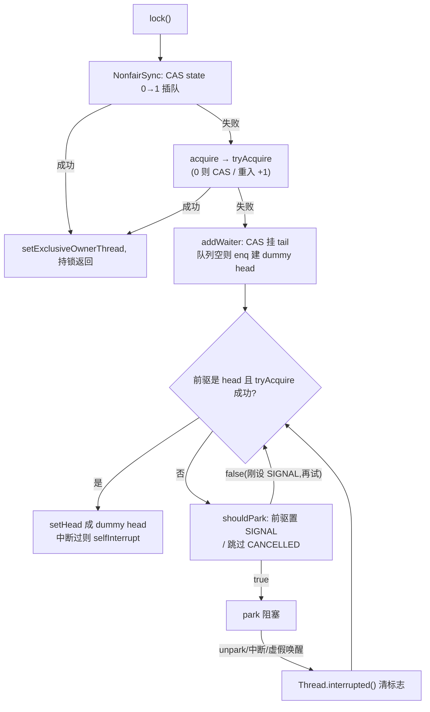
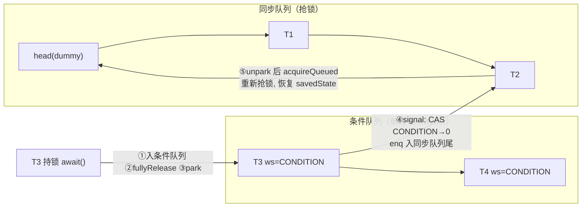

# AQS 与 Lock 家族

> 一句话概括：j.u.c 里几乎所有阻塞式同步器——ReentrantLock、ReadWriteLock、Semaphore、CountDownLatch、线程池 Worker——都站在同一个地基上：
> **AQS 用一个 volatile int state 表达"资源语义"，用一条 CLH 变体双向队列管理"等待与唤醒"，子类只需回答"当前状态允不允许获取"**；
> 本文以 JDK 8 源码为证据，拆开独占/共享链路、Condition 迁移、读写锁位拆分与 StampedLock 乐观读，讲清机制、边界与选型。

预计阅读时间：大约 90 分钟

所属主题：[Java 并发编程常见面试题总结](summary.md)

**版本基线**：以 **JDK 8（openjdk/jdk8u）** 为基线，源码片段均对照原文核验，锚点用 `类名#方法名`。JDK 9/11 VarHandle 替换、**JDK 17 起 AQS 整体重写**（JDK 17 GA 即新实现，见 9.5）、JDK 24 虚拟线程变化单独注明。LockSupport API 语义见 [thread-basics-and-lifecycle](thread-basics-and-lifecycle.md)，CAS 底层见 [cas-and-atomic-classes](cas-and-atomic-classes.md)，不复述。

---

## 0. 阅读路线

| 读者 | 建议阅读 | 关注点 |
| --- | --- | --- |
| 初级 | 1、2.1~2.2、3.1、5.1、5.7、6.1、7.1、7.3、速记 | Lock 用法、AQS 概念、Condition 与乐观读示例 |
| 中级 | 2、3、4，5.2~5.6、6.2~6.5、8.1 | 入队/阻塞/唤醒链路、共享传播、await/signal、锁降级 |
| 高级 | 3.5~3.7、4.3、5.3、6.3、7.5、8.2、9 | 中断/取消边界、PROPAGATE bug、中断陷阱、手写同步器、版本重写 |
| 选型 | 1.3、6.7、7.6、9.5~9.7 | 锁选型、虚拟线程友好度、场景表 |

目录：

1. 为什么需要显式锁
2. AQS 核心设计
3. 独占模式源码走读：ReentrantLock 非公平锁
4. 共享模式源码走读：传播与 CountDownLatch
5. Condition：条件队列的等待与迁移
6. ReentrantReadWriteLock
7. StampedLock：版本戳与乐观读
8. 手写一个 AQS 同步器
9. 边界与工程实践
10. 高频追问集
11. 参考资料
12. 附：一页速记

---

## 1. 为什么需要显式锁

### 1.1 synchronized 缺了什么

**结论**：synchronized 是"语法级"锁，JVM 负责加锁释放；但它把**等待策略**写死了。Lock 接口（JDK 5）把等待策略开放成 API，代价是释放锁的责任回到程序员手里。五个局限：

- **不可中断**：`interrupt()` 只置标志 → `lockInterruptibly()`；
- **无超时** → `tryLock(time, unit)` 支持降级；
- **非公平不可选** → `new ReentrantLock(true)`；
- **单一等待队列** → 多 `Condition` 精确唤醒（第 5 节）；
- **必须块结构** → lock/unlock 可跨方法（不推荐但可行）。

monitor 机制与锁升级见 [synchronized-and-lock-escalation](synchronized-and-lock-escalation.md)，本文只给选型结论。

### 1.2 Lock 接口 API 全景

6 个方法，差异全在"拿不到锁时怎么办"：

| 方法 | 拿不到锁时 | 响应中断 | 遵守公平设置 |
| --- | --- | --- | --- |
| `lock()` | 无限阻塞 | 否（拿到锁后补自我中断，见 3.5） | 是 |
| `lockInterruptibly()` | 无限阻塞 | **是**，抛 `InterruptedException` | 是 |
| `tryLock()` | **立即返回 false** | 否（不阻塞） | **否**，公平锁也插队（javadoc 明确） |
| `tryLock(time, unit)` | 限时阻塞，超时 false | 是 | 是 |
| `unlock()` | — | — | 必须在 finally |
| `newCondition()` | — | — | 创建绑定本锁的条件队列 |

两个易错细节（JDK 8 核验）：

- `tryLock()` 调 `nonfairTryAcquire`——**公平锁的无参 tryLock 也插队**。遵守公平用 `tryLock(0, SECONDS)`（查 hasQueuedPredecessors、感知中断）。
- `lock()` 中断"不响应但不吞掉"：拿到锁后 selfInterrupt 补标志（3.5）。

### 1.3 Lock vs synchronized 选型表

| 维度 | synchronized | ReentrantLock |
| --- | --- | --- |
| 层面 | JVM 关键字，monitorenter/monitorexit | 类库，AQS + CAS + LockSupport |
| 释放 | 自动（异常路径也释放） | **手动**，必须 finally，漏写即永久锁死 |
| 可中断/超时 | 都不支持 | lockInterruptibly / tryLock(time) |
| 公平性 | 不可选（非公平） | 可选，默认非公平 |
| 条件队列 | 1 个（wait/notify） | 多个 Condition，精确唤醒 |
| 读多写少 | 不支持 | 配合 ReadWriteLock/StampedLock |
| 虚拟线程 | **JDK 24 前**阻塞 pin 载体线程（JEP 491 修复） | 基于 park，不 pin（见 [virtual-threads](virtual-threads.md)） |
| 可观测/性能 | 靠 jstack；JDK 6 后低竞争与 Lock 相当 | isLocked/getHoldCount 等 API；高竞争手段更多 |

**口径**：普通临界区优先 synchronized（不会漏释放）；需要中断/超时/公平/多条件/读写分离，或 JDK 21~23 虚拟线程长阻塞时，用 Lock 家族。

### 1.4 最小示例

```java
ReentrantLock lock = new ReentrantLock();
lock.lock();                                       // 阻塞、不响应中断
try { count++; } finally { lock.unlock(); }
if (lock.tryLock(200, TimeUnit.MILLISECONDS)) {    // 超时降级
    try { count++; } finally { lock.unlock(); }
} else { /* 降级 */ }
lock.lockInterruptibly();                          // 等待中 interrupt 抛 IE
try { count++; } finally { lock.unlock(); }
```

**追问：tryLock() 和 tryLock(0, SECONDS) 的区别？**
期望答案：前者永远非公平插队、不感知中断；后者遵守公平设置（有人排队即 false）、入口检查中断可抛 IE。都不阻塞，但语义不同，javadoc 明确。

---

## 2. AQS 核心设计

### 2.1 AQS 是什么

**结论**：`AbstractQueuedSynchronizer`（JDK 5，Doug Lea）是**构建阻塞式同步器的框架**。固化三件事：① `volatile int state` + getState/setState/compareAndSetState；② CLH 变体双向队列（入队/park/unpark/取消）；③ acquire/release 等 final 骨架。子类只回答"**state 允不允许这次获取/释放**"——**模板方法模式**。类注释："Subclasses must define the protected methods that change this state... the other methods in this class carry out all queuing and blocking mechanics."

五个扩展点默认实现全是 `throw new UnsupportedOperationException()`（JDK 8 核验），子类必须覆写自己支持的模式：

| 扩展点 | 模式 | 返回值约定 |
| --- | --- | --- |
| `tryAcquire(int)` | 独占 | true 成功 / false 失败 |
| `tryRelease(int)` | 独占 | true 完全释放（可唤醒后继）/ false 还有剩余持有 |
| `tryAcquireShared(int)` | 共享 | **负数失败；0 成功但后继无需再试；正数成功且后继可能也能成功** |
| `tryReleaseShared(int)` | 共享 | true 允许唤醒后继 |
| `isHeldExclusively()` | 独占 | 当前线程是否独占持有，Condition 依赖它 |

### 2.2 state：一个 int，五种语义

state 语义完全由子类定义，AQS 只保证原子性与可见性——这是"一套骨架支撑半个 j.u.c"的关键抽象：

| 同步器 | state 语义 | 获取/释放 |
| --- | --- | --- |
| `ReentrantLock` | 重入次数（0=未锁） | CAS 0→1 或重入 +1；减到 0 才真正释放 |
| `Semaphore` | 剩余许可数 | CAS 减 n / 加 n（应用见 [concurrency-tools](concurrency-tools.md)） |
| `CountDownLatch` | 剩余计数 | await 只读（==0 通过）；countDown CAS 减 1，不可重置 |
| `ReentrantReadWriteLock` | **高 16 位读计数 + 低 16 位写重入** | 读 +65536，写 +1（第 6 节） |
| `ThreadPoolExecutor.Worker` | -1 未启动 / 0 未锁 / 1 锁定 | 不可重入互斥，保护任务执行（见 [thread-pool](thread-pool.md)） |

JDK 8 中 state 是 `private volatile int`，getState/setState 即 volatile 读写，compareAndSetState 走 Unsafe CAS——**锁的获取/释放天然构成 happens-before 边**（见 [jmm-and-volatile](jmm-and-volatile.md)）。JDK 8 用 `sun.misc.Unsafe`，9~11 换 VarHandle，17 换回 `jdk.internal.misc.Unsafe`（9.5）。另有 `AbstractQueuedLongSynchronizer`（JDK 6）：long 版同构。家族：ReentrantLock.Sync（独占）、RRWL.Sync（写独占+读共享）、Semaphore.Sync 与 CountDownLatch.Sync（共享）、ThreadPoolExecutor.Worker（独占不可重入）都继承 AQS；**StampedLock 不用 AQS**（第 7 节）。应用姿势归 [concurrency-tools](concurrency-tools.md)。

### 2.3 CLH 变体队列：为什么是"变体"

**结论**：原始 CLH（Craig、Landin、Hagersten）是**自旋锁**队列：线程在**前驱节点状态**上自旋。AQS 保留"控制信息放前驱"思想，三处改造（类注释归纳）：

| 改造 | 原始 CLH | AQS 变体 | 为什么 |
| --- | --- | --- | --- |
| 等待方式 | 前驱状态上自旋 | **park 阻塞**，前驱释放时 unpark | 持有时间长，自旋烧 CPU |
| `prev` | 不需要 | **显式 prev** | 取消后沿 prev 跳过失效前驱重挂 |
| `next` | 不需要 | **显式 next** | 释放者找后继 unpark；不可靠时 tail 反扫（3.6） |

```text
  ┌──────────────┐    ┌──────────────┐    ┌──────────────┐
  │ head (dummy) │◄───│   Node T1    │◄───│   Node T2    │◄── tail
  │ thread=null  │───►│ thread=T1    │───►│ thread=T2    │
  │ ws=-1        │    │ ws=-1        │    │ ws=0         │
  └──────────────┘    └──────────────┘    └──────────────┘
   prev 链 CAS 前设置，可靠；next 链 CAS 后设置，可能瞬时 null
```

两个细节（类注释核验）：**dummy head 惰性创建**——首次竞争入队时才 CAS 建 head 并令 tail=head（`enq`），无竞争零队列开销；**队列首位 ≠ 拿到锁**——head 后继只是"有权竞争"，tryAcquire 仍可能失败需重新 park。

### 2.4 Node 与 waitStatus

Node 字段：`volatile int waitStatus`、`volatile Node prev/next`、`volatile Thread thread`、`Node nextWaiter`（条件队列后继，在同步队列里复用为模式标记）；`SHARED = new Node()`、`EXCLUSIVE = null`。waitStatus 五个取值（**已核验**）：

| 值 | 常量 | 语义 | 谁设置 |
| --- | --- | --- | --- |
| 1 | `CANCELLED` | 超时/中断取消，**永不离开** | `cancelAcquire` |
| -1 | `SIGNAL` | **释放/取消时必须 unpark 后继** | 后继在 shouldPark 中 CAS 设置 |
| -2 | `CONDITION` | 在**条件队列**；signal 转移置 0 | `addConditionWaiter` |
| -3 | `PROPAGATE` | 下次 releaseShared 必须传播（仅 head） | `doReleaseShared`（4.3） |
| 0 | — | 初始（条件节点初始 CONDITION） | 构造时 |

**符号技巧**：注释明说"Non-negative values mean that a node doesn't need to signal"——代码多写 `ws > 0`（取消）、`ws < 0`（需信号，含 SIGNAL/PROPAGATE）。**版本注意**：这是 JDK 8~11 实现；JDK 17 重写为 status 位标志（WAITING=1、COND=2、CANCELLED=0x80000000），无 PROPAGATE（9.5）。答数值先声明版本。

### 2.5 独占 vs 共享

两模式**共用一条 FIFO 队列**，区别在"获取成功后要不要叫醒后继"：独占一个持有者，至多 unpark 一个后继；共享可同时持有，获取成功后**资源有剩余则传播唤醒后续共享节点**（`setHeadAndPropagate`）。ReadWriteLock 混用：写独占、读共享，**同队列混排**。

**追问：AQS 为什么不实现 Lock 接口？**
期望答案：AQS 是**组件而非完整锁**——不定义 state 语义、不承诺可重入/公平性，只导出骨架供子类组装（类注释建议 non-public internal helper classes）。业务不该直接继承，框架作者才需要（8、9 节）。

---

## 3. 独占模式源码走读：ReentrantLock 非公平锁全链路

本节以 `new ReentrantLock()`（非公平）为例拆开 lock() 到 unlock()。代码对照 JDK 8 `ReentrantLock.java` 与 `AbstractQueuedSynchronizer.java` 核验。

### 3.1 全链路总览



`AQS#acquire` 本体三行，短路顺序即执行顺序：

```java
public final void acquire(int arg) {
    if (!tryAcquire(arg) &&
        acquireQueued(addWaiter(Node.EXCLUSIVE), arg))
        selfInterrupt();
}
```

### 3.2 NonfairSync#lock：先插队，再排队

```java
// ReentrantLock.NonfairSync（JDK 8）
final void lock() {
    if (compareAndSetState(0, 1))                 // ① 不管队列，先裸 CAS 抢一次
        setExclusiveOwnerThread(Thread.currentThread());
    else
        acquire(1);                               // ② 失败才走标准 acquire
}
// ReentrantLock.Sync#nonfairTryAcquire（JDK 8）
final boolean nonfairTryAcquire(int acquires) {
    final Thread current = Thread.currentThread();
    int c = getState();
    if (c == 0) {
        if (compareAndSetState(0, acquires)) {    // 锁空闲：CAS 抢，不看队列
            setExclusiveOwnerThread(current);
            return true;
        }
    } else if (current == getExclusiveOwnerThread()) {  // 重入：无需 CAS
        int nextc = c + acquires;
        if (nextc < 0) throw new Error("Maximum lock count exceeded");
        setState(nextc);                          // 上限 2147483647 次
        return true;
    }
    return false;
}
```

三个要点：① **非公平 = 两次插队**（入口裸 CAS + state==0 CAS，不看队列）；② **重入免 CAS**（已独占持有）；③ **owner 在父类** `AbstractOwnableSynchronizer`（JDK 6），普通字段不加同步，支撑可重入与归属校验。

### 3.3 addWaiter / enq：入队的原子性边界

```java
// AQS#addWaiter（JDK 8）：快速路径 = ① node.prev=tail ② CAS tail ③ pred.next=node
// 快速路径失败或队列未初始化时走 enq 自旋兜底：
// AQS#enq（JDK 8）
private Node enq(final Node node) {
    for (;;) {
        Node t = tail;
        if (t == null) {                     // 首次竞争：CAS 建 dummy head
            if (compareAndSetHead(new Node()))
                tail = head;
        } else {
            node.prev = t;
            if (compareAndSetTail(t, node)) { t.next = node; return t; }
        }
    }
}
```

**关键认知：入队原子分界点是 `compareAndSetTail`，prev 与 next 被劈成两半**——prev 在 CAS 前（可靠），next 在 CAS 后（可能没写）。**prev 反扫永远可靠，next 正扫可能 null**，这是 3.6 从 tail 找人的根因（`Node.next` 注释明示）。

### 3.4 acquireQueued：自旋与阻塞

```java
// AQS#acquireQueued（JDK 8）
final boolean acquireQueued(final Node node, int arg) {
    boolean failed = true;
    try {
        boolean interrupted = false;
        for (;;) {
            final Node p = node.predecessor();
            if (p == head && tryAcquire(arg)) {   // 只有队首有资格再试
                setHead(node);                    // 自己变 dummy head
                p.next = null;                    // help GC
                failed = false;
                return interrupted;
            }
            if (shouldParkAfterFailedAcquire(p, node) &&
                parkAndCheckInterrupt())
                interrupted = true;               // 中断唤醒：记下，继续抢
        }
    } finally { if (failed) cancelAcquire(node); }
}
// AQS#shouldParkAfterFailedAcquire（JDK 8）
private static boolean shouldParkAfterFailedAcquire(Node pred, Node node) {
    int ws = pred.waitStatus;
    if (ws == Node.SIGNAL)
        return true;                       // 前驱已承诺唤醒 → 安心 park
    if (ws > 0) {                          // 前驱已取消：沿 prev 跳过
        do {
            node.prev = pred = pred.prev;
        } while (pred.waitStatus > 0);
        pred.next = node;
    } else {                               // 0 或 PROPAGATE：置 SIGNAL，先不 park
        compareAndSetWaitStatus(pred, ws, Node.SIGNAL);
    }
    return false;                          // 外层再循环一次
}
```

逐条拆解：

- **只有 `p == head` 才 tryAcquire**：head 是哑节点，其直接后继是队首；非队首 CAS 会破坏 FIFO。插队只在入口和队首。
- **设完 SIGNAL 返回 false**：防漏唤醒——置 SIGNAL 前持有者可能已释放且见 ws==0 没唤醒任何人，直接 park 会睡死；强制**再试一次**确认后才 park（注释："retry to make sure it cannot acquire before parking"）。
- **跳过 CANCELLED 前驱**：ws=1 永不恢复，沿 prev 找有效前驱重挂。
- **setHead**：`head=node; node.thread=null; node.prev=null;`——**线程持有的是 state，节点只是排队凭证**。

### 3.5 中断与超时：三种等待姿势

阻塞点 `parkAndCheckInterrupt`：`LockSupport.park(this); return Thread.interrupted();`（返回并**清除**标志）。park 返回有三种原因：unpark、interrupt、虚假唤醒，AQS 不区分，统一回循环重试——**唤醒只是获得一次竞争机会，不是获得锁**。

| 模式 | 入口 | 等待中被中断 | 节点下场 |
| --- | --- | --- | --- |
| `acquire`（lock） | 不检查 | 清标志记录，**继续抢**；成功后 selfInterrupt | 正常出队 |
| `acquireInterruptibly` | 已中断直接抛 IE | **立即抛 IE** | cancelAcquire 脱链 |
| `tryAcquireNanos` | 同上 | 抛 IE | 超时 false，同样取消 |

`doAcquireNanos` 两个细节（源码核验）：**绝对 deadline**（每轮重算剩余）防虚假唤醒拉长时间；剩余 ≤ `spinForTimeoutThreshold`（**1000ns**）时自旋而不 parkNanos。

**追问：lock() 被中断后为什么补 selfInterrupt？**
期望答案：acquire 契约是"不响应但不丢失中断"。等待中已清标志，不补则上层取消逻辑（如 shutdownNow 后的检查）失效；拿到锁后重新置位，把"是否响应"交还业务代码。

### 3.6 release 与 unparkSuccessor：为什么从 tail 往前找人

```java
// AQS#release（JDK 8）：tryRelease 返回 true（完全释放）且 head.waitStatus!=0
// 时调 unparkSuccessor(head)；否则不唤醒。
// ReentrantLock.Sync#tryRelease（JDK 8）
protected final boolean tryRelease(int releases) {
    int c = getState() - releases;
    if (Thread.currentThread() != getExclusiveOwnerThread())
        throw new IllegalMonitorStateException();   // 非持有者 unlock → IMSE
    boolean free = (c == 0);                        // 重入减到 0 才真正释放
    if (free) setExclusiveOwnerThread(null);
    setState(c);
    return free;
}
// AQS#unparkSuccessor（JDK 8）
private void unparkSuccessor(Node node) {
    int ws = node.waitStatus;
    if (ws < 0)
        compareAndSetWaitStatus(node, ws, 0);
    Node s = node.next;
    if (s == null || s.waitStatus > 0) {        // next 不可靠或已取消
        s = null;
        for (Node t = tail; t != null && t != node; t = t.prev)
            if (t.waitStatus <= 0)
                s = t;                          // 停在最靠前有效节点
    }
    if (s != null)
        LockSupport.unpark(s.thread);
}
```

**重入 3 次就要 unlock 3 次**，前两次返回 false 不唤醒。**为什么从 tail 往前遍历？**① next 在 CAS tail **之后**设置，有 null 窗口，正扫会漏唤醒；② prev 在 CAS **之前**设置，**反向遍历是唯一可靠的链**；③ `s = t` 覆盖停在离 head 最近的有效节点，保证 FIFO。常规 O(1)，异常才 O(n) 反扫。

### 3.7 cancelAcquire：取消的清理成本

中断/超时退出时 finally 调 `cancelAcquire(node)`：置 CANCELLED、跳过取消前驱、摘链或回退 tail，中部摘链失败则 unpark 后继自己重挂。**取消不是 O(1)**，大量短超时 tryLock 制造大量 CANCELLED 节点。JDK 17 用 `cleanQueue()` 批量 unlink（9.5），2026 年曝出短超时 livelock（JDK-8386085，影响 17/21/25，已修复）——**"取消很便宜"是错觉**。

### 3.8 公平锁：hasQueuedPredecessors 一票否决

```java
// ReentrantLock.FairSync（JDK 8）：lock() 直接 acquire(1)，无入口裸 CAS
protected final boolean tryAcquire(int acquires) {
    final Thread current = Thread.currentThread();
    int c = getState();
    if (c == 0) {
        if (!hasQueuedPredecessors() &&         // 唯一差异：有人排队就不抢
            compareAndSetState(0, acquires)) {
            setExclusiveOwnerThread(current);
            return true;
        }
    } else if (current == getExclusiveOwnerThread()) { /* 重入同非公平 */ }
    return false;
}
// AQS#hasQueuedPredecessors（JDK 8，JDK 7 引入）
public final boolean hasQueuedPredecessors() {
    Node t = tail;                         // 逆初始化序读：先 tail 后 head
    Node h = head;
    Node s;
    return h != t &&                       // 队列非空
        ((s = h.next) == null ||           // 正在入队（next 未写）→ 有人在前
         s.thread != Thread.currentThread()); // 队首不是自己
}
```

返回 true 两种情形：队首不是自己；或 `h.next==null` 但 `h!=t`（正在入队）。先读 tail 后读 head 配合 enq 初始化序避免误判。**公平只保证获取顺序近似 FIFO**，不保证调度公平（javadoc）。

### 3.9 公平 vs 非公平：吞吐差异的机制

**结论**：默认非公平。javadoc 原话（核验）："Programs using fair locks accessed by many threads may display lower overall throughput (i.e., are slower; often much slower)... but have smaller variances in times to obtain locks and guarantee lack of starvation."

机制差在**唤醒延迟窗口**：T0 释放 → unpark 队首 T1（调度需微秒~毫秒）→ 路过的 T2 窗口内 CAS 抢锁 → T1 醒来锁又被拿走，重新 park（白白的上下文切换）。非公平让 T2 立即执行、缓存还热，**上下文切换显著减少**，吞吐高；代价是可能饥饿。公平锁串行等队首醒来，吞吐低但无饥饿、可预测。

**实践口径**：绝大多数业务默认非公平；等待时间必须有界/可预测才用公平锁。synchronized 无公平选项，这也是换 Lock 的场景之一。

**追问：非公平锁的插队发生在哪几个位置？**
期望答案：两处——NonfairSync#lock 入口裸 CAS（连 acquire 都不进）、nonfairTryAcquire 中 state==0 的 CAS（不看队列）。队列中部不插队，只有队首有资格 tryAcquire；公平锁在这两处都加 hasQueuedPredecessors。

---

## 4. 共享模式源码走读

### 4.1 tryAcquireShared 返回值协议

共享模式精髓在返回值——它同时告诉框架"**后继要不要继续试**"：负数=失败；0=成功但资源耗尽，后继不必再试；正数=成功且可能有剩余，**应传播唤醒后继共享节点**（CountDownLatch 归零返回 1 放行所有人；Semaphore 返回剩余许可数）。

### 4.2 doAcquireShared：与独占只差两处

```java
// AQS#doAcquireShared（JDK 8，节选；入队/SIGNAL/park/取消与独占同构）
final Node node = addWaiter(Node.SHARED);      // 差异①：共享标记入队
for (;;) {
    final Node p = node.predecessor();
    if (p == head) {
        int r = tryAcquireShared(arg);
        if (r >= 0) {                          // 差异②：>=0 即成功
            setHeadAndPropagate(node, r);      // 成功后可能级联唤醒
            p.next = null;
            return;                            // 中断过则 selfInterrupt（略）
        }
    }
    if (shouldParkAfterFailedAcquire(p, node) && parkAndCheckInterrupt())
        interrupted = true;
}
```

### 4.3 setHeadAndPropagate 与 PROPAGATE：一个真实的漏唤醒 bug

```java
// AQS#setHeadAndPropagate（JDK 8）
private void setHeadAndPropagate(Node node, int propagate) {
    Node h = head;                       // 旧 head
    setHead(node);
    if (propagate > 0 || h == null || h.waitStatus < 0 ||
        (h = head) == null || h.waitStatus < 0) {   // 再读新 head
        Node s = node.next;
        if (s == null || s.isShared())
            doReleaseShared();
    }
}
// AQS#doReleaseShared（JDK 8）
private void doReleaseShared() {
    for (;;) {
        Node h = head;
        if (h != null && h != tail) {
            int ws = h.waitStatus;
            if (ws == Node.SIGNAL) {
                if (!compareAndSetWaitStatus(h, Node.SIGNAL, 0))
                    continue;            // 并发修改，重查
                unparkSuccessor(h);
            }
            else if (ws == 0 &&
                     !compareAndSetWaitStatus(h, 0, Node.PROPAGATE))
                continue;                // 置 PROPAGATE 留记号
        }
        if (h == head)                   // head 变了则重查
            break;
    }
}
```

**为什么需要 PROPAGATE？** 修真实 bug：**JDK-6801020**（Semaphore 并发 release 漏唤醒，影响 6u11/6u17，**修复进 JDK 7**，changeset "Introduce PROPAGATE waitStatus"，回迁 6u21；JDK 8 已含）。时序（Semaphore 初始 0，T1/T2 acquire，T3/T4 release）：

```text
T3 release → state=1，但 head.ws==0（T1 还在 doAcquireShared 里）→ 不 unpark
T1 拿走许可，propagate 计算时 state 已被交错消耗 → propagate==0 → 不传播
T4 release 同样见 ws==0 → 不 unpark
结果：state 有许可，T2 永远 park —— 漏唤醒
```

修复两手：① doReleaseShared 见 head 为 0 时 **CAS 置 PROPAGATE(-3)** 留记号；② setHeadAndPropagate 还检查**旧 head 与新 head 的 waitStatus<0**（符号覆盖 SIGNAL/PROPAGATE），第二次读 head 捕捉 setHead 之后并发 release 的记号。注释承认"may cause unnecessary wake-ups"——**宁可多唤醒，不可漏唤醒**。

### 4.4 CountDownLatch：最小共享同步器全链路

Sync 只有两个方法（JDK 8 全文核验）：

```java
private static final class Sync extends AbstractQueuedSynchronizer {
    Sync(int count) { setState(count); }           // state = 计数
    protected int tryAcquireShared(int acquires) {
        return (getState() == 0) ? 1 : -1;         // 归零返回 1 → 传播唤醒所有人
    }
    protected boolean tryReleaseShared(int releases) {
        for (;;) {
            int c = getState();
            if (c == 0) return false;              // 多余 countDown 无效
            if (compareAndSetState(c, c - 1))
                return c - 1 == 0;                 // 只有最后一次返回 true
        }
    }
}
```

公开方法一行转发：`await()` → `acquireSharedInterruptibly(1)`；`await(time,unit)` → `tryAcquireSharedNanos`；`countDown()` → `releaseShared(1)`；`getCount()` 读 state。

时序：3 线程 await（state=3，全 park）→ countDown 两次（state=1，返回 false，**不唤醒**）→ 第三次（state=0，返回 true）→ unpark 队首 → tryAcquireShared 返回 1 → setHeadAndPropagate 级联 → **放行所有等待者**。边界：计数**不可重置**（循环用 CyclicBarrier）；await 中断抛 IE 但不影响计数。应用见 [concurrency-tools](concurrency-tools.md)。

### 4.5 Semaphore：同一骨架的另一种语义

Semaphore.Sync 的 state 是许可数：tryAcquireShared CAS 减 n、返回**剩余许可**（>0 传播）；tryReleaseShared CAS 加 n、恒 true。**与 CountDownLatch 只差 state 语义与返回值**——"一个 int 五种语义"的实证。

**追问：共享为何可能"多唤醒"？代价？**
期望答案：PROPAGATE 与双重 head 检查保守，宁可多叫；多醒的线程失败后重新 park，代价一次无效切换，换来绝不漏唤醒。

---

## 5. Condition：条件队列的等待与迁移

### 5.1 为什么需要多条件队列

**结论**：wait/notify 单 wait set、随机唤醒，**无法区分等待条件**。`ArrayBlockingQueue` 生产者等 notFull、消费者等 notEmpty，共用队列时 notify 可能叫错人。ReentrantLock + 两个 Condition 精确解决（ArrayBlockingQueue 正是如此）：put 满 `notFull.await()`、入队 `notEmpty.signal()`；take 反之。见 [concurrent-collections](concurrent-collections.md)。

### 5.2 条件队列结构：单向、无 CAS

`ConditionObject`（AQS 内部类）维护**单向链表**：firstWaiter/lastWaiter，节点用 `nextWaiter` 串联，初始 CONDITION(-2)。**不用 CAS**：类注释"are only accessed when exclusively held"——持锁访问天然串行化。**Node 由 waitStatus 区分在哪个队列**，signal 转移时置 0。

### 5.3 await：释放全部锁 → 条件队列 park → 重新抢锁

```java
// ConditionObject#await（JDK 8）
public final void await() throws InterruptedException {
    if (Thread.interrupted()) throw new InterruptedException();
    Node node = addConditionWaiter();          // ① 入条件队列
    int savedState = fullyRelease(node);       // ② 释放全部 state，存重入次数
    int interruptMode = 0;
    while (!isOnSyncQueue(node)) {             // ③ 未被 signal 转移？继续睡
        LockSupport.park(this);
        if ((interruptMode = checkInterruptWhileWaiting(node)) != 0)
            break;
    }
    if (acquireQueued(node, savedState) &&     // ④ 重新抢锁，恢复重入
        interruptMode != THROW_IE)
        interruptMode = REINTERRUPT;
    if (node.nextWaiter != null) unlinkCancelledWaiters();  // ⑤ 清理
    if (interruptMode != 0)
        reportInterruptAfterWait(interruptMode); // ⑥ 抛 IE 或补标志
}
// AQS#fullyRelease（JDK 8）
final int fullyRelease(Node node) {
    boolean failed = true;
    try {
        int savedState = getState();
        if (release(savedState)) {             // 一次性释放全部重入次数！
            failed = false;
            return savedState;
        } else throw new IllegalMonitorStateException();
    } finally {
        if (failed) node.waitStatus = Node.CANCELLED;  // 没持锁 → 作废
    }
}
```

四个关键认知：① **fullyRelease 释放全部重入**——重入 3 次则 state 归 0、owner 清空，savedState=3 保存，唤醒后 `acquireQueued(node, 3)` 恢复；只释放 1 次则永远等不到锁。② **await 期间离开同步队列**。③ **isOnSyncQueue**：CONDITION 或 prev==null → 还在条件队列；有 next → 在同步队列；否则 tail 反扫。④ **被唤醒 ≠ 拿到锁**，要走完整 acquireQueued——**await 必须 while**。



### 5.4 signal：只是移动节点，不是移交锁

```java
// ConditionObject#signal（JDK 8）
public final void signal() {
    if (!isHeldExclusively())                  // 必须持有锁！
        throw new IllegalMonitorStateException();
    Node first = firstWaiter;
    if (first != null) doSignal(first);        // 转移失败(已取消)则试下一个
}
// AQS#transferForSignal（JDK 8）
final boolean transferForSignal(Node node) {
    if (!compareAndSetWaitStatus(node, Node.CONDITION, 0))
        return false;                          // 节点已被中断取消
    Node p = enq(node);                        // 入同步队列尾
    int ws = p.waitStatus;
    if (ws > 0 || !compareAndSetWaitStatus(p, ws, Node.SIGNAL))
        LockSupport.unpark(node.thread);       // 前驱取消 → 立即叫醒自己重挂
    return true;
}
```

**关键认知（面试分水岭）**：signal 全部动作——首节点 CAS 置 0、搬进同步队列尾、必要时设 SIGNAL 或 unpark。**不释放锁、不移交锁**。调用者持锁到 unlock；被唤醒线程还要重新竞争，signal 后 unlock 前醒来也拿不到锁。`signalAll()` 逐个转移后按 FIFO 抢锁。

### 5.5 await/signal 必须在锁内：两种校验路径

signal/signalAll **显式**检查 isHeldExclusively，不满足抛 IMSE；await 经 `fullyRelease → tryRelease` 校验 owner，不是则抛 IMSE 且节点作废——**没持锁就 await 必然抛异常**。与 wait/notify 必须 synchronized 同一纪律：检查与等待之间不能有竞态。

### 5.6 中断语义与变体

await 的中断比 lock 精细：checkInterruptWhileWaiting 区分**中断在 signal 前还是后**——前（THROW_IE）：自行转移出条件队列，抢锁后**抛 IE**；后（REINTERRUPT）：正常获取后 selfInterrupt 补标志。

| 方法 | 中断 | 超时 | 返回 |
| --- | --- | --- | --- |
| `await()` | 抛 IE/补标志（按时机） | 无 | void |
| `awaitUninterruptibly()` | **不抛**，最后 selfInterrupt | 无 | void |
| `awaitNanos(long)` | 同 await | deadline；<1000ns 自旋 | **剩余纳秒**（可负） |
| `await(long, TimeUnit)` | 同 await | 有 | boolean |
| `awaitUntil(Date)` | 同 await | 绝对时间 parkUntil | boolean |

### 5.7 signal vs notify 对比

| 维度 | Object#notify/notifyAll | Condition#signal/signalAll |
| --- | --- | --- |
| 等待队列 | 每 monitor 1 个 | 每 Lock 多个，按条件分组 |
| 唤醒精度 | 随机，无法指定条件 | 指定条件队列首节点（FIFO） |
| 锁依赖 | synchronized | 持有对应 Lock |
| 中断/超时 | wait(timeout)，中断一律抛 IE | 多变体，时机语义更细 |
| 实现层 | JVM monitor | AQS ConditionObject + 队列迁移 |

### 5.8 完整示例：两个 Condition 实现有界缓冲

ArrayBlockingQueue 的最小内核（JDK 8+；两线程分别循环 put/take 即可验证）：

```java
import java.util.concurrent.locks.*;

public class BoundedBuffer<E> {
    private final Object[] items;
    private int putIdx, takeIdx, count;
    private final ReentrantLock lock = new ReentrantLock();
    private final Condition notFull  = lock.newCondition();  // 生产者等这个
    private final Condition notEmpty = lock.newCondition();  // 消费者等这个
    public BoundedBuffer(int capacity) { items = new Object[capacity]; }

    public void put(E e) throws InterruptedException {
        lock.lock();
        try {
            while (count == items.length) notFull.await();  // while 防虚假唤醒
            items[putIdx] = e;
            if (++putIdx == items.length) putIdx = 0;
            count++;
            notEmpty.signal();              // 精确叫醒一个消费者
        } finally { lock.unlock(); }
    }
    @SuppressWarnings("unchecked")
    public E take() throws InterruptedException {
        lock.lock();
        try {
            while (count == 0) notEmpty.await();
            E e = (E) items[takeIdx];
            items[takeIdx] = null;
            if (++takeIdx == items.length) takeIdx = 0;
            count--;
            notFull.signal();               // 精确叫醒一个生产者
            return e;
        } finally { lock.unlock(); }
    }
}
```

若换成一个 Condition（或 wait/notify），容量满时生产者 signal 可能叫醒另一个生产者，消费者继续睡——正是 5.1 的唤醒精度问题。

**追问：await 为何释放全部重入？signal 后立刻执行？**
期望答案：① 只释放 1 次锁仍被自己持有，条件无法改变，死等；存 savedState 唤醒后恢复。② 不能，signal 只搬节点，要等 unlock 后竞争成功，while 重查。

---

## 6. ReentrantReadWriteLock：一个 int 拆出读写两把锁

### 6.1 state 位拆分：高读低写

**结论**：读写锁没有用两个 AQS，而是**一个 Sync 同时实现独占（写）与共享（读）两套 try 方法**，把 32 位 state 按位拆成两个计数器（JDK 8 `Sync` 源码核验）：

```java
static final int SHARED_SHIFT   = 16;
static final int SHARED_UNIT    = (1 << SHARED_SHIFT);      // 65536，读步长
static final int MAX_COUNT      = (1 << SHARED_SHIFT) - 1;  // 65535
static final int EXCLUSIVE_MASK = (1 << SHARED_SHIFT) - 1;  // 0xFFFF
static int sharedCount(int c)    { return c >>> SHARED_SHIFT; }  // 高 16=读总数
static int exclusiveCount(int c) { return c & EXCLUSIVE_MASK; }  // 低 16=写重入
```

```text
 31                16 15                 0
┌────────────────────┬────────────────────┐
│   读锁持有总数      │   写锁重入次数      │  读 +65536 / 写 +1，各上限 65535
└────────────────────┴────────────────────┘
```

互斥规则：**读读共享**、**读写互斥、写写互斥**。读计数是**所有线程的读持有总和**（含重入），不是线程数。

### 6.2 写锁：Sync#tryAcquire

```java
// ReentrantReadWriteLock.Sync#tryAcquire（JDK 8，写锁走独占模式）
protected final boolean tryAcquire(int acquires) {
    Thread current = Thread.currentThread();
    int c = getState();
    int w = exclusiveCount(c);
    if (c != 0) {
        // w==0 → 有读者；owner 非自己 → 有别的写者
        if (w == 0 || current != getExclusiveOwnerThread()) return false;
        if (w + exclusiveCount(acquires) > MAX_COUNT)
            throw new Error("Maximum lock count exceeded");
        setState(c + acquires);              // 写重入
        return true;
    }
    if (writerShouldBlock() || !compareAndSetState(c, c + acquires))
        return false;
    setExclusiveOwnerThread(current);
    return true;
}
```

要点：`c != 0` 时**有任何读者（w==0）或写者非自己，写获取直接失败**——写与一切互斥。tryRelease 减到低 16 位为 0 才清 owner 返回 true；state==0 才可能放行等待者。

### 6.3 读锁：tryAcquireShared 与 per-thread 读计数

```java
// ReentrantReadWriteLock.Sync#tryAcquireShared（JDK 8，快速路径）
protected final int tryAcquireShared(int unused) {
    Thread current = Thread.currentThread();
    int c = getState();
    if (exclusiveCount(c) != 0 && getExclusiveOwnerThread() != current)
        return -1;                           // 写锁被他人持有 → 失败
    int r = sharedCount(c);
    if (!readerShouldBlock() && r < MAX_COUNT &&
        compareAndSetState(c, c + SHARED_UNIT)) {
        /* 记录 per-thread 持有数：firstReader / cachedHoldCounter / readHolds */
        return 1;
    }
    return fullTryAcquireShared(current);    // CAS 失败/重入/被策略挡 → 重试版
}
```

**为什么读锁要 per-thread 计数？** 高 16 位只有总数，而①unlock 校验归属、②公平模式**重入读豁免排队**（`rh.count==0` 才返回 -1）、③降级判断都需要每线程次数。JDK 8 三层缓存：

| 字段 | 类型 | 作用 |
| --- | --- | --- |
| `firstReader`/`firstReaderHoldCount` | Thread/int | 第一个把读计数 0→1 且未释放的线程——**无竞争读快路径**，不碰 ThreadLocal |
| `cachedHoldCounter` | HoldCounter | 最近获取读锁的线程计数器（良性数据竞争），命中免查 ThreadLocal |
| `readHolds` | `ThreadLocalHoldCounter` | 每线程 HoldCounter{count, tid}，**tid 用 id 非引用避免垃圾滞留**；归 0 remove |

tryReleaseShared 先减 per-thread 计数（count<=0 抛 IMSE），再 CAS 减 SHARED_UNIT，**state==0 才返回 true**。JDK 17 核验结构**不变**，仅 tid 改用 `LockSupport.getThreadId`；"JDK 11 重构读计数"未证实，不采信。

### 6.4 公平性策略：读优先还是写优先？

公平性不是简单排队，而是**读/写两个 ShouldBlock 策略**（JDK 8 核验）：

```java
// 非公平（默认）
final boolean writerShouldBlock() { return false; }          // 写者永远可插队
final boolean readerShouldBlock() {
    return apparentlyFirstQueuedIsExclusive();               // 启发式：队首是写者则新读者让路
}
// 公平
final boolean writerShouldBlock() { return hasQueuedPredecessors(); }
final boolean readerShouldBlock() { return hasQueuedPredecessors(); }
```

精确口径（对照类 javadoc）：

- **非公平（默认）**：不保证顺序，"may indefinitely postpone one or more reader or writer threads"。readerShouldBlock 启发式（队首是等待写者时新读者阻塞）**缓解写者饥饿**，但只是概率性。
- **公平**：近似到达顺序；**新读者遇写者在等必须排队**，写者优先于其后读者，代价是读吞吐下降。
- 两种模式 `tryLock()` 都**不遵守公平设置**（barging in both modes）。

**追问：非公平读写锁里写者会不会饿死？**
期望答案：JDK 8 用 apparentlyFirstQueuedIsExclusive 启发式让新读者给队首写者让路，大幅降低但不消除写饥饿（javadoc 明说可能无限推迟读或写）。严格无饥饿用公平模式，或换 StampedLock 并控制读临界区长度。

### 6.5 锁降级：支持；锁升级：死锁

**结论**：持写锁 → 获取读锁 → 释放写锁，是官方支持的**锁降级**（javadoc："a writer can acquire the read lock, but not vice-versa"）；反向读升写**永远不可能成功**（"If a reader tries to acquire the write lock it will never succeed"）。

```java
rwLock.writeLock().lock();
try {
    data = loadFromDb();          // 写阶段
    rwLock.readLock().lock();     // ① 持写锁时获取读锁（允许！）
} finally {
    rwLock.writeLock().unlock();  // ② 释放写锁，仍持读锁
}
try { use(data); }                // ③ 读阶段：读者可并发，写者被挡
finally { rwLock.readLock().unlock(); }
```

**降级价值是可见性连续**：先读后写保证"自己写的数据自己接着读"不被插入；fullTryAcquireShared 对"写锁被**自己**持有"放行（注释：blocking here would cause deadlock）。**升级必死锁**：两线程各持读锁申请写锁，互等读计数归零——读写语义必然。"读后按需写"用 tryConvertToWriteLock（7.4）。

### 6.6 边界与代价

- **Condition 仅写锁支持**：readLock().newCondition() 抛 UOE（javadoc 核验）。
- **上限 65535**：读总数与写重入各自上限，超出抛 Error。
- **读读并行隐性成本**：所有读者 CAS 同一 state 高 16 位，缓存行乒乓——"读锁无竞争"是错觉。读极短时 StampedLock 乐观读更优。

### 6.7 选型

读多写少、要重入/Condition/降级 → RRWL；读远多于写、读极短、容忍不可重入 → StampedLock 乐观读（第 7 节）；读写都频繁 → synchronized/ReentrantLock；要升级 → tryConvertToWriteLock。场景表见 9.7。

**追问：读锁为何记录每线程次数？**
期望答案：总数无法支持重入校验、公平豁免、降级判断；三级缓存压低常见路径开销。

---

## 7. StampedLock：版本戳与乐观读

### 7.1 三种模式与定位

**结论**：StampedLock（JDK 8 引入）是**能力锁**：获取返回 `long stamp`（版本戳+模式凭证），释放/转换必须凭 stamp。**不实现 Lock/ReadWriteLock 接口**（可经 asReadLock()/asWriteLock()/asReadWriteLock() 获得视图），**也不基于 AQS**——自研 CLH 变体队列（WNode，含 cowait 读者组链）。

| 模式 | 获取 | 互斥性 | 释放 |
| --- | --- | --- | --- |
| 写锁 | writeLock() / tryWriteLock() | 与一切互斥 | unlockWrite(stamp) |
| 悲观读 | readLock() / tryReadLock() | 读读共享，与写互斥 | unlockRead(stamp) |
| **乐观读** | tryOptimisticRead() | **无互斥**，写者随时可进入 | 无需释放，validate(stamp) 校验 |

javadoc 定性：乐观读是"an extremely weak version of a read-lock, that can be broken by a writer at any time"——**乐观读不是锁**，是"读版本戳、读完再验"的 seqlock 思路。

### 7.2 stamp 与 state 结构

JDK 8 常量（核验）：`LG_READERS=7`、`WBIT=1L<<7`（写标记）、`RBITS=WBIT-1`（低 7 位读掩码）、`RFULL=126`（溢出阈值）、`SBITS=~RBITS`（版本位）、`ORIGIN=WBIT<<1`（**256，避开 stamp=0**）。结构：**低 7 位读计数 + 写位 + 高位版本号**；写释放推进版本；读者超 126 用 `readerOverflow`。**0 = 失败/无效**，try 方法失败返回 0。

### 7.3 乐观读完整示例

javadoc 官方 Point 示例（核验原文，可直接运行）：

```java
class Point {
    private double x, y;
    private final StampedLock sl = new StampedLock();

    void move(double deltaX, double deltaY) {        // 写：独占
        long stamp = sl.writeLock();
        try { x += deltaX; y += deltaY; }
        finally { sl.unlockWrite(stamp); }
    }
    double distanceFromOrigin() {                    // 乐观读 + 失败升级悲观读
        long stamp = sl.tryOptimisticRead();         // ① 拿版本戳，不加锁
        double currentX = x, currentY = y;           // ② 只读到局部变量！
        if (!sl.validate(stamp)) {                   // ③ 期间有写者？
            stamp = sl.readLock();                   // ④ 升级悲观读重读
            try { currentX = x; currentY = y; }
            finally { sl.unlockRead(stamp); }
        }
        return Math.sqrt(currentX * currentX + currentY * currentY);
    }
}
```

纪律（javadoc）："only read fields and hold them in local variables for later use after validation"——**只读到局部变量，validate 后才用**；期间可能"wildly inconsistent"。validate 先 `U.loadFence()` 再比版本。**收益**：乐观读**不 CAS、不入队、不 park**，失败才退化悲观读——吞吐高于读写锁的根源（后者每读者都 CAS）。

### 7.4 模式转换：tryConvertTo*

| 方法 | 语义（javadoc 核验） | 失败返回 |
| --- | --- | --- |
| `tryConvertToWriteLock(stamp)` | 已写锁→原样；读锁→**无其他读者时**换写；乐观读→立即可用才转 | 0 |
| `tryConvertToReadLock(stamp)` | 写锁→换读；读锁→原样；乐观读→立即可用才获取 | 0 |
| `tryConvertToOptimisticRead(stamp)` | 持锁→释放返回观察戳（可当 tryUnlock）；乐观读→验证通过才返回 | 0 |

这提供读写锁做不到的**安全升级**：原子尝试，失败返回 0 而非阻塞，可释放读锁重排写队（javadoc moveIfAtOrigin 示例），无"持读等写"死锁环。

### 7.5 边界：不可重入、无 Condition、中断陷阱

**① 不可重入**（javadoc："They are not reentrant"）：写锁线程再次 writeLock() **永久阻塞自己**；持悲观读再 readLock 也可能死锁。锁内不要调用可能重新获取锁的未知方法——**回调、递归、AOP 代理链极易踩中**。

**② 不支持 Condition**：asReadLock()/asWriteLock() 视图的 newCondition() 抛 UnsupportedOperationException（核验）。

**③ 中断陷阱（JDK 8 已知问题，重点）**：writeLock()/readLock() 内部调 `acquireWrite(false, 0L)`/`acquireRead(false, 0L)`——**interruptible=false**，唯一的中断检查是短路写法：

```java
U.park(false, time);                       // 等价 LockSupport.park
if (interruptible && Thread.interrupted()) // false 时右边根本不执行！
    return cancelWaiter(node, node, true);
```

后果链（JDK 8 核验）：阻塞中被 interrupt() → 标志置位但**不清除**（短路跳过 Thread.interrupted()）→ park 因标志**立即返回** → 再抢锁失败、再 park、再立即返回……**忙等，CPU 飙升**直到拿到锁；之后 sleep/wait 立刻抛 IE。即 JBS **JDK-8049843**（8u5 报告，JDK 9 处理）。复现：t1 持写锁 park 不释放，t2 阻塞 readLock()，interrupt t2 后单核吃满。**规避**：`readLockInterruptibly()`/`writeLockInterruptibly()`（中断时 cancelWaiter 返回 INTERRUPTED 再抛 IE）或超时 tryReadLock；shutdownNow 的中断会打到等待者上。

**④ 其他**：stamp 必须配对，拿写 stamp 调 unlockRead 抛 IMSE；反序列化后永远未锁；try 方法 best-effort 不保证公平。

### 7.6 选型口径

适合：读远多于写、读极短、无重入/Condition 需求、能管好 stamp 与中断。不适合：读临界区长（validate 频繁失败）、调用链可能重入、要条件队列。拿不准用 RRWL。

**追问：乐观读为何不是锁？靠什么正确？**
期望答案：不改 state、不排斥写者，无互斥；靠版本戳+validate 事后校验，失败升级重读。seqlock：允许不一致中间态，但保证不被使用。

---

## 8. 手写一个 AQS 同步器

### 8.1 不可重入互斥锁（独占模式）

AQS 类注释自带的 Mutex 示例（JDK 8 核验）。state 0/1，**不可重入**——二次 lock 把自己 park 死锁，这正是 Worker 选不可重入锁的原因（防任务内重入池控制方法）：

```java
import java.util.concurrent.TimeUnit;
import java.util.concurrent.locks.*;

public class Mutex implements Lock {
    private static class Sync extends AbstractQueuedSynchronizer {
        @Override protected boolean isHeldExclusively() { return getState() == 1; }
        @Override public boolean tryAcquire(int acquires) {
            if (compareAndSetState(0, 1)) {          // 0→1 CAS，唯一的"语义"代码
                setExclusiveOwnerThread(Thread.currentThread()); return true;
            }
            return false;
        }
        @Override protected boolean tryRelease(int releases) {
            if (getState() == 0) throw new IllegalMonitorStateException();
            setExclusiveOwnerThread(null); setState(0); return true;  // 独占，无需 CAS
        }
        Condition newCondition() { return new ConditionObject(); }
    }
    private final Sync sync = new Sync();
    public void lock() { sync.acquire(1); }
    public void unlock() { sync.release(1); }
    public boolean tryLock() { return sync.tryAcquire(1); }
    public void lockInterruptibly() throws InterruptedException { sync.acquireInterruptibly(1); }
    public boolean tryLock(long t, TimeUnit u) throws InterruptedException { return sync.tryAcquireNanos(1, u.toNanos(t)); }
    public Condition newCondition() { return sync.newCondition(); }
}
```

验证：两线程各累加 10 万次恒为 20 万。**模板方法威力**：入队、SIGNAL、park/unpark、中断、超时、取消、Condition **全白送**——十几行语义换来完整的锁。

### 8.2 共享模式：最多 N 个线程同时访问

把 state 当许可数，实现"N 元信号量"（Semaphore 最小内核，展示共享返回值协议）：

```java
public class NPermitLimiter {
    private static class Sync extends AbstractQueuedSynchronizer {
        Sync(int permits) { setState(permits); }
        @Override protected int tryAcquireShared(int acquires) {
            for (;;) {
                int available = getState();
                int remaining = available - acquires;
                if (remaining < 0) return remaining;   // 不足 → 负数 → park
                if (compareAndSetState(available, remaining))
                    return remaining;                  // >0 传播，==0 不传播
            }
        }
        @Override protected boolean tryReleaseShared(int releases) {
            for (;;) {
                int current = getState(), next = current + releases;
                if (next < current) throw new Error("Maximum permit count exceeded");
                if (compareAndSetState(current, next)) return true;
            }
        }
    }
    private final Sync sync;
    public NPermitLimiter(int permits) { sync = new Sync(permits); }
    public void acquire() throws InterruptedException { sync.acquireSharedInterruptibly(1); }
    public void release() { sync.releaseShared(1); }
}
```

返回剩余许可正是 Semaphore 的协议；正数触发 setHeadAndPropagate 级联唤醒。**独占与共享的全部差异，浓缩在 try 方法返回值里**。

### 8.3 什么时候才该自己写 AQS 子类

**结论**：业务几乎永远不该。互斥用 Lock/synchronized，计数/许可用现成工具。继承 AQS 只在**框架作者**场景：语义不匹配（如 Worker 不可重入+初始 -1）或需合并同步与业务状态到一个原子字。

**追问：Worker 为何不用 ReentrantLock？**
期望答案：可重入会让任务内调用 setCorePoolSize 等池控制方法重入成功，破坏"shutdown 中断只打空闲 worker"的逻辑；不可重入锁使其阻塞而非重入。

---

## 9. 边界与工程实践

### 9.1 unlock 必须 finally：Lock 的原罪

```java
lock.lock();
doSomething();          // 错误：抛异常 → unlock 永不执行，锁永久丢失
lock.unlock();
lock.lock();            // 正确：唯一范式
try { doSomething(); } finally { lock.unlock(); }
```

synchronized 由 JVM 保证异常路径释放，Lock 没有这层保险。**lock() 与 try 之间不插任何可能抛异常的代码**。多锁嵌套释放顺序与获取相反，每把锁都要自己的 finally。

### 9.2 tryLock 避免死锁

死锁四条件里"持有并等待"可被 tryLock 打破：拿不到第二把就释放第一把、退避重试（完整排查见 [deadlock-and-troubleshooting](deadlock-and-troubleshooting.md)）：

```java
while (true) {
    if (from.lock.tryLock()) {
        try {
            if (to.lock.tryLock()) {           // 第二把拿不到就全身而退
                try { /* 转账 */ return true; } finally { to.lock.unlock(); }
            }
        } finally { from.lock.unlock(); }
    }
    Thread.sleep(ThreadLocalRandom.current().nextInt(1, 5)); // 退避防活锁
}
```

更简单的工程解法是**固定加锁顺序**（按账户 id 排序）；tryLock 退避用于无法全局排序的场景，随机退避是标配（否则可能活锁）。

### 9.3 锁粒度与持有时间

缩小临界区（IO/RPC/日志挪锁外）；分段（大锁拆小锁，见 [concurrent-collections](concurrent-collections.md)）；**锁内不调未知代码**（回调可能反向加锁或重入——StampedLock 直接死锁）；读多写少优先读写锁/乐观读。

### 9.4 队列与取消的可观测性

AQS 监控：getQueueLength()、hasQueuedThreads()、getWaitQueueLength(Condition)；ReentrantLock 另有 getHoldCount()/isLocked()。排队长度上涨 = 持有过长或粒度太粗；jstack 中 AQS 等待栈 `LockSupport.park → ConditionObject.await / acquireQueued`，`parking to wait for <0x...> (a ReentrantLock$NonfairSync)` 即锁竞争，与 monitor `waiting on` 区分，排查见 [deadlock-and-troubleshooting](deadlock-and-troubleshooting.md)。

### 9.5 版本演进：JDK 17 重写了 AQS（重要）

**结论**：背诵的 waitStatus/acquireQueued 是 **JDK 8~11 经典实现**；**JDK 17 GA 起整体重写**（核验 jdk-17+35 与 jdk21u 均为新实现；JDK-8386085 标注 Introduced In Version: 17）。

| 版本 | 原子操作 | 队列实现 | 关键变化 |
| --- | --- | --- | --- |
| JDK 5~8 | `sun.misc.Unsafe` | 经典 Node + waitStatus(0/1/-1/-2/-3) | acquireQueued/shouldParkAfterFailedAcquire/unparkSuccessor/setHeadAndPropagate/doReleaseShared；PROPAGATE 于 JDK 7 引入（JDK-6801020） |
| JDK 9~11 | **VarHandle**（STATE/HEAD/TAIL，JDK 11 核验） | 经典结构不变 | waitStatus 与骨架同 JDK 8，本文 3~5 节语义结论适用（个别方法实现体有差异，如 `hasQueuedPredecessors` 在 11 改为 head 先读 + 取消反扫） |
| **JDK 17+**（含 21） | **`jdk.internal.misc.Unsafe`**（类注释：避免 VarHandle 的 VM bootstrap 问题） | **重写**：ExclusiveNode/SharedNode/ConditionNode；status 位 WAITING=1、COND=2、CANCELLED=0x80000000 | 统一 acquire 主循环承担独占/共享/可中断/超时；signalNextIfShared 取代 PROPAGATE；cleanQueue() 批量清理；唤醒后重试自旋指数增长（上限 256）；ConditionNode 实现 ManagedBlocker；无 spinForTimeoutThreshold |
| JDK 24 | — | — | JEP 491：synchronized 不再 pin 虚拟线程（9.6）；StampedLock 加固（JDK-8345052） |

**答源码细节先声明版本**："waitStatus=-1 是 SIGNAL"在 JDK 8~11 正确，17+ 是"status 位 WAITING=1，取消最高位"。语义层跨版本稳定。

### 9.6 虚拟线程下的锁选型

AQS 系走 LockSupport.park，虚拟线程正常 unmount **不 pin**（JDK 21 起）；synchronized 在 21~23 **pin 载体线程**（JEP 444），长临界区可能耗尽载体池，**24（JEP 491）修复**。口径：21~23 长阻塞优先 ReentrantLock；24+ 皆可。StampedLock 虚拟线程行为未核验。见 [virtual-threads](virtual-threads.md)。

### 9.7 场景选型总表

| 场景 | 首选 | 备注 |
| --- | --- | --- |
| 普通短临界区 | synchronized | 自动释放，JVM 优化好 |
| 需要中断/超时/公平/多条件 | ReentrantLock | 记得 finally unlock |
| 读多写少、要重入/降级/Condition | ReentrantReadWriteLock | 公平模式防写饥饿 |
| 读远多于写、读极短、无重入 | StampedLock 乐观读 | 管好 stamp 与中断 |
| 限流/资源池（最多 N 个） | Semaphore | 本质 AQS 共享模式 |
| 一次性汇合/倒计时 | CountDownLatch | 不可重置；循环用 CyclicBarrier |
| JDK 21~23 虚拟线程 + 长阻塞 | ReentrantLock | synchronized 会 pin（JDK 24 修复） |
| 自定义同步语义（框架作者） | 继承 AQS | 业务代码不要直接碰 |

---

## 10. 高频追问集

1. **AQS 为什么用 CLH 变体？**（2.3）原始 CLH 自旋；AQS 改 park+前驱 unpark，增 prev 处理取消、next 定位后继，next 不可靠时 tail 反扫。
2. **unparkSuccessor 为什么从 tail 往前找？**（3.3/3.6）next 在 CAS tail 后设置，有 null 窗口；prev 在 CAS 前设置必然可靠。
3. **shouldPark 设完 SIGNAL 为何再循环？**（3.4）置 SIGNAL 前锁可能已释放且释放者见 ws==0 没唤醒，直接 park 睡死；强制重试确认后才 park。
4. **waitStatus 各值？为何看正负号？**（2.4）1/-1/-2/-3/0；非负=无需信号。JDK 8~11 实现，17 为位标志。
5. **公平 vs 非公平吞吐机制？**（3.9）非公平在唤醒延迟窗口插队，少上下文切换，吞吐高但可能饥饿；公平串行交接，无饥饿。默认非公平。
6. **PROPAGATE 解决什么？**（4.3）并发下 release 见 ws==0 不唤醒 + propagate==0 不传播 → 漏唤醒（JDK-6801020）；留记号+查新旧 head 符号位强制传播。
7. **signal vs notify？signal 后立即执行？**（5.4/5.7）多条件精确 vs 单队列随机；signal 只搬节点不释放锁，要等 unlock 后重新竞争，while 重查。
8. **await 为何释放全部重入？**（5.3）否则锁仍被自己持有，条件无法被改变；存 savedState 唤醒后恢复。
9. **读写锁 state 怎么拆？读锁为何 ThreadLocal？**（6.1/6.3）高 16 读低 16 写，上限 65535；总数无法支持重入校验与公平豁免。
10. **降级可行、升级死锁？**（6.5）持写获取读被放行；升级互等读计数归零。StampedLock tryConvertToWriteLock 规避。
11. **乐观读是锁？JDK 8 中断 CPU 100%？**（7.3/7.5）不是锁，seqlock 事后校验；interruptible=false 不清标志，park 立即返回→空转（JDK-8049843）。
12. **JDK 17 AQS 差异？**（9.5）9~11 仅 VarHandle；17 重写：节点分型、status 位、统一 acquire、cleanQueue、无 PROPAGATE。答细节先报版本。

---

## 11. 参考资料

官方文档（JDK 8 javadoc）：

- AbstractQueuedSynchronizer: https://docs.oracle.com/javase/8/docs/api/java/util/concurrent/locks/AbstractQueuedSynchronizer.html
- ReentrantLock: https://docs.oracle.com/javase/8/docs/api/java/util/concurrent/locks/ReentrantLock.html
- ReentrantReadWriteLock: https://docs.oracle.com/javase/8/docs/api/java/util/concurrent/locks/ReentrantReadWriteLock.html
- StampedLock: https://docs.oracle.com/javase/8/docs/api/java/util/concurrent/locks/StampedLock.html
- Condition: https://docs.oracle.com/javase/8/docs/api/java/util/concurrent/locks/Condition.html

源码（openjdk GitHub，片段逐一核验）：

- JDK 8 AQS: https://github.com/openjdk/jdk8u/blob/master/jdk/src/share/classes/java/util/concurrent/locks/AbstractQueuedSynchronizer.java
- JDK 8 ReentrantLock: https://github.com/openjdk/jdk8u/blob/master/jdk/src/share/classes/java/util/concurrent/locks/ReentrantLock.java
- JDK 8 ReentrantReadWriteLock: https://github.com/openjdk/jdk8u/blob/master/jdk/src/share/classes/java/util/concurrent/locks/ReentrantReadWriteLock.java
- JDK 8 StampedLock: https://github.com/openjdk/jdk8u/blob/master/jdk/src/share/classes/java/util/concurrent/locks/StampedLock.java
- JDK 8 CountDownLatch: https://github.com/openjdk/jdk8u/blob/master/jdk/src/share/classes/java/util/concurrent/CountDownLatch.java
- JDK 11 AQS（VarHandle 版）: https://github.com/openjdk/jdk11u/blob/master/src/java.base/share/classes/java/util/concurrent/locks/AbstractQueuedSynchronizer.java
- JDK 17 GA AQS（重写版，jdk-17+35 tag）: https://github.com/openjdk/jdk17u/blob/jdk-17%2B35/src/java.base/share/classes/java/util/concurrent/locks/AbstractQueuedSynchronizer.java
- JDK 17 ReentrantReadWriteLock（HoldCounter 结构核验）: https://github.com/openjdk/jdk17u/blob/master/src/java.base/share/classes/java/util/concurrent/locks/ReentrantReadWriteLock.java

论文与缺陷记录：

- Doug Lea, *The java.util.concurrent synchronizer framework*, Science of Computer Programming 58(3):293-309, 2005. DOI: https://doi.org/10.1016/j.scico.2005.03.007 （作者主页 PDF: http://gee.cs.oswego.edu/dl/papers/aqs.pdf ）
- JDK-6801020（PROPAGATE 引入，修复共享漏唤醒，Fix Version 7，回迁 6u21）: https://bugs.openjdk.org/browse/JDK-6801020
- JDK-8049843（StampedLock 中断机制缺陷，报告于 8u5，JDK 9 处理）: https://bugs.openjdk.org/browse/JDK-8049843
- JDK-8386085（JDK 17+ cleanQueue 短超时 livelock，Introduced In Version 17）: https://bugs.openjdk.org/browse/JDK-8386085
- JEP 491（JDK 24，synchronized 不再 pin 虚拟线程）: https://openjdk.org/jeps/491

---

## 12. 附：一页速记

- **AQS = volatile int state（语义归子类）+ CLH 变体双向队列（park、prev 可靠 next 优化）+ 模板方法（五个扩展点默认抛 UOE）**。
- **waitStatus（JDK 8~11）**：CANCELLED=1 / SIGNAL=-1 / CONDITION=-2 / PROPAGATE=-3 / 0；非负=无需信号。
- **独占链路**：NonfairSync 裸 CAS 插队 → nonfairTryAcquire（0 则 CAS、重入免 CAS）→ enq（先 prev、CAS tail、后 next）→ acquireQueued（队首才 try；置 SIGNAL 后重试再 park）→ tryRelease（减到 0 才释放）→ unparkSuccessor（**tail 反扫**）。中断：lock 补 selfInterrupt，lockInterruptibly 抛 IE，tryLock(time) deadline+1000ns 阈值。
- **公平**：FairSync 多 hasQueuedPredecessors；无参 tryLock 永远插队；默认非公平换吞吐。
- **共享**：tryAcquireShared 负败/零不传播/正传播；PROPAGATE 防漏唤醒（JDK-6801020，JDK 7）；CountDownLatch 归零返回 1 级联放行。
- **Condition**：单向队列无 CAS；await=fullyRelease 全部重入+park+醒来 acquireQueued(savedState)；signal 只搬节点**不移交锁**；必须持锁；while 防虚假唤醒。
- **读写锁**：高 16 读低 16 写，上限 65535；读计数三级缓存；非公平写插队+读者启发式让路，公平 FIFO；**降级可行升级死锁**；Condition 仅写锁。
- **StampedLock**：写/悲观读/乐观读，stamp（低 7 位读+写位+版本，ORIGIN=256，0=失败）；乐观读靠 validate；**不可重入、无 Condition、JDK 8 中断→CPU 空转（JDK-8049843）**；tryConvertToWriteLock 安全升级。
- **工程**：unlock 必 finally；tryLock+退避破死锁；锁内不做 IO/未知调用；**JDK 17 重写答源码先报版本**；JDK 21~23 虚拟线程长阻塞用 ReentrantLock（24 修复 pin）；业务用 Lock，框架才继承 AQS。
