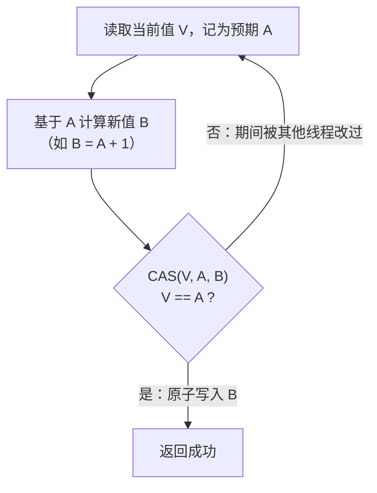
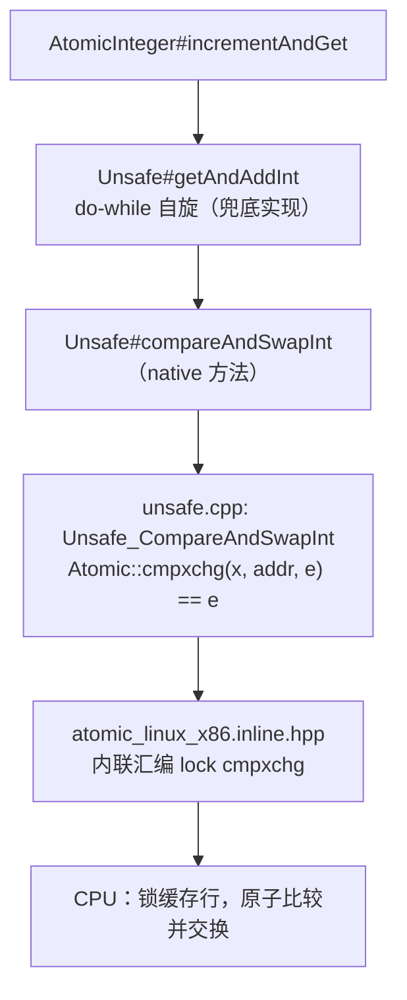
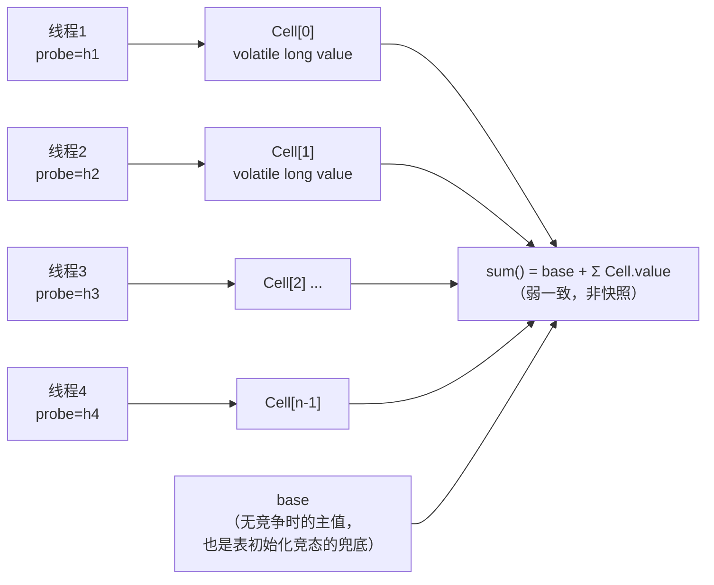

# CAS 与原子类

> 一句话概括：CAS 用一条 CPU 原子指令把「比较并交换」变成不可打断的整体，原子类在此基础上封装出无锁计数与引用更新；
> 本文从 `i++` 的字节码反例讲到 `lock cmpxchg` 指令、ABA 与自旋代价、原子类家族全景，再深入 `Striped64` 分散计数源码与 VarHandle 演进，讲清每个机制的边界与选型。

预计阅读时间：大约 85 分钟

所属主题：[Java 并发编程常见面试题总结](summary.md)

本文以 **JDK 8（本机 1.8.0_202）为主要基线**，源码锚点用 `类名#方法名` 标注；JDK 9 引入 VarHandle（JEP 193）替换 `sun.misc.Unsafe` 的演进在各节单独注明（注意：`AtomicInteger`/`AtomicLong` 本体在 JDK 9 短暂迁移后又回退到 `jdk.internal.misc.Unsafe`，见 2.3）。文中竞态反例、ABA 示例、字段更新器访问规则与 `LongAdder` 对比数据均在本机 JDK 8 编译运行验证，输出随文给出。总结文档给面试结论，本文给机制与源码证据，每个机制按「结论 → 机制 → 边界/代价 → 实践/追问」展开。

---

## 0. 阅读路线

| 读者 | 建议阅读 | 关注点 |
| --- | --- | --- |
| 初级（1 年内） | 1、3.1、4.1~4.2、5.1、5.8、8 | `i++` 为什么不安全、CAS 是什么、原子类怎么用、LongAdder 与 AtomicLong 怎么选 |
| 中级（1~3 年） | 2、3 全部、4.3~4.4、5.2~5.4、6 | Unsafe 调用链与 CPU 指令、ABA/自旋/单变量三大问题、字段更新器限制、Striped64 源码 |
| 高级（3 年+） | 2.2~2.3、5.4~5.6、6.3、7、9 | lock 前缀与缓存一致性、longAccumulate 分支、sum 弱一致、VarHandle 内存语义分层、无锁的工程代价 |
| 选型/架构 | 1.3、3.1、5.8、7、8 | 什么时候不该用 CAS、统计计数与精确同步的分流、全局 ID 与复合原子性的边界 |

目录：

1. 从 `i++` 讲起：读-改-写为什么不原子
2. CAS 的底层：从 Unsafe 到 CPU 指令
3. CAS 三大问题：ABA、自旋开销、单变量限制
4. 原子类家族全景与 API 语义
5. LongAdder / Striped64 深度：分散计数
6. VarHandle（JDK 9，JEP 193）
7. 无锁 vs 有锁的工程权衡
8. 实践边界：全局 ID 与复合原子性
9. 高频追问集
10. 参考资料
- 附：一页速记

---

## 1. 从 `i++` 讲起：读-改-写为什么不原子

### 1.1 字节码证据：一行代码，四步操作

**结论**：`i++` 不是原子操作。它在字节码层面是「读 → 加 → 写」三步（外加压栈常量），任何一步之间都可能被其他线程打断，两个线程各自基于旧值加一再写回，就丢掉一次更新。

用 JDK 8 的 `javap -c` 直接看证据（`static int i; static void inc() { i++; }`）：

```text
static void inc();
  Code:
     0: getstatic     #2    // Field i:I   ← 第一步：读主存字段到操作数栈
     3: iconst_1            // 常量 1 压栈
     4: iadd                // 第二步：栈顶两值相加
     5: putstatic     #2    // Field i:I   ← 第三步：写回字段
     8: return
```

实例字段的 `i++` 对应 `getfield/iadd/putfield`，结构完全相同。竞态窗口就在 `getstatic` 与 `putstatic` 之间：线程 T1 读到 `i=5` 后被挂起，T2 读到 `i=5`、加一、写回 `6`；T1 恢复后仍基于自己栈里的 `5` 加一写回 `6`——两次自增只生效一次。

### 1.2 可运行的竞态反例

```java
import java.util.concurrent.*;
import java.util.concurrent.atomic.AtomicInteger;

public class RaceDemo {
    static int plain = 0;                          // 裸 int，无保护
    static final AtomicInteger atomic = new AtomicInteger();

    public static void main(String[] args) throws Exception {
        int threads = 8, per = 100_000;
        ExecutorService pool = Executors.newFixedThreadPool(threads);
        CountDownLatch start = new CountDownLatch(1);
        for (int t = 0; t < threads; t++) {
            pool.submit(() -> {
                try { start.await(); } catch (InterruptedException e) { return; }
                for (int i = 0; i < per; i++) {
                    plain++;                       // 非原子
                    atomic.incrementAndGet();      // 原子
                }
            });
        }
        start.countDown();                         // 8 线程同时开跑
        pool.shutdown();
        pool.awaitTermination(60, TimeUnit.SECONDS);
        System.out.println("expected=" + threads * per
            + " plain=" + plain + " atomic=" + atomic.get());
    }
}
```

本机 JDK 8u202 实测输出（每次运行 `plain` 都不同，但总是小于期望值）：

```text
expected=800000 plain=504902 atomic=800000
```

`plain` 丢了约 37% 的更新，`atomic` 一次不丢。注意这个反例同时暴露两个问题：**原子性**（三步可被打断）和**可见性**（裸 `int` 没有 volatile 语义，线程可能读到过期值）。给 `plain` 加 `volatile` 只能解决可见性，**解决不了原子性**——`volatile` 不保证复合操作的互斥，内存语义细节见 [JMM 与 volatile](jmm-and-volatile.md)。

### 1.3 两条修复路线：悲观锁与乐观锁

`synchronized` 能修复：把 `i++` 放进临界区，同一时刻只有一个线程执行。但这是**悲观锁**思路——假设冲突总会发生，先加锁再操作，冲突时线程阻塞、挂起、唤醒，涉及用户态/内核态切换与上下文切换，成本不低（锁升级与阻塞成本见 [synchronized 与锁升级](synchronized-and-lock-escalation.md)）。

**乐观锁**思路相反：假设冲突很少，先直接操作，提交时检查「我读到的值还是不是原来那个」，是就写入，不是就重试。这个「检查并写入」必须是一条不可打断的原子指令，否则检查与写入之间仍有竞态窗口——这就是 **CAS（Compare And Swap，比较并交换）**：

> CAS 有三个操作数：内存位置当前值 **V**、预期旧值 **A**、要写入的新值 **B**。当且仅当 `V == A` 时，把该位置更新为 `B` 并返回成功；否则不做任何修改，返回失败（通常带回当前真实值）。整个「比较 + 交换」由硬件保证原子。

CAS 自旋（spin）就是「失败就重读重试」的循环：



Java 里 `AtomicInteger#incrementAndGet` 就是这个循环的封装（源码见 2.1）。**CAS 是乐观锁的底层原语，自旋是它的重试策略**；数据库乐观锁的 `UPDATE ... SET version=version+1 WHERE version=#{old}` 是同一思想在 SQL 层的体现。

**追问：CAS 和 synchronized 谁更快？** 没有绝对答案：低竞争、临界区极短（一条指令级）时 CAS 免去阻塞唤醒，通常更快；高竞争时 CAS 自旋空转烧 CPU，反而可能不如让线程阻塞的锁。完整权衡见第 7 节。

---

## 2. CAS 的底层：从 Unsafe 到 CPU 指令

### 2.1 JDK 8 调用链：incrementAndGet 到底做了什么

**结论**：JDK 8 的 `AtomicInteger#incrementAndGet` 不是「一条 native CAS」，而是 `Unsafe#getAndAddInt` 里的 **Java 层自旋 CAS 循环**；循环体里的 `compareAndSwapInt` 才是 native 方法，最终落到 CPU 的 `cmpxchg` 指令。

JDK 8 源码（`AtomicInteger.java`，jdk8u）：

```java
private static final Unsafe unsafe = Unsafe.getUnsafe();   // sun.misc.Unsafe
private static final long valueOffset;                     // value 字段在对象内的偏移量
static {
    try {
        valueOffset = unsafe.objectFieldOffset(
            AtomicInteger.class.getDeclaredField("value"));
    } catch (Exception ex) { throw new Error(ex); }
}
private volatile int value;                                // 注意：volatile 修饰

public final int incrementAndGet() {
    return unsafe.getAndAddInt(this, valueOffset, 1) + 1;  // 返回旧值 + 1 = 新值
}
public final int getAndIncrement() {
    return unsafe.getAndAddInt(this, valueOffset, 1);      // 返回旧值
}
public final boolean compareAndSet(int expect, int update) {
    return unsafe.compareAndSwapInt(this, valueOffset, expect, update);
}
```

`Unsafe#getAndAddInt`（JDK 8 新增，`@since 1.8`）就是自旋循环本体：

```java
public final int getAndAddInt(Object o, long offset, int delta) {
    int v;
    do {
        v = getIntVolatile(o, offset);                     // volatile 读当前值
    } while (!compareAndSwapInt(o, offset, v, v + delta)); // CAS 失败就重读重试
    return v;                                              // 返回旧值
}
```

两个容易答错的细节：

- `incrementAndGet` 的「+1」是**拿到旧值后在 Java 层做的普通加法**，原子性由 `getAndAddInt` 保证，不是两次原子操作；
- `getAndAddInt` 上方有一段源码注释：*"The following contain CAS-based Java implementations used on platforms not supporting native instructions"*——这个 Java 循环是**兜底实现**。在 x86 等主流平台上，HotSpot 会把它内建（intrinsic）替换成更高效的单条原子指令（如 x86 的 `getAndAdd` 内建为 `lock xadd`，无需自旋）；只有不支持原生指令的平台才真正跑 Java 循环。面试说「JDK 8 是自旋 CAS」指的是 Java 层语义，知道 intrinsic 这层是加分项。

完整调用链（JDK 8，x86-64 Linux）：



native 层证据（jdk8u `hotspot/src/share/vm/prims/unsafe.cpp`）：

```cpp
UNSAFE_ENTRY(jboolean, Unsafe_CompareAndSwapInt(JNIEnv *env, jobject unsafe,
             jobject obj, jlong offset, jint e, jint x))
  oop p = JNIHandles::resolve(obj);
  jint* addr = (jint *) index_oop_from_field_offset_long(p, offset);
  return (jint)(Atomic::cmpxchg(x, addr, e)) == e;   // 返回旧值，等于预期即成功
UNSAFE_END
```

平台层证据（jdk8u `hotspot/src/os_cpu/linux_x86/vm/atomic_linux_x86.inline.hpp`）：

```cpp
// Adding a lock prefix to an instruction on MP machine
#define LOCK_IF_MP(mp) "cmp $0, " #mp "; je 1f; lock; 1: "

inline jlong Atomic::cmpxchg(jlong exchange_value, volatile jlong* dest,
                             jlong compare_value) {
  bool mp = os::is_MP();
  __asm__ __volatile__ (LOCK_IF_MP(%4) "cmpxchgq %1,(%3)"
                        : "=a" (exchange_value)
                        : "r" (exchange_value), "a" (compare_value),
                          "r" (dest), "r" (mp)
                        : "cc", "memory");
  return exchange_value;
}
```

注意 `LOCK_IF_MP`：**只有多处理器（`os::is_MP()`）才加 `lock` 前缀**，单核上 `cmpxchg` 本身就不会被其他核打断，省掉 lock 的开销。`"memory"` clobber 告诉编译器不要跨越这条指令重排内存访问。

### 2.2 lock 前缀保证了什么：原子性 + 可见性

**结论**：`lock` 前缀把随后的指令变成原子操作，并附带全屏障级别的内存可见性效果——所以 CAS 成功时，新值对其他线程立即可见，不需要额外加 volatile 写。

机制分两层：

| 层面 | 行为 |
| --- | --- |
| 原子性 | 现代 x86 上 `lock` 锁定的是**缓存行**（cache line，通常 64 字节）：通过缓存一致性协议独占该行，保证「读-比较-写」期间其他核不能修改同一行；只有操作数跨缓存行等无法锁缓存的场景才退化为**总线锁**（锁住整个总线，代价大得多） |
| 可见性 | `lock` 前缀指令具有内存屏障效果：把写缓冲区刷入缓存，并让其他核中该缓存行的副本失效。其他核再读时必须重新获取最新值 |

一句话带过 MESI：缓存一致性协议把每个缓存行标记为 Modified/Exclusive/Shared/Invalid 四态，`lock cmpxchg` 写入时使其他核的该行进入 Invalid，从而保证「一个核写、其他核立刻知道旧值作废」。这也是 CAS 的隐藏成本来源——高竞争时同一缓存行在多核之间反复失效、来回搬运（缓存行乒乓），见 5.5 与第 7 节。

**边界**：CAS 的可见性建立在「目标字段本身按 volatile 语义访问」之上。`AtomicInteger#value` 声明为 `volatile int`，`getAndAddInt` 用 `getIntVolatile` 读、`compareAndSwapInt` 写（volatile 语义），三者配套。如果绕过原子类直接普通读写同一个字段，原子性保证就被破坏了——字段更新器的 javadoc 明确说了这一点（见 4.3）。volatile 的 happens-before 规则见 [JMM 与 volatile](jmm-and-volatile.md)，本文不展开。

### 2.3 版本演进：Unsafe → VarHandle → 部分回退（易错点）

**结论**：JDK 9 用 VarHandle（JEP 193）作为 `sun.misc.Unsafe` 原子操作的标准替代，但**迁移并不彻底**：`AtomicInteger`/`AtomicLong` 本体因启动期循环依赖回退到 `jdk.internal.misc.Unsafe` 并延续至今；数组类、`Striped64` 的 Cell 等则完成了 VarHandle 化。面试说「JDK 9 之后原子类都用 VarHandle」是不准确的。（AQS 本体的 VarHandle→Unsafe 演进另见 [JMM 与 volatile](jmm-and-volatile.md) 9.3。）

| 组件 | JDK 8 | JDK 9+ 演进（已核实） |
| --- | --- | --- |
| `AtomicInteger`/`AtomicLong` | `sun.misc.Unsafe#getAndAddInt` 自旋 | JDK 9 **开发期** jsr166 集成曾改为 `VarHandle#getAndAdd`（core-libs-dev「jsr166 jdk9 integration wave 7」线程可查），因启动循环依赖**在 9 GA 前回退**；**JDK 9 GA 起即 `jdk.internal.misc.Unsafe#getAndAddInt` 并延续至今**（jdk-11+28 与当前 master 已核验，类注释明言循环依赖），VarHandle 版从未进入任何 GA 版本 |
| `AtomicIntegerArray` 等数组类 | Unsafe + `arrayBaseOffset/arrayIndexScale` | 改用 `MethodHandles.arrayElementVarHandle(int[].class)`（当前 master 源码可查，属 JEP 193 迁移范围） |
| `AtomicIntegerFieldUpdater` | Unsafe 偏移量 CAS | 当前 master 内部**仍是** `jdk.internal.misc.Unsafe`，VarHandle 只出现在 javadoc 语义引用中 |
| `Striped64.Cell#cas` | `UNSAFE.compareAndSwapLong` | 当前 master 改为 `VarHandle#weakCompareAndSetRelease`（见 5.4 版本注） |

回退原因就写在当前 master `AtomicInteger.java` 的注释里：

```java
/*
 * This class intended to be implemented using VarHandles, but there
 * are unresolved cyclic startup dependencies.
 */
private static final Unsafe U = Unsafe.getUnsafe();   // jdk.internal.misc.Unsafe
private static final long VALUE = U.objectFieldOffset(AtomicInteger.class, "value");

public final int incrementAndGet() {
    return U.getAndAddInt(this, VALUE, 1) + 1;        // 与 JDK 8 结构一致，只是 Unsafe 换了包
}
```

VarHandle 的查找依赖 `MethodHandles`/`LambdaForm` 等基础设施，而这些基础设施的启动又反过来用到原子类，形成循环；`AtomicInteger` 是 JVM 启动最早触碰的类之一，只能继续用不依赖这套设施的 Unsafe。JDK 9 同时把 Unsafe 拆成两份：业务可见的 `sun.misc.Unsafe`（委托壳，逐步废弃）与 JDK 内部的 `jdk.internal.misc.Unsafe`（真身，业务代码不可直接访问）。

**实践**：业务代码在 JDK 9+ 需要「对自有字段做原子操作」时，正路是 VarHandle（第 6 节），而不是反射掏 `sun.misc.Unsafe#theUnsafe`——后者绕过访问控制、无类型检查，写错偏移量可以直接让 JVM 崩溃。

---

## 3. CAS 三大问题：ABA、自旋开销、单变量限制

### 3.1 ABA 问题：值回来了，世界变了

**结论**：CAS 只比较「当前值是否等于预期值」，感知不到「值曾经变过又变回来」。对计数器这类只关心数值的场景 ABA 无害；对**依赖中间状态的结构**（无锁栈/链表的节点复用）ABA 可能导致结构损坏。标准解法是加版本号：`AtomicStampedReference`；只需标记「是否被改过/逻辑删除」时用 `AtomicMarkableReference`。

**机制**：线程 T1 读到链表头是节点 A，准备 CAS 把 head 从 A 换成 A.next；此时 T2 弹出 A、弹出 B、又把 A 压回（节点复用），head 仍是 A。T1 的 CAS 成功——但 A.next 早已不是 T1 读到的那个节点，链表可能丢节点甚至成环。Java 有 GC，「节点内存被回收后地址复用」这类 C/C++ 经典 ABA 被大幅缓解，但**逻辑上的节点复用**（同一个对象被移出又移回）依然真实存在。

| 场景 | ABA 是否有害 | 原因 |
| --- | --- | --- |
| 计数器 `AtomicInteger` 自增 | 无害 | 语义只关心数值本身，5→6→5 后再 CAS 成功不影响正确性 |
| 无锁栈/队列的节点复用 | **有害** | 节点的 next 指针等中间状态已变，CAS 成功反而基于过期结构操作 |
| 账户余额 100→50→100 后扣款 | 视业务 | 若业务要求「期间无变动才允许扣」，需要版本号；若只关心当前余额够不够，普通 CAS 即可 |

**完整示例**（本机 JDK 8 实测；用字符串字面量保证引用同一性，原因见 4.4 的 `==` 陷阱）：

```java
import java.util.concurrent.atomic.*;

public class AbaDemo {
    public static void main(String[] args) throws Exception {
        AtomicReference<String> ref = new AtomicReference<>("A");
        AtomicStampedReference<String> stamped = new AtomicStampedReference<>("A", 0);

        String a1 = ref.get();                       // T1 读到预期值 A
        int[] stampHolder = new int[1];
        String s1 = stamped.get(stampHolder);        // 同时读出当前版本号
        int stamp0 = stampHolder[0];                 // 0

        Thread t2 = new Thread(() -> {               // T2 制造 A → B → A
            ref.compareAndSet("A", "B");
            ref.compareAndSet("B", "A");
            stamped.compareAndSet("A", "B", stamp0, stamp0 + 1);
            stamped.compareAndSet("B", "A", stamp0 + 1, stamp0 + 2);
        });
        t2.start(); t2.join();

        // 普通 CAS：值回到 A，比较通过，感知不到中间变化
        System.out.println(ref.compareAndSet(a1, "C"));            // true
        // 带版本号 CAS：引用虽回到 A，但 stamp 已从 0 变成 2，比较失败
        System.out.println(stamped.compareAndSet(s1, "C", stamp0, stamp0 + 1)); // false
        System.out.println(stamped.getStamp());                    // 2
    }
}
```

实测输出：

```text
true
false
2
```

`AtomicStampedReference#compareAndSet` 的源码（JDK 8）揭示了它为什么能防 ABA——把「引用 + 版本号」装进一个不可变 `Pair`，对 Pair 整体做 CAS：

```java
public boolean compareAndSet(V expectedReference, V newReference,
                             int expectedStamp, int newStamp) {
    Pair<V> current = pair;
    return
        expectedReference == current.reference &&    // 引用用 == 比较（同一性）
        expectedStamp == current.stamp &&            // 版本号也要相等
        ((newReference == current.reference &&
          newStamp == current.stamp) ||              // 无变化则直接成功，省一次 CAS
         casPair(current, Pair.of(newReference, newStamp)));
}
```

`AtomicMarkableReference` 是简化版：不记「变过几次」，只记一个 boolean 标记（`compareAndSet(V expectRef, V newRef, boolean expectMark, boolean newMark)`、`attemptMark(V expectedReference, boolean newMark)`），典型用途是并发链表的**逻辑删除标记**——先标记再物理摘除，避免删除与插入互相踩。

**边界/代价**：版本号每次更新都递增，`AtomicStampedReference` 每次成功更新都要 new 一个 Pair 对象，比裸 CAS 多一次分配；int 版本号理论上会溢出回绕（2^32 次更新后回到原值），工程上可忽略但面试可以提。数据库乐观锁的 version 字段、分布式场景的 revision 是同一思想。

**追问：什么场景必须用 AtomicStampedReference？** 期望答案：存在「对象被移出又移回/复用」且中间状态影响正确性的无锁结构（如无锁栈的 Treiber stack 节点复用）；纯数值计数不需要。能说出「Java 有 GC 缓解了内存地址复用型 ABA，但逻辑复用型 ABA 仍在」是高级信号。

### 3.2 自旋开销：失败重试不是免费的

**结论**：CAS 失败不阻塞，而是立刻重读重试（自旋）。低竞争时一两次就成功，比锁便宜；**高竞争时大量线程长时间 CAS 失败，CPU 空转做无用功**，吞吐反而下降，还会加剧缓存行乒乓。

机制与代价：

- JDK 8 `Unsafe#getAndAddInt` 的 do-while **没有退避（backoff）策略**，失败立即重试，竞争越激烈失败率越高，形成「越抢越失败、越失败越抢」的正反馈；
- 每次 CAS 无论成败都要独占缓存行，N 个核抢同一个 `AtomicLong`，缓存行在核间反复失效搬运，单次 CAS 的实际耗时随竞争度上升；
- 自旋期间线程不让出 CPU，**挤占其他任务的算力**——这与锁的「阻塞让出 CPU」是本质区别。

**适用边界**：CAS 适合**竞争低、临界区极短**（一次读-改-写）的场景。竞争高时的两条出路：① 换分散结构消灭单点（`LongAdder`，第 5 节）；② 换锁让线程阻塞等待（`synchronized` 自适应自旋后膨胀、`ReentrantLock` 挂起，见 [synchronized 与锁升级](synchronized-and-lock-escalation.md) 与 [AQS 与锁](aqs-and-locks.md)）。

**追问：自旋和阻塞怎么选？** 期望答案：临界区短于线程挂起+唤醒的成本（微秒级）时自旋划算；长临界区或高竞争时阻塞划算，因为自旋烧的是真 CPU。JVM 的自适应自旋（根据上次自旋成功率调整）就是这个权衡的自动化版本。

### 3.3 单变量限制：CAS 一次只保一个位置

**结论**：一条 CAS 指令只覆盖一个内存位置（int/long/引用），**多个变量的复合不变量 CAS 保不住**。需要「余额和积分同时扣」这类多变量原子性时，要么用锁，要么把多个变量封装进一个不可变对象，用 `AtomicReference` 对整体做 CAS。

```java
// 不可变快照：把两个变量绑成一个整体
final class Account {
    final long balance;
    final long points;
    Account(long balance, long points) { this.balance = balance; this.points = points; }
}

AtomicReference<Account> ref = new AtomicReference<>(new Account(100, 50));

// 多变量原子更新：对「整个快照」做 CAS，失败重试
Account prev, next;
do {
    prev = ref.get();
    if (prev.balance < 10) throw new IllegalStateException("余额不足");
    next = new Account(prev.balance - 10, prev.points + 1);
} while (!ref.compareAndSet(prev, next));
```

**边界/代价**：每次更新都要创建新快照对象（分配 + GC 压力）；快照字段多、更新频繁时成本上升；两个字段若属于不同对象、无法封装进一个引用，CAS 方案就不成立，只能上锁。`AtomicStampedReference` 内部正是这个模式（Pair 不可变对象）的应用。业务层的 check-then-act 复合原子性见 8.2。

---

## 4. 原子类家族全景与 API 语义

### 4.1 家族全景表

**结论**：`java.util.concurrent.atomic` 按「更新目标」分四组：基本类型、数组、引用、字段更新器。它们共享同一套 CAS 底层，差别在封装形态与内存开销。

| 分组 | 类 | 更新目标 | 引入版本 | 典型用途 |
| --- | --- | --- | --- | --- |
| 基本类型 | `AtomicInteger` / `AtomicLong` | 对象内一个 volatile int/long | JDK 5 | 计数器、序列号 |
| 基本类型 | `AtomicBoolean` | 内部是 `volatile int value`（0/1），CAS 走 `compareAndSwapInt` | JDK 5 | 一次性开关、状态标记 |
| 数组 | `AtomicIntegerArray` / `AtomicLongArray` / `AtomicReferenceArray` | 数组元素（构造时**拷贝**传入数组，之后与原数组无关） | JDK 5 | 分段计数、桶计数 |
| 引用 | `AtomicReference<V>` | 一个 volatile 引用 | JDK 5 | 不可变快照整体替换、无锁结构头指针 |
| 引用 | `AtomicStampedReference<V>` | 引用 + int 版本号（不可变 Pair） | JDK 5 | 防 ABA |
| 引用 | `AtomicMarkableReference<V>` | 引用 + boolean 标记 | JDK 5 | 逻辑删除标记 |
| 字段更新器 | `AtomicIntegerFieldUpdater` / `AtomicLongFieldUpdater` / `AtomicReferenceFieldUpdater` | **既有类的 volatile 字段**（反射 + 偏移量 CAS） | JDK 5 | 海量节点省对象头开销 |
| 分散计数 | `LongAdder` / `LongAccumulator` / `DoubleAdder` / `DoubleAccumulator` | base + Cell[]（第 5 节） | **JDK 8** | 高并发统计 |

两个易错点：`AtomicBoolean` 没有 `getAndSet` 之外的数值运算，内部用 int 而非 boolean 存值（JDK 8 源码 `private volatile int value;`，已核实）；数组类构造时拷贝数组，`new AtomicIntegerArray(arr)` 之后改 `arr` 不影响原子数组。

### 4.2 常用 API 语义表

以 `AtomicInteger` 为例（`AtomicLong` 同构）：

| API | 语义 | 返回值 | 备注 |
| --- | --- | --- | --- |
| `get()` / `set(v)` | volatile 读 / volatile 写 | 当前值 / void | `set` 是普通 volatile 写，不是 CAS |
| `getAndIncrement()` | 原子 +1 | **旧值** | JDK 8 走 `Unsafe#getAndAddInt(this, offset, 1)` |
| `incrementAndGet()` | 原子 +1 | **新值** | `getAndAddInt(...) + 1`，见 2.1 |
| `getAndAdd(d)` / `addAndGet(d)` | 原子 +d | 旧值 / 新值 | 同上 |
| `getAndSet(v)` | 原子换新值 | 旧值 | x86 上内建为 `lock xchg`，无需自旋 |
| `compareAndSet(a, b)` | V==a 才写 b | boolean | CAS 本体 |
| `weakCompareAndSet(a, b)` | 同 CAS，但**可能伪失败**、排序保证更弱 | boolean | JDK 8 实现与 compareAndSet 相同；JDK 9 起标记 `@Deprecated`，建议按语义改用 `weakCompareAndSetPlain` 等（见 6.3） |
| `updateAndGet(fn)` | 用 `IntUnaryOperator` 计算新值并 CAS 重试 | 新值 | **JDK 8 新增**，lambda 友好 |
| `accumulateAndGet(x, fn)` | 用 `IntBinaryOperator` 合并当前值与 x | 新值 | JDK 8 新增 |
| `getAndUpdate(fn)` / `getAndAccumulate(x, fn)` | 同上 | 旧值 | JDK 8 新增 |

`updateAndGet` 的 JDK 8 源码就是「读-算-CAS」循环的通用化：

```java
public final int updateAndGet(IntUnaryOperator updateFunction) {
    int prev, next;
    do {
        prev = get();
        next = updateFunction.applyAsInt(prev);
    } while (!compareAndSet(prev, next));
    return next;
}
```

**边界**：传入的函数**必须无副作用**——CAS 失败会重试，函数会被重复执行。`updateAndGet(v -> { log(v); return v + 1; })` 里的日志可能打多次。这条约束在 `LongAccumulator` 的 javadoc 里被明确写出（见 5.7），原子类同理。

```java
AtomicInteger n = new AtomicInteger(5);
n.updateAndGet(v -> v * 2);          // 10
n.accumulateAndGet(3, Integer::sum); // 13
```

### 4.3 字段更新器：反射更新既有 volatile 字段

**结论**：`AtomicIntegerFieldUpdater` 等字段更新器让你**不新建原子对象**，直接对既有类的 `volatile` 字段做原子更新，省下每个节点一个原子类实例的对象头开销；代价是反射创建、访问规则受限、原子性保证更弱。

**为什么省内存**：一个 `AtomicInteger` 实例在压缩指针下约 16 字节（对象头 12B + int 4B），而裸 `volatile int` 字段只占 4B。百万级节点的无锁结构里，每节点省 12B 就是十几 MB，还少一层对象间接寻址。JDK 内部与 Netty 等框架大量使用这个模式。

```java
import java.util.concurrent.atomic.AtomicIntegerFieldUpdater;

public class UpdaterDemo {
    static class Node {
        volatile int state;          // 必须 volatile、非 static、调用者可访问
    }
    private static final AtomicIntegerFieldUpdater<Node> STATE =
        AtomicIntegerFieldUpdater.newUpdater(Node.class, "state");

    public static void main(String[] args) {
        Node node = new Node();
        System.out.println(STATE.compareAndSet(node, 0, 1)); // true
        System.out.println(STATE.incrementAndGet(node));     // 2
    }
}
```

**限制清单**（按 JDK 8 javadoc 与 `AtomicIntegerFieldUpdaterImpl` 构造器源码核实，异常均本机实测）：

| 限制 | 依据 | 违反后果（实测） |
| --- | --- | --- |
| 字段必须是 `int`（对应更新器类型） | 实现里 `field.getType() != int.class` 检查 | `IllegalArgumentException: Must be integer type` |
| 字段必须 `volatile` | 实现里 `Modifier.isVolatile` 检查 | `IllegalArgumentException: Must be volatile type` |
| 字段不能 `static` | 偏移量计算 `Unsafe#objectFieldOffset` 拒绝静态字段（unsafe.cpp `find_field_offset` 检查 `JVM_ACC_STATIC`） | `IllegalArgumentException`（JDK 8 实测消息为 null） |
| 调用者必须按 Java 语言访问控制能访问该字段 | `newUpdater` 标 `@CallerSensitive`，取 `Reflection.getCallerClass()`，实现里 `ReflectUtil.ensureMemberAccess(caller, tclass, null, modifiers)` | 跨类访问 private 字段：`RuntimeException`，cause 为 `IllegalAccessException`（JDK 8 与 JDK 23 实测一致） |
| protected 字段跨包时接收者类型收窄 | 实现里 `cclass` 逻辑：调用者必须是声明类的子类（或同包） | 传入非子类实例抛 `ClassCastException` |

注意「private 不行」的准确口径：**private 字段可以由声明类自己创建更新器**（caller == 声明类，访问检查通过，实测成功）；不行的是「别的类去更新你的 private 字段」。javadoc 的表述是 *"the field is inaccessible to the caller according to Java language access control"*。

**为什么必须 volatile**：CAS 只保证「比较+交换」这一步的原子性，**不保证普通读的可见性与有序性**。字段声明为 volatile，才能让所有读写（包括绕过更新器的直接读）都落在同一套内存语义上。

**更弱的原子性保证**（javadoc 原文，高频追问）：

> Because this class cannot ensure that all uses of the field are appropriate for purposes of atomic access, it can guarantee atomicity only with respect to other invocations of `compareAndSet` and `set` on the same updater.

即：更新器管不住别人用 `node.state = 5` 或 `node.state++` 直接改字段——这些普通写与更新器的 CAS 之间**没有原子性保证**。所以字段更新器适合「字段的所有写路径都收敛到更新器」的受控设计（如框架内部状态机），不适合字段四处被改的开放代码。

**版本注**：JDK 9+ 字段更新器内部仍用 `jdk.internal.misc.Unsafe`（当前 master 已核实，VarHandle 只用于 javadoc 语义引用），API 签名不变。

### 4.4 引用 CAS 的 `==` 陷阱（实测踩坑）

**结论**：`AtomicReference#compareAndSet` 比较的是**引用同一性（==）**，不是 `equals`。对包装类型用字面量 autoboxing 时，超出 `IntegerCache` 范围（默认 [-128, 127]）的值每次装箱都是新对象，CAS 会「莫名其妙」失败。

本文 ABA 示例最初用 `AtomicReference<Integer>` 装 100→200→100，实测 CAS 全部失败：200 超出缓存范围，`compareAndSet(200, 100)` 里的预期值是新装箱的 `Integer(200)`，与内存中那个 `Integer(200)` 不是同一对象，`==` 不成立。改用字符串字面量（常量池保证同一性）后行为才符合预期。

**实践**：引用 CAS 的目标应是**不可变对象的整体替换**（如 3.3 的 Account 快照），预期值永远来自 `ref.get()` 的返回值，而不是自己 new/装箱出来的「等值对象」；需要按值比较时先 `get()` 再自行 `equals` 判断，但注意判断与 CAS 之间仍有竞态，必要时回到锁。

---

## 5. LongAdder / Striped64 深度：分散计数

### 5.1 单点 CAS 的瓶颈：实测数据

**结论**：`AtomicLong` 所有线程 CAS 同一个 `value`，高竞争下失败率飙升 + 缓存行乒乓，吞吐急剧下降；`LongAdder`（JDK 8 引入）把热点分散到多个 Cell，各线程各改各的，读时再求和。

本机 JDK 8u202 实测（8 线程 × 200 万次自增，两轮，第二轮为热身后的计时）：

```text
[bench] round=0 AtomicLong=255ms LongAdder=50ms (threads=8, per=2000000)
[bench] round=1 AtomicLong=215ms LongAdder=17ms (threads=8, per=2000000)
```

热身后约 **12 倍**差距（数值与机器/核数强相关，量级参考；本机为 x86 JDK 跑在 ARM Mac 上，绝对值不代表生产性能）。竞争线程越多差距越大；低竞争时两者接近——这正是 `LongAdder` javadoc 的原话：*"Under low update contention, the two classes have similar characteristics. But under high contention, expected throughput of this class is significantly higher, at the expense of higher space consumption."*

### 5.2 分散结构：base + Cell[]

**结论**：`Striped64`（包私有基类，`LongAdder`/`LongAccumulator`/`DoubleAdder`/`DoubleAccumulator` 共用）维护一个 `base` 和一个 `Cell[]`：无竞争时只 CAS base；出现竞争就初始化/扩容 Cell 表，线程按各自的 probe 哈希到不同 Cell 上独立 CAS；**总值 = base + ΣCell.value**。



JDK 8 `Striped64` 的关键字段（源码核实）：

```java
static final int NCPU = Runtime.getRuntime().availableProcessors(); // 表大小上限
transient volatile Cell[] cells;   // 长度恒为 2 的幂，懒初始化
transient volatile long base;      // 无竞争时的主值
transient volatile int cellsBusy;  // 0/1 自旋锁：建 Cell / 扩容时持有

@sun.misc.Contended static final class Cell {   // 缓存行填充，见 5.5
    volatile long value;
    Cell(long x) { value = x; }
    final boolean cas(long cmp, long val) {
        return UNSAFE.compareAndSwapLong(this, valueOffset, cmp, val);
    }
}
```

线程的「哈希种子」probe 不在 Striped64 里，而是**存在 `Thread` 对象的 `threadLocalRandomProbe` 字段**（与 `ThreadLocalRandom` 共用同一套机制，见 [ThreadLocal](threadlocal.md)），`Striped64#getProbe` 用 Unsafe 按偏移量直接读当前线程的该字段。

### 5.3 LongAdder#add：快路径与慢路径

JDK 8 `LongAdder#add` 源码（完整）：

```java
public void add(long x) {
    Cell[] as; long b, v; int m; Cell a;
    if ((as = cells) != null || !casBase(b = base, b + x)) {
        // 进入慢路径的两种情况：表已存在；或表不存在但 CAS base 失败（出现竞争）
        boolean uncontended = true;
        if (as == null || (m = as.length - 1) < 0 ||
            (a = as[getProbe() & m]) == null ||
            !(uncontended = a.cas(v = a.value, v + x)))
            longAccumulate(x, null, uncontended);   // 交给 Striped64 处理
    }
}
```

读法：

1. **无竞争快路径**：`cells == null` 且 `casBase` 一次成功 → 直接返回，成本与 `AtomicLong` 相当；
2. 表已存在 → 按 `probe & (length-1)` 定位自己的 Cell，CAS 成功即返回；
3. 定位到的槽为空、或 Cell CAS 失败 → 进入 `Striped64#longAccumulate`（建 Cell / rehash / 扩容）。

`increment()` 就是 `add(1L)`，`decrement()` 是 `add(-1L)`。

### 5.4 Striped64#longAccumulate 源码走读

这是分散计数的核心状态机（JDK 8 源码，节选关键分支并标注）：

```java
final void longAccumulate(long x, LongBinaryOperator fn, boolean wasUncontended) {
    int h;
    if ((h = getProbe()) == 0) {
        ThreadLocalRandom.current();   // probe 未初始化：强制初始化
        h = getProbe();
        wasUncontended = true;         // 视为无竞争，给 base/新 Cell 一次机会
    }
    boolean collide = false;           // 上一次槽位是否非空（冲突升级的计数器）
    for (;;) {
        Cell[] as; Cell a; int n; long v;
        if ((as = cells) != null && (n = as.length) > 0) {
            if ((a = as[(n - 1) & h]) == null) {
                // 分支①：槽为空 → 持 cellsBusy 锁创建新 Cell（双重检查）
                if (cellsBusy == 0) {
                    Cell r = new Cell(x);          // 乐观地先 new
                    if (cellsBusy == 0 && casCellsBusy()) {
                        // ... 锁内复查槽仍为空才放入 rs[j] = r ...
                        // finally { cellsBusy = 0; }
                    }
                }
                collide = false;
            }
            else if (!wasUncontended)              // 分支②：已知 CAS 失败
                wasUncontended = true;             // 先 rehash 再试
            else if (a.cas(v = a.value, ((fn == null) ? v + x :
                                         fn.applyAsLong(v, x))))
                break;                             // 分支③：Cell CAS 成功，退出
            else if (n >= NCPU || cells != as)
                collide = false;                   // 分支④：已到上限或表被换，不扩容
            else if (!collide)
                collide = true;                    // 分支⑤：第一次冲突，标记
            else if (cellsBusy == 0 && casCellsBusy()) {
                // 分支⑥：连续冲突 → 持锁扩容一倍（cells == as 复查防过期）
                // Cell[] rs = new Cell[n << 1]; 拷贝旧表; cells = rs;
                collide = false;
                continue;
            }
            h = advanceProbe(h);                   // 各分支末尾：rehash 换槽
        }
        else if (cellsBusy == 0 && cells == as && casCellsBusy()) {
            // 分支⑦：表未初始化 → 持锁建 Cell[2]，把自己放进 rs[h & 1]
        }
        else if (casBase(v = base, ((fn == null) ? v + x :
                                    fn.applyAsLong(v, x))))
            break;                                 // 分支⑧：建表锁抢不到 → 兜底 CAS base
    }
}
```

分支逻辑速查表：

| 分支 | 触发条件 | 动作 | 设计意图 |
| --- | --- | --- | --- |
| ① | 哈希槽为空 | 抢 `cellsBusy` 建新 Cell | 懒创建，只为真实冲突的线程分配 |
| ②③ | 槽非空 | 先 rehash 再 CAS Cell | 失败先换槽，避免死磕热点 |
| ④ | `n >= NCPU` 或表已换 | 不扩容，只 rehash | **表大小以核数为上限**：再多 Cell 也不会提高并行度，只浪费内存 |
| ⑤⑥ | 连续两次冲突且未达上限 | 抢锁扩容一倍 | 冲突升级才扩容，渐进式 |
| ⑦ | 表为 null | 抢锁初始化 `Cell[2]` | 从 2 起步，2 的幂便于位运算取模 |
| ⑧ | 抢不到 `cellsBusy` | 兜底 CAS base | **不等待锁**：宁可挤 base 也不自旋等锁，保持无锁风格 |

三个值得深挖的设计：

- **`cellsBusy` 是 CAS 自旋锁**（`casCellsBusy()` 把 0→1），只保护「建 Cell / 扩容」这类低频结构变更，普通累加完全不碰它；抢不到锁的线程走分支⑧兜底，不阻塞。这是「无锁结构里嵌一把极小范围自旋锁」的经典折中。
- **rehash 用 xorshift**：`advanceProbe` 对 probe 做 `^= <<13; ^= >>>17; ^= <<5` 并写回 Thread 字段，失败线程换一个槽位重试，把冲突摊开。
- **扩容上限 NCPU**：`Cell[]` 最大到 ≥ 核数的最小 2 的幂，之后只 rehash 不扩容——Cell 数超过核数没有并行收益。

**版本注**：当前 master 的 `Striped64` 已改用 VarHandle——`Cell#cas` 变为 `VALUE.weakCompareAndSetRelease(this, cmp, val)`（release 语义的弱 CAS，失败可重试所以允许弱版本），probe 读写改经 `SharedSecrets` 的 `JavaUtilConcurrentTLRAccess`（注释明确面向当前 carrier thread，为虚拟线程适配）；`longAccumulate` 签名多了 `int index` 参数。JDK 8 基线仍是上文 Unsafe 版本。

### 5.5 @Contended：Cell 上的缓存行填充

**结论**：`Cell` 类标注 `@Contended`，JVM 在对象布局时给它前后各填充一段空白（默认 128 字节），让相邻 Cell 不落在同一缓存行，**消除伪共享**——否则分散计数省下的 CAS 竞争会被缓存行乒乓吃回去。

伪共享一句话：两个无关变量恰好位于同一 64 字节缓存行，两个核各写各的变量，却因缓存一致性协议互相使对方的行失效，性能像真的在共享一样。排查手段（perf cmt、JOL 布局分析等）见 [死锁与排查](deadlock-and-troubleshooting.md)，本文只讲 `@Contended` 在 Cell 上的应用。

已核实的版本与开关事实：

| 项 | JDK 8 | JDK 9+ |
| --- | --- | --- |
| 注解包名 | `sun.misc.Contended`（Striped64 源码 `@sun.misc.Contended static final class Cell`） | `jdk.internal.vm.annotation.Contended`（当前 master 源码 `@jdk.internal.vm.annotation.Contended static final class Cell`） |
| 用户类使用 | 默认被 `RestrictContended` 限制，需 `-XX:-RestrictContended` | 同左（注解在内部包，业务类还需 `--add-exports` 才能引用） |

HotSpot 开关证据（jdk8u `globals.hpp`，原文）：

```cpp
product(intx, ContendedPaddingWidth, 128,
        "How many bytes to pad the fields/classes marked @Contended with")
product(bool, EnableContended, true,
        "Enable @Contended annotation support")
product(bool, RestrictContended, true,
        "Restrict @Contended to trusted classes")
```

即：填充宽度默认 **128 字节**（两侧各 128，覆盖相邻行与预取影响）；`RestrictContended` 默认 **true**，注解只对 JDK 内部可信类生效——所以 `Striped64.Cell` 开箱即用，而业务类想用自己的 `@Contended` 必须显式 `-XX:-RestrictContended`。

**边界/代价**：填充是拿空间换时间，每个 Cell 实际占用约 128+16+128 字节量级；`LongAdder` 高竞争下最多 NCPU 量级的 Cell，空间开销显著（javadoc 明说 *at the expense of higher space consumption*）。少量计数器、低竞争场景不值得。

### 5.6 sum() 弱一致：不是快照

**结论**：`LongAdder#sum()` 返回 `base + ΣCell.value`，遍历期间其他线程仍在写，**结果不是原子快照**——这是分散结构换取写吞吐的固有代价。

JDK 8 javadoc 原文（已核实）：

> The returned value is **NOT** an atomic snapshot; invocation in the absence of concurrent updates returns an accurate result, but concurrent updates that occur while the sum is being calculated might not be incorporated.

源码就是普通遍历，没有任何锁或 CAS：

```java
public long sum() {
    Cell[] as = cells; Cell a;
    long sum = base;
    if (as != null) {
        for (int i = 0; i < as.length; ++i) {
            if ((a = as[i]) != null)
                sum += a.value;      // 逐个 volatile 读，期间值可能已变
        }
    }
    return sum;
}
```

配套方法的边界：

| 方法 | 语义 | 边界 |
| --- | --- | --- |
| `sum()` | 当前总和的弱一致估计 | 无并发写时精确；有并发写时可能漏掉遍历期间的增量 |
| `sumThenReset()` | 求和后清零 | 同样非原子，只适合无并发写的窗口（如定时上报后重置） |
| `reset()` | 清零 | javadoc：*"intrinsically racy"*，仅在确知无并发更新时使用 |

**实践**：监控计数、QPS 统计、频率表这类「周期性读个大概」的场景，弱一致完全够用；需要「读到的值必须精确对应某一时刻」或「读后立刻基于该值做决策」（如限流阈值判断、序列号发放）时，用 `AtomicLong`。`LongAdder` 也**没有** `compareAndSet`/`incrementAndGet` 这类返回精确值的 API——它从设计上就放弃了单点语义。

### 5.7 LongAccumulator 与 Double 家族

**结论**：`LongAccumulator` 把「加法」泛化为任意满足条件的二元函数（如 `Long::max`），`DoubleAdder`/`DoubleAccumulator` 是 double 版本（内部按 long 位模式存储转换）。四者都继承 `Striped64`，都是 **JDK 8** 引入。

```java
import java.util.concurrent.atomic.LongAccumulator;

// 并发安全地维护全局最大值：identity 是 Long.MIN_VALUE
LongAccumulator max = new LongAccumulator(Long::max, Long.MIN_VALUE);
max.accumulate(42);
max.accumulate(7);
System.out.println(max.get());   // 42
```

javadoc 对函数的约束（引文为原文，数学性质为据此的推论）：

1. **顺序无关**：*"The order of accumulation within or across threads is not guaranteed"*——据此推论函数须满足结合律与交换律，否则结果不确定；
2. **无副作用**：*"should be side-effect-free, since it may be re-applied when attempted updates fail due to contention"*——CAS 失败重试会重复调用函数；
3. **identity 参数**：`new LongAdder()` 等价于 `new LongAccumulator((x, y) -> x + y, 0L)`（javadoc 原话）；据此 identity 应取单位元，max 的单位元是 `Long.MIN_VALUE`。

**边界**：浮点加法不满足结合律，`DoubleAdder` 的结果与累加顺序有关，和 `double` 直接累加一样存在舍入误差，只是误差形态不同；需要精确十进制运算请用 `BigDecimal`（但那就不是无锁计数器的领域了）。

### 5.8 选型表：LongAdder vs AtomicLong

| 维度 | `AtomicLong` | `LongAdder` |
| --- | --- | --- |
| 写吞吐（高竞争） | 单点 CAS，失败率高 | 分散 Cell，显著更高（实测约一个数量级） |
| 写吞吐（低竞争） | 相当 | 相当（只 CAS base） |
| 读 | `get()` 精确、O(1)、volatile 语义 | `sum()` 弱一致、O(Cell 数) |
| CAS 语义 | 有 `compareAndSet`、`incrementAndGet` 返回精确值 | **无**，只有 add/increment/sum |
| 空间 | 一个对象 | base + 最多 NCPU 量级 Cell + 填充 |
| 典型场景 | 序列号、限流计数、需要精确实时值或 CAS 控制 | 监控统计、QPS/频率表、写多读少 |
| 版本 | JDK 5 | JDK 8 |

一句话选型（javadoc 口径）：**统计计数用 LongAdder，细粒度同步控制用 AtomicLong**（*"collecting statistics, not for fine-grained synchronization control"*）。

---

## 6. VarHandle（JDK 9，JEP 193）

### 6.1 为什么替换 Unsafe

**结论**：VarHandle 是 JDK 9（JEP 193，Release 9，Closed/Delivered）提供的**标准、类型安全、受访问控制**的变量原子操作 API，目标是替代 `sun.misc.Unsafe` 的原子/有序访问能力；Unsafe 的问题不是性能，而是安全与可维护性。

JEP 193 原文的动机与目标（已核实）：

- Unsafe *"unsafe (and unportable and unsupported)"*，其 intrinsic 被广泛使用 *"to the detriment of safety and portability"*；
- **Safety**：*"It must not be possible to place the Java Virtual Machine in a corrupt memory state"*——字段只能写入类型兼容的值，数组访问必须过边界检查；
- **Integrity**：字段访问遵循与 `getfield/putfield` 相同的访问规则，且 final 字段不可更新；
- **Performance**：生成的汇编与等价 Unsafe 操作几乎一致；
- 明确 java.util.concurrent 的类 *"will be migrated from sun.misc.Unsafe to VarHandle"*（实际迁移有回退，见 2.3）。

对比 Unsafe：偏移量是裸 long，写错位置直接破坏内存；无类型检查（可以把引用写进 int 字段的位置）；绕过访问控制（private 字段随便改）。VarHandle 把这三件事全部收进类型系统与访问检查。

### 6.2 最小示例：对自有字段做原子自增

```java
// JDK 9+ 编译运行
import java.lang.invoke.MethodHandles;
import java.lang.invoke.VarHandle;

public class VarHandleCounter {
    private volatile int value;
    private static final VarHandle VALUE;
    static {
        try {
            VALUE = MethodHandles.lookup()
                .findVarHandle(VarHandleCounter.class, "value", int.class);
        } catch (ReflectiveOperationException e) {
            throw new Error(e);
        }
    }
    public int incrementAndGet() {
        return (int) VALUE.getAndAdd(this, 1) + 1;   // 签名多态，无需反射调用
    }
    public static void main(String[] args) {
        VarHandleCounter c = new VarHandleCounter();
        System.out.println(c.incrementAndGet());     // 1
    }
}
```

要点：`findVarHandle(声明类, 字段名, 字段类型)` 在 lookup 的访问权限内查找（private 字段只能由声明类自己的 lookup 获取）；`getAndAdd` 等方法是**签名多态**的，编译期按实参类型直接链接，没有反射开销；数组元素用 `MethodHandles.arrayElementVarHandle(int[].class)`（`AtomicIntegerArray` 在 JDK 9+ 正是这么做的，已核实）。

### 6.3 访问模式分层：把内存语义从「全有全无」拆成四档

**结论**：volatile 是「全有全无」的强语义；VarHandle 把访问模式拆成 plain / opaque / acquire-release / volatile 四档，允许在正确性允许的前提下用更弱的屏障换性能。这是 Unsafe 时代靠 `getXxxVolatile/putOrderedXxx` 等零散方法表达的东西的标准化。

| 模式 | 方法 | 语义（javadoc 口径） |
| --- | --- | --- |
| plain | `get` / `set` | 如同非 volatile 字段；不保证跨线程排序；long/double 在 32 位平台上甚至不保证位级原子 |
| opaque | `getOpaque` / `setOpaque` | 位级原子 + 同一变量的访问按程序序一致（coherence），但不提供跨变量排序 |
| acquire/release | `getAcquire` / `setRelease` | acquire 读之后的访问不能重排到它之前；release 写之前的访问不能重排到它之后；配对使用形成同步 |
| volatile | `getVolatile` / `setVolatile` | 完整 volatile 语义，所有 volatile 操作全序 |

原子更新模式在此之上叠加：`compareAndSet` 是 volatile 读 + volatile 写语义；`compareAndExchange` 返回见证值（witness value）而非 boolean；`getAndAdd`/`getAndSet` 默认 volatile 语义，另有 `Acquire`/`Release` 弱化变体；`weakCompareAndSet*` 系列**允许伪失败**（*"may fail spuriously"*），适合本来就要重试的循环——`Striped64.Cell#cas` 在当前 master 用 `weakCompareAndSetRelease` 正是此理。JDK 8 原子类的 `weakCompareAndSet` 在 JDK 9 起被 `@Deprecated`，因为它实际是 plain 语义却起了个暗示 volatile 的名字，官方建议改用 `weakCompareAndSetPlain`。

各档的 happens-before 推导与屏障细节归 [JMM 与 volatile](jmm-and-volatile.md)，本文只给分层地图。**实践口径**：业务代码默认用 volatile 档（`compareAndSet`/`getAndAdd`）；只有经过正确性论证的热点路径才考虑 acquire/release 弱化，plain/opaque 基本是 JDK 内部与框架的领域。

---

## 7. 无锁 vs 有锁的工程权衡

**结论**：无锁（CAS）不等于更快，也不等于更先进。它是「低竞争、短临界区、单变量」场景的优化手段；竞争激烈、临界区长、需要多变量不变量或等待/通知时，锁是更稳的选择。

| 维度 | CAS / 原子类（无锁） | synchronized / ReentrantLock（有锁） |
| --- | --- | --- |
| 冲突处理 | 失败重试（自旋），不让出 CPU | 阻塞挂起，让出 CPU，唤醒有切换成本 |
| 适合竞争度 | 低~中（高竞争用 LongAdder 分散或换锁） | 中~高 |
| 临界区长度 | 极短（一次读-改-写） | 任意长 |
| 原子范围 | 单变量（或封装后的单引用） | 任意代码块、多变量不变量 |
| 等待/通知 | 不支持（没有条件队列） | `wait/notify`、`Condition` |
| 公平性 | 无公平可言，谁抢到算谁的 | 可选公平锁 |
| 典型代价 | 自旋烧 CPU、缓存行乒乓、ABA、重试逻辑复杂 | 阻塞/唤醒开销、死锁风险、锁竞争 |
| 可组合性 | 差：两个原子操作组合起来不原子 | 好：锁内任意复合操作 |

三个高级认知：

1. **无锁的「锁自由」是系统级性质，不是单次操作性质**。CAS 自旋循环里单个线程可能无限重试（理论上非 wait-free）；高竞争下总吞吐可能低于锁。评估无锁方案要看竞争度分布，而不是「无锁」两个字。
2. **无锁编程的复杂度税**：ABA（3.1）、内存回收（C/C++ 的 hazard pointer/RCU；Java 有 GC 兜底，但逻辑复用型 ABA 仍在）、重试函数的无副作用约束、弱内存序的正确性论证。业务代码里手写无锁结构，多数时候不如用 JDK 现成的。
3. **缓存行乒乓是无锁与有锁共同的敌人**：锁变量本身也是共享缓存行。分散（LongAdder）、填充（@Contended）、减少共享粒度是通用解法。AQS 的 `state` 同样靠 CAS 更新，其排队/阻塞设计见 [AQS 与锁](aqs-and-locks.md)；`ConcurrentHashMap` 的 CAS 应用与 Disruptor 这类「无锁环形队列」的生态见 [并发集合](concurrent-collections.md)。

**追问：什么时候不该用原子类？** 期望答案：① 需要多变量复合原子性；② 需要基于当前值做阻塞等待/条件通知；③ 临界区不止一条读-改-写；④ 极高竞争且无法分散（此时锁或分散结构更好）。能主动说出「无锁不等于更快」并给出自旋成本与缓存行乒乓两个理由，是高级信号。

---

## 8. 实践边界：全局 ID 与复合原子性

### 8.1 AtomicLong 做全局 ID 的边界

**结论**：`AtomicLong#incrementAndGet` 做发号器只保证**单 JVM 内**唯一且趋势递增；进程重启归零、多实例各自发号会撞号。分布式唯一 ID 要换方案。

| 方案 | 唯一性范围 | 特点 |
| --- | --- | --- |
| `AtomicLong` | 单 JVM、单次运行期 | 最简单；重启需从持久化最大值恢复，否则回退撞号 |
| 数据库号段（segment） | 集群 | 每次取一段（如 1000 个）到内存用 AtomicLong 分发，DB 压力小；号段用完取下一段，双 buffer 预取避免毛刺 |
| 雪花算法（Snowflake） | 集群（依赖 workerId 分配） | 时间戳 + 机器位 + 序列号，趋势递增；时钟回拨需处理 |
| Redis `INCR` | 集群 | 单点原子自增，网络往返一次；持久化与高可用要额外设计 |

**实践**：单机内部序号（如连接编号、本地任务号）用 AtomicLong 足够；对外暴露的业务 ID 一律走号段/雪花，并把「重启恢复」纳入设计（号段模式天然免疫重启回退，因为最大值在 DB）。

### 8.2 原子类保不住业务复合原子性

**结论**：`if (x.get() > 0) x.decrementAndGet()` 这类 **check-then-act** 即使每步都原子，组合起来仍有竞态——检查与动作之间别的线程可能已经改过值。修复要么把判断放进 CAS 循环，要么上锁。

```java
// 错误：两个原子操作 ≠ 一个原子操作
if (stock.get() > 0) {
    stock.decrementAndGet();     // 可能扣成负数
}

// 正确（单变量）：把判断与更新放进同一个 CAS 循环
int prev;
do {
    prev = stock.get();
    if (prev <= 0) throw new IllegalStateException("库存不足");
} while (!stock.compareAndSet(prev, prev - 1));

// 等价写法：updateAndGet（函数必须无副作用，见 4.2）
stock.updateAndGet(v -> {
    if (v <= 0) throw new IllegalStateException("库存不足");
    return v - 1;
});
```

多变量不变量（库存与订单状态必须一起变）CAS 循环保不住，用锁或不可变快照（3.3）。键值场景优先用 `ConcurrentHashMap` 的 `compute/computeIfAbsent/merge` 这类**原子复合方法**，而不是「get 判断再 put」，其内部 CAS + synchronized 的实现见 [并发集合](concurrent-collections.md)。

**追问：AtomicInteger 能替代 synchronized 吗？** 期望答案：只能替代「单变量读-改-写」这一种临界区；凡涉及多变量、条件等待、复合业务规则，锁仍不可替代。两者是互补而非替代关系。

---

## 9. 高频追问集

| # | 追问 | 期望答案要点 |
| --- | --- | --- |
| 1 | `i++` 为什么不是原子的？怎么证明？ | 字节码 getstatic/iadd/putstatic 三步可被打断（1.1 javap 证据）；volatile 只解决可见性不解决原子性；实测 8 线程丢更新（1.2） |
| 2 | CAS 底层是什么指令？lock 锁的是什么？ | x86 `cmpxchg` + `lock` 前缀（HotSpot `Atomic::cmpxchg`，仅 MP 加 lock）；现代 CPU 锁缓存行，跨行等场景退化总线锁；MESI 使其他核副本失效（2.1~2.2） |
| 3 | CAS 怎么保证可见性？ | lock 前缀的屏障效果 + 字段本身 volatile 语义（`getIntVolatile` 读、CAS volatile 写）；happens-before 细节归 JMM 专题 |
| 4 | JDK 8 `incrementAndGet` 的实现路径？ | `Unsafe#getAndAddInt` 自旋 CAS（Java 兜底实现），x86 上被 intrinsic 为 lock xadd；返回旧值 +1；VarHandle 迁移仅停留在 JDK 9 开发期，GA 前因启动循环依赖回退，JDK 9 GA 起一直 jdk.internal.misc.Unsafe（2.1/2.3） |
| 5 | ABA 什么时候真的有害？怎么解决？ | 节点复用型无锁结构有害、纯计数无害；AtomicStampedReference 版本号 / AtomicMarkableReference 布尔标记；GC 缓解内存复用但不消除逻辑复用（3.1） |
| 6 | LongAdder 为什么比 AtomicLong 快？ | base+Cell[] 分散热点、probe 哈希 + rehash、cellsBusy 只保护结构变更、扩容上限 NCPU、@Contended 消除伪共享（5.2~5.5） |
| 7 | LongAdder#sum 精确吗？ | 弱一致非快照（javadoc 原文）；无并发写时精确；要精确实时值或 CAS 语义用 AtomicLong（5.6/5.8） |
| 8 | 字段更新器为什么必须 volatile、不能 static？ | volatile 补齐可见性/有序性（CAS 只管原子一步）；static 字段被 objectFieldOffset 拒绝；访问规则按 Java 语言访问控制，private 只能声明类自己更新；原子性只对同一更新器的 compareAndSet/set 成立（4.3） |
| 9 | AtomicReference 的 CAS 按什么比较？ | 引用同一性 ==，不是 equals；Integer 超出缓存范围装箱新对象导致 CAS 失败（4.4 实测）；预期值必须来自 get() |
| 10 | weakCompareAndSet 和 compareAndSet 区别？ | 弱版本允许伪失败、排序保证更弱；JDK 8 实现相同但契约不同；JDK 9 起 deprecated，按语义选 weakCompareAndSetPlain 等（4.2/6.3） |
| 11 | VarHandle 解决了 Unsafe 的什么问题？ | 类型安全（不会写坏内存）、访问控制（同 getfield/putfield）、内存语义四档分层、标准 API；性能与 Unsafe 相当（JEP 193，6.1/6.3） |
| 12 | 无锁一定比有锁快吗？ | 不一定：高竞争自旋烧 CPU + 缓存行乒乓；无锁适合低竞争短临界区单变量；长临界区/多变量/等待通知用锁（第 7 节） |

---

## 10. 参考资料

官方文档：

- JDK 8 javadoc：[AtomicInteger](https://docs.oracle.com/javase/8/docs/api/java/util/concurrent/atomic/AtomicInteger.html)、[LongAdder](https://docs.oracle.com/javase/8/docs/api/java/util/concurrent/atomic/LongAdder.html)、[LongAccumulator](https://docs.oracle.com/javase/8/docs/api/java/util/concurrent/atomic/LongAccumulator.html)、[AtomicIntegerFieldUpdater](https://docs.oracle.com/javase/8/docs/api/java/util/concurrent/atomic/AtomicIntegerFieldUpdater.html)、[AtomicStampedReference](https://docs.oracle.com/javase/8/docs/api/java/util/concurrent/atomic/AtomicStampedReference.html)
- [JEP 193: Variable Handles](https://openjdk.org/jeps/193)（Release 9）
- [VarHandle javadoc（JDK 17，访问模式定义）](https://docs.oracle.com/en/java/javase/17/docs/api/java.base/java/lang/invoke/VarHandle.html)

源码锚点（OpenJDK）：

- JDK 8：[AtomicInteger.java](https://github.com/openjdk/jdk8u/blob/master/jdk/src/share/classes/java/util/concurrent/atomic/AtomicInteger.java)（`AtomicInteger#incrementAndGet`）、[Unsafe.java](https://github.com/openjdk/jdk8u/blob/master/jdk/src/share/classes/sun/misc/Unsafe.java)（`Unsafe#getAndAddInt`、`Unsafe#compareAndSwapInt`）、[Striped64.java](https://github.com/openjdk/jdk8u/blob/master/jdk/src/share/classes/java/util/concurrent/atomic/Striped64.java)（`Striped64#longAccumulate`、`Striped64.Cell#cas`）、[Contended.java](https://github.com/openjdk/jdk8u/blob/master/jdk/src/share/classes/sun/misc/Contended.java)
- HotSpot（jdk8u）：[unsafe.cpp](https://github.com/openjdk/jdk8u/blob/master/hotspot/src/share/vm/prims/unsafe.cpp)（`Unsafe_CompareAndSwapInt`、`find_field_offset`）、[atomic_linux_x86.inline.hpp](https://github.com/openjdk/jdk8u/blob/master/hotspot/src/os_cpu/linux_x86/vm/atomic_linux_x86.inline.hpp)（`Atomic::cmpxchg`、`LOCK_IF_MP`）、[globals.hpp](https://github.com/openjdk/jdk8u/blob/master/hotspot/src/share/vm/runtime/globals.hpp)（`RestrictContended`、`ContendedPaddingWidth`）
- 演进对照：[jdk-11+28 AtomicInteger.java](https://github.com/openjdk/jdk/blob/jdk-11%2B28/src/java.base/share/classes/java/util/concurrent/atomic/AtomicInteger.java)（回退后的 Unsafe 实现与注释）、[当前 master Striped64.java](https://github.com/openjdk/jdk/blob/master/src/java.base/share/classes/java/util/concurrent/atomic/Striped64.java)（`@jdk.internal.vm.annotation.Contended`、`Cell#cas` 的 weakCompareAndSetRelease）、[当前 master AtomicIntegerArray.java](https://github.com/openjdk/jdk/blob/master/src/java.base/share/classes/java/util/concurrent/atomic/AtomicIntegerArray.java)（arrayElementVarHandle）、[core-libs-dev：jsr166 jdk9 integration wave 7](https://mail.openjdk.org/archives/list/core-libs-dev@openjdk.org/thread/LMSYZE3BFMPM3VNWMPQJOTLUMWY7KZOI/)（JDK 9 的 VarHandle 迁移与 bootstrap 问题讨论）

本地验证说明：竞态反例、ABA 示例、字段更新器异常、LongAdder 对比计时均在 JDK 1.8.0_202 编译运行（字段更新器另在 JDK 23 复核）；`i++` 字节码来自 JDK 8 `javap -c`；JDK 8 类源码另对照本机 `src.zip`。基准数值与机器强相关，仅作量级参考。

---

## 附：一页速记

- `i++` = 读-改-写三步（getstatic/iadd/putstatic），volatile 救不了原子性；CAS = 「V==A 才写 B」的硬件原子指令，乐观锁原语。
- JDK 8 链路：`AtomicInteger#incrementAndGet` → `Unsafe#getAndAddInt`（do-while 自旋，兜底实现，x86 intrinsic 为 lock xadd）→ `compareAndSwapInt`(native) → `Atomic::cmpxchg` → `lock cmpxchg`（仅 MP 加 lock；锁缓存行，退化才锁总线；附带可见性）。
- 版本：JDK 9 VarHandle（JEP 193）；AtomicInteger/AtomicLong 自 JDK 9 GA 起一直 `jdk.internal.misc.Unsafe`（开发期曾集成 VarHandle，GA 前因启动循环依赖回退，注释可查）；数组类、Striped64.Cell 完成 VarHandle 化；字段更新器内部至今 Unsafe。
- 三大问题：ABA（节点复用有害、计数无害；AtomicStampedReference 版本号 / AtomicMarkableReference 标记）；自旋烧 CPU（高竞争换 LongAdder 或锁）；单变量（多变量用锁或 AtomicReference 不可变快照）。
- 引用 CAS 比 `==` 不比 equals；Integer 超 [-128,127] 装箱新对象会 CAS 失败；预期值永远来自 get()。
- 字段更新器：volatile + 非 static + 调用者可访问（private 仅声明类自己）；原子性只对同一更新器的 CAS/set 成立；省对象头（16B→4B）。
- LongAdder（JDK 8）：base + Cell[]，probe 哈希（存 Thread 字段）、失败 rehash（xorshift）、连续冲突扩容、上限 NCPU、cellsBusy 自旋锁只护结构变更、抢不到锁兜底 CAS base。
- @Contended：JDK 8 `sun.misc` / JDK 9+ `jdk.internal.vm.annotation`；填充默认 128B；`RestrictContended` 默认 true，用户类需 `-XX:-RestrictContended`。
- sum() 弱一致非快照；要精确实时值/CAS 语义用 AtomicLong；统计用 LongAdder，同步控制用 AtomicLong。
- LongAccumulator：函数结合交换 + 无副作用 + identity 单位元；DoubleAdder 浮点误差仍在。
- VarHandle 四档：plain / opaque / acquire-release / volatile；compareAndSet 是 volatile 语义；weak 系列可伪失败。
- 无锁 ≠ 更快：低竞争短临界区单变量才占优；全局 ID 单 JVM 用 AtomicLong，分布式用号段/雪花；check-then-act 要进 CAS 循环或上锁。
