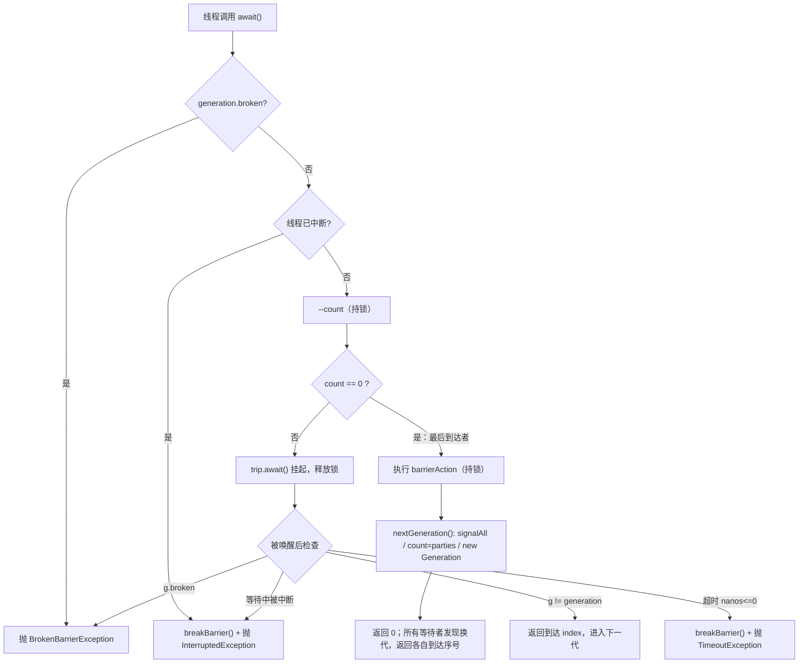
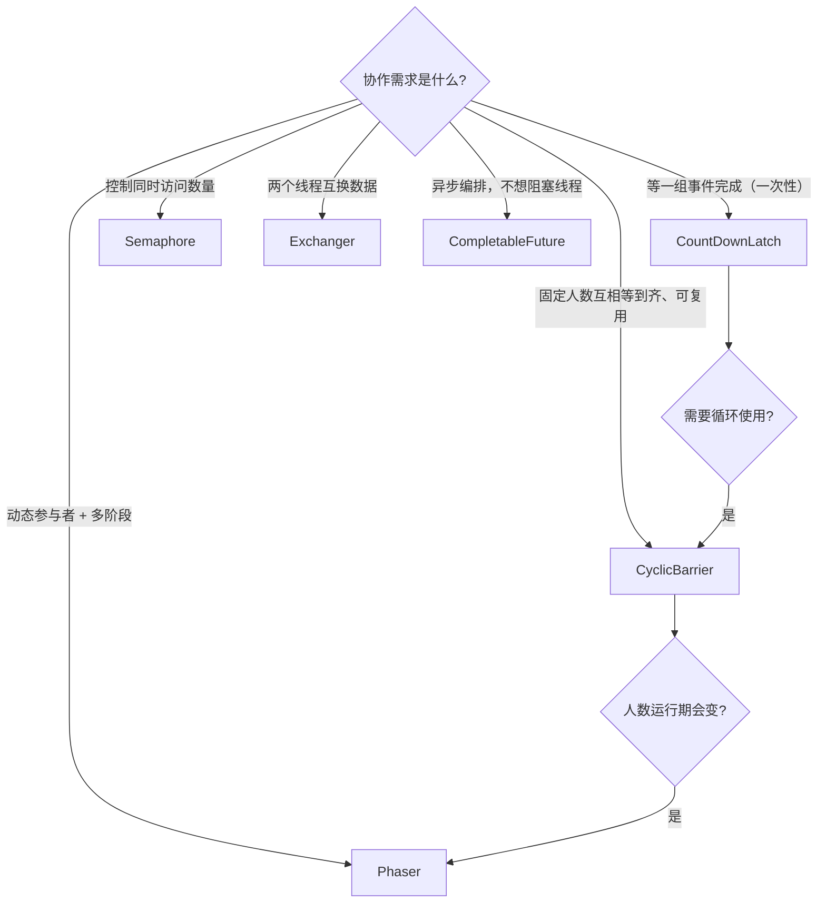

# 并发协调工具：CountDownLatch、CyclicBarrier、Semaphore 与 Phaser

> 一句话概括：`synchronized`/`Lock` 解决的是「互斥——同一时刻谁能进」，而协调工具解决的是「协作——谁等谁、等到什么条件、放行多少人」；
> 本文讲清 CountDownLatch、CyclicBarrier、Semaphore、Exchanger、Phaser 五个工具**各自把同步状态定义成什么、唤醒条件怎么写、边界在哪、什么场景选谁**。

预计阅读时间：大约 85 分钟

所属主题：[Java 并发编程常见面试题总结](summary.md)

版本基线：以 **JDK 8** 为主要基线，源码锚点用 `类名#方法名` 标注，已对照 OpenJDK（jdk8u 与当前 master）核实；JDK 17/21 的差异（Exchanger 实现重构、虚拟线程下的阻塞行为）单独注明。AQS 共享模式的通用源码骨架（`acquireSharedInterruptibly`/`doReleaseShared` 传播唤醒）归 [AQS 与锁体系](aqs-and-locks.md)，本文只讲各工具**如何定义 state 与 `tryAcquireShared`/`tryReleaseShared`**；线程池参数与用法归 [线程池](thread-pool.md)。总结文档给面试结论，本文给机制与源码证据。

---

## 0. 阅读路线

| 读者 | 建议阅读 | 关注点 |
| --- | --- | --- |
| 初级（1 年内） | 1、2.1、3.1、4、5.1、6.1、9 | 五个工具各干什么、两种 Latch 用法、必考对比表、能跑通示例 |
| 中级（1~3 年） | 2.2、3.2、5.2、6.2、7.1~7.3 | state 语义、`dowait` 走读、公平/非公平、slot+arena、Phaser 位编码 |
| 高级（3 年+） | 2.3、3.3、5.3、6.3、7.4、8.2~8.4 | broken 传播、一次性边界、许可凭空增加、arena 扩容上限、线程池死锁反例 |
| 选型/架构 | 1.3、4、7.5、8 全部 | 工具全景、选型决策图、常见误用、虚拟线程与异步编排的替代关系 |

目录：

1. 为什么需要协调工具：三类协作问题
2. CountDownLatch：一次性的事件门闸
3. CyclicBarrier：可复用的人数屏障
4. CountDownLatch vs CyclicBarrier（必考对比）
5. Semaphore：并发许可控制
6. Exchanger：两方数据交换
7. Phaser：动态多阶段同步器
8. 选型与工程踩坑
9. 高频追问集
10. 参考资料
- 附：一页速记

---

## 1. 为什么需要协调工具：三类协作问题

### 1.1 互斥之外，还有协作

**结论**：锁回答「同一时刻谁能访问共享资源」，但多线程程序还有一大类需求是**线程之间的时序协作**，锁本身表达不了。归纳起来是三类（外加两个特殊形态）：

| 协作问题 | 一句话描述 | 对应工具 |
| --- | --- | --- |
| 等待一组事件完成 | 主线程等 N 个子任务都做完再汇总；或 N 个 worker 等一声令下同时开跑 | CountDownLatch |
| 一组线程互相等待到齐 | N 个线程各自算完一段，必须全员到齐才能一起进入下一段，且反复多轮 | CyclicBarrier |
| 控制同时访问数量 | 资源只有 M 个，最多允许 M 个线程同时进入，其余排队 | Semaphore |
| 两方互换数据（特殊） | 两个线程在交换点各自交出数据、拿回对方的数据 | Exchanger |
| 动态参与者的多阶段同步（特殊） | 参与者数量运行期可变、阶段数不定的「加强版 Barrier」 | Phaser |

这五个工具都在 `java.util.concurrent` 包下，前四个 `@since 1.5`，Phaser `@since 1.7`（源码 `@since` 标签核实）。

### 1.2 join 的局限

`Thread#join` 是最原始的「等待」手段，但它有三个表达不了的场景：

| 局限 | 说明 |
| --- | --- |
| 只能等「线程结束」 | `join` 的语义是等 `isAlive() == false`。线程还活着、只是完成了某个阶段？join 无能为力 |
| 不能等「事件」而非「线程」 | 「等 3 个任务完成」不等于「等 3 个线程死亡」——线程池里的线程根本不会结束；任务提交顺序与完成顺序也无关 |
| 不能复用、无法多方互等 | join 是单向的（A 等 B），表达不了「N 个线程互相等到齐」；也没有重置语义 |

**机制补充**：JDK 8 中 `Thread#join(long)` 的实现是「以 `isAlive()` 为条件循环调用 `this.wait()`」，线程终止时由 JVM 调用该线程对象上的 `notifyAll()` 唤醒（`Thread#join` javadoc 原文，并明确建议应用代码不要对 Thread 实例使用 wait/notify）。所以 join 本质是「线程对象上的 wait/notify」，这也是它只能绑定线程生命周期的原因。线程状态与中断基础见 [线程基础与生命周期](thread-basics-and-lifecycle.md)。

### 1.3 工具全景表

| 工具 | 引入版本 | 底层实现 | 可复用性 | 参与方 | 典型场景 |
| --- | --- | --- | --- | --- | --- |
| CountDownLatch | 1.5 | AQS 共享模式，state=计数 | **一次性**，计数到 0 后永久敞开 | 任意多线程 countDown，任意多线程 await | 汇总等待、发令枪、依赖就绪门闸 |
| CyclicBarrier | 1.5 | **ReentrantLock + Condition**（不是 AQS 共享模式） | 可复用，到齐自动进入下一代 | 固定 parties 个线程互相等待 | 分阶段并行计算、多轮迭代对齐 |
| Semaphore | 1.5 | AQS 共享模式，state=许可数 | 许可随 acquire/release 动态增减 | 任意多线程 | 并发数限制、资源池、舱壁隔离 |
| Exchanger | 1.5 | 单槽 slot + 消除数组 arena（CAS + park） | 可反复交换 | **每次恰好两方** | 双线程缓冲区互换、遗传算法配对 |
| Phaser | 1.7 | 自定义 long state 位编码 + CAS（不继承 AQS） | 可复用，phase 自动推进 | **动态注册/注销**，上限 65535 | 动态参与者的多阶段任务 |

注意两个容易记错的点：**CyclicBarrier 不是直接基于 AQS 共享模式**（见 3.2），**Phaser 也不继承 AQS**（见 7.2）——「并发工具都是 AQS 包一层」是错误印象。

---

## 2. CountDownLatch：一次性的事件门闸

### 2.1 结论与两种用法

**结论**：CountDownLatch 是一个**一次性**的计数门闸：构造时给定计数 N，`countDown()` 把计数减 1，`await()` 阻塞直到计数为 0；到 0 之后所有 await 立即返回，且**计数不可重置**（javadoc 原文："This is a one-shot phenomenon -- the count cannot be reset"）。

两种经典用法方向相反，面试要能分清：

| 用法 | 计数 | 谁 await | 谁 countDown | 语义 |
| --- | --- | --- | --- | --- |
| ① 汇总模式 | count=N | 主线程（1 个） | N 个 worker 各减 1 | 等一组事件完成 |
| ② 发令枪模式 | count=1 | N 个 worker | 主线程减 1 | 让一组线程同时开跑，模拟瞬时并发 |

完整示例（两种模式组合：发令枪 + 汇总，JDK 8 可直接运行）：

```java
import java.util.Arrays;
import java.util.concurrent.*;

public class LatchDemo {
    public static void main(String[] args) throws InterruptedException {
        int n = 3;
        CountDownLatch start = new CountDownLatch(1);   // 发令枪
        CountDownLatch done  = new CountDownLatch(n);   // 汇总门闸
        long[] results = new long[n];
        ExecutorService pool = Executors.newFixedThreadPool(n);

        for (int i = 0; i < n; i++) {
            final int idx = i;
            pool.submit(() -> {
                try {
                    start.await();                      // 所有 worker 卡在起跑线
                    results[idx] = compute(idx);
                } catch (InterruptedException e) {
                    Thread.currentThread().interrupt();
                } finally {
                    done.countDown();                   // 无论成败都减计数，见 2.4
                }
            });
        }

        Thread.sleep(100);                              // 确保 worker 都已就位（演示用）
        long t0 = System.nanoTime();
        start.countDown();                              // 发令：N 个 worker 同时开跑
        boolean finished = done.await(5, TimeUnit.SECONDS);
        System.out.println(finished
                ? "sum=" + Arrays.stream(results).sum() + ", cost=" + (System.nanoTime() - t0) / 1_000_000 + "ms"
                : "超时，仍有任务未完成");
        pool.shutdown();
    }

    static long compute(int idx) throws InterruptedException {
        TimeUnit.MILLISECONDS.sleep(200);               // 模拟耗时计算
        return (idx + 1) * 100L;
    }
}
```

`results` 数组由 worker 写、主线程读，不需要额外加锁：javadoc 的 memory consistency effects 保证「`countDown()` 之前的动作 happen-before 另一线程 `await()` 成功返回之后的动作」，可见性由门闸本身建立（happen-before 规则详见 [JMM 与 volatile](jmm-and-volatile.md)）。

### 2.2 机制：AQS 共享模式，state 就是计数

CountDownLatch 内部只有一个 `Sync extends AbstractQueuedSynchronizer`，**把 AQS 的 state 直接当计数用**（源码注释："Uses AQS state to represent count"）：

```java
// CountDownLatch 构造器 → Sync(int count) { setState(count); }

// await() → sync.acquireSharedInterruptibly(1)，获取条件：
protected int tryAcquireShared(int acquires) {
    return (getState() == 0) ? 1 : -1;      // 计数为 0 才放行，否则入队 park
}

// countDown() → sync.releaseShared(1)，释放逻辑：
protected boolean tryReleaseShared(int releases) {
    for (;;) {
        int c = getState();
        if (c == 0)
            return false;                   // 已经到 0，再 countDown 是空操作
        int nextc = c - 1;
        if (compareAndSetState(c, nextc))
            return nextc == 0;              // 只有减到 0 的那一次返回 true
    }
}
```

（源码核实：`CountDownLatch.Sync#tryAcquireShared`、`CountDownLatch.Sync#tryReleaseShared`。）

三个关键设计：

1. **共享模式而非独占**：门闸打开时所有 awaiter 都要被放行。`tryAcquireShared` 返回 ≥0 表示获取成功，AQS 随后走**传播唤醒**（`doReleaseShared` 沿共享节点向后继传播），一次放行整条等待链——骨架见 [AQS 与锁体系](aqs-and-locks.md)。
2. **只有减到 0 的那次 countDown 触发唤醒**：`tryReleaseShared` 返回 `nextc == 0`，中间的减 1 返回 false，不做任何唤醒，开销只是一次 CAS。
3. **await 不消耗计数**：`tryAcquireShared` 只读 state 不改 state，所以任意多个线程可以同时 await，门闸打开后**后续 await 立即返回**（state 恒为 0）。

### 2.3 边界与代价

| 边界 | 说明 |
| --- | --- |
| 一次性，没有 reset | 计数到 0 后永久敞开，无法重置。需要循环使用 → CyclicBarrier 或 Phaser（javadoc 明确建议） |
| countDown 到 0 后是空操作 | `tryReleaseShared` 中 `c == 0 → return false`，多减不会变负，也不会报错——**计数错误是静默的** |
| `await(timeout)` 返回 boolean | 超时返回 false，**不抛 TimeoutException**（走 `tryAcquireSharedNanos`）；超时后门闸状态不变，其他线程继续等 |
| countDown 不抛受检异常 | 签名 `public void countDown()` 无 throws；但 worker 业务异常若跳过了 countDown，计数永远到不了 0 |
| `getCount()` 仅供调试 | 返回瞬时值，判断「是否完成」应该用 await 的返回值，而不是轮询 getCount |
| 计数必须与事件数严格一致 | 构造参数 N 与实际 countDown 次数不符：多了静默忽略，少了永久等待 |

### 2.4 实践与追问

**最佳实践：countDown 放 finally**。worker 里任何异常（包括 Error）都不应让主线程永久等待：

```java
try {
    doWork();
} finally {
    latch.countDown();   // 失败也要释放计数；结果是否有效由业务字段另行标记
}
```

再配合 `await(timeout)` 兜底，双保险。注意这与 Semaphore 的 `release` 放 finally 是同一个模式，但语义不同：Latch 减的是「待完成事件数」，Semaphore 还的是「占用许可」。

**与 join 对比**：

| 维度 | Thread.join | CountDownLatch |
| --- | --- | --- |
| 等待对象 | 线程终止 | 任意事件（countDown 调用） |
| 与线程池兼容 | 不兼容（池线程不终止） | 天然兼容 |
| 等待方向 | 单向，逐个 join | 一个计数聚合 N 个事件，多方 await |
| 超时语义 | `join(ms)` 超时静默返回，需再查 isAlive | `await(t,u)` 返回 false，语义清晰 |
| 复用 | 不可 | 不可（都是一次性，但 Latch 与线程解耦） |

**追问：CountDownLatch 和 CyclicBarrier 到底怎么选？** 见第 4 节对比表，口诀「Latch 等事件、Barrier 等人」。

**追问：为什么 countDown 用 CAS 而不是加锁？** 减 1 是单变量原子操作，CAS 自旋足够且无锁开销；竞争再高也只是重试，不会 park。这正是 AQS「state + CAS」设计的用武之地（CAS 基础见 [CAS 与原子类](cas-and-atomic-classes.md)）。

---

## 3. CyclicBarrier：可复用的人数屏障

### 3.1 结论与示例

**结论**：CyclicBarrier 让**固定 parties 个线程互相等待到齐**：每个线程调 `await()` 表示自己到达，最后一个到达的线程触发屏障——可选执行 `barrierAction`，然后**所有线程一起放行并自动重置计数进入下一代（generation）**，因此可以循环使用。

完整示例：3 个 worker 做两轮分阶段计算，每轮到齐后由 barrierAction 汇总：

```java
import java.util.concurrent.BrokenBarrierException;
import java.util.concurrent.CyclicBarrier;

public class BarrierDemo {
    static final int N = 3;
    static final int[] partial = new int[N];   // 各 worker 的分段结果

    public static void main(String[] args) {
        CyclicBarrier barrier = new CyclicBarrier(N, () -> {
            // 最后一个到达的线程执行（持锁），适合做阶段汇总
            int sum = 0;
            for (int v : partial) sum += v;
            System.out.println(Thread.currentThread().getName() + " 汇总: " + sum);
        });

        for (int i = 0; i < N; i++) {
            final int idx = i;
            new Thread(() -> {
                try {
                    for (int round = 1; round <= 2; round++) {
                        partial[idx] = (idx + 1) * round;          // 本阶段计算
                        System.out.println(Thread.currentThread().getName()
                                + " round " + round + " 计算完成");
                        barrier.await();                           // 到齐 → 汇总 → 下一代
                    }
                } catch (InterruptedException e) {
                    Thread.currentThread().interrupt();
                } catch (BrokenBarrierException e) {
                    System.err.println(Thread.currentThread().getName() + " 屏障已损坏");
                }
            }, "worker-" + i).start();
        }
    }
}
```

输出中每个 round 的「汇总」一定出现在该轮所有「计算完成」之后、下一轮任何「计算完成」之前。可见性由锁保证：各线程写 `partial` 后 `await`（释放锁），barrierAction 在持锁状态下读，其他线程 `await` 返回（重新获得锁）后才进入下一轮——javadoc 的 memory consistency effects 对此有明确表述。

### 3.2 机制：ReentrantLock + Condition，不是 AQS 共享模式

**这是与 CountDownLatch 最本质的实现区别**。CyclicBarrier 的字段（源码核实）：

```java
private final ReentrantLock lock = new ReentrantLock();   // 守护屏障入口
private final Condition trip = lock.newCondition();       // 到齐前在此等待
private final int parties;                                // 总人数（不变）
private final Runnable barrierCommand;                    // 到齐回调
private Generation generation = new Generation();         // 当前代
private int count;                                        // 本代还差几人，parties → 0

private static class Generation {
    boolean broken;                                       // 本代是否损坏
}
```

为什么不用 AQS 共享模式？这是**实现选择而非技术必然**：屏障语义是「等待一个复合条件（全员到齐）成立后批量唤醒，并重置状态」，`Condition.await/signalAll` 是最直接的表达；且 count、generation、barrierAction 需要在**同一把锁**下原子地读写。AQS 共享模式擅长的是「state 表达资源量/门闸状态、按 state 判定放行」（Phaser 就自己实现了类似机制，见第 7 节）。面试答「CyclicBarrier 基于 Lock+Condition，CountDownLatch 基于 AQS 共享模式」是准确的，答「都是 AQS」则错。

核心方法 `CyclicBarrier#dowait` 走读（源码核实，节选注释为本文所加）：

```java
private int dowait(boolean timed, long nanos)
    throws InterruptedException, BrokenBarrierException, TimeoutException {
    final ReentrantLock lock = this.lock;
    lock.lock();
    try {
        final Generation g = generation;
        if (g.broken)
            throw new BrokenBarrierException();          // ① 本代已损坏，直接失败
        if (Thread.interrupted()) {
            breakBarrier();                              // ② 进屏障前已被中断：损坏本代
            throw new InterruptedException();
        }
        int index = --count;                             // ③ 到达人数 +1（剩余 -1）
        if (index == 0) {                                // ④ 我是最后一个
            Runnable command = barrierCommand;
            if (command != null) {
                try { command.run(); }                   // 持锁执行回调
                catch (Throwable ex) {
                    breakBarrier();                      // 回调抛任何 Throwable 都损坏屏障
                    throw ex;
                }
            }
            nextGeneration();                            // ⑤ 唤醒所有人、开新一代
            return 0;
        }
        for (;;) {                                       // ⑥ 不是最后一个：等待
            try {
                if (!timed) trip.await();
                else if (nanos > 0L) nanos = trip.awaitNanos(nanos);
            } catch (InterruptedException ie) {
                if (g == generation && !g.broken) {
                    breakBarrier();                      // 等待中被中断：损坏本代
                    throw ie;
                } else {
                    Thread.currentThread().interrupt();  // 已换代/已损坏：中断留给后续逻辑
                }
            }
            if (g.broken) throw new BrokenBarrierException();
            if (g != generation) return index;           // 换代成功，返回到达序号
            if (timed && nanos <= 0L) {
                breakBarrier();                          // 超时：同样损坏本代
                throw new TimeoutException();
            }
        }
    } finally {
        lock.unlock();
    }
}
```

> **版本注**：上面 `index == 0` 分支的 `try { command.run(); } catch (Throwable)` 结构是当前 master 写法；jdk8u 用 `boolean ranAction` 标志 + `finally { if (!ranAction) breakBarrier(); }`，语义等价（任何 Throwable 都损坏屏障并外抛）。

配套的两个私有方法（源码核实）：

```java
private void nextGeneration() {
    trip.signalAll();              // 唤醒本代所有等待者
    count = parties;               // 计数重置
    generation = new Generation(); // 新一代（broken=false）
}

private void breakBarrier() {
    generation.broken = true;      // 标记本代损坏
    count = parties;
    trip.signalAll();              // 唤醒所有等待者，让它们抛 BrokenBarrierException
}
```

generation（代）的流转：



**「代」是复用与隔离的关键**：等待线程持有的是旧 Generation 的引用 `g`，被唤醒后通过 `g != generation` 判断「是正常换代还是出了事」。新一代的线程与上一代的残留状态互不干扰。

### 3.3 边界与代价：broken 传播

**结论：CyclicBarrier 是「一损俱损」的**——任何一个参与方失败，整代所有等待线程都抛 `BrokenBarrierException`。触发 broken 的四种情形（全部在 `dowait`/`reset` 中核实）：

| 触发源 | 行为 |
| --- | --- |
| 某等待线程被中断 | `breakBarrier()` + 该线程抛 InterruptedException，其余抛 BrokenBarrierException |
| 某等待线程 `await(timeout)` 超时 | `breakBarrier()` + 该线程抛 TimeoutException，其余抛 BrokenBarrierException |
| barrierAction 抛出 Throwable | `breakBarrier()` + 异常抛给最后到达的线程，其余抛 BrokenBarrierException |
| 外部调用 `reset()` | 先 `breakBarrier()` 再 `nextGeneration()`：当前代等待者全部收到 BrokenBarrierException，屏障开新一代 |

这与 CountDownLatch 形成鲜明对比：Latch 的某个 worker 失败（只要 finally 里 countDown 了）**不影响其他线程**，门闸照常打开；Barrier 的失败会**传染全组**。设计意图不同：分阶段计算里一方失败后其他方的结果往往已无意义，快速失败优于继续空转。

其他边界：

- **broken 后必须 reset 才能恢复**：损坏的屏障不会自愈，后续 await 直接抛 BrokenBarrierException；`reset()` 是唯一恢复手段（代价是再牺牲一代）。
- **barrierAction 在最后一个到达线程上持锁执行**：回调里做耗时操作会阻塞所有其他线程的放行；回调抛异常会损坏屏障。回调要短、要稳。
- **await 返回到达序号**：最后一个到达返回 0，第一个返回 parties-1。可以用 `if (barrier.await() == 0)` 选出一个「领导线程」做汇总，替代 barrierAction。
- **parties 与实际线程数不符 = 永久等待**：构造 parties=4 但只有 3 个线程 await，第 4 个永远不来，3 个线程全部卡死（无超时版本）。这是高频事故，见 8.2。
- **reset 与正常换代竞争**：reset 可能把「即将正常到齐」的一代打断，使用 reset 要有明确的外部协调理由。

### 3.4 实践与追问

**实践**：分阶段并行计算（如迭代式数值计算、MapReduce 的本地模拟）是 CyclicBarrier 的主场；每轮用 barrierAction 汇总并决定是否继续。给 await 加超时，避免一方卡死拖住全组；捕获 BrokenBarrierException 后走降级/终止逻辑，而不是无脑重试。

**追问：CyclicBarrier 为什么叫 Cyclic？** 因为 `nextGeneration()` 自动重置计数并换代，同一实例可无限轮次使用；CountDownLatch 到 0 即废。

**追问：最后一个线程执行 barrierAction 时其他线程在干什么？** 还 park 在 `trip` 的条件队列上（`nextGeneration` 尚未调用）；回调执行完才 signalAll。所以回调耗时 = 全组等待耗时。

**追问：等待中的线程被中断，为什么有时不抛 InterruptedException？** `dowait` 的 catch 块区分两种情况：若仍在本代且未损坏，中断属于本次等待 → breakBarrier + 抛出；若已换代或已损坏，说明等待本来就要结束，中断「属于后续执行」→ 只恢复中断标志（`Thread.currentThread().interrupt()`），让上层业务感知。这个细节体现了中断语义的严谨处理。

---

## 4. CountDownLatch vs CyclicBarrier（必考对比）

**一句话结论**：Latch 是「一个/多个线程等**一组事件**完成」，Barrier 是「**一组线程互相等**到齐」；前者一次性、后者可循环；前者失败隔离、后者一损俱损。

| 维度 | CountDownLatch | CyclicBarrier |
| --- | --- | --- |
| 底层实现 | AQS 共享模式（state=计数） | ReentrantLock + Condition（count/generation 在锁内维护） |
| 计数方向 | 从 N **减到 0**（countDown） | 剩余数从 parties 减到 0，等价于到达数**加到 parties**（await） |
| 可复用 | 一次性，无 reset | 自动换代复用；另有手动 reset |
| 等待关系 | 一个/多个线程等事件，事件方与等待方可以是不同线程 | parties 个线程互相等待，每个参与方既到达又等待 |
| 到齐回调 | 无 | barrierAction，最后到达线程持锁执行 |
| 异常影响 | countDown 无受检异常；某 worker 失败不影响门闸打开（前提 finally countDown） | 任一方中断/超时/回调异常 → 全代 BrokenBarrierException |
| 超时行为 | `await(t,u)` 返回 false，不损坏门闸 | `await(t,u)` 抛 TimeoutException 并**损坏屏障** |
| 典型场景 | 主线程汇总 N 个子任务；发令枪模拟并发 | 多线程分阶段计算、多轮迭代对齐 |

**场景口诀：Latch 等事件，Barrier 等人。**

- 「等事件」：计数代表**事件**，线程做完事减一下就走，不必留在原地等别人——所以 countDown 之后线程可以继续干别的甚至结束。
- 「等人」：计数代表**人**，每个线程必须亲自到场并**原地等到全员到齐**才一起走——所以 await 既是「报到」也是「等待」。

**追问：能用 CountDownLatch 模拟 CyclicBarrier 吗？** 单轮可以（N 个线程各 countDown 再 await 同一个 latch，近似「到齐放行」），但多轮不行——latch 不能重置，每轮都要 new 一个，且没有 barrierAction、没有 broken 传播，等待中的线程也无法感知同伴失败。这正是 CyclicBarrier 存在的理由。

**追问：发令枪为什么不用 CyclicBarrier(N+1)？** 可以但不自然：主线程也得参与 await 凑人数，而发令枪语义是「主线程发令后不等待」；count=1 的 latch 让主线程 countDown 即走，worker 各自 await，职责更清晰。

---

## 5. Semaphore：并发许可控制

### 5.1 结论与示例

**结论**：Semaphore 维护一组**许可（permits）**：`acquire()` 取走一个许可（没有则阻塞），`release()` 归还一个许可；**同一时刻最多有「许可数」个线程持有许可**，因此它控制的是**并发数**，不是速率。

完整示例：10 个线程访问某资源，最多允许 3 个同时进行：

```java
import java.util.concurrent.Semaphore;
import java.util.concurrent.TimeUnit;

public class SemaphoreDemo {
    private static final Semaphore LIMIT = new Semaphore(3);   // 默认非公平

    public static void main(String[] args) {
        for (int i = 0; i < 10; i++) {
            final int id = i;
            new Thread(() -> {
                try {
                    LIMIT.acquire();                  // 拿不到许可就排队
                    try {
                        System.out.println("task-" + id + " 进入，当前并发≈"
                                + (3 - LIMIT.availablePermits()));
                        TimeUnit.MILLISECONDS.sleep(300);   // 模拟访问受限资源
                    } finally {
                        LIMIT.release();              // 务必 finally 归还
                    }
                } catch (InterruptedException e) {
                    Thread.currentThread().interrupt();
                }
            }, "t-" + i).start();
        }
    }
}
```

任何时刻打印的「进入」线程不超过 3 个。快速失败变体：`if (!LIMIT.tryAcquire(200, TimeUnit.MILLISECONDS)) { /* 降级 */ }`——超时返回 false，不抛异常。

### 5.2 机制：AQS 共享模式，state 就是许可数

与 CountDownLatch 同属 AQS 共享模式，但 state 语义不同：**Latch 的 state 单调递减到 0 即终点；Semaphore 的 state 在 acquire/release 间双向增减，是「当前可用资源量」**。

```java
// Semaphore.Sync#nonfairTryAcquireShared（非公平获取，源码核实）
final int nonfairTryAcquireShared(int acquires) {
    for (;;) {
        int available = getState();
        int remaining = available - acquires;
        if (remaining < 0 ||                       // 不够：返回负数 → AQS 入队 park
            compareAndSetState(available, remaining))
            return remaining;                      // 够：CAS 扣减，返回剩余（≥0 成功）
    }
}

// Semaphore.Sync#tryReleaseShared（归还，源码核实）
protected final boolean tryReleaseShared(int releases) {
    for (;;) {
        int current = getState();
        int next = current + releases;
        if (next < current)                        // int 溢出
            throw new Error("Maximum permit count exceeded");
        if (compareAndSetState(current, next))
            return true;                           // 恒 true → 每次都触发共享传播唤醒
    }
}
```

对照 AQS 共享骨架（[AQS 与锁体系](aqs-and-locks.md)）：`tryAcquireShared` 返回负数 → 入队阻塞；`tryReleaseShared` 返回 true → `doReleaseShared` 唤醒后继。与 Latch 的「只有减到 0 才唤醒」不同，Semaphore **每次 release 都唤醒**，因为每归还一个许可就可能放行一个等待者。

**公平与非公平**（构造器 `Semaphore(int permits)` 默认非公平，`Semaphore(int permits, boolean fair)` 可选）：

```java
// FairSync#tryAcquireShared（源码核实）
protected int tryAcquireShared(int acquires) {
    for (;;) {
        if (hasQueuedPredecessors())               // 队列里有前驱 → 不抢，直接排队
            return -1;
        int available = getState();
        int remaining = available - acquires;
        if (remaining < 0 || compareAndSetState(available, remaining))
            return remaining;
    }
}
```

非公平版新线程可以直接 CAS 抢许可（可能插队成功），吞吐更高但可能饿死等待者；公平版先查 `hasQueuedPredecessors()`，严格 FIFO。这与 ReentrantLock 的公平/非公平是同一套思路。

**API 与中断语义**：

| 方法 | 阻塞 | 中断响应 | 超时 |
| --- | --- | --- | --- |
| `acquire()` | 是 | 抛 InterruptedException | 无 |
| `acquireUninterruptibly()` | 是 | **不响应**（内部走 `acquireShared`，中断标志保留到返回后） | 无 |
| `tryAcquire()` | 否 | — | 立即返回 true/false |
| `tryAcquire(t, u)` | 限时 | 抛 InterruptedException | 超时返回 false |
| `acquire(n)` / `release(n)` | 批量取/还 n 个许可 | 同上 | — |

`acquireUninterruptibly` 用于「必须拿到资源、不允许中途放弃」的清理/收尾路径——代价是线程可能无限期阻塞且无法被中断取消。

### 5.3 边界与代价

**① release 不要求先 acquire——许可可以凭空增加**。javadoc 原文："There is no requirement that a thread that releases a permit must have acquired that permit by calling acquire. Correct usage of a semaphore is established by programming convention in the application." 实现上 `release()` 就是 `sync.releaseShared(1)`，没有任何「当前线程是否持有许可」的检查（AQS 共享模式也不记录持有者）。

这带来一个有用能力和一个事故源：

- **有用**：运行期动态扩容。`sem.release(5)` 直接让许可 +5，无需重建 Semaphore；配合 protected 的 `reducePermits` 可以缩容（见 5.4）。
- **事故**：重复 release（比如 finally 里 release 了、异常分支又 release 一次）会让许可**越还越多**，并发上限悄悄失效，且没有任何报错。约定「acquire 与 release 严格配对、release 只出现在 finally」是唯一的防线。

**② 许可数可以是负数**：构造器 javadoc 明确 permits 可为负，此时必须先 release 足够次数才有 acquire 能成功——可用于「先闭闸、就绪后开闸」的门闸用法。

**③ 上限是 Integer.MAX_VALUE**：state 是 int，`tryReleaseShared` 检测到溢出抛 `Error("Maximum permit count exceeded")`；`reducePermits` 下溢同样抛 Error。

**④ 并发数控制 ≠ 速率控制**。Semaphore 限制的是**同时在场的线程数**，不是每秒请求数：10 个许可、每个操作 1ms，理论吞吐可达上万 QPS；操作变成 1s，吞吐就掉到 10 QPS。**吞吐随下游延迟漂移**，这正是它和令牌桶/漏桶的本质区别——令牌桶（如 Guava RateLimiter）按时间发放令牌控制速率，漏桶恒定速率流出。要「保护下游不被压垮」用 Semaphore（舱壁），要「平滑流量/配额」用速率限流器，两者经常组合使用。

**⑤ `availablePermits()` 是瞬时值**：只适合监控与调试，不要用它做「先检查再 acquire」的决策（检查与获取之间状态会变），直接用 acquire/tryAcquire。

### 5.4 实践与追问

**动态调整许可**的完整写法（`reducePermits` 是 protected，需要子类暴露）：

```java
import java.util.concurrent.Semaphore;

public class ResizableSemaphore extends Semaphore {
    public ResizableSemaphore(int permits) { super(permits); }

    public void expand(int extra)  { release(extra); }        // 凭空加许可
    public void shrink(int fewer)  { reducePermits(fewer); }  // 直接扣减可用许可
    // 注意：shrink 只扣「可用」许可，已被占用的许可不受影响，
    // 实际并发上限要等占用者归还后才收敛到新值
}
```

**典型场景**：连接池/对象池（许可数=池容量，acquire 拿资源、release 还资源）、接口舱壁隔离（每个下游一个 Semaphore，防止单个慢依赖拖垮全部线程）、稀缺资源访问（如限制同时压缩/导出的任务数）。资源池场景里许可与真实资源必须一一对应，否则「拿到许可却拿不到资源」——许可只是入场券，不是资源本身。

**追问：Semaphore 能当互斥锁用吗？** 能，`new Semaphore(1)` 近似互斥，但它**不可重入**（同一线程二次 acquire 会把自己锁死）、不记录持有者、任何线程都能 release——需要锁语义请用 ReentrantLock（见 [AQS 与锁体系](aqs-and-locks.md)）。

**追问：为什么 release 不校验持有者？** 共享模式的 state 是「资源总量」而非「谁持有」，AQS 不维护共享持有者集合；校验需要额外的线程登记结构，得不偿失。灵活性（异步归还、动态扩容）与安全性（严格配对）的取舍交给了应用层约定。

---

## 6. Exchanger：两方数据交换

### 6.1 结论与示例

**结论**：Exchanger 是**恰好两个线程**的交换点：双方各自调用 `exchange(V x)` 交出数据并阻塞，配对成功后各自拿回对方的数据返回。javadoc 把它定位为「双向的 SynchronousQueue」，典型场景是遗传算法与管道设计（javadoc 原文）。

完整示例：生产者与消费者互换缓冲区——生产者交出满缓冲区、换回空缓冲区继续填；消费者交出空缓冲区、换回满缓冲区处理：

```java
import java.util.ArrayList;
import java.util.List;
import java.util.concurrent.Exchanger;

public class ExchangerDemo {
    public static void main(String[] args) {
        Exchanger<List<String>> ex = new Exchanger<>();

        Thread producer = new Thread(() -> {
            List<String> buf = new ArrayList<>();
            try {
                for (int batch = 1; batch <= 3; batch++) {
                    for (int i = 0; i < 3; i++) buf.add("data-" + batch + "-" + i);
                    buf = ex.exchange(buf);          // 交出满的，换回空的
                }
                buf.clear();
                ex.exchange(buf);                    // 空列表作为结束信号
            } catch (InterruptedException e) { Thread.currentThread().interrupt(); }
        }, "producer");

        Thread consumer = new Thread(() -> {
            List<String> buf = new ArrayList<>();
            try {
                while (true) {
                    buf = ex.exchange(buf);          // 交出空的，换回满的
                    if (buf.isEmpty()) break;        // 收到结束信号
                    System.out.println("consume: " + buf);
                    buf.clear();
                }
            } catch (InterruptedException e) { Thread.currentThread().interrupt(); }
        }, "consumer");

        producer.start();
        consumer.start();
    }
}
```

相比 `SynchronousQueue` 的单向传递，Exchanger 一次配对完成**双向**交接，缓冲区在两个线程间循环复用，零分配、零拷贝。

### 6.2 机制：单槽 slot + 消除数组 arena（JDK 8）

**结论**：Exchanger 的朴素实现是「一个共享槽位，先到者 CAS 放入自己的 Node 并 park，后到者 CAS 取走、写入 match、unpark 对方」。但单点 CAS 在多参与者下竞争剧烈，所以 JDK 8 实现采用**单槽起步、检测到竞争再启用多槽 arena** 的两级结构（`Exchanger#slotExchange`、`Exchanger#arenaExchange`，jdk8u 源码核实）：

| 结构 | 作用 |
| --- | --- |
| `volatile Node slot` | 单槽：无竞争时所有交换走这里，路径最短 |
| `volatile Node[] arena` | 消除数组：竞争出现后启用，线程按各自随机索引分散到不同槽位配对 |
| `volatile int bound` | arena 最大有效索引 + 版本序号（SEQ 高位），CAS 更新 |
| `FULL = NCPU >>> 1`（上限 MMASK=255） | arena 索引硬上限，约为核数一半 |
| `Participant extends ThreadLocal<Node>` | 每线程一个 Node（item/match/parked/index/seed 等），避免重复分配 |

关键流转（源码核实）：

1. `exchange(x)` 先把 null 翻译成哨兵 `NULL_ITEM`（所以 **null 可以交换**），然后分派：arena 已启用走 `arenaExchange`，否则走 `slotExchange`。
2. `slotExchange` 中单槽 CAS 失败即视为竞争信号：`NCPU > 1 && bound == 0` 时 `CAS(bound, 0, SEQ)` 保证 arena **只构造一次**，随后调用方改道 `arenaExchange`。
3. `arenaExchange` 用每线程的随机种子（xorshift）选槽，CAS offer/release 配对；在某个槽上冲突累计到阈值才把 arena 扩大一格。
4. **到达 FULL 上限后不再扩容，而是循环遍历已有槽位**（`m == FULL` 分支：记一次冲突、索引回退循环）——注意不是「退回单槽」，单槽只是竞争出现前的默认路径。
5. 配对成功：释放方 `q.match = item` 写入对方数据并 unpark；等待方醒来读 match 返回。

这个「分散热点、降低单点 CAS 冲突」的思路与 LongAdder 的 Cell 分段完全同源（见 [CAS 与原子类](cas-and-atomic-classes.md)）；区别是 LongAdder 分散的是累加，Exchanger 分散的是**配对 rendezvous**，且必须保证任意两方最终能碰上（所以有循环遍历与收缩机制）。

**版本差异**：OpenJDK 当前 master 已重构为 `Slot[] arena`（`@Contended` 填充避免伪共享）+ 实例字段 `ncpu`，不再有 `slot`/`FULL` 字段；「单槽起步、竞争扩容、上限封顶」的设计思想不变。具体重构落地的 JDK 版本号未逐一核实，本文按 JDK 8 结构描述。

### 6.3 边界与代价

- **只能两方**：一次 exchange 恰好配对两个线程。投入 3 个以上线程会**随机两两配对**，落单者阻塞等待——它不是 N 方广播，也不是队列。
- **可中断、可超时**：`exchange(V)` 抛 InterruptedException；`exchange(V, long, TimeUnit)` 超时抛 TimeoutException。一方中断/超时离开后，另一方继续等下一个配对者（没有 CyclicBarrier 式的 broken 传染）。
- **内存可见性**：javadoc 保证每对成功交换的线程之间，exchange 前的动作 happen-before 对方 exchange 返回后的动作——所以示例中缓冲区内容无需额外同步。
- **忙等 + park 混合**：arena 路径先自旋（SPINS 与核数相关）再 park，短交换延迟低，但长时间等不到配对者会占用 CPU 自旋窗口。

### 6.4 实践与追问

**适用**：双线程管道（填充/清空缓冲区）、遗传算法中两个个体交换基因片段、任何「成对协作、互换工作成果」的模型。**不适用**：多方汇聚（用 Latch/Barrier）、单向传递（用 SynchronousQueue/BlockingQueue）。

**追问：Exchanger 和 SynchronousQueue 什么关系？** SynchronousQueue 是「一手交钱一手交货」的单向移交（put/take 配对），Exchanger 是双向互换（双方都带数据来、都带数据走）。javadoc 原话：Exchanger 可视为双向形式的 SynchronousQueue。

**追问：为什么 arena 能降低竞争却不破坏配对正确性？** 槽位只是「碰头地点」，线程在槽间循环迁移，任意两个活跃线程最终会在某个槽相遇；CAS offer/release 保证一个槽同一时刻只成就一对交换。分散的是竞争热点，不是配对语义。

---

## 7. Phaser：动态多阶段同步器（JDK 7+）

### 7.1 结论与定位

**结论**：Phaser（`@since 1.7`）是「可复用 + 参与者数量动态可变 + 多阶段」的同步器，javadoc 自述「功能类似 CyclicBarrier 和 CountDownLatch 但支持更灵活的用法」。三个独有能力：

| 能力 | API | 对比 |
| --- | --- | --- |
| 动态注册/注销参与者 | `register()` / `bulkRegister(int)` / `arriveAndDeregister()` | Latch 计数构造时定死；Barrier parties 定死 |
| 多阶段自动推进 | `arriveAndAwaitAdvance()`，phase 0 → 1 → 2 … | Barrier 有代但无显式阶段号与阶段钩子 |
| 阶段完成钩子 | `onAdvance(int phase, int registeredParties)` 返回 true 终止 | Barrier 的 barrierAction 只能做动作，不能决定终止 |

### 7.2 机制：一个 long state 的位编码

Phaser **不继承 AQS**，自己用一个 `volatile long state` 编码全部同步状态（源码核实）：

| 位段 | 含义 | 常量 |
| --- | --- | --- |
| bit 0~15 | unarrived：本阶段尚未到达的参与者数 | `UNARRIVED_MASK = 0xffff` |
| bit 16~31 | parties：注册参与者总数 | `PARTIES_SHIFT = 16`，`MAX_PARTIES = 0xffff`（65535） |
| bit 32~62 | phase：当前阶段号 | `PHASE_SHIFT = 32`，`MAX_PHASE = Integer.MAX_VALUE` |
| bit 63 | terminated：终止标志 | `TERMINATION_BIT = 1L << 63` |

特殊值 `EMPTY = 1` 表示「0 个参与者」的初始态（0 parties + 1 unarrived 的非法组合被用作哨兵）。所有变更都是对 state 的 CAS：

- `register()` → `doRegister(1)`：一次 CAS 同时给 parties 和 unarrived 各 +1（`adjust = (registrations << 16) | registrations`）；超过 65535 抛 IllegalStateException（`Phaser#doRegister` 核实）。
- `arrive()` → `doArrive(ONE_ARRIVAL)`：unarrived -1，**不等待**，返回当前 phase。
- `arriveAndDeregister()` → `doArrive(ONE_DEREGISTER)`：unarrived 与 parties 同时 -1，用于「我干完了，以后别再等我」。
- `arriveAndAwaitAdvance()`：先 CAS 减 unarrived；若减完仍 >0，挂起等待本阶段结束；**若我是最后一个（unarrived 减到 0）**，由我执行推进：调用 `onAdvance(phase, nextParties)`，返回 true 则置终止位，否则 phase 推进为 `(phase + 1) & MAX_PHASE`（到 Integer.MAX_VALUE 后回绕到 0），重置 unarrived=parties，`releaseWaiters(phase)` 唤醒所有等待者（`Phaser#arriveAndAwaitAdvance` 核实）。

等待队列按阶段奇偶分成 `evenQ`/`oddQ` 两条（入队时 `(phase & 1) == 0 ? evenQ : oddQ`，源码核实），相邻阶段的等待者互不干扰——这是「代」思想在 Phaser 里的对应物。另一个工程细节：等待节点 `QNode implements ForkJoinPool.ManagedBlocker`，阻塞走 `ForkJoinPool.managedBlock`（源码核实），在 ForkJoinPool 里等待时会触发补偿线程，不至于饿死并行度——Phaser 与 ForkJoin 体系是刻意亲和的（见 [ForkJoin 与 CompletableFuture](forkjoin-and-completable-future.md)）。

### 7.3 用法示例：动态任务分阶段

完整示例：3 个任务分 3 个阶段执行，task-2 在第 1 阶段后提前退出（动态减员），主线程注册自己防止提前推进、随后注销：

```java
import java.util.concurrent.Phaser;

public class PhaserDemo {
    public static void main(String[] args) {
        Phaser phaser = new Phaser(1) {            // 主线程先注册自己，占住一个 party
            @Override
            protected boolean onAdvance(int phase, int registeredParties) {
                System.out.println("== phase " + phase + " 完成，剩余参与者=" + registeredParties);
                return phase >= 2 || registeredParties == 0;   // 3 个阶段后终止
            }
        };

        for (int i = 0; i < 3; i++) {
            final int id = i;
            phaser.register();                     // 启动前由主线程注册，避免注册/注销竞态（见 7.4）
            new Thread(() -> {
                for (int p = 0; p <= 2; p++) {
                    System.out.println("task-" + id + " 执行 phase " + p);
                    if (p == 1 && id == 2) {
                        phaser.arriveAndDeregister();   // task-2 提前退出，后续阶段不再等它
                        return;
                    }
                    phaser.arriveAndAwaitAdvance();     // 到达并等待本阶段全员到齐
                }
                phaser.arriveAndDeregister();
            }, "task-" + id).start();
        }

        phaser.arriveAndDeregister();              // 主线程注销：后续阶段只由 worker 推进
    }
}
```

`onAdvance` 由**最后一个到达的线程**执行（与 barrierAction 相同的位置），返回 true 后 phaser 终止：后续 arrive 类方法返回负数 phase、不再阻塞，`isTerminated()` 为 true。终止前的阶段号可用 `getPhase() + Integer.MIN_VALUE` 还原（javadoc 核实）。

**替代 CountDownLatch 的官方惯用法**（javadoc 原文模式）：`new Phaser(1)` 注册自己 → 为每个任务 `register()` 并启动 → 自己 `arriveAndDeregister()`。参与者数量运行期才确定时，这比「先数清楚再 new CountDownLatch(N)」灵活得多。

### 7.4 边界与代价

| 边界 | 说明 |
| --- | --- |
| 参与者上限 65535 | parties 只有 16 位，超出抛 IllegalStateException；CyclicBarrier 无此限制 |
| `arriveAndAwaitAdvance()` **不可中断** | 签名无 throws InterruptedException；类 javadoc 明确「与 CyclicBarrier 不同，awaitAdvance 即使等待线程被中断也继续等待」。实现上中断只被记录，等待结束后用 `Thread.currentThread().interrupt()` 恢复标志（`Phaser#internalAwaitAdvance` 核实）。需要可中断/超时等待用 `awaitAdvanceInterruptibly(int phase[, long, TimeUnit])`，且中断/超时退出**不改变 phaser 状态**（不像 Barrier 会 broken） |
| 没有 broken 传染 | 一方失败不会让其他方抛异常；失败方应 `arriveAndDeregister()` 退出，否则其他方永久等它。失败语义要自己设计 |
| 注册/注销竞态 | 若主线程 `Phaser(1)` 后立刻 `arriveAndDeregister()`，而 worker 还没来得及 register，parties 归 0 → 默认 `onAdvance` 返回 true → **phaser 直接终止**。所以要么启动前预注册（本文示例），要么主线程用 `arriveAndAwaitAdvance()` 参与第 0 阶段 |
| 到达次数必须与注册匹配 | 未注册就 arrive、或 arrive 次数超过 unarrived，抛 IllegalStateException（`badArrive`）；多阶段循环里提前 return 的分支要格外小心 |
| onAdvance 抛异常 | 异常抛给最后到达的线程，phaser 状态可能停在半推进状态——钩子要短且稳 |

**分层 Phaser（tiering）**：参与者极多时，单个 state 的 CAS 会成为热点。可以构造树形结构——`new Phaser(parent)` 或 `new Phaser(parent, parties)`，子 phaser 的最后一个到达者代表整组向 parent 到达（`parent.doArrive(...)`，源码核实），把竞争从「N 个线程抢一个 state」降为「组内竞争 + 少量组间竞争」。javadoc 明确这是用更高的单次操作开销换吞吐。子 phaser 参与者从 0 变非 0 时自动注册到 parent、归 0 时自动注销（javadoc 核实）。思路与 Exchanger arena、LongAdder 分段一脉相承。

### 7.5 为什么日常用得少

**结论**：Phaser 能力最全，但**复杂度也最高**——位编码状态机、注册/注销竞态、不可中断等待、终止语义，每一个都是认知负担。工程上绝大多数场景是「固定人数、固定阶段」：

- 一次性等事件 → CountDownLatch，三行代码讲清楚；
- 固定人数循环对齐 → CyclicBarrier，语义直观、broken 快速失败；
- 异步任务编排 → CompletableFuture 组合子（见 [ForkJoin 与 CompletableFuture](forkjoin-and-completable-future.md)），根本不需要线程互相阻塞等待；
- 真正需要「运行期动态增减参与者 + 多阶段 + 阶段钩子」的场景（如分阶段仿真、动态波次任务）才值得请出 Phaser。

**追问：Phaser 能完全替代 Latch 和 Barrier 吗？** 功能上基本能（javadoc 给了两者的替代惯用法），但语义有差：无 broken 传染、arriveAndAwaitAdvance 不可中断、65535 上限、无 barrierAction（onAdvance 更强大但也更危险）。替代与否看团队对复杂度的承受力，不是「越新越好」。

---

## 8. 选型与工程踩坑

### 8.1 选型决策

| 需求 | 首选 | 理由 |
| --- | --- | --- |
| 等一组事件完成（一次性） | CountDownLatch | 最简单，事件与线程解耦 |
| 固定一组线程互相等到齐、循环多轮 | CyclicBarrier | 自动换代 + barrierAction + broken 快速失败 |
| 限制同时访问某资源的线程数 | Semaphore | 许可=容量，acquire/release 配对 |
| 两个线程互换数据 | Exchanger | 双向配对，缓冲区零拷贝复用 |
| 参与者动态变化 + 多阶段 + 阶段钩子 | Phaser | 唯一支持动态注册的多阶段同步器 |
| 异步任务编排（不想阻塞线程） | CompletableFuture | 组合子表达依赖，无需互相等待（见 [ForkJoin 与 CompletableFuture](forkjoin-and-completable-future.md)） |
| JDK 21+ 虚拟线程上的结构化协作 | 结构化并发 / CompletableFuture | 见 [虚拟线程](virtual-threads.md) |



### 8.2 常见误用清单

| 误用 | 后果 | 正解 |
| --- | --- | --- |
| 用 CountDownLatch 做可复用屏障 | 第二轮计数已为 0，await 直接穿透，「到齐」语义失效 | CyclicBarrier / Phaser |
| Semaphore 当速率限流 | 限的是并发数，吞吐随下游延迟漂移，慢调用时限不住 QPS、快调用时过度放行 | 速率用令牌桶/漏桶；Semaphore 只做舱壁 |
| Barrier parties 与实际线程数不符 | 少一个线程 → 其余永久等待；多一个线程 → 多出的线程提前触发换代，节奏错乱 | parties 由参与方数量唯一确定；await 加超时兜底 |
| Semaphore release 不配对 | 许可越还越多，并发上限静默失效 | acquire 成功后立刻 try/finally release；禁止「补还」 |
| countDown 不在 finally | worker 异常 → 计数永不归零 → 主线程永久 await | finally countDown + await 超时双保险 |
| barrierAction 里做耗时 IO | 持锁执行，全组放行被拖住；抛异常还会 broken | 回调只做轻量汇总，重活交给异步任务 |
| Phaser 主线程过早 arriveAndDeregister | parties 归 0，默认 onAdvance 直接终止 | 启动前预注册，或主线程参与第 0 阶段 |

### 8.3 线程池 + Barrier 的经典死锁（完整反例）

**结论：把「互相等待到齐」的任务提交到线程数小于 parties 的池里，必然死锁**——屏障等待占住池线程，凑齐人数所需的任务却还在队列里排不上号。

```java
import java.util.concurrent.*;

public class PoolBarrierDeadlock {
    public static void main(String[] args) {
        ExecutorService pool = Executors.newFixedThreadPool(2);   // 只有 2 个池线程
        CyclicBarrier barrier = new CyclicBarrier(3);             // 却要 3 方到齐

        for (int i = 0; i < 3; i++) {
            pool.submit(() -> {
                try {
                    System.out.println(Thread.currentThread().getName() + " 到达屏障");
                    barrier.await();                              // 占住池线程无限等待
                    System.out.println(Thread.currentThread().getName() + " 通过");
                } catch (Exception e) {
                    e.printStackTrace();
                }
            });
        }
        // 结果：2 个任务占满池线程卡在 await，第 3 个任务在无界队列里永远排不到线程
        // 「通过」永远不会打印，池也无法正常关闭
    }
}
```

死锁链条：任务 3 需要池线程 → 池线程被任务 1/2 占用 → 任务 1/2 在等任务 3 到达屏障 → 循环等待。`newFixedThreadPool` 的无界队列让第 3 个任务**静默排队**，连拒绝异常都没有，比直接报错更难发现（线程池参数与队列行为见 [线程池](thread-pool.md)）。

**修复方案**（按优先级）：

1. **池线程数 ≥ parties**（本例 `newFixedThreadPool(3)`），且要确认同一池里没有其他会长期占用线程的任务；
2. **await 加超时**：`barrier.await(5, TimeUnit.SECONDS)` 超时后 broken 快速失败，至少能暴露问题而不是永久挂起；
3. **换思路**：分阶段协作用 CompletableFuture 编排（`allOf` 汇聚每阶段），不阻塞池线程；或每方用独立线程/虚拟线程，让「等待」不占用稀缺的池线程。

同构的坑也发生在 CountDownLatch 上：向固定池提交 N 个任务，任务内部又 await 另一个「由同池任务 countDown」的 latch——只要等待方占满了池，计数方就排不上号。**原则：会阻塞等待协作的任务，不要和「解除该等待所必需的任务」共享同一个有界线程池。**排查手段（jstack 看 WAITING 栈、池活跃度监控）见 [死锁与排查](deadlock-and-troubleshooting.md)。

### 8.4 虚拟线程下的协调工具（JDK 21+）

**结论：这五个工具在虚拟线程上依然可用，且阻塞代价大幅降低**。它们的阻塞最终都落在 `LockSupport.park`（CyclicBarrier 走 ReentrantLock/Condition，Condition.await 底层同样是 park；Exchanger 在 jdk8u 走 `Unsafe.park`，其重构为 `LockSupport.park` 的落地版本待核），虚拟线程 park 时会 **unmount** 释放载体线程，不再「一个等待占一个 OS 线程」（机制见 [虚拟线程](virtual-threads.md)）。两点注意：

- CyclicBarrier 内部用的是 ReentrantLock 而非 synchronized，**不会触发虚拟线程 pinning**；但如果你的 barrierAction 或业务代码里有 synchronized 块内阻塞，仍会钉住载体线程。
- 8.3 的池死锁在虚拟线程下**形态变化但未消失**：`newFixedThreadPool` 的池线程是平台线程，反例依旧成立；换成「每任务一个虚拟线程」后等待不再稀缺，但 parties 与实际参与方数量不符的逻辑错误照样永久等待。JDK 21 的结构化并发（预览）提供了另一种「任务组协作」的表达，选型时一并考虑。

---

## 9. 高频追问集

临场快答，每题给期望答案要点（机制细节见对应章节）：

1. **CountDownLatch 为什么是一次性的？** state 减到 0 后 `tryReleaseShared` 对 0 直接返回 false，没有任何重置入口；javadoc 明确 one-shot。要复用选 CyclicBarrier/Phaser。（2.2/2.3）
2. **countDown 和 await 的底层分别走 AQS 哪条路？** countDown → `releaseShared(1)` → `tryReleaseShared` CAS 减 1，减到 0 返回 true 触发共享传播唤醒；await → `acquireSharedInterruptibly(1)` → `tryAcquireShared` 判 state==0，否则入队 park。（2.2）
3. **CyclicBarrier 是 AQS 实现的吗？** 不是，ReentrantLock + Condition；count/generation 在锁内维护，到齐 `signalAll` 并换代。（3.2）
4. **CyclicBarrier 一个线程中断了会怎样？** 整代 broken：中断者抛 InterruptedException，其余等待者抛 BrokenBarrierException；屏障需 reset 恢复。（3.3）
5. **barrierAction 谁执行、什么时机？** 最后一个到达的线程，持锁、在 nextGeneration 之前执行；抛 Throwable 会损坏屏障。（3.2/3.3）
6. **Semaphore 的 release 必须先 acquire 吗？** 不必须，javadoc 明确无此要求；许可可凭空增加（动态扩容），也可能因重复 release 悄悄突破上限。（5.3）
7. **Semaphore 能做速率限流吗？** 不能，它控并发数不控速率，吞吐随操作耗时漂移；速率控制用令牌桶/漏桶。（5.3）
8. **公平 Semaphore 公平在哪？** FairSync#tryAcquireShared 先查 `hasQueuedPredecessors()`，有前驱就排队不抢；非公平版直接 CAS 插队。（5.2）
9. **Exchanger 为什么搞 arena？** 单槽 CAS 是多参与者热点；竞争出现后启用多槽分散配对，思路同 LongAdder 分段；FULL 封顶后循环遍历槽位。（6.2）
10. **Phaser 的 state 怎么编码？** 一个 long：低 16 位 unarrived、16~31 位 parties、32~62 位 phase、63 位终止标志；参与者上限 65535。（7.2）
11. **Phaser 怎么终止？** 最后到达者执行 onAdvance 返回 true → 置终止位，phase 变负，后续 arrive 不再阻塞；默认实现是 registeredParties==0 时终止。（7.2/7.4）
12. **线程池里用 CyclicBarrier 为什么可能死锁？** 池线程数 < parties 时，等待占住池线程、凑人头的任务排不上号，循环等待；修复：池容量 ≥ parties、await 超时、或改异步编排。（8.3）
13. **这些工具在虚拟线程上还能用吗？** 能，阻塞走 park → unmount，不占 OS 线程；CyclicBarrier 用 ReentrantLock 不 pinning；但 parties 不符等逻辑错误照样挂。（8.4）
14. **Latch/Barrier/Semaphore 的内存可见性谁保证？** javadoc 的 memory consistency effects：countDown hb await 返回；await hb barrierAction hb 其他线程 await 返回；release hb 后续 acquire。不需要额外 volatile。（2.1/3.1/5.2）

---

## 10. 参考资料

官方 javadoc（JDK 8）：

- [CountDownLatch](https://docs.oracle.com/javase/8/docs/api/java/util/concurrent/CountDownLatch.html)：one-shot 表述、两种用法示例、memory consistency effects
- [CyclicBarrier](https://docs.oracle.com/javase/8/docs/api/java/util/concurrent/CyclicBarrier.html)：generation/broken 语义、barrierAction、reset
- [Semaphore](https://docs.oracle.com/javase/8/docs/api/java/util/concurrent/Semaphore.html)：「release 不要求先 acquire」、负许可、公平性
- [Exchanger](https://docs.oracle.com/javase/8/docs/api/java/util/concurrent/Exchanger.html)：双向 SynchronousQueue 定位、缓冲区示例、happen-before
- [Phaser](https://docs.oracle.com/javase/8/docs/api/java/util/concurrent/Phaser.html)：位编码说明、tiering、Latch/Barrier 替代惯用法、65535 上限
- [AbstractQueuedSynchronizer](https://docs.oracle.com/javase/8/docs/api/java/util/concurrent/locks/AbstractQueuedSynchronizer.html)：共享模式骨架（本文各工具 state 语义的公共底座）
- [Thread#join](https://docs.oracle.com/javase/8/docs/api/java/lang/Thread.html#join-long-)：wait/notifyAll 实现说明
- [JEP 444: Virtual Threads](https://openjdk.org/jeps/444)：JDK 21 虚拟线程与 park/unmount

OpenJDK 源码（本文锚点核实出处）：

- [CountDownLatch.java（master）](https://github.com/openjdk/jdk/blob/master/src/java.base/share/classes/java/util/concurrent/CountDownLatch.java)
- [CyclicBarrier.java（master）](https://github.com/openjdk/jdk/blob/master/src/java.base/share/classes/java/util/concurrent/CyclicBarrier.java)
- [Semaphore.java（master）](https://github.com/openjdk/jdk/blob/master/src/java.base/share/classes/java/util/concurrent/Semaphore.java)
- [Exchanger.java（jdk8u，本文基线）](https://github.com/openjdk/jdk8u/blob/master/jdk/src/share/classes/java/util/concurrent/Exchanger.java)
- [Phaser.java（master）](https://github.com/openjdk/jdk/blob/master/src/java.base/share/classes/java/util/concurrent/Phaser.java)

关键源码锚点速查：

| 锚点 | 证明的事实 |
| --- | --- |
| `CountDownLatch.Sync#tryAcquireShared` | state==0 返回 1，否则 -1；await 不改 state |
| `CountDownLatch.Sync#tryReleaseShared` | CAS 减 1，仅减到 0 返回 true；到 0 后 countDown 空操作 |
| `CyclicBarrier#dowait` | lock → broken/中断检查 → --count → 最后到达执行回调 → nextGeneration；否则 trip.await |
| `CyclicBarrier#nextGeneration` / `#breakBarrier` | signalAll + count 重置 + 换代；broken 标记 + signalAll |
| `CyclicBarrier#reset` | breakBarrier + nextGeneration，牺牲当前代 |
| `Semaphore.Sync#nonfairTryAcquireShared` / `#tryReleaseShared` | CAS 减/加许可；release 恒触发唤醒；溢出抛 Error |
| `Semaphore.FairSync#tryAcquireShared` | hasQueuedPredecessors 实现公平 |
| `Exchanger#slotExchange` / `#arenaExchange`（jdk8u） | 单槽起步、竞争建 arena、FULL 封顶循环遍历 |
| `Phaser#doRegister` / `#doArrive` / `#arriveAndAwaitAdvance` | 位编码 CAS；最后到达者执行 onAdvance 并推进 phase |

未验证项说明：Exchanger 从 slot/arena 重构为 `Slot[] + @Contended` 的具体 JDK 版本号未逐一核实（本文已对照 jdk8u 与 master 两个端点）；其余行为与版本归属均按上述源码/javadoc 核实。

---

## 附：一页速记

- **三类协作**：等事件 → Latch；互相等到齐 → Barrier；控并发数 → Semaphore。外加两方交换 Exchanger、动态多阶段 Phaser。
- **Latch**：AQS 共享，state=计数；countDown CAS 减 1、减到 0 才唤醒；await 判 0 放行；**一次性**、countDown 放 finally、await(timeout) 返回 false。口诀：count=N 汇总，count=1 发令枪。
- **Barrier**：**ReentrantLock + Condition**，不是 AQS 共享；parties/generation/broken；最后到达者持锁跑 barrierAction → signalAll 换代复用；中断/超时/回调异常/reset → **全代 BrokenBarrierException**，reset 恢复。
- **对比口诀**：Latch 等事件（减到 0、一次性、失败隔离），Barrier 等人（加到 parties、可循环、一损俱损）。
- **Semaphore**：AQS 共享，state=许可；acquire CAS 减、负数排队；release CAS 加、恒唤醒；**release 无需先 acquire**（可扩容、也会因重复 release 失效）；公平版查 hasQueuedPredecessors；**控并发不控速率**。
- **Exchanger**：恰好两方互换；JDK 8 单槽 slot 起步、竞争启用 arena 分散 CAS（同 LongAdder 思路），FULL≈核数一半封顶后循环遍历；null 可交换；hb 保证可见性。
- **Phaser**（JDK 7）：long state 位编码（unarrived/parties/phase/终止位），上限 65535；register/bulkRegister 动态加人、arriveAndDeregister 减人；最后到达者跑 onAdvance（true 终止）；phase 到 MAX_VALUE 回绕；**arriveAndAwaitAdvance 不可中断**；树形分层降竞争；小心「主线程过早注销 → parties 归 0 直接终止」。
- **工程铁律**：池线程数 ≥ Barrier parties，否则死锁；会阻塞等待的任务别和「解锁所需任务」共享有界池；虚拟线程下这些工具照用（park → unmount），逻辑错误照样挂。
