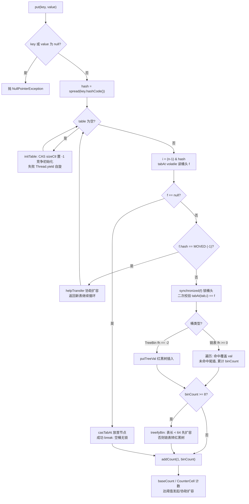
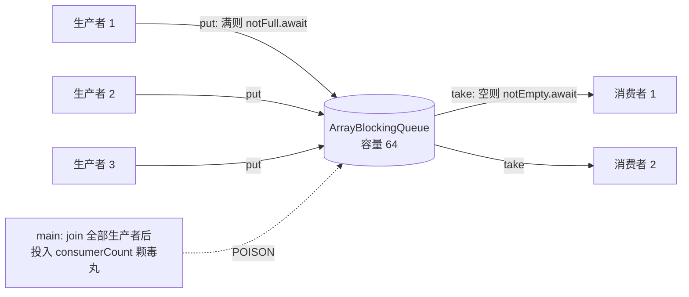

# 并发容器与阻塞队列

> 一句话概括：并发容器解决的是「多线程共享数据结构时，如何在不牺牲吞吐的前提下保证单个操作的原子性与可见性」——
> ConcurrentHashMap 用「CAS + 桶头 synchronized」把锁粒度细化到桶，CopyOnWriteArrayList 用「写时复制」把读做到零锁，
> BlockingQueue 用「锁 + 条件变量」把阻塞与唤醒封装成生产者-消费者语义；本文讲清这三条路线的机制、源码证据、边界与选型。

预计阅读时间：大约 90 分钟

所属主题：[Java 并发编程常见面试题总结](summary.md)

**版本基线**：以 **JDK 8** 为主要基线（源码取自 OpenJDK jdk8u），JDK 7 历史实现单独对比注明，JDK 11+ 差异在对应小节注明。源码锚点用 `类名#方法名`。AQS/Condition 底层见 [AQS 与锁](aqs-and-locks.md)，CAS 与 LongAdder 底层见 [CAS 与原子类](cas-and-atomic-classes.md)。

---

## 0. 阅读路线

| 读者 | 建议阅读 | 关注点 |
| --- | --- | --- |
| 初级（1 年内） | 1、3.9、4.1、5.1~5.2、6、12 | HashMap 为什么不安全、容器全景、禁 null、生产者-消费者 |
| 中级（1~3 年） | 2、3.1~3.6、4.2~4.3、5.3~5.7、7、8 | Segment、putVal/get/树化、双锁 LBQ、无锁队列 |
| 高级（3 年+） | 3.4、3.7、3.8、3.10、7.1、9.2~9.6、10 | sizeCtl、协助扩容、分散计数、递归更新、pinning |
| 选型/架构 | 1.5、5.2、7.3、8.3、9 | 决策表、队列权衡、复合操作边界 |

目录：

1. HashMap 为什么并发不安全
2. ConcurrentHashMap JDK 7：Segment 分段锁（历史对比）
3. ConcurrentHashMap JDK 8：CAS + 桶头锁（重点源码）
4. CopyOnWriteArrayList / CopyOnWriteArraySet：写时复制
5. BlockingQueue 家族：阻塞语义与六种实现
6. 生产者-消费者完整实战（必考手写）
7. ConcurrentLinkedQueue：Michael-Scott 无锁队列
8. ConcurrentSkipListMap / Set：有序并发容器
9. 选型与工程（资深层）
10. 高频追问集
11. 参考资料
12. 附：一页速记

---

## 1. HashMap 为什么并发不安全

### 1.1 结论：三类事故，两个版本

**结论**：HashMap 无任何同步（类 javadoc："Note that this implementation is not synchronized"），并发写有三类事故：**JDK 7 扩容成环死循环（CPU 100%）**、**JDK 8 数据覆盖丢失**、**两版共有的 size 不准**。JDK 8 头插改尾插**只修复了成环，没有修复线程安全**。

| 事故 | JDK 7 | JDK 8 | 根因 |
| --- | --- | --- | --- |
| 扩容链表成环 → get 死循环 | 有（头插） | 无（尾插保序） | `HashMap#transfer`（7）并发改写 `e.next` |
| 并发 put 覆盖丢数据 | 有 | 有 | 两线程同时看到链表尾/空桶，后写覆盖先写 |
| size 偏小 | 有 | 有 | `++size` 普通 int 自增，丢失更新 |
| 迭代抛 ConcurrentModificationException | 有 | 有 | modCount 快速失败（这是保护机制） |

### 1.2 JDK 7 头插法扩容成环（历史实现）

JDK 7 `HashMap#transfer` 迁移代码（源码原文）：

```java
while (null != e) {
    Entry<K,V> next = e.next;          // ① 先记下后继
    int i = indexFor(e.hash, newCapacity);
    e.next = (Entry<K,V>)newTable[i];  // ② 头插：e 指向新桶当前头
    newTable[i] = e;                   // ③ e 成为新桶头
    e = next;
}
```

头插会**反转链表**。两线程同时扩容：A 执行完 ① 后挂起（`e=A节点, next=B节点`），B 完整扩容把链表反转成 `B→A`；A 恢复后按**旧的 next 关系**继续头插，可把 A、B 互相指向形成 `A→B→A` 环。之后 get 落到该桶且 key 不存在时永远走不到 null——**死循环，CPU 100%**，线程栈停在 `HashMap.getEntry`。**边界**：成环需「并发扩容 + 特定调度」，非必现；并发 put 丢数据几乎必现。面试要区分「JDK 7 可能死循环」与「JDK 8 只丢数据、不死循环」。

### 1.3 JDK 8 尾插修复成环，但没修复安全

JDK 8 `HashMap#putVal` 改**尾插**，`HashMap#resize` 按 `(e.hash & oldCap)` 拆 lo/hi 两条链并**保持相对顺序**，不再反转、不会成环。但两线程同时判断桶空（或同时到达链表尾）各自写入，**后写覆盖先写**；`++size`、`++modCount` 仍是普通自增，丢失更新；扩容期间读线程可能读到中间状态。

### 1.4 并发 put 丢数据最小示例（可运行）

```java
import java.util.HashMap;
import java.util.Map;
import java.util.concurrent.CountDownLatch;

public class HashMapLostUpdate {
    public static void main(String[] args) throws InterruptedException {
        final int threads = 8, perThread = 10_000;
        Map<String, Integer> map = new HashMap<>();
        CountDownLatch start = new CountDownLatch(1), done = new CountDownLatch(threads);
        for (int t = 0; t < threads; t++) {
            final int id = t;
            new Thread(() -> {
                try {
                    start.await();                    // 同时开写
                    for (int i = 0; i < perThread; i++)
                        map.put(id + ":" + i, i);     // key 互不重复
                } catch (InterruptedException e) {
                    Thread.currentThread().interrupt();
                } finally { done.countDown(); }
            }).start();
        }
        start.countDown();
        done.await();
        System.out.println("期望 " + threads * perThread + "，实际 " + map.size());
    }
}
```

期望 80000，JDK 8 上通常明显偏小，偶尔抛异常；**JDK 7 上可能直接死循环（1.2），演示请用 JDK 8+**；换成 ConcurrentHashMap 则稳定 80000。CountDownLatch 见 [并发工具类](concurrency-tools.md)。

### 1.5 Hashtable 与 synchronizedMap 为什么吞吐差

| 维度 | Hashtable | Collections.synchronizedMap | ConcurrentHashMap |
| --- | --- | --- | --- |
| 锁形态 | 方法 synchronized（锁 this，全表一把） | 方法 synchronized(mutex)（全表一把） | CAS + 桶头锁（JDK 8） |
| 并发写 | 任意时刻 1 个 | 同左 | 不同桶并行 |
| 并发读 | 读也抢锁 | 读也抢锁 | get 全程无锁 |
| 迭代 | 调用方须手动锁住 map | 同左（javadoc 明确要求） | 弱一致迭代器，无需外部锁 |
| null | 都不允许 | 取决于被包装 map | 都不允许 |

**机制**：两者都是全表互斥——读读、读写、写写全部串行，读多写少时读线程本可并行却被一把锁排队，吞吐随线程数不升反降。synchronizedMap 只是包了层 mutex，**没改变数据结构**，复合操作仍要调用方自己锁 mutex。**追问：两者区别？** 锁粒度相同；synchronizedMap 可包装任意 Map、null 支持取决于底层；Hashtable 是独立实现。都应换成 ConcurrentHashMap（Hashtable javadoc 原话推荐）。

### 1.6 并发容器全景表

| 容器 | 底层结构 | 同步策略 | 有序性 | 阻塞 | 典型场景 |
| --- | --- | --- | --- | --- | --- |
| ConcurrentHashMap | Node 数组 + 链表/红黑树 | CAS + 桶头 synchronized | 无序 | 无 | 高并发 KV |
| ConcurrentSkipListMap | 跳表 | CAS 无锁 | key 排序 | 无 | 有序索引、范围查询 |
| ConcurrentSkipListSet | 委托 SkipListMap | CAS | 排序 | 无 | 有序去重 |
| CopyOnWriteArrayList | 数组写时复制 | 写加锁复制，读无锁 | 插入序 | 无 | 监听器/配置 |
| CopyOnWriteArraySet | 委托 COWList | 同上 | 插入序 | 无 | 小集合去重 |
| ConcurrentLinkedQueue | 链表 | CAS（Michael-Scott） | FIFO | **非阻塞** | 无锁任务收集 |
| ConcurrentLinkedDeque | 双端链表 | CAS | 双端 | 非阻塞 | 工作窃取 |
| ArrayBlockingQueue | 循环数组 | 1 锁 + 2 Condition | FIFO | 阻塞 | 定容生产者-消费者 |
| LinkedBlockingQueue | 链表 | 2 锁 + 2 Condition | FIFO | 阻塞 | 吞吐优先 |
| LinkedBlockingDeque | 双端链表 | 1 锁 + 2 Condition | 双端 | 阻塞 | 双端阻塞 |
| SynchronousQueue | TransferStack/Queue | CAS + 自旋/阻塞 | 配对交接 | 阻塞 | 直接交接 |
| PriorityBlockingQueue | 二叉堆（无界） | 1 锁 + notEmpty | 优先级 | take 阻塞 | 优先级调度 |
| DelayQueue | 二叉堆（无界） | 1 锁 + available + leader | 到期时间 | 到期才能 take | 延时任务 |
| LinkedTransferQueue | 链表（无界） | CAS + 阻塞交接 | FIFO | transfer 可等消费 | 确认送达 |

记忆主线：**Map 两条路线（哈希桶锁 / 跳表 CAS），List 写时复制，Queue 两大阵营（阻塞 / 非阻塞）**。

---

## 2. ConcurrentHashMap JDK 7：Segment 分段锁（历史对比）

> 历史实现，面试常作「JDK 7 vs 8」对比题；理解它是为了理解 JDK 8 为什么那样改。

### 2.1 结构与二次定位

**结论**：JDK 7 CHM = `Segment[]` + 每段一个 `HashEntry[]`。`Segment` **继承 ReentrantLock**（源码：`static final class Segment<K,V> extends ReentrantLock`），段即锁；默认 16 段（`DEFAULT_CONCURRENCY_LEVEL = 16`），即**最多 16 个线程并发写**。`HashEntry` 的 `value` 与 `next` 是 volatile（JDK 8 Node 字段名是 `val`），这是 get 无锁的可见性基础。

定位分两步（`ConcurrentHashMap#segmentForHash`，JDK 7 源码方法名是 segmentForHash 不是 segmentFor）：① **段定位** `(h >>> segmentShift) & segmentMask`——取 hash **高位**选段；② **桶定位** 段内 `(tab.length - 1) & h` 取低位。两次数组读都用 `UNSAFE.getObjectVolatile`（数组元素本身无 volatile 语义）。段**懒创建**：构造只建 segment[0] 作原型，其余首次写入时 `ensureSegment` CAS 创建。

### 2.2 get 无锁、size 先乐观后悲观、put 自旋预热

- **get 无锁**：volatile 读段 → 读桶头 → 沿 volatile next 遍历 → 读 volatile value（happens-before 见 [JMM 与 volatile](jmm-and-volatile.md)）。
- **put 加段锁**：先 `tryLock()`，失败进 `Segment#scanAndLockForPut`——自旋期间顺带遍历链表定位节点、**投机预创建 HashEntry**（预热缓存），多核最多 `MAX_SCAN_RETRIES = 64` 次后 `lock()` 阻塞。
- **size 先乐观后悲观**：无锁累加各段 count 与 modCount，连续两次 modCount 总和相等即认为无修改；重试 `RETRIES_BEFORE_LOCK = 2` 次仍不稳定就**锁全部段**统计。containsValue/isEmpty 同套路。

### 2.3 concurrencyLevel 的含义与局限

构造参数，「预估并发写线程数」，向上取 2 的幂决定段数（上限 `MAX_SEGMENTS = 1 << 16`），**创建后不可变**。局限：锁粒度=段，**同段不同桶的写也互斥**；段数固定，热点集中时并发度上不去；size 锁全段代价大；两级结构多一次定位多一份内存。这些正是 JDK 8 重写的动机（3.5）。

---

## 3. ConcurrentHashMap JDK 8：CAS + 桶头锁（重点源码）

### 3.1 结构：Node 数组 + 链表 + 红黑树

**结论**：JDK 8 抛弃 Segment，回归与 HashMap 同构的**一级结构** `Node<K,V>[] table` + 链表 + 红黑树（TreeBin），锁粒度细化到**每个桶的头节点**。

```java
static class Node<K,V> implements Map.Entry<K,V> {
    final int hash;
    final K key;
    volatile V val;          // get 无锁读值
    volatile Node<K,V> next; // get 无锁遍历
}
```

特殊节点用 hash 区分（源码常量）：

| 节点 | hash | 含义 |
| --- | --- | --- |
| 普通 Node | `>= 0`（spread 后最高位恒 0） | 正常元素 |
| ForwardingNode | `MOVED = -1` | 扩容占位：本桶已迁新表，持有 nextTable |
| TreeBin | `TREEBIN = -2` | 红黑树桶根包装（树节点自身 hash 仍 >= 0） |
| ReservationNode | `RESERVED = -3` | computeIfAbsent/compute 计算期间占位 |

**树化三阈值**（源码常量已核对）：

| 常量 | 值 | 含义 |
| --- | --- | --- |
| TREEIFY_THRESHOLD | 8 | 链表长度达 8 尝试树化 |
| UNTREEIFY_THRESHOLD | 6 | 扩容拆分后子链 <= 6 退化回链表 |
| MIN_TREEIFY_CAPACITY | 64 | 表长至少 64 才树化，否则优先扩容（`treeifyBin` 转 `tryPresize(n << 1)`） |

**为什么 8？** 类注释的泊松分布论证：负载因子 0.75 下桶内节点数近似 λ=0.5 的泊松分布，长度达 8 的概率约 **0.00000006**（千万分之六）——树化是极端冲突的**兜底**而非常态，TreeNode 体积约为 Node 两倍，不值得常备。**为什么退化是 6 不是 7？** 留缓冲带：若 7 退化、8 树化，长度在边界反复增删会引发**树化↔退化频繁震荡**（转换要重建节点）；6 与 8 隔着 7 吸收抖动。**为什么还要 64？** 表小时冲突多因「桶太少」而非「哈希太差」，扩容更治本；注释要求 `MIN_TREEIFY_CAPACITY >= 4 * TREEIFY_THRESHOLD`，避免扩容与树化阈值打架。

### 3.2 spread：高低位异或扰动

```java
static final int spread(int h) {
    return (h ^ (h >>> 16)) & HASH_BITS;   // HASH_BITS = 0x7fffffff
}
```

① 高 16 位异或到低位——桶定位只用 `(n-1) & hash` 的低位，扰动让高位参与散列，减少系统性碰撞；② 符号位强制 0，**普通节点 hash 恒非负**，负数才能留给 MOVED/TREEBIN/RESERVED。

### 3.3 putVal 走读（核心源码）

`ConcurrentHashMap#putVal` 骨架（源码节选）：

```java
final V putVal(K key, V value, boolean onlyIfAbsent) {
    if (key == null || value == null) throw new NullPointerException();
    int hash = spread(key.hashCode());
    int binCount = 0;
    for (Node<K,V>[] tab = table;;) {                 // 自旋重试
        Node<K,V> f; int n, i, fh;
        if (tab == null || (n = tab.length) == 0)
            tab = initTable();                        // ① 懒初始化
        else if ((f = tabAt(tab, i = (n - 1) & hash)) == null) {
            if (casTabAt(tab, i, null, new Node<>(hash, key, value, null)))
                break;                                // ② 空桶 CAS 放首节点，无锁
        }
        else if ((fh = f.hash) == MOVED)
            tab = helpTransfer(tab, f);               // ③ 转发节点：协助扩容
        else {
            synchronized (f) {                        // ④ 锁桶头
                if (tabAt(tab, i) == f) {             // 二次校验桶头没被换
                    if (fh >= 0) {                    // 链表：命中覆盖否则尾插
                        binCount = 1;
                        for (Node<K,V> e = f;; ++binCount) { /* ... */ }
                    } else if (f instanceof TreeBin) {
                        binCount = 2;                 // 红黑树 putTreeVal
                    }
                }
            }
            if (binCount != 0) {
                if (binCount >= TREEIFY_THRESHOLD) treeifyBin(tab, i); // ⑤
                if (oldVal != null) return oldVal;
                break;
            }
        }
    }
    addCount(1L, binCount);                           // ⑥ 计数 + 检查扩容
    return null;
}
```



逐点拆解：**② 空桶 CAS** 一条 CAS 完成插入，**不加锁**，失败回循环重试，这是低竞争写入高吞吐的来源。**③ MOVED**：桶已迁移，`helpTransfer` **先帮忙搬家再写新表**（3.7）。**④ synchronized(f)** 锁**桶头节点对象**，不同桶互不影响；进锁后必须二次校验 `tabAt(tab, i) == f`——拿锁瞬间桶头可能已被扩容换掉，校验失败退出锁重试；链表**尾插**（不成环）。**⑤ treeifyBin**：`binCount >= 8` 只是「尝试」，表长 < 64 改扩容；binCount 从 1 起计，不同资料口径略有差异，以源码计数为准。

### 3.4 sizeCtl 的多语义与 initTable

`sizeCtl` 是 CHM 的「状态机寄存器」，一个 volatile int 多种语义（字段 javadoc 只写 `-1` 初始化与 `-(1+扩容线程数)`，高低 16 位编码由 `resizeStamp`/`addCount` 推导，见下）：

| 取值 | 阶段 | 含义 |
| --- | --- | --- |
| 0 | 未初始化 | 默认容量 16 |
| 正数 | 未初始化 | 构造器指定初始容量（取 2 的幂） |
| -1 | 初始化中 | 某线程已抢到初始化权 |
| 正数 | 已初始化 | **下次扩容阈值** = 0.75 × 表长（initTable 末尾 `sc = n - (n >>> 2)` 写回） |
| 负数（非 -1） | 扩容中 | 高 16 位 = resizeStamp(n) 扩容戳，低 16 位 = 参与线程数 + 1 |

扩容态编码（`#addCount` / `#resizeStamp`）：`resizeStamp(n) = Integer.numberOfLeadingZeros(n) | (1 << 15)`，16 位、最高位 1；首个发起扩容的线程 CAS sizeCtl 从阈值 → `(resizeStamp(n) << 16) + 2`，协助线程 CAS +1，退出时 CAS -1。

`resizeStamp(n) << 16` 恒负（戳最高位 1），故扩容态 sizeCtl < 0；**低 16 位从 2 起计**（1 个线程时值为 2），即「线程数 + 1」。+1 偏移让「最后一人退出」（`sc - 2 == rs`）、「戳不匹配」、「达 MAX_RESIZERS」可用整数比较统一判断；不同容量戳不同，防止旧一轮扩容的票混入新一轮。

`initTable` 竞争协议（源码已核对，节选）：

```java
while ((tab = table) == null || tab.length == 0) {
    if ((sc = sizeCtl) < 0)
        Thread.yield();                          // 别人在初始化：让出 CPU 自旋
    else if (U.compareAndSwapInt(this, SIZECTL, sc, -1)) { // 抢到初始化权
        try {
            int n = (sc > 0) ? sc : DEFAULT_CAPACITY;
            table = tab = (Node<K,V>[])new Node<?,?>[n];
            sc = n - (n >>> 2);                  // 0.75n 写回作扩容阈值
        } finally { sizeCtl = sc; }
        break;
    }
}
```

**边界**：竞争失败方 `Thread.yield()` 自旋而非阻塞——初始化很快，自旋比挂起/唤醒便宜。

### 3.5 为什么 JDK 8 放弃 Segment

| 维度 | JDK 7 Segment | JDK 8 桶头锁 |
| --- | --- | --- |
| 锁粒度 | 段（覆盖多桶），默认最多 16 路并发写 | 单桶头，理论并发度 = 桶数 |
| 空桶写入 | 也要拿段锁 | 一条 CAS，无锁 |
| 锁实现 | ReentrantLock（AQS state + 队列节点） | synchronized（对象头 mark word，可锁升级） |
| 结构 | 两级数组两次定位 | 一级数组一次定位 |
| 扩容 | 段内独立，不跨段 | 全表多线程协助（3.7） |
| 计数 | 各段 count，size 乐观重试/全段锁 | baseCount + CounterCell 分散（3.8） |

核心理由三条：① **锁粒度细化**——段锁让同段不同桶互斥，桶头锁彻底消除；② **synchronized 成本已低于 ReentrantLock**——JDK 6 起锁升级优化（见 [synchronized 与锁升级](synchronized-and-lock-escalation.md)）使低竞争 synchronized 几乎零开销，JVM 还能持续优化它，而 AQS 状态与队列节点是固定内存开销；③ **结构简化**——少一层数组、少一次定位、少一份对象内存，空桶 CAS 让最常见写入路径完全无锁。

**追问：锁桶头时桶头被扩容换掉怎么办？** 锁的是「当时读到的 Node」，换头不影响已持锁线程的互斥；进锁后二次校验发现头已变就放弃本轮重新循环，保证不写进已迁移的旧桶。

### 3.6 get 全程无锁

```java
public V get(Object key) {
    int h = spread(key.hashCode());
    if ((tab = table) != null && (n = tab.length) > 0 &&
        (e = tabAt(tab, (n - 1) & h)) != null) {
        if ((eh = e.hash) == h) { /* 命中首节点 */ return e.val; }
        else if (eh < 0)          // 特殊节点：委托 find（ForwardingNode 查新表）
            return (p = e.find(h, key)) != null ? p.val : null;
        while ((e = e.next) != null) { /* volatile next 遍历 */ }
    }
    return null;
}
```

无锁三支柱：① `table` volatile，`tabAt` 用 `U.getObjectVolatile` 读数组元素（Unsafe 模拟元素 volatile）；② `Node.val/next` volatile——写线程锁内赋值与读线程 volatile 读建立 happens-before，**看到的要么旧值要么新值，不会是半初始化对象**（详见 [JMM 与 volatile](jmm-and-volatile.md)）；③ `eh < 0` 委托 `Node#find`：ForwardingNode.find **到 nextTable 新表查**（扩容期间 get 不阻塞不丢失），TreeBin.find 走树查找。**边界**：get 无锁 ≠ get 与 put 构成原子整体，「get 判空再 put」仍是竞态（9.2）；get 返回某时刻快照值，弱一致。

### 3.7 transfer：多线程协助扩容

**结论**：JDK 8 扩容是「**认领区间 + 桶级迁移 + 转发占位 + 后来者协助**」的并行工程。入口：addCount 发现 `size >= sizeCtl` 发起；put 遇 MOVED 经 `helpTransfer` 加入。

`ConcurrentHashMap#transfer` 关键机制（源码已核对）：

**① 步长与区间认领**：每线程一次认领一段连续桶区间，从高位向低位推进。步长 `stride = (NCPU > 1) ? (n >>> 3) / NCPU : n`，最小 `MIN_TRANSFER_STRIDE = 16`（避免区间太小引发 CAS 争抢）；CAS `transferIndex` 从 nextIndex 减到 nextIndex - stride，本线程负责 [bound, nextIndex)。`transferIndex` 初始为旧表长 n，`<= 0` 表示分完。

**② 桶级迁移**：空桶直接 CAS 放 ForwardingNode；已迁移（MOVED）跳过；否则 `synchronized(f)` 锁桶头，按 `hash & n` 拆 lo（新表下标 i）/hi（下标 i+n）两条链——2 倍扩容下元素**要么原位要么原位+旧容量**。迁完 `setTabAt(tab, i, fwd)` 占位。**③ lastRun 复用**：拆链前找「最后一次 runBit 变化点」lastRun，其后缀 runBit 相同**整段复用不新建节点**，只复制前缀。

**④ ForwardingNode**：`hash = MOVED = -1`，持 nextTable 引用。put/remove 遇它去新表（或协助扩容），get 遇它 find 查新表——**旧桶迁移后到扩容结束前旧表依然可读**。**⑤ 协助与退出**：`helpTransfer` 校验 `fh == MOVED` 且 table 未换代后 CAS `sizeCtl + 1` 报名，再调 transfer 认领区间；干完 CAS `sizeCtl - 1` 退出；**最后一人**（`(sc - 2) == resizeStamp(n) << 16`）负责 finishing：全表复查无遗漏后 `table = nextTab`、`nextTable = null`、`sizeCtl = (n << 1) - (n >>> 1)`（新容量 0.75 倍，回正数阈值态）。

```text
sizeCtl 变化示意（n=16, rs=resizeStamp(16)<<16）：
12(阈值) → rs+2(A发起) → rs+3(B协助) → rs+2(B退出) → rs+1(A退出,finishing) → 24(新阈值)
```

**边界/代价**：新旧两表并存，内存峰值约 1.5~2 倍；协助线程的 put 被「征用」搬家，延迟升高；`MAX_RESIZERS = (1 << 16) - 1` 限制协助数。这是「CHM 要预估容量」的工程依据。

### 3.8 addCount 与 size：LongAdder 思路的分散计数

**结论**：元素计数不用锁也不用单个 AtomicLong，而是 **baseCount + CounterCell[]** 分散累加——与 LongAdder/Striped64 同一思路（底层见 [CAS 与原子类](cas-and-atomic-classes.md)）。

`#addCount` 逻辑（源码已核对）：① 无竞争直接 CAS `baseCount += x`；② 失败或 cells 已存在 → 按 `ThreadLocalRandom.getProbe() & (m-1)` 选 Cell CAS 其 value；③ 再失败 → `fullAddCount` 初始化/扩容 cells 直到成功。

```java
@sun.misc.Contended static final class CounterCell {   // JDK 9+ 为 jdk.internal.vm.annotation.Contended
    volatile long value;
}
```

`@Contended` 让每个 Cell 独占缓存行（填充），**避免伪共享**——多核同时 CAS 相邻 Cell 不互相打掉缓存行（伪共享排查见 [死锁与排查](deadlock-and-troubleshooting.md)）。

**size 弱一致**：`sumCount()` = baseCount + 遍历 Cell.value，**不加锁不暂停写入**，是统计期间的近似值：

| 方法 | 返回 | 语义 |
| --- | --- | --- |
| `size()` | int | sumCount 截断到 [0, Integer.MAX_VALUE]，估计值 |
| `mappingCount()` | long | sumCount 原值（负归 0），javadoc 推荐（映射数可超 int） |
| `isEmpty()` | boolean | sumCount() <= 0，同样弱一致 |

### 3.9 为什么 key/value 不能为 null

**结论**：不是实现不了，而是**并发下 null 有二义性且无法消除**——`get(key)` 返回 null 分不清「key 不存在」还是「值就是 null」。

单线程 HashMap 可复查：containsKey 为 true 而 get 为 null，说明值就是 null。并发下**复查不可靠**：两次调用之间别的线程可能 put/remove 了 key。Doug Lea 在 concurrency-interest 邮件列表（2006-05）原话：

> The main reason that nulls aren't allowed in ConcurrentMaps (ConcurrentHashMaps, ConcurrentSkipListMaps) is that ambiguities that may be just barely tolerable in non-concurrent maps can't be accommodated. The main one is that if map.get(key) returns null, you can't detect whether the key explicitly maps to null vs the key isn't mapped. In a non-concurrent map, you can check this via map.contains(key), but in a concurrent one, the map might have changed between calls.

他还说允许 null 是「邀请程序埋下直到最坏时刻才爆发的错误」（与 Josh Bloch 的长期分歧），替代方案是**哨兵对象** `static final Object NULL = new Object();`。源码层面：`putVal` 首行判 null 抛 NPE。另一层收益：值永不为 null，**null 才能可靠地用作「无结果」的原子指示**。

**追问：Hashtable 禁 null 原因一样吗？** 结果一致出处不同：Hashtable 是更早的设计（对 key 调 hashCode/equals 的限制 + 同样二义性考量）；CHM 是 Doug Lea 明确论证的主动设计，ConcurrentSkipListMap 同样禁止（原话并列两者）。

### 3.10 原子复合方法：computeIfAbsent / merge / compute

**结论**：CHM 提供**桶锁内原子执行**的复合方法，是 check-then-act 竞态的官方解法：

| 方法 | 语义 | 典型用途 |
| --- | --- | --- |
| `putIfAbsent(k, v)` | 不存在才放 | 去重注册 |
| `computeIfAbsent(k, f)` | 不存在则 f 计算并放入，**整个调用原子**，f 至多执行一次 | 缓存、多值 map、计数器初始化 |
| `computeIfPresent(k, f)` | 存在才重算 | 条件更新 |
| `compute(k, f)` | 无论存在与否重算（f 返回 null 则删除） | 通用原子更新 |
| `merge(k, v, f)` | 不存在放 v，存在则 f(old, v) | 累加合并 |

机制：computeIfAbsent 桶空时先 CAS 放 **ReservationNode（hash = RESERVED = -3）** 占位，synchronized 占位节点内执行 mappingFunction、建链/树、替换占位；桶非空锁桶头。函数执行期间同桶更新被阻塞。**边界（高频坑）**：javadoc 契约——"The entire method invocation is performed atomically ... the computation should be short and simple, and **must not attempt to update any other mappings of this map**."

```java
ConcurrentHashMap<Integer, Integer> map = new ConcurrentHashMap<>();
map.computeIfAbsent(16, k -> {
    map.computeIfAbsent(32, k2 -> 32);  // 默认容量 16 下 16 与 32 同落桶 0（spread 后 & 15 均为 0）
    return 16;
});
```

- **JDK 8**：内层看到 RESERVED 占位，外层等内层、内层等外层——**死循环（livelock），CPU 打满**（JDK-8062841、JDK-8074374，Spring SimpleThreadScope 曾因此挂死）；
- **JDK 9+**：检测到递归更新抛 `IllegalStateException: Recursive update`（javadoc Throws 条款）。

**实践**：① mappingFunction 短小、无副作用、不碰本 map；② 「值对象内部再累加」用 `freqs.computeIfAbsent(k, x -> new LongAdder()).increment()`——increment 在方法**返回后**执行；③ 函数里做远程调用会长时间占桶锁，先算好再 putIfAbsent 或异步加载。

---

## 4. CopyOnWriteArrayList / CopyOnWriteArraySet：写时复制

### 4.1 机制：写加锁复制，读无锁读旧数组

**结论**：COW 把「读写互斥」换成「**读写分离**」——写线程加锁复制新数组、修改、volatile 写一次性替换引用；读线程永远无锁，读到的是完整数组，无中间状态。

JDK 8 `CopyOnWriteArrayList#add`（源码已核对）：

```java
final transient ReentrantLock lock = new ReentrantLock();   // JDK 8：ReentrantLock
private transient volatile Object[] array;                  // volatile 引用发布

public boolean add(E e) {
    lock.lock();
    try {
        Object[] elements = getArray();
        int len = elements.length;
        Object[] newElements = Arrays.copyOf(elements, len + 1); // 复制整个数组
        newElements[len] = e;
        setArray(newElements);                                   // volatile 写替换
        return true;
    } finally { lock.unlock(); }
}
```

读方法（get/iterator/size）直接 `getArray()` 后操作，**零锁**；写锁只互斥写写。

### 4.2 版本差异：JDK 11+ 改用 synchronized（已核对源码）

JDK 11（jdk-11+28）锁字段变为 `final transient Object lock = new Object();`，add 改为 `synchronized (lock) { ... }`，字段注释直说动机："The lock protecting all mutators. (We have a mild preference for builtin monitors over ReentrantLock when either will do.)"——两者都可行时**更偏好内置监视器**（省 AQS 对象开销，JVM 持续优化 synchronized），与 CHM JDK 8 放弃 ReentrantLock 同一取向。写锁语义不变，读依旧无锁。（引入该变更的具体 JDK bug 编号未核实，本文不引用；变更本身已对照 jdk8u 与 jdk-11+28 源码确认。）

### 4.3 迭代器：创建时快照，弱一致

`COWIterator` 构造时保存 `snapshot = getArray()`，之后遍历这份**私有快照**：迭代期间其他线程增删改**看不到**，**绝不抛 CME**（无 modCount 检查）；迭代器 `remove/set/add` 一律抛 `UnsupportedOperationException`。细节：`subList` 的 COWSubList 视图**会**做 checkForComodification（底层数组被换掉抛 CME），与主迭代器语义不同。

### 4.4 边界/代价与适用场景

| 代价 | 说明 |
| --- | --- |
| 写内存翻倍 | 每次写复制整个数组，瞬时 2 倍内存；大数组高频写引发 GC 风暴 |
| 写 O(n) | add/remove 都是复制 + 移动 |
| 短暂不一致 | 读线程可能读旧数组（弱一致），不保证读己之写 |
| 快照陈旧 | 长迭代期间的所有修改不可见 |

**适用**：读多写**极少**、集合不大、容忍短暂陈旧——监听器列表、白名单/配置。**不适用**：写频繁、集合大、要求 read-your-writes。`CopyOnWriteArraySet` 一句话：内部持有 COWList，add 走 `addIfAbsent`（持锁遍历判重 O(n)）；大集合用 `ConcurrentHashMap.newKeySet()`。

**追问：COW 和「volatile 数组引用 + 每次写新建数组」有区别吗？** 本质相同，COW 是标准封装；关键在写写必须互斥（否则两写线程基于同一旧数组复制，后替换者覆盖先替换者），写锁不可省。

---

## 5. BlockingQueue 家族：阻塞语义与六种实现

### 5.1 接口四组 API（必背）

**核心价值**：队列满放不进、空取不出，这两种「边界等待」由容器负责阻塞与唤醒，调用方不写 wait/notify。四组 API 对应四种失败策略：

| 操作 | 抛异常 | 返回特殊值 | 阻塞 | 超时 |
| --- | --- | --- | --- | --- |
| 入队 | `add(e)`（满抛 IllegalStateException） | `offer(e)`（满返回 false） | `put(e)`（满一直等） | `offer(e, time, unit)` |
| 出队 | `remove()`（空抛 NoSuchElementException） | `poll()`（空返回 null） | `take()`（空一直等） | `poll(time, unit)` |
| 检查 | `element()`（空抛异常） | `peek()`（空返回 null） | — | — |

记忆：**add/remove/element 暴脾气，offer/poll/peek 好商量，put/take 死等，超时版限时等**。所有实现**不接受 null 元素**（null 被 poll/peek 用作「空」哨兵，与 CHM 禁 null 同理）。

### 5.2 家族对比表

| 实现 | 底层 | 有界性 | 锁结构 | 公平 | 一句话 |
| --- | --- | --- | --- | --- | --- |
| ArrayBlockingQueue | 循环数组 | **必须有界** | 1 ReentrantLock + notFull/notEmpty | 可选 | 创建即定容，无节点分配 |
| LinkedBlockingQueue | 链表 | 可选，**默认 Integer.MAX_VALUE** | **2 锁** putLock/takeLock + AtomicInteger count | 非公平 | 读写分离吞吐高；默认容量 OOM 隐患 |
| SynchronousQueue | TransferStack/Queue | **无容量**（连 1 都没有） | CAS + 自旋/阻塞 | 可选 | 每个 put 必须等一个 take |
| PriorityBlockingQueue | 二叉堆 | 无界自动扩容 | 1 锁 + notEmpty | 优先级序 | compareTo 出队；put 永不阻塞 |
| DelayQueue | 二叉堆 | 无界 | 1 锁 + available + leader | 到期序 | 到期才能 take；Leader-Follower |
| LinkedTransferQueue | 链表 | 无界 | CAS + 阻塞交接 | 非公平 | transfer 阻塞到被拿走 |
| LinkedBlockingDeque | 双端链表 | 可选 | 1 锁 + 2 Condition | 非公平 | 双端阻塞 |

### 5.3 ArrayBlockingQueue：一把锁 + 两个条件变量

**结论**：经典「双条件算法」——一把 ReentrantLock 保护循环数组，**notFull 挂起放不下的生产者，notEmpty 挂起取不到的消费者**，两个等待队列分开、精准唤醒对方阵营（Condition 机制见 [AQS 与锁](aqs-and-locks.md)）。

```java
final ReentrantLock lock;                 // 唯一主锁
private final Condition notEmpty;         // take 等待队列
private final Condition notFull;          // put 等待队列
final Object[] items;                     // 循环数组, putIndex/takeIndex 双游标
// 构造器：lock = new ReentrantLock(fair)，两个 Condition 均由 lock.newCondition() 创建

public void put(E e) throws InterruptedException {
    checkNotNull(e);
    lock.lockInterruptibly();             // 可响应中断
    try {
        while (count == items.length)     // while 而非 if：防虚假唤醒
            notFull.await();              // 满：挂起并释放锁
        enqueue(e);                       // 入队 + notEmpty.signal()
    } finally { lock.unlock(); }
}
// take 对称：while (count == 0) notEmpty.await(); return dequeue();
// dequeue 出队 + notFull.signal()
```

要点：① `await` **释放锁**再挂起，被 signal 后重新抢锁返回，故条件判断必须 while（防虚假唤醒）；② enqueue/dequeue 内互相 signal 对方阵营；③ fair=true 按 FIFO 抢锁，杜绝饥饿但吞吐略降；④ `remove(Object)` 删中间元素要整体前移数组（源码注释 "intrinsically slow and disruptive"），ABQ 只适合队头队尾操作。

### 5.4 LinkedBlockingQueue：两把锁分离读写

**结论**：**putLock/takeLock 两把锁**把入队出队解耦——生产者之间互斥、消费者之间互斥，但**生产者和消费者可并行**，吞吐高于单锁 ABQ；代价是结构复杂、每元素一个 Node。

```java
private final ReentrantLock takeLock = new ReentrantLock();
private final Condition notEmpty = takeLock.newCondition();
private final ReentrantLock putLock = new ReentrantLock();
private final Condition notFull = putLock.newCondition();
private final AtomicInteger count = new AtomicInteger();  // 两锁共享计数
```

三个关键设计（源码注释已核对）：

1. **count 用 AtomicInteger**：put/take 各持一把锁都要改 count，原子变量让双方无需同时持两锁。put 的等待条件 `while (count.get() == capacity)` 读的 count 不受 putLock 保护，但安全：此刻其他 put 都被锁挡住，count 只可能减小，减到不满必有 signal。
2. **级联通知（cascading notifies）**：put 后若 `c + 1 < capacity`（未满）顺手 `notFull.signal()` 唤醒下一个生产者；若 `c == 0`（之前为空）才在**释放 putLock 后**拿 takeLock 调 signalNotEmpty()；take 对称。多数操作只需一把锁，跨锁通知只在「空→非空」「满→非满」边界发生。
3. **fullyLock 冻结全队列**：remove(Object)/contains/toArray/迭代器需同时拿两锁（固定顺序 putLock → takeLock 防死锁），会同时阻塞生产消费，高频调用抵消双锁优势。

**边界（高频坑）**：无参构造容量 `Integer.MAX_VALUE`，堆积到 OOM；线程池用时 maximumPoolSize 失效（见 [线程池](thread-pool.md)）。**生产环境永远显式指定容量**。

### 5.5 SynchronousQueue：无容量的直接交接

**结论**：**没有内部容量，连 1 都没有**（javadoc："does not have any internal capacity, not even a capacity of one"）。它是**配对交接的通道**而非存元素的队列：每个 put 必须等一个 take 拿走，反之亦然。`size()` 恒 0、`isEmpty()` 恒 true、`peek()` 恒 null、不能迭代。机制（源码已核对）：内部 `Transferer` 按公平性二选一：

```java
public SynchronousQueue(boolean fair) {
    transferer = fair ? new TransferQueue<E>() : new TransferStack<E>();
}
```

| 模式 | 结构 | 顺序 | 取舍（源码注释） |
| --- | --- | --- | --- |
| 非公平（默认） | TransferStack（LIFO） | 后进先出 | 线程局部性好（刚挂起的线程缓存还热） |
| 公平 | TransferQueue（FIFO） | 先进先出 | 高竞争下吞吐更高，杜绝饥饿 |

两者实现 Scherer & Scott 的 dual stack / dual queue 算法：等待线程封装成节点入栈/入队，**互补模式**（DATA 生产者 / REQUEST 消费者）相遇即 CAS 配对唤醒。put/take 统一委托 `transferer.transfer(e, timed, nanos)`——**第一参数是否为 null 区分方向**：put 传 e（DATA），take 传 null（REQUEST）；timed=false 无限等，offer/poll 带超时。

**为什么 CachedThreadPool 用它**：`Executors#newCachedThreadPool` 的工作队列就是 SynchronousQueue——任务不排队，**无线程接手就新建线程**（配合 maximumPoolSize=Integer.MAX_VALUE）；换无界 LBQ 线程数停 corePoolSize（见 [线程池](thread-pool.md)）。**边界**：无缓冲，速率须即时匹配；适合 handoff，不适合削峰填谷。

### 5.6 PriorityBlockingQueue：无界优先级堆

**结论**：数组二叉堆（与 PriorityQueue 同构），出队序由 `compareTo`/Comparator 决定，**不保证同优先级 FIFO**。单把 ReentrantLock + 一个 notEmpty Condition（没有 notFull——**无界，put 永不阻塞**，不够就扩容）；take 空时阻塞。

**边界**：无界堆积风险同 LBQ 默认容量；扩容抢锁复制数组有毛刺；元素必须可比较（否则 ClassCastException）；迭代器**不保证优先级序**，要有序输出得反复 poll。

### 5.7 DelayQueue：到期才能取

**结论**：元素实现 `Delayed`（getDelay + compareTo），内部 PriorityQueue 按到期时间建堆，**只有到期元素能被 take/poll 取走**。单锁 + `available` Condition，**Leader-Follower 模式**避免所有消费者定时醒来：

`DelayQueue#take`（源码已核对）：队空 → 无限 await；队头到期 → 出堆返回；未到期 → **只有第一个线程成为 leader**，`awaitNanos(delay)` 精确睡到队头到期，其余无限 await；leader 返回前唤醒后继。offer 时新元素若成为更早到期队头，置 `leader = null` 并 signal，让等待者重新竞选按新时间睡。细节：`peek` 能返回**未到期**队头（与 poll 不同）；size 含未到期元素；put 委托 offer 永不阻塞。`ScheduledThreadPoolExecutor` 的 DelayedWorkQueue 是同思路定制版（见 [线程池](thread-pool.md)）。适用延时任务、订单超时、缓存过期；无界，海量延时任务注意内存。

### 5.8 LinkedTransferQueue / LinkedBlockingDeque 一句话

- **LinkedTransferQueue**：无界链表 + CAS，融合 SQ 交接语义与 LBQ 缓冲——`transfer(e)` 阻塞到元素**被消费者拿走**（不只是入队），tryTransfer 立即探测有无等待消费者；适合「确认送达」。
- **LinkedBlockingDeque**：双端阻塞队列，一把锁两个 Condition，头尾都能 put/take；「自己从头取、别人从尾偷」可用它（ForkJoinPool 用自己的无锁双端队列，见 [ForkJoin 与 CompletableFuture](forkjoin-and-completable-future.md)）。

---

## 6. 生产者-消费者完整实战（必考手写）

### 6.1 模型图



### 6.2 完整可运行代码：多生产者多消费者 + 毒丸优雅停止

```java
import java.util.ArrayList;
import java.util.List;
import java.util.concurrent.ArrayBlockingQueue;
import java.util.concurrent.BlockingQueue;

public class ProducerConsumerDemo {
    private static final String POISON = "__POISON__";   // 毒丸：与业务元素可区分

    public static void main(String[] args) throws InterruptedException {
        int producerCount = 3, consumerCount = 2;
        BlockingQueue<String> queue = new ArrayBlockingQueue<>(64); // 有界：天然背压
        List<Thread> producers = new ArrayList<>(), consumers = new ArrayList<>();
        for (int p = 0; p < producerCount; p++) {
            final int id = p;
            Thread t = new Thread(() -> {
                try {
                    for (int i = 0; i < 100; i++)
                        queue.put("task-" + id + "-" + i);  // 满则阻塞，不撑爆内存
                } catch (InterruptedException e) { Thread.currentThread().interrupt(); }
            }, "producer-" + p);
            t.start();
            producers.add(t);
        }
        for (int c = 0; c < consumerCount; c++) {
            Thread t = new Thread(() -> {
                try {
                    while (true) {
                        String task = queue.take();         // 空则阻塞，不空转
                        if (POISON.equals(task)) return;    // 收到毒丸：优雅退出
                        System.out.println(Thread.currentThread().getName() + " 处理 " + task);
                    }
                } catch (InterruptedException e) { Thread.currentThread().interrupt(); }
            }, "consumer-" + c);
            t.start();
            consumers.add(t);
        }
        for (Thread t : producers) t.join();                // ① 等全部生产结束
        for (int c = 0; c < consumerCount; c++)
            queue.put(POISON);                              // ② 每个消费者一颗毒丸
        for (Thread t : consumers) t.join();                // ③ 等全部消费结束
        System.out.println("全部任务处理完毕，队列剩余 " + queue.size()); // 0
    }
}
```

正确性论证（面试要能讲）：

- **为什么任务全处理完才退出**：FIFO 中毒丸排在所有真实任务之后；main 先 join 全部生产者再投毒，投毒后无真实任务入队；每个消费者恰取一颗毒丸退出，退出前必然取完前面的所有任务。
- **为什么 consumerCount 颗**：一颗只终止一个消费者。也可只投一颗、消费者收到后 `queue.put(POISON)` 再退出（毒丸传递），等价。
- **为什么不用 interrupt**：interrupt 让 take 抛异常，可能漏掉剩余任务；毒丸是「排干式」停止，需立即停止（丢弃剩余）才用 interrupt。
- **边界**：毒丸须与业务值可区分；消费者循环内要 catch 住业务异常，否则线程提前死亡、毒丸无人认领。

### 6.3 三种写法复杂度对比

| 维度 | wait/notify 版 | Lock/Condition 版 | BlockingQueue 版 |
| --- | --- | --- | --- |
| 边界等待 | 手写 `while (满) wait()` | 手写 `while (满) notFull.await()` | put/take 内置 |
| 唤醒正确性 | notify 可能唤醒错阵营（需 notifyAll） | 双 Condition 精准唤醒 | 内置（ABQ 双 Condition / LBQ 级联） |
| 锁管理 | synchronized + 异常路径 | lock/finally unlock | 无需感知锁 |
| 中断处理 | 自行处理 | await 可中断 | put/take 声明 InterruptedException |
| 代码量 | 30~50 行且易错 | 与 ABQ 源码相当 | 业务循环 10 行 |

wait/notify 版要手写 `while (满) wait()` + `notifyAll()`（notify 可能只唤醒同阵营线程，造成丢失唤醒），等于把 ABQ 源码的活全干一遍且易错。机制细节见 [synchronized 与锁升级](synchronized-and-lock-escalation.md)（wait/notify 与监视器）和 [AQS 与锁](aqs-and-locks.md)（Condition 队列）。

**结论：BlockingQueue 是首选**——封装了「阻塞、唤醒、边界、中断」四件最易写错的事。能说出「ABQ 内部就是 Lock + 双 Condition，LBQ 更进一步双锁分离」才算真懂。

---

## 7. ConcurrentLinkedQueue：Michael-Scott 无锁队列

### 7.1 机制：CAS 入队出队，head/tail 允许滞后

**结论**：CLQ 基于 Michael & Scott 无锁队列算法（PODC'96，类 javadoc 引用）的**非阻塞** FIFO 队列：入队 CAS 尾节点 next，出队 CAS 头节点 item 置 null，**全程无锁**；head/tail **允许滞后**，「跳两跳才更新」减少 CAS。

`ConcurrentLinkedQueue#offer`（JDK 8 源码已核对，节选）：

```java
for (Node<E> t = tail, p = t;;) {
    Node<E> q = p.next;
    if (q == null) {                          // p 是尾节点
        if (p.casNext(null, newNode)) {       // 入队线性化点：CAS next
            if (p != t)                       // p 已比 tail 前进一跳
                casTail(t, newNode);          // 才更新 tail，失败也无所谓
            return true;
        }
    }
    else if (p == q)                          // 节点已出链（自环哨兵）
        p = (t != (t = tail)) ? t : head;     // 从 head 重新出发
    else
        p = (p != t && t != (t = tail)) ? t : q;
}
```

`poll` 对称：找第一个 item 非空节点，`casItem(item, null)` 是出队线性化点；`p != h`（跳两跳）才 `updateHead`，旧 head 的 next 自链（`h.lazySetNext(h)`）作「已出链」哨兵助 GC。

三个反直觉设计（实现注释原话 "Both head and tail are permitted to lag"）：

1. **tail 可落后于真实尾节点**（甚至落后 head）：每次入队都 CAS tail 会让生产者在 tail 上串行竞争；"slack threshold of two"——落后两步才更新，CAS 频率降一半以上，casTail 失败可忽略。
2. **出队不摘节点，只把 item 置 null**：摘节点要 CAS 前驱 next，与入队 CAS 同一位置冲突；置 null 把逻辑删除与物理出链解耦。
3. **版本注**：JDK 8 源码**没有 HOPS 常量**，阈值 2 写死在 `p != t` / `p != h` 判断里（网传 `HOPS=1` 与 JDK 8 源码不符）；JDK 11+ 改 VarHandle 替代 Unsafe，引入 `MAX_HOPS = 8`——那是 clear/跳过死节点的另一阈值，勿混淆。

### 7.2 size() 是 O(n) 且弱一致

`size()` 从头遍历数 item 非空节点（javadoc："NOT a constant-time operation ... requires an O(n) traversal ... may be inaccurate"）。无锁队列没有全局计数器，遍历期间还在增删，结果只是近似。**实践**：判空用 `isEmpty()`（`first() == null`，O(1)）；**绝不在热路径调 size()**；精确计数外挂 LongAdder。

### 7.3 与 BlockingQueue 的选型

| 维度 | ConcurrentLinkedQueue | BlockingQueue |
| --- | --- | --- |
| 空队列取 | poll 立即返回 null | take 阻塞等待 |
| 满队列放 | 无界，offer 恒成功 | put 阻塞（有界时） |
| 同步手段 | CAS 无锁 | 锁 + Condition |
| 适用 | 自己轮询/事件循环、批量收集、不想被阻塞 | 标准生产者-消费者、要背压与等待 |

**结论**：选型第一问「**要不要阻塞语义**」。要「没活就睡、来活就醒」选 BlockingQueue；要「永不阻塞、自控节奏」选 CLQ。用 CLQ 手写 `while(poll()==null) Thread.yield()` 是反模式——空转烧 CPU。

---

## 8. ConcurrentSkipListMap / Set：有序并发容器

### 8.1 跳表：空间换时间的多层索引

**结论**：ConcurrentSkipListMap 是**并发有序 map**（key 按自然序/Comparator），底层跳表——多层索引链表，查找从最高层「右移下沉」，平均 O(log n)。数据结构细节（随机层高、索引概率、Redis zset 的 span 对比）见库内 [跳表与 Redis 有序集合深度笔记](../../../redis/skiplist-and-sorted-set.md)，本文只讲并发实现。

```java
ConcurrentSkipListMap<Integer, String> map = new ConcurrentSkipListMap<>();
map.put(3, "c"); map.put(1, "a"); map.put(2, "b");
System.out.println(map.firstKey());    // 1
System.out.println(map.headMap(3));    // {1=a, 2=b}  范围视图
System.out.println(map.ceilingKey(2)); // 2  导航方法
```

### 8.2 为什么跳表并发友好

**机制**：插入 = ① 底层链表 CAS 接 next；② 逐层 CAS 建索引。每层都是独立单指针 CAS，**无需全局锁、无需旋转再平衡**。对比红黑树：插入/删除后的旋转牵动父、叔、祖父多节点，并发下要么锁整树、要么极复杂的锁耦合；跳表把结构调整摊薄成独立 CAS，天然适合无锁化（Doug Lea 的无锁跳表算法，CAS + 标记删除）。读无锁沿索引下沉；写 CAS 竞争同位置自旋重试；迭代器弱一致沿底层链表推进、不抛 CME；size 同 CLQ，O(n) 弱一致，判空用 isEmpty。

### 8.3 与 TreeMap + 锁 / 红黑树的对比

| 维度 | TreeMap + synchronized | ConcurrentSkipListMap |
| --- | --- | --- |
| 并发写 | 全表串行 | 不同位置 CAS 并行 |
| 读 | 抢锁 | 无锁 |
| 结构调整 | 旋转（牵一发动全身） | 多层独立 CAS |
| 实现复杂度 | 红黑树 + 并发更复杂 | 跳表简单得多 |
| 内存 | 每节点固定开销 | 索引层额外指针（空间换时间） |

**结论**：需要「并发 + 排序/范围查询/导航」选 ConcurrentSkipListMap；ConcurrentHashMap **无序**做不了范围查询；单线程或外部已同步时 TreeMap 更省内存。ConcurrentSkipListSet 一句话：委托 SkipListMap（value 放 Boolean.TRUE），有序版并发 Set。**追问：为什么不给 CHM 加排序？** 哈希 O(1) 与有序 O(log n) 是两种取舍，哈希桶无法范围扫描；跳表是并发友好度最高的有序结构，各司其职。

---

## 9. 选型与工程（资深层）

### 9.1 场景选型决策表

| 场景 | 首选 | 理由 |
| --- | --- | --- |
| 高并发 KV 缓存、注册表 | ConcurrentHashMap | 桶级锁 + 无锁读；预估容量 |
| 读多写极少列表 | CopyOnWriteArrayList | 读零锁；写频繁换 CHM |
| 生产者-消费者、任务缓冲 | ABQ / LBQ | 必须有界；要背压选 ABQ |
| 任务直接交接、弹性线程 | SynchronousQueue | CachedThreadPool 模式 |
| 延时/定时任务 | DelayQueue / ScheduledThreadPoolExecutor | 到期语义内置 |
| 优先级调度 | PriorityBlockingQueue | 注意无界堆积 |
| 并发有序、范围查询 | ConcurrentSkipListMap | 导航 API |
| 无锁非阻塞任务收集 | ConcurrentLinkedQueue | 判空 isEmpty |
| 需「确认被消费」 | LinkedTransferQueue.transfer | 交接语义 |
| 并发 Set | CHM.newKeySet() / SkipListSet / COWSet | 按序与写频选 |

### 9.2 单操作原子 ≠ 复合操作原子（最重要的边界）

**结论**：并发容器只保证**每个方法调用自身**的原子性与可见性；check-then-act、read-modify-write、迭代中修改这类**复合操作仍是竞态**，须用原子复合方法或外部同步。

```java
// 反例：两个原子操作拼不出原子复合
if (!map.containsKey(k)) map.put(k, v);   // ①②之间别的线程可能已 put
// 正例
map.putIfAbsent(k, v);
map.computeIfAbsent(k, key -> expensiveCreate(key));
// 反例：读改写丢失更新
Integer old = map.get(k); map.put(k, old + 1);
// 正例
map.merge(k, 1, Integer::sum);            // 桶锁内原子；或值用原子类（9.4）
```

迭代同理：CHM/CLQ/SkipList 迭代器弱一致不抛 CME，但「遍历并删除」用迭代器自己的 remove 或 removeIf；「遍历求和再判断」得到的是近似值，业务要能容忍。

### 9.3 弱一致语义小结

| 容器 | 迭代器 | 抛 CME | size |
| --- | --- | --- | --- |
| ConcurrentHashMap | 弱一致 | 否 | 弱一致估计 |
| CopyOnWriteArrayList | **创建时快照**（之后修改全不可见） | 否 | 精确（数组长度） |
| ConcurrentLinkedQueue | 弱一致 | 否 | O(n) 弱一致 |
| ConcurrentSkipListMap | 弱一致 | 否 | O(n) 弱一致 |
| ArrayBlockingQueue | 弱一致（加锁遍历） | 否 | 精确（持锁 count） |
| HashMap + 外部锁迭代 | 快速失败 | **是** | — |

工程含义：**遍历不会炸，但别把遍历结果当精确快照做对账**；要对账就停写或换快照机制（COW/拷贝）。

### 9.4 CHM 计数误用：能用 LongAdder 就别用 map.merge

```java
// 反例：CHM 当全局计数器
map.merge("pv", 1L, Long::sum);
// 每次：定位桶 + 锁桶头 + Long 装箱拆箱 + 新建对象 + 写回，单 key 高频累加全串行在同一桶锁
// 正例：单一计数器
LongAdder pv = new LongAdder();
pv.increment();   // 分散 CAS，无锁无装箱
```

**按 key 计数**的正确姿势：`ConcurrentHashMap<K, LongAdder>` + `computeIfAbsent(k, x -> new LongAdder()).increment()`——map 只负责找到计数器，累加交给 LongAdder（CHM javadoc 官方 frequency map 示例）。

### 9.5 极致吞吐：Disruptor 一句话

LMAX Disruptor（**第三方库**，非 JDK）：环形数组预分配事件、缓存行填充消除伪共享、单写者原则（单生产者序号无 CAS）、多生产者 CAS 抢序号、消费者按序号屏障批量消费——吞吐比 BlockingQueue 高一个量级；代价是 API 复杂、容量固定、事件复用的状态管理负担。伪共享见 [死锁与排查](deadlock-and-troubleshooting.md)。一般业务 BlockingQueue 足够。

### 9.6 虚拟线程时代的注意点（JDK 21+）

JDK 21 虚拟线程（见 [虚拟线程](virtual-threads.md)）在 **synchronized 块内阻塞会 pin 住载体线程**（JEP 444 已知限制，JDK 24 JEP 491 解除）。影响：① CHM 桶头锁、JDK 11+ COW 锁内操作极短，正常无感；但 **computeIfAbsent 的 mappingFunction 在 synchronized 内执行**，函数里做阻塞 IO 会 pin 载体——虚拟线程下「计算移出函数」从建议升级为硬约束；② ABQ/LBQ 基于 ReentrantLock，await 挂起不 pin 载体，更友好。结论：虚拟线程 + 并发容器，优先 ReentrantLock 系或确认 synchronized 临界区无阻塞。

---

## 10. 高频追问集

**Q1：JDK 7 HashMap 并发扩容为什么死循环？JDK 8 不会了就安全了吗？**
期望：JDK 7 transfer 头插反转链表，两线程交错迁移可成环，get 死循环；JDK 8 尾插 + lo/hi 保序拆分不成环，但并发 put 仍覆盖丢数据、++size 丢失更新，**依然不安全**。

**Q2：CHM JDK 8 为什么用 synchronized 而不是 ReentrantLock？**
期望：锁粒度细到桶头、竞争低；synchronized 经锁升级优化低竞争几乎零开销、JVM 可持续优化、省 AQS 内存；空桶纯 CAS。JDK 11 COW 改回 synchronized 同一取向。

**Q3：树化为什么 8、退化 6、还要表长 64？**
期望：泊松 λ=0.5 下桶长达 8 概率千万分之六，树化是兜底且 TreeNode 两倍大；6 留缓冲防震荡；64 以下扩容治本（64>=4×8 避免阈值打架）。

**Q4：sizeCtl 各取值含义？扩容计数为什么从 2 开始？**
期望：0 默认 / 正数初始容量或 0.75n 阈值 / -1 初始化 / 负数高 16 位 resizeStamp + 低 16 位线程数+1。首线程置 rs+2，协助 +1 退出 -1，减到 1（sc-2==rs）者收尾；+1 偏移统一边界判断。

**Q5：CHM get 为什么不加锁也安全？扩容时读哪张表？**
期望：table volatile + tabAt + Node.val/next volatile 建立 happens-before；桶头 hash<0 委托 find，ForwardingNode 查新表，扩容期间读不阻塞不丢失。

**Q6：CHM 为什么禁 null？HashMap 为什么允许？**
期望：get 返回 null 二义性（不存在 vs 值为 null）；单线程可 containsKey 复查，并发下两调用间 map 可能已变、复查不可靠，故 NPE 禁止（Doug Lea）；哨兵对象替代。HashMap 允许是历史设计。

**Q7：CHM size() 精确吗？计数怎么实现？**
期望：弱一致估计。baseCount CAS + @Contended CounterCell[] 分散（LongAdder 思路），sumCount 无锁求和；mappingCount() long 更推荐；精确计数外挂原子类。

**Q8：computeIfAbsent 的函数里再 put 同一个 map 会怎样？**
期望：违反 javadoc 契约。同桶递归 JDK 8 死循环（ReservationNode 互等，JDK-8062841），JDK 9+ 抛 IllegalStateException: Recursive update；函数要短小无副作用。

**Q9：ABQ 和 LBQ 怎么选？**
期望：ABQ 单锁双 Condition、定容数组、可公平；LBQ 双锁分离 + AtomicInteger count + 级联通知吞吐更高，但默认 MAX_VALUE 有 OOM 隐患、remove/toArray 要 fullyLock。要背压/公平选 ABQ，要吞吐选 LBQ 且显式容量。

**Q10：SynchronousQueue 没容量为什么叫队列？CachedThreadPool 为什么用它？**
期望：交接通道非缓冲，put/take 必须配对（非公平 TransferStack / 公平 TransferQueue），size 恒 0。CachedThreadPool 用它实现「任务不排队、无接手就新建线程」；换无界 LBQ 线程数停 core。

**Q11：COW 迭代时修改会抛 CME 吗？代价？**
期望：不抛——迭代器持创建时快照，之后修改不可见，迭代器 remove/set/add 抛 UnsupportedOperationException。代价：写复制整数组、短暂不一致；只适合读多写极少小集合。

**Q12：CLQ size 为什么 O(n)？tail 为什么允许滞后？**
期望：无锁队列无全局计数，size 只能遍历且不准，判空用 isEmpty（O(1)）。每次入队 CAS tail 会成串行点，「跳两跳才 casTail、失败可忽略」降 CAS 频率；head 同理滞后。

---

## 11. 参考资料

官方 javadoc（JDK 8）：

- [ConcurrentHashMap](https://docs.oracle.com/javase/8/docs/api/java/util/concurrent/ConcurrentHashMap.html)（frequency map 示例、computeIfAbsent 契约）
- [BlockingQueue](https://docs.oracle.com/javase/8/docs/api/java/util/concurrent/BlockingQueue.html)（四组 API 表）
- [ArrayBlockingQueue](https://docs.oracle.com/javase/8/docs/api/java/util/concurrent/ArrayBlockingQueue.html) / [LinkedBlockingQueue](https://docs.oracle.com/javase/8/docs/api/java/util/concurrent/LinkedBlockingQueue.html) / [SynchronousQueue](https://docs.oracle.com/javase/8/docs/api/java/util/concurrent/SynchronousQueue.html) / [PriorityBlockingQueue](https://docs.oracle.com/javase/8/docs/api/java/util/concurrent/PriorityBlockingQueue.html) / [DelayQueue](https://docs.oracle.com/javase/8/docs/api/java/util/concurrent/DelayQueue.html)
- [CopyOnWriteArrayList](https://docs.oracle.com/javase/8/docs/api/java/util/concurrent/CopyOnWriteArrayList.html) / [ConcurrentLinkedQueue](https://docs.oracle.com/javase/8/docs/api/java/util/concurrent/ConcurrentLinkedQueue.html) / [ConcurrentSkipListMap](https://docs.oracle.com/javase/8/docs/api/java/util/concurrent/ConcurrentSkipListMap.html)

OpenJDK 源码（本文锚点均已对照原文核实，方法级锚点见正文各节）：

- [jdk8u ConcurrentHashMap.java](https://github.com/openjdk/jdk8u/blob/master/jdk/src/share/classes/java/util/concurrent/ConcurrentHashMap.java)：putVal / initTable / spread / transfer / addCount / helpTransfer / get / size / mappingCount、sizeCtl 注释、树化常量与泊松注释、@Contended CounterCell
- [jdk7u ConcurrentHashMap.java](https://github.com/openjdk/jdk7u/blob/master/jdk/src/share/classes/java/util/concurrent/ConcurrentHashMap.java)：Segment / segmentForHash / scanAndLockForPut / size
- [jdk7u HashMap.java](https://github.com/openjdk/jdk7u/blob/master/jdk/src/share/classes/java/util/HashMap.java)：transfer（头插）/ addEntry / createEntry
- [jdk8u CopyOnWriteArrayList.java](https://github.com/openjdk/jdk8u/blob/master/jdk/src/share/classes/java/util/concurrent/CopyOnWriteArrayList.java)（ReentrantLock）与 [jdk-11+28 版](https://github.com/openjdk/jdk/blob/jdk-11%2B28/src/java.base/share/classes/java/util/concurrent/CopyOnWriteArrayList.java)（synchronized(lock)）
- [jdk8u ArrayBlockingQueue.java](https://github.com/openjdk/jdk8u/blob/master/jdk/src/share/classes/java/util/concurrent/ArrayBlockingQueue.java) / [LinkedBlockingQueue.java](https://github.com/openjdk/jdk8u/blob/master/jdk/src/share/classes/java/util/concurrent/LinkedBlockingQueue.java) / [SynchronousQueue.java](https://github.com/openjdk/jdk8u/blob/master/jdk/src/share/classes/java/util/concurrent/SynchronousQueue.java) / [DelayQueue.java](https://github.com/openjdk/jdk8u/blob/master/jdk/src/share/classes/java/util/concurrent/DelayQueue.java)
- [jdk8u ConcurrentLinkedQueue.java](https://github.com/openjdk/jdk8u/blob/master/jdk/src/share/classes/java/util/concurrent/ConcurrentLinkedQueue.java)：offer / poll / updateHead / size、slack threshold 注释；[jdk-11+28 版](https://github.com/openjdk/jdk/blob/jdk-11%2B28/src/java.base/share/classes/java/util/concurrent/ConcurrentLinkedQueue.java)：VarHandle、MAX_HOPS=8

论文与邮件列表：

- Michael & Scott, *Simple, Fast, and Practical Non-Blocking and Blocking Concurrent Queue Algorithms*, PODC 1996：http://www.cs.rochester.edu/u/michael/PODC96.html（CLQ javadoc 引用）
- Scherer III & Scott, *Nonblocking Concurrent Objects with Condition Synchronization*, DISC 2004（SQ dual stack/queue 出处，类注释引用）
- Doug Lea 禁 null 回复，concurrency-interest 2006-05（原始 cs.oswego.edu 存档已失效，转载见 [StackOverflow](https://stackoverflow.com/questions/698638/why-does-concurrenthashmap-prevent-null-keys-and-values)）
- [JDK-8062841](https://bugs.openjdk.org/browse/JDK-8062841) / [JDK-8074374](https://bugs.openjdk.org/browse/JDK-8074374)：computeIfAbsent 递归死循环（JDK 8），JDK 9 起抛 IllegalStateException

**未验证项说明**：① COW 锁变更的具体 JDK bug 编号未核实（变更本身已对照 jdk8u ReentrantLock / jdk-11+28 synchronized 两版源码确认；网传 JDK-8186171 实为 HashMap bug，勿引用）；② JDK 8 computeIfAbsent 在 key 已存在时仍加桶锁的行为对应 [JDK-8161372](https://bugs.openjdk.org/browse/JDK-8161372)（affects 8/9，fixed 9），小版本间有差异。PriorityBlockingQueue「单锁 + notEmpty、无界自动扩容」已对照 jdk8u 源码核实。

---

## 12. 附：一页速记

- **HashMap 三事故**：JDK 7 头插扩容成环死循环；JDK 8 尾插不成环但覆盖丢数据；两版 ++size 都丢更新。Hashtable/synchronizedMap 全表一把锁。
- **CHM JDK 7**：Segment[16] extends ReentrantLock，高位选段二次定位，get 无锁，size 乐观两次再全段锁。
- **CHM JDK 8 putVal**：空桶 CAS → MOVED 协助扩容 → synchronized 桶头（二次校验）尾插/树插 → binCount>=8 树化（表长<64 先扩容）→ addCount。树化 8/6/64：泊松千万分之六兜底、6 防震荡、64 以下扩容治本。
- **sizeCtl**：0 默认 / 正数初始容量或 0.75n 阈值 / -1 初始化 / 负数高 16 位扩容戳低 16 位线程数+1（首线程 rs+2）。
- **get 无锁**：table volatile + tabAt + Node.val/next volatile；ForwardingNode.find 查新表。**transfer**：stride>=16 认领区间、锁桶拆 lo/hi、lastRun 复用、fwd 占位、协助扩容、最后一人收尾。
- **计数**：baseCount + @Contended CounterCell[]（LongAdder 思路），sumCount 弱一致；mappingCount() 优于 size()。
- **禁 null**：get 返回 null 二义性，并发下 containsKey 复查不可靠（Doug Lea）；哨兵对象替代。
- **复合方法**：computeIfAbsent/merge 桶锁内原子；函数内再操作同 map → JDK 8 死循环 / JDK 9+ IllegalStateException。
- **COW**：写加锁复制 + volatile 替换，读零锁；JDK 8 ReentrantLock → JDK 11+ synchronized；迭代器创建时快照、不抛 CME、不支持 remove；只适合读多写极少。
- **ABQ**：循环数组有界，1 锁 + notFull/notEmpty，fair 可选。**LBQ**：双锁 + AtomicInteger count + 级联通知，默认 MAX_VALUE 要显式容量。**SQ**：无容量 put 等 take 配对，非公平 TransferStack / 公平 TransferQueue，CachedThreadPool 用它。**PBQ** 无界堆单锁；**DQ** 堆 + leader-follower 到期才能 take。
- **生产者-消费者**：put/take + 每消费者一颗毒丸，先 join 生产者再投毒；BlockingQueue 封装阻塞/唤醒/边界/中断，首选。
- **CLQ**：Michael-Scott 无锁，CAS next 入队 / CAS item 置 null 出队，head/tail 跳两跳才更新（JDK 8 无 HOPS 常量）；size O(n)，判空 isEmpty。
- **SkipListMap**：并发有序，多层索引 CAS 无旋转，范围/导航 API；结构细节见 Redis 跳表笔记。
- **选型**：KV→CHM；读多写少列表→COW；生产者消费者→有界 BQ；有序→SkipList；无锁非阻塞→CLQ；单计数器→LongAdder。
- **铁律**：并发容器只保证单操作原子，复合操作要原子复合方法或外部同步；弱一致迭代别当精确快照。
