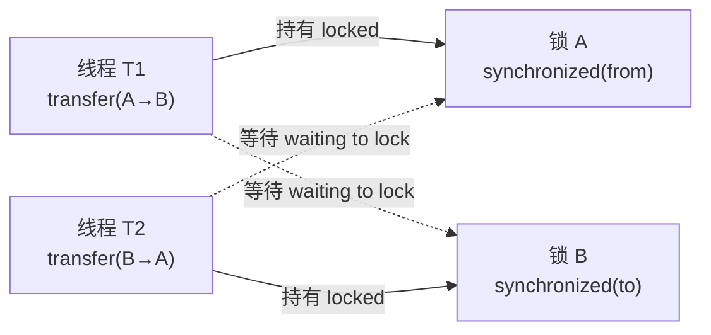
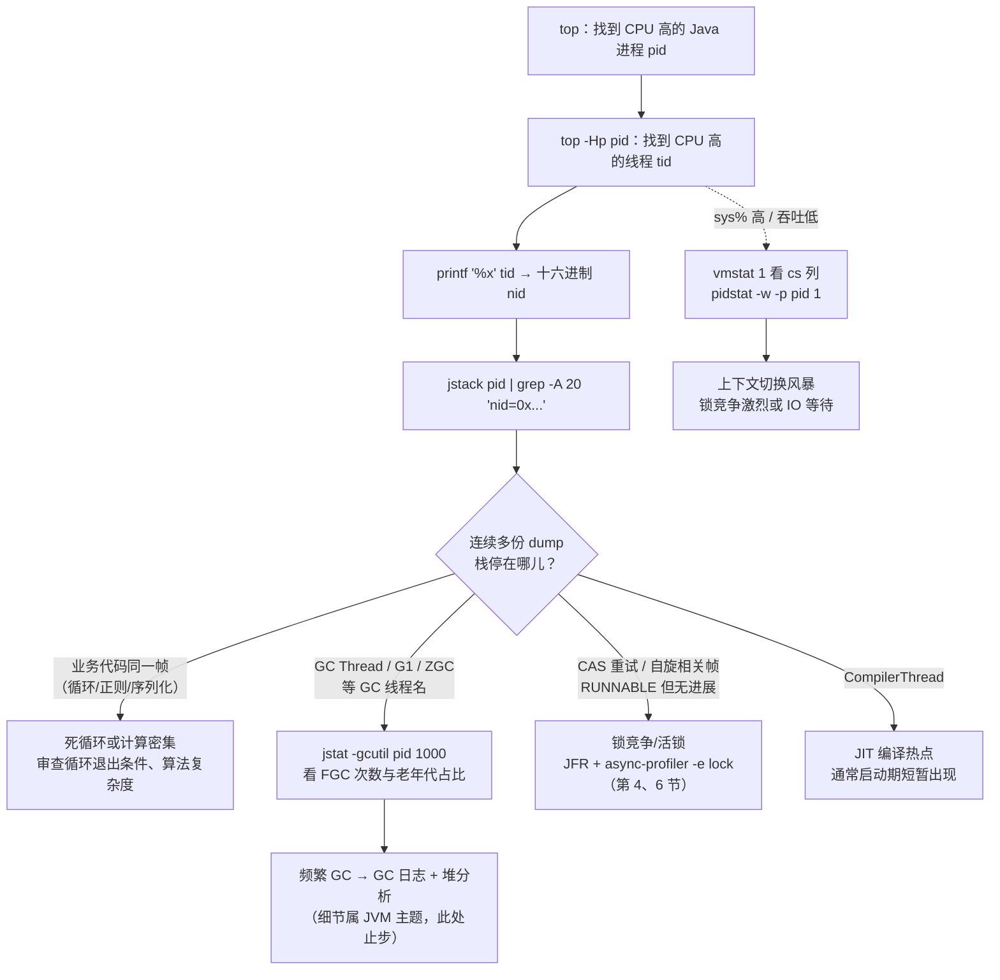

# 死锁与并发问题排查

> 一句话概括：并发问题的难点不在「知道死锁四条件」，而在**线上出问题时能不能在十分钟内完成「识别 → 定位 → 修复 → 预防」的工程闭环**——
> 本文以死锁为切入点，把线程 dump、CPU 飙高、锁竞争、伪共享、基准测试陷阱串成一条可动手的排查链路。

预计阅读时间：大约 65 分钟

所属主题：[Java 并发编程常见面试题总结](summary.md)

版本基线：以 **JDK 8 / 17 工具链**为基线（jps / jstack / jcmd / jstat / JFR），JDK 21+ 的差异单独注明；第三方工具版本：**Arthas 3.x/4.x**（官方文档当前为 4.x）、**async-profiler 3.x**（2.x 的入口脚本是 `profiler.sh`，3.x 改名 `asprof`）、**JMH 1.37**。源码锚点用 `类名#方法名`，工具锚点用命令/事件名。锁机制本身（synchronized 升级、AQS 队列）归各自专题，本文聚焦问题排查，不复述实现。

---

## 0. 阅读路线

| 读者 | 建议阅读 | 关注点 |
| --- | --- | --- |
| 初级（1 年内） | 1、2.1~2.3、3、9 | 死锁四条件与反例、三种常见破解写法、死锁/活锁/饥饿的区别、故障速查表 |
| 中级（1~3 年） | 1.3~1.4、2 全部、4、5 | jstack 输出逐行解读、ThreadMXBean 检测范围、CPU 飙高全流程 |
| 高级（3 年+） | 4.4~4.6、6、7、8 | JFR 事件与阈值、锁竞争度量、伪共享与 @Contended、JMH 陷阱 |
| 选型/架构 | 2.6、6.3、10 | 检测+恢复 vs 预防的取舍、优化手段的成本账、评审与监控文化 |

目录：

1. 死锁四条件与一个完整反例
2. 死锁破解策略：逐个配代码
3. 死锁 vs 活锁 vs 饥饿
4. 排查工具箱：命令 + 输出解读
5. CPU 飙高排查全流程
6. 锁竞争与性能优化
7. 伪共享：缓存行级别的「隐形锁竞争」
8. 并发基准测试陷阱（JMH）
9. 其他并发故障速查表
10. 预防与工程文化
11. 高频追问集
12. 参考资料
附：一页速记

---

## 1. 死锁四条件与一个完整反例

### 1.1 四个必要条件（必考）

**结论**：死锁是**一组线程互相持有对方需要的资源并永久等待**的状态。产生死锁必须**同时满足**四个必要条件，破坏任意一个即可预防：

| 条件 | 含义 | 在 Java 里的体现 | 常见破坏手段 |
| --- | --- | --- | --- |
| 互斥 | 资源同一时刻只能被一个线程占有 | `synchronized` / `ReentrantLock` 的排他性 | 无锁化（CAS、并发容器），见 2.4 |
| 持有并等待 | 持有一个资源的同时请求另一个 | 嵌套锁：`synchronized(a){ synchronized(b){} }` | 一次性申请全部资源，见 2.2 |
| 不可剥夺 | 已获得的锁不能被强行抢走 | `synchronized` 阻塞无法被中断 | `tryLock` 超时主动放弃，见 2.3 |
| 循环等待 | 存在线程→资源的环形等待链 | T1 持 A 等 B，T2 持 B 等 A | 固定全局加锁顺序，见 2.1 |

**边界**：四条件是**必要**而非充分条件的通俗说法——严格讲，四者同时成立时死锁「可能」发生（单实例资源下等价于必然）；工程上记住「缺一不可、破一即可」就够用。另外，**死锁的线程不消耗 CPU**：它们处于 BLOCKED/WAITING，被挂起让出处理器。所以「CPU 100%」通常不是死锁的直接症状，「请求全部卡住但 CPU 很闲」才是（见第 5 节的对照）。

### 1.2 经典转账死锁：完整可运行反例

线程 1 锁 A 等 B，线程 2 锁 B 等 A，`sleep` 只是放大竞态窗口，去掉它死锁依然概率性发生：

```java
public class TransferDeadlock {
    static class Account {
        final String name;
        long balance;
        Account(String name, long balance) { this.name = name; this.balance = balance; }
    }

    static void transfer(Account from, Account to, long amount) {
        synchronized (from) {                       // 先锁转出方
            System.out.println(Thread.currentThread().getName() + " 持有 " + from.name);
            try { Thread.sleep(100); }              // 放大窗口，确保对方也拿到第一把锁
            catch (InterruptedException e) { Thread.currentThread().interrupt(); }
            synchronized (to) {                     // 再锁转入方 —— 循环等待在此形成
                from.balance -= amount;
                to.balance += amount;
            }
        }
    }

    public static void main(String[] args) {
        Account a = new Account("A", 1000);
        Account b = new Account("B", 1000);
        new Thread(() -> transfer(a, b, 100), "T1").start();  // 锁顺序 A → B
        new Thread(() -> transfer(b, a, 200), "T2").start();  // 锁顺序 B → A
    }
}
```

运行后两条「持有」日志打印完即永久挂起。资源等待图（实线=已持有，虚线=正在等待，环即死锁）：



### 1.3 jstack 死锁输出解读（示意）

对上面的进程执行 `jstack <pid>`，末尾会出现专门的死锁段落（**以下输出为示意**，地址/行号以实际为准）：

```text
Found one Java-level deadlock:
=============================
"T2":
  waiting to lock monitor 0x00006000012a4568 (object 0x000000076ab62208, a TransferDeadlock$Account),
  which is held by "T1"
"T1":
  waiting to lock monitor 0x00006000012a7890 (object 0x000000076ab62210, a TransferDeadlock$Account),
  which is held by "T2"

Java stack information for the threads listed above:
===================================================
"T2":
        at TransferDeadlock.transfer(TransferDeadlock.java:14)
        - waiting to lock <0x000000076ab62208> (a TransferDeadlock$Account)
        - locked <0x000000076ab62210> (a TransferDeadlock$Account)
"T1":
        at TransferDeadlock.transfer(TransferDeadlock.java:14)
        - waiting to lock <0x000000076ab62210> (a TransferDeadlock$Account)
        - locked <0x000000076ab62208> (a TransferDeadlock$Account)

Found 1 deadlock.
```

读法：`waiting to lock <地址>` 与 `locked <地址>` 按**对象地址**交叉配对——T1 等的正是 T2 持有的，反之亦然，环成立。JVM 在生成 dump 时做环检测，**monitor 死锁和 ownable synchronizer（如 `ReentrantLock`）死锁都能检出**；`jstack -l` 还会额外打印每个线程的 `Locked ownable synchronizers` 清单，便于核对 `ReentrantLock` 的持有关系。

### 1.4 编程式检测：ThreadMXBean 的两个 find 方法

**结论**：`ThreadMXBean#findDeadlockedThreads` 检测 **object monitor + ownable synchronizer** 两类锁的死锁；`ThreadMXBean#findMonitorDeadlockedThreads` **只检测 object monitor**（`synchronized`）。用 `ReentrantLock` 写出的死锁，后者查不出来——这是高频追问点。

| 方法 | 检测范围 | 返回 | 备注 |
| --- | --- | --- | --- |
| `findMonitorDeadlockedThreads()` | 仅 object monitor（含 `Object.wait` 后重入阻塞） | 死锁线程 id 数组，无则 `null` | JDK 5 引入 |
| `findDeadlockedThreads()` | monitor + ownable synchronizer（`ReentrantLock`、`ReentrantReadWriteLock` 的写锁等 AQS 独占锁） | 同上 | JDK 6 引入；JVM 不支持 ownable synchronizer 监控时抛 `UnsupportedOperationException` |

两者的 javadoc 都明确写着：**"This method is designed for troubleshooting use, but not for synchronization control. It might be an expensive operation."**——它是排障工具，不是同步控制手段，且开销不小，不要放进高频业务路径。

```java
// 可挂到定时任务/健康检查里，发现死锁即告警（低频调用，如每分钟一次）
ThreadMXBean bean = ManagementFactory.getThreadMXBean();
long[] ids = bean.findDeadlockedThreads();          // 两类锁都查
if (ids != null) {
    for (ThreadInfo info : bean.getThreadInfo(ids, true, true)) {
        System.err.println("[DEADLOCK] " + info.getThreadName()
                + " 等待 " + info.getLockName()
                + "，持有者 " + info.getLockOwnerName());
    }
    // 生产环境此处接告警；JVM 不会自动解开死锁
}
```

**追问：`ReentrantReadWriteLock` 的读锁死锁能检测吗？** 读锁是共享模式，不属于 ownable synchronizer 的独占持有语义，`findDeadlockedThreads` 对纯读锁参与的等待环检测能力有限；读写锁交叉（读→写升级）造成的互等，更多要靠 dump 里 `parking to wait for` 的 AQS 队列信息人工分析。

---

## 2. 死锁破解策略：逐个配代码

### 2.1 固定加锁顺序（破坏循环等待）

**结论**：给所有锁定义一个**全局偏序**，任何线程都按同一顺序申请，等待图就不可能成环。这是工程上最常用、成本最低的方案。

有业务 id 时按 id 排序；没有时用 `System.identityHashCode`，但它**不保证唯一**，哈希相等时需要一把额外的 tie-breaker 锁串行化这种罕见情况（《Java Concurrency in Practice》经典写法）：

```java
private static final Object TIE_LOCK = new Object();

static void transfer(Account from, Account to, long amount) {
    int h1 = System.identityHashCode(from);
    int h2 = System.identityHashCode(to);
    if (h1 < h2) {
        synchronized (from) { synchronized (to) { doTransfer(from, to, amount); } }
    } else if (h1 > h2) {
        synchronized (to) { synchronized (from) { doTransfer(from, to, amount); } }
    } else {                                  // 哈希碰撞：先抢全局 tie-breaker
        synchronized (TIE_LOCK) {
            synchronized (from) { synchronized (to) { doTransfer(from, to, amount); } }
        }
    }
}
```

**边界/代价**：① 顺序必须**全局一致**，只要有一条代码路径反序就前功尽弃——所以它本质是团队纪律问题（见第 10 节评审项）；② tie-breaker 锁在碰撞时降低并发度，但碰撞概率极低，可接受；③ 锁对象由外部传入、调用方不可控时（如公共库），固定顺序难以推行，此时改用 2.3 的 tryLock。

**追问：为什么不用 `hashCode()` 而用 `identityHashCode()`？** 业务类可能重写 `hashCode()` 且随字段变化（账户余额变了哈希也变），排序基准不稳定会直接破坏偏序；`identityHashCode` 与对象身份绑定、生命周期内不变。

### 2.2 一次性申请所有资源（破坏持有并等待）

**结论**：把「申请多把锁」这件事本身原子化——要么全拿到，要么一把都不拿。

```java
private static final Object ALLOCATOR = new Object();   // 资源分配器锁

static void transfer(Account from, Account to, long amount) {
    synchronized (ALLOCATOR) {          // 申请阶段互斥：不会有人「拿了一半」
        synchronized (from) {
            synchronized (to) {
                doTransfer(from, to, amount);
            }
        }
    }
}
```

**边界/代价**：分配器锁把所有转账串行化了，并发度退化为 1，只适合**临界区极短、竞争者少**的场景（如初始化期申请多个单例资源）。它的价值更多是思想层面的：数据库事务的「先检查全部锁再执行」、`tryLock` 全拿全放（2.3）都是这个思路的变体。

### 2.3 tryLock 超时回退（破坏不可剥夺）

**结论**：`ReentrantLock#tryLock(time, unit)` 拿不到锁就**超时放弃并释放已持有的锁**，把「不可剥夺」变成「可主动让出」。这是锁对象不可控、无法推行全局顺序时的兜底方案。AQS 如何支撑可超时/可中断的获取见 [AQS 与 Lock 体系](aqs-and-locks.md)。

```java
static class Account {
    final ReentrantLock lock = new ReentrantLock();
    long balance;
}

static boolean transfer(Account from, Account to, long amount) throws InterruptedException {
    while (true) {
        if (from.lock.tryLock(50, TimeUnit.MILLISECONDS)) {
            try {
                if (to.lock.tryLock(50, TimeUnit.MILLISECONDS)) {
                    try {
                        from.balance -= amount;
                        to.balance += amount;
                        return true;
                    } finally { to.lock.unlock(); }
                }
            } finally { from.lock.unlock(); }   // 第二把失败必须释放第一把！
        }
        // 随机退避：避免双方同步重试形成活锁（见第 3 节）
        Thread.sleep(ThreadLocalRandom.current().nextInt(10, 50));
    }
}
```

**边界/代价**：① 两个 `finally` 缺一不可，漏掉就是「锁未释放」故障（第 9 节）；② 固定间隔重试会让两个线程永远镜像同步——**必须随机退避**，否则死锁变活锁；③ 超时时间要覆盖正常临界区耗时，太短会导致高竞争下大量无效重试；④ `tryLock()` 无参版本会**无视公平设置直接插队**，与 `tryLock(0, unit)` 语义不同，后者遵守公平策略。

**追问：`synchronized` 能做到超时吗？** 不能。monitor 阻塞不响应中断也没有超时参数，这正是 `java.util.concurrent.locks` 存在的理由之一：`lockInterruptibly()`、`tryLock(time)` 给了线程「放弃」的权利。

### 2.4 减少锁粒度 / 无锁化（破坏互斥）

**结论**：没有排他锁就没有死锁。能用并发容器和原子类表达的语义，不要自己拿锁拼：

```java
// 反例：synchronized(map) 后 get-check-put，既慢又可能与别处嵌套成环
// 正例：原子复合操作，锁粒度下沉到桶级
ConcurrentHashMap<String, Long> balances = new ConcurrentHashMap<>();
balances.merge("A", -100L, Long::sum);     // 单 key 原子更新

// 纯计数场景：LongAdder 分段 CAS，几乎无竞争
LongAdder total = new LongAdder();
total.increment();
```

机制与源码见 [CAS 与原子类](cas-and-atomic-classes.md)、[并发容器](concurrent-collections.md)。**边界**：无锁化只解决**单变量/单 key** 的原子性；「A 减 100 且 B 加 100」这种跨资源不变量仍然需要锁或事务语义，别为了无锁把一致性丢了。

### 2.5 银行家算法（一句话）

操作系统层面的死锁避免算法：每次分配前模拟「分配后是否仍存在安全序列」，不安全就拒绝。它需要**预知每个进程的最大资源需求**，Java 业务里几乎不可能拿到这个信息，工程上基本不用——面试点到「避免（avoidance）与预防（prevention）的区别」即可。

### 2.6 「检测 + 恢复」vs「预防」的工程取舍

| 策略 | 思路 | 代表 | 代价 |
| --- | --- | --- | --- |
| 预防 | 设计上让四条件不成立 | 固定顺序、tryLock、无锁化 | 约束编码方式，可能牺牲并发度 |
| 避免 | 运行时判断分配是否安全 | 银行家算法 | 需要最大需求先验，工程罕见 |
| 检测 + 恢复 | 允许死锁发生，周期检测后杀受害者回滚 | 数据库（MySQL InnoDB 检测行锁环后回滚 undo 量小的事务） | 需要可回滚的操作与牺牲者选择策略 |

**JVM 没有内置恢复机制**：`Thread.stop` 早已废弃（JDK 20+ 直接抛 `UnsupportedOperationException`），`interrupt()` 对 `synchronized` 阻塞无效（只对 `lockInterruptibly`/`tryLock`/可中断 IO 有效）。所以 Java 进程内死锁一旦形成，**只能重启或靠设计预防**——这就是为什么 Java 工程把重心全压在预防侧，而数据库敢用检测+恢复（事务天然可回滚）。

**追问：线上发现死锁怎么办？** 先 `jstack` 留证据（连续两份），确认环上的线程与锁；短期重启恢复服务；长期按 2.1~2.4 改造代码，并把 `findDeadlockedThreads` 挂进监控（1.4）。不要试图「杀掉一个线程」——做不到，也不该做。

---

## 3. 死锁 vs 活锁 vs 饥饿

**结论**：三者都是「无进展」，但状态特征完全不同——死锁是**都不动**，活锁是**都在动但互相抵消**，饥饿是**别人都在动、就它轮不上**。

| 维度 | 死锁 deadlock | 活锁 livelock | 饥饿 starvation |
| --- | --- | --- | --- |
| 线程状态 | BLOCKED/WAITING，静止 | RUNNABLE/TIMED_WAITING，反复变化 | 长期 WAITING/BLOCKED 或反复 CAS 失败 |
| CPU 表现 | 低（挂起不耗 CPU） | **偏高**（不断重试） | 视实现：阻塞型低，自旋型高 |
| 本质 | 循环等待，谁也不释放 | 互相谦让/同步重试，状态变但无进展 | 调度/竞争策略不公，弱者永远排不上 |
| 生活类比 | 两人过独木桥互不相让 | 走廊相遇反复互相让路，永远同向移动 | 食堂排队永远被插队 |
| 典型解法 | 破坏四条件（第 2 节） | **随机退避**打破同步节奏 | 公平锁、优先级老化、限制强者吞吐 |
| 能否自动解开 | 不能 | 引入随机性后大概率能 | 改策略后才能 |

### 3.1 活锁：不断重试的「礼貌谦让」

2.3 的 tryLock 如果**固定间隔**重试，两个线程会永远「同时拿第一把 → 同时拿第二把失败 → 同时释放 → 同时重来」：

```java
// 活锁版：双方节奏完全镜像，状态一直在变，转账永远不成功
while (true) {
    if (from.lock.tryLock()) {
        try {
            if (to.lock.tryLock()) { try { doTransfer(from, to, amount); return; }
                                     finally { to.lock.unlock(); } }
        } finally { from.lock.unlock(); }
    }
    Thread.sleep(10);   // 固定 10ms：双方永远同步重试 → 活锁
}
// 修复：Thread.sleep(ThreadLocalRandom.current().nextInt(10, 50)) 随机退避
```

以太网 CSMA/CD 的截断二进制指数退避、`ConcurrentHashMap` 扩容时的协作让位，都是同一思想：**用随机性打破对称**。

### 3.2 饥饿：非公平锁与优先级

`new ReentrantLock()` 默认非公平，新来线程可以插队，理论上存在某线程长期抢不到锁的饥饿（实践中概率低，因为插队窗口很小）；`synchronized` 也是非公平的。解法：`new ReentrantLock(true)` 公平锁（代价是吞吐下降，见 [AQS 与 Lock 体系](aqs-and-locks.md)）、线程优先级老化、把大任务拆小让出锁。注意 `Thread.setPriority` 只是给 OS 的**建议**，不同平台映射不同，不能当正确性手段。

### 3.3 阻塞 vs 忙等待

| 方式 | 等待时做什么 | CPU | 适用 |
| --- | --- | --- | --- |
| 阻塞（park/wait） | 让出 CPU，挂进等待队列 | 不耗 | 等待时间长（毫秒级以上） |
| 忙等待（自旋 CAS） | 循环重试，占着 CPU | 耗 | 等待极短（几十纳秒~微秒），省上下文切换 |

JVM 的自适应自旋（见 [synchronized 与锁升级](synchronized-and-lock-escalation.md)）就是在两者间动态权衡。**排查含义**：忙等待型故障表现为 CPU 高（第 5 节），阻塞型故障表现为 CPU 闲但请求卡死——先分清这一类，再选工具。

---

## 4. 排查工具箱：命令 + 输出解读

### 4.1 jps：找到目标进程

```bash
jps -l        # 列出 Java 进程：pid + 主类/jar 全名
# 12345 com.example.OrderApplication
# 23456 sun.tools.jps.Jps
```

容器里注意：`jps` 只能看到**同一 PID 命名空间、同一用户**的进程；attach 失败时检查是否跨容器/跨用户（可用 `jcmd` 同理，或进目标容器执行）。

### 4.2 jstack：线程 dump 逐行解读（重点）

```bash
jstack 12345          # 基础 dump
jstack -l 12345       # 附加 ownable synchronizer 持有清单（排查 ReentrantLock 必加）
```

一个 BLOCKED 线程的 dump 片段（**示意输出**）：

```text
"T1" #12 prio=5 os_prio=0 tid=0x00007f8a1c0b2000 nid=0x3059 waiting for monitor entry [0x00007f89e8dfe000]
   java.lang.Thread.State: BLOCKED (on object monitor)
        at TransferDeadlock.transfer(TransferDeadlock.java:14)
        - waiting to lock <0x000000076ab62210> (a TransferDeadlock$Account)
        - locked <0x000000076ab62208> (a TransferDeadlock$Account)
```

| 字段/行 | 含义 |
| --- | --- |
| `"T1" #12` | 线程名 + Java 层线程 id（`Thread.getId()`） |
| `nid=0x3059` | **native 线程 id，十六进制**——与 `top -Hp` 的十进制 tid 换算后对应（第 5 节的关键桥梁） |
| `waiting for monitor entry` | 正在等 `synchronized` 的 monitor，对应 `BLOCKED` |
| `java.lang.Thread.State` | Java 层状态，与头部描述对照见下表 |
| `- locked <地址>` | 该帧**已持有**的 monitor |
| `- waiting to lock <地址>` | 该帧**正在等待**的 monitor |
| `parking to wait for <地址>` | 通过 `LockSupport.park` 等待（`ReentrantLock`/AQS 队列、`Condition`），对应 WAITING/TIMED_WAITING |

头部描述与 `Thread.State` 的常见对照：

| dump 头部描述 | Thread.State | 典型场景 |
| --- | --- | --- |
| `runnable` | RUNNABLE | 正在执行/等 IO（socketRead 也显示 RUNNABLE） |
| `waiting for monitor entry` | BLOCKED (on object monitor) | 等 synchronized |
| `in Object.wait()` | WAITING / TIMED_WAITING (on object monitor) | `wait()` / `wait(timeout)` |
| `waiting on condition` + parking | WAITING / TIMED_WAITING (parking) | AQS 排队、`LockSupport.park`、队列 take |

**连续多次 dump 对比**是定位卡点的核心手法：间隔 5~10 秒抓 3 份，**栈一直停在同一帧**的线程才是真卡住（单次 dump 只是快照，可能恰好路过）；对比「locked 地址是否变化」可区分死锁（永不变）与慢操作（缓慢推进）。

**边界**：JDK 17 的 jstack man page 明确标注它是 **experimental and unsupported** 命令，官方排障指南推荐用 `jcmd Thread.print`（4.3，该推荐出自 jcmd man page/排障指南而非 jstack man page）。JDK 21+ 虚拟线程不在传统 dump 里，需要 `jcmd <pid> Thread.dump_to_file -format=json <file>` 导出新格式全量 dump（含虚拟线程），见 [虚拟线程](virtual-threads.md)。

### 4.3 jcmd：官方推荐的统一入口

```bash
jcmd 12345 help                 # 列出目标进程支持的全部诊断命令
jcmd 12345 Thread.print -l      # 等价 jstack -l，-l 打印 j.u.c 锁信息
jcmd 12345 VM.flags             # 生效的 JVM 参数
jcmd 12345 GC.heap_info         # 堆概况
```

`Thread.print` 的官方文档标注 Impact: Medium（取决于线程数）——线程上万时 dump 本身有可观停顿，生产高峰期谨慎。

### 4.4 Arthas：交互式排查（第三方，阿里开源）

```bash
#  attach 到目标进程后：
thread -n 3 -i 1000        # 采样 1000ms 内最忙的 3 个线程并打印栈（CPU 飙高首选）
thread -b                  # 找出「持有锁且阻塞了其他线程」的元凶线程
thread --state BLOCKED     # 只看 BLOCKED 线程
thread 12                  # 查看指定线程 id 的栈
```

两个必须知道的机制细节（官方文档口径）：

- `thread -n` 的 cpuUsage 是**两次采样 `ThreadMXBean#getThreadCpuTime` 的增量 / 采样间隔**（默认 200ms，`-i` 可调）；栈在第二次采样末尾抓取，**不保证整个区间都在执行该栈**，区间越长越失真，建议 `-i 1000` 起步。
- **`thread -b` 目前只支持找出 `synchronized` 阻塞住的线程，`java.util.concurrent.Lock` 不支持**（官方文档原话：「目前只支持找出 synchronized 关键字阻塞住的线程，如果是 java.util.concurrent.Lock，目前还不支持」）。`ReentrantLock` 卡死要靠 dump 里 `parking to wait for` + `Locked ownable synchronizers` 人工配对，或 JFR 的 `jdk.ThreadPark` 事件。

### 4.5 JFR：低开销的锁竞争录像（JDK 内置）

**结论**：JFR（JDK Flight Recorder）是 JVM 内置的事件录制器，**JDK 11 起免费开源**（JEP 328；此前 JDK 8/9/10 是 Oracle 商业特性，需 `-XX:+UnlockCommercialFeatures`；OpenJDK **8u262 起回移、8u272 起默认构建启用**）。它回答 jstack 回答不了的问题：**锁竞争发生了多少次、每次阻塞多久、发生在哪行代码**。

```bash
# 录制 60 秒，profile 配置（事件更全、阈值更低）
jcmd 12345 JFR.start name=lock settings=profile duration=60s filename=/tmp/lock.jfr
jcmd 12345 JFR.dump name=lock filename=/tmp/lock.jfr   # 提前导出
jfr print --events jdk.JavaMonitorEnter,jdk.ThreadPark /tmp/lock.jfr   # 命令行分析
# 图形化分析用 JDK Mission Control（JMC，单独下载）
```

三个锁相关核心事件（事件名与默认配置已对照 OpenJDK 17 `default.jfc` 核实）：

| 事件 | 记录什么 | 对应机制 |
| --- | --- | --- |
| `jdk.JavaMonitorEnter` | 进入 `synchronized` 时的**阻塞等待**（含持有时长、monitor 类、栈） | monitor 竞争 |
| `jdk.JavaMonitorWait` | `Object.wait()` 的等待 | wait/notify |
| `jdk.ThreadPark` | `LockSupport.park` 的等待（`ReentrantLock`、AQS 队列、`BlockingQueue` 等） | j.u.c 锁竞争 |

三者在 `default.jfc` 中默认开启、带栈、阈值 **20 ms**（受 `locking-threshold` 控制，可自定义 settings 调低）——**短于阈值的竞争不会被记录**，这是「JFR 里看不到竞争但吞吐就是上不去」的常见原因。default 配置开销约 1%，可常开；profile 配置开销更高，适合短时排障。

### 4.6 async-profiler：火焰图视角（第三方）

```bash
asprof -e lock -d 30 -f lock.html 12345     # 锁竞争火焰图：计数=等待进入锁的纳秒数
asprof -e wall -t -i 10ms -d 30 -f wall.html 12345   # wall-clock：所有线程等间隔采样
```

官方文档口径：`-e lock` 的火焰图**顶帧是锁/monitor 的类，计数是进入该锁花费的纳秒数**，可用 `--lock 5ms` 设阈值；`-e wall` 对 Running/Sleeping/Blocked 线程**一视同仁**按墙钟采样，适合「CPU 不高但请求慢」的场景——阻塞型故障在 CPU 火焰图里是隐形的，wall 火焰图里一览无余。（2.x 版本命令为 `profiler.sh -e lock ...`。）

### 4.7 ThreadMXBean：编程式常态监控

```java
ThreadMXBean bean = ManagementFactory.getThreadMXBean();
bean.setThreadContentionMonitoringEnabled(true);      // 开启竞争统计（有开销）
ThreadInfo info = bean.getThreadInfo(threadId);
info.getBlockedTime();    // 累计 BLOCKED 毫秒（等 monitor）
info.getBlockedCount();   // 累计进入 BLOCKED 次数
info.getWaitedTime();     // 累计 WAITING/TIMED_WAITING 毫秒
```

配合 1.4 的死锁检测做成分钟级巡检即可。**边界**：javadoc 明示这些方法「expensive」，竞争监控开启后每次锁竞争都记账，高竞争服务上长期开启有可观开销——按需开关，不要默认全量常开。

**工具选型一句话**：卡死看 dump（jstack/jcmd/Arthas），CPU 高看 `thread -n`/top，竞争度量看 JFR/async-profiler，常态巡检看 ThreadMXBean。

---

## 5. CPU 飙高排查全流程（必考场景题）

**结论**：标准链路是 **top 找进程 → top -Hp 找线程 → 十进制 tid 转十六进制 nid → jstack 里按 nid 定位栈**，然后按栈内容分流到三种根因：死循环/计算密集、频繁 GC、锁自旋。



### 5.1 四步命令（Linux，输出为示意）

```bash
top                          # ① 按 P 排序，找到 Java 进程：PID=12345，%CPU=380
top -Hp 12345                # ② 展开该进程线程，找到 TID=12377，%CPU=99.8
printf '%x\n' 12377          # ③ 十进制 → 十六进制：3059
jstack 12345 | grep -A 20 'nid=0x3059'   # ④ 定位线程栈
```

第 ④ 步输出（**示意**）：

```text
"order-worker-3" #45 prio=5 os_prio=0 tid=0x... nid=0x3059 runnable [0x...]
   java.lang.Thread.State: RUNNABLE
        at com.example.PriceEngine.match(PriceEngine.java:88)
        at com.example.PriceEngine.loop(PriceEngine.java:52)
```

间隔几秒再抓两份，若始终停在 `PriceEngine.match` 同一行——基本锁定死循环或病态计算（如正则回溯）。**macOS 没有 `top -Hp`**，可用 `jstack` 全量 dump + Arthas `thread -n 3` 替代第 ② 步。

### 5.2 三种根因的鉴别

| 根因 | dump/指标特征 | 确认手段 |
| --- | --- | --- |
| 死循环/计算密集 | 业务线程 RUNNABLE，多份 dump 停同一帧；us% 高 | 读栈 + 代码审查 |
| 频繁 GC | 高 CPU 的是 **GC 线程**（`GC Thread#`、`G1 Young RemSet` 等）；业务线程反而在等 | `jstat -gcutil 12345 1000`：FGC 持续增长、O 区居高不下 |
| 锁自旋/活锁 | RUNNABLE 但栈在 CAS/重试路径；吞吐不涨 | JFR `jdk.ThreadPark`/`jdk.JavaMonitorEnter`、`-e lock` 火焰图 |

```bash
jstat -gcutil 12345 1000 5   # 每秒一次共 5 次（示意输出）
#  S0     S1     E      O      M     YGC   YGCT    FGC   FGCT    GCT
#  0.00  99.8  87.3   99.1  95.2   412   8.31    67   142.5   150.8
```

O（老年代）99% + FGC 一分钟涨几十次 = 内存问题伪装成 CPU 问题。**一句话边界**：到这里就转 GC 日志（`-Xlog:gc*`）与堆 dump 分析，GC 算法与调优细节属 JVM 主题，本文不展开。

### 5.3 频繁上下文切换：CPU 高但吞吐低

```bash
vmstat 1                 # cs 列：每秒上下文切换次数，数万~数十万即异常
pidstat -w -p 12345 1    # 按线程看 cswch/s（自愿）与 nvcswch/s（非自愿）
```

| 指标 | 含义 | 指向 |
| --- | --- | --- |
| 自愿切换（cswch/s）高 | 线程主动让出：等锁、等 IO、sleep | 锁竞争激烈 / IO 等待 |
| 非自愿切换（nvcswch/s）高 | 时间片耗尽被抢占 |  runnable 线程太多、CPU 争抢 |

**「CPU 高但吞吐低」的锁竞争特征**：大量线程在「短暂拿锁→阻塞→唤醒→再抢」间震荡，sys% 偏高、cs 飙升、`-e lock` 火焰图顶部集中在少数锁类。注意区分：**阻塞本身不耗 CPU**（3.3），耗 CPU 的是自旋重试与切换开销——所以看到 BLOCKED 一片时 CPU 反而可能不高，那是「卡死」而非「飙高」，走第 4 节 dump 路线。

---

## 6. 锁竞争与性能优化（高级层）

### 6.1 先度量：竞争的三个数字

**结论**：优化锁之前先拿到三个数字——**竞争次数、单次阻塞时长、阻塞总时长占比**。没有度量的换锁是赌博。

| 度量 | 工具锚点 | 看什么 |
| --- | --- | --- |
| monitor 阻塞时长分布 | JFR `jdk.JavaMonitorEnter`（duration 字段） | 超过 20ms 阈值的竞争事件数与栈 |
| j.u.c 锁等待 | JFR `jdk.ThreadPark`、`jstack -l` 的 ownable synchronizers | park 时长与 AQS 队列深度 |
| 等待时间火焰图 | `asprof -e lock`（计数=等待纳秒） | 哪把锁、哪条调用路径吃掉最多等待时间 |
| 累计阻塞统计 | `ThreadMXBean#getThreadInfo` 的 blockedTime/blockedCount | 常态巡检趋势 |

### 6.2 优化手段清单（按侵入性从低到高）

| 手段 | 做法 | 代价/边界 | 延伸 |
| --- | --- | --- | --- |
| 缩小临界区 | 把 IO、计算、日志移出锁外，锁内只留共享状态读写 | 需要重新论证原子性边界 | 10.2 |
| 降低锁粒度 | 一把大锁 → 分段/桶锁（如 ConcurrentHashMap 按桶加锁） | 跨段复合操作仍需外部同步 | [并发容器](concurrent-collections.md) |
| 读写分离 | 读多写少用 `ReentrantReadWriteLock`；读远多于写且可容忍过期读用 `StampedLock` 乐观读 | 写饥饿风险；StampedLock 不可重入、不支持 Condition | [AQS 与 Lock 体系](aqs-and-locks.md) |
| 无锁化 | CAS 原子类；高竞争计数用 `LongAdder` 分段累加 | 只保单变量原子性；LongAdder 的 sum 是弱一致快照 | [CAS 与原子类](cas-and-atomic-classes.md) |
| 锁粗化（反向权衡） | 循环内反复加解锁 → 把锁提到循环外一次持有 | 持锁时间变长，阻塞他人；与「缩小临界区」方向相反，按竞争形态选 | JIT 也会做锁粗化 |
| 异步化削峰 | 锁内只做入队，重活交给线程池/消息队列 | 引入队列堆积与一致性延迟问题 | [线程池](thread-pool.md)、[ForkJoin 与 CompletableFuture](forkjoin-and-completable-future.md) |

### 6.3 先度量再优化，不要凭感觉换锁

**结论**：「synchronized 慢，换 ReentrantLock」是典型错觉——JDK 6 之后两者性能同量级（锁升级机制见 [synchronized 与锁升级](synchronized-and-lock-escalation.md)），真正决定吞吐的是**临界区大小与竞争度**，不是锁的实现。

实践流程：`-e lock` 火焰图找到 Top 等待路径 → JMH 基准对比候选方案（第 8 节）→ 灰度上线看 P99 与吞吐 → 保留度量手段防回退。**追问：什么时候宁可不动？** 竞争事件低于 JFR 阈值、P99 达标、锁路径不在热点上——此时换锁只增加复杂度，不产生收益。

---

## 7. 伪共享：缓存行级别的「隐形锁竞争」

### 7.1 机制：MESI 乒乓

**结论**：伪共享（false sharing）是**两个线程各写各的变量，却因变量落在同一条缓存行上而互相拖慢**——没有锁，却有类似锁竞争的代价。

CPU 缓存以**缓存行（cache line，主流 x86 为 64 字节）**为单位与内存交换数据。核 1 写变量 x、核 2 写变量 y，x/y 相邻同行：按 MESI 一致性协议，任一核写入都会使**其他核的整行副本失效**，对方下次访问必须重新从内存/对方缓存拉取。两核高频写 → 缓存行在核间反复失效-同步（乒乓），性能可跌数倍。

```java
// 反例：两个 volatile long 相邻（16 字节，必然同行），两线程各写一个
static class Shared {
    volatile long x;   // 线程 1 疯狂写
    volatile long y;   // 线程 2 疯狂写
}
// 修复：中间填充，使 x、y 不同行
static class Padded {
    volatile long x;
    long p1, p2, p3, p4, p5, p6, p7;   // 56 字节填充（历史写法，Disruptor 早期用法）
    volatile long y;
}
```

用两个线程各循环写 1 亿次对比，Padded 版通常快数倍（手写计时只看数量级，严谨对比用第 8 节 JMH）。注意填充可能被 JIT/对象布局重排优化掉，`volatile` 或继承链技巧是历史写法的一部分——**JDK 8+ 优先用 @Contended**。

### 7.2 @Contended：JVM 官方填充（版本差异必考）

| 版本 | 注解全名 | 用户类使用条件 |
| --- | --- | --- |
| JDK 8 | `sun.misc.Contended` | `-XX:-RestrictContended` |
| JDK 9+ | `jdk.internal.vm.annotation.Contended` | `-XX:-RestrictContended`，编译/运行还需 `--add-exports java.base/jdk.internal.vm.annotation=ALL-UNNAMED` |

已对照 OpenJDK 源码核实：`RestrictContended` 是 HotSpot product 参数，**默认 true**（"Restrict @Contended to trusted classes"），即默认只对 JDK 内部类生效，用户类必须显式关闭限制；`ContendedPaddingWidth` **默认 128 字节**（不是 64——为对抗相邻行预取），范围 0~8192。

```java
import jdk.internal.vm.annotation.Contended;   // JDK 9+；JDK 8 用 sun.misc.Contended

static class Counter {
    @Contended volatile long x;   // 每个标注字段独占隔离区
    @Contended volatile long y;
}
// 运行：java -XX:-RestrictContended --add-exports java.base/jdk.internal.vm.annotation=ALL-UNNAMED ...
```

注解可标字段或类；`value` 是 contention group 标签——**同组字段一起隔离、组内不互相隔离**，适合「一组字段被同一线程访问」的场景。JDK 内部应用：`Striped64` 的 `Cell`（`LongAdder` 的分段单元，JDK 8 源码中即 `@sun.misc.Contended static final class Cell`）、`ConcurrentHashMap` 的 `CounterCell`；第三方如 Disruptor 的 RingBuffer 序号填充（见 [CAS 与原子类](cas-and-atomic-classes.md)、[并发容器](concurrent-collections.md)）。

### 7.3 什么时候值得做

**结论**：只有**高并发写相邻字段**且度量证实缓存行乒乓时才值得——典型是框架级计数器、序号、队列游标。普通业务对象字段访问频率低，填充只会白白膨胀对象（每字段 +128 字节）与缓存占用。**代价**：空间换时间，且 @Contended 依赖非公开 API 与 JVM 参数，升级 JDK 要回归验证。

**追问：怎么证明是伪共享而不是锁竞争？** 无锁代码（纯 volatile 写）也慢、`-e lock` 火焰图无等待、perf 的 cache-misses 指标高（async-profiler 支持 `-e cache-misses` 硬件事件）、加填充后显著变快——四条证据链。

---

## 8. 并发基准测试陷阱（JMH，高级层）

### 8.1 为什么手写计时不可靠

**结论**：`long t = System.nanoTime(); for(...) work(); print(nanoTime()-t)` 测出来的数字**经常是错的**，因为 JIT 会把你测的代码优化没：

| 陷阱 | 机制 | 后果 |
| --- | --- | --- |
| JIT 预热 | 前几千次走解释器/C1，热点后才 C2 编译 | 冷启动数据混入，均值失真 |
| 死代码消除（DCE） | 计算结果没人消费 → 整段计算被删除 | 测出「0 纳秒的神级性能」 |
| 常量折叠 | 输入是编译期常量 → 结果直接算好 | 测的是查表不是计算 |
| 循环优化 | 循环体被外提/合并/向量化 | 单次成本被摊薄到失真 |

JMH（OpenJDK Code Tools 项目）通过**注解处理器生成合成基准代码**、黑盒消费结果、多 fork 多轮预热来系统性规避这些陷阱。官方 README 的原话值得记住：**"Your benchmarks should be peer-reviewed"**——工具只是让避坑更容易，不是免除思考。

### 8.2 最小可运行示例

```bash
mvn archetype:generate -DinteractiveMode=false \
  -DarchetypeGroupId=org.openjdk.jmh -DarchetypeArtifactId=jmh-java-benchmark-archetype \
  -DgroupId=org.sample -DartifactId=bench -Dversion=1.0
cd bench && mvn clean verify && java -jar target/benchmarks.jar
```

```java
@BenchmarkMode(Mode.Throughput)
@OutputTimeUnit(TimeUnit.MILLISECONDS)
@Warmup(iterations = 3, time = 1)        // 预热 3 轮，每轮 1s
@Measurement(iterations = 5, time = 1)   // 测量 5 轮
@Fork(1)                                  // 独立 JVM 进程，隔离 JIT profile 污染
@State(Scope.Benchmark)                   // 整个基准共享一份状态（多线程竞争同一对象）
public class CounterBenchmark {
    AtomicLong atomic = new AtomicLong();
    LongAdder adder = new LongAdder();

    @Benchmark @Threads(8)                // 8 线程并发调用
    public long atomicInc() { return atomic.incrementAndGet(); }  // 返回值被 JMH 消费，防 DCE

    @Benchmark @Threads(8)
    public void adderInc() { adder.increment(); }
}
```

输出片段（**示意**）：

```text
Benchmark                       Mode  Cnt    Score    Error  Units
CounterBenchmark.adderInc      thrpt    5  81234.5 ± 1203.4  ops/ms
CounterBenchmark.atomicInc     thrpt    5  12456.7 ±  890.1  ops/ms
```

### 8.3 并发测试的三个注意

- **`@State(Scope.Benchmark)`**：所有线程共享一个实例，测的是**竞争下的吞吐**；`Scope.Thread` 每线程一份，测的是无竞争单线程性能——选错 Scope，结论完全相反。
- **`@Threads(N)`**：线程数要贴近生产竞争度；1 线程下 LongAdder 未必赢 AtomicLong，8/64 线程下差距才拉开。
- **多值消费用 `Blackhole`**：`bh.consume(a); bh.consume(b);` 防止「只返回一个值、另一个被 DCE」。

**边界（必说）**：**微基准不等于生产吞吐**。JMH 测的是隔离热点的相对成本，生产里还有 IO、GC、调度、缓存冷热——「JMH 快 3 倍」不能直接换算成「接口 P99 降 3 倍」。正确用法：候选方案相对排序 + 生产压测验证。

---

## 9. 其他并发故障速查表

| 故障 | 典型症状 | 根因 | 解法 | 延伸 |
| --- | --- | --- | --- | --- |
| `OutOfMemoryError: unable to create new native thread` | 创建线程即抛错，堆却不满了 | 线程数超 `ulimit -u` / 系统 pid 上限；`-Xss` 过大耗尽虚拟内存；物理内存不足 | 调 ulimit、减 Xss、**用线程池限制线程总量** | [线程池](thread-pool.md)、[线程基础](thread-basics-and-lifecycle.md) |
| ThreadLocal 泄漏 | 线程池场景内存缓慢上涨、偶发脏数据 | 线程复用导致 Entry 不释放；value 强引用链 | `finally { tl.remove(); }`，拦截器统一清理 | [ThreadLocal](threadlocal.md) |
| 线程池队列堆积 OOM | 堆被任务对象占满，RT 飙升 | 无界队列（`Executors.newFixedThreadPool` 的 LinkedBlockingQueue）+ 生产快于消费 | 有界队列 + 拒绝策略 + 队列长度监控 | [线程池](thread-pool.md) |
| `ConcurrentModificationException` | 遍历集合时抛错，**单线程也会抛** | fail-fast：迭代器校验 modCount，foreach 中 remove 即触发 | `Iterator.remove()`、`removeIf`、并发容器（弱一致迭代） | [并发容器](concurrent-collections.md) |
| 虚假唤醒 | wait 后条件不成立却继续执行 | `notifyAll` 广播 / OS 层虚假唤醒 | **wait 必须放 while 循环里重查条件**；j.u.c 用 `Condition.await` 同样 while | [synchronized 与锁升级](synchronized-and-lock-escalation.md) |
| 锁未释放 | 一次异常后所有线程永久卡死 | `unlock()` 不在 finally，临界区抛异常跳过释放 | `lock(); try {...} finally { unlock(); }` 铁律 | 2.3 |
| 中断失效 | `interrupt()` 后线程照旧阻塞 | synchronized 阻塞 / 不可中断 IO 不响应中断 | `lockInterruptibly`、可中断通道、超时兜底 | [AQS 与 Lock 体系](aqs-and-locks.md) |
| 虚拟线程 pinning | JDK 21+ 载体线程被钉住，吞吐骤降 | 虚拟线程在 synchronized 块内阻塞（JDK 21~23；JDK 24 起 JEP 491 已解决） | 升级 JDK 24+ 或改 ReentrantLock | [虚拟线程](virtual-threads.md) |

---

## 10. 预防与工程文化（资深层）

### 10.1 代码评审检查项

| 检查项 | 反例信号 | 要求 |
| --- | --- | --- |
| 锁顺序 | 两处代码以不同顺序嵌套同组锁 | 全局偏序成文，评审必查嵌套锁 |
| finally 释放 | `lock()` 与 `unlock()` 之间隔着可能抛异常的业务代码 | unlock 必须在 finally |
| 锁内耗时操作 | 临界区里有 RPC/DB 查询/HTTP/sleep | 锁内只留内存操作，IO 移出（10.2） |
| 嵌套锁层数 | 三层以上嵌套 | 原则上不超过两层，超过要书面说明顺序 |
| 阻塞无超时 | `lock()`、`take()`、无超时的 `Future.get()` | 一律带超时（10.3） |
| 线程池裸用 Executors | 无界队列/无限线程 | 手工 ThreadPoolExecutor + 命名 + 监控 |

### 10.2 锁内不做耗时操作

锁的持有时间 = 所有竞争者的等待时间上限。锁内一次 50ms 的 RPC，在 100 QPS 下就是排队灾难，还会把「偶发下游抖动」放大成「本服务线程耗尽」。**模式**：锁内拷贝/计算 → 锁外 IO → 必要时短锁回写。这条与「缩小临界区」（6.2）是同一件事的纪律化表达。

### 10.3 超时兜底

所有阻塞获取都带超时：`tryLock(time)`、`offer/poll(time)`、`Future.get(timeout)`、HTTP/RPC client 超时。**超时的意义不是成功，而是失败得可控**——把「永久卡死」降级为「可重试的异常」，这也是 2.3 破坏不可剥夺的工程推广。

### 10.4 监控告警

| 指标 | 来源 | 告警思路 |
| --- | --- | --- |
| 死锁 | `ThreadMXBean#findDeadlockedThreads` 分钟级巡检 | 发现即 P0（不会自愈） |
| 线程数 | `ThreadMXBean#getThreadCount` / 池指标 | 突破容量水位即告警（防 native OOM） |
| 队列长度 | ThreadPoolExecutor `getQueue().size()` | 持续增长 = 消费跟不上 |
| 锁等待 | JFR 常开 default 配置 + 定期分析 | monitor enter 阻塞时长 P99 突增 |

### 10.5 分布式场景的边界（一句话）

本地工具（jstack/JFR/ThreadMXBean）**只看得到单 JVM 内的锁**；跨服务的「服务 A 持锁调 B、B 持锁调 A」式死锁、数据库行锁互等，要靠调用链超时熔断与 DB 侧死锁日志（如 InnoDB `SHOW ENGINE INNODB STATUS`）识别——排查思路同构（找环），工具完全不同。

---

## 11. 高频追问集

1. **死锁四条件哪个最容易破坏？** 循环等待（固定顺序）成本最低；不可剥夺（tryLock）次之；互斥最难——破坏它等于放弃排他语义。期望答案能按成本排序而不是背顺序。
2. **findMonitorDeadlockedThreads 为什么查不出 ReentrantLock 死锁？** 它只检测 object monitor；ReentrantLock 是 ownable synchronizer，要用 findDeadlockedThreads（JDK 6+）。
3. **死锁的线程占 CPU 吗？** 不占，BLOCKED/WAITING 被挂起；CPU 飙高要找自旋、GC、死循环，不是死锁。
4. **jstack 里 nid 是什么？怎么和 top 对上？** native 线程 id 的十六进制；`top -Hp` 拿十进制 tid，`printf '%x'` 转换后 grep。
5. **Arthas thread -b 能找出 ReentrantLock 的阻塞源头吗？** 不能，官方明确只支持 synchronized；j.u.c 锁用 dump 的 ownable synchronizers 或 JFR ThreadPark。
6. **tryLock 重试为什么必须随机退避？** 固定间隔会让双方镜像同步，死锁变活锁；随机性打破对称。
7. **JFR 看不到锁竞争就一定没有竞争吗？** 不一定，default.jfc 阈值 20ms，短竞争被过滤；调低 locking-threshold 或用 async-profiler。
8. **@Contended 为什么用户类默认不生效？** RestrictContended 默认 true 只信任 JDK 内部类；需 `-XX:-RestrictContended`，JDK 9+ 还要 --add-exports；填充默认 128 字节而非 64。
9. **手写 nanoTime 基准为什么可能测出 0ns？** 结果无消费触发 DCE，JIT 把整段计算删了；JMH 用 Blackhole/返回值消费 + 预热 + fork 规避。
10. **线上死锁能「杀一个线程」恢复吗？** 不能：Thread.stop JDK 20+ 抛 UnsupportedOperationException，interrupt 对 synchronized 阻塞无效；只能重启 + 事后预防。数据库敢检测+恢复是因为事务可回滚。
11. **公平锁能消灭饥饿吗？代价？** FIFO 排队基本消灭插队型饥饿，代价是每次唤醒都要上下文切换、吞吐显著下降；非公平锁的插队窗口正是吞吐优势来源。
12. **CPU 高但吞吐低，怎么区分锁竞争和 GC？** 看高 CPU 线程是谁：业务线程自旋/切换 → 锁竞争（vmstat cs、-e lock）；GC 线程 → jstat -gcutil 看 FGC。

---

## 12. 参考资料

官方文档：

- ThreadMXBean javadoc（两个 find 方法的检测范围与开销说明）：https://docs.oracle.com/en/java/javase/17/docs/api/java.management/java/lang/management/ThreadMXBean.html
- jstack man page（experimental/unsupported 标注、-l 选项）：https://docs.oracle.com/en/java/javase/17/docs/specs/man/jstack.html
- jcmd man page（Thread.print -l、JFR.start/dump/stop 与 settings 说明）：https://docs.oracle.com/en/java/javase/17/docs/specs/man/jcmd.html
- JFR 概述与 JEP 328（JDK 11 开源）：https://openjdk.org/jeps/328
- Arthas thread 命令官方文档（-n/-b/-i 与 -b 的 synchronized 限制）：https://arthas.aliyun.com/doc/thread.html
- async-profiler ProfilingModes（-e lock / -e wall 语义）：https://github.com/async-profiler/async-profiler/blob/master/docs/ProfilingModes.md
- JMH 官方仓库与 Samples：https://github.com/openjdk/jmh 、https://github.com/openjdk/jmh/tree/master/jmh-samples/src/main/java/org/openjdk/jmh/samples
- JEP 491（JDK 24 消除 synchronized pinning）：https://openjdk.org/jeps/491

源码锚点（OpenJDK）：

- `ThreadMXBean#findDeadlockedThreads` / `#findMonitorDeadlockedThreads`（java.management 模块）
- `sun.management.ThreadImpl#findDeadlockedThreads`（检测实现入口，委托 VM）
- `java.util.concurrent.locks.ReentrantLock#tryLock(long, TimeUnit)` → `AbstractQueuedSynchronizer#tryAcquireNanos`
- `jdk.internal.vm.annotation.Contended`（JDK 9+；JDK 8 为 `sun.misc.Contended`，@since 1.8）
- HotSpot `globals.hpp`：`RestrictContended`（默认 true）、`EnableContended`、`ContendedPaddingWidth`（默认 128）
- `java.util.concurrent.atomic.Striped64.Cell`（@Contended 应用，LongAdder 分段单元）
- JFR 事件配置：`src/jdk.jfr/share/conf/jfr/default.jfc` 的 `jdk.JavaMonitorEnter` / `jdk.JavaMonitorWait` / `jdk.ThreadPark`（threshold 20ms，control=locking-threshold）

未验证项说明：文中命令输出片段均为**示意**（死锁 jstack 段落、jstat/top 输出、JMH 分数），格式依据官方文档与工具惯例构造，未在文中逐条实机采集；profile.jfc 的具体阈值未逐条核对，仅确认 default.jfc 为 20ms。

---

## 附：一页速记

- **四条件**：互斥、持有并等待、不可剥夺、循环等待；缺一不可，破一即可。
- **破解四招**：固定顺序（identityHashCode + tie-breaker）→ 一次性申请 → tryLock 超时 + **随机退避** → 无锁化。
- **三态区分**：死锁都不动（CPU 闲）、活锁都在动没进展（CPU 高）、饥饿就它轮不上（公平锁/老化）。
- **检测**：`findDeadlockedThreads` 查 monitor + ownable synchronizer；`findMonitorDeadlockedThreads` 只查 monitor；jstack 两类都能检出，`-l` 看 j.u.c 锁。
- **CPU 飙高四步**：top → top -Hp → `printf '%x'` → jstack grep nid；分流死循环 / GC（jstat）/ 自旋（JFR）。
- **工具分工**：卡死看 dump，最忙看 Arthas `thread -n`（`-b` 只认 synchronized），竞争度量看 JFR（JavaMonitorEnter/ThreadPark，默认阈值 20ms）与 `asprof -e lock`，慢而不忙看 `-e wall`。
- **伪共享**：64B 缓存行 MESI 乒乓；@Contended（JDK 8 sun.misc / 9+ jdk.internal.vm.annotation），用户类要 `-XX:-RestrictContended`，填充默认 128B。
- **JMH**：防 DCE/常量折叠/预热不足；Scope.Benchmark 测竞争、Scope.Thread 测单线程；微基准 ≠ 生产吞吐。
- **纪律**：锁序成文、unlock 进 finally、锁内无 IO、阻塞必超时、死锁巡检进监控；JVM 死锁无恢复，只能预防 + 重启。
