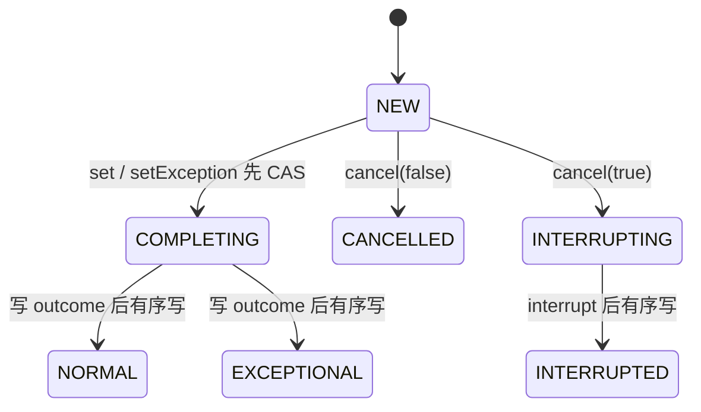
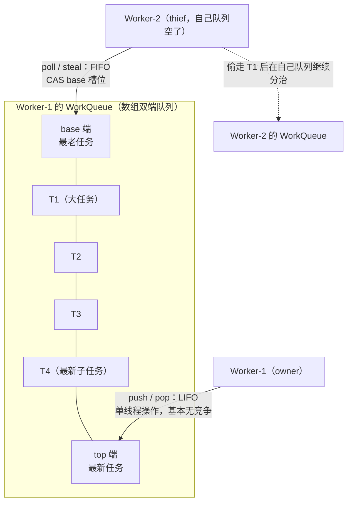
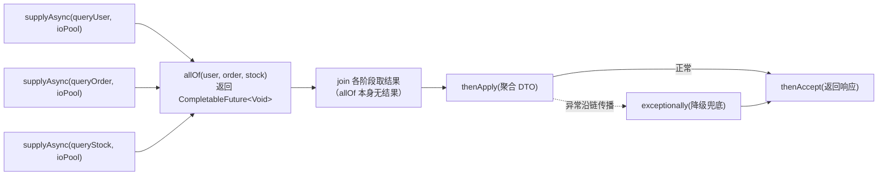

# Fork/Join 与 CompletableFuture 异步编排

> 一句话概括：Future 只能「阻塞等一个结果」，Fork/Join 用 work-stealing 把「可分解的计算」摊到多核上，CompletableFuture 用「依赖链 + 回调」把「多个异步步骤」编排成一张图——
> 本文讲清三者的源码机制、执行线程规则、异常传播路径，以及 commonPool 这个全 JVM 共享池为什么是生产事故高发区。

预计阅读时间：大约 80 分钟

所属主题：[Java 并发编程常见面试题总结](summary.md)

本文以 **JDK 8** 为主要基线（源码锚点对照 OpenJDK jdk8u），JDK 9 超时 API、JDK 12/19/21 差异单独注明。源码锚点用 `类名#方法名` 标注。总结文档给面试结论，本文给机制与证据：每个机制按「结论 → 机制 → 边界/代价 → 实践/追问」展开。线程池通用机制见 [thread-pool.md](thread-pool.md)，虚拟线程与结构化并发见 [virtual-threads.md](virtual-threads.md)，本文只讲 ForkJoinPool 与它们的差异和选型连接。

---

## 0. 阅读路线

| 读者 | 建议阅读 | 关注点 |
| --- | --- | --- |
| 初级（1 年内） | 1.1、2.1~2.2、5.1~5.3、5.5、6.2~6.4、附速记 | Future 缺什么、分治怎么写、CF 常用 API、异常怎么兜底 |
| 中级（1~3 年） | 全部，重点 1.2~1.5、3、4.1~4.3、5.4、6.1 | FutureTask 状态机、work-stealing、commonPool 参数、「谁执行回调」 |
| 高级（3 年+） | 1.3~1.4、3.3~3.4、4.5、5.6、6.5~6.6、7、8.4 | awaitJoin 帮助执行、managedBlock 补偿、allOf 异常取舍、取消语义、JDK 19 重写 |
| 选型/架构 | 2.4、4.4、7.4、8 全部 | ForkJoinPool vs ThreadPoolExecutor、CF vs 虚拟线程+结构化并发、什么时候不该异步化 |

目录：

1. Future 的局限：从 FutureTask 状态机说起
2. Fork/Join 框架：分治与正确姿势
3. work-stealing：双端队列与偷取算法
4. ForkJoinPool 与 commonPool：必考坑
5. CompletableFuture：异步编排核心
6. 异常处理：传播、包装与兜底
7. 工程层：线程池与上下文
8. 选型与演进
9. 高频追问集
10. 参考资料
11. 附：一页速记

---

## 1. Future 的局限：从 FutureTask 状态机说起

### 1.1 Future 能做什么、不能做什么

**结论**：`Future`（JDK 5）只是「异步结果占位符」，解决了「提交后稍后取结果」，**没有解决「结果到了之后自动做下一步」**。

| 能力 | Future / FutureTask | 缺口后果 |
| --- | --- | --- |
| 阻塞取结果 | `get()` / `get(timeout, unit)` | 调用线程挂起，异步退化为同步 |
| 非阻塞查状态 | `isDone()` | 想「完成即处理」只能轮询，烧 CPU |
| 手动完成 | 无 | 无法把回调式 API（Netty、NIO）适配成 Future |
| 完成回调 | 无 | 不能注册「完成后执行 X」 |
| 组合多个结果 | 无 | 两个 Future 聚合只能逐个 get，串行等待 |
| 链式转换 | 无 | A 的结果喂 B 必须手写阻塞胶水 |
| 取消 | `cancel(mayInterruptIfRunning)` | 语义有限（1.5），且不传播 |

`CompletableFuture`（JDK 8）把这些缺口全部补齐：同时实现 `Future` 与 `CompletionStage`，前者兼容旧世界，后者提供编排（第 5 节）。理解一切的起点是 `FutureTask` 那台 7 状态的状态机。

### 1.2 FutureTask 状态机

**结论**：`FutureTask` 用 `volatile int state` 表示生命周期，**流转全靠 CAS 或有序写，没有锁**；`outcome` 不是 volatile，可见性由 state 的读写顺序保证。

```java
private static final int NEW          = 0;
private static final int COMPLETING   = 1;
private static final int NORMAL       = 2;
private static final int EXCEPTIONAL  = 3;
private static final int CANCELLED    = 4;
private static final int INTERRUPTING = 5;
private static final int INTERRUPTED  = 6;
private volatile int state;
private Object outcome; // non-volatile, protected by state reads/writes
```

官方注释给出的全部合法转换：



**机制**：`COMPLETING` 中间态的存在是因为「写结果」和「发布终态」是两步：先 CAS `NEW → COMPLETING` 抢完成权，再写 outcome，最后 `UNSAFE.putOrderedInt` 发布终态——**读到终态的线程必能看到 outcome**（happens-before 由 volatile state 建立，见 [jmm-and-volatile.md](jmm-and-volatile.md)）。`INTERRUPTING` 同理：先标记再发 interrupt 再发布 `INTERRUPTED`，避免等待者在中断发出前就返回。

**边界/代价**：终态用 `putOrderedInt`（lazySet）而非 volatile 写，因为终态唯一且不再变，省一次 StoreLoad 屏障；正确性不受影响，读侧总会再读 volatile state。

**追问：state 为什么 volatile 而 outcome 不是？**
state 是唯一同步变量：写侧「CAS/有序写 state」之前的 outcome 写入，对「读到新 state」的线程可见；outcome 再加 volatile 是冗余开销。

### 1.3 run / set / finishCompletion 源码走读

**结论**：`FutureTask#run` 用 **CAS 抢执行权**（`runner` 从 null 换成当前线程）保证只执行一次；结果经 `set`/`setException` 写入；`finishCompletion` 逐个 unpark 等待者。

```java
// FutureTask#run 关键路径
if (state != NEW ||
    !UNSAFE.compareAndSwapObject(this, runnerOffset, null, Thread.currentThread()))
    return;                          // 抢不到执行权直接返回
try {
    result = c.call();               // 业务逻辑；catch Throwable → setException(ex)
    set(result);                     // 正常 → set
} finally {
    runner = null;                   // 若 state >= INTERRUPTING，自旋等中断完成
}

// FutureTask#set（setException 同构，终态为 EXCEPTIONAL）
if (UNSAFE.compareAndSwapInt(this, stateOffset, NEW, COMPLETING)) {
    outcome = v;
    UNSAFE.putOrderedInt(this, stateOffset, NORMAL); // final state
    finishCompletion();
}
```

等待者是 **Treiber 栈**（无锁栈，CAS 压栈，见 [cas-and-atomic-classes.md](cas-and-atomic-classes.md)）。`FutureTask#finishCompletion` 把整条栈一次性 CAS 摘下（`waiters → null`），遍历逐个 `LockSupport.unpark(t)`，然后调 `done()` 钩子、置空 callable。整栈摘下后再遍历，unpark 过程无需与并发压栈竞争。

**边界/代价**：run 里 catch 的是 `Throwable`——Error 也进 EXCEPTIONAL 而不是炸掉工作线程；`cancel(true)` 的中断若落在 call() 期间，`handlePossibleCancellationInterrupt` 自旋等 `INTERRUPTING → INTERRUPTED`，但**不清除中断标志**（源码注释明确保留）。

### 1.4 awaitDone 与 get：自旋 + park

**结论**：`FutureTask#get` 不是 synchronized/wait，而是「**自旋 → 入 Treiber 栈 → park**」三段式。

`FutureTask#awaitDone` 循环骨架：中断 → `removeWaiter` 并抛 `InterruptedException`；`state > COMPLETING` → 返回状态；`state == COMPLETING` → `Thread.yield()`（完成在即，不入栈）；否则建 WaitNode、CAS 压入 waiters 栈、`LockSupport.park`（带超时则 parkNanos）。

`FutureTask#report`：NORMAL 返回 outcome；`>= CANCELLED` 抛 `CancellationException`；EXCEPTIONAL 抛 `ExecutionException`（cause 是原始异常）。带超时 get 超时后 state 仍 `<= COMPLETING` 则抛 `TimeoutException`。

**边界**：`isDone()` 实现是 `state != NEW`，**COMPLETING 也算 done**，但此时 get 仍会短暂 yield 等待。

### 1.5 cancel 的真实语义

**结论**：`cancel` 只在 NEW 态有效（CAS `NEW → CANCELLED/INTERRUPTING`，失败返回 false）；`mayInterruptIfRunning=false` **只改状态，已在跑的任务继续跑完，结果被丢弃**；true 才对 runner 线程发 interrupt，随后发布 INTERRUPTED。任务已完成或已取消时 cancel 返回 false；中断只是「请求」，任务不检查中断照样跑到底。

### 1.6 「submit 吞异常」的根源

**结论**：`ThreadPoolExecutor#submit` 把 Callable 包成 FutureTask，异常被 `setException` 收进 outcome，**只有 get 才重新抛出**；execute 提交的异常则走 UncaughtExceptionHandler。「submit 后异常无声消失」不是线程池吞了，是 FutureTask 把异常存起来了。线程池侧完整讨论见 [thread-pool.md](thread-pool.md)。

```java
Future<?> f = pool.submit(() -> { throw new IllegalStateException("boom"); });
// 不调用 f.get()，"boom" 不会出现在任何日志里
f.get(); // 这里才抛 ExecutionException(cause = IllegalStateException)
```

**实践**：规约应要求「submit 返回值必须被消费（get/join/挂回调），否则用 execute + 显式 try-catch」。CF 同样有这个问题（6.4 反例）。

---

## 2. Fork/Join 框架：分治与正确姿势

### 2.1 分治思想与完整示例

**结论**：Fork/Join（JDK 7）为「**可递归分解的计算密集型任务**」设计：大任务拆小（fork）、结果合并（join）、低于阈值直接串行算。载体是 `RecursiveTask<V>`（有返回值）/`RecursiveAction`（无返回值），都继承 ForkJoinTask。

完整可运行示例——并行求和（JDK 8 基线）：

```java
import java.util.concurrent.ForkJoinPool;
import java.util.concurrent.RecursiveTask;

public class ParallelSum extends RecursiveTask<Long> {
    private static final int THRESHOLD = 10_000;
    private final long[] array;
    private final int lo, hi;

    ParallelSum(long[] array, int lo, int hi) {
        this.array = array; this.lo = lo; this.hi = hi;
    }

    @Override
    protected Long compute() {
        if (hi - lo <= THRESHOLD) {
            long sum = 0;
            for (int i = lo; i < hi; i++) sum += array[i];
            return sum;
        }
        int mid = (lo + hi) >>> 1;
        ParallelSum left  = new ParallelSum(array, lo, mid);
        ParallelSum right = new ParallelSum(array, mid, hi);
        left.fork();                        // 左半入队（可能被偷）
        long rightResult = right.compute(); // 右半当前线程直接算
        return left.join() + rightResult;
    }

    public static void main(String[] args) {
        long[] data = new long[1_000_000];
        for (int i = 0; i < data.length; i++) data[i] = i;
        ForkJoinPool pool = new ForkJoinPool();   // 默认并行度 = CPU 核数
        System.out.println(pool.invoke(new ParallelSum(data, 0, data.length)));
        pool.shutdown();                          // 499999500000
    }
}
```

**机制**：`fork()` 不创建线程，只把子任务压入当前工作线程的双端队列（3.4）；`join()` 也不傻等——会尝试自己执行或帮助偷取者（3.4）。并行性来自 work-stealing，不是「每子任务一个线程」。

### 2.2 fork/join 的正确姿势与反模式

**结论**：推荐 **`left.fork(); right.compute(); left.join();`**——一个入队（可能被偷），一个当前线程直接算，最后取回入队那个的结果。

| 写法 | 评价 | 原因 |
| --- | --- | --- |
| `left.fork(); right.compute(); left.join();` | **推荐** | 少一次调度；右半连续执行缓存最热；left 没被偷时 join 从本地队列弹出直接执行 |
| `left.fork(); right.fork(); left.join(); right.join();` | 可用但次优 | 两个都入队多一次调度；join 可能触发帮助执行链（helpStealer） |
| `left.fork(); left.join(); right.compute();` | **反模式：串行** | fork 后立刻 join 同一任务，没被偷就等价当前线程执行，右半还没开始 |
| `invokeAll(left, right);` | 推荐便捷写法 | 语义等价「fork 一个 + compute 一个 + join」 |

**追问：两个都 fork 为什么只是次优不是错误？**
正确性没问题，但当前线程把能直接算的活也扔进队列，多付 push/pop 与信号唤醒成本；分治收益来自「减少调度、增加局部性」，能本地算的就本地算。

### 2.3 invoke vs submit vs execute

| 方法 | 调用方 | 行为 | 返回 |
| --- | --- | --- | --- |
| `pool.invoke(task)` | 池外 | 提交并**阻塞等结果**，异常原样重抛（unchecked） | `V` |
| `pool.submit(task)` | 池外 | 异步提交立即返回 | `ForkJoinTask<V>`（本身就是 Future） |
| `pool.execute(task)` | 池外 | 异步提交不关心结果 | void |
| `task.fork()` | **池内** | 压入当前线程队列 | task 自身 |
| `task.invoke()` | 池内/外 | 语义等价 `fork(); join()`，实现上**先尝试当前线程直接执行**（`ForkJoinTask#doInvoke`） | `V` |

`ForkJoinTask#join` 与 `get` 异常行为不同：join 用 sneaky throw（`ForkJoinTask#rethrow` → `uncheckedThrow`）**原样重抛为 unchecked**、不响应中断；get 包 `ExecutionException`、可中断。与 CF 的 join/get 分野（6.3）对照。

### 2.4 阈值与适用边界

- **阈值太小**：任务分配、入队、偷取开销超过计算本身。经验值：叶子计算量几十微秒~毫秒级，需实测；
- **子任务必须独立**：共享可变状态的「分治」引入同步开销，得不偿失；
- **不适合阻塞 IO**：线程数按核数设计，一个阻塞任务占住一个核（补偿见 4.5，是兜底不是设计目标）；
- 工作线程全部 **daemon**（`ForkJoinPool#registerWorker` 中 `wt.setDaemon(true)`），main 结束即终止。

**追问：ForkJoinPool 能当通用线程池吗？**
能提交普通 Runnable/Callable（内部 adapt），但队列结构与 LIFO 优化都为分治设计；独立、含 IO 的任务用 ThreadPoolExecutor 更合适（4.4）。

---

## 3. work-stealing：双端队列与偷取算法

### 3.1 每个工作线程一个双端队列

**结论**：核心结构是「**每个工作线程私有一个双端队列（WorkQueue）**」：owner 从 top 端 LIFO push/pop，thief 从 base 端 FIFO steal。忙线程的任务被闲线程偷走，负载自动均衡，**没有全局队列这个竞争热点**。



源码注释（jdk8u）约束：push/pop 只由 owner 调用，poll 可由其他线程调用；push 是 `q.array[q.top] = task; ++q.top`，pop CAS top 槽位、poll CAS base 槽位。**两端分离把竞争压缩到「队列只剩一个元素」的罕见时刻**（pop 与 poll 争同一槽位，CAS 裁决）。

### 3.2 为什么 owner LIFO、thief FIFO

| 端 | 策略 | 理由 |
| --- | --- | --- |
| owner LIFO | 最新 fork 的子任务先执行 | **数据最热**（刚拆出的数据还在缓存）；最新任务常是当前计算链的下一步，先执行让父任务尽快 join 成功 |
| thief FIFO | 最老的任务先偷 | **最老的任务最大**（分治树越早入队粒度越大），偷一个够干很久，**降低偷取频率**；老任务数据已冷，owner 损失小 |

**机制**：thief 偷走大任务后在自己队列继续分治——偷取一次、增殖一片，这是吞吐高于「共享队列」的关键。

**边界**：LIFO 让深递归子任务优先，极端不平衡的树可能让大任务长期压队底；`getStealCount()` 可监控——javadoc 建议「偷取次数高到让线程忙起来，又低到避免跨线程竞争」。

### 3.3 scan / runWorker：随机扫描避免惊群

**结论**：空闲线程**从随机起点扫描所有队列**找活，而不是都盯同一个队列。

一句话算法（`ForkJoinPool#scan` + `#runWorker`）：以工作线程的随机 hint 为种子，从 `r & m` 随机下标线性探测；遇竞争用 xorshift 重新随机化；连续两遍扫描 base 校验和不变则判无活、尝试挂起自己，发现任务再唤醒。

```java
final void runWorker(WorkQueue w) {
    w.growArray();
    int seed = w.hint;
    int r = (seed == 0) ? 1 : seed;
    for (ForkJoinTask<?> t;;) {
        if ((t = scan(w, r)) != null) w.runTask(t);
        else if (!awaitWork(w, r)) break;
        r ^= r << 13; r ^= r >>> 17; r ^= r << 5; // xorshift
    }
}
```

**机制**：源码注释明确「长期吞吐随机选择往往优于定向策略」；偷取失败必须换随机受害者。jdk8u 队列数组「奇数下标放工作队列、偶数放外部提交队列」，提交线程用 ThreadLocalRandom probe 哈希选队列、竞争时重散列——外部提交也不走全局锁。

**追问：为什么不用全局 BlockingQueue？**
所有线程抢同一个锁/CAS 热点，核数越多竞争越烈；per-thread deque 让「取自己的任务」无竞争，偷取是低频事件。

### 3.4 fork 与 join 的源码路径

**结论**：`fork` 按「当前线程是否本池工作线程」分流；`join` 是「**查状态 → 本地弹出执行 → 帮助偷取者 → 补偿等待**」四级策略，绝不轻易 park。

```java
// ForkJoinTask#fork（jdk8u）
if ((t = Thread.currentThread()) instanceof ForkJoinWorkerThread)
    ((ForkJoinWorkerThread)t).workQueue.push(this);  // 池内：本地队列
else
    ForkJoinPool.common.externalPush(this);          // 池外：进 commonPool！

// ForkJoinTask#doJoin（简化，省略 instanceof 分支判断）
return (s = status) < 0 ? s :                        // ① 已完成直接返回
    (w.tryUnpush(this) && (s = doExec()) < 0) ? s :  // ② 还在自己队列？弹出自己执行
    wt.pool.awaitJoin(w, this, 0L);                  // ③ 被偷了？帮助/等待（外部线程走 externalAwaitDone）

// ForkJoinPool#awaitJoin 帮助逻辑
if (cc != null) helpComplete(w, cc, 0);              // CountedCompleter：帮同根任务
else if (w.base == w.top || w.tryRemoveAndExec(task))
    helpStealer(w, task);                            // 找到偷取者，帮它干活
if (tryCompensate(w)) { task.internalWait(ms); ... } // 实在要等：先补偿线程再阻塞
```

**机制**：join 的哲学是「**等待的时间用来干活**」。`ForkJoinTask` 完成状态用负数编码（`NORMAL = 0xf0000000`、`CANCELLED = 0xc0000000`、`EXCEPTIONAL = 0x80000000`），`status < 0` 即完成，一次符号判断代替多状态比较。

**边界**：帮助执行让**调用栈可能「穿越」到别的任务**——join 处的异常栈可能含不相关任务帧，排查要有心理预期（见 [deadlock-and-troubleshooting.md](deadlock-and-troubleshooting.md)）。注意 fork 的第二分支：**普通线程里 fork，任务进的是 commonPool**——这是 4.2 技巧的机制基础，也是隐蔽坑。

### 3.5 asyncMode：FIFO 本地队列

**结论**：构造器 `asyncMode=true` 时 owner 本地取任务改用 poll（FIFO）：`nextLocalTask()` 中 `(config & FIFO_QUEUE) == 0 ? pop() : poll()`。适合「**事件式、从不 join**」的任务流——LIFO 的数据热/尽快 join 优势对它们无意义，反而让早到事件饿死。JDK 21 虚拟线程调度器正是 **FIFO 模式的 work-stealing ForkJoinPool**（JEP 444 明确它与 LIFO 的 commonPool 是两个池），见 [virtual-threads.md](virtual-threads.md)。

---

## 4. ForkJoinPool 与 commonPool：必考坑

### 4.1 commonPool 的参数与生命周期

**结论**：`ForkJoinPool.commonPool()` 是 **JVM 全局静态共享**池：默认并行度 `CPU 核数 - 1`（最小 1），工作线程 daemon，`shutdown()` 对它无效，进程退出即终止。

```java
// ForkJoinPool#makeCommonPool（jdk8u）关键行
if (parallelism < 0 && // default 1 less than #cores
    (parallelism = Runtime.getRuntime().availableProcessors() - 1) <= 0)
    parallelism = 1;
return new ForkJoinPool(parallelism, factory, handler, LIFO_QUEUE,
                        "ForkJoinPool.commonPool-worker-");
```

| 参数 | 默认值 | 调整方式 |
| --- | --- | --- |
| parallelism | `availableProcessors() - 1`，最小 1 | `-Djava.util.concurrent.ForkJoinPool.common.parallelism=N` |
| threadFactory / exceptionHandler | 默认工厂 / 无 | 同名系统属性指定类名 |
| 最大补偿线程 | commonMaxSpares = 256 | 不可调，超出抛 RejectedExecutionException |
| 线程类型 | daemon（registerWorker 统一设置，**所有 FJP 都如此**） | — |

三个易混点：

1. **`new ForkJoinPool()` 默认并行度是 CPU 核数**，**commonPool 才是核数 - 1**——留一个核给提交线程（caller-helps）；
2. parallelism 可设 0，退化为 caller-runs，`getCommonPoolParallelism()` 仍报告 1；
3. 系统属性在 commonPool **静态初始化时读取一次**，必须 JVM 启动参数设置。

**边界/代价**：commonPool 被 parallelStream、默认异步 CF、任何池外 fork 共享。**一个慢任务占住一个 worker，全 JVM 的并行流和默认 CF 都少一分算力**；阻塞 IO 直接把核数级池变串行池。

### 4.2 parallelStream 与自定义池技巧

**结论**：`parallelStream()` 默认跑 commonPool。换自定义池要把**整个流操作**包进自定义池任务提交：

```java
ForkJoinPool customPool = new ForkJoinPool(4);
List<Integer> result = customPool.submit(() ->
        list.parallelStream().filter(n -> n % 2 == 0).collect(Collectors.toList())
).get();
customPool.shutdown();
```

**机制**：依赖一条实现细节——`ForkJoinTask#fork` 检查当前线程是否 ForkJoinWorkerThread，是则 push 进**该线程所属池**（3.4）。流的终端操作在自定义池 worker 里启动后，后续 fork 的子任务都留在这个池；在普通线程直接调 parallelStream，子任务 fork 进 commonPool。

**边界/代价**（必须说清，否则是背技巧）：

- 这是**实现细节而非规范保证**，javadoc 未承诺，只是 JDK 8~21 实现一直如此（JDK 19 重写后仍保留分流）；
- 必须包住**整个流管道**（parallelStream 到终端操作），只包一半无效；
- `submit(...).get()` 阻塞调用线程、抛 ExecutionException；池要复用，别每次 new。

**追问：为什么没有给 parallelStream 传池的 API？**
Stream API 设计上不暴露执行器参数；官方态度是「需要隔离就自建 ForkJoinPool 提交」。要精细控制执行器，用 CF + 自定义 Executor。

### 4.3 CF 默认执行器与 ThreadPerTaskExecutor

**结论**：CF 的 `xxxAsync` 无池版本默认用 commonPool，**前提是 commonPool 并行度 > 1**，否则退化为「每任务一个新线程」。

```java
// jdk8u CompletableFuture 静态字段
private static final boolean useCommonPool =
    (ForkJoinPool.getCommonPoolParallelism() > 1);
private static final Executor asyncPool = useCommonPool ?
    ForkJoinPool.commonPool() : new ThreadPerTaskExecutor();
static final class ThreadPerTaskExecutor implements Executor {
    public void execute(Runnable r) { new Thread(r).start(); }
}
```

JDK 21 逻辑不变（字段改名 `USE_COMMON_POOL`/`ASYNC_POOL`，已对照 jdk-21+35 核实）。`CompletableFuture#screenExecutor` 还会把显式传入的 commonPool 在并行度不足时悄悄换成 ThreadPerTaskExecutor。

**边界/代价**：单核机器（或 parallelism=1）上默认异步 CF **每任务新建线程**，高并发线程爆炸；`useCommonPool` 类加载时算一次，属性须启动时设；JDK 25（JDK-8319447）起 CF 默认执行器改用 `ForkJoinPool.asyncCommonPool()`：返回的**仍是与 parallelStream 共享的同一个 commonPool 实例**，仅当并行度为 0 时静默提升到 2，从而去掉每任务新建线程的兜底，**并非与 parallelStream 解耦**。

### 4.4 ForkJoinPool vs ThreadPoolExecutor 选型

**结论**：**可分解的 CPU 密集计算选 ForkJoinPool；独立的、含 IO 的通用任务选 ThreadPoolExecutor**。差异不是新旧，是队列结构与调度哲学。

| 维度 | ForkJoinPool | ThreadPoolExecutor |
| --- | --- | --- |
| 队列 | per-thread 双端队列 + 外部提交队列 | 共享 BlockingQueue（一个） |
| 取任务 | owner LIFO + thief FIFO | 所有 worker 抢同一队列 |
| 任务模型 | 可递归分解、子任务会 join | 独立任务，互不依赖 |
| 等待语义 | join 帮助执行/补偿，不轻易阻塞 | get 就是阻塞 |
| 线程数 | 目标并行度 ≈ 核数，阻塞时补偿 | core/max 可远大于核数（IO 密集） |
| 典型场景 | 并行求和、归并排序、parallelStream | Web 请求、RPC、批处理 |
| 拒绝策略 | 仅 shutdown 或资源耗尽 | 四种 Handler 可配 |

ThreadPoolExecutor 参数与机制归 [thread-pool.md](thread-pool.md)，不展开。

### 4.5 managedBlock：阻塞补偿

**结论**：在 FJP 里不得不阻塞时，用 `ForkJoinPool.managedBlock(ManagedBlocker)` 告知池，池**补偿一个线程**（唤醒闲置 worker 或新建 spare）维持并行度，避免饥饿。

`ForkJoinPool#managedBlock`（jdk8u）骨架：当前线程是 FJP worker 时，循环 `while (!blocker.isReleasable())`，`tryCompensate(w)` 成功后才真正执行 `blocker.block()`，finally 恢复活跃计数；非 worker 线程直接 block。

```java
// 在 ForkJoinPool 里安全地 take 阻塞队列
pool.execute(() -> {
    try {
        ForkJoinPool.managedBlock(new ForkJoinPool.ManagedBlocker() {
            String item;
            public boolean block() throws InterruptedException {
                item = queue.take(); return true;
            }
            public boolean isReleasable() { return item != null; }
        });
    } catch (InterruptedException e) { Thread.currentThread().interrupt(); }
});
```

**边界/代价**：

- 补偿有上限：commonPool 最多到 `parallelism + 256`，超出抛 `RejectedExecutionException: Thread limit exceeded replacing blocked worker`；
- `tryCompensate` 先校验「活跃线程真在干活」才补偿；空队列 worker 阻塞可能直接容忍少一个线程；
- **managedBlock 是兜底不是许可证**：IO 密集任务塞 FJP 靠补偿撑线程，不如 ThreadPoolExecutor 或虚拟线程；
- CF 的 join/get 内部等待（`CompletableFuture.Signaller`）本身实现了 ManagedBlocker，在 FJP worker 里 join CF 自动走补偿。

**追问：join ForkJoinTask 需要 managedBlock 吗？**
不需要，`awaitJoin` 已集成帮助执行与 tryCompensate；managedBlock 是给「框架不认识的阻塞」（IO、锁、外部 Future）的扩展点。

---

## 5. CompletableFuture：异步编排核心

### 5.1 数据结构：result + Completion 栈

**结论**：CF 同时实现 `Future`（get/cancel）与 `CompletionStage`（编排）。核心只有两个字段：**`volatile Object result`**（非 null 即完成）和 **`Completion` 依赖栈**（Treiber 栈，存「完成后触发谁」）。

result 三形态：正常值直接存；**null 存 `NIL`（ex 为 null 的 AltResult）**；异常存 `AltResult(CompletionException)`。完成是 result 的一次 CAS，**只有第一个完成者生效**（complete/completeExceptionally 返回 boolean）。



**机制**：注册依赖时源已完成则**当场执行**（5.4），否则把 UniApply 节点 push 进源 stack；源完成时 `CompletableFuture#postComplete` 弹栈逐个 tryFire，节点用 `claim()`（CAS tag 0→1）保证**只执行一次**。

### 5.2 创建 API

| API | 用途 | 执行线程 |
| --- | --- | --- |
| `supplyAsync(Supplier<U>[, Executor])` | 有返回值异步任务 | 无池：commonPool（4.3 前提）；带池：指定 |
| `runAsync(Runnable[, Executor])` | 无返回值 | 同上 |
| `completedFuture(U)` | 包装已知值，立即完成 | 无执行 |
| `new CompletableFuture<>()` + `complete(v)` / `completeExceptionally(ex)` | **手动完成** | 调 complete 的线程 |
| `failedFuture(Throwable)`（JDK 9+） | 包装已知异常 | 无执行 |

手动完成是 Future 做不到的关键能力——把回调式 API 桥接成 CF：

```java
CompletableFuture<Response> cf = new CompletableFuture<>();
httpClient.executeAsync(request, new Callback() {
    public void onSuccess(Response r) { cf.complete(r); }
    public void onFailure(Throwable t) { cf.completeExceptionally(t); }
});
// 之后 cf 可 thenApply / exceptionally / allOf，与 supplyAsync 产物无异
```

### 5.3 串行转换与组合 API 对比

**结论**：thenApply/thenAccept/thenRun 是「消费上一步」三档；**thenCompose 是 flatMap**（扁平化嵌套 CF），**thenCombine 是 zip**（合并两个独立结果）。

| API | 入参 | 出参 | 语义 |
| --- | --- | --- | --- |
| `thenApply` | `Function<T,U>` | `CF<U>` | 转换（map） |
| `thenAccept` | `Consumer<T>` | `CF<Void>` | 消费，无返回 |
| `thenRun` | `Runnable` | `CF<Void>` | 不关心结果，完成后执行 |
| `thenCompose` | `Function<T, CompletionStage<U>>` | `CF<U>` | 结果喂给另一个异步操作，**扁平化**，避免 `CF<CF<U>>` |
| `thenCombine(other, fn)` | `BiFunction<T,U,V>` | `CF<V>` | 两个**独立**阶段都完成后合并 |
| `thenAcceptBoth` / `runAfterBoth` | BiConsumer / Runnable | `CF<Void>` | 两个都完成后消费/执行 |
| `applyToEither` / `acceptEither` / `runAfterEither` | Function / Consumer / Runnable | `CF<U>` / `CF<Void>` | 任一完成即转换/消费/执行（竞速） |

**判别法**：第二步**依赖第一步结果**（拿到 userId 才能查订单）→ thenCompose；两步**互相独立** → thenCombine。

```java
// thenCompose：串行依赖（误用 thenApply 会得到 CF<CF<Order>>）
CompletableFuture<Order> cf = queryUserAsync(name)
        .thenCompose(user -> queryOrderAsync(user.getId()));
// thenCombine：独立并行
CompletableFuture<Page> page = queryUserAsync(name)
        .thenCombine(queryConfigAsync(), (user, config) -> render(user, config));
```

**机制**：thenCompose 由 `UniCompose` 实现，对内层 CF 挂 `UniRelay` 转发结果（扁平化）；thenCombine 由 `BiApply`（继承 BiCompletion，多一个 snd 源）实现，`bipush` 同时注册到两个源，`CoCompletion` 共享句柄保证只触发一次。

### 5.4 thenApply vs thenApplyAsync：谁执行回调（高频追问）

**结论**：**无 Async：回调可能由「完成前一阶段的线程」执行，也可能由「注册回调的调用线程」执行（注册时源已完成）；Async 无池：一定 commonPool（4.3 前提）；Async 带池：一定指定池。**

源码依据（jdk8u `CompletableFuture#uniApplyStage`）：

```java
CompletableFuture<V> d = new CompletableFuture<V>();
if (e != null || !d.uniApply(this, f, null)) {  // e==null 且源已完成 → 当场执行
    UniApply<T,V> c = new UniApply<T,V>(e, d, this, f);
    push(c);                                     // 否则入栈，等完成线程触发
    c.tryFire(SYNC);
}
```

thenApply 传 `e=null`，thenApplyAsync 传 `e=asyncPool`（或 screenExecutor 后的指定池）。`UniCompletion#claim`：`e==null` 返回 true 当前线程直接执行；`e!=null` 则 `e.execute(this)` 投递到执行器。

| 场景 | thenApply | thenApplyAsync | thenApplyAsync(fn, pool) |
| --- | --- | --- | --- |
| 注册时源**未完成** | 完成源的线程（池线程或调 complete 的线程） | commonPool | pool |
| 注册时源**已完成** | **调用线程**（当场执行） | commonPool | pool |

```java
// 验证一：源已完成 → main 线程执行
CompletableFuture.completedFuture("A").thenApply(s -> {
    System.out.println(Thread.currentThread().getName()); // main
    return s;
});
// 验证二：源未完成 → 完成源的线程执行
CompletableFuture<String> cf = new CompletableFuture<>();
cf.thenApply(s -> { System.out.println(Thread.currentThread().getName()); return s; });
new Thread(() -> cf.complete("X"), "completer-thread").start(); // completer-thread
```

**边界/代价**：无 Async 的重回调可能阻塞注册线程（Web 请求线程里 thenApply 耗时计算）；回调线程不确定 → ThreadLocal 不可依赖（7.2）；要「回调一定异步、在受控池」就用 Async + 显式池。

**追问：thenApplyAsync 不传池，与 thenApply 恰好在池线程完成有何区别？**
前者强制再投递一次 commonPool（多一次调度，但与完成线程解耦）；后者零调度，但可能占住不该占的线程（如业务关键线程）。

### 5.5 allOf / anyOf：并行组合

**结论**：`allOf` 返回 **`CompletableFuture<Void>`**——只表示「全部完成」事件，**不携带结果**，取结果须逐个 join；`anyOf` 返回 `CompletableFuture<Object>`，结果是**最先完成者**的（需强转）。

**机制**：`CompletableFuture#andTree` 把 N 个阶段**两两分治**成二叉树，内部节点 `BiRelay` 等两个孩子都完成再转发；`orTree` 同构用 `OrRelay`（任一完成即转发）。完成传播 O(log N) 层而非 O(N) 长链；空数组 allOf 直接返回已完成的 NIL。

```java
CompletableFuture<User>  user  = CompletableFuture.supplyAsync(() -> queryUser(id), ioPool);
CompletableFuture<Order> order = CompletableFuture.supplyAsync(() -> queryOrder(id), ioPool);
CompletableFuture<Stock> stock = CompletableFuture.supplyAsync(() -> queryStock(id), ioPool);
CompletableFuture.allOf(user, order, stock).join();   // Void 的 join 返回 null
Page page = new Page(user.join(), order.join(), stock.join());
```

**边界/代价**：

- allOf **不短路**：某阶段早已异常也要等所有阶段完成才转发（biRelay 要求两个 result 都非 null）；
- 多阶段异常时保留**数组顺序最靠左的失败分支**的异常，不是时间上第一个（6.5）；
- anyOf 的「最先完成」包含异常完成——最快的是异常，anyOf 就是异常；
- 「任一失败即短路」CF 原生不提供，需自行组合或结构化并发（8.1）。

### 5.6 实战：并行聚合 + 超时降级

JDK 8 基线（超时用 `get(timeout, unit)`）：

```java
public Page queryPage(long id) {   // ioPool 为业务自定义线程池
    CompletableFuture<User>  user  = CompletableFuture.supplyAsync(() -> queryUser(id), ioPool);
    CompletableFuture<Order> order = CompletableFuture.supplyAsync(() -> queryOrder(id), ioPool);
    CompletableFuture<Stock> stock = CompletableFuture.supplyAsync(() -> queryStock(id), ioPool)
            .exceptionally(ex -> Stock.EMPTY);        // 非核心依赖失败降级
    try {
        CompletableFuture.allOf(user, order, stock).get(500, TimeUnit.MILLISECONDS);
        return new Page(user.join(), order.join(), stock.join());
    } catch (TimeoutException e) {
        return Page.DEGRADED;
    } catch (InterruptedException e) {
        Thread.currentThread().interrupt(); throw new RuntimeException(e);
    } catch (ExecutionException e) {
        throw new RuntimeException(e.getCause());
    }
}
```

JDK 9+（`orTimeout`/`completeOnTimeout`，已核实 @since 9）：

```java
CompletableFuture<User> user = CompletableFuture.supplyAsync(() -> queryUser(id), ioPool)
        .orTimeout(500, TimeUnit.MILLISECONDS)        // 超时 → 异常完成(TimeoutException)
        .exceptionally(ex -> User.ANONYMOUS);
CompletableFuture<Stock> stock = CompletableFuture.supplyAsync(() -> queryStock(id), ioPool)
        .completeOnTimeout(Stock.EMPTY, 300, TimeUnit.MILLISECONDS); // 超时 → 兜底值
```

**机制**：超时由内部 `CompletableFuture.Delayer` 实现——**单线程 ScheduledThreadPoolExecutor**，线程名 `CompletableFutureDelayScheduler`、daemon（已对照 jdk-21+35）。orTimeout 到点未完成则 `completeExceptionally(new TimeoutException())`，completeOnTimeout 到点 `complete(value)`；完成 CAS 一次性生效，超时与正常完成谁先到谁赢。

**边界/代价**：

- **超时只改 CF 状态，不中断/取消底层任务**——RPC 仍在跑、线程仍被占；真正的调用超时靠客户端自身 timeout；
- orTimeout 返回 this（同一 CF），不是新阶段；JDK 8 用 get(timeout) 或自挂 ScheduledExecutorService；
- 每个 orTimeout 往 Delayer 排一个延时任务，海量 CF 注意单线程调度压力。

---

## 6. 异常处理：传播、包装与兜底

### 6.1 异常沿依赖链传播

**结论**：前阶段异常完成后，**后续正常转换节点（thenApply/thenAccept/thenCompose 等）全部跳过**，异常沿链直达第一个异常处理节点；没人处理就留在最终 CF，等 join/get 抛出。

**机制**：异常以 AltResult 编码。`CompletableFuture#uniApply` 看到源 result 是带异常的 AltResult 时直接 `completeThrowable(x, r)` 转发，**不执行 fn**。包装规则（`CompletableFuture#encodeThrowable`）：非 CompletionException 统一包一层 `CompletionException`，已是则不重复包——**链上传播的通常是 CompletionException，原始异常在 cause 里**。

### 6.2 exceptionally / handle / whenComplete 对比

**结论**：**exceptionally 只管异常（返回兜底值，可恢复）；handle 正常异常都管（可转换可恢复）；whenComplete 只旁观（不改变结果，除非自己抛异常）**。

| API | 入参 | 触发 | 能否恢复 | 返回语义 |
| --- | --- | --- | --- | --- |
| `exceptionally` | `Function<Throwable,T>` | 仅异常 | **能** | 正常时原样透传 |
| `handle` | `BiFunction<T,Throwable,U>` | 正常+异常 | **能** | 可转换类型、异常转值 |
| `whenComplete` | `BiConsumer<T,Throwable>` | 正常+异常 | **不能** | 透传；fn 抛异常且原本正常时才替代结果 |

源码语义（jdk8u）：`uniExceptionally` 源异常 → `completeValue(f.apply(x))`，源正常 → `internalComplete(r)` 透传；`uniHandle` 无条件 `completeValue(f.apply(s, x))`（s/x 之一为 null）；`uniWhenComplete` 执行 `f.accept(t, x)` 后 x==null 则保留原结果，fn 抛异常且原本无异常才用新异常（`if (x == null) x = ex`，**不覆盖已有上游异常**）。

两个易错细节：三个 API 收到的 Throwable **通常是 CompletionException**（6.1），取原始异常要 getCause()；exceptionally 在 JDK 8 无 Async 变体（JDK 12 才加 exceptionallyAsync）。

```java
CompletableFuture<Integer> cf = CompletableFuture
    .supplyAsync(() -> { throw new IllegalStateException("boom"); })
    .thenApply(n -> n * 2)                    // 跳过
    .exceptionally(ex -> {
        log.warn("fallback, cause={}", ex.getCause().toString());
        return -1;                            // 恢复为正常结果
    })
    .whenComplete((v, ex) -> metrics.record(v)); // v=-1, ex=null
```

### 6.3 join vs get：异常类型与中断语义

**结论**：**join 抛 unchecked `CompletionException`，get 抛 checked `ExecutionException`**，cause 都是原始异常；join 不响应中断（保留标志），get 可中断。

| 维度 | `join()` | `get()` |
| --- | --- | --- |
| 异常 | CompletionException（unchecked） | ExecutionException（checked） |
| 取消 | CancellationException | CancellationException |
| 中断 | 不抛 InterruptedException，保留标志继续等 | 抛 InterruptedException |
| 超时 | 无 | get(timeout, unit) 抛 TimeoutException |
| 适用 | 链式编排、lambda 内 | 需要 checked 契约的旧代码 |

源码：`CompletableFuture#reportJoin` 直抛 CompletionException；`reportGet` **解开 CompletionException 取 cause** 再包 ExecutionException。等待路径 `waitingGet(boolean interruptible)`：join 传 false、get 传 true；`Signaller`（实现 ManagedBlocker）不可中断模式下被中断只记录标志、继续 park，完成后补还中断。

**追问：join 为什么不响应中断？**
编排中 join 常在 lambda/Stream 里，checked InterruptedException 会污染函数式签名；CF 取消不依赖中断（6.6），中断语义留给 get 兼容 Future 契约。

### 6.4 完整示例与「异常被吞」反例

**反例（生产事故常见形态）**：

```java
CompletableFuture.supplyAsync(() -> { throw new IllegalStateException("boom"); }, ioPool);
// 没有然后了：不 join/get、不挂异常回调，"boom" 不出现在任何日志
```

机制：异常收进 result 的 AltResult，CF 不打印不抛出；没有消费者就没人触发 reportJoin/reportGet。**与 1.6 同源：异步框架把异常「存起来」，消费端才「抛出来」。**

**正确姿势**：每条链末端必须有异常出口——join/get 让调用方处理，或 exceptionally/handle 兜底，或 whenComplete 记录后继续传播（它不恢复异常，链仍异常态，最终仍需出口）。

### 6.5 allOf 场景的异常取舍

**结论**：allOf 等**所有**阶段完成才转发；多异常时保留**数组顺序最靠左的失败分支**（`biRelay` 先查左子树 a 再查 b），不是时间最先。anyOf 转发**最先完成者**的结果或异常（`orRelay`）。

**实践**：要「收集所有失败原因」，给每个阶段挂 handle 把异常转成值对象，allOf 后统一检查：

```java
CompletableFuture<Result<User>> user = queryUserAsync(id)
        .handle((v, ex) -> ex == null ? Result.ok(v) : Result.fail(ex));
// 每个阶段都正常完成（异常装进值对象），allOf 后逐个检查
```

### 6.6 cancel 的真相：不中断、不传播

**结论**：`CompletableFuture#cancel(mayInterruptIfRunning)` 参数**完全无效**——实现只是 `completeExceptionally(new CancellationException())`，**不中断执行线程、不取消上游**。

推论：任务已在跑则继续跑完、结果被丢弃；取消下游不反向取消上游（依赖链只正向传播）；要「取消即停」选结构化并发（8.1，[virtual-threads.md](virtual-threads.md)）。

---

## 7. 工程层：线程池与上下文

### 7.1 IO 密集任务必须传自定义池

**结论**：默认异步跑 commonPool（核数 - 1 个 daemon 线程），**IO 任务长时间占住 worker，拖垮全 JVM 的 parallelStream 和其他默认 CF**。规约：含 RPC/DB/文件 IO 的 supplyAsync 必须显式传业务池。池参数设计见 [thread-pool.md](thread-pool.md)。

CF 特有补充：自定义池线程通常非 daemon，注意优雅停机；无 Async 回调可能跑在「完成源的线程」上——源由 ioPool 完成时，重计算回调会占住 IO 线程，**IO 池只做 IO，转换计算用 thenApplyAsync(fn, computePool) 切回计算池**。

### 7.2 ThreadLocal 上下文在异步链中丢失

**结论**：traceId/MDC 存 ThreadLocal，**回调可能在不同线程执行（5.4），上下文必然断链**；CF 无内置传播机制。通用解法——**装饰 Executor：提交时捕获、执行时恢复、结束时清理**：

```java
static Executor contextAware(Executor delegate) {
    return command -> {
        String captured = TRACE_ID.get();              // 提交线程捕获
        delegate.execute(() -> {
            String backup = TRACE_ID.get();
            TRACE_ID.set(captured);                    // 执行线程恢复
            try { command.run(); }
            finally {
                if (backup != null) TRACE_ID.set(backup);
                else TRACE_ID.remove();                // 池线程复用，必须清理
            }
        });
    };
}
```

**边界/代价**：

- 只覆盖「提交到执行器」这一跳；**无 Async 回调由完成线程执行**的那跳不经 Executor，仍会断——关键链路统一 Async + 装饰池；
- 池线程复用导致 ThreadLocal 残留是泄漏与串数据双重来源，finally 清理不可省（[threadlocal.md](threadlocal.md)）；
- 第三方方案如阿里 TransmittableThreadLocal 可装饰线程池自动传递（第三方库，引入需评估）；
- JDK 21 虚拟线程让「每请求一线程」回归，官方推荐的跨异步边界方案是 ScopedValue，见 [virtual-threads.md](virtual-threads.md)。

### 7.3 回调里抛异常的去向

**结论**：回调里抛的异常被 `uniApply` 的 catch 收进**该阶段自己的 result**（completeThrowable），按 6.1 向下游传播——**不炸执行线程、不自动打日志**。没有异常出口就是 6.4 的吞异常反例。

### 7.4 CF 不是银弹

- **简单同步逻辑别过度异步化**：两次本地调用包成 supplyAsync + thenCombine，调度开销大于收益，还丢栈可读性；
- **调试栈不直观**：异常栈是「注册链」非「调用链」，帮助执行（3.4）更让栈穿越到别的任务；排查优先看「哪个阶段异常完成」（whenComplete 打点）；
- **链越长越难推理**：超 5~6 段的链，执行线程/异常路径/上下文难以人肉推演——拆方法或换结构化并发同步写法；
- **取消与超时不彻底**（6.6、5.6）：对「必须停」的任务 CF 不是合适载体。

---

## 8. 选型与演进

### 8.1 Future vs CompletableFuture vs 虚拟线程 + 结构化并发

**结论**：三代方案——Future 解决「有」，CF 解决「编排」，虚拟线程 + 结构化并发解决「**用同步写法获得异步吞吐，且取消/错误自动传播**」。JDK 21+ 简单并发聚合，结构化并发可替代相当部分 CF 用法。

| 维度 | Future（JDK 5） | CompletableFuture（JDK 8） | 虚拟线程 + StructuredTaskScope（JDK 21 预览） |
| --- | --- | --- | --- |
| 组合 | 无 | 强：map/flatMap/zip/allOf/anyOf | 普通代码组合（fork 子任务、join 取结果） |
| 手动完成 | 无 | complete/completeExceptionally | 不需要（同步写法） |
| 超时 | get(timeout) | orTimeout/completeOnTimeout（JDK 9+） | joinUntil(deadline) |
| 取消传播 | 无 | **无**（不中断不传播，6.6） | **有**：scope 关闭自动取消未完成子任务 |
| 错误传播 | get 才见 | 沿链传播，需挂处理节点 | shutdownOnFailure：一败自动取消其余 |
| 可读性/调试 | 阻塞胶水 | lambda 链，栈不直观 | **同步栈**，与串行代码一致 |
| 阻塞代价 | 占平台线程 | 占池线程（commonPool 坑） | 虚拟线程阻塞廉价 |
| 背压/流式 | 无 | 无（单值） | 无 |
| 成熟度 | 稳定 | 稳定 | JDK 21 预览（JEP 453），持续演进，见 [virtual-threads.md](virtual-threads.md) |

结构化并发示意（JDK 21 预览 API，仅作选型对照）：

```java
try (var scope = new StructuredTaskScope.ShutdownOnFailure()) {
    Subtask<User>  user  = scope.fork(() -> queryUser(id));
    Subtask<Order> order = scope.fork(() -> queryOrder(id));
    scope.join();                  // 等全部；任一失败自动取消其余
    scope.throwIfFailed();
    return new Page(user.get(), order.get());
}   // try-with-resources 保证 scope 关闭，无泄漏
```

**选型口诀**：回调桥接、复杂依赖图、竞速/兜底值 → **CF**；JDK 21+ 请求级扇出-聚合、要取消/错误自动传播、不想维护 lambda 链 → **虚拟线程 + 结构化并发**；可分解纯计算 → **ForkJoinPool/parallelStream**（正交）；遗留代码只要个结果 → Future 够用。

### 8.2 Reactive Streams 的边界（一句话）

Reactor/RxJava（第三方）解决「**多元素流 + 背压**」：CF 是单值异步、无背压，把 CF 当流用是误用；流式处理选 Reactive，CF 可作桥接点（如 `Mono.fromFuture`）。JDK 9 的 `java.util.concurrent.Flow` 只是 Reactive Streams 接口规范，不含实现。

### 8.3 版本演进与历史

| 版本 | 变化 | 影响 |
| --- | --- | --- |
| JDK 5 | Future/FutureTask/ExecutorService | 第 1 节基线 |
| JDK 7 | Fork/Join 框架 | 第 2~4 节基线 |
| JDK 8 | CompletableFuture、parallelStream、commonPool | 第 5~7 节基线 |
| JDK 9 | orTimeout/completeOnTimeout/delayedExecutor/newFailedFuture/completedStage（均 @since 9，已核实）；Flow API | 5.6 |
| JDK 12 | exceptionallyAsync/exceptionallyCompose（@since 12，已核实） | 异常处理可指定执行器 |
| JDK 19 | ForkJoinPool 随 jsr166 refresh 重写（JDK-8277090）；新增 lazySubmit/setParallelism；Future 增 resultNow/exceptionNow/state；worker 启动不再经 Thread::start（JDK-8284161 的 release note 子项，FJP 与 TPE 均受影响） | jdk8u 的奇偶队列布局等细节已变，语义保留 |
| JDK 21 | 虚拟线程正式（JEP 444，调度器 FIFO FJP）；结构化并发预览（JEP 453）；CF 默认执行器逻辑不变（已核实） | 8.1 |
| JDK 25 | CF 默认执行器改 `ForkJoinPool.asyncCommonPool()`（JDK-8319447）：仍是同一个 commonPool，仅把并行度 0 提升到 2，非解耦 | 4.3 |

历史一句话：JDK 8 之前 Guava `ListenableFuture`（第三方）用 addListener 提供回调，是 CF 思想前身；Guava 另提供 JdkFutureAdapters 把 JDK Future 适配成 ListenableFuture 以桥接两套体系。

### 8.4 JDK 19 重写的一个真实坑（高级谈资）

JDK 19 重写曾让 **commonPool 不再清理工作线程 ThreadLocal**（JDK-8329701，影响 19，修复于 21）：依赖「池线程任务后 ThreadLocal 被清空」的代码会读到上一任务残留。两点提醒：「框架帮我清理 ThreadLocal」从来不是可依赖契约（7.2 的 finally 才是）；升级 JDK 19/20 且用 commonPool 传上下文的应用应验证该行为或升到 21+。

---

## 9. 高频追问集

**Q1：Future 和 CompletableFuture 本质区别？**
期望：Future 只是结果占位符（阻塞 get、无回调/组合/手动完成）；CF 实现 Future + CompletionStage，用 result + Completion 栈支持编排。补一句「异常都存进结果，消费端才抛出」更佳。

**Q2：FutureTask 为什么需要 COMPLETING？**
期望：写 outcome 与发布终态两步，先 CAS 抢完成权再写值再有序写终态，保证读到终态必见 outcome，outcome 无需 volatile。

**Q3：submit 后异常去哪了？**
期望：包成 FutureTask，setException 收进 outcome，只有 get 抛 ExecutionException；不消费就无声消失。execute 的异常走 UncaughtExceptionHandler。

**Q4：work-stealing 为什么 owner LIFO、thief FIFO？**
期望：owner 取最新子任务数据最热、尽快推进 join；thief 偷最老任务粒度最大、降低偷取频率；两端分离把竞争压到单元素时刻。

**Q5：fork/join 推荐写法？**
期望：left.fork(); right.compute(); left.join()。本地算一个省调度保局部性；两个都 fork 多调度且可能走帮助链；fork 后立刻 join 同一任务退化串行。

**Q6：parallelStream 用哪个池？怎么换？坑在哪？**
期望：commonPool（核数-1、daemon、全局共享）；customPool.submit(() -> parallelStream()...).get()，机制是 fork 按当前线程所属池分流；是实现细节非规范保证、要包整个管道、池要复用。

**Q7：thenApply 和 thenApplyAsync 回调谁执行？**
期望：无 Async——源未完成由完成线程、源已完成由注册线程当场执行；Async 无池 commonPool（parallelism>1 前提，否则 ThreadPerTaskExecutor）；带池指定池。能说出 uniApplyStage 短路逻辑加分。

**Q8：thenCompose vs thenCombine？**
期望：compose=flatMap，第二步依赖第一步结果，扁平化 CF<CF<U>>；combine=zip，两独立阶段合并。判别法：有无数据依赖。

**Q9：allOf 为什么返回 Void？多异常怎么办？**
期望：只表达「全部完成」事件，结果逐个 join；不短路；多异常取数组最左失败分支（biRelay 先查 a）。收集全部失败用 handle 转值对象。

**Q10：join vs get？**
期望：join 抛 unchecked CompletionException、不响应中断（保留标志）；get 抛 checked ExecutionException（解包取 cause）、可中断、有超时版。取消都抛 CancellationException。

**Q11：exceptionally/handle/whenComplete 怎么选？**
期望：exceptionally 只处理异常并恢复兜底值；handle 都处理、可转换可恢复；whenComplete 旁观不改结果（自身抛异常且原本正常才替代）。收到的是 CompletionException，取 cause。

**Q12：CF cancel 能停正在跑的任务吗？**
期望：不能。等价 completeExceptionally(CancellationException)，参数无效，不中断不取消上游。要取消传播选结构化并发。

**Q13：IO 为什么不能用 commonPool？不得不阻塞怎么办？**
期望：核数-1 个 daemon 线程全 JVM 共享，IO 占 worker 拖垮 parallelStream 与默认 CF；必须自定义池。FJP 内阻塞用 managedBlock 补偿（上限 parallelism+256），是兜底不是设计目标。

**Q14：JDK 21 了 CF 还要学/用吗？**
期望：要。回调桥接、复杂依赖图、竞速/兜底仍是强项；但请求级扇出-聚合可用虚拟线程+结构化并发写同步代码，获得自动取消/错误传播与可读栈。说出「CF 取消不传播、超时不停任务」两短板即到位。

---

## 10. 参考资料

官方文档：

- [CompletableFuture (Java SE 8)](https://docs.oracle.com/javase/8/docs/api/java/util/concurrent/CompletableFuture.html) / [Java SE 21](https://docs.oracle.com/en/java/javase/21/docs/api/java.base/java/util/concurrent/CompletableFuture.html)（orTimeout/completeOnTimeout @since 9）
- [ForkJoinPool (Java SE 8)](https://docs.oracle.com/javase/8/docs/api/java/util/concurrent/ForkJoinPool.html) / [Java SE 21](https://docs.oracle.com/en/java/javase/21/docs/api/java.base/java/util/concurrent/ForkJoinPool.html)
- [FutureTask (Java SE 8)](https://docs.oracle.com/javase/8/docs/api/java/util/concurrent/FutureTask.html)
- [JEP 444: Virtual Threads](https://openjdk.org/jeps/444)（FIFO ForkJoinPool 调度器）、[JEP 453: Structured Concurrency (Preview)](https://openjdk.org/jeps/453)
- [JDK-8277090: jsr166 refresh for jdk19](https://bugs.openjdk.org/browse/JDK-8277090)、[JDK-8329701: commonPool does not reset Thread Locals](https://bugs.openjdk.org/browse/JDK-8329701)（影响 19，修复 21）

源码（OpenJDK GitHub，本文锚点均已对照）：

- [jdk8u FutureTask.java](https://github.com/openjdk/jdk8u/blob/master/jdk/src/share/classes/java/util/concurrent/FutureTask.java)：`FutureTask#run/set/setException/finishCompletion/awaitDone/cancel/report`
- [jdk8u ForkJoinPool.java](https://github.com/openjdk/jdk8u/blob/master/jdk/src/share/classes/java/util/concurrent/ForkJoinPool.java)：`ForkJoinPool#makeCommonPool/registerWorker/runWorker/scan/awaitJoin/helpStealer/tryCompensate/managedBlock`、WorkQueue push/pop/poll
- [jdk8u ForkJoinTask.java](https://github.com/openjdk/jdk8u/blob/master/jdk/src/share/classes/java/util/concurrent/ForkJoinTask.java)：`ForkJoinTask#fork/doJoin/doInvoke/join/get/rethrow`、status 常量
- [jdk8u CompletableFuture.java](https://github.com/openjdk/jdk8u/blob/master/jdk/src/share/classes/java/util/concurrent/CompletableFuture.java)：`CompletableFuture#uniApplyStage/claim/uniApply/uniExceptionally/uniHandle/uniWhenComplete/andTree/biRelay/orRelay/reportJoin/reportGet/encodeThrowable/cancel/waitingGet`、useCommonPool/asyncPool/Signaller
- [jdk-21+35 CompletableFuture.java](https://github.com/openjdk/jdk/blob/jdk-21%2B35/src/java.base/share/classes/java/util/concurrent/CompletableFuture.java)：USE_COMMON_POOL/ASYNC_POOL、`CompletableFuture#orTimeout`、Delayer

---

## 11. 附：一页速记

- **Future 七缺**：阻塞 get、轮询 isDone、不能手动完成、无回调、无组合、无转换、取消有限。
- **FutureTask 状态**：NEW(0)→COMPLETING(1)→NORMAL(2)/EXCEPTIONAL(3)；NEW→CANCELLED(4)；NEW→INTERRUPTING(5)→INTERRUPTED(6)。run CAS 抢 runner；set 先 CAS 再写 outcome 再有序写终态；finishCompletion 摘 Treiber 栈逐个 unpark；submit 吞异常根源在此。
- **Fork/Join 姿势**：left.fork(); right.compute(); left.join()；叶子阈值几十微秒~毫秒；invoke 阻塞取结果、submit 返回 Future、execute 发射后不管；池内用 fork/invoke。
- **work-stealing**：per-thread deque；owner top LIFO（数据热），thief base FIFO（偷大任务）；scan 随机起点 + xorshift 避惊群；join 四级：查状态→本地弹出执行→helpStealer→补偿等待；asyncMode=FIFO，虚拟线程调度器在用。
- **commonPool**：全局静态、核数-1（最小 1）、daemon、shutdown 无效；parallelStream 与默认 CF 共用；自定义池技巧 submit(() -> parallelStream()).get() 是实现细节；CF 默认池前提 parallelism>1，否则 ThreadPerTaskExecutor。
- **CF 结构**：volatile result（NIL 包 null、AltResult 包异常）+ Completion Treiber 栈；CAS 一次性完成；claim 去重。
- **谁执行回调**：无 Async = 完成线程或调用线程（源已完成时）；Async = commonPool/指定池。
- **组合**：thenCompose=flatMap（有依赖），thenCombine=zip（独立）；allOf 返回 Void、不短路、多异常取最左；anyOf 返回 Object、取最先。
- **异常**：沿链传播跳过正常节点；encodeThrowable 包 CompletionException；exceptionally 恢复、handle 转换、whenComplete 旁观；join 抛 CompletionException 不响应中断，get 抛 ExecutionException 可中断；不消费=吞异常。
- **cancel/超时**：CF cancel 不中断不传播；orTimeout（JDK 9）只改状态不停任务，Delayer 单线程 daemon 调度。
- **工程**：IO 必须自定义池；ThreadLocal 装饰 Executor 捕获-恢复-清理；回调异常进下一阶段 result；链超 5~6 段考虑重构。
- **选型**：可分解计算→ForkJoinPool；编排/桥接→CF；JDK 21+ 扇出聚合→虚拟线程+结构化并发；多元素背压→Reactive（第三方）。
- **版本**：JDK 7 Fork/Join；8 CF；9 orTimeout/completeOnTimeout；12 exceptionallyAsync；19 FJP 重写（ThreadLocal 清理坑修复于 21）；21 虚拟线程正式、结构化并发预览。
