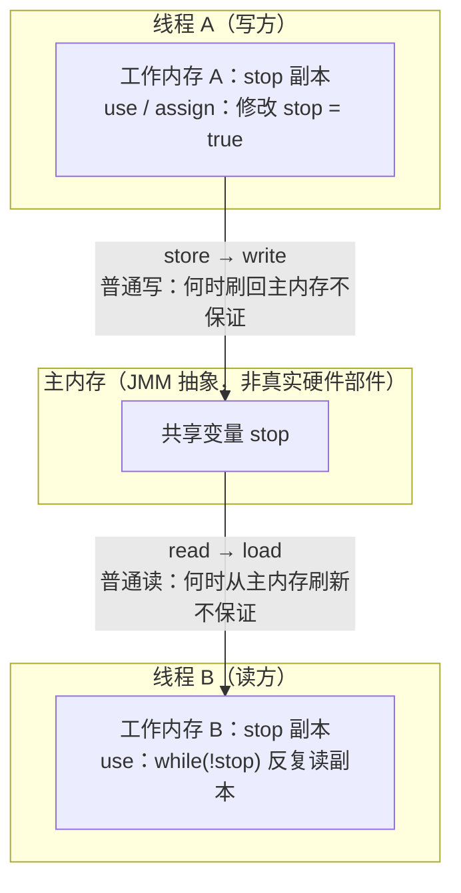
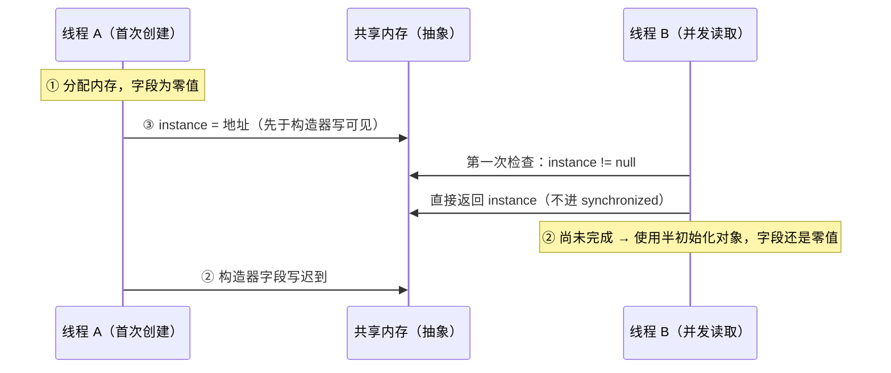

# Java 内存模型与 volatile

> 一句话概括：JMM 不是真实存在的硬件部件，而是一份「多线程读写共享变量时，什么结果合法」的规范——它用 happens-before 定义可见性与有序性的底线，用内存屏障把底线落到 x86/ARM 等不同硬件上；volatile 则是这份规范暴露给程序员的最小同步原语：**保证可见性与有序性，但不保证复合操作的原子性**。

预计阅读时间：大约 70 分钟

所属主题：[Java 并发编程常见面试题总结](summary.md)

本文以 **JDK 8** 为主要基线（规范口径为 JLS SE 8 第 17 章 / JSR-133），HotSpot 源码锚点默认指 `jdk8u` 分支；**JDK 9+ 的 VarHandle、JDK 17/21 的差异在正文单独注明**。与总结文档的分工：那里给面试结论，这里给**每条结论对应的规范条文与源码证据**。与兄弟专题的分工：synchronized 的 monitor 实现与锁升级归 [synchronized 与锁升级](synchronized-and-lock-escalation.md)，CAS 的硬件指令与原子类实现归 [CAS 与原子类](cas-and-atomic-classes.md)，本文聚焦**内存语义**本身。每个机制按「结论 → 机制 → 边界/代价 → 实践/追问」组织。

---

## 0. 阅读路线

| 读者 | 建议阅读 | 关注点 |
| --- | --- | --- |
| 初级（1 年内） | 1、2.1~2.3、6.1~6.4、7.1~7.3 | 可见性反例、三大特性、volatile 能做什么不能做什么、DCL 正确写法 |
| 中级（1~3 年） | 3、4、5、6.5、8 全部 | 重排与数据依赖、happens-before 推导、屏障插入策略、final 与安全发布 |
| 高级（3 年+） | 2.4、4.2、5.3、7.4、9、10 | 硬件模型差异、规范与实现之分、fence 源码、JSR-133 版本归属、VarHandle、排查 |
| 选型/架构 | 6.3~6.4、7.3、8.3、9.1、10.4 | 同步手段选型、单例方案对比、安全发布方式、内存语义层级、决策表 |

目录：

1. 从一个可见性反例讲起
2. 硬件背景与 JMM 抽象
3. 指令重排与 as-if-serial
4. happens-before：JMM 的核心规则
5. 内存屏障：规范如何落到硬件
6. volatile 语义与边界
7. DCL 单例完整推演
8. final 语义与安全发布
9. JDK 9+ VarHandle 的内存语义层级
10. 工程与排查
11. 高频追问集
12. 参考资料
13. 附：一页速记

---

## 1. 从一个可见性反例讲起

### 1.1 改了标志，循环却不退出

**结论**：一个线程修改共享标志、另一个线程轮询该标志，如果没有任何同步手段，**轮询线程可能永远看不到修改**——这不是玄学，而是 JMM 明确允许的结果。

```java
public class VisibilityDemo {
    private static boolean stop = false;              // 没有 volatile

    public static void main(String[] args) throws InterruptedException {
        new Thread(() -> {
            long i = 0;
            while (!stop) { i++; }                    // 热点循环
            System.out.println("stopped at i=" + i);
        }).start();
        Thread.sleep(100);                            // 给 JIT 编译留出时间
        stop = true;                                  // 主线程修改标志
        System.out.println("main set stop=true");
    }
}
```

在 JDK 8 默认的 server 模式（64 位 JVM 默认 `-server`）下运行，子线程大概率**永不退出**：主线程打印了 `main set stop=true`，子线程的 `while (!stop)` 却像没看见一样继续空转。

**机制**：要分「规范层」和「实现层」两层解释，面试时混为一谈会被追问穿：

- **规范层**：主线程写 `stop` 与子线程读 `stop` 之间没有任何 happens-before 关系（见第 4 节），构成**数据竞争（data race）**。JMM 对数据竞争的结果不做可见性承诺——子线程读到旧值 `false` 是合法执行。
- **实现层**：C2  JIT 编译器把这个热点循环里的 `stop` 读取**提升（hoist）出循环**——字段在循环体内没有被修改，编译器判定它是循环不变量，于是代码等效变成：

```java
if (!stop) {              // 只在进循环前读一次
    while (true) { i++; } // 循环体内不再读 stop
}
```

此后无论主线程怎么改 `stop`，子线程都不会再读它。注意这是**编译器优化**导致的「彻底看不见」，比「缓存未及时刷新」更极端；即使没有 hoisting，规范层也不保证可见。

**边界/代价**：这个 bug 的出现依赖 JIT 编译时机（循环要足够热才触发 C2 编译与 hoisting）、硬件与 JVM 版本，所以**本地跑几遍可能正常，压测/生产才炸**。在循环里加一句 `System.out.println`（内部有 synchronized）或 `Thread.sleep` 可能「碰巧」让它退出——那只是掩盖了问题，不是修复（见 10.1）。

### 1.2 加 volatile 修复

```java
private static volatile boolean stop = false;   // 其余代码不变
```

加上 `volatile` 后子线程正常退出。原因同样有两层：

- **规范层**：volatile 写 happens-before 后续对该字段的 volatile 读（JLS 17.4.5），主线程的写对子线程的读**必须可见**，数据竞争消除；
- **实现层**：volatile 读禁止被 hoist 出循环（每次迭代都必须真实读取），volatile 写后插入 StoreLoad 屏障保证写尽快全局可见（见第 5 节）。

### 1.3 三大特性：原子性、可见性、有序性

**结论**：并发正确性问题可归约为三个特性，每个特性都有独立的反例与保障手段，**没有任何一个关键字能单独包办全部**。

| 特性 | 含义 | 典型反例 | 保障手段 |
| --- | --- | --- | --- |
| 原子性 | 一组操作要么全做完要么全不做，中间不被其他线程观察/打断 | `i++` 读-改-写丢失更新（见 6.2） | `synchronized`、Lock、原子类（CAS）；volatile **不行** |
| 可见性 | 一个线程对共享变量的修改，其他线程能及时看到 | 1.1 的 `while(!stop)` | `volatile`、`synchronized`（解锁前刷回）、原子类（内部 volatile）、final（正确构造时） |
| 有序性 | 程序执行的顺序符合代码的先后约束（跨线程可观测的重排被禁止） | `a=1; flag=true` 被重排后他人看到 `flag==true && a==0`（见 3.4） | `volatile`（禁止特定重排）、`synchronized`（临界区互斥 + hb）、final（构造器写不沉底） |

四种手段的覆盖对照：

| 手段 | 原子性 | 可见性 | 有序性 | 备注 |
| --- | --- | --- | --- | --- |
| `volatile` | 仅单次读/写本身 | ✓ | ✓（禁止相关重排） | 不阻塞；复合操作无原子性 |
| `synchronized` | ✓（临界区整体） | ✓ | ✓（unlock→lock 建立 hb） | 阻塞；临界区内仍可按 as-if-serial 重排，monitor 实现见 [兄弟专题](synchronized-and-lock-escalation.md) |
| 原子类（`AtomicInteger` 等） | ✓（单变量 CAS） | ✓ | ✓（CAS 具 volatile 语义） | 非阻塞；多变量不变式无能为力，实现见 [兄弟专题](cas-and-atomic-classes.md) |
| `final`（正确构造） | —（不可变） | ✓（final 字段值） | ✓（构造器写不重排到发布之后） | 仅对 final 字段生效，见第 8 节 |

**追问：volatile 能保证有序性，为什么还不能替代 synchronized？**
期望答案：volatile 的有序性是「禁止特定重排 + 建立 hb」，不提供互斥。两个线程同时对 volatile 变量做 `i++`，每一步读写都可见、都有序，但「读-改-写」三步整体仍会交错丢失更新。**有序性 ≠ 原子性**，这是最高频的混淆点。

---

## 2. 硬件背景与 JMM 抽象

### 2.1 CPU 缓存层次与 MESI 一句话

**结论**：现代 CPU 与主存之间隔着多层缓存，**缓存一致性协议保证的是「同一缓存行最终一致」，不保证「多变量之间的写入顺序与即时可见」**——后者才是 JMM 要管的事。

| 层级 | 典型延迟（数量级） | 归属 |
| --- | --- | --- |
| 寄存器 | < 1 ns | 每核 |
| L1（指令/数据分离） | ~1 ns | 每核私有 |
| L2 | ~3-10 ns | 每核私有（部分架构共享） |
| L3 | ~10-40 ns | 多核共享 |
| 主存 DRAM | ~60-100 ns | 全局 |

MESI 一句话：缓存行有 Modified/Exclusive/Shared/Invalid 四种状态，核心写缓存行前通过总线嗅探使其他核的副本失效，从而保证**单个缓存行**在各核之间最终一致。它是背景知识，不是本课重点——关键在下一节：**有了 MESI，为什么还会有可见性问题？**

### 2.2 store buffer 与 invalid queue：一致性 ≠ 可见性

**机制**：为了不让 CPU 在写缓存时干等（写命中失效副本要等确认），硬件在缓存前又加了两层异步结构：

| 结构 | 作用 | 引入的问题 |
| --- | --- | --- |
| store buffer（写缓冲） | 写操作先落入本核缓冲，异步刷入缓存 | 其他核**晚于程序顺序**看到写 → 可见性延迟；本核后续读可能越过未刷出的写 → StoreLoad 重排 |
| invalid queue（失效队列） | 收到失效消息先入队并立即应答，稍后才真正失效本地副本 | 本核可能**继续读到已失效的旧值** → 读侧可见性/重排问题 |

所以「缓存一致性协议」解决的是缓存行状态的最终一致，而 store buffer/invalid queue 让**写入对其他核可见的时刻**与**程序顺序**脱钩。内存屏障（第 5 节）本质上就是约束这些异步结构的排空时机。

### 2.3 JMM 是规范，不是实体：主内存/工作内存模型

**结论**：JMM（Java Memory Model）是**抽象规范**，定义「线程与共享变量交互的规则」；「主内存/工作内存」是教学抽象，**不是真实存在的硬件部件**——工作内存对应寄存器、各级缓存、store buffer 等一切的总和。



旧版规范（JSR-133 之前，JLS 第 1/2 版（J2SE 1.4 及以前）第 17 章）用 8 种原子操作描述这套交互，可作理解模型：

| 操作 | 作用域 | 语义 |
| --- | --- | --- |
| lock | 主内存 | 把变量标记为某线程独占 |
| unlock | 主内存 | 释放独占，释放前须刷回 |
| read | 主内存→传输 | 把变量值从主内存读出 |
| load | 传输→工作内存 | 把 read 到的值放入工作内存副本 |
| use | 工作内存→执行引擎 | 把副本值交给执行代码 |
| assign | 执行引擎→工作内存 | 把执行结果赋给工作内存副本 |
| store | 工作内存→传输 | 把副本值传出 |
| write | 传输→主内存 | 把 store 到的值写入主内存变量 |

配套规则如：read/load、store/write 必须成对按序出现（可不连续）；不允许丢弃最近的 assign；新变量只能在主内存诞生等。

**版本注记（重要）**：这 8 种操作出自**旧 JMM**。JSR-133（J2SE 5.0 落地）之后，现行 JLS 17.4 已**不再用它们定义内存模型**，而是改用「动作（action）+ happens-before + synchronizes-with」的形式化定义。上表仅用于建立「主内存/工作内存」的直觉，**面试引用时请说明它是旧规范的教学模型**，现行规范的权威口径是第 4 节的 hb 规则。

### 2.4 JMM 与硬件内存模型：屏蔽差异

**结论**：JMM 是「Java 程序视角的统一契约」，硬件内存模型是「某款 CPU 实际允许的重排集合」；JVM 负责在两者之间翻译——**同一份 Java 代码在 x86 与 ARM 上语义一致，但插入的屏障不同**。

| 硬件模型 | 特点 | 对 JVM 的意义 |
| --- | --- | --- |
| x86/x64（TSO，Total Store Order） | 较强：仅允许 StoreLoad 重排（store buffer 所致），LoadLoad/LoadStore/StoreStore 天然保序 | volatile 读几乎零成本（普通 load），volatile 写只需一条 StoreLoad 屏障（见 5.3） |
| ARM / POWER（弱模型） | 四类重排都可能发生 | 需要插入更多屏障（acquire/release 语义要显式指令），volatile 成本更高 |

**边界/代价**：这解释了两个工程现象——① 同一段有数据竞争的代码，x86 上「看起来正常」、ARM 服务器/手机上翻车（x86 的强模型掩盖了部分重排）；② 性能测试跨平台不可直接类比。**不要依赖具体硬件的「额外恩惠」写并发代码，只依赖 JMM 承诺的部分。**

**追问：既然 x86 这么强，JMM 为什么还要定义得比 TSO 弱？**
期望答案：JMM 要在所有平台（含弱模型）上可实现，且要给 JIT 留出优化空间（如 synchronized 临界区内重排）。规范定得比最强硬件弱，才能让「一次编写、处处一致」成立；代价是程序员不能拿 x86 的直觉当规范。

---

## 3. 指令重排与 as-if-serial

### 3.1 三种重排来源

**结论**：从源码到执行，有三层都可能改变操作的可见顺序，**每一层都以「不改变单线程语义」为底线**。

| 重排层次 | 谁做的 | 例子 |
| --- | --- | --- |
| 编译器优化重排 | javac / JIT（C1/C2） | 循环不变量外提（1.1 的 hoisting）、指令调度、逃逸分析后的标量替换 |
| 指令级并行重排 | CPU 乱序执行 | 无依赖的指令被乱序发射/执行（只要结果按序提交，单线程不可感知） |
| 内存系统重排 | store buffer / 缓存 | 写先落缓冲后刷缓存，其他核看到的顺序与程序顺序不同（2.2） |

### 3.2 数据依赖分类

**机制**：同一线程内，若两个操作访问同一变量且至少一个是写，则存在数据依赖，**重排不得改变依赖关系的结果**：

| 依赖类型 | 别名 | 示例 | 能否重排 |
| --- | --- | --- | --- |
| 写后读（RAW） | 真依赖 | `a = 1; b = a;` | 不能（否则 b 读到旧值） |
| 写后写（WAW） | 输出依赖 | `a = 1; a = 2;` | 不能（否则终值变 1） |
| 读后写（WAR） | 反依赖 | `a = b; b = 1;` | 不能（否则 a 读到新值） |

注意：**依赖只约束「同一变量」的操作**。`a = 1; flag = true;` 访问两个不同变量、无数据依赖，编译器与 CPU 完全可以交换它们的可见顺序——这正是多线程问题的入口。

### 3.3 as-if-serial：只保证单线程语义

**结论**：as-if-serial 语义 =「不管怎么重排，**单线程**程序的执行结果不能被改变」。它是编译器/CPU 优化的合法性边界，**不是多线程的保证**。

**边界**：多线程下，线程 B 观察的是线程 A 操作的**内存可见顺序**，而不是 A 的程序顺序。A 内部合法的重排，在 B 眼里就是「乱序」。JMM 的工作就是规定：哪些跨线程可观测的重排必须被禁止（通过 volatile/synchronized/final 建立的 hb 关系）。

### 3.4 经典反例：a=1; flag=true

```java
// 线程 A                      // 线程 B
a = 1;          // ①           while (!flag) {}   // ③ 自旋等 flag
flag = true;    // ②           System.out.println(a); // ④ 期望 1
```

①②无数据依赖，可被重排为②先可见：

```mermaid
sequenceDiagram
    participant A as 线程 A
    participant M as 共享内存（抽象）
    participant B as 线程 B
    Note over A: 程序顺序：① a=1; ② flag=true
    A->>M: ② flag=true 先刷出（重排/写缓冲）
    B->>M: ③ 读 flag == true，退出自旋
    B->>M: ④ 读 a == 0（① 尚未可见）
    A->>M: ① a=1 迟到
    Note over B: 观察到「flag 已置位但 a 还是 0」
```

**修复**：把 `flag` 声明为 volatile。volatile 写之前的 StoreStore 屏障禁止①沉到②之下（见 5.2），且 volatile 写→读建立 hb，B 看到 `flag==true` 就必然看到 `a==1`。这就是「volatile 写之前的普通写，对后续 volatile 读可见」的完整推导场景（4.3 逐步推）。

**追问：把①②都改成 volatile 写行不行？**
期望答案：行但没必要——只需 flag 是 volatile，①的可见性由 hb 传递性捎带保证。全部 volatile 会多插屏障、多花成本，且仍不解决「读-改-写」原子性。

---

## 4. happens-before：JMM 的核心规则

### 4.1 定义与完整规则清单

**结论**：happens-before（hb）是 JMM 定义的**偏序关系**：若 hb(x, y)，则 x 的结果对 y 可见、且 x 在 y 之前「发生」（规范意义上的先后，见 4.2）。**判断并发代码是否正确，就是找冲突访问之间有没有 hb 链**；没有 hb 的两个冲突访问 = 数据竞争（JLS 17.4.5）。

JLS 17.4.5 的基础规则 + 17.4.4 的 synchronizes-with 来源，完整清单：

| # | 规则 | 内容（JLS 口径） | 锚点 |
| --- | --- | --- | --- |
| 1 | 程序顺序 | 同一线程内，程序顺序在前的动作 hb 在后的动作 | JLS 17.4.5 |
| 2 | 监视器锁 | 对**同一监视器**，unlock hb 后续每一次 lock | JLS 17.4.5 |
| 3 | volatile | 对**同一 volatile 字段**，写 hb 后续每一次读 | JLS 17.4.5 |
| 4 | 线程启动 | `Thread#start` hb 被启动线程内的任何动作 | JLS 17.4.5 |
| 5 | 线程终止 | 线程内所有动作 hb 其他线程从该线程 `join` 成功返回（或检测到其终止，如 `isAlive()==false`） | JLS 17.4.5 / 17.4.4 |
| 6 | 中断 | T1 调用 T2 的 `interrupt` hb T2 检测到中断的点（抛 `InterruptedException`、调用 `Thread.interrupted`/`isInterrupted`） | JLS 17.4.4 |
| 7 | 终结器 | 对象构造器结束 hb 该对象 `finalize` 的开始 | JLS 17.4.5 |
| 8 | 默认初始化 | 任何对象的默认值写（0/false/null）hb 程序的其他动作 | JLS 17.4.5 |
| 9 | 传递性 | hb(x,y) 且 hb(y,z) ⇒ hb(x,z) | JLS 17.4.5 |

三个易错措辞：

- 规则 2/3 的「后续（subsequent）」指**同步顺序（synchronization order）**上的后续，不是墙钟时间——hb 边本身由同步顺序决定、与读方实际读到的值无关；但「看到 volatile 写才捎带看到它之前的普通写」这一可见性结论，以读到匹配的写为前提；
- 规则 3 要求**同一个字段**：写 volatile f 与读 volatile g 之间没有 hb（JSR-133 FAQ 原话：release 与 acquire 必须 "match"）；
- 规则 4/5 是「start 之前的写对子线程可见」「子线程的写对 join 返回后的主线程可见」的规范依据，线程生命周期细节见 [线程基础与生命周期](thread-basics-and-lifecycle.md)。

**工程推论**：`java.util.concurrent` 包 javadoc 的 "Memory Consistency Properties" 一节把这些规则延伸到工具类——如「向 Executor 提交任务前的动作 hb 任务开始执行」（线程池见 [thread-pool.md](thread-pool.md)）、「`countDown` hb `await` 返回」（同步工具见 [concurrency-tools.md](concurrency-tools.md)）。它们底层都靠 AQS 的 volatile state + CAS 建立 hb（见 [AQS 与锁](aqs-and-locks.md)）。

### 4.2 hb ≠ 时间先后，也 ≠ 必须按序执行

**结论**：hb 是**可见性 + 有序性的承诺**，不是执行时刻表。JLS 17.4.5 原文：

> "the presence of a happens-before relationship between two actions does not necessarily imply that they have to take place in that order in an implementation. If the reordering produces results consistent with a legal execution, it is not illegal."

两个推论：

1. **时间上先发生 ≠ hb**：线程 A 先写了 x，线程 B 后读 x，若无同步手段，依然没有 hb，B 可以读不到——「我先写的」不是可见性的理由；
2. **有 hb ≠ 禁止一切重排**：只要重排后的结果与某个合法执行一致，实现照样可以重排。例如 hb(x,y) 且 y 根本观察不到 x 的结果时，x、y 的实际执行顺序可以颠倒。**JMM 管的是「你能看到什么」，不是「CPU 第几纳秒执行了哪条指令」。**

### 4.3 推导：为什么 volatile 写之前的普通写对后续 volatile 读可见

这是 volatile 最有价值的语义（JSR-133 强化后的核心），用规则逐步推导：

```java
// 线程 A（writer）            // 线程 B（reader）
x = 42;          // ①          r1 = v;        // ③ volatile 读
v = true;        // ② volatile 写   if (r1) print(x); // ④
```

| 步骤 | 依据 | 结论 |
| --- | --- | --- |
| hb(①, ②) | 规则 1 程序顺序（同线程 A） | ① 在 ② 前 |
| hb(②, ③) | 规则 3 volatile（B 读到了 A 写的 true） | ② 在 ③ 前 |
| hb(③, ④) | 规则 1 程序顺序（同线程 B） | ③ 在 ④ 前 |
| hb(①, ④) | 规则 9 传递性 | **④ 必须看到 42**（或更晚的合法写） |

**边界**：若 B 读到的是 `v==false`（初始值），②③之间没有 hb，x 的可见性无任何承诺。「看到 true 才看到 42」——**条件成立才触发保证**，这也是 volatile 适合做「一次性发布标志」的原因（6.3）。

**追问：x 不是 volatile，为什么也能被捎带保证可见？**
期望答案：hb 保证的是「x 的写在 v 的写之前已对后续读可见」，传递性把普通写捎带进了同步边界。实现上对应 volatile 写前的 StoreStore 屏障（5.2）：普通写不许沉到 volatile 写之下。这正是 JSR-133 之前做不到的（7.4）。

### 4.4 数据竞争与「正确同步 ⇒ 顺序一致」

**结论**：JLS 17.4.5 定义——程序含两个未被 hb 排序的冲突访问即**数据竞争**；若程序的所有顺序一致执行都无数据竞争，则称**正确同步**，此时**所有执行都呈现顺序一致（SC）**。

这就是 DRF-SC 承诺：**把同步写对，你就拿回「代码像按顺序执行」的直觉；写不对，JMM 只给出很弱的底线保证**（不保证可见、甚至允许看似因果倒置的结果）。面试一句话：「JMM 对正确同步的程序承诺顺序一致性，对数据竞争的程序不承诺可见性。」

---

## 5. 内存屏障：规范如何落到硬件

### 5.1 四类屏障语义

**结论**：内存屏障（memory barrier/fence）是插入在两个内存访问之间的约束，**按它分隔的访问类型命名**（JSR-133 Cookbook 口径）：

| 屏障 | 典型序列 | 语义 |
| --- | --- | --- |
| LoadLoad | Load1; LoadLoad; Load2 | Load1 的数据先于 Load2 及后续所有读加载 |
| StoreStore | Store1; StoreStore; Store2 | Store1 先于 Store2 及后续所有写**对其他处理器可见**（刷出写缓冲） |
| LoadStore | Load1; LoadStore; Store2 | Load1 的数据先于 Store2 及后续所有写刷出 |
| StoreLoad | Store1; StoreLoad; Load2 | Store1 先于 Load2 及后续所有读**对其他处理器可见** |

两个要点（Cookbook 原文结论）：

- **StoreLoad 最贵**，几乎所有现代多处理器都需要它；且它**兼具其他三种屏障的效果**，可当全能 fence 用；反过来，其他三种的任意组合**通常不等价于** StoreLoad；
- x86 上 LoadLoad/LoadStore/StoreStore 都是 no-op（TSO 天然保序），**只有 StoreLoad 需要真实指令**（mfence / cpuid / lock 前缀指令）。

### 5.2 JMM 的保守插入策略

**机制**：JSR-133 Cookbook 给出的保守策略（教学与编译器实现的基准模型）：

| 位置 | 插入屏障 | 禁止的重排 |
| --- | --- | --- |
| volatile 写**之前** | StoreStore | 上面的普通写沉到 volatile 写之下（保住 4.3 的捎带可见） |
| volatile 写**之后** | StoreLoad | 下面的读/写浮到 volatile 写之上；保证写尽快全局可见 |
| volatile 读**之后** | LoadLoad | 下面的普通读浮到 volatile 读之上 |
| volatile 读**之后** | LoadStore | 下面的普通写浮到 volatile 读之上 |

```text
普通写 a=1
StoreStore          ← volatile 写前
volatile 写 flag=true
StoreLoad           ← volatile 写后（最贵的一道）
...
volatile 读 flag
LoadLoad            ← volatile 读后
LoadStore           ← volatile 读后
普通读 a
```

**边界/代价**：

- 这是**保守策略**，不是唯一合法实现。Cookbook 自己注明：StoreLoad 也可以改插在每个 volatile 读**之前**（读多写少时更慢，故不选）；x86 上 volatile 写还可直接用带 lock 语义的原子指令（如 xchg）省掉独立屏障。
- Cookbook 页面现已标注 "now of historical interest only"——具体处理器的支持细节有过时内容，**但四类屏障语义与插入策略仍是理解 JMM 实现的标准模型**；语义正确性最终以 JLS 为准，实现以各平台 HotSpot 代码为准。
- final 字段另有一条特殊规则：构造器内所有写之后、构造器返回之前插 StoreStore（`x.finalField = v; StoreStore; sharedRef = x;`），见第 8 节。

### 5.3 x86 实现：OrderAccess::fence 源码

**结论**：HotSpot 在 x86 上把 StoreLoad 屏障实现为 **`lock addl $0,0(%rsp)`**——一条对栈顶加 0 的 lock 前缀指令，语义上是 no-op，副作用是充当全屏障（排空 store buffer、序列化内存访问）。

`jdk8u` 分支 `hotspot/src/os_cpu/linux_x86/vm/orderAccess_linux_x86.inline.hpp`（源码锚点 `OrderAccess#fence`）：

```cpp
inline void OrderAccess::fence() {
  if (os::is_MP()) {
    // always use locked addl since mfence is sometimes expensive
#ifdef AMD64
    __asm__ volatile ("lock; addl $0,0(%%rsp)" : : : "cc", "memory");
#else
    __asm__ volatile ("lock; addl $0,0(%%esp)" : : : "cc", "memory");
#endif
  }
}
```

同文件的映射关系（`OrderAccess#storeload` 等）：

```cpp
inline void OrderAccess::loadload()   { acquire(); }
inline void OrderAccess::storestore() { release(); }
inline void OrderAccess::loadstore()  { acquire(); }
inline void OrderAccess::storeload()  { fence(); }
```

三个值得注意的实现细节：

1. **注释直说选型理由**：mfence 有时更贵，所以统一用 locked addl（Cookbook 也推荐 lock 前缀指令作 StoreLoad 屏障）；
2. **`os::is_MP()` 门槛**：单处理器上 `fence()` 函数体整体为空、直接跳过（没有跨核可见性问题）——可见性成本与硬件拓扑相关；
3. x86 上 `acquire()` 是一条 dummy load 汇编 + memory clobber、`release()` 是对栈局部变量的 volatile 写，**均不产生硬件屏障指令**——因为 TSO 硬件已保序。这解释了「x86 上 volatile 读几乎免费」：读侧只需普通 mov + 编译器约束。

在 JIT 侧，C2 用内存屏障节点（`MemBarVolatile`/`MemBarAcquire` 等，见 `opto/memnode.hpp`）表达这些约束，最终 lowering 到上述指令；解释器执行 volatile 写字段时同样会补 fence。**规范要求的屏障位置（5.2）与平台实际插入的指令（本节）是两回事**——面试把两者分开讲，是高级信号。

### 5.4 volatile 写 ≈ 释放，读 ≈ 获取

**结论**：JSR-133 FAQ 的定性——「写 volatile 字段的内存效果等同于 monitor release，读 volatile 字段等同于 monitor acquire」。即：

- volatile 写 = **release**：之前的所有读写不许沉到它下面，写完对后续 acquire 方可见；
- volatile 读 = **acquire**：之后的所有读写不许浮到它上面，读到匹配 release 的值即继承其之前的全部写入。

**边界/代价**：acquire/release 是「半同步」——**没有互斥**，两个线程可以同时读写同一个 volatile 变量；它也不像完整 StoreLoad fence 那样约束所有方向（volatile 写后的 StoreLoad 才是保证「写立即全局可见」的关键）。与 monitor 的完整语义对比见 6.4，monitor 的获取/释放实现见 [synchronized 与锁升级](synchronized-and-lock-escalation.md)。

**追问：volatile 写后为什么必须是 StoreLoad，而不是 StoreStore？**
期望答案：StoreStore 只约束「写与写」的顺序，挡不住后面的**读**越过前面的写（x86 唯一允许的重排恰是 StoreLoad）。volatile 写后若允许后续读浮上去，会破坏 volatile 变量间的全序与「写立即可见」语义，所以必须用最贵的 StoreLoad。

---

## 6. volatile 语义与边界

### 6.1 保证什么、不保证什么

**结论**：volatile 提供三件事——① 单次读/写的可见性（写 hb 后续读）；② 禁止相关重排（5.2 的屏障位置）；③ 单次读/写本身的原子性（含 long/double，见 6.5）。**不提供**：复合操作（读-改-写、check-then-act）的原子性、互斥。

### 6.2 反例：volatile int 的 i++

```java
public class VolatileAtomicityDemo {
    private static volatile int count = 0;

    public static void main(String[] args) throws InterruptedException {
        Thread[] ts = new Thread[10];
        for (int i = 0; i < 10; i++) {
            ts[i] = new Thread(() -> {
                for (int j = 0; j < 10000; j++) count++;   // 复合操作
            });
            ts[i].start();
        }
        for (Thread t : ts) t.join();
        System.out.println(count);   // 几乎总是 < 100000
    }
}
```

**机制**：`count++` 编译后是四条字节码（`javap -c` 可见，省略 aload/dup）：

```text
getfield  count    // 读（volatile 读，可见性 OK）
iconst_1
iadd               // 改（线程私有栈上计算）
putfield  count    // 写（volatile 写，可见性 OK）
```

volatile 只保证 getfield/putfield 各自的可见性与有序性，**不保证四条指令整体不被交错**：两个线程同时 getfield 读到 5，各自 iadd 得 6，先后 putfield 写回 6——两次自增只生效一次。

**修复**：`AtomicInteger#incrementAndGet`（CAS 循环，见 [CAS 与原子类](cas-and-atomic-classes.md)）、`synchronized` 包住 `count++`、或高并发计数用 `LongAdder`。

### 6.3 适用场景

| 场景 | 模式 | 为什么 volatile 够用 |
| --- | --- | --- |
| 状态标志 | 一写多读：`volatile boolean shutdown` | 单次写/读，无复合操作；1.1 的标准修复 |
| DCL 单例 | `volatile Singleton instance` | 禁止「引用赋值」与「构造器写」重排，见第 7 节 |
| 一次性安全发布 | `volatile Config config`，构造完成后整体赋值 | 读方看到非 null 即看到完整构造结果（4.3 推导） |
| 独立观察 | 定期发布统计值/心跳：`volatile long lastHeartbeat` | 读方只需「最新值的近似」，不需要读-改-写一致 |

共同特征：**写入不依赖当前值（或依赖关系由单一写线程保证），读方只做简单读取**。一旦需要「读了再决定写什么」且有多写者，volatile 就不够（6.2）。

### 6.4 volatile vs synchronized

| 维度 | volatile | synchronized |
| --- | --- | --- |
| 原子性 | 仅单次读/写 | 临界区整体 |
| 可见性 | ✓（写→读 hb） | ✓（unlock→lock hb） |
| 有序性 | ✓（禁止相关重排） | ✓（hb）；临界区内仍可 as-if-serial 重排 |
| 阻塞 | 不阻塞 | 竞争时阻塞（锁升级细节见 [兄弟专题](synchronized-and-lock-escalation.md)） |
| 作用对象 | 变量 | 代码块/方法（监视器） |
| 编译器优化 | 禁止 hoist 等优化，读写必须真实发生 | 临界区内优化空间更大 |
| 成本 | x86 上读≈普通读，写多一条 lock 指令 | 无竞争时偏向/轻量级锁成本低，竞争时涉及内核态切换 |
| 适用 | 状态标志、一次性发布、独立观察 | 复合操作、多变量不变式、check-then-act |

**一句话选型**：「一写多读的标志/发布用 volatile；只要涉及『读-改-写』或多个变量的一致性，用锁或原子类。」

### 6.5 边界：volatile 数组/对象引用、long/double

**结论**：volatile 修饰的是**变量本身**——对引用类型，只保证「引用这个指针」的读写语义，**不保证所指对象的内部状态**。

```java
private static volatile int[] arr = new int[10];
arr[0] = 1;          // 普通写！volatile 只作用于 arr 这个引用
arr = new int[10];   // 这才是 volatile 写
```

对象字段同理：`volatile User user` 只保证 `user` 引用的可见性，`user.name = "x"` 是普通写。要元素级语义：`AtomicIntegerArray`、锁、或 JDK 9+ 的数组 VarHandle（第 9 节）。

**long/double 注记（JLS 17.7）**：非 volatile 的 64 位读写在规范上**允许拆成两个 32 位操作**（32 位 JVM 上可能读到「半新半旧」的值）；**volatile 的 long/double 读写总是原子的**。64 位 HotSpot 实际上非 volatile 也原子，但写可移植代码应按规范口径处理。VarHandle 的 plain get/set 同样注明 32 位平台上 long/double 例外（第 9 节）。

**追问：volatile 对象引用 + 不可变对象，是不是就线程安全了？**
期望答案：是经典组合——引用用 volatile 保证发布可见性，对象内部全 final 保证状态不可变（第 8 节），读方无需加锁。这正是「一次性安全发布」模式的完整形态。

---

## 7. DCL 单例完整推演

### 7.1 new 对象的三步与半初始化问题

**结论**：DCL（Double-Checked Locking）不加 volatile 是**错误的**：其他线程可能拿到「引用非 null 但构造未完成」的半初始化对象。

`instance = new Singleton()` 概念上分三步：

```text
① 分配内存（字段置零值）
② 执行构造器初始化字段
③ 把内存地址赋给 instance 引用
```

字节码层面顺序是固定的（`new` → `dup` → `invokespecial` → `putstatic`），**重排发生在 JIT/硬件层**：②的字段写还在 store buffer 里，③的引用写先对其他核可见——等效于②③重排：



注意线程 B 走的是**第一次检查**（无锁路径）——这正是 DCL 的设计目的（创建后不再加锁），也是它危险的地方：无锁路径没有任何同步，全靠引用本身的发布语义。

### 7.2 volatile 修复与正确写法

```java
public class Singleton {
    private static volatile Singleton instance;      // volatile 不可省略
    private Singleton() {}

    public static Singleton getInstance() {
        if (instance == null) {                      // 第一次检查（无锁，快路径）
            synchronized (Singleton.class) {
                if (instance == null) {              // 第二次检查（持锁，防重复创建）
                    instance = new Singleton();
                }
            }
        }
        return instance;
    }
}
```

**机制**：`instance` 是 volatile 写，其前的 StoreStore 屏障禁止构造器字段写沉到引用赋值之下（5.2）；读方第一次检查是 volatile 读，看到非 null 即与构造写建立 hb（4.3），**必然看到完整初始化的对象**。

**边界**：volatile 只解决「发布安全」，不解决「构造器里 this 逃逸」（8.2）——构造器内部把 this 泄漏出去，volatile 也救不了。

### 7.3 替代方案对比：静态内部类 / 枚举

| 方案 | 懒加载 | 线程安全依据 | 防反射 | 防序列化破坏 | 复杂度 |
| --- | --- | --- | --- | --- | --- |
| volatile DCL | ✓ | volatile hb + synchronized | ✗（可反射调私有构造） | ✗（需 readResolve） | 中 |
| 静态内部类（Holder） | ✓（首次调用 getInstance 才加载 Holder） | **JVM 类初始化锁**（JLS 12.4.2） | ✗ | ✗ | 低 |
| 枚举 | ✗（类加载即创建） | JVM 类初始化 + 枚举语义 | ✓（反射创建枚举被禁止） | ✓（序列化机制保证单例） | 最低 |
| 饿汉（static final 直接 new） | ✗ | JVM 类初始化 | ✗ | ✗ | 最低 |

```java
// Holder：利用类初始化锁，无锁且懒加载
public class Singleton {
    private Singleton() {}
    private static class Holder {
        static final Singleton INSTANCE = new Singleton();
    }
    public static Singleton getInstance() { return Holder.INSTANCE; }
}

// 枚举：《Effective Java》推荐，天然防反射/序列化
public enum Singleton {
    INSTANCE;
    public void doWork() { /* ... */ }
}
```

**机制**：JLS 12.4.2 规定类初始化过程持锁（每个类一把初始化锁），`Holder.INSTANCE` 的创建与发布被 JVM 保证线程安全且只执行一次——**不需要任何显式同步**。这也是 JSR-133 FAQ 推荐的 "Initialization On Demand Holder" 惯用法。

**实践**：需要懒加载且无序列化/反射顾虑 → Holder；要绝对防破坏 → 枚举；必须手写 DCL（如框架代码）→ volatile 版。JSR-133 FAQ 甚至直言：volatile 语义强化后成本接近同步，「没有充分理由再用 DCL」——Holder 更简单。

### 7.4 版本注记：JDK 5 之前 volatile 修不了 DCL

**结论**：**JSR-133（J2SE 5.0）之前，给 instance 加 volatile 也无法修复 DCL**。JSR-133 FAQ 原文：

> "In JVMs prior to 1.5, volatile would not ensure that it worked (your mileage may vary). Under the new memory model, making the instance field volatile will 'fix' the problems with double-checked locking."

**机制**：旧 JMM 只禁止 volatile 访问**彼此之间**的重排，**允许 volatile 写与普通写重排**——构造器字段写（普通写）可以沉到 volatile 引用赋值之下，半初始化问题依旧。JSR-133 把 volatile 强化为 acquire/release 语义（5.4），普通写被纳入约束，DCL 才成立。

**面试口径**：「volatile 修复 DCL 是 JDK 5+ 的事，依据是 JSR-133 对 volatile 语义的强化；JDK 1.4 及以前无解，只能全程加锁或用饿汉/Holder。」

---

## 8. final 语义与安全发布

### 8.1 JMM 对 final 字段的特殊保证

**结论**：JLS 17.5——**对象正确构造（构造期间引用未逃逸）时，任何线程只要看到该对象的引用，就保证看到构造器中赋予 final 字段的值**，无需同步；且保证传递到 final 字段引用的对象/数组（"at least as up-to-date as the final fields"）。

**机制**：规范引入 **freeze（冻结）动作**——构造器退出（正常或异常）时，对其中写过的每个 final 字段执行 freeze。实现上对应 Cookbook 的特殊规则：**构造器内所有写之后、构造器返回之前插 StoreStore**（`x.finalField = v; StoreStore; sharedRef = x;`），禁止 final 写沉到「对象引用发布」之下；弱内存模型上首次读 final 字段前还需 LoadLoad（禁止读引用与读 final 字段重排）。

**边界**：

- **只保 final 字段**。JLS 17.5 示例：`final int x` 保证读到 3，非 final 的 `y` 可能读到 0——final 不是「整个对象可见性」的开关；
- 保证的是「构造结束时的值」，不是「最新值」（final 本来也不可变）；
- 反射修改 final 字段会触发额外 freeze，但语义复杂且不建议；常量表达式初始化的 final 字段会被编译期内联（JLS 17.5.3），修改根本不可观测。

### 8.2 this 逃逸：保证的破坏者

**结论**：构造器完成前把 `this` 发布给其他线程（this escape），final 保证**失效**——其他线程可能看到 final 字段的默认值（0/false/null）。

```java
public class Escape {
    final int x;
    static Escape global;

    public Escape() {
        global = this;      // this 逃逸！其他线程此刻可读到 x == 0
        x = 3;              // final 写发生在发布之后
    }
}
```

常见逃逸形式：构造器内 `new Thread(...).start()`（子线程立刻读 this）、注册监听器/回调、把 this 赋给静态字段或共享集合。JSR-133 FAQ 的安全构造要求原话：「不要把正在构造的对象引用放到其他线程可能看到的地方——不要赋给静态字段，不要注册为监听器。」

**实践**：构造器只做字段赋值；需要启动线程/注册监听时用工厂方法——**先构造完成，再发布**：

```java
static Escape create() {
    Escape e = new Escape();   // 构造完成（freeze 已发生）
    e.registerListener();      // 之后再注册
    return e;
}
```

### 8.3 安全发布的四种方式

**结论**：「安全发布」= 保证其他线程看到引用时，对象的构造状态也可见。四种标准方式（JCiP §16.1 口径）：

| 方式 | 机制 | 锚点/依据 |
| --- | --- | --- |
| 静态初始化器 | JVM 类初始化锁保证 `static final X x = new X()` 的创建与发布原子且可见 | JLS 12.4.2 |
| volatile 字段 / AtomicReference | volatile 写→读 hb，构造写被捎带发布 | JLS 17.4.5；6.3 |
| final 字段（正确构造） | freeze + StoreStore，看到引用即看到 final 值 | JLS 17.5；8.1 |
| 锁保护（含线程安全容器） | unlock→lock hb；如放入 `ConcurrentHashMap`/`BlockingQueue` | JLS 17.4.5；[concurrent-collections.md](concurrent-collections.md) |

**边界**：final 方式只保 final 字段（8.1），对象含非 final 可变状态时仍需 volatile/锁发布**引用**；反之，volatile 发布对普通字段也生效（4.3），两者可组合（6.5 追问）。

### 8.4 不可变对象为什么天然线程安全

**结论**：不可变对象（所有字段 final、正确构造、不暴露可变内部状态）**没有写操作，就没有数据竞争**，任何线程读到的都是一致的构造期快照——无需同步。

**边界/代价**：

- 「不可变」要求**深度**：final 引用指向可变对象（如 `final List<String> list`）不算不可变，需不可变包装或防御性拷贝；
- **final 不保证引用本身的可见性**：JSR-133 FAQ 强调，不可变对象构造完成后，要让其他线程「看到引用」通常仍需安全发布（volatile/锁/静态初始化）——final 保的是「看到引用后字段正确」，不是「一定看得到引用」。通过数据竞争传递不可变对象，最坏情况是对方一直看不到，但**一旦看到就不会是半成品**。

**追问：String 为什么线程安全？**
期望答案：JDK 8 的 String 内部 `final char[] value` + 不可变 API + 正确构造，符合不可变对象定义；JDK 9+ 改为 `final byte[] value` + coder（紧凑字符串），语义不变。注意 String 的「不可变」也依赖构造期不逃逸——JDK 内部实现满足这一点。

---

## 9. JDK 9+ VarHandle 的内存语义层级

> 本节为 **JDK 9+** 内容（JEP 193 引入 VarHandle），JDK 8 无此 API；JDK 17/21 的语义与 JDK 9 一致，差异主要在 JDK 内部实现选型（9.3）。

### 9.1 四级访问模式

**结论**：VarHandle 把「内存语义强度」从变量声明（volatile 关键字）解耦为**按访问选择**的四级模式，同一字段可以按需混用不同强度（官方 javadoc 口径）：

| 层级 | 读/写方法 | 保证 |
| --- | --- | --- |
| plain | `get` / `set` | 无跨线程顺序约束；仅引用与 ≤32 位基本类型保证按位原子（32 位平台 long/double 例外） |
| opaque | `getOpaque` / `setOpaque` | 按位原子 + **同一变量**的访问连贯有序（coherent），按程序顺序访问，但不保证跨线程顺序效果 |
| acquire/release | `getAcquire` / `setRelease` | 在 opaque 之上：acquire 读及其后续访问，不许重排到匹配的 release 写及其之前访问的前面 |
| volatile | `getVolatile` / `setVolatile` | 在 acquire/release 之上：**所有 volatile 模式操作之间全序**（对应 JMM 的 volatile 语义 / seq_cst） |

```java
// JDK 9+：同一字段，四种强度按需取用
public class VarHandleDemo {
    private int state;                       // 注意：声明处可以不是 volatile
    private static final VarHandle STATE;
    static {
        try {
            STATE = MethodHandles.lookup()
                    .findVarHandle(VarHandleDemo.class, "state", int.class);
        } catch (ReflectiveOperationException e) {
            throw new ExceptionInInitializerError(e);
        }
    }
    void publish(int v)      { STATE.setRelease(this, v); }        // ≈ volatile 写（省 StoreLoad）
    int observe()            { return (int) STATE.getAcquire(this); }
    boolean cas(int e, int u){ return STATE.compareAndSet(this, e, u); } // volatile 语义
    int plainRead()          { return (int) STATE.get(this); }     // 普通读，无保证
}
```

**机制**：acquire/release 配对即 5.4 的「半同步」——`setRelease` 前的写不许沉底，`getAcquire` 后的访问不许上浮，配对成功即建立 hb；volatile 模式额外要求所有此类操作全序（这是 volatile 变量间互相保序的来源）。

### 9.2 原子更新方法的默认语义

| 方法族 | 默认内存语义 | 变体 |
| --- | --- | --- |
| `compareAndSet` / `compareAndExchange` | volatile 读 + volatile 写 | `compareAndExchangeAcquire` / `Release` |
| `weakCompareAndSet` | volatile（可能伪失败） | `weakCompareAndSetPlain` / `Acquire` / `Release` |
| `getAndSet` / `getAndAdd` / `getAndBitwise*` | volatile | `*Acquire` / `*Release`（plain 变体见 javadoc） |

另有静态 fence 方法：`VarHandle.fullFence()` / `acquireFence()` / `releaseFence()` / `loadLoadFence()` / `storeStoreFence()`（JDK 9+），对应第 5 节的屏障语义。CAS 的硬件指令与原子类封装细节见 [CAS 与原子类](cas-and-atomic-classes.md)，本文只强调：**JDK 8 原子类的 CAS 一律 volatile 语义，JDK 9+ 才把强度选择权开放出来**。

### 9.3 与 Unsafe 的关系：版本归属要讲准

**结论**：VarHandle 是 Unsafe 内存访问操作的**标准化、类型安全替代**（JEP 193）；但「JDK 9+ 内部已全面用 VarHandle 替换 Unsafe」**不准确**——实际是「部分迁移、部分回退、部分从未迁移」：

| 类 | JDK 8 | JDK 9~11 | JDK 17 GA 及当前 master |
| --- | --- | --- | --- |
| `AbstractQueuedSynchronizer` | Unsafe + 字段偏移 | **VarHandle**（STATE/HEAD/TAIL，已核验 jdk-11+28 源码） | **改回 Unsafe**，类注释：「We use jdk.internal Unsafe versions of atomic access methods rather than VarHandles to avoid potential VM bootstrap issues」（已核验 jdk-17+35 与 master） |
| `AtomicInteger` | Unsafe | Unsafe（注释：「This class intended to be implemented using VarHandles, but there are unresolved cyclic startup dependencies」） | 同左，**从未完成迁移**（已核验 master） |

两点解读：

1. **回退原因是 VM 启动期类加载循环依赖**：VarHandle 的初始化依赖 MethodHandles/LambdaForm 等一整套 invoke 机制，在 VM bootstrap 早期使用有类加载风险——AQS 与原子类恰是启动期最早被触碰的类。这是「标准 API 不等于内部实现首选」的典型案例；
2. JDK 9+ 的 `AtomicInteger` 虽然内部仍是 Unsafe，但**对外新增了 `getAcquire`/`setOpaque`/`compareAndExchange` 等访问模式方法**（@since 9），委托给 Unsafe 的对应语义方法（如 `lazySet` → `putIntRelease`）——API 层面与 VarHandle 对齐。

**版本注记**：AQS 从 VarHandle 回退到 Unsafe 发生在 JDK 11 之后、JDK 17 GA 之前的某个版本（本文核验了 jdk-11+28 与 jdk-17+35 两个端点，**具体回退版本号未核验**）；`sun.misc.Unsafe` 在 JDK 9+ 被强封装（JEP 260），仅保留为 `jdk.internal.misc.Unsafe` 的受限代理，JDK 内部并发设施用的是后者。AQS 的 state 语义与队列机制见 [AQS 与锁](aqs-and-locks.md)。

### 9.4 两个易错点

- **访问模式覆盖声明处语义**：javadoc 明确——即使字段声明为 volatile，用 `get()` 访问就是 plain 语义。混用模式时 JMM 可能给出「令人惊讶的结果」，团队约定应统一访问模式；
- **只读变量**：final 字段的 VarHandle 不支持写/原子更新模式，调用抛 `UnsupportedOperationException`。

### 9.5 JDK 17/21 注记

JMM 本身（JLS 17 章）在 JDK 17/21 没有语义变化；VarHandle 四级模式不变。**JDK 21 虚拟线程同样遵守 JMM**——内存语义与调度方式无关，volatile/hb 规则原样适用（虚拟线程的调度与 pinning 问题见 [virtual-threads.md](virtual-threads.md)，与内存模型是两回事）。

---

## 10. 工程与排查

### 10.1 可见性 bug 为什么难复现

**结论**：可见性/重排 bug 的显现依赖 **JIT 编译时机 × 硬件模型 × 线程调度**三个变量，天然「偶发」：

| 变量 | 影响 | 排查手段 |
| --- | --- | --- |
| JIT 编译时机 | 循环要热到触发 C2 才可能 hoist；解释执行时每次真实读字段，bug 不出现 | `-Xint` 纯解释运行：bug 消失 → 强烈提示 JIT 相关的可见性/重排问题 |
| 硬件模型 | x86 TSO 掩盖 StoreStore/LoadLoad 类重排，ARM 弱模型全暴露 | 跨平台对比；x86 正常不代表代码正确 |
| 处理器拓扑 | 单核上 HotSpot 跳过 fence（`os::is_MP()`，5.3） | 多核压测才暴露 |
| 调度时序 | 重排窗口极短，需要特定交错 | 提高并发度、延长运行；用 **jcstress**（OpenJDK 官方并发压力测试工具）系统性探测 |

**实践**：排查清单——① 确认冲突访问间有无 hb 链（4.1 规则逐条对）；② `-Xint` 对比定位 JIT 因素；③ 检查是否「加 println/sleep 就好了」的假修复（1.1）；④ 用 jcstress 写最小复现。更系统的并发故障排查（含死锁、CPU 飙高）见 [deadlock-and-troubleshooting.md](deadlock-and-troubleshooting.md)。

### 10.2 常见误用清单

| 误用 | 为什么错 | 正确做法 |
| --- | --- | --- |
| volatile 当计数器（`volatile int count; count++`） | 复合操作无原子性（6.2） | AtomicInteger / LongAdder / 锁 |
| volatile 做 check-then-act（`if (!initialized) { init(); initialized=true; }` 多写者） | 检查与行动之间可被插入 | 锁 / DCL（7.2）/ Holder |
| volatile 引用当「对象线程安全」 | 只保引用本身（6.5） | 不可变对象 / 内部同步 |
| 两个不同 volatile 字段互相「捎带」 | release/acquire 必须匹配同一字段（4.1） | 用同一个 volatile 做发布标志 |
| 依赖「x86 上没加 volatile 也没事」 | 硬件恩惠不是规范承诺（2.4） | 按 JMM 写，跨平台验证 |

### 10.3 伪共享一句话

多个线程频繁写**同一缓存行内的不同变量**，会因缓存行失效互相拖累（MESI 层面的性能问题，不是正确性问题）——JDK 8 可用 `@Contended`（`jdk.internal.vm.annotation`，需 `-XX:-RestrictContended`）做缓存行填充，典型例子是 `LongAdder` 的 Cell 数组。排查与调优细节见 [deadlock-and-troubleshooting.md](deadlock-and-troubleshooting.md)。

### 10.4 选型决策表

| 需求 | 首选 | 理由 |
| --- | --- | --- |
| 一写多读的状态/停止标志 | volatile | 最便宜的正确方案 |
| 单变量读-改-写（计数、序号） | AtomicInteger/AtomicLong；高并发计数 LongAdder | CAS 原子性，无阻塞 |
| 多变量不变式 / check-then-act | synchronized / ReentrantLock | 只有互斥能保复合临界区 |
| 对象发布 | 不可变 + final / volatile 引用 / 线程安全容器 | 第 8 节四种安全发布 |
| 懒加载单例 | Holder（首选）/ 枚举 / volatile DCL | 7.3 对比 |
| 需要比 volatile 弱、比 plain 强的定制语义（JDK 9+） | VarHandle acquire/release/opaque | 9.1，省掉 StoreLoad 的成本 |

---

## 11. 高频追问集

1. **volatile 为什么不保证原子性？**
   期望：volatile 只约束单次读/写的可见性与顺序；`i++` 是 getfield/iadd/putfield 复合操作，两个线程的读-改-写可交错，volatile 不提供互斥（6.2 字节码证据）。

2. **volatile 到底禁止了哪些重排？**
   期望：不只是 volatile 之间——写前 StoreStore 禁普通写沉底，写后 StoreLoad 禁后续读写上浮，读后 LoadLoad/LoadStore 禁后续读写上浮（5.2）。JSR-133 前只禁 volatile 彼此重排，这是版本分水岭（7.4）。

3. **happens-before 和时间先后是什么关系？**
   期望：hb 是可见性+有序性的偏序承诺，不是执行时刻表；时间先发生不等于 hb，有 hb 也不禁止结果等价的重排（4.2，JLS 原文）。

4. **volatile 写后为什么是 StoreLoad？x86 上它为什么贵？**
   期望：要挡住「后续读越过前面的写」（x86 唯一允许的重排），必须全屏障；lock 前缀指令要排空 store buffer、序列化内存访问，是 x86 上唯一有真实开销的屏障（5.1/5.3）。

5. **为什么 x86 上 volatile 读几乎免费？**
   期望：TSO 天然保 LoadLoad/LoadStore/StoreStore，读侧只需普通 load + 编译器屏障；成本集中在写侧的 lock addl（5.3）。

6. **JDK 5 之前 volatile 为什么修不了 DCL？**
   期望：旧 JMM 允许 volatile 写与普通写重排，构造器字段写可沉到引用赋值之下；JSR-133 强化为 acquire/release 后才修复（7.4，FAQ 原文）。

7. **静态内部类单例为什么线程安全？**
   期望：JVM 类初始化锁（JLS 12.4.2）保证 Holder 的静态字段初始化原子、可见、只执行一次，且首次访问才触发（懒加载）。

8. **final 的保证什么时候失效？**
   期望：this 逃逸（构造期发布引用）；只保 final 字段不保非 final；反射改 final/常量内联另说（8.1/8.2）。

9. **volatile 数组的元素写有 volatile 语义吗？**
   期望：没有，volatile 只作用于引用变量本身；元素级要用 AtomicIntegerArray/锁/数组 VarHandle（6.5）。

10. **VarHandle 的 getAcquire 和 getVolatile 差在哪？**
    期望：acquire 只与匹配的 release 建立顺序（半同步），volatile 模式额外要求所有 volatile 操作全序；acquire/release 配对可省掉 StoreLoad（9.1）。

11. **可见性 bug 为什么 -Xint 下可能消失？**
    期望：解释器每次真实读字段、不做 hoist 等优化，bug 的 JIT 诱因被移除——这恰是定位手段而非修复（10.1）。

12. **volatile long 在 32 位 JVM 上读写原子吗？**
    期望：原子。JLS 17.7 允许非 volatile 的 64 位读写拆分，但 volatile 的 long/double 总是原子（6.5）。

---

## 12. 参考资料

官方文档：

- JLS SE 8 第 17 章（Threads and Locks）：https://docs.oracle.com/javase/specs/jls/se8/html/jls-17.html —— 17.4（JMM 与 happens-before）、17.5（final 语义）、17.7（long/double 非原子处理）、12.4.2（类初始化锁）
- JSR-133 FAQ（Jeremy Manson / Brian Goetz）：https://www.cs.umd.edu/~pugh/java/memoryModel/jsr-133-faq.html —— volatile 强化、DCL、final 与安全发布的权威口径
- JSR-133 Cookbook（Doug Lea）：https://gee.cs.oswego.edu/dl/jmm/cookbook.html —— 四类屏障、保守插入策略、各处理器屏障需求（页面自注：部分处理器细节已过时，作历史参考）
- VarHandle javadoc（JDK 17）：https://docs.oracle.com/en/java/javase/17/docs/api/java.base/java/lang/invoke/VarHandle.html —— 四级访问模式与原子更新方法语义
- JEP 193（VarHandle，JDK 9）：https://openjdk.org/jeps/193 ；JEP 260（封装内部 API）：https://openjdk.org/jeps/260
- `java.util.concurrent` 包 javadoc "Memory Consistency Properties"：https://docs.oracle.com/javase/8/docs/api/java/util/concurrent/package-summary.html

源码锚点（本文已核验的出处）：

- `OrderAccess#fence` / `OrderAccess#storeload`：jdk8u `hotspot/src/os_cpu/linux_x86/vm/orderAccess_linux_x86.inline.hpp`（`lock; addl $0,0(%%rsp)`，注释 "always use locked addl since mfence is sometimes expensive"）
- `AbstractQueuedSynchronizer`：jdk-11+28 用 VarHandle（STATE/HEAD/TAIL）；jdk-17+35 与 master 用 Unsafe（"avoid potential VM bootstrap issues" 注释）
- `AtomicInteger`：master 仍用 Unsafe（"unresolved cyclic startup dependencies" 注释），JDK 9+ 新增访问模式方法委托 Unsafe
- C2 屏障节点：`MemBarVolatile` / `MemBarAcquire`（`src/hotspot/share/opto/memnode.hpp`）

未直接核验、按通行口径表述的点：C2 loop hoisting 的具体优化 pass 名称、AQS 回退 Unsafe 的确切版本号（9.3 已注明）。

---

## 13. 附：一页速记

- **JMM 是规范不是硬件**：主内存/工作内存是抽象；8 操作表是旧 JLS 教学模型，现行口径是 happens-before（JLS 17.4）。
- **三大特性**：原子性（synchronized/原子类）、可见性（volatile/synchronized/final）、有序性（volatile/synchronized/final）；volatile 不保复合操作原子性。
- **硬件根因**：缓存一致性（MESI）≠ 可见性；store buffer/invalid queue 造成延迟与重排；x86 TSO 只许 StoreLoad 重排，ARM 弱模型。
- **as-if-serial 只保单线程**；无数据依赖的跨变量写可重排，多线程可观测（a=1; flag=true）。
- **hb 九条**：程序顺序、监视器锁、volatile（同一字段）、start、join/终止、interrupt、finalizer、默认初始化、传递性；hb ≠ 时间先后 ≠ 禁止等价重排；正确同步 ⇒ 顺序一致（DRF-SC）。
- **屏障**：volatile 写前 StoreStore、写后 StoreLoad；读后 LoadLoad + LoadStore。x86 只有 StoreLoad 有成本 = `lock addl $0,(%rsp)`（OrderAccess#fence）；volatile 写≈release、读≈acquire。
- **volatile 边界**：只保变量本身（引用/数组元素不保内部）；volatile long/double 原子（JLS 17.7）；适用一写多读标志、DCL、一次性发布、独立观察。
- **DCL**：new 三步②③可在 JIT/硬件层重排 → 半初始化对象；volatile 修复是 JDK 5+（JSR-133）的事；首选 Holder（类初始化锁）/枚举。
- **final**：正确构造（无 this 逃逸）⇒ 看到引用即看到 final 值（freeze + StoreStore）；非 final 不保；不可变对象仍需安全发布引用。
- **VarHandle（JDK 9+）**：plain < opaque < acquire/release < volatile；CAS 默认 volatile 语义；访问模式覆盖声明处语义；内部实现并非全面替换 Unsafe（AQS 回退、AtomicInteger 未迁移，皆因 VM bootstrap）。
- **排查**：可见性 bug 依赖 JIT/硬件/调度；-Xint 消失 → JIT 因素；jcstress 复现；别信「加 println 就好了」。
