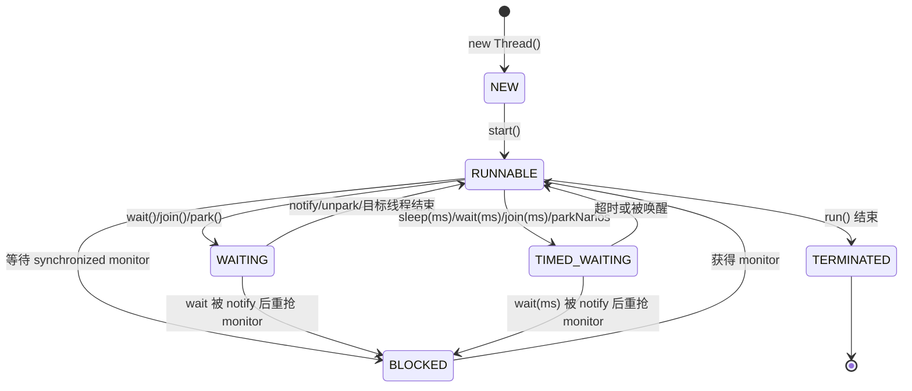
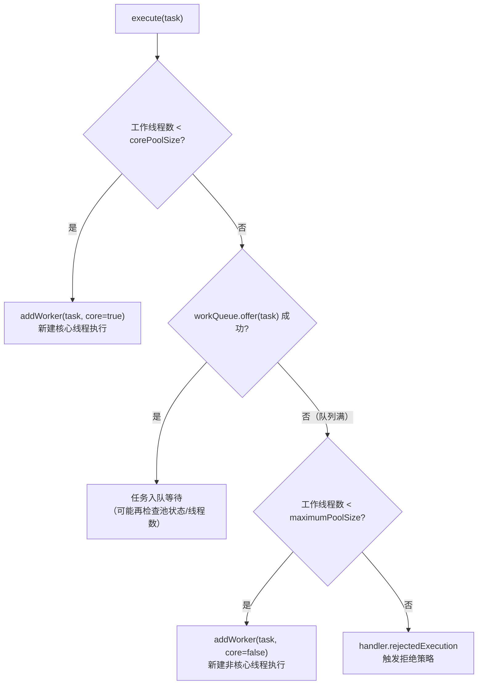

# Java 并发编程常见面试题总结

> 一句话概括：Java 并发面试考的从来不是"背 API"，而是"你能不能为 **JMM + j.u.c** 这套体系说清楚每个工具**靠什么机制保证安全、在哪里会失效、代价是什么、什么场景该换方案**"。

预计阅读时间：大约 85 分钟

本文按面试真实提问顺序组织：基础认知 → 线程基础 → JMM 与 volatile → synchronized → CAS 与原子类 → AQS 与 Lock → 线程池 → 并发容器 → 协调工具 → 异步编排 → ThreadLocal → 死锁与排查 → 虚拟线程 → 工程踩坑 → 版本演进 → 快问快答。每题都给出**一句话结论 + 展开要点 + 追问方向**，方便临场组织语言。

**版本基线**：以 JDK 8 / 17 / 21 三个 LTS 为基线（国内存量主力仍是 8 与 17，新项目推荐 21+）；热门特性均注明引入/转正的 JDK 版本；**JDK 25 为当前最新 LTS**（2025-09 发布，LTS 节奏已从 3 年改为 2 年：17 → 21 → 25）。凡涉及版本归属的结论（偏向锁废弃、虚拟线程转正、ScopedValue 等）均已对照 JEP 官方页面核实，见第 15、18 节。

---

## 0. 怎么用这篇文档

### 0.1 答题四段式

面试官问"线程池为什么先入队再扩线程"，答"源码就是这么写的"只能拿到 30 分。用四段式：

| 层次 | 内容 | 作用 |
| --- | --- | --- |
| ① 结论 | 一句话给出判断 | 让面试官知道你有整体认知 |
| ② 机制 | 关键实现原理，2~4 个点 | 证明不是背的 |
| ③ 边界 | 什么时候不成立 / 代价是什么 | **区分中级和高级的分水岭** |
| ④ 实践 | 你在项目里怎么用、踩过什么坑 | 把知识变成经验 |

例：

> `ThreadPoolExecutor#execute` 的顺序是"核心线程 → 入队 → 扩到 max → 拒绝"。**这么设计是为了省线程**：线程是昂贵资源（栈内存 + 调度开销），队列能缓冲突发流量，只有队列扛不住时才付出创建非核心线程的代价。**但边界在于"队列优先"会让 max 形同虚设**——用无界队列（`Executors.newFixedThreadPool` 的默认做法）时任务永远入队成功，maximumPoolSize 永远用不上，堆积到 OOM。所以线上统一用有界队列 + 明确拒绝策略，并把队列深度纳入监控。

### 0.2 面试官的四个考察层次

| 层次 | 典型问法 | 期望 |
| --- | --- | --- |
| 会不会用 | 怎么创建线程、线程池怎么配 | 知道常用 API 与参数含义 |
| 懂不懂原理 | AQS 怎么实现、volatile 为什么保证可见 | 能讲清 JMM、锁升级、CAS、队列机制 |
| 能不能扛事 | CPU 飙高怎么查、ThreadLocal 泄漏怎么排 | 有排查思路（jstack/Arthas/JFR）和工程预案 |
| 有没有判断力 | 这个场景该不该上虚拟线程 / 分布式锁 | 能说"不该用"的理由与替代方案 |

### 0.3 阅读路线

| 读者 | 建议章节 |
| --- | --- |
| 初级（1 年内） | 1、2、7.1~7.3、8.1、16 快问快答 |
| 中级（1~3 年） | 3、4、5、6 全部，7.4~7.6、9、10、11 |
| 高级（3 年+） | 6.1 AQS、7.7 动态线程池、12 排查、13 虚拟线程、14 工程踩坑 |
| 选型/架构 | 6.5 Lock 选型、8.4 队列选型、10.5、13.5 适用边界、15 版本演进，重点看每节"边界"段落 |

### 0.4 本主题文档与目录

本主题按「一份总结 + 若干专题」组织，深入细节见下表（新增专题后请同步补充，并在专题文档开头加回本文的链接）：

| 文档 | 内容 |
| --- | --- |
| [线程基础与生命周期](thread-basics-and-lifecycle.md) | 四种创建方式、六状态与转换、sleep/wait/yield/join、中断与安全停止、LockSupport、顺序执行手写 |
| [Java 内存模型与 volatile](jmm-and-volatile.md) | 三大特性、happens-before、重排与内存屏障、volatile 语义与 DCL、final 与安全发布 |
| [synchronized 与锁升级](synchronized-and-lock-escalation.md) | monitor/ObjectMonitor、Mark Word、锁升级与偏向锁版本归属、wait/notify、锁粗化/消除 |
| [CAS 与原子类](cas-and-atomic-classes.md) | CAS 与 CPU 实现、ABA、原子类家族、LongAdder/Striped64 分散、VarHandle |
| [AQS 与 Lock 家族](aqs-and-locks.md) | AQS state+CLH 队列源码、ReentrantLock 公平/非公平、Condition、ReadWriteLock、StampedLock 与选型 |
| [线程池原理与工程实践](thread-pool.md) | 七参数与 execute 流程、拒绝策略、Executors 坑、异常处理、调优与优雅关闭、动态线程池 |
| [并发容器与阻塞队列](concurrent-collections.md) | ConcurrentHashMap JDK7/8、CopyOnWriteArrayList、BlockingQueue 家族与生产者-消费者、ConcurrentLinkedQueue |
| [并发协调工具](concurrency-tools.md) | CountDownLatch、CyclicBarrier、Semaphore、Exchanger、Phaser 机制与选型 |
| [Fork/Join 与 CompletableFuture 异步编排](forkjoin-and-completable-future.md) | FutureTask 状态机、work-stealing、parallelStream 坑、CompletableFuture 组合与异常处理 |
| [ThreadLocal 与上下文传递](threadlocal.md) | ThreadLocalMap 与弱引用、内存泄漏链、线程池污染、InheritableThreadLocal/TTL/ScopedValue |
| [死锁与并发问题排查](deadlock-and-troubleshooting.md) | 四条件与破解、jstack/Arthas/JFR、CPU 飙高与锁竞争排查、伪共享 |
| [虚拟线程与结构化并发](virtual-threads.md) | Loom 原理与 pinning、JDK24 JEP491、结构化并发、迁移清单 |

本文目录：

1. 基础认知
2. 线程基础与生命周期
3. JMM 与 volatile
4. synchronized 与锁升级
5. CAS 与原子类
6. AQS 与 Lock 家族
7. 线程池原理与工程实践（必考重镇）
8. 并发容器与阻塞队列
9. 并发协调工具
10. Fork/Join 与 CompletableFuture 异步编排
11. ThreadLocal 与上下文传递
12. 死锁与并发问题排查
13. 虚拟线程与新特性（热门）
14. 工程踩坑与场景设计
15. 版本演进（加分项）
16. 快问快答 40 题
17. 面试答题模板与反问
18. 参考资料

---

## 1. 基础认知

### 1.1 并发 vs 并行

**结论**：并发（concurrency）是**同一时间段内多个任务交替推进**（单核也能并发，靠时间片切换）；并行（parallelism）是**同一时刻多个任务真的同时执行**（必须多核）。并发是"结构"问题（怎么组织任务），并行是"执行"问题（怎么同时跑）。

- 单核 CPU 上的多线程是并发不是并行；多核上既并发又并行。平台线程 1:1 映射 OS 内核线程，多核即可并行。
- 虚拟线程（JDK 21）是 M:N 调度，海量虚拟线程复用少量载体平台线程，**并发规模上去了，并行度仍受核数限制**（见 13）。

### 1.2 三大特性与保障手段（必考地基）

**结论**：并发安全的三个根问题是**原子性、可见性、有序性**，JMM 与 j.u.c 的所有工具都是在不同代价下保障这三者。

| 特性 | 含义 | 破坏来源 | 保障手段 |
| --- | --- | --- | --- |
| 原子性 | 操作不可分割，要么全做要么不做 | 线程切换（`i++` 是读-改-写三步） | `synchronized`、`Lock`、CAS 原子类 |
| 可见性 | 一个线程的修改对其他线程立即可见 | CPU 缓存、工作内存副本 | `volatile`、`synchronized`、`final`、`Lock` |
| 有序性 | 程序按代码顺序执行 | 编译器/CPU 指令重排 | `volatile`（禁重排）、`synchronized`（串行语义）、happens-before |

**追问：`i++` 为什么不是原子的？**
字节码是 `getfield → iconst_1 → iadd → putfield` 四步，交错执行会丢失更新。`volatile int i` 也救不了——只保证可见与有序，**不保证复合操作原子性**，要用 `AtomicInteger#incrementAndGet`（CAS）或加锁。

### 1.3 线程安全的五种分类

**结论**：《Java Concurrency in Practice》把线程安全按"安全程度"分五类，面试能说出分类比只说"加锁就安全"更显体系。

| 分类 | 含义 | 例子 |
| --- | --- | --- |
| 不可变 | 对象创建后状态不变，天然线程安全 | `String`、`Integer`、`final` 正确发布的对象 |
| 绝对线程安全 | 任何调用方式、任何交错都不需外部同步 | 极少（如正确发布的不可变对象）；`Vector` 常被误认为绝对安全，实为相对线程安全 |
| 相对线程安全 | 单个操作原子，复合操作需外部同步 | `ConcurrentHashMap`、`CopyOnWriteArrayList` |
| 线程兼容 | 本身不安全，正确同步后可安全使用 | `ArrayList`、`HashMap` |
| 线程对立 | 无论怎么同步都不能并发使用 | `Thread.stop()`（已废弃）、`System.setOut()` 部分场景 |

**追问：`ConcurrentHashMap` 是绝对线程安全吗？**
不是，是相对线程安全。`put`/`get` 各自原子，但"先 `containsKey` 再 `put`"这种复合操作仍可能竞态，要用 `putIfAbsent`/`computeIfAbsent` 这类原子复合方法。

### 1.4 JMM 是什么（一句话）

**结论**：Java 内存模型（JMM）是一套**抽象规范**，定义线程与主内存间的可见性、有序性规则（核心是 happens-before），屏蔽硬件与 OS 的内存访问差异，让 Java 各平台并发语义一致。它不是物理结构，"工作内存/主内存"是抽象比喻。深入见 [Java 内存模型与 volatile](jmm-and-volatile.md)。

---

## 2. 线程基础与生命周期

### 2.1 四种创建方式对比

**结论**：本质只有一种——`new Thread(...).start()`，所谓"四种方式"是**任务（run 的内容）的四种组织形式**。

| 方式 | 写法 | 特点 |
| --- | --- | --- |
| 继承 Thread | 重写 `run()` | 单继承限制，任务与线程耦合，不推荐 |
| 实现 Runnable | `new Thread(runnable)` | 无返回值、不能抛受检异常，解耦，最常用 |
| Callable + FutureTask | `new Thread(new FutureTask<>(callable))` | 有返回值、可抛异常，`Future#get` 阻塞取结果 |
| 线程池 | `ExecutorService#submit` | 复用线程、统一管控，**生产唯一推荐** |

**追问：为什么 `start()` 而不是直接调 `run()`？**
`start()` 向 JVM 申请新线程并在新线程里调 `run()`；直接调 `run()` 只是当前线程的普通方法调用，没有并发。`start()` 只能调一次，重复调抛 `IllegalThreadStateException`。深入见 [线程基础与生命周期](thread-basics-and-lifecycle.md)。

### 2.2 六种状态与转换（BLOCKED vs WAITING 易错）

**结论**：`Thread.State` 定义六态：NEW、RUNNABLE、BLOCKED、WAITING、TIMED_WAITING、TERMINATED。**Java 的 RUNNABLE 合并了 OS 的"就绪 + 运行"**，没有单独的 running 态。



**最易错的区分**：

| 状态 | 触发 | 关键区别 |
| --- | --- | --- |
| BLOCKED | 等待进入 `synchronized`（抢 monitor 失败） | **只与 synchronized 有关**，等的是 monitor 锁 |
| WAITING | `Object.wait()`、`Thread.join()`、`LockSupport.park()` | 无限期等，需被显式唤醒；**ReentrantLock 排队等待是 WAITING（park）不是 BLOCKED** |
| TIMED_WAITING | `sleep(ms)`、`wait(ms)`、`join(ms)`、`parkNanos` | 带超时，到点自动回 RUNNABLE |

**追问：`sleep` 会让线程进入 BLOCKED 吗？**
不会，是 TIMED_WAITING，且**不释放任何锁**。BLOCKED 专指抢 synchronized monitor 失败；`Lock` 排队等待是 WAITING（park），IO 等待在 Java 态里甚至仍显示 RUNNABLE（JVM 不感知 OS 层 IO 阻塞）。

### 2.3 sleep vs wait（必考）

**结论**：`sleep` 是 `Thread` 的静态方法，**让出 CPU 但不释放锁**，到点自动醒；`wait` 是 `Object` 的方法，**释放当前对象的 monitor 锁**进入 WaitSet，需 `notify/notifyAll` 唤醒，且必须在同步块内调用。

| 维度 | sleep | wait |
| --- | --- | --- |
| 所属 | `Thread`（静态） | `Object`（实例） |
| 释放锁 | **不释放** | **释放 monitor** |
| 唤醒 | 超时自动 / interrupt | notify/notifyAll / interrupt / 超时 |
| 调用前提 | 任意位置 | 必须持有该对象 monitor（同步块内） |
| 用途 | 暂停执行 | 线程间协作（等待条件） |
| 异常 | 抛 InterruptedException | 抛 InterruptedException |

**追问：为什么 wait 必须在 synchronized 里？**
wait 语义是"原子地释放锁 + 进入等待"，必须先持锁才能释放，否则抛 `IllegalMonitorStateException`；更深层是防"检查条件 → wait"间的竞态（丢失唤醒），标准写法 `while (条件不满足) { lock.wait(); }`——用 while 而非 if 还防虚假唤醒（spurious wakeup）。深入见 [synchronized 与锁升级](synchronized-and-lock-escalation.md)。

### 2.4 interrupt 三件套与安全停止

**结论**：Java 用**协作式中断**——`interrupt()` 只是设置中断标志，不会强行杀线程；线程自己检查标志并决定如何退出。`stop/suspend/resume` 早已废弃（`Thread.stop` 在 JDK 18 被终端废弃），因为会突然释放所有锁导致状态不一致。

| 方法 | 作用 |
| --- | --- |
| `interrupt()` | 设置目标线程中断标志为 true；若线程阻塞在 sleep/wait/join，抛 InterruptedException 并**清除标志** |
| `isInterrupted()` | 实例方法，查询标志，**不清除** |
| `Thread.interrupted()` | 静态方法，查询**当前线程**标志并**清除**（复位） |

**安全停止**：循环里检查 `isInterrupted()` 为 true 就退出；或捕获 InterruptedException 后**恢复中断标志**（`Thread.currentThread().interrupt()`）再退出，别吞异常。

**追问：为什么捕获 InterruptedException 后要重新 interrupt？**
因为抛出该异常时 JVM 已把标志清掉了，如果你 catch 后不恢复，上层调用者就感知不到中断请求，中断链断裂。这是代码评审高频检查项。深入见 [线程基础与生命周期](thread-basics-and-lifecycle.md)。

### 2.5 LockSupport 与守护线程

**结论**：`LockSupport.park()/unpark()` 是 AQS 底层用的线程阻塞原语，比 wait/notify 更灵活——**不需要持有 monitor，unpark 可以先于 park 调用**（基于"许可 permit"，最多一个，先 unpark 发许可，后 park 直接消费许可不阻塞）。

- `park` 不抛 InterruptedException 但响应中断（返回后自查标志）；`parkNanos/parkUntil` 带超时。与 wait 区别：wait 释放锁、需同步块、notify 随机唤醒；park 不释放锁、无锁前提、unpark 精确指定线程。
- **守护线程（daemon）**：`setDaemon(true)` 须在 start 前；JVM 只剩守护线程时退出，**其 finally 不保证执行**，别用它做资源清理（GC 线程是典型守护线程）。

**追问：交替打印 odd/even 用哪个最简洁？**
`LockSupport` 互相 unpark 最干净（无需锁、精确唤醒）；也可用 wait/notify、ReentrantLock+Condition、Semaphore。场景对照见 14.1。

---

## 3. JMM 与 volatile

### 3.1 指令重排与 as-if-serial

**结论**：编译器和 CPU 会在**不改变单线程语义**的前提下重排指令以提升性能，这叫 as-if-serial；但多线程下重排可能暴露中间状态，导致并发 bug。

- 重排来源：编译器优化、CPU 指令级并行、内存系统（缓存/写缓冲让"看起来"重排）。有数据依赖的指令不会重排（`a=1; b=a;`），无依赖的才可能（`a=1; b=2;`）。
- `volatile` 通过插入内存屏障禁止特定重排；`synchronized` 靠"同一时刻只有一个线程执行"保证串行语义。

### 3.2 happens-before 规则（必考，要能列全）

**结论**：happens-before 是 JMM 的核心——若 A happens-before B，则 A 的结果对 B 可见且 A 排在 B 前（**是可见性+有序性规则，不是时间先后**）。

| 规则 | 内容 |
| --- | --- |
| 程序顺序 | 同一线程内，前面的操作 hb 后面的操作 |
| 监视器锁 | 对同一锁，`unlock` hb 后续 `lock` |
| volatile | 对同一 volatile 变量，写 hb 后续读 |
| 线程启动 | `Thread.start()` hb 该线程内任何操作 |
| 线程终止 | 线程内所有操作 hb 其他线程检测到它终止（`join` 返回 / `isAlive` false） |
| 中断 | `interrupt()` hb 被中断线程检测到中断 |
| 对象终结 | 构造器结束 hb `finalize()` 开始 |
| 传递性 | A hb B，B hb C ⇒ A hb C |

**追问：happens-before 和"时间上先发生"是一回事吗？**
不是。两个无同步的操作即使时间上有先后，也不构成 hb，结果未必可见；反之 hb 也不要求物理时间顺序（编译器可在不违反语义下重排）。**hb 是"可见性契约"，不是时钟**。深入见 [Java 内存模型与 volatile](jmm-and-volatile.md)。

### 3.3 volatile 语义（可见 + 有序，不保证原子）

**结论**：volatile 保证**可见性**（写立即刷主内存、读强制从主内存取）和**有序性**（禁重排），**不保证原子性**。

- 底层靠内存屏障：volatile 写前插 StoreStore、写后插 StoreLoad；读后插 LoadLoad + LoadStore。x86 上写 volatile 会生成 `lock` 前缀指令，触发缓存一致性（MESI）并充当全屏障。
- 适用：状态标志位（`volatile boolean running`）、DCL 单例、一次性安全发布。
- 不适用：`count++` 这类复合操作（用原子类或锁）。

### 3.4 DCL 为什么需要 volatile（必考）

**结论**：双重检查锁（DCL）单例的 `instance` 必须加 volatile，否则可能拿到**半初始化对象**。

```java
public class Singleton {
    private static volatile Singleton instance;   // volatile 不可省
    public static Singleton getInstance() {
        if (instance == null) {                    // 第一次检查（无锁，快路径）
            synchronized (Singleton.class) {
                if (instance == null) {            // 第二次检查（持锁）
                    instance = new Singleton();
                }
            }
        }
        return instance;
    }
}
```

`new Singleton()` 字节码三步：① 分配内存 ② 初始化对象 ③ 把引用赋给 instance。②③ 无数据依赖可被重排为 ①③②。若线程 A 执行到 ①③（instance 已非 null 但对象没初始化），线程 B 第一次检查发现非 null 直接返回，就用到了半成品。**volatile 禁止 ②③ 重排**，保证"看到引用非 null 时对象一定初始化完成"。

**追问：有没有不用 volatile 的线程安全懒加载？**
有：静态内部类 holder（类初始化锁 `<clinit>` 保证线程安全且懒加载）、枚举单例（《Effective Java》推荐，防反射防序列化）。DCL 的价值是"既懒加载又支持传参构造"，holder 不支持传参。

### 3.5 final 与安全发布

**结论**：JSR-133（JDK 5）增强了 final 语义——**正确构造（构造器中 this 不逸出）的对象，其 final 字段对其他线程可见无需同步**。这是不可变对象线程安全的理论基础。

- 安全发布手段：静态初始化器、volatile 字段、AtomicReference、final 字段、锁保护的字段。
- "this 逸出"指构造未完成就把 this 传出去（注册监听器、启动线程、放入共享容器），会破坏 final 保证。

### 3.6 volatile vs synchronized（必考）

| 维度 | volatile | synchronized |
| --- | --- | --- |
| 原子性 | 不保证（单次读/写原子，复合不保证） | 保证（块内串行） |
| 可见性 | 保证 | 保证 |
| 有序性 | 禁重排 | 串行语义 |
| 阻塞 | 不阻塞 | 可能阻塞 |
| 作用对象 | 变量 | 代码块/方法 |
| 适用 | 状态标志、DCL、一写多读 | 复合操作、临界区 |

**一句话**：volatile 是轻量"可见+有序"，synchronized 是重量"原子+可见+有序"；能用 volatile 别上锁，需原子复合操作时 volatile 无能为力。

---

## 4. synchronized 与锁升级

### 4.1 三种用法与锁对象

**结论**：synchronized 锁的是**对象**（monitor），三种用法对应三种锁对象。

| 用法 | 锁对象 |
| --- | --- |
| 实例方法 | 当前实例 `this` |
| 静态方法 | 当前类的 `Class` 对象 |
| 同步代码块 | 括号里指定的对象 |

**追问：两个线程分别调同一对象的两个不同 synchronized 实例方法会互斥吗？**
会，锁的是同一个 this。但一个调实例方法、一个调静态方法不互斥（锁对象不同：this vs Class）。字符串常量、Integer 缓存对象做锁是坑（可能被别处共享），推荐 `private final Object lock = new Object()`。

### 4.2 monitor 机制（一句话）

**结论**：synchronized 基于对象头 Mark Word + monitor（管程）。字节码层面同步块是 `monitorenter/monitorexit`，同步方法是 `ACC_SYNCHRONIZED` 标志；重量级锁对应 C++ 的 `ObjectMonitor`，含 `_owner`（持有者）、`_EntryList`/`_cxq`（阻塞队列）、`_WaitSet`（wait 队列）、`_recursions`（重入计数）。深入见 [synchronized 与锁升级](synchronized-and-lock-escalation.md)。

### 4.3 锁升级（必考，注意版本归属）

**结论**：为降低无竞争/低竞争下的锁开销，HotSpot 设计了锁升级：**无锁 → 偏向锁 → 轻量级锁 → 重量级锁**，运行期只能升不能降（STW 仅 deflation 回收空闲 monitor，批量重偏向/撤销是类级偏向资格管理，均非降级）。

| 锁状态 | Mark Word 存什么 | 适用场景 | 加锁方式 |
| --- | --- | --- | --- |
| 无锁 | 对象 hashCode | 无竞争 | — |
| 偏向锁 | 线程 ID | 始终只有一个线程进入 | 第一次 CAS 记录线程 ID，之后比对 ID 即可，几乎零开销 |
| 轻量级锁 | 指向栈中 Lock Record 的指针 | 多线程交替进入（竞争不激烈） | CAS 替换 Mark Word，失败自旋 |
| 重量级锁 | 指向 ObjectMonitor 的指针 | 竞争激烈、自旋失败 | 阻塞挂起，OS 互斥量 |

**版本归属（务必答准）**：偏向锁在 **JDK 15 被 JEP 374 默认禁用并废弃**（`-XX:+UseBiasedLocking` 可重开但告警），**JDK 18 彻底移除**（JDK-8256425，相关选项 obsoleted、代码删除）。原因：现代应用大量用 j.u.c 与 lambda，偏向锁收益下降，而其撤销（revocation）需要 STW 安全点、维护成本极高。**所以 JDK 17 及以后默认已无偏向锁，"锁升级"实际是 无锁 → 轻量级 → 重量级**。

**追问：为什么偏向锁撤销代价大？**
撤销要等到全局安全点（STW），遍历持有偏向的线程栈、检查锁是否在用，可能批量重偏向或批量撤销。高并发下频繁撤销反而比直接用轻量级锁更慢——这是它被废弃的核心动机。

### 4.4 wait/notify 为什么在同步块内、可重入

- **wait/notify 必须持锁**：见 2.3，wait 原子释放锁进 WaitSet，notify 把线程从 WaitSet 移到 EntryList/cxq，被唤醒后需重新抢锁才能继续。notify 不立即释放锁，等退出同步块才释放。
- **可重入**：同一线程可重复进入同一把锁，`_recursions` 计数递增，退出递减到 0 才真正释放。避免"自己等自己"死锁。synchronized 与 ReentrantLock 都可重入。
- **锁粗化/锁消除**：JIT 优化——连续对同一对象加锁解锁合并成一次（粗化）；逃逸分析判定锁对象不逃逸则去掉锁（消除）。"循环里加锁一定慢"不绝对。

### 4.5 synchronized vs ReentrantLock（必考）

| 维度 | synchronized | ReentrantLock |
| --- | --- | --- |
| 层级 | JVM 关键字（字节码/monitor） | JDK API（AQS） |
| 释放 | 自动（退出块/异常） | **手动 `unlock()`，必须 finally** |
| 公平 | 仅非公平 | 可选公平/非公平 |
| 中断响应 | 不可中断等待 | `lockInterruptibly()` 可中断 |
| 尝试加锁 | 无 | `tryLock()` / `tryLock(timeout)` |
| 条件队列 | 单一 WaitSet（wait/notify） | 多个 `Condition`（精确唤醒） |
| 性能 | JDK 6 优化后与 Lock 相当 | 相当，高竞争下 Lock 略灵活 |

**结论**：优先 synchronized（简洁、不会忘释放、JVM 持续优化）；需要"可中断 / 超时尝试 / 公平 / 多条件"时才用 ReentrantLock。深入见 [AQS 与 Lock 家族](aqs-and-locks.md)。

---

## 5. CAS 与原子类

### 5.1 CAS 原理与 CPU 实现

**结论**：CAS（Compare-And-Swap）是**无锁原子操作**：比较内存值 V 与预期值 A，相等才更新为 B，否则不更新（返回失败/重试）。它把"读-改-写"压缩成一条 CPU 原子指令。

- Java 层 JDK 8 用 `sun.misc.Unsafe#compareAndSwapInt`，JDK 9+ 推荐 `VarHandle`（JEP 193）；CPU 层是 x86 `lock cmpxchg` 指令，`lock` 前缀锁缓存行保证原子 + 触发缓存一致性。
- 三大问题：**ABA**、**自旋开销**（高竞争空转烧 CPU）、**只能保证单变量原子**（多变量用锁或 AtomicReference 封装）。

### 5.2 ABA 与 AtomicStampedReference（必考）

**结论**：值从 A 变 B 再变回 A，CAS 检查"值没变"就成功，但中间状态可能已破坏业务逻辑（如链表头被换过、余额被扣又补）。解法是**加版本号**。

| 工具 | 机制 |
| --- | --- |
| `AtomicStampedReference` | 值 + int 版本号（stamp），CAS 同时比对两者 |
| `AtomicMarkableReference` | 值 + boolean 标记，只关心"是否被改过" |

**追问：什么场景 ABA 真的有害？**
无锁栈/队列的节点复用：线程 1 看到头是 A 准备 pop，线程 2 pop A、pop B、又 push A，线程 1 CAS 成功但 next 已指向被释放的 B。单纯计数器 ABA 通常无害（值对了就行），所以 AtomicInteger 不防 ABA 是合理取舍。深入见 [CAS 与原子类](cas-and-atomic-classes.md)。

### 5.3 原子类家族速查

| 分类 | 类 | 说明 |
| --- | --- | --- |
| 基本类型 | AtomicInteger / AtomicLong / AtomicBoolean | CAS 单变量 |
| 引用类型 | AtomicReference / AtomicStampedReference / AtomicMarkableReference | 引用 CAS / 防 ABA |
| 数组 | AtomicIntegerArray / AtomicLongArray / AtomicReferenceArray | 数组元素原子更新 |
| 字段更新器 | AtomicIntegerFieldUpdater / AtomicLongFieldUpdater / AtomicReferenceFieldUpdater | 反射式更新已有 volatile 字段，省对象头 |
| 累加器（JDK 8） | LongAdder / DoubleAdder / LongAccumulator / DoubleAccumulator | 分散热点，高并发计数 |

### 5.4 LongAdder vs AtomicLong（必考）

**结论**：高并发计数选 `LongAdder`，低竞争或需要精确 CAS 语义选 `AtomicLong`。LongAdder 用**空间换时间 + 分散热点**。

- 机制（Striped64）：内部 `base` + `Cell[]`。无竞争时 CAS base；一旦竞争失败，把线程 hash 到某个 Cell 各自累加，**把单点热点分散到多个缓存行**。`sum() = base + ΣCell`。
- `Cell` 用 `@Contended` 注解填充缓存行，避免伪共享（见 12.4）。
- **弱一致 sum**：sum 遍历期间若有并发写入，结果不是某一时刻的精确快照；需要"精确瞬时值 + compareAndSet"时仍用 AtomicLong。
- 代价：内存占用更大（Cell 数组），低竞争时反而比 AtomicLong 略慢。

**追问：LongAdder 能做库存扣减吗？**
不能。扣减需"读-判断-扣"的原子 CAS，LongAdder 只有 add/increment/sum、无 CAS 语义，只适合统计计数（QPS、请求数）。

### 5.5 CAS 适用边界与 VarHandle

- 适用：单变量、低~中竞争、无锁数据结构（ConcurrentLinkedQueue、CHM 初始化桶）。
- 不适用：高竞争（自旋烧 CPU，改用锁或 LongAdder 分散）、多变量一致性（用锁）。
- **VarHandle（JDK 9，JEP 193）**：类型安全的变量句柄，替代 Unsafe，提供 plain / opaque / acquire-release / volatile 四档内存序，比 volatile 更细粒度。是 JDK 9+ 写无锁代码的推荐入口。

---

## 6. AQS 与 Lock 家族

### 6.1 AQS 核心（必考）

**结论**：`AbstractQueuedSynchronizer`（AQS）是 j.u.c 锁与同步器的**骨架**，核心 = **一个 volatile int state + 一个 CLH 变体的 FIFO 双向队列 + 模板方法**。ReentrantLock、Semaphore、CountDownLatch、ReadWriteLock、ThreadPoolExecutor.Worker 都基于它。

- **state**：同步状态的抽象。ReentrantLock 里是重入次数，Semaphore 里是剩余许可，CountDownLatch 里是计数，ReadWriteLock 里高 16 位读、低 16 位写。
- **队列**：抢锁失败的线程被包装成 Node 入队，`LockSupport.park` 挂起；前驱释放后唤醒后继。是 CLH 队列的变体（显式 prev/next 双向链表，便于取消与共享传播）。
- **模板方法**：子类实现 `tryAcquire/tryRelease`（独占）、`tryAcquireShared/tryReleaseShared`（共享）、`isHeldExclusively`；AQS 负责排队、阻塞、唤醒。
- 独占（ReentrantLock）vs 共享（Semaphore/CountDownLatch/读锁）：共享模式释放时会**向后传播唤醒**多个共享节点。

**追问：AQS 为什么用 CLH 变体？**
原始 CLH 自旋在"前驱节点的 locked 字段"上，AQS 改为 park 阻塞 + 显式 prev/next 指针，便于取消节点、共享传播和条件队列。深入见 [AQS 与 Lock 家族](aqs-and-locks.md)。

### 6.2 ReentrantLock 公平 vs 非公平（为什么默认非公平）

**结论**：默认**非公平**——`lock()` 先直接 CAS 抢 state（插队/barging），失败才入队；公平锁 `tryAcquire` 会先 `hasQueuedPredecessors()` 检查队列有没有等待者，有就老实排队。

| 维度 | 非公平（默认） | 公平 |
| --- | --- | --- |
| 获取顺序 | 允许插队 | 严格 FIFO |
| 吞吐 | **高**（省去唤醒-切换延迟） | 低 |
| 饥饿 | 可能（某线程长期抢不到） | 不会 |
| 构造 | `new ReentrantLock()` | `new ReentrantLock(true)` |

**为什么默认非公平**：唤醒 parked 线程到真正拿锁有微秒级延迟，非公平允许"刚好在运行的线程"直接拿锁，**减少切换、提高吞吐**；公平用吞吐换，多数业务不需要。

### 6.3 Condition 与多条件队列

**结论**：`Condition` 是 Lock 版的 wait/notify，`await/signal/signalAll`，**一个 Lock 可建多个 Condition**，实现"精确唤醒某一类等待线程"。

- 每个 Condition 维护独立条件队列（单向），signal 把节点从条件队列移到 AQS 同步队列；同样必须持锁调用，await 释放锁，用 while 防虚假唤醒。
- 经典：有界队列用 `notFull`（生产者等）和 `notEmpty`（消费者等）两个 Condition，避免 wait/notify"唤醒错对象"。

### 6.4 ReadWriteLock 与 StampedLock

**ReadWriteLock（ReentrantReadWriteLock）**：读读共享、读写/写写互斥，适合读多写少。

- state **高 16 位 = 读锁持有数，低 16 位 = 写锁重入数**。
- **锁降级**：持有写锁时先获取读锁再释放写锁（写→读），保证可见性平滑过渡；**锁升级（读→写）不允许**，会死锁（多个读者都想升级互相等）。
- 非公平下读或写都可能被无限推迟（javadoc 原文）；JDK 8 用「队首是等待写者时新读者让路」的启发式概率性缓解写饥饿，详见 [AQS 与 Lock 家族](aqs-and-locks.md) 6.4。

**StampedLock（JDK 8）**：三种模式——写锁、悲观读锁、**乐观读**（`tryOptimisticRead` 返回 stamp，读完后 `validate(stamp)` 校验期间无写）。

- 乐观读不阻塞写，读多写少性能优于 ReadWriteLock。**坑：不可重入**（重入读死锁）、不支持 Condition、阻塞读不可中断（可能 CPU 飙高，需用可中断变体）。

### 6.5 Lock 选型

| 场景 | 首选 |
| --- | --- |
| 简单互斥、无特殊需求 | synchronized |
| 需可中断/超时/公平/多条件 | ReentrantLock |
| 读多写少、可接受写饥饿 | ReentrantReadWriteLock |
| 读极多写极少、追求极致读性能 | StampedLock 乐观读 |
| 高并发计数 | LongAdder（不是锁） |

---

## 7. 线程池原理与工程实践（必考重镇）

### 7.1 七大参数

**结论**：`ThreadPoolExecutor` 构造器七参数，理解每个参数才能讲清 execute 流程与调优。

| 参数 | 含义 |
| --- | --- |
| corePoolSize | 核心线程数（常驻，默认不回收） |
| maximumPoolSize | 最大线程数（核心 + 非核心） |
| keepAliveTime | 非核心线程空闲存活时间 |
| unit | 存活时间单位 |
| workQueue | 任务阻塞队列 |
| threadFactory | 线程工厂（**务必命名**，便于排障） |
| handler | 拒绝策略 |

`allowCoreThreadTimeOut(true)` 可让核心线程也超时回收。

### 7.2 execute 三步流程（先入队再扩 max，必考）

**结论**：提交任务时——**① 运行线程 < core → 建核心线程；② 否则尝试入队；③ 队列满 → 建非核心线程直到 max；④ 都满 → 拒绝**。注意是"先入队再扩线程"，不是"先扩满再入队"。



**追问：为什么先入队再扩线程？**
省线程资源——队列能缓冲突发，就不必为每个任务开线程；只有队列扛不住才付出创建非核心线程的代价。**副作用**：无界队列下第 ③ 步永远走不到，max 形同虚设（见 7.4）。源码锚点 `ThreadPoolExecutor#execute`、`#addWorker`。深入见 [线程池原理与工程实践](thread-pool.md)。

### 7.3 四种拒绝策略

| 策略 | 行为 | 适用 |
| --- | --- | --- |
| AbortPolicy（默认） | 抛 RejectedExecutionException | 需要感知失败、快速失败 |
| CallerRunsPolicy | 由提交任务的线程自己执行 | 反压（拖慢生产者），不丢任务 |
| DiscardPolicy | 静默丢弃新任务 | 可丢弃的统计/日志 |
| DiscardOldestPolicy | 丢队首最老任务，再尝试提交 | 喜新厌旧（实时行情） |

生产常自定义 handler：记录日志 + 落库/发 MQ 兜底 + 告警，而不是简单丢弃。

### 7.4 Executors 为什么被禁（OOM，必考）

**结论**：《阿里巴巴 Java 开发手册》强制"线程池不允许用 Executors 创建"，因为默认参数会埋 OOM 雷。

| 工厂方法 | 隐患 | OOM 类型 |
| --- | --- | --- |
| newFixedThreadPool / newSingleThreadExecutor | 队列是 `LinkedBlockingQueue`，容量 Integer.MAX_VALUE（无界） | 任务堆积 → 堆 OOM |
| newCachedThreadPool / newScheduledThreadPool | maximumPoolSize = Integer.MAX_VALUE | 狂建线程 → 栈/原生 OOM |

正确姿势：`new ThreadPoolExecutor(...)` 显式七参数，**有界队列 + 明确拒绝策略 + 命名线程工厂**。

### 7.5 submit 吞异常与异常处理

**结论**：`execute` 提交的任务抛异常会向外抛（线程死亡，可被 UncaughtExceptionHandler 捕获）；`submit` 提交的任务异常被**封装进 Future**，不调 `get()` 就永远看不到——这是"任务静默失败"的头号原因。

- 拿异常：`future.get()`（抛 ExecutionException）；或重写 `afterExecute(Runnable, Throwable)` 钩子统一处理。
- 注意：submit 包装成 FutureTask 后，afterExecute 的 Throwable 参数为 null，需从 Future 里取。
- 实践：任务内部 try-catch 兜底 + 日志，别依赖线程池帮你暴露异常。

### 7.6 参数调优与优雅关闭

**调优公式只是起点**：

| 任务类型 | 经验起点 | 说明 |
| --- | --- | --- |
| CPU 密集 | N+1（N=核数） | 多一个防偶发缺页中断 |
| IO 密集 | N × (1 + 等待时间/计算时间) | 等待占比越高线程越多 |

**但公式不是答案**：真实值靠压测 + 监控（队列深度、活跃线程、拒绝次数、任务耗时）迭代；下游容量（DB 连接池、RPC 线程）往往是真瓶颈，线程开再多也没用。

**优雅关闭**：

| 方法 | 行为 |
| --- | --- |
| `shutdown()` | 拒新任务，已入队的执行完 |
| `shutdownNow()` | 拒新任务 + 中断正在执行 + 返回未执行列表 |
| `awaitTermination(timeout)` | 阻塞等待终止，配合 shutdown 用 |

标准顺序：`shutdown()` → `awaitTermination` → 超时则 `shutdownNow()` → 再 await。Spring `ThreadPoolTaskExecutor` 可设 `setWaitForTasksToCompleteOnShutdown(true)` + `setAwaitTerminationSeconds`。

### 7.7 线程池监控与动态线程池（热门）

**结论**：线程池参数不该写死——**动态线程池**通过配置中心（Nacos/Apollo）运行时调 core/max/队列容量，配合监控告警，避免"改参数要重启"。

- 监控：`getPoolSize/getActiveCount/getQueue().size()/getCompletedTaskCount/getLargestPoolSize` + 拒绝次数 + 排队/执行耗时。
- 调参：`setCorePoolSize/setMaximumPoolSize` 原生支持；队列容量原生不可变，需自定义 `ResizableCapacityLinkedBlockingQueue`（capacity 改 volatile）。开源方案 DynamicTp、Hippo4j，美团有经典实践。
- 边界：调大 max 要评估下游承载力，否则只是把堆积从队列转移到下游。

---

## 8. 并发容器与阻塞队列

### 8.1 HashMap 的并发问题

**结论**：HashMap 非线程安全，并发下 **JDK 7 可能成环导致死循环，JDK 8 改为尾插避免成环但仍丢数据/覆盖**。

- JDK 7：扩容 `transfer` 用头插法，并发 resize 可能让链表成环，后续 `get` 遍历死循环（CPU 100%）。
- JDK 8：改尾插法，不再成环，但并发 put 仍会丢失更新、size 不准、可能覆盖。
- 并发场景一律用 ConcurrentHashMap，别用 `Collections.synchronizedMap`（全表锁，性能差）。

### 8.2 ConcurrentHashMap JDK 7 vs JDK 8（必考）

| 维度 | JDK 7 | JDK 8 |
| --- | --- | --- |
| 结构 | Segment[] + HashEntry[] + 链表 | Node[] + 链表 + 红黑树 |
| 锁粒度 | **分段锁 Segment（继承 ReentrantLock）**，默认 16 段 | **CAS + synchronized 锁单个桶头节点** |
| 并发度 | 默认 16（段数） | 桶数量（更细） |
| 空桶插入 | 锁段 | CAS 无锁插入 |
| 非空桶插入 | 锁段 | synchronized 锁头节点 |
| 扩容 | 段内扩容 | 多线程协助扩容（ForwardingNode + helpTransfer） |
| 树化 | 无 | 链表长 ≥ 8 且表长 ≥ 64 转红黑树 |
| size | 先无锁统计两次比 modCount，不一致再锁全段 | baseCount + CounterCell[]（类似 LongAdder） |

**追问：JDK 8 为什么放弃分段锁？**
锁粒度更细（锁桶头而非锁段）、内存更省（去掉 Segment 对象）、CAS 处理空桶无锁、synchronized 经锁升级优化后低竞争开销小、红黑树解决哈希冲突退化。源码锚点 `ConcurrentHashMap#putVal`、`#addCount`、`#transfer`。深入见 [并发容器与阻塞队列](concurrent-collections.md)。

### 8.3 为什么 key/value 不能 null、size 弱一致（必考）

**null 键值**：并发下 `get(k)` 返回 null 有**二义性**——是"键不存在"还是"值就是 null"？单线程 HashMap 可用 `containsKey` 再查一次消歧，但并发下 containsKey 与 get 之间可能被修改，无法原子消歧。Doug Lea 为避免这种歧义直接禁止 null（HashMap 允许是因为单线程可消歧）。

**size 弱一致**：JDK 8 用 `baseCount + CounterCell[]` 分散计数（Striped64 思路），`sumCount()` 求和期间可能有并发增删，**结果是弱一致近似值**而非精确快照；需要精确 size 的场景本就不该用并发容器。

### 8.4 CopyOnWriteArrayList 与 BlockingQueue 选型

**CopyOnWriteArrayList**：写时复制——写操作加 ReentrantLock 复制底层数组再改，volatile 数组引用切换；读无锁。

- 优点：读极快、迭代器是快照（不抛 ConcurrentModificationException）；代价：写开销大（每次复制全量）、内存翻倍、**弱一致读**、迭代器不支持 remove。适用读多写极少（监听器列表、白名单、配置）。

**BlockingQueue 家族选型**：

| 队列 | 结构/容量 | 特点 |
| --- | --- | --- |
| ArrayBlockingQueue | 数组、有界 | 一把锁（put/take 共用），可选公平 |
| LinkedBlockingQueue | 链表、默认无界 | 两把锁（putLock/takeLock），吞吐更高 |
| SynchronousQueue | 无容量 | 直接交接，每个 put 等一个 take（CachedThreadPool 用它） |
| PriorityBlockingQueue | 堆、无界 | 按优先级出队 |
| DelayQueue | 优先堆 | 元素到期才能取（延迟任务） |
| LinkedTransferQueue | 链表 | transfer 可等消费者接收 |

**生产者-消费者首选 BlockingQueue**：`put`（满则阻塞）/`take`（空则阻塞）天然解耦 + 反压，比手写 wait/notify 简洁安全。深入见 [并发容器与阻塞队列](concurrent-collections.md)。

---

## 9. 并发协调工具

### 9.1 CountDownLatch vs CyclicBarrier（必考）

**结论**：都是"等多个线程到齐"，但 **CountDownLatch 一次性、计数递减、等别人完成；CyclicBarrier 可复用、计数递增到齐、互相等待一起出发**。

| 维度 | CountDownLatch | CyclicBarrier |
| --- | --- | --- |
| 复用 | 一次性（计数到 0 不能重置） | 可循环复用（自动重置） |
| 底层 | AQS 共享模式，state=计数 | ReentrantLock + Condition |
| 语义 | 一个/多个线程等其余线程完成（countDown） | N 个线程互相等，到齐一起过栏 |
| 回调 | 无 | 可带 barrierAction（到齐时执行） |
| 异常 | countDown 不抛 | 中断/超时 → 屏障 broken，中断者抛 InterruptedException、其余等待者抛 BrokenBarrierException |
| 典型 | 主线程等 N 个子任务完成再汇总 | 多线程分阶段计算，每阶段对齐 |

**追问：CountDownLatch 能重置吗？**
不能，计数到 0 就废了，要再来一轮得 new 一个；需要复用选 CyclicBarrier 或 Phaser。深入见 [并发协调工具](concurrency-tools.md)。

### 9.2 Semaphore 限流（并发数 ≠ 速率）

**结论**：Semaphore 控制**同时访问某资源的线程数**（许可 permits），`acquire` 拿许可（无则阻塞）、`release` 还许可。它是**并发数限制，不是速率限制**。

- 限流（每秒 N 个）用令牌桶/漏桶（Guava RateLimiter、Sentinel）；Semaphore 限的是"同时最多 N 个在跑"。
- 公平/非公平可选；`tryAcquire(timeout)` 可超时。
- 典型：连接池、限并发调用下游、虚拟线程场景限制并发（JEP 444 明确推荐用 Semaphore 而非池化虚拟线程来限并发）。

### 9.3 Exchanger / Phaser 一句话与 Barrier 死锁坑

- **Exchanger**：两个线程在交换点互换数据（一对一），`exchange(x)` 阻塞等对方。**Phaser（JDK 7）**：多阶段屏障，支持动态注册/注销参与者，比 CyclicBarrier 灵活。
- **线程池 + Barrier 死锁坑**：固定线程池跑 CyclicBarrier 任务，若 parties > 池线程数，先到任务占满线程在栏上等、剩余任务永远进不来 → 死锁。**parties 必须 ≤ 可用线程数**，或用虚拟线程/不限线程的执行器。

---

## 10. Fork/Join 与 CompletableFuture 异步编排

### 10.1 Future 的局限与 FutureTask 状态机

**结论**：`Future` 只能**阻塞 get 或轮询 isDone**，不能组合、不能手动完成、没有回调——这是 CompletableFuture 诞生的原因。

- FutureTask 状态机：NEW → COMPLETING → NORMAL/EXCEPTIONAL；`cancel(false)` 走 NEW → CANCELLED，`cancel(true)` 走 NEW → INTERRUPTING → INTERRUPTED，state 用 volatile + CAS 流转。Callable 有返回值可抛异常，Runnable 无；FutureTask 同时实现 Runnable 和 Future，是二者桥梁。

### 10.2 Fork/Join 与 work-stealing

**结论**：Fork/Join（JDK 7）是**分治 + 工作窃取**框架，适合可递归拆分的 CPU 密集任务。

- 每个工作线程维护一个**双端队列**：自己从队头 push/pop（LIFO， locality 好），空闲线程从别人队尾 steal（FIFO，减少竞争）。
- `ForkJoinTask#fork` 拆分子任务、`#join` 取结果；`RecursiveTask`（有返回）/`RecursiveAction`（无返回）。
- `ForkJoinPool.commonPool()` 是 JVM 共享池，默认并行度 = 核数 - 1，线程是守护线程。

### 10.3 parallelStream 的 commonPool 坑（必考）

**结论**：`parallelStream()` 默认用 **commonPool**，全 JVM 共享——**一个慢/阻塞任务会拖垮所有 parallelStream**，且无法单独配参数。

- 坑：在 parallelStream 里做 IO/阻塞调用，占死 commonPool 线程，其他业务的并行流全卡。
- 解法：① 提交到自定义 ForkJoinPool（`pool.submit(() -> list.parallelStream()...)`）；② IO 密集改用 CompletableFuture + 自定义线程池；③ 小数据量并行反而更慢，先评估必要性。并行度可用 `-Djava.util.concurrent.ForkJoinPool.common.parallelism` 调，但影响全局，慎用。

### 10.4 CompletableFuture 组合 / 异常 / 执行线程规则

**结论**：CompletableFuture（JDK 8）实现 Future + CompletionStage，支持**链式组合、回调、异常处理、手动完成**，是异步编排首选。

| 能力 | 方法 |
| --- | --- |
| 创建 | supplyAsync（有返回）/ runAsync（无返回） |
| 串行转换 | thenApply / thenApplyAsync |
| 串行消费 | thenAccept / thenRun |
| 组合两结果 | thenCombine / thenAcceptBoth |
| 扁平化嵌套 | thenCompose |
| 多任务聚合 | allOf（全完成）/ anyOf（任一完成） |
| 异常 | exceptionally（兜底）/ handle（正常+异常都处理）/ whenComplete（消费不改结果） |

**执行线程规则（高频追问）**：不带 Async 的方法，若上游已完成则由**调用线程**执行，否则由**完成上游的线程**执行；带 Async 的方法默认提交到 commonPool（可传自定义 Executor）。**生产务必传自定义线程池**，别依赖 commonPool。

**异常处理**：`get()` 抛受检 ExecutionException，`join()` 抛非受检 CompletionException；链路上一个环节异常会向后传播，用 exceptionally/handle 兜底。allOf 多异常时不短路、等所有阶段完成，保留**数组顺序最靠左**的失败分支异常（非时间最先）。深入见 [Fork/Join 与 CompletableFuture 异步编排](forkjoin-and-completable-future.md)。

### 10.5 超时 API（JDK 9）与 Future vs CompletableFuture

**JDK 9（JEP 266）新增超时 API**：`orTimeout(long, unit)`（超时抛 TimeoutException）、`completeOnTimeout(value, long, unit)`（超时用默认值完成）、`delayedExecutor`（延迟执行器）。JDK 8 没有原生超时，需自己 schedule 一个取消任务。

| 维度 | Future | CompletableFuture |
| --- | --- | --- |
| 取结果 | 阻塞 get / 轮询 | 回调 thenXxx，非阻塞 |
| 组合 | 不支持 | thenCompose/thenCombine/allOf |
| 手动完成 | 不支持 | complete / completeExceptionally |
| 异常 | get 时才知道 | exceptionally/handle 链式处理 |
| 超时 | 无原生（JDK 8） | orTimeout/completeOnTimeout（JDK 9） |

---

## 11. ThreadLocal 与上下文传递

### 11.1 原理：数据在 Thread 里

**结论**：ThreadLocal 不是"把变量复制给每个线程"，而是**每个 Thread 对象内部持有一个 ThreadLocalMap**，ThreadLocal 实例只是 key。`set` 是往当前线程的 map 里放，`get` 是从当前线程的 map 里取——数据天然线程隔离。

- 结构：`Thread.threadLocals` → `ThreadLocalMap` → `Entry[]`（开放寻址，hash 魔数 `0x61c88647` 斐波那契散列减少冲突）。
- 用途：线程上下文（用户身份、traceId、数据库连接、SimpleDateFormat）。

### 11.2 弱引用 key 与内存泄漏链（必考）

**结论**：Entry 的 **key 是弱引用（WeakReference<ThreadLocal>），value 是强引用**。泄漏要分两种模式：① **static final 场景**（最常见）key 永不回收、弱引用形同虚设，泄漏主因是 **value 未 remove + 线程池长生命周期复用**；② ThreadLocal 实例本身不可达时 key 被 GC 变 null，value 仍被 `Thread → ThreadLocalMap → Entry` 强引用链持有——**线程不死，value 就泄漏**。只背「key 弱引用被回收导致泄漏」是不完整的，详见 [ThreadLocal 与上下文传递](threadlocal.md) 4.3。

泄漏链：`Thread → ThreadLocalMap → Entry(key=null) → value（强引用，无法回收）`。

- key 用弱引用是为让 ThreadLocal 本身能被回收，但弱引用只解决 key、解决不了 value。**根治：用完 `remove()`**（finally 里），既防泄漏又防线程池污染；get/set 会顺带清理部分 key=null 的脏 Entry，但不彻底，不能依赖。

### 11.3 线程池污染与 remove

**结论**：线程池复用线程，上一个任务 set 的 ThreadLocal 若不清理，**下一个任务会读到上一个任务的脏数据**（如串了用户身份）——这是比内存泄漏更危险的事故。

- 规范：`try { set(x); ... } finally { remove(); }`；框架层由拦截器/过滤器在请求结束统一清理，TTL 的 replay/restore 也会恢复现场。

### 11.4 InheritableThreadLocal / TTL / ScopedValue（热门）

| 工具 | 机制 | 坑/边界 |
| --- | --- | --- |
| InheritableThreadLocal | **线程创建时**从父线程拷贝（childValue） | 线程池复用线程，创建只发生一次，**继承时机失效** |
| TransmittableThreadLocal（TTL，阿里开源） | 在**任务提交时** capture、执行时 replay、结束 restore | 需 TtlRunnable/TtlExecutors 包装或 javaagent；解决线程池上下文传递 |
| ScopedValue（JDK 25 转正，JEP 506） | 不可变、绑定作用域、作用域结束自动解绑 | 配合结构化并发子任务自动继承；比 ThreadLocal 更轻、更适合海量虚拟线程 |

**追问：为什么 ThreadLocal 不适合虚拟线程？**
百万虚拟线程各持 ThreadLocalMap 内存开销大，且虚拟线程"一任务一线程不复用"，ThreadLocal 的"线程级缓存复用"价值消失。JEP 444 建议用 ScopedValue 替代。深入见 [ThreadLocal 与上下文传递](threadlocal.md)。

---

## 12. 死锁与并发问题排查

### 12.1 死锁四条件与破解（必考）

**结论**：死锁需同时满足四条件——**互斥、持有并等待、不可剥夺、循环等待**；破解只需打破其一。

| 条件 | 破解手段 |
| --- | --- |
| 互斥 | 资源本身要求互斥，通常无法破（改用无锁/不可变） |
| 持有并等待 | 一次性申请所有资源；申请前释放已持有 |
| 不可剥夺 | tryLock 超时主动释放（ReentrantLock） |
| 循环等待 | **按固定全局顺序加锁**（最常用、最有效） |

**追问：怎么定位死锁？**
`jstack <pid>` 输出末尾会直接打印 "Found one Java-level deadlock" 及涉及线程与锁；Arthas `thread -b` 一键找出阻塞其他线程的元凶。深入见 [死锁与并发问题排查](deadlock-and-troubleshooting.md)。

### 12.2 CPU 飙高排查流程（必考场景）

**结论**：标准四步——**top 定位进程 → top -Hp 定位线程 → 线程号转十六进制 → jstack 匹配 nid 找代码**。

```bash
top                          # 找到 CPU 高的 Java 进程 pid
top -Hp <pid>                # 找到进程内 CPU 高的线程 tid
printf "%x\n" <tid>          # 转十六进制（jstack 里 nid 是十六进制）
jstack <pid> | grep -A 30 <nid>   # 定位线程栈
```

- 更快：Arthas `dashboard` / `thread -n 3`（直接列最忙 3 个线程及栈）。
- 常见根因：死循环、正则回溯、频繁 Full GC（`jstat -gcutil`）、CAS 高竞争自旋、序列化热点。GC 导致的看 GC 日志/频率；锁竞争看 BLOCKED/WAITING 线程数与 jstack 锁等待。

### 12.3 活锁与饥饿

- **活锁**：线程没阻塞但不断重试-冲突-退让、推进不了（如走廊互相让路），解法是重试加随机退避。
- **饥饿**：长期抢不到资源（优先级低、非公平被插队、读锁源源不断），解法是公平锁、调优先级、减小锁粒度。
- 区别：死锁大家都阻塞不动；活锁都在动但没进展；饥饿是个别人拿不到。

### 12.4 伪共享与 @Contended（热门）

**结论**：伪共享（false sharing）指**多个线程修改的变量落在同一缓存行（通常 64 字节）**，虽逻辑无关却因缓存一致性协议（MESI）互相 invalidate，性能骤降。

- 解法：缓存行填充（padding）让热点变量独占一行。JDK 8 用 `@sun.misc.Contended`、JDK 9+ 用 `@jdk.internal.vm.annotation.Contended`（需 `-XX:-RestrictContended` 才对用户类生效）。
- 实例：LongAdder 的 Cell 用 @Contended；Disruptor（LMAX 高性能队列）的 RingBuffer 序号大量 padding 防伪共享。
- Disruptor 不是 JDK 组件，是第三方无锁环形队列，靠 CAS + 缓存行填充 + 单生产者声明策略做到超高吞吐，面试常作为"伪共享/无锁"的延伸例子。

---

## 13. 虚拟线程与新特性（热门）

### 13.1 平台线程的瓶颈

**结论**：平台线程 1:1 映射 OS 内核线程，**每个约 1MB 栈 + 内核调度开销**，几千个就到顶；IO 密集场景线程大部分时间阻塞等待、利用率极低，"一请求一线程"扛不住高并发连接。

### 13.2 虚拟线程原理（M:N / Continuation / 堆上栈）

**结论**：虚拟线程（JDK 21 转正，JEP 444；JDK 19/20 预览 JEP 425/436）是 JVM 管理的轻量线程，**M:N 调度**——海量虚拟线程复用少量载体（carrier）平台线程。

- 栈存在**堆上**（StackChunk），按需增长，创建成本极低（几百字节起），可百万级；调度器是 FIFO 的 work-stealing ForkJoinPool，默认并行度 = 核数。
- 阻塞时通过 **Continuation.yield** 把虚拟线程从载体上 unmount，栈帧保存到堆，载体去跑别的虚拟线程；就绪后再 mount 回来。**阻塞不再昂贵**。
- 创建：`Thread.ofVirtual().start(r)`、`Thread.startVirtualThread(r)`、`Executors.newVirtualThreadPerTaskExecutor()`。
- **虚拟线程提供规模（吞吐）而非速度（延迟）**——代码不会跑得更快，只是能同时跑更多。

### 13.3 pinning 与 JDK 24 JEP 491

**结论**：pinning 指虚拟线程**无法 unmount、被钉在载体上**，阻塞时连载体一起占住，削弱扩展性。

- JDK 21 两种 pinning：① `synchronized` 块/方法内阻塞；② native 方法/foreign function 内阻塞。
- **JDK 24（JEP 491）解决 synchronized 的 pinning**：JVM 改按虚拟线程（而非平台线程）记录 monitor 持有者，synchronized 内阻塞也能 unmount 释放载体；**native/FFM 仍会 pin**。
- 排查：JDK 21 用 `-Djdk.tracePinnedThreads=full` 或 JFR `jdk.VirtualThreadPinned`；**JDK 24 起该属性移除**，统一用增强后的 JFR 事件。JDK 21 缓解建议是把"高频 + 长 IO"的 synchronized 换 ReentrantLock，JDK 24+ 基本无需此改造。

### 13.4 不要池化虚拟线程、结构化并发与 ScopedValue

- **不要池化**（JEP 444 明确）：虚拟线程廉价，池化违背"一任务一线程"设计；**限并发用 Semaphore 不是线程池**，也别用 ThreadLocal 池化昂贵资源。
- **结构化并发（JDK 25 仍 preview，JEP 505 第五次预览）**：`StructuredTaskScope` 把多个子任务当一个工作单元，统一 fork/join/取消/异常传播，避免"子任务泄漏"。自 JDK 21 起多轮 preview，**尚未转正**，生产慎用。
- **ScopedValue（JDK 25 转正，JEP 506）**：不可变上下文值，绑定作用域自动清理，结构化并发子任务自动继承，比 ThreadLocal 更适合虚拟线程（见 11.4）。

### 13.5 适用边界

| 场景 | 虚拟线程是否合适 |
| --- | --- |
| IO 密集、高并发连接（Web/RPC/DB 调用） | **合适**，吞吐大幅提升 |
| CPU 密集计算 | **无益**，并行度仍受核数限制，用平台线程/ForkJoin |
| 大量 synchronized + 长阻塞（JDK 21） | 注意 pinning，JDK 24+ 已改善 |
| 依赖 ThreadLocal 缓存复用 | 重新评估，改 ScopedValue |
| 需要严格限并发 | 用 Semaphore 包裹，别池化 |

**一句话立场**：新项目高并发 IO 密集优先虚拟线程（Boot 3.2+ `spring.threads.virtual.enabled=true`）；CPU 密集与流式背压仍用传统方案。深入见 [虚拟线程与结构化并发](virtual-threads.md)。

---

## 14. 工程踩坑与场景设计

### 14.1 场景对照表

| 需求 | 首选方案 | 深入 |
| --- | --- | --- |
| 生产者-消费者 | BlockingQueue（put/take） | [并发容器与阻塞队列](concurrent-collections.md) |
| 交替打印（odd/even、ABC） | LockSupport 互 unpark / wait-notify / Lock+Condition / Semaphore | [线程基础与生命周期](thread-basics-and-lifecycle.md) |
| 限并发（同时 N 个） | Semaphore | [并发协调工具](concurrency-tools.md) |
| 限速率（每秒 N 个） | Guava RateLimiter / Sentinel（令牌桶） | — |
| 并行聚合多接口 | CompletableFuture.allOf + 自定义线程池 | [Fork/Join 与 CompletableFuture 异步编排](forkjoin-and-completable-future.md) |
| 上下文跨线程传递 | TTL（线程池）/ ScopedValue（虚拟线程） | [ThreadLocal 与上下文传递](threadlocal.md) |
| 全局唯一 ID | AtomicLong（单 JVM）/ 雪花算法 / 号段（分布式） | [CAS 与原子类](cas-and-atomic-classes.md) |
| 等多任务完成再汇总 | CountDownLatch / CompletableFuture.allOf | [并发协调工具](concurrency-tools.md) |
| 分阶段对齐 | CyclicBarrier / Phaser | [并发协调工具](concurrency-tools.md) |

### 14.2 本地锁 vs 分布式锁的边界

**结论**：`synchronized` / `ReentrantLock` **只在单 JVM 内有效**。多实例部署（集群）下，本地锁锁不住跨进程的并发——需要分布式锁（Redis/Redisson、ZooKeeper）或数据库唯一约束/乐观锁。

- 判断：单机内存状态用本地锁；跨进程共享资源（库存、订单号、定时任务防重）用分布式锁。分布式锁的坑（超时、续期、主从切换丢锁）见 Redis 主题第 7 章。别用本地锁"假装"解决分布式并发——评审高频事故。

### 14.3 并发 bug 排查清单

| 症状 | 优先怀疑 | 工具 |
| --- | --- | --- |
| CPU 100% | 死循环 / 正则回溯 / Full GC / CAS 自旋 | top -Hp + jstack、jstat、Arthas |
| 请求卡住不返回 | 死锁 / 锁竞争 / 下游阻塞 | jstack（Found deadlock）、thread -b |
| 数据偶尔不一致 | 复合操作非原子 / 可见性 / 线程池污染 | 代码评审 + 复现 |
| 内存缓慢增长 | ThreadLocal 泄漏 / 无界队列堆积 | MAT 看 GC Root、队列监控 |
| 任务静默失败 | submit 吞异常 | future.get / afterExecute |
| 偶发 half-object | DCL 无 volatile / this 逸出 | 代码评审 |

### 14.4 代码评审检查项

- 线程池是否显式七参数 + 有界队列 + 命名工厂 + 拒绝策略？
- ThreadLocal 是否 finally remove？线程池场景是否用 TTL？
- submit 的异常是否有出口（get/afterExecute/任务内 catch）？
- 复合操作是否用了原子复合方法（computeIfAbsent）而非 check-then-act？
- 多锁是否固定顺序？是否用 tryLock 超时防死锁？
- DCL 是否 volatile？构造器是否 this 逸出？
- 集群场景是否误用本地锁？
- parallelStream / CompletableFuture 是否依赖 commonPool 做阻塞 IO？

---

## 15. 版本演进（加分项）

| 版本 | 关键特性 | 面试价值 |
| --- | --- | --- |
| JDK 5（2004） | **j.u.c（JSR-166）、AQS、Lock/Condition、原子类、并发容器**；JSR-133 新 JMM（增强 volatile/final） | 现代 Java 并发的起点 |
| JDK 7（2011） | **Fork/Join、work-stealing、Phaser**、TransferQueue | 分治与多阶段协调 |
| JDK 8（2014） | **CompletableFuture、LongAdder/Striped64、StampedLock**、CHM 重写（CAS+synchronized）、@Contended | 异步编排与高并发计数 |
| JDK 9（2017） | **VarHandle（JEP 193）、Flow/Reactive Streams（JEP 266）、CF 超时 API（orTimeout/completeOnTimeout）** | 细粒度内存序与响应式 |
| JDK 15（2020） | **偏向锁默认禁用并废弃（JEP 374）** | 锁升级版本归属必考 |
| JDK 17（2021，LTS） | **AQS 重写**（节点分型 ExclusiveNode/SharedNode、status 位、统一 acquire 主循环、移除 PROPAGATE，原子操作回退 Unsafe） | 答准 AQS 经典结构属 JDK 8~11 |
| JDK 18（2022） | **偏向锁彻底移除（JDK-8256425）**；Thread.stop 终端废弃 | 答准"15 废弃 18 移除" |
| JDK 19/20 | 虚拟线程预览（JEP 425@19 / 436@20）、ScopedValue 孵化（JEP 429@20） | Loom 演进 |
| JDK 21（2023，LTS） | **虚拟线程转正（JEP 444）**、结构化并发 preview（JEP 453）、ScopedValue preview（JEP 446） | 并发模型新格局 |
| JDK 24（2025） | **synchronized 不再 pin 虚拟线程（JEP 491）** | 虚拟线程落地关键改善 |
| JDK 25（2025，最新 LTS） | **ScopedValue 转正（JEP 506）**、结构化并发第五次 preview（JEP 505） | 答准"ScopedValue 转正、结构化并发仍 preview" |

**能说清"偏向锁 15 废弃 18 移除""虚拟线程 21 转正、24 解决 synchronized pinning""ScopedValue 25 转正但结构化并发仍 preview"，版本题就稳了。**

---

## 16. 快问快答 40 题

| # | 问题 | 一句话答案 |
| --- | --- | --- |
| 1 | 并发 vs 并行 | 同时间段交替推进 vs 同一时刻同时执行（需多核） |
| 2 | 三大特性 | 原子性、可见性、有序性 |
| 3 | volatile 保证原子吗 | 不保证，只保证可见+有序 |
| 4 | 线程六状态 | NEW/RUNNABLE/BLOCKED/WAITING/TIMED_WAITING/TERMINATED |
| 5 | BLOCKED vs WAITING | 抢 synchronized monitor 失败 vs wait/join/park 无限期等 |
| 6 | sleep vs wait | sleep 不释放锁（Thread 静态）；wait 释放 monitor（Object，需同步块） |
| 7 | sleep 是 BLOCKED 吗 | 不是，TIMED_WAITING |
| 8 | interrupt 会杀线程吗 | 不会，只设标志，协作式中断 |
| 9 | 捕获 InterruptedException 后 | 恢复中断标志再退出，别吞 |
| 10 | LockSupport vs wait | 无需 monitor、unpark 可先于 park、精确唤醒 |
| 11 | happens-before 是时间先后吗 | 不是，是可见性+有序性契约 |
| 12 | DCL 为什么要 volatile | 防 new 的初始化与赋引用重排，避免半初始化对象 |
| 13 | final 的并发语义 | 正确构造对象的 final 字段无需同步即见（JSR-133） |
| 14 | synchronized 锁什么 | 对象（实例方法 this、静态方法 Class、块指定对象） |
| 15 | 锁升级顺序 | 无锁→偏向→轻量级→重量级（JDK15 起默认无偏向） |
| 16 | 偏向锁版本归属 | JDK 15 JEP 374 废弃禁用，JDK 18 移除 |
| 17 | wait/notify 为何在同步块 | 需持 monitor 才能原子释放锁，防丢失唤醒 |
| 18 | synchronized vs ReentrantLock | 关键字自动释放 vs API 手动 unlock+可中断/超时/公平/多 Condition |
| 19 | CAS 三大问题 | ABA、自旋开销、单变量限制 |
| 20 | ABA 怎么解 | AtomicStampedReference 加版本号 |
| 21 | LongAdder vs AtomicLong | 分散热点高并发计数 vs 精确 CAS；sum 弱一致 |
| 22 | VarHandle 哪个版本 | JDK 9（JEP 193），替代 Unsafe |
| 23 | AQS 核心 | volatile state + CLH 变体队列 + 模板方法 |
| 24 | ReentrantLock 默认公平吗 | 非公平，为吞吐（省唤醒切换） |
| 25 | 读写锁 state 怎么分 | 高 16 位读、低 16 位写；可降级不可升级 |
| 26 | StampedLock 坑 | 不可重入、无 Condition、readLock/writeLock 不可中断（JDK 8 中断会 CPU 空转，JDK-8049843），需用 readLockInterruptibly 等可中断变体 |
| 27 | 线程池七参数 | core/max/keepAlive/unit/queue/factory/handler |
| 28 | execute 流程 | 核心线程→入队→扩 max→拒绝（先入队再扩） |
| 29 | 默认拒绝策略 | AbortPolicy 抛异常 |
| 30 | Executors 为什么禁 | 无界队列或无限线程 → OOM |
| 31 | submit 异常去哪了 | 封进 Future，不 get 就看不到 |
| 32 | CHM 1.7 vs 1.8 | 分段锁 Segment vs CAS+synchronized 锁桶头+红黑树 |
| 33 | CHM 为何禁 null | 并发下 get 返回 null 有二义性，无法原子消歧 |
| 34 | CHM size 精确吗 | 弱一致（baseCount+CounterCell） |
| 35 | CountDownLatch vs CyclicBarrier | 一次性递减等完成 vs 可复用递增互相等 |
| 36 | Semaphore 限流是限速率吗 | 不是，限并发数；速率用令牌桶 |
| 37 | parallelStream 坑 | 共享 commonPool，阻塞任务拖垮全局 |
| 38 | CF 超时 API 哪个版本 | JDK 9（orTimeout/completeOnTimeout，JEP 266） |
| 39 | ThreadLocal 泄漏根因 | value 被线程强引用链持有 + 未 remove + 线程长生命周期是通用根因；弱引用 key 仅缓解实例不可达的 null-key 模式，static final 场景 key 不回收；remove 根治 |
| 40 | 虚拟线程转正/不 pin 版本 | JDK 21 转正（JEP 444）；JDK 24 synchronized 不再 pin（JEP 491） |

---

## 17. 面试答题模板与反问

### 17.1 万能结构：背景 → 方案 → 权衡 → 结果

问"你排查过什么并发相关的线上问题"：

> **背景**：订单服务高峰期偶发"用户串号"——A 用户看到 B 用户的上下文。
> **排查**：怀疑线程池复用 + ThreadLocal 未清理。jstack 确认是线程池线程；复现发现拦截器 set 了上下文但异常路径没 remove，复用后下一个请求读到脏值。
> **方案**：ThreadLocal 统一 finally remove；跨线程传递改用 TTL 包装线程池；评审加入"必须 remove"检查项；核心链路补上下文校验兜底。
> **权衡**：没上 ScopedValue——当时还在 JDK 17，TTL 更成熟；升 21 后再评估虚拟线程 + ScopedValue。
> **结果**：串号归零，沉淀上下文传递规范。

### 17.2 不会答时怎么办

不要编。可以说：

- "这块我没在生产实践过，我的理解是……（讲机制），如果是我会先写个最小 demo + jstack 验证。"
- 拉回熟悉的相邻领域："这和我们排查 ThreadLocal 泄漏类似，本质都是线程复用下的状态隔离问题……"

面试官更怕"张口就来"，不怕"知道边界"——能说出"这个方案在 XX 条件下不成立"比背全 API 更加分。

### 17.3 可以反问的问题

- 你们线上 JDK 版本是 8/17 还是 21？虚拟线程有没有落地，pinning 怎么处理的？
- 线程池有没有统一规范和监控？动态线程池上了吗？
- 高并发场景用的是线程池调优、虚拟线程还是响应式？怎么选的？

这些问题能让面试官感觉你真的维护过高并发工程，而不是只写过 CRUD。

---

## 18. 参考资料

- JLS §17（Threads and Locks，JMM 权威定义）：<https://docs.oracle.com/javase/specs/jls/se21/html/jls-17.html>
- JSR-133（Java Memory Model FAQ）：<https://www.cs.umd.edu/~pugh/java/memoryModel/>
- `java.util.concurrent` javadoc（Doug Lea）：<https://docs.oracle.com/en/java/javase/21/docs/api/java.base/java/util/concurrent/package-summary.html>
- JEP 374（偏向锁废弃，JDK 15）：<https://openjdk.org/jeps/374>
- JDK-8256425（偏向锁移除，JDK 18）：<https://bugs.openjdk.org/browse/JDK-8256425>
- JEP 444（虚拟线程，JDK 21）：<https://openjdk.org/jeps/444>
- JEP 491（synchronized 无 pinning，JDK 24）：<https://openjdk.org/jeps/491>
- JEP 505（结构化并发第五次 preview，JDK 25）：<https://openjdk.org/jeps/505>
- JEP 506（ScopedValue 转正，JDK 25）：<https://openjdk.org/jeps/506>
- JEP 266（JDK 9 并发更新：Flow + CF 超时）：<https://openjdk.org/jeps/266>；JEP 193（VarHandle）：<https://openjdk.org/jeps/193>
- OpenJDK 源码锚点：`AbstractQueuedSynchronizer#acquire`（AQS）、`ThreadPoolExecutor#execute/#addWorker`（线程池）、`ConcurrentHashMap#putVal/#addCount/#transfer`（CHM）、`ThreadLocal$ThreadLocalMap`（弱引用 Entry）、`Striped64`（LongAdder 分散）、`FutureTask#run`（状态机）、`CompletableFuture`（异步编排）、`VirtualThread/Continuation`（虚拟线程）
- Doug Lea《The java.util.concurrent Synchronizer Framework》（AQS 论文）
- 《Java Concurrency in Practice》Brian Goetz —— 线程安全分类、安全发布、j.u.c 设计圣经
- 《Java 并发编程的艺术》方腾飞 —— 锁升级、AQS、线程池源码入门

---

## 附：一页速记

**地基**
1. 并发是结构、并行是执行；三大特性：原子（锁/CAS）、可见（volatile/锁/final）、有序（volatile/hb）。JMM 是规范，happens-before 是可见性契约非时间先后。

**线程**
2. 六态，RUNNABLE 合并就绪+运行；BLOCKED 只指抢 monitor，Lock 排队是 WAITING（park）。
3. sleep 不释放锁（TIMED_WAITING），wait 释放 monitor（需同步块、while 防虚假唤醒）；interrupt 协作式，catch 后恢复标志；LockSupport 无需锁、unpark 可先行。

**锁与原子**
4. volatile 可见+有序不原子；DCL 必须 volatile 防半初始化；final 正确构造即安全发布。
5. 锁升级 无锁→偏向→轻量级→重量级；偏向锁 JDK 15 废弃 18 移除，17+ 默认无偏向。
6. CAS 三坑 ABA/自旋/单变量；ABA 用 AtomicStampedReference；LongAdder 分散热点、sum 弱一致。
7. AQS = state + CLH 变体队列 + 模板方法；ReentrantLock 默认非公平为吞吐；读写锁高读低写、可降级不可升级。

**线程池**
8. 七参数；execute：核心→入队→扩 max→拒绝（无界队列让 max 失效）；Executors 禁（OOM）；submit 吞异常进 Future。
9. 调优公式只是起点靠监控压测；shutdown→await→shutdownNow；动态线程池 = 配置中心调参 + 队列监控 + 可变容量队列。

**容器与协调**
10. HashMap 并发 7 成环 8 丢数据；CHM 7 分段锁 8 CAS+synchronized 锁桶头；禁 null（二义性）、size 弱一致。
11. 生产者消费者用 BlockingQueue；CountDownLatch 一次性递减、CyclicBarrier 可复用递增；Semaphore 限并发非速率。
12. parallelStream 共享 commonPool 别做阻塞 IO；CF 组合 thenCompose/thenCombine/allOf，超时 JDK 9，务必自定义线程池。

**上下文与排查**
13. ThreadLocal 数据在 Thread 里；key 弱 value 强，泄漏主因 value 未 remove + 线程复用，finally remove；线程池污染用 TTL；虚拟线程用 ScopedValue。
14. 死锁四条件，破循环等待（固定顺序加锁）最有效；jstack 找 deadlock；CPU 高 top -Hp→十六进制→jstack nid；伪共享用 @Contended/padding。

**新特性**
15. 虚拟线程 JDK 21 转正（M:N + 堆上栈 + Continuation），不要池化、限并发用 Semaphore；JDK 24 JEP 491 解决 synchronized pinning（native 仍 pin）。
16. ScopedValue JDK 25 转正（JEP 506）；结构化并发 JDK 25 仍 preview（JEP 505）；IO 密集吞吐受益、CPU 密集无益。

**一句话**
> Java 并发的所有面试题，最终都指向同一个判断：**你知不知道自己正在用"共享内存 + 同步工具"换取并发能力，并且清楚每个工具靠什么机制保证安全、在哪里失效、代价由谁承担、什么场景该换方案。**