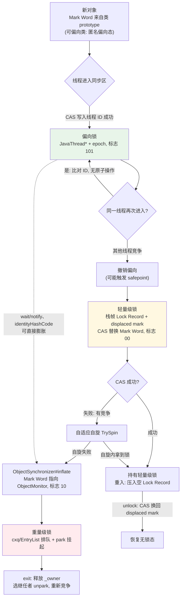
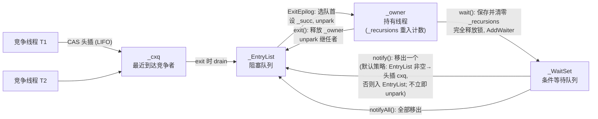

# synchronized 与锁升级

> 一句话概括：synchronized 不是「一把慢锁」，而是 HotSpot 按竞争程度**逐级匹配成本**的一套监视器（monitor）机制——无锁 → 偏向锁 → 轻量级锁 → 重量级锁；理解这条升级链路的位级实现、版本归属与边界，才能解释它为什么快、什么时候不快、以及哪些「常识」已经过时。

预计阅读时间：大约 80 分钟

所属主题：[Java 并发编程常见面试题总结](summary.md)

**版本基线**：本文以 **JDK 8（64 位 HotSpot）** 为主要基线讲锁升级全貌，源码锚点取自 `openjdk/jdk8u` 仓库；偏向锁在 **JDK 15 被默认禁用并废弃（JEP 374）**、**JDK 18 彻底移除（JDK-8256425）**，JDK 21+ 轻量级锁实现改用 lock stack（JDK-8291555 等），这些版本归属在第 5 节单独展开——**版本归属是本文重点，面试答「锁升级」必须注明版本**。JMM/happens-before 规则见 [JMM 与 volatile](jmm-and-volatile.md)，CAS 硬件细节见 [CAS 与原子类](cas-and-atomic-classes.md)，AQS/ReentrantLock 细节见 [AQS 与 Lock](aqs-and-locks.md)，本文不复述。

---

## 0. 阅读路线

| 读者 | 建议阅读 | 关注点 |
| --- | --- | --- |
| 初级（1 年内） | 1、2.1~2.2、7.1~7.2、9.1 | 三种用法锁的是谁、字节码长什么样、wait/sleep 区别、和 ReentrantLock 怎么选 |
| 中级（1~3 年） | 3、4、6.1、7.3~7.5、8 | Mark Word 位布局、升级全链路、ObjectMonitor 字段、等待-通知范式、JIT 锁优化 |
| 高级（3 年+） | 4.5~4.7、5、6.2~6.4、10.2、11 | 批量重偏向/撤销、自适应自旋源码、偏向锁版本归属、enter/exit 唤醒策略、排查手段 |
| 选型/架构 | 5.4、9、10 | 面试如何注明版本、synchronized vs Lock 的取舍、锁对象与分布式边界 |

目录：

1. 三种用法与锁对象
2. 字节码层面：monitorenter/monitorexit 与 ACC_SYNCHRONIZED
3. 对象头与 Mark Word
4. 锁升级全链路（JDK 8 视角）
5. 偏向锁的版本归属（重点）
6. ObjectMonitor 重量级锁机制
7. wait/notify/notifyAll
8. JIT 锁优化：消除、粗化与自适应自旋
9. synchronized vs ReentrantLock 与选型
10. 边界与工程实践
11. 高频追问集
12. 参考资料
附：一页速记

---

## 1. 三种用法与锁对象

### 1.1 三种用法，锁的到底是谁

**结论**：synchronized 锁的永远是**一个对象**（的 monitor），不是方法、不是代码。三种写法的区别只是「这个对象是谁」：

| 用法 | 锁对象 | 作用范围 | 备注 |
| --- | --- | --- | --- |
| 实例方法 `public synchronized void m()` | `this`（当前实例） | 同一实例的所有 synchronized 实例方法互斥 | 不同实例之间**不互斥** |
| 静态方法 `public static synchronized void m()` | 当前类的 `Class` 对象（`Xxx.class`） | 该类所有实例共享这一把锁 | 与实例锁是**两把不同的锁** |
| 代码块 `synchronized (obj) { ... }` | 括号里指定的 `obj` | 所有锁同一个 `obj` 的代码块互斥 | 最灵活，也最容易锁错对象 |

**机制**：每个 Java 对象在 HotSpot 里都关联一个监视器（monitor），synchronized 的互斥、重入、wait/notify 全部建立在 monitor 上（第 6 节展开）。`Class` 对象也是普通 Java 对象，所以静态方法锁和实例锁天然独立。

**边界/代价**：锁的粒度由对象决定——锁 `this` 意味着**整个实例**的所有同步方法串行；锁 `Xxx.class` 意味着**全类**串行。粒度选错，要么并发度白白损失，要么该互斥的没互斥。

**实践/追问**：面试常问「两个线程分别访问同一对象的 synchronized 实例方法和 synchronized 静态方法，会互斥吗？」——**不会**，一把是 `this`，一把是 `Class` 对象。见 1.2 的可运行验证。

### 1.2 两把锁互不干扰（可运行示例）

```java
public class TwoLocks {
    // 锁 this
    public synchronized void instanceMethod() throws InterruptedException {
        Thread.sleep(1000);
    }
    // 锁 TwoLocks.class
    public static synchronized void classMethod() throws InterruptedException {
        Thread.sleep(1000);
    }

    public static void main(String[] args) throws InterruptedException {
        TwoLocks obj = new TwoLocks();
        long start = System.currentTimeMillis();
        Thread t1 = new Thread(() -> {
            try { obj.instanceMethod(); } catch (InterruptedException ignored) {}
        });
        Thread t2 = new Thread(() -> {
            try { classMethod(); } catch (InterruptedException ignored) {}
        });
        t1.start(); t2.start();
        t1.join(); t2.join();
        // 两把锁互不干扰：总耗时约 1000ms 而不是 2000ms
        System.out.println("elapsed = " + (System.currentTimeMillis() - start) + "ms");
    }
}
```

把 `classMethod` 改成实例方法（锁同一个 `this`），总耗时立刻变成约 2000ms——这就是「锁对象决定互斥范围」最直接的证据。

### 1.3 锁对象的三个坑：字符串常量、Integer 缓存、暴露的 this

**结论**：**永远不要用字符串字面量、`Integer` 等缓存对象、`this` 或任何对外暴露的对象当锁**，用 `private final Object lock = new Object()` 专用锁。

**机制与证据**：

- **字符串字面量全局共享**：字面量在字符串常量池中 intern，整个 JVM 里 `"order"` 只有一个对象。两段毫无关系的代码 `synchronized ("order")` 会互相阻塞，甚至死锁。`new String("order")` 才是新对象——但没人这么写锁。
- **Integer 缓存 -128~127**：JLS §5.1.7 规定装箱必须缓存 `-128~127`（`IntegerCache`，上界可用 `-XX:AutoBoxCacheMax` 调大）。`Integer a = 127, b = 127;` 时 `a == b` 为 true——两个「不同的计数器」锁的是**同一个缓存对象**。本机实测（JDK 23）：

```text
Integer 127 same object: true
Integer 128 same object: false
String literal same object: true
```

- **this 暴露锁**：`synchronized` 实例方法等价于把锁交给所有调用方——外部代码可以 `synchronized (yourObj) { Thread.sleep(60_000); }` 合法地卡住你所有同步方法。锁对象一旦暴露，互斥范围就不再由你控制。

**边界/代价**：专用锁的代价只是多一个对象字段；收益是锁的可见性被 `private final` 封死，评审时一眼能看出「谁和谁互斥」。`Boolean`、`Long` 等缓存对象同理不可用。

**追问：为什么 Integer 128 就不共享了？** 缓存范围是 JLS 规定的 -128~127（含），128 走 `new Integer`。这题本质考「锁的是对象身份（identity），不是值」。

### 1.4 可重入性：同一线程重复进入

**结论**：synchronized 是**可重入锁**——同一线程可以反复进入同一把锁的同步区，不会把自己锁死；实现上靠「持有者身份 + 重入计数」。

**机制**（三种锁状态下的重入方式不同，这是高级考点）：

| 锁状态 | 重入如何表达 |
| --- | --- |
| 偏向锁 | 只比对 Mark Word 里的线程 ID，**不计数**（Mark Word 没有计数的位置）；重入信息隐含在栈帧的 Lock Record 里，撤销偏向时 JVM 遍历持有者栈恢复 |
| 轻量级锁 | 每重入一次，在当前栈帧再压入一个 Lock Record（displaced mark 为 null），用 Lock Record 数量计数 |
| 重量级锁 | `ObjectMonitor::_recursions` 计数，`enter` 发现 `_owner == 自己` 就 `_recursions++`，`exit` 递减到 0 才真正释放（源码见第 6 节） |

**可运行验证**（父子类同步方法重入，本机实测输出 `child` → `parent`）：

```java
static class Parent {
    public synchronized void hello() { System.out.println("parent"); }
}
static class Child extends Parent {
    @Override
    public synchronized void hello() {
        System.out.println("child");
        super.hello(); // 已持有 this 锁，重入进入父类同步方法，不会死锁
    }
}
// new Child().hello(); 输出 child、parent
```

**边界/代价**：可重入解决的是「自己等自己」的死锁，**不解决跨线程的锁顺序死锁**；重入也不意味着同步区里的复合操作自动原子——每次进出仍是独立的临界区边界。

**追问：不可重入锁会发生什么？** 同一线程第二次 `lock()` 时把自己挂起等待自己释放，永久死锁。synchronized 与 `ReentrantLock` 都可重入，`ReentrantLock` 的重入计数就是 AQS 的 `state`（见 [AQS 与 Lock](aqs-and-locks.md)）。

---

## 2. 字节码层面：monitorenter/monitorexit 与 ACC_SYNCHRONIZED

### 2.1 同步代码块：monitorenter + 两个 monitorexit

**结论**：同步代码块编译为 `monitorenter`/`monitorexit` 指令对；编译器会生成**两个** `monitorexit`——正常路径一个、异常路径一个，保证任何退出方式都释放锁。

**证据**（以下为本机 JDK 23 真实 `javap -c -p` 输出；字节码语义由 JVMS 规定，各版本一致）：

```java
public class SyncDemo {
    private final Object lock = new Object();
    private int count;
    public void block() {
        synchronized (lock) { count++; }
    }
}
```

```text
public void block();
  Code:
     0: aload_0
     1: getfield      #7    // Field lock:Ljava/lang/Object;
     4: dup
     5: astore_1            // 锁对象引用存入局部变量 1（供异常路径复用）
     6: monitorenter        // 进入 monitor
     7: aload_0
     8: dup
     9: getfield      #13   // Field count:I
    12: iconst_1
    13: iadd
    14: putfield      #13   // count++
    17: aload_1
    18: monitorexit         // 正常路径释放
    19: goto          27
    22: astore_2            // 异常路径：接住任意异常
    23: aload_1
    24: monitorexit         // 异常路径释放（第二个 monitorexit）
    25: aload_2
    26: athrow              // 原样重抛
    27: return
  Exception table:
     from    to  target type
         7    19    22   any
        22    25    22   any
```

**机制**：异常表把 `[7, 19)`（临界区）的任何异常路由到 22 号指令：先 `monitorexit` 再 `athrow`。所以「synchronized 块里抛异常会不会不释放锁」的答案是**不会**——这是字节码层面保证的，不依赖程序员写 finally。

**边界/代价**：`monitorenter` 的语义是「获取对象 monitor，计数 +1」，`monitorexit` 计数 -1 到 0 释放（JVMS §6.5）；指令本身不规定如何实现——偏向/轻量级/重量级都是 HotSpot 对这两条指令的实现策略，字节码看不到锁升级。

**追问：为什么异常表里 `22~25` 也指向 22？** 覆盖「异常处理器自身再抛异常」的极端情形，保证释放路径本身也被保护。答出「两个 monitorexit 分别覆盖正常与异常路径」即可，这一条是加分细节。

### 2.2 同步方法：ACC_SYNCHRONIZED 标志

**结论**：同步方法**没有** monitorenter/monitorexit 指令，而是方法访问标志里的 `ACC_SYNCHRONIZED`（0x0020），由方法调用机制隐式完成加锁/释放。

**证据**（同一份 `SyncDemo` 的 `javap -v` 输出节选）：

```text
public synchronized void method();
  flags: (0x0021) ACC_PUBLIC, ACC_SYNCHRONIZED

public static synchronized void staticMethod();
  flags: (0x0029) ACC_PUBLIC, ACC_STATIC, ACC_SYNCHRONIZED
```

`method()` 的 Code 里只有 `count++` 的普通指令，没有任何 monitor 指令。

**机制**：JVM 调用方法时检查 `ACC_SYNCHRONIZED`：实例方法先获取 `this` 的 monitor，静态方法获取该方法所属类的 `Class` 对象的 monitor，然后执行方法体；方法正常返回或抛出异常时，由方法调用机制释放 monitor（JVMS §2.11.10）。**异常时同样会释放**，与代码块的异常路径等价。

**边界/代价**：两种实现语义等价，但同步方法的锁范围是**整个方法**，无法缩小；需要细粒度控制时用同步块。`ACC_SYNCHRONIZED` 也解释了为什么 synchronized 不能被继承语义「覆盖掉」——子类重写方法若不加 synchronized，就没有这个标志，父类的同步约定在子类失效（这是设计约定问题，不是锁失效）。

**追问：monitorenter 和 ACC_SYNCHRONIZED 的区别？** 前者是显式指令、锁对象在操作数栈上；后者是方法标志、锁对象由调用机制隐式确定（this 或 Class）。面试答到「语义等价、实现位置不同、异常都会释放」即满分。

---

## 3. 对象头与 Mark Word

### 3.1 64 位 HotSpot 对象头布局

**结论**：锁状态不存放在任何「锁表」里，而是直接编码在**对象头的 Mark Word** 中——这是理解锁升级的物理基础。

64 位 HotSpot 普通对象的对象头：

| 组成 | 大小 | 内容 |
| --- | --- | --- |
| Mark Word | 8 字节 | 运行时元数据：identity hashcode、GC 分代年龄、**锁状态位**（随状态复用，见 3.2） |
| Klass Pointer | 8 字节（开启压缩类指针时 4 字节） | 指向方法区中该对象的类元数据（Klass） |
| 数组 length（仅数组对象） | 4 字节 | 数组长度 |

所以普通对象头 12 字节（压缩类指针，默认开启）或 16 字节，数组对象再加 4 字节长度并按 8 字节对齐。JEP 450 的官方描述与此一致：「object headers occupy between 96 bits (12 bytes) and 128 bits (16 bytes)」。

**压缩指针一句话**：`-XX:+UseCompressedOops`（堆 < 32GB 时默认开启）把 64 位对象引用压缩成 32 位偏移，类指针由 `-XX:+UseCompressedClassPointers` 压缩——这是 Klass Pointer 从 8 字节变 4 字节的原因。

### 3.2 Mark Word 在不同锁状态下的位布局（JDK 8）

**结论**：Mark Word 是**复用**的——同一块 64 位空间，在不同锁状态下解释成完全不同的字段。以下布局按 JDK 8 源码 `hotspot/src/share/vm/oops/markOop.hpp` 头部注释整理（高位 → 低位，位宽记法；62 位指针记法参考新版 `markWord.hpp`）：

| 状态 | 位布局（64 位） | 低 3 位（biased_lock + lock） |
| --- | --- | --- |
| 无锁（未偏向） | `unused:25 \| hash:31 \| unused:1 \| age:4 \| biased_lock:0 \| lock:01` | `0 01` |
| 偏向锁 | `JavaThread*:54 \| epoch:2 \| unused:1 \| age:4 \| biased_lock:1 \| lock:01` | `1 01` |
| 轻量级锁 | `ptr_to_lock_record:62 \| lock:00`（指向持有者栈帧中的 Lock Record） | `00` |
| 重量级锁 | `ptr_to_object_monitor:62 \| lock:10`（指向堆外 ObjectMonitor） | `10` |
| GC 标记 | `lock:11`（仅 mark-sweep 标记期间有效） | `11` |

源码中的状态枚举（`markOop.hpp` 枚举值原文，行内注释为整理）：

```cpp
enum { locked_value        = 0,   // 00 轻量级锁
       unlocked_value      = 1,   // 01 无锁/偏向（再看 biased_lock 位）
       monitor_value       = 2,   // 10 重量级锁
       marked_value        = 3,   // 11 GC 标记
       biased_lock_pattern = 5 }; // 101 偏向锁（低三位整体匹配）
```

**机制要点**：

- 无锁态的 `hash:31` 存 identity hashcode（`System.identityHashCode`），`age:4` 是 GC 分代年龄（所以对象最多熬过 15 次 Minor GC 就晋升，`-XX:MaxTenuringThreshold` 上限 15 的由来）。
- 偏向态用 54 位存 `JavaThread*`、2 位存 epoch（批量重偏向的「版本号」，见 4.5）。**线程指针占满了 hash 的位置**——这是 hashcode 与偏向锁互斥的物理原因（3.3）。
- 轻量级/重量级态整个 Mark Word 变成一个指针（低 2 位做标签），原来的 hash、age 等信息被「 displaced（置换）」到别处保存：轻量级锁存在栈上 Lock Record 里，重量级锁存在 `ObjectMonitor::_header` 里。
- 源码注释明确假设「stack/thread pointers have the lowest two bits cleared」——指针天然对齐，低 2 位才能拿来做锁标签。
- 使用 CMS 时，无锁/偏向态中那个 `unused:1` 位被用作 `cms_free` 标记（上表按非 CMS 情形）。

**边界/代价**：Mark Word 只有 64 位，装不下「线程 ID + hashcode + 年龄」的全部组合，所以**状态之间必须做取舍**——偏向与 hash 互斥、锁升级后原 header 必须 displaced。很多「为什么」都能从这 64 位的空间预算推出来。

**追问：新版本还是这个布局吗？** JDK 18 移除偏向锁后，biased_lock 位恒为 unused（JDK-8256425 RFR 描述：「The third least significant bit of the markword is now always unused」）；JDK 24 起 JEP 450 实验性引入 64 位压缩对象头，把压缩类指针并入 Mark Word，锁操作不再覆写 Mark Word 为 tagged pointer（见 3.4）。**面试默认按 JDK 8 经典布局答，再补一句版本现状**。

### 3.3 为什么 hashcode 与偏向锁互斥

**结论**：对一个**已偏向**的对象计算 identity hashcode，会**撤销偏向**；如果对象正被轻量级锁定，计算 hashcode 甚至会直接**膨胀为重量级锁**。

**机制**（源码证据：`ObjectSynchronizer#FastHashCode`，jdk8u `synchronizer.cpp`）：

1. 对象处于偏向态（`has_bias_pattern()`）：先调用 `BiasedLocking::revoke_and_rebias(hobj, false, ...)` 撤销偏向——因为偏向态的 54 位被线程指针占据，**没有地方放 31 位 hash**。
2. 无锁态：hash 直接 CAS 写进 Mark Word 的 hash 位，不升级。
3. 已膨胀：hash 存进 `ObjectMonitor::_header`（displaced header）。
4. 当前线程持有轻量级锁：源码注释写得很硬——

```cpp
// WARNING:
//   The displaced header is strictly immutable.
// It can NOT be changed in ANY cases. So we have
// to inflate the header into heavyweight monitor
// even the current thread owns the lock.
```

栈上 displaced header 不可变（其他线程可能正在读它做 CAS 判断），所以只能膨胀到 ObjectMonitor，把 hash 写进 monitor 的 `_header`。

**边界/代价**：这解释了两件事——① 偏向锁适合「从头到尾单线程、且不算 identity hash」的对象；② 把对象放进 `HashMap`/`HashSet`（会调 hashCode，若未重写则是 identity hash）可能悄悄撤销偏向甚至膨胀锁。注意区分：**重写过的 `hashCode()` 是普通方法调用，与 Mark Word 无关**；互斥的只是 `System.identityHashCode`（及未重写时的 `Object.hashCode`）。

**追问：撤销偏向一定要 STW 吗？** 不一定。匿名偏向、偏向自己的对象可以无 safepoint 直接 CAS 撤销；偏向别的存活线程时才需要 `VM_RevokeBias` 进 safepoint 遍历对方栈（源码证据见 4.5）。

### 3.4 压缩对象头：Mark Word 的未来（JDK 24+）

JEP 450（JDK 24，实验性，`-XX:+UnlockExperimentalVMOptions -XX:+UseCompactObjectHeaders`）把对象头从 96/128 位压到 **64 位**：压缩类指针（22 位）并入 Mark Word，官方描述「Locking operations no longer overwrite the mark word with a tagged pointer」——经典「Mark Word 变指针」的锁实现在该布局下不再成立。JEP 519（JDK 25）将其转为产品特性（仍默认关闭，`-XX:+UseCompactObjectHeaders` 开启），后续 JEP 534 计划设为默认（目标版本未核验）。**本文的位级分析以 JDK 8 经典布局为准**；面试提到压缩对象头属于前沿加分项，说清「JDK 24 实验 / JDK 25 产品化 / 默认关闭」即可。

---

## 4. 锁升级全链路（JDK 8 视角）

### 4.1 为什么要升级：不同竞争程度用不同成本的手段

**结论**：锁升级的本质是**成本与竞争程度的匹配**——绝大多数同步场景根本没有竞争或竞争很轻，为它们付出内核态阻塞的代价是浪费。

| 锁状态 | 加锁/重入成本 | 适用场景 | 代价 |
| --- | --- | --- | --- |
| 偏向锁 | 首次 CAS 记录线程 ID；之后重入**只比对 ID，无原子操作** | 始终只有一个线程进入（如单线程阶段初始化的容器） | 出现竞争时撤销昂贵（可能 safepoint） |
| 轻量级锁 | CAS 替换 Mark Word + 失败时自旋 | 多线程**交替**进入，临界区短、竞争不激烈 | 自旋烧 CPU；竞争激烈时自旋是浪费 |
| 重量级锁 | 膨胀 ObjectMonitor，竞争者 park 挂起（用户态→内核态） | 竞争激烈、临界区长 | 挂起/唤醒约微秒级上下文切换开销 |

**机制**：升级由 HotSpot 在运行时按 Mark Word 状态自动驱动，字节码与 Java 代码完全无感知。**升级不可逆**（运行期不降级，见 4.5），因为降级需要处理「正在排队/自旋的线程」的一致性，收益却很小——竞争一旦发生过，大概率还会再来。

**追问：为什么不直接全用重量级锁？** 早期 synchronized 只有重量级实现，因此背上「慢锁」名声；JDK 6 时代引入偏向锁、自适应自旋等优化后（轻量级锁的引入版本通说亦为 JDK 6，未逐版本核验），无竞争场景的成本降到接近零，这是「JDK 6 之后 synchronized 与 ReentrantLock 性能接近」说法的实现基础。

### 4.2 偏向锁：把锁「偏向」给第一个线程

**结论**：偏向锁假设「锁大部分时间由同一个线程反复进入」，第一次用 CAS 把线程 ID 写进 Mark Word，之后该线程进出同步区**只需比对 ID，连 CAS 都不用**。

**机制**（JDK 8，`UseBiasedLocking` 默认 true）：

1. 对象新建时 Mark Word 来自类的 prototype header。可偏向类的 prototype 是「匿名偏向」态：偏向位为 1、线程 ID 为 0（源码注释：`[0 | epoch | age | 1 | 01] lock is anonymously biased`）。
2. 第一个线程进入同步区：CAS 把匿名偏向的 Mark Word 替换为「自己的 JavaThread* + epoch」。成功即持有偏向锁。
3. 同一线程再次进入：比对 Mark Word 中的线程 ID 等于自己 → 直接进入，**不做任何原子操作**（重入不计数，见 1.4）。
4. 另一个线程来竞争：触发**撤销偏向**（revoke），对象回到可轻量级锁定的状态，竞争走轻量级锁路径。撤销可能需要 safepoint（4.5）。

**边界/代价**：

- **启动延迟**：JDK 8 默认 `BiasedLockingStartupDelay=4000`（毫秒，已核验 jdk8u `globals.hpp`）——VM 启动 4 秒后才通过 `VM_EnableBiasedLocking` 给所有类打开偏向，因为启动期大量类加载/撤销会引发密集 safepoint（`biasedLocking.cpp` 注释原文：「a workaround for startup time regressions due to a large number of safepoints being taken during VM startup」）。**所以用 JOL 观察偏向锁要 `Thread.sleep(5000)` 或加 `-XX:BiasedLockingStartupDelay=0`**，否则前 4 秒创建的对象根本不可偏向。后续版本该默认值改为 0（jdk17u 源码可见，具体变更版本未核验）。
- 撤销成本不对称：偏向锁把成本从「每次加锁」挪到了「第一次竞争」，竞争频繁时净亏损——这正是它被废弃的伏笔（第 5 节）。

**追问：偏向锁和轻量级锁的核心区别？** 偏向锁重入**无原子操作**（只读比对），轻量级锁每次加锁都要 CAS；偏向锁面向「始终单线程」，轻量级锁面向「交替执行」。

### 4.3 轻量级锁：栈帧 Lock Record + CAS

**结论**：轻量级锁把「锁记录」放在**当前线程栈帧**里，用一次 CAS 把 Mark Word 换成指向该记录的指针；竞争失败先自旋，不立即挂起。

**机制**（JDK 8 经典模型，汇编快路径见 `MacroAssembler#lock_object`，x86 在 `macroAssembler_x86.cpp`）：

1. 线程进入同步区，在自己的栈帧中开辟一块 **Lock Record**（HotSpot 内部叫 `BasicLock`），把对象当前的 Mark Word 拷贝进去——这份拷贝叫 **displaced mark**（置换头）。
2. CAS 尝试把对象 Mark Word 替换为「指向这个 Lock Record 的指针 + 锁标志 00」。
3. CAS 成功 → 持有轻量级锁；Mark Word 低 2 位 `00`，原 header 信息保存在栈上。
4. CAS 失败 → 说明有竞争：先**自适应自旋**重试（4.7）；自旋仍失败 → 膨胀为重量级锁（4.4）。
5. 重入：再压入一个 displaced mark 为 null 的 Lock Record 计数（1.4）。
6. 解锁：CAS 把 displaced mark 换回对象头；换回失败说明期间已膨胀，走重量级释放路径并唤醒竞争者。

**边界/代价**：轻量级锁的「轻」在于**无竞争时不进入内核、不分配堆外结构**；代价是竞争时自旋消耗 CPU，且每个栈帧都要预留 Lock Record 空间。「交替执行」场景下 CAS 几乎总是成功，自旋 rarely 发生——这是它的最优区间。

**追问：displaced mark 为什么不可变？** 其他线程可能正拿着旧 Mark Word 做 CAS 比较，栈上这份拷贝是它们判断对象状态的依据之一；改它会造成竞态（`FastHashCode` 的 WARNING 注释，3.3）。

### 4.4 重量级锁：inflate 到 ObjectMonitor

**结论**：竞争升级后，HotSpot 调用 `ObjectSynchronizer#inflate` 把锁「膨胀」为一个堆外的 **ObjectMonitor** 结构，Mark Word 变成指向它的指针（锁标志 `10`），竞争线程进入队列并 park 挂起。

**机制**（jdk8u `synchronizer.cpp`，`ObjectSynchronizer#inflate`）：

- inflate 按 Mark Word 当前状态分派：已膨胀直接返回；`INFLATING`（中间态）忙等；**stack-locked**（轻量级）先把 Mark Word CAS 成 `INFLATING`（值为 0 的「膨胀进行中」标记），从持有者栈上取回 displaced mark 填进 `monitor->_header`、设置 `_owner`，最后 `release_set_mark` 发布 monitor 指针；**neutral**（无锁）直接新建 monitor 并 CAS 安装。
- 为什么先 CAS 成 0 再发布？源码注释：避免持有者同时 unlock 时 hash 值「flicker」，0 作为 BUSY 标记让并发方忙等而非读到半成品。
- **膨胀不一定要经过轻量级锁**：`inflate_cause_name()` 列出的起因包括 `Monitor Enter / Monitor Wait / Monitor Notify / Monitor Hash Code / JNI Monitor Enter` 等——wait/notify、对持锁对象算 identity hash 都会**直接膨胀**。升级链路是「成本递增的可选路径」，不是必须逐级走过的楼梯。

**边界/代价**：ObjectMonitor 从全局池分配（池只增不减，「The monitor pool is grow-only」），空闲 monitor 在 STW 时回收（4.5）。park/unpark 依赖操作系统互斥量与条件变量，一次挂起/唤醒是微秒级开销——比一次 CAS（纳秒级）贵两到三个数量级。

**追问：膨胀后对象头里的 hashcode 去哪了？** 在 `ObjectMonitor::_header`（displaced header）里，`FastHashCode` 从那里读（3.3）。

### 4.5 升级不可逆、STW deflation 与批量重偏向/批量撤销

**结论**：**运行期锁升级不可逆**——偏向→轻量级→重量级单向进行，不存在「竞争消失后自动降回轻量级」；JVM 对偏向锁的类级优化是**批量重偏向/批量撤销**，它们不是降级。

**机制与证据**：

1. **STW deflation（回收，不是降级）**：`ObjectSynchronizer#deflate_idle_monitors` 在 safepoint 执行（源码断言 `assert(SafepointSynchronize::is_at_safepoint(), ...)`），把**空闲**（`is_busy()` 为假：无 owner、无等待者、无排队者）的 ObjectMonitor 回收，恢复对象头。正在使用中的锁不会被降级。注释原文：「called at all safepoints, immediately after all mutators are stopped」。
2. **批量重偏向（bulk rebias）**：每个 Klass 维护撤销计数。计数达到 `BiasedLockingBulkRebiasThreshold`（默认 **20**，已核验 jdk8u `globals.hpp`）时，JVM 在 safepoint 把该类 prototype header 的 **epoch +1**——所有旧 epoch 的偏向对象**隐式失效**（下次访问发现 epoch 不匹配，CAS 重偏向即可，无需逐个撤销），同时遍历线程栈修正已锁对象的 epoch。适用「A 线程批量创建对象、整体交给 B 线程」的模式。
3. **批量撤销（bulk revoke）**：计数达到 `BiasedLockingBulkRevokeThreshold`（默认 **40**）时，把该类 prototype header 重置为**无偏向**——该类新老对象全部永久失去偏向资格，新对象直接按无锁/轻量级路径走。
4. **衰减**：`BiasedLockingDecayTime`（默认 **25000ms**）——距上次批量操作超过该时间才再次出现撤销，说明是正常交接模式，重置计数，允许再次批量重偏向（`biasedLocking.cpp#update_heuristics` 注释原文：「The application is allocating objects in bulk which are biased toward a thread and then handing them off to another thread」）。
5. **撤销的 safepoint 成本分级**（`biasedLocking.cpp`）：匿名偏向、偏向自己的对象 → 无 safepoint 直接 CAS；偏向其他存活线程 → `VM_RevokeBias` 进 safepoint 遍历对方栈；批量操作 → `VM_BulkRevokeBias`，断言必须在 safepoint。

**边界/代价**：批量机制是**类级**的——一个类的对象撤销太频繁，整个类都被取消偏向资格，这是「偏向锁收益不稳定」的又一来源。注意区分三个概念：**升级**（单对象，运行期，不可逆）、**deflation**（空闲 monitor 回收，STW）、**批量重偏向/撤销**（类级偏向资格管理，STW）。

**追问：「锁降级」存在吗？** 运行期不存在。有人把 deflation 说成降级是不准确的：它回收的是**无人使用**的 monitor，恢复的是无锁对象头，不涉及任何正在持有的锁。

### 4.6 锁升级流程图（JDK 8 经典模型）



图中虚线表示 4.4 的要点：**膨胀可以跳过轻量级阶段**。JDK 15+ 默认关闭偏向锁后，入口直接是「无锁 → 轻量级锁」（第 5 节）。

### 4.7 自适应自旋：不是 UseAdaptiveSizePolicy

**结论**：轻量级锁竞争失败后、膨胀挂起前，线程会**自旋**重试；自旋时长由 HotSpot 按「最近自旋成功率」**逐 monitor 自适应调整**。注意：网上大量文章把自适应自旋归到 `-XX:+UseAdaptiveSizePolicy`，**这是误传**——那是 GC 人体工学参数；已核验 jdk8u `objectMonitor.cpp` 的自旋代码不引用该 flag。

**机制**（jdk8u `objectMonitor.cpp`，`#define TrySpin TrySpin_VaryDuration`）：

- 每个 ObjectMonitor 维护 `_SpinDuration`（自旋预算），注释原文：「D varies with the success rate of recent spin attempts. (D is capped at approximately length of a round-trip context switch)」——上限约等于一次上下文切换往返，超过就不如直接挂起。
- 自旋成功：`_SpinDuration += Knob_Bonus`（默认 +100）；自旋耗尽失败：`-= Knob_Penalty`（默认 -200）；上限 `Knob_SpinLimit = 5000`。这些是源码内部 knob（可经 `-XX:SyncKnobs` 调整，非稳定接口），不是常规 product flag。
- 自旋前还有准入判断：`NotRunnable`（持有者不在运行态，自旋无意义）直接放弃；持有者正在运行才值得 spin 等它快速释放。

**边界/代价**：自旋赌的是「持有者马上就释放」；单核机器上自旋几乎必输（持有者根本没在跑），多核短临界区才是收益区间。自旋失败后仍会膨胀挂起，所以自旋只是**延迟**阻塞成本，不能消除它。

**追问：JDK 6 前后自旋有什么区别？** JDK 6 之前是固定次数自旋（早期参数 PreBlockSpin），之后改为按成功率自适应；答出「自适应 = 上次自旋成功就加长、失败就缩短甚至跳过」即可（PreBlockSpin 的移除版本未核验，不展开）。

---

## 5. 偏向锁的版本归属（重点）

### 5.1 版本时间线（全部经官方来源核验）

**结论**：「无锁→偏向→轻量级→重量级」是 **JDK 8 时代的经典模型**。偏向锁 JDK 15 默认禁用并废弃、JDK 18 移除；JDK 21 起轻量级锁本身也换了实现。**今天（JDK 21/23/25）默认路径是「无锁 → 轻量级锁 → 重量级锁」，没有偏向锁**。

| 版本 | 变化 | 官方依据 |
| --- | --- | --- |
| JDK 8 | `UseBiasedLocking` 默认 true；`BiasedLockingStartupDelay=4000ms` | jdk8u `globals.hpp`（已核验） |
| JDK 15 | **JEP 374：默认禁用 + 废弃**偏向锁及全部相关 flag；`-XX:+UseBiasedLocking` 仍可开启但打印 deprecation 警告 | [JEP 374](https://openjdk.org/jeps/374)，实现 issue [JDK-8231264](https://bugs.openjdk.org/browse/JDK-8231264) |
| JDK 16 | 原计划在此版本 obsolete，**推迟到 18** | [JDK-8256253](https://bugs.openjdk.org/browse/JDK-8256253) |
| JDK 18 | **彻底移除**偏向锁代码，相关选项 obsoleted（警告后忽略）；Mark Word 的 biased 位恒为 unused | [JDK-8256425](https://bugs.openjdk.org/browse/JDK-8256425)、[JDK 18 Release Notes](https://www.oracle.com/java/technologies/javase/18all-relnotes.html) |
| JDK 21 | 引入替代 fast-locking 方案（lock stack），实验性 `-XX:LockingMode=2`（LM_LIGHTWEIGHT），默认仍是 LM_LEGACY | [JDK-8291555](https://bugs.openjdk.org/browse/JDK-8291555)、[JDK-8319251](https://bugs.openjdk.org/browse/JDK-8319251) 描述 |
| JDK 22 | `LockingMode` 转为 product flag | [JDK-8315061](https://bugs.openjdk.org/browse/JDK-8315061)（见 JDK-8319251 描述） |
| JDK 23 | **默认切换为 LM_LIGHTWEIGHT**（lock stack 成为默认轻量级锁实现）；补齐递归轻量级锁（JDK-8319796/8319797，Fix Version 23） | [JDK-8319251](https://bugs.openjdk.org/browse/JDK-8319251)、release note [JDK-8327089](https://bugs.openjdk.org/browse/JDK-8327089)、[JDK-8319796](https://bugs.openjdk.org/browse/JDK-8319796) |
| JDK 24 | **JEP 491：synchronized 不再 pin 虚拟线程**；`jdk.tracePinnedThreads` 移除；JEP 450 压缩对象头（实验） | [JEP 491](https://openjdk.org/jeps/491)、[JEP 450](https://openjdk.org/jeps/450) |
| JDK 25 | JEP 519：压缩对象头转产品特性（仍默认关闭） | [JEP 519](https://openjdk.org/jeps/519) |

两个易错点特别提醒：

- **移除偏向锁的 issue 是 JDK-8256425，不是 JDK-8273826**（后者与偏向锁无关，坊间文章常引错）。JEP 374 的实现 issue 是 JDK-8231264。
- JDK 15 是「**禁用 + 废弃**」，JDK 18 才是「**移除**」——「JDK 15 移除偏向锁」是错误表述。JDK 15~17 仍可用 `-XX:+UseBiasedLocking` 显式开启（带警告）。

### 5.2 为什么废弃：JEP 374 的三条理由

**结论**：偏向锁不是「变慢了」，而是**收益场景消失、维护与撤销成本依旧**，性价比倒挂。

JEP 374 原文依据：

1. **维护成本高**：「Biased locking introduced a lot of complex code into the synchronization subsystem and is invasive to other HotSpot components as well... an impediment to making significant design changes」——偏向锁代码阻碍了同步子系统的演进（后来的 lock stack、压缩对象头都要求摆脱它）。
2. **撤销昂贵**：「the cost of requiring an expensive revocation operation in case of contention」——跨线程撤销要 safepoint（4.5 已核验源码），批量机制又引入 epoch 等复杂度。
3. **收益场景消失**：当年受益的是「使用早期同步集合（`Hashtable`、`Vector`，每次访问都 synchronized）的老应用」；现代应用用 `HashMap`/`ArrayList` + 外部同步，或直接用 `java.util.concurrent`（见 [并发容器](concurrent-collections.md)），无竞争 synchronized 占比大降。JEP 原文还点名：「applications built around a thread-pool queue and worker threads generally perform better with biased locking disabled」（线程池工作线程轮流处理任务，对象在线程间频繁交接，偏向几乎必被撤销；线程池模型见 [线程池](thread-pool.md)）。JDK-8231264 讨论区还记录了 Google 的生产实验：7 台服务器中 4 台关闭偏向锁后 CPU 占用下降。

**边界/代价**：JEP 也承认「Some Java applications may see a performance regression」——保留命令行开关就是给这类应用兜底。所以严谨表述是「对现代典型负载收益不再明显」，不是「偏向锁一无是处」。

### 5.3 JDK 15+ 的默认路径与 JDK 21+ 的 lock stack

**结论**：JDK 15~17 默认路径变为「无锁 → 轻量级锁（栈上 Lock Record）→ 重量级锁」；JDK 21 引入、JDK 23 默认的 LM_LIGHTWEIGHT 进一步把「栈帧 Lock Record + displaced mark」换成**线程私有的 lock stack**。

**机制**（JDK-8291555 方案，细节以官方 issue/源码为准）：

- 每个 JavaThread 维护一个 `LockStack`，轻量级加锁就是把对象 oop **压入 lock stack**，解锁弹出；重入通过重复入栈表达（递归支持由 JDK-8319797 补齐）。
- 不再需要在每个栈帧里布置 Lock Record、不再 displaced header 来回搬运，Mark Word 的锁编码也随之简化——这为 JEP 450「锁操作不覆写 Mark Word 为 tagged pointer」铺路。
- 崩溃诊断配套：JDK 21.0.2 起 `hs_err` 文件在 LM_LIGHTWEIGHT 下打印当前线程的 lock stack（JDK-8316735）。

**边界/代价**：官方 release note（JDK-8327089）明确「not expected to change any semantic behavior... performance neutral for almost all applications」——**语义不变，变的只是实现**。LM_LEGACY 模式已于 JDK 24 废弃（JDK-8334299），CSR JDK-8334496 计划 JDK 26 obsolete、27 remove。本文第 3、4 节的位级细节按经典模型讲，**面试以经典模型为准，注明「JDK 21 前后实现有调整（JDK-8291555/JDK-8319797 等）」即可**；lock stack 的位级编码未完全核验，不展开。

### 5.4 面试怎么答「锁升级」：先经典模型，再版本现状

推荐答题骨架（30 秒版）：

> 「以 JDK 8 为例，synchronized 有四种状态：无锁、偏向锁、轻量级锁、重量级锁，按竞争程度单向升级、运行期不可逆。偏向锁把线程 ID 写进 Mark Word，同一线程重入零原子操作；出现竞争撤销偏向，升级为轻量级锁——栈帧 Lock Record + CAS 替换 Mark Word，失败先自适应自旋；自旋仍失败就 inflate 成 ObjectMonitor，竞争者进 cxq/EntryList 挂起。**但要注明版本**：偏向锁 JDK 15 被 JEP 374 默认禁用并废弃、JDK 18 移除，原因是维护成本高、撤销要 safepoint、现代应用大量用 j.u.c 使收益消失；所以 JDK 15+ 默认从轻量级锁起步，JDK 23 起轻量级锁默认用 lock stack 实现。升级的核心思想——按竞争程度匹配成本——一直没变。」

**追问：你现在项目用的 JDK 几？还有偏向锁吗？** 这题考的就是版本意识：JDK 8/11 有（11 仍默认开启），JDK 15+ 默认没有，JDK 18+ 彻底没有。答「有」或「没有」都要带上版本前提。

---

## 6. ObjectMonitor 重量级锁机制

### 6.1 ObjectMonitor 关键字段

**结论**：重量级锁的本体是堆外的 `ObjectMonitor`（C++ 对象），对象头 Mark Word 只存指向它的指针。它同时承担**互斥**（owner/队列）与**条件等待**（WaitSet）两套职责。

字段表（jdk8u `hotspot/src/share/vm/runtime/objectMonitor.hpp`，声明原文核验）：

| 字段 | 含义 |
| --- | --- |
| `_header` | displaced mark word——对象原来的 Mark Word（hash、age 存这里），必须是结构第一个字 |
| `_object` | 反向指向锁对象（GC 强根） |
| `_owner` | 当前持有者：`Thread*`，或轻量级转膨胀过渡期的栈上 BasicLock 指针 |
| `_recursions` | 重入计数，首次进入为 0 |
| `_cxq` | **最近到达**的竞争线程链表（LIFO 单链，节点是 ObjectWaiter，作为线程代理） |
| `_EntryList` | 入口/重入阻塞队列（候选继任者从这里选） |
| `_WaitSet` | 调用 `wait()` 的线程链表（条件等待队列） |
| `_succ` | 「假定继承人」：已被 unpark 但还没跑起来的线程，用于抑制无效唤醒 |
| `_Responsible` | 负责定时 park 轮询的线程，防止「stranding」（锁空闲却没人被唤醒） |
| `_count` / `_waiters` | 引用计数（防 STW deflation 误回收）/ 等待者数 |

**与 AQS 队列一句话对比**：ObjectMonitor 的 cxq/EntryList/WaitSet 是 **JVM 层 C++ 链表 + park**，一个 monitor 只有一个等待集；AQS 是 **Java 层 CLH 变体队列 + LockSupport**，`ReentrantLock` 可挂多个 `Condition` 队列——结构细节见 [AQS 与 Lock](aqs-and-locks.md)。

### 6.2 enter：从 CAS 到挂起

**结论**：`ObjectMonitor#enter` 是「先抢、再旋、后排队」三段式。

**机制**（jdk8u `objectMonitor.cpp`，流程核验）：

1. **TryLock**：`CAS(_owner, NULL → Self)`。成功直接持有；`_owner == Self` 则 `_recursions++`（重入）；`_owner` 指向自己栈上的 BasicLock（轻量级转膨胀场景）则认领 owner。
2. **自旋**：`Knob_SpinEarly` 开启时先 `TrySpin`（4.7），赌持有者马上释放。
3. **EnterI 排队**：构造 `ObjectWaiter` 节点，**CAS 头插 `_cxq`**（LIFO），然后循环「TryLock → park → 醒来再 TryLock」。`_Responsible` 线程用**定时 park** 周期性检查，兜底防止唤醒丢失。
4. 拿到锁后 `UnlinkAfterAcquire` 把自己从队列摘除。

**边界/代价**：cxq 是 LIFO——**刚到的线程反而排前面**，这是「synchronized 非公平」的实现层证据之一（公平性还体现在释放时不保证唤醒最久等待者，6.3）。挂起走 `ParkEvent`（底层 pthread 条件变量/mutex），一次 park/unpark 是内核态往返。

### 6.3 exit：竞争式交接，不是所有权转让

**结论**：释放锁**不会把锁「交给」某个线程**，而是释放 owner、唤醒一个继任者让它**重新竞争**。源码注释原文：「The exiting thread does _not_ grant or pass ownership to the successor thread... the successor can (re)compete for ownership」。

**机制**（`ObjectMonitor#exit` → `ExitEpilog`）：

1. 快速出口：`release_store(_owner, NULL)` 后，若 cxq/EntryList 皆空或 `_succ != NULL`（已有人在自旋/已被唤醒），**直接返回不唤醒**——避免 futile wakeup。
2. 需要唤醒时：先 CAS 把锁抢回来（保证只有 owner 能操作队列），从 `_EntryList` 选队首；EntryList 空则把 `_cxq` 排空（drain）进 EntryList 再选。
3. `ExitEpilog`：设 `_succ = wakee` → 释放 `_owner` → fence → `unpark(wakee)`。**被唤醒者仍在队列里**，醒来后重新 TryLock，可能输给新来的线程（非公平）。

**边界/代价**：`_succ` 节流保证「只需一个就绪继任者就能推进」，减少惊群；代价是唤醒策略复杂、存在 stranding 风险（靠 `_Responsible` 定时 park 兜底）。这套「唤醒 ≠ 获得锁」的语义与 AQS 的 `unparkSuccessor` 神似，但队列结构与公平性选项不同。

### 6.4 ObjectMonitor 等待/同步队列图



要点：**竞争队列（cxq/EntryList）与等待队列（WaitSet）是分开的**；notify 只是「搬家」，真正的 unpark 发生在通知者 exit 时（7.3 源码证据）。

---

## 7. wait/notify/notifyAll

### 7.1 为什么必须在 synchronized 块内

**结论**：`wait/notify/notifyAll` 是 **monitor 的操作**，调用前提是当前线程持有该对象的 monitor，否则抛 `IllegalMonitorStateException`——这不是语法约束，是语义约束。

**机制**：这三个方法都是 `Object` 的 native 方法，JVM 入口（`ObjectSynchronizer#wait/notify`）先检查调用者是否 owner。wait 要「释放锁 + 挂起 + 醒来重新抢锁」，notify 要操作 monitor 的 WaitSet——**不持有 monitor 就谈不上释放，也无权动它的等待队列**。本机实测（JDK 23）：

```java
Object o = new Object();
o.wait(1); // java.lang.IllegalMonitorStateException（已运行验证）
```

**边界/代价**：「必须在 synchronized 里」的准确表述是「必须持有**这个对象**的 monitor」——在 `synchronized (other)` 块里调 `o.wait()` 照样抛 IMSE。锁对象与 wait 对象必须是同一个。

**追问：为什么 wait/notify 定义在 Object 而不是 Thread？** 因为锁是任意对象，等待/通知是「锁（monitor）上的条件操作」，自然挂在所有对象的基类上；Thread 只是被挂起/唤醒的载体。

### 7.2 wait 释放锁进入 WaitSet，sleep 不释放锁

**结论**：`wait()` **完全释放当前对象的 monitor**（包括全部重入层次）并进入 WaitSet 挂起；`Thread.sleep()` **不释放任何锁**，只是让出 CPU。

**机制**（jdk8u `ObjectMonitor#wait`，源码核验）：

```cpp
intptr_t save = _recursions; // 保存重入计数
_waiters++;
_recursions = 0;             // 重入层次清零
exit (true, Self) ;          // 彻底释放 monitor（不是只退一层！）
// AddWaiter 挂入 _WaitSet，然后 _ParkEvent->park() 挂起
// 被唤醒后 enter/ReenterI 重新竞争 monitor
_recursions = save;          // 恢复原重入计数
```

注意两个细节：① wait 释放的是**全部重入层次**（重入 3 层就释放 3 层），醒来后原样恢复；② 醒来≠立刻执行——要**重新竞争到锁**才从 wait 返回。

**wait vs sleep 对比表**（API 语义与线程状态细节见 [线程基础与生命周期](thread-basics-and-lifecycle.md)）：

| 维度 | `Object.wait()` | `Thread.sleep()` |
| --- | --- | --- |
| 所属 | Object 实例方法（native） | Thread 静态方法（native） |
| 锁释放 | **释放当前对象 monitor（全部重入）** | **不释放任何锁** |
| 调用前提 | 必须持有该对象 monitor | 任意位置 |
| 唤醒方式 | notify/notifyAll、超时、中断 | 超时、中断 |
| 线程状态 | WAITING / TIMED_WAITING（`waiting on <obj>`） | TIMED_WAITING（`sleeping`） |
| 醒来后 | 重新竞争锁，拿到才返回 | 直接继续执行 |
| 典型用途 | 条件等待（等待-通知协作） | 单纯暂停 |

**边界/代价**：「wait 释放的是**当前对象**的锁，不是所有锁」——持有 A、B 两把锁时 `A.wait()` 只释放 A，B 仍被持有。若另一线程需要 B 才能 notify A，就死锁。这是等待-通知设计里最隐蔽的坑。

**追问：wait(0) 是立即返回吗？** 不是，`wait(0)` 等价于无限期等待（javadoc 明确），超时版本是 `wait(long timeout)` / `wait(long, int)`。

### 7.3 notify 随机唤醒一个，notifyAll 全唤醒

**结论**：`notify()` 从 WaitSet 移出**一个**等待者（规范说「任意一个」，不保证公平或随机算法），`notifyAll()` 移出**全部**；被移出的线程**不会立即执行**，要等通知者释放锁后重新竞争。

**机制**（jdk8u `ObjectMonitor#notify`，源码核验）：

- WaitSet 是循环双向链表，`DequeueWaiter()` 取队首——所以 HotSpot 实现上近似「唤醒等待最久的」，但**这是实现细节，规范只承诺 arbitrary**，答题说「随机/任意一个，不保证顺序」最稳。
- 默认策略（`Knob_MoveNotifyee=2`）：EntryList 非空 → 把 waiter **CAS 头插 cxq**；EntryList 空 → 直接放入 EntryList。源码注释原文：「notify() or notifyAll() simply transfers threads from the WaitSet to either the EntryList or cxq. Subsequent exit() operations will unpark the notifyee」——**notify 本身不 unpark**，唤醒发生在通知者 exit 时。
- 所以「notify 之后立刻继续执行同步区剩余代码，出块才真正唤醒」是准确时序；被唤醒线程从 wait 返回前还要重新拿到锁。

**边界/代价**：notify 只唤醒一个，若等待者等的**条件不同**（如生产者消费者共用一个 WaitSet），可能唤醒「条件仍不满足」的那个，它检查后继续 wait，而真正该醒的没醒——**信号丢失**。条件异构或等待者多于一个时，用 `notifyAll` 最安全（代价是惊群式竞争）。`ReentrantLock` 的多 `Condition` 就是为了解决「一个 WaitSet 混装多种条件」的问题（见 [AQS 与 Lock](aqs-and-locks.md)）。

### 7.4 while 防虚假唤醒：等待-通知标准范式

**结论**：wait 必须放在 **while 循环**里检查条件，不能用 if——防虚假唤醒（spurious wakeup），也防「醒来但条件已被别人消费」。

**机制**：javadoc 明确允许虚假唤醒（无 notify 也可能返回）；更常见的是真实竞态：notifyAll 唤醒 N 个消费者，第一个拿锁消费完，其余拿锁时条件已不成立——if 写法会带着错误条件继续执行。while 让每个醒来者**重新检查**。

**标准范式**（生产者-消费者骨架；生产级实现直接用 `BlockingQueue`，见 [并发容器](concurrent-collections.md)）：

```java
class BoundedBuffer<T> {
    private final Object[] items;
    private int count, putIdx, takeIdx;
    private final Object lock = new Object(); // 专用锁，wait/notify 都在它上面

    @SuppressWarnings("unchecked")
    BoundedBuffer(int cap) { items = new Object[cap]; }

    public void put(T x) throws InterruptedException {
        synchronized (lock) {
            while (count == items.length) { // while，不是 if
                lock.wait();                // 满：释放 lock 并等待
            }
            items[putIdx] = x;
            putIdx = (putIdx + 1) % items.length;
            count++;
            lock.notifyAll();               // 条件异构(空/满)，notifyAll 最稳
        }
    }

    public T take() throws InterruptedException {
        synchronized (lock) {
            while (count == 0) {
                lock.wait();                // 空：释放 lock 并等待
            }
            @SuppressWarnings("unchecked")
            T x = (T) items[takeIdx];
            items[takeIdx] = null;
            takeIdx = (takeIdx + 1) % items.length;
            count--;
            lock.notifyAll();
            return x;                       // 出同步块才真正唤醒等待者
        }
    }
}
```

**边界/代价**：范式三要素——**同一把锁、while 检查、状态变更与 notify 在同一临界区**。漏掉任何一条都可能丢信号或死等。notifyAll 的惊群代价在等待者极多时可观，此时应换 `Condition` 分队列或 `BlockingQueue`。

### 7.5 wait(timeout) 与超时语义

`wait(long timeout)` 超时后自动醒来（仍需重新竞争锁），线程状态 TIMED_WAITING；`wait(long, int)` 提供纳秒级参数但实际精度受 OS 限制。超时返回与 notify 返回**无法区分**（都不抛异常），所以条件检查的 while 循环同样覆盖超时情形。中断 wait 会抛 `InterruptedException`（抛出前仍会重新获取 monitor）。等待/通知与 `LockSupport.park/unpark` 的许可语义差异见 [线程基础与生命周期](thread-basics-and-lifecycle.md)。

---

## 8. JIT 锁优化：消除、粗化与自适应自旋

### 8.1 锁消除：逃逸分析撑腰

**结论**：JIT（C2）通过**逃逸分析**（`-XX:+DoEscapeAnalysis`，默认开启）证明锁对象**不会被其他线程访问**时，直接**消除**这对加锁/解锁——同步开销归零。

**经典示例**：

```java
public String concat(String a, String b) {
    StringBuffer sb = new StringBuffer(); // 局部对象，未逃逸出方法
    sb.append(a);   // StringBuffer.append 是 synchronized 方法
    sb.append(b);   // 但锁对象 sb 只有当前线程能碰到
    return sb.toString(); // 锁被 JIT 消除
}
```

`StringBuffer` 每个 append 都 synchronized，但 sb 是方法局部变量、没有逃逸，锁毫无意义——C2 消除之。这也是「局部变量用 StringBuilder 还是 StringBuffer 性能差异不大」的原因之一（当然语义上仍推荐 StringBuilder）。

**机制一句话**：逃逸分析判断对象作用域——未逃逸的对象可做**标量替换**（把对象打散成若干局部变量，根本不分配对象；常被笼统称为「栈上分配」，HotSpot 实际主要靠标量替换）与锁消除。

**边界/代价**：锁消除是**运行时**优化，解释执行阶段锁还在；对象一旦逃逸（赋给字段、传入未知方法、被返回），优化失效。不能因为「JIT 会消除」就故意乱加锁。

### 8.2 锁粗化：合并相邻临界区

**结论**：JIT 发现**对同一把锁的连续、相邻加锁/解锁**（典型：循环内反复 append），会把它们**合并成一次更大范围的加锁**，省去反复进出 monitor 的成本。

```java
// 循环内每次 append 都 monitorenter/monitorexit 同一把 sb 锁
for (int i = 0; i < 100; i++) {
    sb.append(i); // JIT 可能粗化为循环外一次加锁
}
```

**边界/代价**：粗化扩大了临界区——若循环体很长或含阻塞操作，粗化反而增加其他线程等待。它是 JIT 的启发式权衡，不是语义保证；写代码时仍应主动把循环整体放进同步块（如果确实需要原子性），而不是依赖粗化。

**追问：锁消除和锁粗化矛盾吗？** 不矛盾：消除针对「锁根本没必要」（对象未逃逸），粗化针对「锁有必要但进出太频繁」。自适应自旋（4.7）则是运行期策略，三者分别作用在编译期与运行期。

---

## 9. synchronized vs ReentrantLock 与选型

### 9.1 对比表

| 维度 | synchronized | ReentrantLock |
| --- | --- | --- |
| 层次 | JVM 关键字（monitor，字节码/方法标志） | JDK 类库（AQS，Java 代码） |
| 加锁/释放 | 自动，异常也释放（第 2 节字节码保证） | 手动 `lock()`/`unlock()`，**必须 finally** |
| 可重入 | 是（_recursions / Lock Record） | 是（AQS state） |
| 公平性 | **仅非公平** | 可选公平/非公平（构造参数） |
| 可中断获取 | 不支持（阻塞中等锁不响应 interrupt） | `lockInterruptibly()` |
| 尝试/超时获取 | 不支持 | `tryLock()` / `tryLock(timeout)` |
| 条件队列 | 一个 monitor 一个 WaitSet | 多个 `Condition`，精准唤醒 |
| 锁绑定 | 绑定对象，无法跨方法传递锁状态 | Lock 对象可传递，支持链式加锁（hand-over-hand） |
| 性能现状 | JDK 6 优化后与 ReentrantLock **接近** | 同左；高竞争下各有胜负，看场景 |
| 虚拟线程 | JDK 24（JEP 491）前阻塞会 **pin carrier** | 不 pin（JDK 21~23 的官方规避方案） |
| 实现细节 | 本文第 3~6 节 | 见 [AQS 与 Lock](aqs-and-locks.md) |

### 9.2 选型结论

**结论**：**默认用 synchronized**——简洁、不会忘记释放、JVM 持续优化（锁消除/粗化/升级，且 JEP 491 后虚拟线程短板也补上了）；**只有需要高级功能时才用 Lock**：可中断、超时尝试、公平锁、多条件队列、跨方法锁传递。

**机制层面的理由**：synchronized 的释放由字节码/方法调用机制保证（第 2 节），`unlock()` 忘写或写错位置则是 ReentrantLock 的经典事故；JVM 对 monitor 的优化是「免费」的，AQS 的优化只能靠类库自身。

**边界/代价**：synchronized 阻塞中**不响应中断**（只能等拿到锁后再检查中断标志），需要「等锁时可取消」的场景必须 `lockInterruptibly()`；公平锁吞吐显著低于非公平，ReentrantLock 默认也是非公平。

**虚拟线程一句话**：JDK 21~23 中虚拟线程在 synchronized 内阻塞（含等锁、wait）会 **pin 住 carrier 平台线程**，官方曾建议改 ReentrantLock 规避；**JDK 24 JEP 491 已解决**，synchronized 不再 pin，且无需把已迁移的代码改回来。细节与排查见 [虚拟线程](virtual-threads.md)。

**追问：JDK 6 之后两者性能接近，为什么还有人说 synchronized 慢？** 历史印象（JDK 1.5 前纯重量级）+ 把「重量级锁的开销」当成「synchronized 的开销」。准确表述：无竞争/轻竞争时两者都很快；激烈竞争时瓶颈在阻塞/唤醒本身，与用哪个 API 关系不大。

---

## 10. 边界与工程实践

### 10.1 锁对象选择与同步范围

- **专用锁**：`private final Object lock = new Object()`；需要保护多个独立状态时用多把专用锁（注意锁顺序，10.3）。
- **同步范围最小化**：只把真正需要互斥的读写包进临界区；耗时计算、IO、RPC 放锁外。临界区每多一毫秒，竞争者的等待就放大 N 倍。
- **锁内不调用外来代码**：回调、监听器、可重写方法都可能在锁内引入未知锁顺序（「锁内回调」是死锁高发区）。
- **不要锁 this/Class/字符串/缓存对象**（1.3）；`Collections.synchronizedList` 返回的包装对象锁是包装器自身，迭代时仍要手动 `synchronized (list)` 包住整个遍历。

### 10.2 死锁与排查

死锁四条件一句话：**互斥、持有并等待、不可剥夺、循环等待**——破坏任意一条即可预防（最常用：固定加锁顺序破坏循环等待、tryLock 超时破坏持有并等待）。完整排查（jstack 读法、BLOCKED vs WAITING、arthas）见 [死锁与排查](deadlock-and-troubleshooting.md)。与本文直接相关的两个观察点：

- jstack 中 `BLOCKED (on object monitor)` = 在 cxq/EntryList 等锁；`WAITING (on object monitor)` + `waiting on <0x...>` = 在 WaitSet 里 wait。两者都指向 monitor，但队列不同（6.4）。
- JDK 8 可用 `-XX:+TraceMonitorInflation` 观察膨胀事件（已核验该 flag 存在）；JDK 11+ 用 JFR 的 `jdk.JavaMonitorEnter` / `jdk.JavaMonitorWait` 事件量化锁竞争与等待时长。

### 10.3 synchronized 不能跨 JVM

**结论**：synchronized 的 monitor 是**进程内**结构，只约束同一个 JVM 里的线程。多实例部署下，两个 JVM 各自锁各自的对象，互不感知——**分布式互斥必须用分布式锁**（Redis/ZooKeeper/数据库等），synchronized 与 ReentrantLock 都无能为力。这是「本地锁」与「分布式锁」的边界，选型时先问「竞争者是否在同一进程」。

---

## 11. 高频追问集

**Q1：synchronized 锁升级的过程？能降级吗？**
期望答案：JDK 8 经典模型四态单向升级（无锁→偏向→轻量级→重量级），按竞争程度匹配成本；运行期不可逆，STW 时只回收空闲 monitor（deflation），不是降级；批量重偏向/撤销是类级偏向资格管理（阈值 20/40）。**必须补版本**：偏向锁 JDK 15 禁用废弃、JDK 18 移除，JDK 15+ 从轻量级起步（第 4、5 节）。

**Q2：为什么同步代码块有两个 monitorexit？**
期望答案：正常路径一个、异常表路由的异常路径一个，保证任何退出都释放锁；同步方法则靠 ACC_SYNCHRONIZED 由调用机制隐式加锁/释放，异常同样释放（第 2 节 javap 证据）。

**Q3：为什么调用 identityHashCode 会撤销偏向锁？**
期望答案：Mark Word 64 位空间预算——偏向态 54 位被线程指针占据，放不下 31 位 hash；FastHashCode 先 revoke_and_rebias，若对象被轻量级锁定，displaced header 不可变，只能膨胀到 ObjectMonitor 把 hash 存进 _header（3.3）。

**Q4：偏向锁现在还有吗？**
期望答案：JDK 8/11 默认有；JDK 15 JEP 374 默认禁用并废弃（可显式开启，带警告）；JDK 18 JDK-8256425 移除代码。废弃原因：维护复杂、撤销可能 safepoint、现代应用 j.u.c 化使收益消失（5.1~5.2）。

**Q5：wait 和 sleep 的区别？wait 为什么必须在 synchronized 里？**
期望答案：wait 是 Object 方法、释放当前对象全部重入层次的锁、进 WaitSet、需 monitor 所有权（否则 IMSE）；sleep 是 Thread 静态方法、不释放锁。wait 醒来要重新竞争锁（7.1~7.2）。

**Q6：notify 之后被唤醒的线程立刻执行吗？**
期望答案：不。notify 只把 waiter 从 WaitSet 移到 EntryList/cxq，不立即 unpark；通知者 exit 时才唤醒，被唤醒者还要重新竞争到锁才从 wait 返回（6.3、7.3 源码注释）。

**Q7：synchronized 是公平锁吗？能中断吗？**
期望答案：非公平（cxq LIFO + 释放后重新竞争，新线程可插队）；阻塞等锁不响应中断。需要公平/可中断/超时用 ReentrantLock（6.2、9.1）。

**Q8：ObjectMonitor 的 cxq 和 EntryList 什么关系？和 AQS 队列有何不同？**
期望答案：cxq 是最近到达竞争者的 LIFO 链表，exit 时 drain 进 EntryList 选继任者；WaitSet 独立存 wait 线程。AQS 是 Java 层 CLH 变体双向队列、支持多 Condition 与公平模式；ObjectMonitor 是 C++ 层、单等待集、仅非公平（6.1、6.4）。

**Q9：锁消除/锁粗化什么时候发生？能依赖它们吗？**
期望答案：C2 编译期 + 逃逸分析；未逃逸对象的锁被消除，相邻同锁临界区被粗化。是启发式优化不是语义保证，代码仍应按正确性写锁（第 8 节）。

**Q10：虚拟线程时代 synchronized 还能用吗？**
期望答案：能。JDK 21~23 在 synchronized 内阻塞会 pin carrier，官方曾建议换 ReentrantLock；JDK 24 JEP 491 让 monitor 独立于 carrier，不再 pin，也无需回迁代码（9.2）。

---

## 12. 参考资料

官方文档与 JEP：

- [JEP 374: Deprecate and Disable Biased Locking](https://openjdk.org/jeps/374)（JDK 15）
- [JEP 491: Synchronize Virtual Threads without Pinning](https://openjdk.org/jeps/491)（JDK 24）
- [JEP 450: Compact Object Headers (Experimental)](https://openjdk.org/jeps/450)（JDK 24）、[JEP 519: Compact Object Headers](https://openjdk.org/jeps/519)（JDK 25）
- [JVMS §2.11.10 Synchronization](https://docs.oracle.com/javase/specs/jvms/se8/html/jvms-2.html#jvms-2.11.10)、[JVMS §6.5 monitorenter/monitorexit](https://docs.oracle.com/javase/specs/jvms/se8/html/jvms-6.html)
- [JLS §17.1 Synchronization（内存语义）](https://docs.oracle.com/javase/specs/jls/se8/html/jls-17.html#jls-17.1)、[JLS §5.1.7 Boxing Conversion（Integer 缓存）](https://docs.oracle.com/javase/specs/jls/se8/html/jls-5.html#jls-5.1.7)
- [java.lang.Object javadoc（wait/notify 契约）](https://docs.oracle.com/javase/8/docs/api/java/lang/Object.html)
- [JDK 18 Release Notes（Obsoleted Biased-Locking）](https://www.oracle.com/java/technologies/javase/18all-relnotes.html)

关键 issue（版本归属核验用）：

- [JDK-8231264](https://bugs.openjdk.org/browse/JDK-8231264)（JEP 374 实现，JDK 15）、[JDK-8256253](https://bugs.openjdk.org/browse/JDK-8256253)（obsolete 推迟到 18）、[JDK-8256425](https://bugs.openjdk.org/browse/JDK-8256425)（JDK 18 移除偏向锁）
- [JDK-8291555](https://bugs.openjdk.org/browse/JDK-8291555)（JDK 21 替代 fast-locking）、[JDK-8319251](https://bugs.openjdk.org/browse/JDK-8319251) / [JDK-8327089](https://bugs.openjdk.org/browse/JDK-8327089)（JDK 23 默认 LM_LIGHTWEIGHT）、[JDK-8319797](https://bugs.openjdk.org/browse/JDK-8319797)（递归轻量级锁）

HotSpot 源码锚点（JDK 8：`openjdk/jdk8u`，路径前缀 `hotspot/src/share/vm/`；新版本：`openjdk/jdk`，前缀 `src/hotspot/share/`）：

- `oops/markOop.hpp`（Mark Word 位布局与状态枚举；新版本为 `runtime/markWord.hpp`）
- `runtime/synchronizer.cpp`：`ObjectSynchronizer#inflate`、`ObjectSynchronizer#FastHashCode`、`ObjectSynchronizer#deflate_idle_monitors`
- `runtime/objectMonitor.hpp` / `objectMonitor.cpp`：`ObjectMonitor#enter`、`ObjectMonitor#exit`、`ObjectMonitor#wait`、`ObjectMonitor#notify`、`TrySpin_VaryDuration`
- `runtime/biasedLocking.cpp`：`BiasedLocking#revoke_and_rebias`、`update_heuristics`（批量重偏向/撤销）、`VM_RevokeBias` / `VM_BulkRevokeBias`
- `runtime/globals.hpp`：`UseBiasedLocking`、`BiasedLockingStartupDelay`、`BiasedLockingBulkRebiasThreshold=20`、`BiasedLockingBulkRevokeThreshold=40`、`BiasedLockingDecayTime=25000`
- 轻量级锁汇编快路径：`hotspot/src/cpu/x86/vm/macroAssembler_x86.cpp`（`MacroAssembler#lock_object`，注意在 `cpu/` 而非 `share/vm/` 下）

未完全核验项（文中已就地标注）：BiasedLockingStartupDelay 默认值 4000→0 的具体变更版本、JEP 534 目标版本、lock stack 的位级编码、偏向锁/轻量级锁的引入版本（通说 JDK 6）。

---

## 附：一页速记

- **锁的是对象**：实例方法锁 this，静态方法锁 Class 对象，代码块锁指定对象；两把锁互不干扰。别锁字符串字面量 / Integer 缓存（-128~127）/ 暴露的 this，用 `private final Object`。
- **可重入**：偏向态比 ID 不计数；轻量级态数 Lock Record；重量级态 `_recursions`。父子类同步方法重入不死锁。
- **字节码**：代码块 monitorenter + **两个** monitorexit（异常表保证异常释放）；方法 ACC_SYNCHRONIZED（0x0020），调用机制隐式加解锁。
- **Mark Word（JDK 8，64 位）**：无锁 `0 01`（hash:31 + age:4）；偏向 `1 01`（JavaThread*:54 + epoch:2）；轻量级 `00`（指向栈 Lock Record）；重量级 `10`（指向 ObjectMonitor）；GC `11`。hash 与偏向互斥：空间不够，算 identityHashCode 撤销偏向甚至直接膨胀。
- **升级链（JDK 8）**：无锁→偏向（CAS 记 ID，重入零原子操作）→轻量级（CAS + 自适应自旋）→重量级（inflate，park 挂起）。**单向不可逆**；wait/notify/hashCode 可直接膨胀。STW deflation 回收空闲 monitor ≠ 降级；批量重偏向/撤销阈值 20/40（类级，epoch 机制）。
- **版本归属（必背）**：偏向锁 **JDK 15 JEP 374 禁用+废弃，JDK 18 JDK-8256425 移除**；JDK 21 引入 lock stack（JDK-8291555），**JDK 23 默认 LM_LIGHTWEIGHT**；JDK 24 JEP 491 解决虚拟线程 pinning；JDK 24/25 压缩对象头 JEP 450/519（默认关闭）。
- **ObjectMonitor**：`_owner/_recursions` 互斥重入；`_cxq`（LIFO 新到者）→ drain → `_EntryList`（选继任者）；`_WaitSet`（wait 线程）。exit 是**竞争式交接**：释放 + unpark，不转让所有权；`_succ` 抑制无效唤醒。
- **wait/notify**：必须持有该对象 monitor（否则 IMSE）；wait 释放**全部重入**、只释放当前对象的锁；sleep 不释放锁；notify 只搬家不立即唤醒，exit 才 unpark；**while 防虚假唤醒**；条件异构用 notifyAll 或 Condition。
- **JIT**：锁消除（逃逸分析，局部 StringBuffer）、锁粗化（循环 append 合并）、自适应自旋（_SpinDuration 按成功率增减，**不是** UseAdaptiveSizePolicy）。
- **选型**：默认 synchronized（自动释放 + JVM 优化）；要可中断/超时/公平/多条件/锁传递才用 ReentrantLock；JDK 6 后性能接近；跨 JVM 用分布式锁。