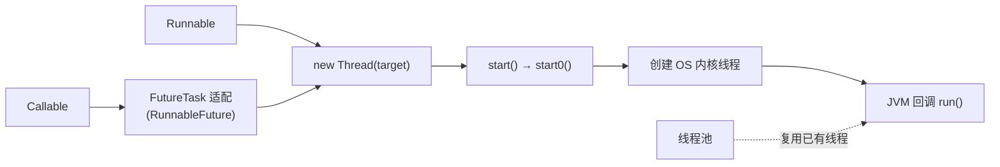
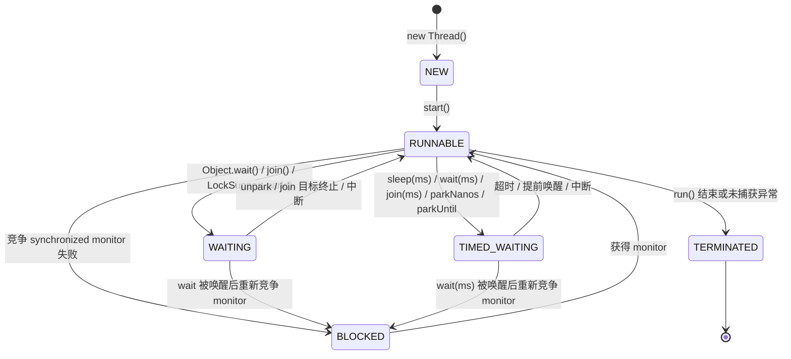

# 线程基础与生命周期

> 一句话概括：Java 线程是「Java 对象 + OS 内核线程」的一次绑定——`start()` 完成绑定、六种状态描述绑定期间的调度处境、`interrupt()` 是唯一的协作式退出信号；
> 本文讲清这次绑定的创建方式、状态语义、阻塞/唤醒 API 的精确差异，以及「优雅停止」为什么只能协作、不能强杀。

预计阅读时间：大约 90 分钟

所属主题：[Java 并发编程常见面试题总结](summary.md)

本文以 JDK 8（HotSpot）为主要基线，源码锚点用 `类名#方法名` 标注；JDK 17/21 LTS 的差异（虚拟线程、`stop/suspend/resume` 降级等）在相关小节单独注明。JDK 17 在本文范围内与 JDK 8 行为基本一致。总结文档给面试结论，本文给机制与源码证据：每个机制按「结论 → 机制 → 边界/代价 → 实践/追问」展开。

---

## 0. 阅读路线

| 读者 | 建议阅读 | 关注点 |
| --- | --- | --- |
| 初级（1 年内） | 1、2.1~2.2、3.1~3.2、4.1、6.1、7.1、8.1~8.2 | 进程/线程区别、四种创建方式、六种状态长什么样、sleep/wait 表面差异、中断三件套、守护线程、手写交替打印 |
| 中级（1~3 年） | 2.3、3.3~3.5、4.2~4.4、5、6.2~6.5、8 全部 | start/join 源码、BLOCKED vs WAITING 易错点、permit 语义、中断标志的清除与恢复、优雅停止两模式、四种手写实现 |
| 高级（3 年+） | 2.3~2.4、4.4、5.3~5.4、6.4、9、10 | ensure_join 的 JVM 侧证据、park 的边界、废弃 API 的版本演进、线程成本账与 native OOM、追问集 |
| 选型/架构 | 1.3、2.2、8.6、9.3，及各节「边界与代价」段 | 平台线程 vs 虚拟线程、为什么用线程池、手写方案选型、线程数估算的适用边界 |

目录：

1. 进程、线程、协程：为什么要多线程
2. 创建线程的四种方式
3. 线程六种状态与转换
4. sleep vs wait vs yield vs join
5. LockSupport：park/unpark 与 permit 语义
6. 中断机制：协作式停止的唯一正解
7. 守护线程、优先级与命名
8. 面试手写：顺序执行与交替打印 ABC
9. 边界与工程：线程不是越多越好
10. 高频面试追问集
11. 参考资料
附：一页速记

---

## 1. 进程、线程、协程：为什么要多线程

### 1.1 进程 vs 线程

**结论**：进程是**资源分配**的基本单位（独立地址空间、文件描述符表），线程是**CPU 调度**的基本单位（共享进程资源，独享栈与寄存器上下文）。一个进程至少有一个线程；Java 程序的 `main` 方法就跑在主线程上。

| 维度 | 进程 | 线程 |
| --- | --- | --- |
| 地址空间 | 独立，互相隔离 | 共享所属进程的堆与方法区；**栈、程序计数器、寄存器上下文私有** |
| 创建/切换成本 | 高（页表、资源表复制） | 低（同一地址空间内切换，无需切换页表） |
| 通信 | IPC：管道、共享内存、socket，需要内核介入 | 直接读写共享堆对象，**但必须自己解决可见性与原子性**（见 [JMM 与 volatile](jmm-and-volatile.md)） |
| 崩溃影响 | 一个进程崩溃一般不影响其它进程 | 一个线程的未捕获异常只终止该线程；但 native 崩溃（如 JNI 段错误）会带走整个进程 |
| Java 对应 | 一个 JVM 实例就是一个进程 | `java.lang.Thread` 实例 |

**边界**：「线程切换比进程便宜」的前提是**同进程内**——不用换页表、TLB 大部分保留。但线程共享地址空间正是并发 bug 的根源：进程隔离是操作系统免费给你的线程安全，线程模型把这份责任交还给了程序员。

### 1.2 并发 vs 并行，为什么要多线程

| 概念 | 含义 | 单核能否实现 |
| --- | --- | --- |
| 并发（concurrency） | 同一时间段内多个任务**交替推进**，宏观同时、微观串行 | 能（时间片轮转） |
| 并行（parallelism） | 同一时刻多个任务**物理上同时执行** | 不能（需要多核/多机） |

多线程的两个根本动机：

1. **提高 CPU 利用率**：单线程遇到 IO（磁盘、网络、锁等待）只能干等，CPU 空转；多线程让等待中的线程让出 CPU，其它线程顶上。IO 密集型收益最大。
2. **提高响应性**：GUI/服务端把耗时任务放到后台线程，主线程/请求线程不被阻塞。

**边界与代价**：多线程不是免费午餐——上下文切换、栈内存、共享状态的同步成本（第 9 节算账）。**CPU 密集型任务开超过核数的线程不会更快**，反而增加切换开销；这条对虚拟线程同样成立（JEP 444 原文：虚拟线程提供的是 throughput 而非 speed）。

### 1.3 Java 的线程模型：1:1 内核线程

**结论**：HotSpot 的平台线程（platform thread）与 OS 内核线程 **1:1 映射**，调度由操作系统完成，JVM 不掌握调度权。JDK 21  Thread javadoc 原文："typically mapped 1:1 to kernel threads scheduled by the operating system"。

这解释了两件事：

- `Thread.yield()`、线程优先级为什么只是「建议」——最终说了算的是 OS 调度器（见 4.3、7.2）；
- 为什么线程是昂贵资源——每个线程要一个内核调度实体 + 约 1MB 栈（见 9.1）。

**协程/虚拟线程一句话**：虚拟线程（JDK 21 正式，JEP 444）是 JVM 在用户态调度的轻量线程，M:N 挂载到少量载体线程（carrier thread）上，阻塞时卸载而非占用 OS 线程，适合海量 IO 阻塞任务；它**不是更快的线程，也不该池化**。完整机制、pinning 与选型见 [虚拟线程](virtual-threads.md)，本文只在状态与中断处注明差异。

---

## 2. 创建线程的四种方式

### 2.1 四种方式对比

**结论**：面试口径的「四种方式」是**任务定义与提交方式**的四种组合；JVM 层面真正创建线程的只有一条路——`new Thread(...).start()`（2.4 展开）。

| 方式 | 写法 | 返回值 | 异常传播 | 适用 |
| --- | --- | --- | --- | --- |
| 继承 Thread | `class T extends Thread` 覆写 `run()` | 无 | run 内未捕获异常交给 UncaughtExceptionHandler | 教学演示；需要覆写 Thread 其它方法时 |
| 实现 Runnable | `new Thread(runnable).start()` | 无 | 同上 | **推荐**：任务与执行解耦 |
| Callable + FutureTask | `new Thread(new FutureTask<>(callable)).start()` | `FutureTask#get()` 取结果 | 异常包装为 `ExecutionException` | 需要返回值/取消/超时 |
| 线程池 | `ExecutorService#submit/execute` | `Future` | 同上（submit）；execute 的异常走 UncaughtExceptionHandler | **生产推荐**：复用线程、控制并发度 |

```java
// 方式 1：继承 Thread
class MyThread extends Thread {
    @Override public void run() { System.out.println(getName() + " running"); }
}
new MyThread().start();

// 方式 2：实现 Runnable（JDK 8 起可用 lambda）
Runnable task = () -> System.out.println(Thread.currentThread().getName() + " running");
new Thread(task, "worker-1").start();

// 方式 3：Callable + FutureTask
Callable<Integer> sum = () -> 1 + 1;
FutureTask<Integer> ft = new FutureTask<>(sum);
new Thread(ft, "calc-1").start();
Integer result = ft.get();          // 阻塞到算完；任务抛异常则 get 抛 ExecutionException

// 方式 4：线程池（示意；生产参数见 thread-pool.md）
ExecutorService pool = Executors.newFixedThreadPool(4);
Future<Integer> f = pool.submit(sum);
pool.shutdown();
```

### 2.2 为什么推荐 Runnable / 线程池

**结论**：三个理由——**解耦、单继承、资源管理**。

1. **任务与执行解耦**：Runnable/Callable 只描述「做什么」，不关心「谁来跑、跑几次」。同一个任务可以交给 Thread、线程池、`ForkJoinPool`，甚至当前线程直接 `run()`（测试时）。继承 Thread 把任务和线程焊死。
2. **Java 单继承**：继承了 Thread 就不能再继承业务基类；实现接口没有这个限制，且天然适配 lambda。
3. **资源管理**：裸 `new Thread` 无法控制总量、无法复用、无法统一命名/监控/拒绝策略。线程池把「线程生命周期」与「任务生命周期」分离，线程是昂贵资源必须池化（虚拟线程除外，见 1.3）。

**边界与代价**：`Executors.newFixedThreadPool/newCachedThreadPool` 这类快捷工厂在生产被普遍禁用——前者用无界 `LinkedBlockingQueue` 堆积任务可致 OOM，后者线程数上限 `Integer.MAX_VALUE` 可致创建线程失控；应直接用 `ThreadPoolExecutor` 显式指定七参数。参数权衡、拒绝策略与监控见 [线程池](thread-pool.md)。

**追问：Callable 和 Runnable 区别？** 三点：`call()` 有返回值、可抛受检异常、只能经 FutureTask/线程池提交（没有 `new Thread(callable)` 构造器）。FutureTask 是适配器：`implements RunnableFuture<V>`（= Runnable + Future），`FutureTask#run` 内调 `callable.call()`，结果/异常写入状态字段，`get()` 经 `FutureTask#awaitDone` 用 LockSupport 阻塞等待，完成后 `FutureTask#finishCompletion` 逐个 unpark 等待者。状态机与 get 的完整源码见 [ForkJoin 与 CompletableFuture](forkjoin-and-completable-future.md)。

### 2.3 Thread#start 源码要点

**结论**：`start()` 做三件事——校验状态、登记线程组、调 native `start0()` 创建 OS 线程；**一个 Thread 实例只能 start 一次**，直接调 `run()` 只是普通方法调用。

```java
// java.lang.Thread#start —— JDK 8（jdk8u 源码）
public synchronized void start() {
    // threadStatus == 0 对应 NEW；非 0 说明已 start 过（含已终止）
    if (threadStatus != 0)
        throw new IllegalThreadStateException();
    group.add(this);                 // 登记进 ThreadGroup，unstarted 计数减一
    boolean started = false;
    try {
        start0();                    // native：创建 OS 线程，由 JVM 回调 run()
        started = true;
    } finally {
        try {
            if (!started) {
                group.threadStartFailed(this);   // 创建失败回滚组内登记
            }
        } catch (Throwable ignore) { }
    }
}
private native void start0();
```

三个要点：

1. **不能重复 start**：`threadStatus` 是 VM 维护的字段（`private volatile int threadStatus`），start 后不再为 0；线程终止后状态是 TERMINATED 而非回到 NEW，所以**终止的线程也不能复活**。OS 线程已销毁，Java 对象救不回来。
2. **start ≠ run**：`start()` 返回后是「两个线程并发」——调用线程继续往下走，新线程由 JVM 在**新 OS 线程**上回调 `run()`。直接 `t.run()` 在当前线程同步执行，没有新线程、没有并发。

```java
// java.lang.Thread#run —— JDK 8
@Override
public void run() {
    if (target != null) {            // target 即构造器传入的 Runnable
        target.run();
    }
}
```

3. **start 是 synchronized 的**：防止两个线程同时对同一实例 start 造成双重创建；这也是「线程安全发布」的一部分——start 之前的写操作对 run 内可见（happens-before 规则，见 [JMM 与 volatile](jmm-and-volatile.md)）。

**追问：为什么 run() 里能拿到构造时传入的 Runnable？** Thread 本身也实现了 Runnable，`run()` 默认实现就是委托 `target.run()`；继承 Thread 覆写 run 时 target 为 null，走子类逻辑。这是模板方法的朴素应用。

### 2.4 本质：只有一种创建方式

**结论**：四种方式在 JVM 层面收敛为一种——`Thread` 实例 + `start()`。Runnable/Callable 只是**任务载体**，FutureTask 把 Callable 适配成 Runnable，线程池把「提交任务」适配成「复用已有线程执行 Runnable」。



**实践**：面试答「四种方式」后主动补一句「本质都是 Thread + start，区别在任务定义与资源管理」，是区分背题与理解的分水岭。

---

## 3. 线程六种状态与转换

### 3.1 Thread.State 六态

**结论**：`Thread.State` 枚举定义六种状态（JDK 5 引入），是 **JVM 层面的虚拟状态**，javadoc 明确："These states are virtual machine states which do not reflect any operating system thread states."

| 状态 | 含义 | 进入方式（API 清单） | 离开条件 |
| --- | --- | --- | --- |
| NEW | 已创建未启动 | `new Thread(...)` | `start()` |
| RUNNABLE | 可运行（含 OS 就绪/运行中，甚至传统 IO 阻塞） | start 后；从其它状态被唤醒/超时 | 阻塞、等待、终止 |
| BLOCKED | **等待 synchronized 的 monitor 锁** | 进入 synchronized 块/方法失败；`Object.wait` 被唤醒后**重新竞争** monitor | 拿到 monitor |
| WAITING | 无限期等待其它线程的特定动作 | `Object.wait()`（无超时）、`Thread.join()`（无超时）、`LockSupport.park()` | notify/notifyAll + 重获锁；join 目标终止；unpark；中断 |
| TIMED_WAITING | 限期等待 | `Thread.sleep(ms)`、`Object.wait(ms)`、`Thread.join(ms)`、`LockSupport.parkNanos`、`LockSupport.parkUntil` | 超时；或提前被唤醒/中断 |
| TERMINATED | run 结束（正常返回或异常逃逸） | run() 执行完毕 | **不可逆** |

以上清单与 `Thread.State` javadoc 逐条对应（WAITING 恰好列三个方法、TIMED_WAITING 恰好列五个，均要求正等待时间）。

### 3.2 状态转换图



注意图中两条容易漏画的边：**WAITING/TIMED_WAITING → BLOCKED**。`Object.wait` 被 notify 唤醒后不能直接执行，必须先重新拿到 monitor（javadoc："The awakened thread will not be able to proceed until the current thread relinquishes the lock"），这段竞争期就是 BLOCKED。而 `LockSupport.park` 被 unpark 后直接回 RUNNABLE——它不关联 monitor。

### 3.3 Java 状态 ≠ OS 状态

**结论**：Java 的 RUNNABLE 是个「大口袋」，合并了 OS 的 ready 与 running，甚至包含传统阻塞 IO。

- **ready/running 不分**：javadoc 原文 "executing in the Java virtual machine but it may be waiting for other resources from the operating system such as processor"——等 CPU 时间片也是 RUNNABLE。Java 层面无法区分「正在跑」和「排队等核」。
- **传统 IO 阻塞也是 RUNNABLE**：线程阻塞在 `SocketInputStream#read` 等 native IO 上时，OS 层面线程已休眠，但 JVM 不感知这种阻塞，`getState()` 仍返回 RUNNABLE。所以「RUNNABLE 的线程一定在消耗 CPU」是错的——jstack 里大量 RUNNABLE 却 CPU 不高，多半卡在 socket read。

**实践**：排查 CPU 高时，`top -Hp <pid>` 找高 CPU 线程 → 线程 id 转十六进制 → jstack 里按 nid 匹配；排查「卡住不动」时，RUNNABLE 的线程要看栈顶是不是 IO，而不是只看状态。完整排查链路见 [死锁与排查](deadlock-and-troubleshooting.md)。

### 3.4 BLOCKED vs WAITING：高频易错点

**结论**：**BLOCKED 只属于 synchronized 的 monitor 等待**；`ReentrantLock.lock()` 拿不到锁时线程是 **WAITING**（AQS 内部用 `LockSupport.park` 阻塞），不是 BLOCKED。

| 场景 | getState() | 原因 |
| --- | --- | --- |
| 进入 synchronized 失败 | BLOCKED | JVM monitor 竞争，VM 直接置状态 |
| wait 被唤醒后重抢 monitor | BLOCKED | 同上 |
| `ReentrantLock.lock()` 排队 | **WAITING** | `AbstractQueuedSynchronizer#acquireQueued` → `parkAndCheckInterrupt` → `LockSupport.park` |
| `lock.tryLock(timeout)` 排队 | TIMED_WAITING | AQS 用 `parkNanos` |
| `Object.wait()` | WAITING | monitor 的 wait set |
| `Thread.sleep(ms)` | TIMED_WAITING | 与锁无关 |

**机制**：BLOCKED 是 JVM 为 monitor 机制专设的状态，由 VM 在 monitorenter 失败时设置；而 JUC 锁完全构建在 LockSupport 之上，park 对应 WAITING。两条阻塞路径在 JVM 眼里是不同机制。AQS 的队列与 park 细节见 [AQS 与锁](aqs-and-locks.md)。

**可运行验证**（JDK 8）：

```java
public class BlockedVsWaiting {
    private static final Object MONITOR = new Object();
    private static final ReentrantLock LOCK = new ReentrantLock();

    public static void main(String[] args) throws Exception {
        Thread holder = new Thread(() -> {
            synchronized (MONITOR) {
                try { Thread.sleep(60_000); } catch (InterruptedException ignored) { }
            }
        }, "monitor-holder");
        holder.start();
        Thread.sleep(100);                       // 确保 holder 先持有 monitor

        Thread blocked = new Thread(() -> {
            synchronized (MONITOR) { }           // 竞争 monitor 失败
        }, "synchronized-waiter");
        blocked.start();
        Thread.sleep(100);
        System.out.println(blocked.getState());  // BLOCKED

        Thread lockHolder = new Thread(() -> {
            LOCK.lock();
            try { Thread.sleep(60_000); } catch (InterruptedException ignored) { }
            finally { LOCK.unlock(); }
        }, "lock-holder");
        lockHolder.start();
        Thread.sleep(100);

        Thread waiting = new Thread(() -> {
            LOCK.lock();                         // AQS 内 park
            try { } finally { LOCK.unlock(); }
        }, "lock-waiter");
        waiting.start();
        Thread.sleep(100);
        System.out.println(waiting.getState());  // WAITING
    }
}
```

**追问：jstack 里怎么区分？** BLOCKED 的栈会标注 `waiting to lock <0x...>`（monitor 地址）；AQS 等待的线程状态是 WAITING (parking)，栈顶是 `LockSupport.park` → `acquireQueued`，jstack 打印 `parking to wait for <0x...>`（括号里是 `ReentrantLock$NonfairSync` 这类具体同步器）。看到 parking 就别答 BLOCKED。

### 3.5 TERMINATED 不可逆

**结论**：run 结束（正常返回或异常逃逸）后状态置 TERMINATED，**永不回到 NEW**，再 start 抛 `IllegalThreadStateException`（2.3 的 `threadStatus != 0` 检查）。需要「再跑一次」只能新建 Thread 实例或向线程池再提交一个任务。

**JDK 21 差异（虚拟线程 getState）**：网传「虚拟线程 getState 恒为 RUNNABLE」对 JDK 21 GA **不成立**。`VirtualThread#threadState`（jdk-21+35 源码）在 PARKED/PINNED 时返回 `WAITING`，RUNNING 且已挂载时返回**载体线程的状态**，运行/阻塞相关状态中其余返回 RUNNABLE（NEW/TERMINATED 原样映射）；jdk21u 更新版进一步把 TIMED_PARKED/TIMED_PINNED 映射为 TIMED_WAITING。预览期（JDK 19/20）的行为本文未逐一核验，引用时注意版本。详见 [虚拟线程](virtual-threads.md)。

---

## 4. sleep vs wait vs yield vs join

### 4.1 四 API 对比总表

| 维度 | sleep | wait | yield | join |
| --- | --- | --- | --- | --- |
| 所属类 | Thread（静态） | Object（实例） | Thread（静态） | Thread（实例） |
| 使用前提 | 无 | **必须持有该对象的 monitor**，否则 IllegalMonitorStateException | 无 | 无（内部 synchronized 目标线程对象） |
| 是否释放锁 | **不释放**任何 monitor | **释放**，但只释放调用对象这一个 monitor，其它已持有的锁不放 | 不释放 | 内部 wait 会释放目标 Thread 对象的 monitor；不影响调用者持有的其它锁 |
| 是否让出 CPU | 是 | 是 | 提示让出，调度器可忽略 | 是（等待期间） |
| 唤醒方式 | 超时 / 中断 | notify/notifyAll / 超时 / 中断 | 调度器重新调度 | 目标线程终止 / 超时 / 中断 |
| InterruptedException | 抛，且**清除中断标志** | 抛，且清除标志 | 不抛 | 抛，且清除标志 |
| 线程状态 | TIMED_WAITING | WAITING / TIMED_WAITING | **仍 RUNNABLE** | WAITING / TIMED_WAITING |
| 典型用途 | 暂停执行、轮询间隔 | 线程协作（条件等待） | 让同优先级线程有机会跑 | 等待某线程完成 |

### 4.2 sleep 不释放锁，wait 释放锁

**结论**：`sleep` 抱着锁睡觉，`wait` 把锁让出来等通知——这是两者最本质的区别，也是「sleep 能不能用于线程协作」的答案：不能，它不释放锁，别人进不来。

sleep javadoc 原文："The thread does not lose ownership of any monitors." 可运行验证：

```java
public class SleepKeepsLock {
    private static final Object LOCK = new Object();
    public static void main(String[] args) throws Exception {
        Thread t1 = new Thread(() -> {
            synchronized (LOCK) {
                System.out.println("t1 拿到锁，sleep 2s（不释放）");
                try { Thread.sleep(2000); } catch (InterruptedException e) { return; }
                System.out.println("t1 醒来，仍持有锁");
            }
        });
        Thread t2 = new Thread(() -> {
            synchronized (LOCK) { System.out.println("t2 拿到锁"); }
        });
        t1.start();
        Thread.sleep(100);
        t2.start();                              // t2 必须等 t1 睡醒释放锁
        t1.join(); t2.join();
    }
}
// 输出顺序固定：t1 拿到锁 → (2 秒后) t1 醒来 → t2 拿到锁
```

wait 的三条硬语义（Object javadoc 原文核验）：

1. **前提**：调用线程必须持有该对象 monitor（synchronized 块/方法内），否则 `IllegalMonitorStateException`；notify/notifyAll 同样要求。
2. **释放范围**：只释放调用对象这一个 monitor——"unlocks only this object; any other objects on which the current thread may be synchronized remain locked"。嵌套锁场景下 wait 不会放掉外层锁。
3. **必须在 while 循环里 wait**：javadoc 明确 spurious wakeup（虚假唤醒）存在，且被唤醒后条件未必成立（notifyAll 唤醒多个、条件被抢先消费），"waits should always occur in loops"。用 if 判断条件是经典 bug。

**机制与边界**：wait/notify 依赖 monitor 的 wait set / entry list，涉及对象头、ObjectMonitor 的 WaitSet 与 EntryList 迁移、notify 的任意唤醒策略——这些归 [synchronized 与锁升级](synchronized-and-lock-escalation.md)，本文只强调 API 语义：**notify 随机唤醒一个，多条件场景必须 notifyAll 或改用 Condition 精确唤醒**（8.2/8.3 有对照实现）。

### 4.3 yield：只是提示

**结论**：`Thread.yield()` 向调度器提示「我愿意让出当前时间片」，javadoc 原文 "The scheduler is free to ignore this hint"、"It is rarely appropriate to use this method"。线程从 running 回到 ready（Java 状态仍是 RUNNABLE），不释放任何锁，不抛 InterruptedException。

**边界**：在 Linux CFS 调度器下 yield 的效果极弱，可能立刻又被调度回来；它不能用来做线程协作或「礼让」保证。自旋等待里偶尔用 yield 降低空转强度，但正确做法是 park 或 `Thread.onSpinWait`（JDK 9+）。

### 4.4 join：底层是 wait，不是 sleep

**结论**：`t.join()` 的语义是「等待 t 终止」，实现是**在 t 这个 Thread 对象上 synchronized + while(isAlive()) wait**；线程终止时 **JVM 会 notifyAll 这个对象**，所以官方明确建议：**不要在 Thread 实例上调用 wait/notify/notifyAll**。

```java
// java.lang.Thread#join(long) —— JDK 8（jdk8u 源码）
public final synchronized void join(long millis) throws InterruptedException {
    long base = System.currentTimeMillis();
    long now = 0;
    if (millis < 0) throw new IllegalArgumentException("timeout value is negative");
    if (millis == 0) {
        while (isAlive()) {
            wait(0);                    // 在「目标线程对象」上 wait，不是 sleep！
        }
    } else {
        while (isAlive()) {
            long delay = millis - now;
            if (delay <= 0) break;
            wait(delay);
            now = System.currentTimeMillis() - base;
        }
    }
}
public final void join() throws InterruptedException { join(0); }   // 0 = 无限等
```

**机制（JVM 侧证据）**：线程退出路径 `JavaThread::run → thread_main_inner → JavaThread::exit → ensure_join`，在 HotSpot `thread.cpp` 中：

```cpp
// hotspot/src/share/vm/runtime/thread.cpp —— ensure_join（JDK 8）
static void ensure_join(JavaThread* thread) {
  Handle threadObj(thread, thread->threadObj());
  ObjectLocker lock(threadObj, thread);             // 锁住 Thread 对象
  thread->clear_pending_exception();
  java_lang_Thread::set_thread_status(threadObj(), java_lang_Thread::TERMINATED);
  java_lang_Thread::set_thread(threadObj(), NULL);  // isAlive() 变 false
  lock.notify_all(thread);                          // 唤醒所有 join 等待者
  thread->clear_pending_exception();
}
```

即：join 的唤醒不是某个 Java 方法调的 notify，而是 **VM 在线程退出时自动做的 notifyAll**。join 的 while 循环防的正是虚假唤醒与「notifyAll 后 isAlive 仍可能短暂为真」的竞态。

**边界与代价**：

- 若你在业务代码里对同一个 Thread 实例 wait/notify，会和 VM 的 notifyAll 互相干扰——你的 wait 可能被线程终止「意外」唤醒，你的 notify 可能唤醒别人的 join。**Thread 对象的 monitor 被 JVM 征用了**。
- `join(ms)` 超时返回**不代表目标线程已终止**，只表示等够了；需要确认结果要再查 `isAlive()`。
- join 抛 InterruptedException 时清除的是**调用线程**的中断标志，目标线程不受影响。

**JDK 21 差异**：平台线程 join 仍是这套 wait 循环（javadoc Implementation Note 保留原文，限定 "For platform threads"）；虚拟线程 join 走 `VirtualThread#joinNanos` 独立分支，不再依赖 Thread 对象 monitor。另 JDK 19 起新增 `join(Duration)` 返回 boolean 表示是否在时限内终止。

**追问：为什么 join 不用 sleep 轮询 isAlive？** sleep 轮询有延迟与空转开销，且无法被「线程终止」事件精确唤醒；wait + VM notifyAll 是事件驱动，终止即唤醒，零轮询。

---

## 5. LockSupport：park/unpark 与 permit 语义

### 5.1 permit：每线程一张「许可证」

**结论**：LockSupport 给每个线程关联一个 permit（语义类似 Semaphore 但**最多 1 个、不累计**）：`park` 消费 permit，有则立即返回、无则阻塞；`unpark` 发放 permit。**先 unpark 后 park 不会阻塞**——这是它相对 wait/notify 的核心优势。

javadoc 原文："A call to park will return immediately if the permit is available, consuming it in the process; otherwise it may block." / "Unlike with Semaphores though, permits do not accumulate. There is at most one." / "Races between one thread invoking park and another thread trying to unpark it will preserve liveness, due to the permit."

```java
// 先 unpark 后 park：permit 已备好，park 立即返回
Thread t = new Thread(() -> {
    try { Thread.sleep(500); } catch (InterruptedException ignored) { }
    LockSupport.park();                 // permit=1，消费后立即返回，不阻塞
    System.out.println("park 没有阻塞");
});
t.start();                              // 必须先 start：对未启动线程 unpark 不保证生效
LockSupport.unpark(t);                  // 发放 permit（0→1）
```

**机制**：Java 层 `LockSupport#park` 委托 `Unsafe#park`，底层由每线程一个的 HotSpot `Parker` 对象负责阻塞/唤醒（`park.cpp` 中 `Parker::Allocate`/`Parker::Release` 可见），Linux 上以 pthread mutex + 条件变量实现；unpark 发放许可并唤醒，park 检查并消费许可。`park(Object blocker)` 额外记录 blocker 字段。

### 5.2 与 wait/notify 对比

| 维度 | wait/notify | park/unpark |
| --- | --- | --- |
| 是否需要锁 | **必须**持有 monitor | 不需要，任何位置可调 |
| 顺序敏感 | 先 notify 后 wait → **永久等待**（通知丢失） | 先 unpark 后 park → permit 兜底，不阻塞 |
| 唤醒目标 | notify 随机唤醒 wait set 中一个 | unpark **精确指定线程** |
| 中断响应 | 抛 InterruptedException，清标志 | **只是返回**，不抛异常，标志保留 |
| 超时 | wait(ms) | parkNanos / parkUntil（deadline 为 epoch 毫秒） |
| 虚假唤醒 | 有，需 while | 有（"may return at any other time, for no reason"），需 while |
| 状态 | WAITING/TIMED_WAITING（BLOCKED 重抢锁） | WAITING/TIMED_WAITING |
| 定位 | Object 的通用协作原语 | JUC 的底层阻塞原语 |

### 5.3 中断行为与 AQS 的使用

**结论**：park 被中断时**静默返回**，不抛 InterruptedException、不清中断标志——javadoc："This method does not report which of these caused the method to return. Callers should re-check the conditions... Callers may also determine, for example, the interrupt status of the thread upon return."

这正是 AQS 需要的语义：`AbstractQueuedSynchronizer#acquireQueued` 里 `parkAndCheckInterrupt` 先 park、返回后查中断标志，**拿锁失败/被中断都不抛异常**，而是记录中断、继续排队，拿到锁后再 `selfInterrupt` 补上中断——所以 `lock()` 不响应中断而 `lockInterruptibly()` 响应（后者走 `acquireInterruptibly`，park 返回后查到中断直接抛）。完整推演见 [AQS 与锁](aqs-and-locks.md)。FutureTask 的 `awaitDone` 同样用 park/parkNanos 阻塞 get 等待者（2.2）。

**blocker 参数**：`park(Object blocker)` 把「为什么阻塞」记录到线程的 parkBlocker 字段，jstack/监控工具经 `LockSupport#getBlocker` 读取。javadoc "strongly encouraged" 用带 blocker 的重载，锁实现里传 `this`。裸 `park()` 在 jstack 里看不出阻塞原因，排查成本高。

### 5.4 边界与代价

1. **必须 while 重查条件**：park 可能无理由返回，官方推荐形态 `while (!canProceed()) { ... LockSupport.park(this); }`。park 本身不带条件，条件判断是调用者的责任。
2. **permit 不计数、会被「中间环节」消费**：javadoc 警告 "any intermediary uses of park could interfere with its intended effects"——若框架代码在你 park 之前消费了 permit，你的 park 会意外阻塞/放行。不要在同一个线程上混用多套 park 协议。
3. **对未 start 的线程 unpark 不保证生效**（javadoc 原文），5.1 示例必须先 start。
4. **park 不释放任何锁**：抱着 synchronized monitor 去 park 会把锁一起带进等待——和 sleep 一样，这是死锁温床（8.5 的实现刻意不在锁内 park）。

**追问：park 和 sleep 都能暂停线程，区别在哪？** sleep 是「定时暂停」，到点必醒、响应中断抛异常；park 是「条件阻塞原语」，靠 unpark/permit 精确唤醒、中断只返回，且不需要锁。sleep 给人用，park 给同步器用。

---

## 6. 中断机制：协作式停止的唯一正解

### 6.1 三件套：interrupt / isInterrupted / Thread.interrupted

**结论**：中断是**协作信号**，不是强制停止——`interrupt()` 只做两件事：置中断标志、唤醒可中断阻塞（sleep/wait/join/park/NIO）。线程是否退出、何时退出，由线程自己的代码决定。

| 方法 | 类型 | 作用 | 是否清标志 |
| --- | --- | --- | --- |
| `t.interrupt()` | 实例 | 置 t 的中断标志；若 t 阻塞在 sleep/wait/join 则使其抛 InterruptedException | 置位（不清） |
| `t.isInterrupted()` | 实例 | 查 t 的标志 | **不清** |
| `Thread.interrupted()` | **静态** | 查**当前线程**的标志 | **清除** |

```java
// java.lang.Thread —— JDK 8（jdk8u 源码）
public static boolean interrupted() {
    return currentThread().isInterrupted(true);    // true = 查完清除
}
public boolean isInterrupted() {
    return isInterrupted(false);                   // false = 只查不清
}
private native boolean isInterrupted(boolean ClearInterrupted);
```

```java
// 清除语义演示
Thread.currentThread().interrupt();
System.out.println(Thread.interrupted());   // true（并清除）
System.out.println(Thread.interrupted());   // false
System.out.println(Thread.currentThread().isInterrupted()); // false
```

**机制**：`interrupt()` 的 JDK 8 实现先 `checkAccess`，再在 `blockerLock` 内检查 NIO 的 `Interruptible` blocker（有则 `interrupt0()` 置标志后调 `b.interrupt(this)` 关闭通道），否则直接 `interrupt0()`（native：置标志 + 唤醒 sleep/wait/join/park）。JDK 21 改为先置 `interrupted = true` 再 `interrupt0()`，NIO blocker 字段更名 `nioBlocker`，语义不变。

**边界**：对**未启动或已终止**的线程 interrupt 不会置标志（javadoc：中断被忽略时 isInterrupted 返回 false）；interrupt 自己不会让一个正在跑普通代码的线程停下来——它只是把标志置 1，线程不检查就永远不知道。

### 6.2 哪些阻塞响应中断，哪些不响应

**结论**：可中断阻塞抛 InterruptedException 并**清除标志**；不可中断阻塞只置标志、线程继续等。这是「interrupt 为什么停不掉某些线程」的根源。

| 阻塞场景 | 响应中断？ | 行为 |
| --- | --- | --- |
| sleep / wait / join | 是 | 抛 InterruptedException，**标志被清除** |
| LockSupport.park | 是（返回） | 不抛异常，标志保留 |
| synchronized 锁等待 | **否** | 继续 BLOCKED，只置标志；拿到锁后也不抛 |
| ReentrantLock.lock() | **否** | 继续 WAITING（park），AQS 拿锁后 selfInterrupt 补标志 |
| lockInterruptibly() / tryLock(ms) | 是 | 抛 InterruptedException |
| BlockingQueue.put/take | 是 | 抛 InterruptedException |
| 传统 Socket/ServerSocket IO | **否** | 需 close socket 使其抛 SocketException |
| InterruptibleChannel（NIO） | 是 | 抛 ClosedByInterruptException 并关闭通道 |

**追问：为什么 synchronized 设计成不响应中断？** monitor 是 JVM 内建原语，语义是「要么拿到锁要么一直等」，没有给中断留出口；这也是 JUC 锁相对 synchronized 的能力增量之一（可中断、可超时、可公平）。代价是 AQS 的复杂度，见 [AQS 与锁](aqs-and-locks.md)。

### 6.3 正确处理 InterruptedException

**结论**：捕获后只有两种正确做法——**向上抛**（让调用者决定），或**恢复中断标志**（`Thread.currentThread().interrupt()`）。**禁止空 catch**：异常抛出时标志已被清除，吞掉异常等于把取消信号彻底抹掉。

```java
// ❌ 吞掉中断：标志已清，上层再也感知不到取消请求
try { Thread.sleep(1000); } catch (InterruptedException e) { /* ignore */ }

// ✅ 方式 1：能抛就抛，把决策权交给调用者
void doWork() throws InterruptedException {
    Thread.sleep(1000);
}

// ✅ 方式 2：不能抛（如 Runnable#run 签名限制），恢复标志
@Override public void run() {
    try {
        while (!Thread.currentThread().isInterrupted()) {
            Thread.sleep(100);
            // do work
        }
    } catch (InterruptedException e) {
        Thread.currentThread().interrupt();   // 恢复标志，供上层/下次循环检测
    }
}
```

**机制**：为什么抛出时要清标志？因为「抛出异常」本身就是中断的交付方式，标志与异常二选一，避免重复处理；但这把「是否继续响应中断」的责任交给了 catch 块。恢复标志后，循环条件 `isInterrupted()` 下一轮即为 true，线程得以退出。

### 6.4 为什么 stop/suspend/resume 被废弃

**结论**：`stop` 破坏一致性，`suspend` 制造死锁——两者都是「外部强权干预线程」，与协作式模型根本冲突。

- **stop()**：向目标线程抛 `ThreadDeath`（Error），异常沿栈传播时**释放它持有的所有 monitor**（javadoc 原文："causes it to unlock all of the monitors that it has locked"）。若此时共享对象正处于「改了一半」的中间态，损坏状态立刻对其它线程可见，且无任何报错。官方建议替代方案正是「volatile 标志 + interrupt」（6.5）。
- **suspend()**：挂起时**不释放锁**。若目标线程持有某关键 monitor 被挂起，而负责 resume 它的线程恰好需要先拿这把锁 → 死锁，表现为进程「冻结」。
- **resume()**：仅为 suspend 配套，一并废弃。

**版本演进（已核验 JDK 20 Release Notes）**：

| 版本 | 行为 |
| --- | --- |
| JDK 1.2 起 | 三者标记 @Deprecated，但 stop 仍真的抛 ThreadDeath |
| JDK 18 | `Thread.stop` 终端废弃（forRemoval，JDK-8277861） |
| JDK 19 | ThreadGroup 的 stop/suspend/resume 改为抛 UnsupportedOperationException |
| **JDK 20** | `Thread.stop`（JDK-8289610）、`Thread.suspend/resume`（JDK-8249627）改为**无条件抛 UnsupportedOperationException**；ThreadDeath 标记 deprecated for removal |
| JDK 21 | 三者均 `@Deprecated(since="1.2", forRemoval=true)`，方法体只剩 `throw new UnsupportedOperationException()`（源码核验） |

**实践**：JDK 8 项目里 stop 仍能「成功」执行——这才是最危险的，代码评审应把 stop/suspend 列为禁项；升级到 JDK 20+ 后调用即炸，反而把隐患提前暴露。

### 6.5 优雅停止线程的两种模式

**结论**：模式一「volatile 标志位」适合纯计算/短任务；模式二「interrupt」能唤醒阻塞，是通用解；两者可组合。**没有第三种正解**——stop 已死，协作是唯一模型。

**模式一：volatile 标志位**

```java
public class FlagStop implements Runnable {
    private volatile boolean cancelled = false;      // volatile 保证可见性
    public void cancel() { cancelled = true; }
    @Override public void run() {
        while (!cancelled) {
            // do work：每轮循环检查一次
        }
        System.out.println("优雅退出");
    }
}
```

边界：线程若阻塞在 sleep/wait/IO 上，**标志位改了也叫不醒**——它根本没机会执行到检查点。所以标志位模式要求任务体不含长阻塞，或阻塞本身可被其它手段打断。

**模式二：interrupt（完整可运行）**

```java
public class InterruptStop implements Runnable {
    @Override public void run() {
        try {
            while (!Thread.currentThread().isInterrupted()) {
                // do work，可能阻塞
                Thread.sleep(100);
            }
        } catch (InterruptedException e) {
            // sleep 中被中断：标志已清，这里直接退出循环
            Thread.currentThread().interrupt();      // 按惯例恢复，便于上层感知
        }
        System.out.println("优雅退出");
    }
    public static void main(String[] args) throws Exception {
        Thread t = new Thread(new InterruptStop());
        t.start();
        Thread.sleep(500);
        t.interrupt();      // 睡着 → 立刻抛 InterruptedException；醒着 → 置标志下轮退出
        t.join();
    }
}
```

**组合与边界**：

- 标志位 + interrupt 组合：`cancel()` 里既置标志又 `t.interrupt()`，兼顾「醒着查标志」与「睡着被叫醒」。
- interrupt **叫不醒** synchronized 锁等待与传统 Socket IO（6.2）：前者只能等锁释放，后者需 `socket.close()`。设计可取消任务时，优先选可中断的阻塞 API（lockInterruptibly、BlockingQueue、NIO）。
- 线程池场景不要直接 interrupt 工作线程（会破坏池的复用），用 `Future#cancel(true)` / `shutdownNow()`，见 [线程池](thread-pool.md)。

**追问：为什么 volatile 标志位不能替代 interrupt？** 可见性 ≠ 唤醒能力。volatile 只保证「醒着的线程能看到新值」，对阻塞中的线程无能为力；interrupt 兼具置标志与唤醒可中断阻塞两种能力。

---

## 7. 守护线程、优先级与命名

### 7.1 守护线程 setDaemon

**结论**：守护线程（daemon）是「服务性」线程（GC、JIT 编译、监控），**JVM 在所有非守护线程结束后即退出，不等守护线程**。`setDaemon(true)` 必须在 `start()` 之前调用。

```java
// java.lang.Thread#setDaemon —— JDK 8（jdk8u 源码）
public final void setDaemon(boolean on) {
    checkAccess();
    if (isAlive()) {
        throw new IllegalThreadStateException();   // 已启动不允许改
    }
    daemon = on;
}
```

JVM 退出的两个条件（Thread 类 javadoc）：`Runtime.exit` 被调用；或**所有非守护线程死亡**。推论：

1. **守护线程的 finally 不保证执行**：JVM 退出时守护线程被直接终止，不会等它跑完 run，finally/资源释放都可能被跳过。因此守护线程**不应持有需要可靠释放的资源**（文件句柄、数据库连接、未落盘数据）——这是《Java Concurrency in Practice》的明确告诫，也是 JVM 退出语义的直接推论。
2. **main 结束 ≠ JVM 结束**：只要还有非守护线程活着，JVM 就不退出；反过来 main 结束后只剩守护线程，JVM 立即退出。

```java
public class DaemonDemo {
    public static void main(String[] args) throws Exception {
        Thread t = new Thread(() -> {
            try {
                while (true) { Thread.sleep(100); System.out.println("daemon running"); }
            } catch (InterruptedException e) {
                System.out.println("interrupted");
            } finally {
                System.out.println("finally 执行了吗？");   // JVM 退出时不保证
            }
        });
        t.setDaemon(true);          // 必须在 start 前
        t.start();
        Thread.sleep(350);
        System.out.println("main 结束，只剩守护线程 → JVM 退出");
    }
}
```

**JDK 21 差异**：虚拟线程**永远是守护线程**，`setDaemon(false)` 抛 IllegalArgumentException（源码核验），`setDaemon(true)` 静默接受；即虚拟线程不会阻止 JVM 退出。详见 [虚拟线程](virtual-threads.md)。

**追问：线程池的线程是守护线程吗？** 默认不是（`Executors.defaultThreadFactory` 创建非守护线程），所以忘了 shutdown 的线程池会阻止 JVM 退出——这是「main 跑完了程序却不结束」的常见原因。

### 7.2 线程优先级为什么不可靠

**结论**：优先级（1~10，默认 5）只是给 OS 调度器的**建议**，Java 规范不保证高优先级先跑，生产代码不应依赖它做任何正确性假设。

三个原因：

1. **映射有损**：Java 10 级优先级要映射到 OS 的调度策略（Linux CFS 的 nice 值粒度、Windows 的优先级类），不同平台映射不同，可能多对一。
2. **线程组上限**：`setPriority` 实际取 `min(newPriority, group.getMaxPriority())`（javadoc 原文），设 10 可能被组上限压回 5。
3. **调度器自由裁量**：现代调度器以公平/吞吐为目标，优先级影响有限；1:1 模型下 JVM 说了不算（1.3）。

常量核验（jdk8u 源码）：`MIN_PRIORITY = 1`、`NORM_PRIORITY = 5`、`MAX_PRIORITY = 10`；新线程继承创建者的优先级。

**JDK 21 差异**：虚拟线程优先级恒为 NORM_PRIORITY，`setPriority` 只做范围校验后静默忽略（源码核验）。

### 7.3 线程命名与 ThreadFactory

**结论**：给线程起有意义的名字是**最便宜的排查投资**——jstack/日志/监控全靠线程名定位问题。默认名 `Thread-0/1/2` 在几百个线程里毫无信息量。

```java
ThreadFactory factory = new ThreadFactory() {
    private final AtomicInteger seq = new AtomicInteger();
    @Override public Thread newThread(Runnable r) {
        Thread t = new Thread(r, "order-async-" + seq.incrementAndGet());
        t.setDaemon(false);
        return t;
    }
};
```

**实践**：线程池务必自定义 ThreadFactory（命名 + 可选的 UncaughtExceptionHandler），`ThreadPoolExecutor` 构造器直接接收；命名建议「业务-用途-序号」。线程池侧的完整约定见 [线程池](thread-pool.md)。JDK 21 虚拟线程默认**没有名字**（getName 返回空串），Builder 可显式命名，排查时更要注意。

---

## 8. 面试手写：顺序执行与交替打印 ABC

### 8.1 顺序执行：join 的朴素应用

**结论**：让 T1→T2→T3 严格顺序执行，最简实现是 start-join 串行化：

```java
Thread t1 = new Thread(() -> System.out.println("T1"), "T1");
Thread t2 = new Thread(() -> System.out.println("T2"), "T2");
Thread t3 = new Thread(() -> System.out.println("T3"), "T3");
t1.start(); t1.join();      // 等 T1 终止
t2.start(); t2.join();
t3.start(); t3.join();
```

**易错点**：「三个都 start，再依次 join」**不保证执行顺序**——join 只约束等待顺序，T2 完全可能先于 T1 跑完。另一种写法是让 t2 的 run 内部先 `t1.join()`，把依赖放进任务里。

### 8.2 交替打印 ABC：wait/notify 版

**结论**：共享状态 + synchronized + while 检查 + notifyAll，是最经典的实现（各打印 10 轮，输出 ABCABC…）：

```java
public class AbcWaitNotify {
    private static final Object LOCK = new Object();
    private static int state = 0;                 // 0→A 1→B 2→C，由 LOCK 保护
    private static final int ROUNDS = 10;

    public static void main(String[] args) {
        new Thread(new Printer(0, 'A'), "A").start();
        new Thread(new Printer(1, 'B'), "B").start();
        new Thread(new Printer(2, 'C'), "C").start();
    }

    static class Printer implements Runnable {
        private final int id; private final char ch;
        Printer(int id, char ch) { this.id = id; this.ch = ch; }
        @Override public void run() {
            for (int i = 0; i < ROUNDS; i++) {
                synchronized (LOCK) {
                    while (state % 3 != id) {     // ① 必须 while，不能 if
                        try { LOCK.wait(); } catch (InterruptedException e) {
                            Thread.currentThread().interrupt(); return;
                        }
                    }
                    System.out.print(ch);
                    state++;
                    LOCK.notifyAll();             // ② 必须 notifyAll，不能 notify
                }
            }
        }
    }
}
```

**两个易错点（必考）**：

1. **while 防虚假唤醒**：wait 可能无理由返回，且 notifyAll 唤醒后条件可能被别的线程抢先消费；if 判断会让线程在条件不成立时继续执行，打印乱序。
2. **notifyAll 而非 notify**：三个线程都在同一个 wait set 里，notify 随机唤醒一个——若唤醒的不是「该轮到的」线程，它检查条件后继续 wait，而其它线程没人再通知，**全体永久等待**。单条件单等待者才可用 notify。

### 8.3 Lock + Condition 版：精确唤醒

**结论**：每个线程一个 Condition，`signal` 精确唤醒下一个，避免 notifyAll 的「惊群」：

```java
public class AbcCondition {
    private static final ReentrantLock LOCK = new ReentrantLock();
    private static final Condition[] CONDS = {
        LOCK.newCondition(), LOCK.newCondition(), LOCK.newCondition()
    };
    private static int state = 0;                 // 仅在锁内访问，无需 volatile
    private static final int ROUNDS = 10;

    public static void main(String[] args) {
        for (int i = 0; i < 3; i++) {
            final int id = i;
            new Thread(() -> {
                for (int r = 0; r < ROUNDS; r++) {
                    LOCK.lock();
                    try {
                        while (state % 3 != id) {
                            CONDS[id].await();            // 必须持锁，否则 IllegalMonitorStateException
                        }
                        System.out.print((char) ('A' + id));
                        state++;
                        CONDS[(id + 1) % 3].signal();     // 精确唤醒下一个
                    } catch (InterruptedException e) {
                        Thread.currentThread().interrupt(); return;
                    } finally {
                        LOCK.unlock();                    // finally 保证释放
                    }
                }
            }, String.valueOf((char) ('A' + id))).start();
        }
    }
}
```

**易错点**：await/signal 必须持锁（与 wait/notify 同理）；仍要 while 重查（Condition 同样允许虚假唤醒）；unlock 必须在 finally。Condition 的等待队列是 AQS 的 ConditionObject 单向队列，signal 把节点移回同步队列——细节见 [AQS 与锁](aqs-and-locks.md)。

### 8.4 Semaphore 版：令牌传递，无共享状态

**结论**：三个信号量初始许可 (1,0,0)，每个线程「拿自己的令牌 → 打印 → 给下一个发令牌」，不需要共享 state、不需要显式锁：

```java
public class AbcSemaphore {
    private static final Semaphore SA = new Semaphore(1);   // A 先跑
    private static final Semaphore SB = new Semaphore(0);
    private static final Semaphore SC = new Semaphore(0);
    private static final int ROUNDS = 10;

    public static void main(String[] args) {
        new Thread(() -> print('A', SA, SB), "A").start();
        new Thread(() -> print('B', SB, SC), "B").start();
        new Thread(() -> print('C', SC, SA), "C").start();
    }

    private static void print(char ch, Semaphore mine, Semaphore next) {
        for (int i = 0; i < ROUNDS; i++) {
            try {
                mine.acquire();          // 拿自己的「回合令牌」，没有就阻塞
                System.out.print(ch);
                next.release();          // 把令牌交给下一个
            } catch (InterruptedException e) {
                Thread.currentThread().interrupt(); return;
            }
        }
    }
}
```

**易错点**：初始许可必须恰好 (1,0,0)，多给一个就乱序；acquire 可中断、要处理 InterruptedException；Semaphore 的 release **不要求持有者身份**（不像锁），谁都能 release，多 release 会凭空造出令牌——这是它和锁的本质差异。Semaphore 的 AQS 共享模式实现见 [AQS 与锁](aqs-and-locks.md)。

### 8.5 LockSupport 版：permit 兜底竞态

**结论**：volatile state + park/unpark，无需锁；「先 unpark 后 park」的 permit 语义天然化解唤醒竞态：

```java
public class AbcLockSupport {
    private static volatile int state = 0;        // 锁外读写，必须 volatile
    private static final int ROUNDS = 10;
    private static final Thread[] T = new Thread[3];

    public static void main(String[] args) {
        for (int i = 0; i < 3; i++) {
            final int id = i;
            T[i] = new Thread(() -> {
                for (int r = 0; r < ROUNDS; r++) {
                    while (state % 3 != id) {
                        LockSupport.park();       // unpark 可能先于 park 到达：permit 兜底
                    }
                    System.out.print((char) ('A' + id));
                    state++;
                    LockSupport.unpark(T[(id + 1) % 3]);
                }
            }, String.valueOf((char) ('A' + id)));
        }
        for (Thread t : T) t.start();             // 数组填满后再 start，unpark 目标已就绪
    }
}
```

**为什么不会丢唤醒**：若 unpark 发生在目标线程 park 之前，permit 置 1，随后 park 消费 permit 立即返回，while 重查条件——要么轮到它（执行），要么没轮到（再 park，此时 permit 已消费，正常阻塞）。若 unpark 发生在 park 之后，直接唤醒。两种时序都正确，这正是 5.1 permit 语义的实战价值。

**易错点**：state 必须 volatile（无锁保护）；while 重查不能省（park 可虚假返回、permit 可能残留）；不要在 synchronized 块内 park（5.4）。另有 CAS 自旋版（AtomicInteger state + while 空转），实现最短但**忙等烧 CPU**，只适合等待极短的场景，面试可提但不推荐作为主答案。

### 8.6 四种方案选型

| 方案 | 唤醒精度 | 是否需锁 | 代码复杂度 | 适用 |
| --- | --- | --- | --- | --- |
| wait/notifyAll | 粗（惊群） | 是 | 低 | 面试首选，展示 monitor 语义 |
| Lock + Condition | **精确** | 是 | 中 | 多条件协作的工程首选 |
| Semaphore | 精确（令牌） | 否（内部 AQS） | 低 | 回合制/限流语义天然契合 |
| LockSupport | 精确 | 否 | 中 | 展示 permit 理解；自研同步器 |

**追问：为什么工程里更推荐 Condition 而不是 wait/notify？** 一个锁可以挂多个 Condition，按条件分队列、精确唤醒，避免 notifyAll 惊群与「唤醒错线程」风险；且与 Lock 的可中断/超时/公平能力配套。wait/notify 是单 wait set 的粗粒度原语。

---

## 9. 边界与工程：线程不是越多越好

### 9.1 线程的成本账

**结论**：每个平台线程 = 一个内核调度实体 + 约 1MB 栈 + JVM 侧对象；线程数失控的尽头是 `OutOfMemoryError: unable to create new native thread` 或上下文切换吃光 CPU。

| 成本 | 说明 |
| --- | --- |
| 上下文切换 | 直接成本：寄存器/程序计数器保存恢复、调度器运行；间接成本：CPU 缓存/TLB 污染。单次通常微秒级，线程数远超核数时切换占比急剧上升 |
| 栈内存 | `-Xss` 默认值（java 工具文档核验）：Linux/x64、macOS(64)、Solaris/x64 均 **1024KB**，Windows 取决于虚拟内存。1000 线程 ≈ 1GB 栈（虚拟内存，按需提交物理页） |
| 内核对象 | 每线程一个 task_struct、内核栈；受进程/系统线程数上限约束 |
| GC 压力 | 线程栈是 GC Roots 扫描对象，线程越多 STW 扫描越久 |

**unable to create new native thread 的三类根因**：

1. **线程数上限**：`ulimit -u`（max user processes）、`/proc/sys/kernel/threads-max`、`pid_max`；容器里还需要 pids cgroup 限额。
2. **内存不足**：栈虚拟内存耗尽（32 位进程地址空间尤其明显）或物理内存/overcommit 限制。
3. **映射数上限**：每线程栈需要 mmap，`vm.max_map_count` 耗尽也会创建失败。

**排查与处置**：jstack 数线程、按线程名归类找泄漏源（常见：每请求 new Thread、连接池/定时器失控）；处置是收敛到线程池、调限额、减 Xss。完整命令与案例见 [死锁与排查](deadlock-and-troubleshooting.md)。

### 9.2 Thread 对象与 OS 线程的生命周期不一致

**结论**：`start()` 创建 OS 线程，run 结束后 **OS 线程销毁，但 Java Thread 对象可以继续存活**——两者生命周期解耦。

- TERMINATED 后 `isAlive()` 返回 false、`join()` 立即返回、再 start 抛异常（2.3/3.5）；对象本身仍可被引用、调 getName/getPriority 等。
- VM 在退出路径回调 `Thread#exit` 做清理（thread.cpp 中 `exit_method_name` 调用可见），置空 target、threadLocals 等字段——所以终止线程的 ThreadLocal 条目会被清理（细节见 [ThreadLocal](threadlocal.md)），但**Thread 对象若被集合长期引用仍会泄漏**（对象壳 + 名字等字段）。
- 推论：**不要用 Thread 对象当「任务结果」的载体长期缓存**；线程池复用线程时，Thread 对象活着而任务换了一茬，ThreadLocal 不清理就会串数据（线程池场景的 ThreadLocal 治理见 [ThreadLocal](threadlocal.md)）。

### 9.3 线程数估算：公式与边界

**结论**：两个经验公式（《Java Concurrency in Practice》）只用于**起点估算**，不是真理：

| 任务类型 | 经验公式 | 直觉 |
| --- | --- | --- |
| CPU 密集型 | N+1（N = 核数） | 多一个线程防偶发页缺失/中断导致核空转 |
| IO 密集型 | N × (1 + W/C)（W=等待时间，C=计算时间） | 等待占比越高，可容纳越多线程 |

**边界**：公式假设单一任务类型、无锁竞争、无下游瓶颈；真实系统里线程数还受连接池大小、下游承载、内存约束限制，**最终靠压测定**。多业务混部时按业务隔离线程池（舱壁模式），避免互相拖垮。线程池参数与队列的完整权衡见 [线程池](thread-pool.md)；海量 IO 阻塞任务的另一条路是虚拟线程（1.3，[虚拟线程](virtual-threads.md)）。

---

## 10. 高频面试追问集

**Q1：线程为什么不能 start 两次？**
期望答案：`Thread#start` 检查 `threadStatus != 0` 抛 IllegalThreadStateException；该字段由 VM 维护，终止后是 TERMINATED 而非回到 NEW。OS 线程已销毁，Java 对象无法复活；要再跑只能新建实例或再提交任务。

**Q2：直接调 run() 和 start() 的区别？**
期望答案：run() 是当前线程上的普通方法调用，无新线程、无并发；start() 经 native start0 创建 OS 线程，由 JVM 在新线程上回调 run，调用线程立即返回——「两个线程并发」。

**Q3：ReentrantLock 拿不到锁时线程是 BLOCKED 吗？**
期望答案：不是，是 WAITING。BLOCKED 专指 synchronized 的 monitor 等待；AQS 用 LockSupport.park 阻塞，对应 WAITING（tryLock 超时版是 TIMED_WAITING）。jstack 里看 "parking to wait for" 而非 "waiting to lock"。

**Q4：sleep 释放锁吗？wait 释放哪把锁？**
期望答案：sleep 不释放任何 monitor（javadoc 原文）；wait 释放调用对象这一个 monitor，其它已持有的锁不放。wait 还要求先持有该 monitor，否则 IllegalMonitorStateException。

**Q5：wait 为什么必须在 while 循环里？**
期望答案：防虚假唤醒（javadoc 明确 spurious wakeup 存在）；且唤醒后条件未必成立——notifyAll 唤醒多个线程、条件可能被抢先消费。if 判断会在条件不成立时继续执行。

**Q6：join 底层是 sleep 还是 wait？为什么不能在线程实例上 wait/notify？**
期望答案：是 synchronized + while(isAlive()) wait(0)，不是 sleep。线程终止时 JVM 在 ensure_join 里对该 Thread 对象 notifyAll（HotSpot thread.cpp 源码），Thread 对象的 monitor 被 VM 征用；业务 wait/notify 会与之互相干扰，官方明确不建议。

**Q7：Thread.interrupted() 和 isInterrupted() 区别？**
期望答案：前者静态、查当前线程、**清除**标志（连调两次第二次 false）；后者实例、查目标线程、不清标志。源码分别是 isInterrupted(true)/isInterrupted(false)。

**Q8：catch InterruptedException 后为什么要恢复标志？**
期望答案：异常抛出时标志已被清除，空 catch 等于抹掉取消信号，上层/循环条件再也感知不到。不能向上抛时就 `Thread.currentThread().interrupt()` 恢复，让协作式停止链路不断。

**Q9：interrupt 能停止线程吗？什么叫不醒？**
期望答案：不能强制停止，只是置标志 + 唤醒可中断阻塞（sleep/wait/join/park/NIO），退出由线程代码协作完成。synchronized 锁等待、传统 Socket IO 不响应中断；前者只能等锁，后者需 close socket。

**Q10：stop/suspend 为什么废弃？现在还能用吗？**
期望答案：stop 抛 ThreadDeath 并释放所有 monitor，把「改了一半」的共享对象暴露给其它线程；suspend 挂起不释放锁，resume 方若需同一把锁即死锁。JDK 20 起三者无条件抛 UnsupportedOperationException（JDK-8289610/8249627），JDK 8 里 stop 仍能执行，更危险。

**Q11：setDaemon 为什么必须在 start 前？守护线程的 finally 可靠吗？**
期望答案：源码 isAlive() 检查，已启动抛 IllegalThreadStateException。JVM 在所有非守护线程结束后即退出、不等守护线程，finally 不保证执行——守护线程不应持有需可靠释放的资源。

**Q12：park/unpark 对调用顺序敏感吗？为什么？**
期望答案：不敏感。每线程一个 permit（0/1，不累计），先 unpark 把 permit 置 1，随后 park 消费并立即返回；wait/notify 先 notify 后 wait 则通知丢失、永久等待。这是 permit 语义的核心价值。

**Q13：线程优先级能保证执行顺序吗？**
期望答案：不能。1~10 只是建议，受线程组上限截断（取 min）、OS 映射有损、调度器自由裁量三重削弱；正确性逻辑绝不能依赖优先级。虚拟线程优先级恒为 5 且 setPriority 无效。

---

## 11. 参考资料

官方文档（本文行为描述均已对照核验）：

- JDK 8 Thread javadoc：<https://docs.oracle.com/javase/8/docs/api/java/lang/Thread.html>
- JDK 8 Thread.State javadoc（六态定义与方法清单）：<https://docs.oracle.com/javase/8/docs/api/java/lang/Thread.State.html>
- JDK 8 Object javadoc（wait/notify 语义、spurious wakeup）：<https://docs.oracle.com/javase/8/docs/api/java/lang/Object.html>
- JDK 8 LockSupport javadoc（permit 语义、park 返回原因）：<https://docs.oracle.com/javase/8/docs/api/java/util/concurrent/locks/LockSupport.html>
- JDK 21 Thread javadoc（平台/虚拟线程、stop 抛 UOE、join(Duration)）：<https://docs.oracle.com/en/java/javase/21/docs/api/java.base/java/lang/Thread.html>
- JEP 444: Virtual Threads：<https://openjdk.org/jeps/444>
- JDK 20 Release Notes（stop/suspend/resume 降级，JDK-8289610 / JDK-8249627）：<https://www.oracle.com/java/technologies/javase/20-relnote-issues.html>
- java 工具文档（-Xss / -XX:ThreadStackSize 默认值）：<https://docs.oracle.com/javase/8/docs/technotes/tools/unix/java.html>

源码（OpenJDK）：

- jdk8u Thread.java（start/join/interrupt/setDaemon）：<https://github.com/openjdk/jdk8u/blob/master/jdk/src/share/classes/java/lang/Thread.java>
- jdk8u HotSpot thread.cpp（ensure_join / JavaThread::exit）：<https://github.com/openjdk/jdk8u/blob/master/hotspot/src/share/vm/runtime/thread.cpp>
- jdk8u FutureTask.java（run/awaitDone/finishCompletion）：<https://github.com/openjdk/jdk8u/blob/master/jdk/src/share/classes/java/util/concurrent/FutureTask.java>
- jdk21u Thread.java / VirtualThread.java（虚拟线程 getState/setDaemon/setPriority）：<https://github.com/openjdk/jdk21u/blob/master/src/java.base/share/classes/java/lang/VirtualThread.java>

本文源码锚点：`Thread#start` / `#start0` / `#run` / `#join(long)` / `#interrupt` / `#interrupted` / `#isInterrupted` / `#setDaemon` / `#setPriority` / `#exit`、`Object#wait` / `#notify` / `#notifyAll`、`LockSupport#park` / `#unpark` / `#getBlocker`、`FutureTask#run` / `#awaitDone` / `#finishCompletion`、`AbstractQueuedSynchronizer#acquireQueued` / `#parkAndCheckInterrupt` / `#acquireInterruptibly`、HotSpot `ensure_join` / `JavaThread::exit` / `JavaThread::thread_main_inner`、JDK 21 `VirtualThread#threadState` / `#joinNanos`。

兄弟专题：[JMM 与 volatile](jmm-and-volatile.md)、[synchronized 与锁升级](synchronized-and-lock-escalation.md)、[CAS 与原子类](cas-and-atomic-classes.md)、[AQS 与锁](aqs-and-locks.md)、[线程池](thread-pool.md)、[并发容器](concurrent-collections.md)、[并发工具](concurrency-tools.md)、[ForkJoin 与 CompletableFuture](forkjoin-and-completable-future.md)、[ThreadLocal](threadlocal.md)、[死锁与排查](deadlock-and-troubleshooting.md)、[虚拟线程](virtual-threads.md)。

---

## 附：一页速记

**创建与本质**
1. 进程分配资源、线程调度 CPU；Java 平台线程 1:1 内核线程，调度权在 OS。
2. 四种创建方式本质都是 Thread + start；Runnable 解耦、线程池管资源；生产禁 Executors 快捷工厂。
3. start 检查 threadStatus≠0 抛异常，不能重复/复活；run 直接调只是普通方法。

**状态**
4. 六态：NEW/RUNNABLE/BLOCKED/WAITING/TIMED_WAITING/TERMINATED；是 VM 状态，不反映 OS 状态。
5. RUNNABLE 合并 ready/running，传统 IO 阻塞也是 RUNNABLE。
6. **BLOCKED 只属于 synchronized monitor；Lock 排队是 WAITING（park）**——最高频易错点。
7. wait 唤醒后重抢 monitor 那段是 BLOCKED；TERMINATED 不可逆。

**阻塞与唤醒**
8. sleep 抱锁睡（TIMED_WAITING）；wait 放锁等（须持 monitor、只放这一把、必须 while）。
9. yield 只是提示，仍 RUNNABLE；join 底层是 wait 不是 sleep，VM 退出时 ensure_join notifyAll，别在 Thread 实例上 wait/notify。
10. park/unpark：permit 0/1 不累计，先 unpark 后 park 不阻塞；中断只返回不抛异常；必须 while 重查、带 blocker。

**中断与停止**
11. interrupt 置标志 + 唤醒可中断阻塞；Thread.interrupted() 静态清标志，isInterrupted() 不清。
12. InterruptedException 抛出即清标志；正确处理 = 向上抛或恢复标志，禁空 catch。
13. synchronized 锁等待/传统 Socket IO 不响应中断；lockInterruptibly 响应。
14. stop 释放所有锁暴露中间态、suspend 持锁死锁 → 废弃；JDK 20 起抛 UOE。优雅停止 = volatile 标志 + interrupt。

**工程**
15. setDaemon 必须 start 前；JVM 不等守护线程，finally 不保证；优先级不可靠；线程命名是最便宜的排查投资。
16. 交替打印 ABC：wait/notifyAll（while+notifyAll）、Condition（精确 signal）、Semaphore（令牌 1,0,0）、LockSupport（permit 兜底）。
17. 线程成本：切换 + 1MB 栈（Xss 默认）+ 内核对象；unable to create native thread 查 ulimit/threads-max/内存/max_map_count。
18. Thread 对象与 OS 线程生命周期解耦：TERMINATED 后对象仍可引用；线程数公式只是起点，压测定终值。

**一句话**
> 线程的一生是「Java 对象绑定 OS 线程」的一生：start 绑定、六态描述处境、interrupt 协作告别——所有强权 API（stop/suspend）都已被时代淘汰，理解 permit 与中断标志的精确语义，就理解了 JUC 大厦的地基。
