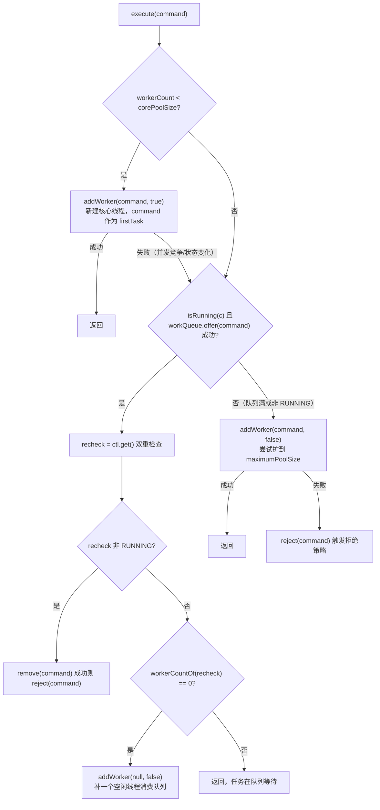
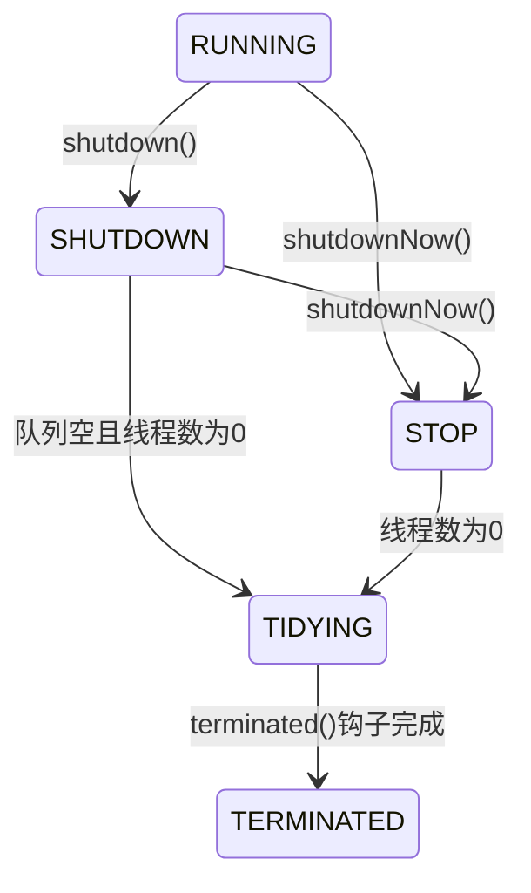

# 线程池原理与工程实践

> 一句话概括：线程池用「**复用 worker 线程 + 有界队列缓冲 + 显式拒绝策略**」把线程的创建、调度、回收和过载保护收敛到一个可管理的对象里；
> 它的全部能力与全部的坑，都藏在 `execute` 三步、`ctl` 一个 int、`Worker` 一把不可重入锁和 `getTask` 的 poll/take 分支里——本文讲清这些机制的源码证据、边界与工程取舍。

预计阅读时间：大约 90 分钟

所属主题：[Java 并发编程常见面试题总结](summary.md)

本文以 **JDK 8（OpenJDK jdk8u）** 源码为基线，锚点用 `类名#方法名`，关键片段均已对照 OpenJDK 源码核验。JDK 17/21 差异单独注明：`execute`/`Worker`/`getTask` 主链路已对照 jdk-21+35 核验与 JDK 8 一致（JDK 17/21 掩码常量名均为 `COUNT_MASK`，至迟 17 已更名，JDK 8 名 `CAPACITY`，值相同，本文按 JDK 8 命名）；虚拟线程执行器见 12.4 与 [virtual-threads.md](virtual-threads.md)。总结给面试结论，本文给机制与证据，按「结论 → 机制 → 边界/代价 → 实践/追问」展开。

---

## 0. 阅读路线

| 读者 | 建议章节 | 关注点 |
| --- | --- | --- |
| 初级（1 年内） | 1、2、5.1、6、8.1、附 | 为什么用池、七参数怎么填、拒绝策略、Executors 为什么被禁、异常去哪了 |
| 中级（1~3 年） | 3、4、7、8、11 全部 | execute 三步源码、ctl 与五状态、getTask 回收、submit 吞异常、周期任务异常坑 |
| 高级（3 年+） | 3.3~3.5、4.3~4.4、5.3、9、10、11.3~11.5 | addWorker/Worker/runWorker 细节、优雅关闭、拒绝事故、调优压测、监控与动态线程池 |
| 选型/架构 | 6.3、9.3、10.3、12 | 队列×拒绝组合、动态线程池方案、池隔离、虚拟线程时代的取舍 |

目录：

1. 为什么用线程池
2. 七大参数逐个讲
3. execute 执行流程（必考）
4. ctl 与五状态：线程池生命周期
5. 拒绝策略：过载时的最后一道闸门
6. Executors 四种工厂为什么被禁用
7. getTask 与线程回收
8. 异常处理：execute 与 submit 的两条路
9. 参数调优：公式只是起点
10. 监控与动态线程池
11. ScheduledThreadPoolExecutor
12. 工程边界与选型
13. 高频追问集
14. 参考资料
- 附：一页速记

---

## 1. 为什么用线程池

### 1.1 new Thread 的三笔账

**结论**：裸 `new Thread(task).start()` 的问题不是"慢"，而是**无上限、无管理、无复用**——任务量与线程量焊死成 1:1，流量一冲就失控。

| 代价 | 具体表现 |
| --- | --- |
| 创建/销毁开销 | JVM `Thread` 对象 + OS 内核线程创建（系统调用），短任务高频创建时开销可能超过任务本身 |
| 内存与 OOM | 每线程独占栈内存（HotSpot 64 位默认 `-Xss` 约 1MB）；无上限时往往先于堆 OOM 出现 `unable to create new native thread` |
| 缺乏管理 | 无统一命名、无并发上限、无优雅关闭、无运行指标 |

线程生命状态与中断机制见 [thread-basics-and-lifecycle.md](thread-basics-and-lifecycle.md)，本文只关心池化这一层。

### 1.2 池化三收益

**结论**：线程池把线程当可复用资源管理，收益有三：**复用**（worker 跑完不退出，循环取下一个，摊薄创建成本）、**控制并发数**（max + 有界队列 + 拒绝策略三道闸门，保护自己也保护下游）、**统一管理**（命名、监控、生命周期、过载行为收敛在一个对象上）。

**边界与代价**：排队引入延迟；线程复用带来 ThreadLocal 残留（12.3）；参数配错比不用池更危险——无界队列把 OOM 从"线程爆炸"换成"任务堆积"（第 6 节）。

### 1.3 Executor 框架接口层次

| 类型 | 一句话定位 |
| --- | --- |
| `Executor` | 顶层接口，只有 `execute(Runnable)`：把"提交"与"怎么执行"解耦 |
| `ExecutorService` | 加生命周期与结果：`submit`/`invokeAll`/`shutdown`/`shutdownNow`/`awaitTermination` |
| `ScheduledExecutorService` | 再加时间维度：`schedule`/`scheduleAtFixedRate`/`scheduleWithFixedDelay` |
| `AbstractExecutorService` | 骨架实现：`newTaskFor` 包成 `FutureTask` 后交给 `execute`，实现 submit/invokeAll（第 8 节） |
| `ThreadPoolExecutor` | 核心实现：worker 集合 + 阻塞队列 + ctl 状态机，本文主角 |
| `ScheduledThreadPoolExecutor` | 继承 ThreadPoolExecutor，换 DelayedWorkQueue 实现定时（第 11 节） |
| `Executors` | 静态工厂，便捷但隐藏危险默认值（第 6 节） |

**实践/追问**：问"submit 和 execute 区别"，除返回值外一定要带出**异常处理路径不同**（第 8 节），这才是区分度。

---

## 2. 七大参数逐个讲

### 2.1 参数总表

```java
public ThreadPoolExecutor(int corePoolSize,
                          int maximumPoolSize,
                          long keepAliveTime,
                          TimeUnit unit,
                          BlockingQueue<Runnable> workQueue,
                          ThreadFactory threadFactory,
                          RejectedExecutionHandler handler)
```

| 参数 | 语义 | 默认值陷阱 | 配置建议 |
| --- | --- | --- | --- |
| `corePoolSize` | 常驻线程数；**默认懒创建**，来任务才建 | 构造后池里是 0 个线程；`prestartAllCoreThreads()` 可预热 | 按负载估（第 9 节） |
| `maximumPoolSize` | 线程数上限；**队列满了才扩到这里** | 无界队列时永远不生效 | 必须有界队列配合；内部受 `CAPACITY=(1<<29)-1` 约束 |
| `keepAliveTime` | **空闲**线程存活时间，默认只回收超出 core 的线程 | 对执行中的任务无效；非核心设 0 = 空闲即回收 | 突发场景 30~60s；`allowCoreThreadTimeOut(true)` 要求 >0 |
| `unit` | 时间单位 | 无 | 内部转纳秒 |
| `workQueue` | 任务缓冲队列 | `new LinkedBlockingQueue<>()` 容量 `Integer.MAX_VALUE`，约等于无界 | 显式有界（如 `ArrayBlockingQueue<>(1000)`），容量是延迟与吞吐的权衡（9.3） |
| `threadFactory` | 创建 worker 的工厂 | 默认 `pool-N-thread-M`、非守护、`NORM_PRIORITY` | 自定义命名（排查刚需）、守护/优先级/UEH |
| `handler` | 线程满且队列满时的拒绝策略 | 默认 `AbortPolicy` 抛异常 | 按业务显式选（第 5 节） |

构造器校验：`corePoolSize < 0`、`maximumPoolSize <= 0`、`maximumPoolSize < corePoolSize`、`keepAliveTime < 0` 抛 `IllegalArgumentException`；queue/factory/handler 为 null 抛 `NullPointerException`。

### 2.2 几个容易答错的语义

- **core 线程不是启动就建好**：execute 第一步只判断 `workerCount < corePoolSize`，成立就新建——哪怕已有空闲线程也照建，直到 core 满。预热用 `prestartCoreThread()`/`prestartAllCoreThreads()`（源码即循环 `addWorker(null, true)`）。
- **max 不是"第二档常驻"**：只有 `offer` 失败才扩到 max；队列不满，线程数停在 core。
- **keepAliveTime 量的是"空闲等待任务"的时间**：阻塞在 `getTask` 的 `poll(timeout)` 超时才回收，任务执行多久都不算（第 7 节）。
- **workQueue 选型速查**（家族实现细节见 [concurrent-collections.md](concurrent-collections.md)）：

| 队列 | 有界性 | 特点 | 典型搭配 |
| --- | --- | --- | --- |
| `ArrayBlockingQueue(n)` | 有界 | 数组，一把锁 | 通用首选 |
| `LinkedBlockingQueue(n)` | 可指定容量 | 链表，读写两把锁，吞吐略高 | 高并发入队出队 |
| `LinkedBlockingQueue()` | **Integer.MAX_VALUE** | 约等于无界 | 危险默认值（第 6 节） |
| `SynchronousQueue` | 容量 0 | 不存任务，直接交接 | cached 型：大 max + 短 keepAlive |
| `PriorityBlockingQueue` | 无界 | 按优先级出队 | 注意无界风险 |
| `DelayedWorkQueue` | 无界 | 按到期时间出队（堆） | Scheduled 专用（第 11 节） |

### 2.3 threadFactory：命名与守护线程

**结论**：threadFactory 是池的"线程出口"，命名、守护、优先级、异常处理器在此统一设置。阿里手册【强制】"创建线程或线程池时请指定有意义的线程名称，方便出错时回溯"。

```java
public class NamedThreadFactory implements ThreadFactory {
    private final String prefix;
    private final boolean daemon;
    private final AtomicInteger seq = new AtomicInteger(1);

    public NamedThreadFactory(String prefix, boolean daemon) {
        this.prefix = prefix;
        this.daemon = daemon;
    }

    @Override
    public Thread newThread(Runnable r) {
        Thread t = new Thread(r, prefix + "-" + seq.getAndIncrement());
        t.setDaemon(daemon);
        if (t.getPriority() != Thread.NORM_PRIORITY) {
            t.setPriority(Thread.NORM_PRIORITY);
        }
        return t;
    }
}
```

**边界与代价**：守护设 true 要谨慎——JVM 退出时守护线程被直接抛弃，任务跑一半就没了；业务池一般非守护 + 优雅关闭（4.4），只有"进程退了也无所谓"的后台任务才考虑守护。默认工厂 `Executors.DefaultThreadFactory` 强制非守护、`NORM_PRIORITY`，"继承调用线程守护属性"不成立。线程名是 jstack/Arthas 排查的第一线索：`order-async-3` 一眼定位，`pool-2-thread-7` 只能靠猜。

**实践/追问**：问"为什么不用默认工厂"——命名不可读、无法统一设 UncaughtExceptionHandler（第 8 节）、无法控制守护属性，都是生产排查的真实痛点。

---

## 3. execute 执行流程（必考）

### 3.1 三步流程总览

**结论**：`ThreadPoolExecutor#execute` 的逻辑是"**先核心线程，再队列，再非核心线程，最后拒绝**"——注意是**先入队、后扩 max**。



源码（JDK 8 `ThreadPoolExecutor#execute`，注释为本文所加）：

```java
public void execute(Runnable command) {
    if (command == null)
        throw new NullPointerException();
    int c = ctl.get();
    // 第一步：线程数 < core，新建核心线程执行该任务
    if (workerCountOf(c) < corePoolSize) {
        if (addWorker(command, true))
            return;
        c = ctl.get();
    }
    // 第二步：RUNNING 且入队成功，还要双重检查
    if (isRunning(c) && workQueue.offer(command)) {
        int recheck = ctl.get();
        if (! isRunning(recheck) && remove(command))
            reject(command);                    // 入队后池被 shutdown：回滚并拒绝
        else if (workerCountOf(recheck) == 0)
            addWorker(null, false);             // 没有线程了：补一个空任务线程消费队列
    }
    // 第三步：入队失败（队列满），扩到 max；再失败就拒绝
    else if (!addWorker(command, false))
        reject(command);
}
```

**机制**：两个深挖点——

1. **双重检查防什么**：`isRunning(c)` 用的是入队前的旧 ctl；入队到 recheck 之间，池可能被 shutdown（要 `remove + reject` 回滚），也可能最后一个 worker 恰好超时退出（要 `addWorker(null, false)` 保证队列有人消费，否则任务入队却永远没人取）。
2. **为什么传 `(null, false)`**：此时 workerCount 可能已 ≥ core（竞争致第一步失败），传 true 会因 core 边界再失败；false 按 max 检查，`firstTask=null` 表示新线程直接从队列取任务。

**边界与代价**：submit 不是另一条路——`AbstractExecutorService#submit` 包成 FutureTask 后同样调 `execute`（第 8 节），三步流程对 submit 一样适用。

**实践/追问**：问"第一步为什么不先看有没有空闲线程"——core 阶段就是"来任务建线程直到 core 满"，判断空闲要加锁遍历 workers，得不偿失；core 满后任务进队列，空闲线程通过 `getTask` 取走，**复用发生在队列消费侧而非提交侧**。

### 3.2 为什么先入队、再扩到 max

**结论**：**队列是缓冲，max 是应急**。创建线程有真实成本（OS 线程 + 栈内存 + `mainLock`），先用队列吸收突发，队列满才动用应急容量。优先级链：核心线程（便宜常驻）> 排队（便宜有延迟）> 非核心（贵应急）> 拒绝（保护）；反过来"先扩 max"会让突发瞬间建大量线程、退去又回收，抖动大。

**边界与代价**：默认顺序不是普适真理——队列越长尾延迟越差；无界队列时 max 永不触发，过载全转化为堆积（第 6 节）。**反例：Tomcat 线程优先**——定制 `TaskQueue`（继承 LinkedBlockingQueue）重写 `offer`：**有空闲线程（`submittedCount <= poolSize`）先入队复用；无空闲且 `poolSize < max` 时 offer 返回 false**，逼池建新线程，因为 Web 请求延迟敏感（已对照 Apache Tomcat 源码核验，锚点 `org.apache.tomcat.util.threads.TaskQueue#offer`）；DynamicTp EagerDtpExecutor 同类思路（第三方）。"先入队还是先扩线程"是**可按业务改写的策略点**。

**实践/追问**：问"什么场景该改顺序"——延迟敏感、任务短、下游扛得住的在线服务用线程优先；吞吐优先、可容忍排队的批处理用默认顺序 + 较长队列。

### 3.3 addWorker：CAS 增计数与状态闸门

**结论**：`ThreadPoolExecutor#addWorker(Runnable firstTask, boolean core)` 分两段——**先 CAS 把 workerCount 加 1（无锁），再持 `mainLock` 注册 Worker 并启动线程**。

```java
private boolean addWorker(Runnable firstTask, boolean core) {
    retry:
    for (;;) {
        int c = ctl.get();
        int rs = runStateOf(c);
        // 状态闸门：SHUTDOWN 后只允许 firstTask==null 且队列非空的补线程
        if (rs >= SHUTDOWN &&
            ! (rs == SHUTDOWN && firstTask == null && ! workQueue.isEmpty()))
            return false;
        for (;;) {
            int wc = workerCountOf(c);
            if (wc >= CAPACITY || wc >= (core ? corePoolSize : maximumPoolSize))
                return false;                       // core 参数决定按哪档上限
            if (compareAndIncrementWorkerCount(c))
                break retry;                        // CAS 计数 +1
            c = ctl.get();
            if (runStateOf(c) != rs) continue retry; // 状态变→外层重来，否则内层重试
        }
    }
    // 第二段：new Worker(firstTask) → mainLock 内再查状态、workers.add(w)、
    // 更新 largestPoolSize → 锁外 t.start()；失败 addWorkerFailed(w) 回滚
}
```

**机制**：

- **计数用 CAS、集合用锁**：workerCount 被 execute/getTask 高频读写，必须轻量（ctl 一次 CAS 覆盖状态与计数，4.1）；`workers` 是 HashSet，只在创建/销毁线程时低频修改，用 `mainLock` 保护，统计方法复用此锁。
- **状态闸门**：`rs >= SHUTDOWN` 一般拒绝新增；唯一例外 `SHUTDOWN && firstTask==null && 队列非空`——shutdown 后还要消费存量队列。这解释了 3.1 的 `addWorker(null, false)` 在 SHUTDOWN 初期仍可能成功。
- **`t.start()` 在锁外**：启动线程可能触发类加载等耗时操作，不该持全局锁做。

**边界与代价**：`firstTask` 可为 null（预热、补线程、消费存量队列）；`core` 参数只影响边界检查，**不标记线程身份**——"核心线程"只是"线程数 ≤ core 时不被超时回收"的动态地位（第 7 节）。

**实践/追问**：问"为什么 retry 双层循环"——CAS 失败分两种：计数被改（内层重试）和状态变了（外层重做闸门检查），分开处理避免用旧状态决策。

### 3.4 Worker：为什么是 AQS 不可重入锁

**结论**：`Worker` 继承 `AbstractQueuedSynchronizer` 并实现 `Runnable`，自带**不可重入独占锁**，标记"该线程是否正在执行任务"——这是 shutdown 只中断空闲线程的判断基础。AQS 原理见 [aqs-and-locks.md](aqs-and-locks.md)。

```java
private final class Worker
    extends AbstractQueuedSynchronizer
    implements Runnable {

    Worker(Runnable firstTask) {
        setState(-1); // 抑制中断，直到 runWorker 里 unlock 置 0
        this.firstTask = firstTask;
        this.thread = getThreadFactory().newThread(this);
    }

    protected boolean tryAcquire(int unused) {
        if (compareAndSetState(0, 1)) {   // 只有 0→1，没有重入计数
            setExclusiveOwnerThread(Thread.currentThread());
            return true;
        }
        return false;
    }
}
```

**机制**：为什么不用 `ReentrantLock`？源码注释两个理由：

1. **不希望任务代码重入这把锁**。池控制方法（如 `setCorePoolSize`）内部走 `interruptIdleWorkers`，对每个 worker `w.tryLock()` 成功才中断。若可重入，**正在执行任务**的线程在任务里调 `setCorePoolSize`，会对自己的锁 tryLock 成功 → 被当成"空闲"中断自己。不可重入保证：**正在跑任务的 worker 一定 tryLock 失败**。
2. **state 初始 -1**：start 前抑制中断（tryLock 对 -1 必失败），`runWorker` 开头 `w.unlock()` 清到 0 后才允许中断。

关键等式：**`tryLock()` 成功 = 没在跑任务 = 空闲（阻塞在 getTask 的 take/poll 上）**。shutdown 靠它精准中断空闲、放过执行中的线程（4.3）。

**边界与代价**：这是"状态标记"锁而非业务互斥锁，lock/unlock 严格配对；任务内部无法用它做同步。

**实践/追问**：问"Worker 为什么实现 Runnable"——`newThread(this)` 把 Worker 作为线程 target，`Thread.run()` → `Worker.run()` → `runWorker(this)`。问"shutdown 怎么区分空闲忙碌"——就是 tryLock 等式，标准答案。

### 3.5 runWorker：任务循环与异常退出补建

**结论**：worker 主体是 `ThreadPoolExecutor#runWorker` 的 while 循环：**取任务 → 加锁 → 钩子 → 执行 → 解锁**；任务抛异常会终止该 worker，但池会**销毁重建**补上，线程数不会永久减少。

```java
final void runWorker(Worker w) {
    Thread wt = Thread.currentThread();
    Runnable task = w.firstTask;
    w.firstTask = null;
    w.unlock(); // state -1 → 0，允许中断
    boolean completedAbruptly = true;
    try {
        while (task != null || (task = getTask()) != null) {
            w.lock(); // 标记"正在执行任务"，shutdown 的 tryLock 会失败
            // STOP 状态双重检查，确保线程带上中断标记（源码略）
            try {
                beforeExecute(wt, task);
                Throwable thrown = null;
                try {
                    task.run();
                } catch (RuntimeException x) { thrown = x; throw x; }
                  catch (Error x)            { thrown = x; throw x; }
                  catch (Throwable x)        { thrown = x; throw new Error(x); }
                finally {
                    afterExecute(task, thrown);   // 异常作为 thrown 传给钩子
                }
            } finally {
                task = null; w.completedTasks++; w.unlock();
            }
        }
        completedAbruptly = false;   // 正常退出（getTask 返回 null）
    } finally {
        processWorkerExit(w, completedAbruptly);
    }
}
```

**机制**：

- 循环条件 `task != null || (task = getTask()) != null`：firstTask 优先，之后靠 getTask 取；返回 null（超时回收或池关闭）则结束。
- **异常路径**：`task.run()` 的异常记录到 thrown、传给 afterExecute 后**继续外抛**，跳过 `completedAbruptly = false`，直达 `processWorkerExit(w, true)`。
- **processWorkerExit**：abrupt 退出先 `decrementWorkerCount()`（正常退出计数已在 getTask 减过），持 mainLock 移除 worker、累加完成数、调 `tryTerminate()`；池仍 RUNNING/SHUTDOWN 时 **abrupt 退出无条件 `addWorker(null, false)` 补线程**，正常退出按 `min = allowCoreThreadTimeOut ? 0 : corePoolSize`（min==0 且队列非空取 1）判断是否补。
- **钩子**：before/afterExecute 是扩展点（日志、耗时、上下文清理、异常兜底，8.3）；beforeExecute 抛异常同样杀死 worker。

**边界与代价**：execute 任务抛异常 → 打到线程 `UncaughtExceptionHandler`（默认 stderr）→ 销毁重建。频繁异常 = 频繁重建，开销 + 日志污染；submit 完全是另一条路（第 8 节）。

**实践/追问**：问"任务抛异常线程池会怎样"——必须分 execute/submit 两条路答（8.1）。问"为什么异常后还补线程"——维持 core 容量是池的契约，一个任务失败不该让并发能力永久降级。

---

## 4. ctl 与五状态：线程池生命周期

### 4.1 一个 int 装下状态与线程数

**结论**：`AtomicInteger ctl` 同时存「运行状态（高 3 位）」和「线程数（低 29 位）」，一次 CAS 原子地同时变更两者。

```java
private final AtomicInteger ctl = new AtomicInteger(ctlOf(RUNNING, 0));
private static final int COUNT_BITS = Integer.SIZE - 3;          // 29
private static final int CAPACITY   = (1 << COUNT_BITS) - 1;     // 536870911

private static final int RUNNING    = -1 << COUNT_BITS;  // 111，唯一负数状态
private static final int SHUTDOWN   =  0 << COUNT_BITS;  // 000
private static final int STOP       =  1 << COUNT_BITS;  // 001
private static final int TIDYING    =  2 << COUNT_BITS;  // 010
private static final int TERMINATED =  3 << COUNT_BITS;  // 011

private static int runStateOf(int c)     { return c & ~CAPACITY; }
private static int workerCountOf(int c)  { return c & CAPACITY; }
private static int ctlOf(int rs, int wc) { return rs | wc; }
```

**机制**：

- **为什么合并**：execute/addWorker/getTask 每个决策都要"状态 + 计数"联合判断。拆成两个变量，读两次之间状态可能变，需额外加锁；合并后一次 `ctl.get()` 拿一致快照，一次 CAS 联合变更。用位运算换原子性的经典设计（CAS 原理见 [cas-and-atomic-classes.md](cas-and-atomic-classes.md)）。
- **状态单调递增**：RUNNING(-1) < SHUTDOWN(0) < STOP(1) < TIDYING(2) < TERMINATED(3)，源码用 `runStateLessThan`/`runStateAtLeast` 比较；`isRunning(c)` 即 `c < SHUTDOWN`（RUNNING 是唯一负数）。
- **CAPACITY**：线程数上限 2^29-1 ≈ 5.37 亿，实际远早于此被内存/OS 卡住。

**边界与代价**：位打包可读性差；JDK 17/21 掩码常量均为 `COUNT_MASK`（至迟 17 已更名，JDK 8 为 `CAPACITY`，值与布局不变），读不同版本源码注意名字差异。

### 4.2 五状态转换

**结论**：状态沿 RUNNING → SHUTDOWN/STOP → TIDYING → TERMINATED **单向不可逆**；TIDYING/TERMINATED 由 `tryTerminate()` 在条件满足时自动推进。



| 状态 | 含义 | 收新任务 | 处理队列 | 中断线程 |
| --- | --- | --- | --- | --- |
| RUNNING | 正常运行 | ✅ | ✅ | — |
| SHUTDOWN | 优雅关闭中 | ❌ | ✅ 消费存量 | 只中断空闲 |
| STOP | 立即关闭 | ❌ | ❌ 被 drain | 中断所有 |
| TIDYING | 收尾中 | ❌ | 队列空、线程数 0 | 执行 `terminated()` 钩子 |
| TERMINATED | 已终止 | ❌ | — | `signalAll` 唤醒 awaitTermination |

**机制**：`tryTerminate()` 在每次"可能使终止条件成立"的动作后调用（worker 退出、shutdown、remove 任务）：RUNNING、或已 ≥ TIDYING、或 SHUTDOWN 但队列非空 → 返回；线程数 ≠ 0 → `interruptIdleWorkers(ONLY_ONE)` 中断一个空闲线程传播关闭信号后返回；只有"非 RUNNING +（STOP 或队列空）+ 线程数 0"才 CAS 进 TIDYING，执行 `terminated()`，finally 置 TERMINATED 并 `termination.signalAll()`。

**实践/追问**：问"SHUTDOWN 和 STOP 到 TIDYING 条件差别"——SHUTDOWN 必须等队列消费完（存量还要跑），STOP 只等线程数归零（队列已 drain）。

### 4.3 shutdown / shutdownNow / awaitTermination

**结论**：`shutdown` = 不收新任务、把存量干完；`shutdownNow` = 尝试立刻停、把没跑的退给你；`awaitTermination` **只等待，不发起关闭**。

| 维度 | `shutdown()` | `shutdownNow()` | `awaitTermination` |
| --- | --- | --- | --- |
| 目标状态 | SHUTDOWN | STOP | 不改变状态 |
| 新任务 | 拒绝（走 handler） | 拒绝 | — |
| 队列存量 | 继续执行完 | `drainQueue()` 取出返回 `List<Runnable>` | — |
| 执行中任务 | 不打断 | 逐个 `interrupt()`，**是否停取决于任务响应中断** | — |
| 空闲线程 | `interruptIdleWorkers()` 唤醒后退出 | `interruptWorkers()` 全部中断 | — |
| 返回 | void | 未执行任务列表 | true=已 TERMINATED；false=超时 |

源码要点：shutdown = `advanceRunState(SHUTDOWN)` + `interruptIdleWorkers()` + `tryTerminate()`；shutdownNow = `advanceRunState(STOP)` + `interruptWorkers()` + `drainQueue()` + `tryTerminate()`；awaitTermination 持 mainLock 对 `termination` 条件循环 `awaitNanos`。

**边界与代价**（高频深挖）：

- **shutdownNow 不保证停掉执行中的任务**：interrupt 只是设标记/唤醒可中断阻塞（sleep/wait/take/poll）。死循环不检查中断、`InputStream.read()` 这类不可中断 IO，照跑不误。任务必须响应中断（见 [thread-basics-and-lifecycle.md](thread-basics-and-lifecycle.md)）。
- shutdown 后提交的任务**走拒绝策略**，不是抛 IllegalStateException；shutdownNow 返回的列表**不含执行中的任务**。
- awaitTermination 单独用没意义：不先 shutdown 只会干等超时。
- 中断空闲线程的目的不是杀死，而是**唤醒阻塞在 take/poll 的 getTask**，让它回循环顶部重查 runState，发现 SHUTDOWN+队列空后正常退出。

### 4.4 优雅关闭完整范式

**结论**：标准写法"**先 shutdown → 限时 await → 超时 shutdownNow → 再 await → 恢复中断**"，drain 出的任务持久化兜底。

```java
public static void shutdownGracefully(ExecutorService pool, long timeoutSeconds) {
    pool.shutdown();
    try {
        if (!pool.awaitTermination(timeoutSeconds, TimeUnit.SECONDS)) {
            List<Runnable> dropped = pool.shutdownNow();
            // dropped 落库/发 MQ，由补偿机制重投，避免任务无声丢失
            if (!pool.awaitTermination(10, TimeUnit.SECONDS)) {
                // 记录日志：仍有任务不响应中断，需人工介入
            }
        }
    } catch (InterruptedException e) {
        pool.shutdownNow();
        Thread.currentThread().interrupt(); // 恢复中断标记，交上层决策
    }
}
```

**边界与代价**：超时按"最慢任务的合理执行时间"定；Spring 环境可用 `ThreadPoolTaskExecutor` 的 `waitForTasksToCompleteOnShutdown`/`awaitTerminationSeconds` 或 `@PreDestroy`。@Async 执行器的关闭与选择见 [../spring/async-annotation-principle.md](../spring/async-annotation-principle.md)。

**实践/追问**：问"catch InterruptedException 后为什么恢复中断标记"——捕获会清掉标记，不恢复则上层感知不到中断请求，违背协作语义。问"shutdownNow 后任务一定丢吗"——返回的 List 给了兜底机会，丢不丢取决于你有没有处理它。

---

## 5. 拒绝策略：过载时的最后一道闸门

### 5.1 四种内置策略对比

**结论**：拒绝在「线程数到 max **且** 队列满」或「池已 shutdown」时触发（`reject` → `handler.rejectedExecution`）。四种策略的本质区别是**过载时牺牲什么**。

| 策略 | 行为 | 牺牲 | 适用 |
| --- | --- | --- | --- |
| `AbortPolicy`（**默认**） | 抛 `RejectedExecutionException` | 任务失败，但**调用方明确知道** | 通用；在线服务快速失败 + 上游降级 |
| `DiscardPolicy` | 方法体为空，**静默丢弃** | 任务无声消失 | 几乎不该用于业务任务 |
| `DiscardOldestPolicy` | 未 shutdown 时 `queue.poll()` 丢队头，再 `execute(r)` | 最老任务被牺牲 | 只关心最新数据（实时行情覆盖） |
| `CallerRunsPolicy` | 未 shutdown 时 `r.run()`，**调用者线程执行** | 调用方被拖住 = 天然背压 | 不许丢任务、可接受提交变慢 |

**机制**：CallerRuns 的背压——提交线程（如 Tomcat 请求线程）被任务占住，无法继续提交，生产速度自动降到消费速度，队列不再增长。用调用方的时间换系统稳定。

### 5.2 自定义 handler：落库 / 降级 / 告警

**结论**：内置不够时实现 `RejectedExecutionHandler`，把"拒绝"变成**可观测、可兜底**的事件。

```java
public class ObservableRejectedHandler implements RejectedExecutionHandler {
    private static final Logger log = LoggerFactory.getLogger(ObservableRejectedHandler.class);
    private final LongAdder rejectedCount = new LongAdder(); // 供监控采集

    @Override
    public void rejectedExecution(Runnable r, ThreadPoolExecutor executor) {
        rejectedCount.increment();
        log.warn("task rejected: poolSize={}, active={}, queueSize={}",
                executor.getPoolSize(), executor.getActiveCount(), executor.getQueue().size());
        if (r instanceof DurableTask) {
            ((DurableTask) r).persist();   // 可持久化任务：落库，补偿重投
        } else {
            throw new RejectedExecutionException("pool saturated, task not durable");
        }
    }
}
```

**实践/追问**：handler 里**不要无限重试 `executor.execute(r)`**（DiscardOldest 的重试有 poll 腾位前提），饱和时忙等甚至栈溢出。拒绝次数 > 0 即告警（第 10 节）。

### 5.3 边界与事故

**结论**：**Discard 系静默丢任务是生产事故源**——无日志、无异常、无指标，对账时才发现少数据。

- `DiscardOldestPolicy` + `PriorityBlockingQueue`：丢的是**优先级最高**的队头，反直觉。
- `DiscardOldestPolicy` + `SynchronousQueue`：`poll()` 恒 null（不存元素），没腾位就重试 execute，max 已满时反复拒绝 → 忙等/递归风险。
- `CallerRunsPolicy` 两个坑：① 池 shutdown 后**静默丢弃**（源码 `if (!e.isShutdown())`）；② 任务跑在调用者线程，ThreadLocal 上下文是调用者的，且调用方被占住拉低吞吐——背压是特性也是代价。
- `AbortPolicy` 抛 RuntimeException，提交侧不 catch 会炸到业务主流程，要配套降级。

**实践/追问**：问"为什么宁可 Abort 也不 Discard"——失败要**可感知**才能降级、重试、告警；静默丢弃把故障推迟到对账，损失放大。问"CallerRuns 一定好吗"——调用方是 Netty IO 线程这类不能阻塞的线程时会拖垮事件循环，应选 Abort + 上游限流。

---

## 6. Executors 四种工厂为什么被禁用

### 6.1 四种工厂的真实参数

**结论**：阿里手册并发章【强制】"**线程池不允许使用 Executors 去创建，而是通过 ThreadPoolExecutor 的方式**……规避资源耗尽的风险"。根源是工厂把**无界队列**或**无界线程数**藏在默认值里（参数已对照 JDK 8 `Executors` 源码核验）。

| 工厂 | core | max | keepAlive | 队列 | 隐患 |
| --- | --- | --- | --- | --- | --- |
| `newFixedThreadPool(n)` | n | n | 0 | `LinkedBlockingQueue`（**MAX_VALUE**） | 堆积 → 堆 OOM |
| `newSingleThreadExecutor()` | 1 | 1 | 0 | 同上 + `FinalizableDelegatedExecutorService` 包装 | 同上 + 不可强转重配置 |
| `newCachedThreadPool()` | 0 | **MAX_VALUE** | 60s | `SynchronousQueue` | 线程爆炸 → native OOM |
| `newScheduledThreadPool(n)` | n | **MAX_VALUE** | 0 | `DelayedWorkQueue`（无界堆） | 堆积 → 堆 OOM |

```java
// JDK 8 Executors 源码节选
public static ExecutorService newFixedThreadPool(int nThreads) {
    return new ThreadPoolExecutor(nThreads, nThreads,
                                  0L, TimeUnit.MILLISECONDS,
                                  new LinkedBlockingQueue<Runnable>());
}
public static ExecutorService newCachedThreadPool() {
    return new ThreadPoolExecutor(0, Integer.MAX_VALUE,
                                  60L, TimeUnit.SECONDS,
                                  new SynchronousQueue<Runnable>());
}
```

### 6.2 两条 OOM 路径

**结论**：两条路径要分开讲。

1. **堆积型（Fixed/Single/Scheduled）**：队列约等于无界 → offer 几乎恒成功 → 永远走"入队"分支 → max 与拒绝策略失效。生产 > 消费时任务对象（及闭包引用的大对象）无限累积 → **堆 OOM**。更隐蔽的是 OOM 前系统"看起来正常但延迟无限增大"，队列里的任务可能早已过期无效。
2. **线程爆炸型（Cached）**：SynchronousQueue 不存任务，没有空闲 worker 接手时 offer 立即失败 → 不断 `addWorker(command, false)`，max=MAX_VALUE → 每并发任务一个线程 → 栈内存/OS 线程数耗尽 → `unable to create new native thread`。

**边界与代价**：

- `newScheduledThreadPool` 的 max 虽是 MAX_VALUE，但 DelayedWorkQueue 无界几乎不会满，实际线程数停在 core——风险主要是**队列堆积**而非线程爆炸（手册归为一类，机制上应区分）。
- `newSingleThreadExecutor` 返回 `FinalizableDelegatedExecutorService` 包装（只转发接口方法），**不能强转 ThreadPoolExecutor** 做动态调参/监控。
- 禁的是**隐藏的危险默认值**，不是工厂模式本身；`Executors.defaultThreadFactory()` 仍可用。JDK 21 `newVirtualThreadPerTaskExecutor` 语义完全不同（12.4），不在禁令范围。

### 6.3 正确姿势：手动 new ThreadPoolExecutor

**结论**：显式七参数 = **有界队列 + 合理 max + 命名 factory + 明确拒绝策略**，让每个资源边界写在代码里。

```java
ThreadFactory factory = new NamedThreadFactory("order-async", false); // 见 2.3

ThreadPoolExecutor orderPool = new ThreadPoolExecutor(
        8,                                  // core：按负载估算（第 9 节）
        16,                                 // max：应急容量，队列满才扩
        60L, TimeUnit.SECONDS,              // 非核心空闲 60s 回收
        new ArrayBlockingQueue<>(1000),     // 显式有界：堆积上限可见
        factory,                            // 命名线程，排查可回溯
        new ThreadPoolExecutor.CallerRunsPolicy()); // 明确背压；或自定义 handler
orderPool.prestartAllCoreThreads();         // 可选：预热，避免冷启动排队
```

**实践/追问**：问"队列 1000 怎么定"——"可接受最大排队延迟 ÷ 单任务平均耗时 × 消费线程数"量级估算，再压测校准（9.3/9.4）。问"为什么不用 LinkedBlockingQueue(1000)"——也可以，都有界；Array 一把锁更简单、内存预分配，Linked 读写分离锁高并发吞吐略好（细节见 [concurrent-collections.md](concurrent-collections.md)）。

---

## 7. getTask 与线程回收

### 7.1 keepAliveTime 到底对谁生效

**结论**：默认**只回收超出 core 的线程**；回收发生在 `getTask`——`poll(keepAliveTime)` 超时拿不到任务就退出。核心线程用 `take()` 无限等，默认不回收。

```java
private Runnable getTask() {
    boolean timedOut = false;
    for (;;) {
        int c = ctl.get();
        int rs = runStateOf(c);
        // STOP，或 SHUTDOWN 且队列空 → 减计数退出
        if (rs >= SHUTDOWN && (rs >= STOP || workQueue.isEmpty())) {
            decrementWorkerCount();
            return null;
        }
        int wc = workerCountOf(c);
        boolean timed = allowCoreThreadTimeOut || wc > corePoolSize;
        if ((wc > maximumPoolSize || (timed && timedOut))
            && (wc > 1 || workQueue.isEmpty())) {
            if (compareAndDecrementWorkerCount(c))
                return null;            // 回收：计数 -1，runWorker 循环结束
            continue;
        }
        try {
            Runnable r = timed ?
                workQueue.poll(keepAliveTime, TimeUnit.NANOSECONDS) :
                workQueue.take();       // 核心线程无限阻塞，不回收
            if (r != null) return r;
            timedOut = true;            // poll 超时，下一轮走回收分支
        } catch (InterruptedException retry) {
            timedOut = false;           // 被中断不算超时，重查状态
        }
    }
}
```

**机制**：

- "核心/非核心"是**动态地位**：判断式 `wc > corePoolSize`，不是出生标记。线程数从 10 缩到 5，先超时退出的 5 个就是"当时的非核心"。
- `wc > maximumPoolSize` 分支服务于运行时调小 max 后的收缩。
- `(wc > 1 || workQueue.isEmpty())` 保证不会回收掉最后一个线程而队列还有任务。
- keepAlive 量的是**空闲等待**时间，任务执行再久也不触发。

**边界与代价**：核心默认不回收是为**避免抖动**——稳定负载下建了又拆白白付出创建成本，保温常驻线程是更优稳态；代价是低峰期占着栈内存。

### 7.2 allowCoreThreadTimeOut：让核心也回收

**结论**：`allowCoreThreadTimeOut(true)` 让 timed 恒真，核心也走 poll(timeout)，池可缩到 0。

**机制**：前置校验 `value==true && keepAliveTime<=0` 抛 `IllegalArgumentException`；设 true 时立即 `interruptIdleWorkers()` 唤醒空闲线程按新规则 poll。缩到 0 后队列还有任务时，`processWorkerExit` 的 `min==0 && !queue.isEmpty() → min=1` 会补一个线程，任务不会饿死。

**实践/追问**：适合波峰波谷极大、低峰很长的池；常驻在线服务一般不开，避免冷启动延迟。问"keepAliveTime=0 会怎样"——非核心空闲即回收；此时开 allowCoreThreadTimeOut(true) 直接抛异常。

### 7.3 观测线程数动态变化

```java
ThreadPoolExecutor pool = new ThreadPoolExecutor(
        2, 4, 2, TimeUnit.SECONDS,
        new ArrayBlockingQueue<>(2), new NamedThreadFactory("demo", false));

for (int i = 0; i < 6; i++) {
    pool.execute(() -> {
        try { Thread.sleep(500); }
        catch (InterruptedException e) { Thread.currentThread().interrupt(); }
    });
}
// 6 任务：2 进核心，2 入队，2 触发扩到 max=4
Thread.sleep(200);
System.out.println(pool.getPoolSize());   // 4
Thread.sleep(3500);
System.out.println(pool.getPoolSize());   // 2（非核心空闲超 2s 回收）
pool.shutdown();
```

**实践/追问**：定时打印就是最简监控曲线（生产指标见第 10 节）。问"怎么验证 keepAlive 生效"——看 getPoolSize 从峰值回落到 core 的时间点 ≈ 最后任务完成时间 + keepAliveTime。

---

## 8. 异常处理：execute 与 submit 的两条路

### 8.1 两条异常路径

**结论**：**execute 的异常会"炸出来"**（打到 UncaughtExceptionHandler、worker 销毁重建）；**submit 的异常被 FutureTask 捕获吞掉**，不调 `get()` 永远看不到。最高频生产坑之一。

```java
ExecutorService pool = Executors.newFixedThreadPool(1); // 仅演示，生产见 6.3
pool.execute(() -> { throw new RuntimeException("boom-execute"); }); // 炸到 stderr，worker 重建
Future<?> f = pool.submit(() -> { throw new RuntimeException("boom-submit"); }); // 存进 Future，静默
// 只有 f.get() 才以 ExecutionException 抛出
```

| 维度 | execute(Runnable) | submit(Runnable/Callable) |
| --- | --- | --- |
| 任务包装 | 原始 Runnable 进队列 | `newTaskFor` 包成 FutureTask |
| 异常去向 | runWorker 捕获后**重抛** → 线程 UEH | `FutureTask#run` 捕获后 `setException` 存 outcome |
| worker 线程 | 销毁并补建（3.5） | **不受影响** |
| 默认感知 | stderr 堆栈 | 无；必须 get() |
| afterExecute 的 t | 非 null | **null**（异常没抛出 runWorker） |

### 8.2 源码依据：FutureTask#run 的 catch

**结论**：submit 吞异常不是"丢了"，而是**转移**——从线程异常通道转到 Future 结果通道。

```java
// AbstractExecutorService#submit：包装 → 提交 → 返回同一对象
public Future<?> submit(Runnable task) {
    if (task == null) throw new NullPointerException();
    RunnableFuture<Void> ftask = newTaskFor(task, null); // 默认 new FutureTask<>
    execute(ftask);
    return ftask;
}
// FutureTask#run：异常被捕获存入 outcome，不向 runWorker 传播
try {
    result = c.call();
    ran = true;
} catch (Throwable ex) {
    result = null;
    ran = false;
    setException(ex);   // state NEW→COMPLETING→EXCEPTIONAL，outcome=ex
}
// FutureTask#get：state==EXCEPTIONAL → throw new ExecutionException(outcome)
```

**机制**：捕获的是 **Throwable**（含 Error），submit 连 OOM 都收进 Future。`setException` 推 state 到 EXCEPTIONAL 并唤醒等待者；get() 经 report 抛 ExecutionException，cause 才是原始异常。FutureTask 状态机与 CompletableFuture 组合式异常处理见 [forkjoin-and-completable-future.md](forkjoin-and-completable-future.md)。

**边界与代价**：`submit(Runnable)` 正常 get() 返回 null，异常时根本走不到返回而是抛 ExecutionException；但**不调 get 就什么都不发生**。周期任务异常更狠：直接取消后续调度（11.3）。

### 8.3 三种处理方案

**结论**：要结果就 get 捕获；不要结果用 afterExecute 统一兜底；execute 路径加 UEH 做最后防线。三者可叠加。

**方案一：submit 配对 get（要结果的任务）**

```java
try {
    Result r = pool.submit(() -> doWork()).get(2, TimeUnit.SECONDS);
} catch (ExecutionException e) {
    log.error("task failed", e.getCause());   // cause 才是业务异常
} catch (TimeoutException e) {
    // 超时处理：cancel(true) 尝试中断
} catch (InterruptedException e) {
    Thread.currentThread().interrupt();
}
```

**方案二：重写 afterExecute 统一兜底（fire-and-forget，推荐）**

```java
public class LoggingThreadPoolExecutor extends ThreadPoolExecutor {
    // 构造器透传七参数，省略
    @Override
    protected void afterExecute(Runnable r, Throwable t) {
        super.afterExecute(r, t);
        // submit 路径：t==null，但 FutureTask 已 done，get 不阻塞
        if (t == null && r instanceof Future<?> && ((Future<?>) r).isDone()) {
            try {
                ((Future<?>) r).get();
            } catch (CancellationException ce) {
                t = ce;
            } catch (ExecutionException ee) {
                t = ee.getCause();
            } catch (InterruptedException ie) {
                Thread.currentThread().interrupt();
            }
        }
        if (t != null) {
            LoggerFactory.getLogger(getClass()).error("task failed", t); // 统一日志+告警
        }
    }
}
```

这正是 JDK 8 ThreadPoolExecutor 类 javadoc 给出的扩展思路：afterExecute 里 FutureTask 已 done，get() 立即返回/抛异常，不阻塞 worker。

**方案三：ThreadFactory 设 UEH（execute 路径最后防线）**

```java
ThreadFactory factory = r -> {
    Thread t = new Thread(r, "order-async-" + seq.getAndIncrement());
    t.setUncaughtExceptionHandler((thread, ex) ->
        LoggerFactory.getLogger("pool-ueh").error("uncaught in {}", thread.getName(), ex));
    return t;
};
```

**边界与代价**：方案三**只覆盖 execute**——submit 异常到不了 UEH；方案二覆盖最全，但 beforeExecute 抛异常时 afterExecute 不执行（钩子本身要稳）。三种方案都不改变"任务已失败"的事实，重试/补偿要另行设计。

**实践/追问**：问"为什么 submit 要吞异常"——契约是"结果（含异常）通过 Future 交付"；若直接抛到 worker，Future 永远停在 NEW，get 无限阻塞。问"线上怎么发现"——任务失败无日志无告警、下游数据缺失；治理靠方案二 + 评审禁止"submit 后不 get 也不包装"。

---

## 9. 参数调优：公式只是起点

### 9.1 两个起点公式

**结论**：N = CPU 核数（`availableProcessors()`，容器注意 cgroup 感知）。

| 负载类型 | 公式 | 直觉 |
| --- | --- | --- |
| CPU 密集 | **N + 1** | 线程 ≈ 核数吃满 CPU；+1 在某线程偶发缺页/暂停时顶上 |
| IO 密集 | **2N**（粗估）或 **N × (1 + W/C)** | W=等待、C=计算；线程多在等，多开让 CPU 在等待间隙干活 |

**机制**：`N×(1+W/C)` 出自《Java Concurrency in Practice》：每线程只有 C/(W+C) 比例在用 CPU，喂饱 N 核需 N×(W+C)/C 个线程。等价视角 **Little's Law**：稳态「并发数 = 吞吐率 × 平均延迟」。目标 QPS=1000、单任务 50ms（几乎全 IO），所需并发 ≈ 1000×0.05 = 50——比 2N 更贴近业务目标。

### 9.2 为什么公式只是起点

**结论**：公式给**量级**，真实参数由四个约束取最小值：

1. **下游容量**：DB 连接池 20 个连接，开 200 线程也只是抢 20 个连接，多余并发全变成连接池等待——超过下游有效容量是纯浪费还放大压力。
2. **混合负载**：真实任务 W/C 随请求变化，按业务拆池（12.1）比单池折中好。
3. **上下文切换账**：线程远超核数时频繁切换（微秒级 + 缓存/TLB 污染），CPU 被切换吃掉；几千线程逼近 native OOM。**线程不是越多越好**，吞吐过拐点会降。
4. **延迟目标**：队列长度决定排队延迟（9.3），线程数决定消费速度，一起对着 P99 调。

**实践/追问**：问"W/C 怎么测"——profiling（async-profiler/JFR）看 runnable 与 blocked/waiting 占比；或固定线程数阶梯加压，QPS 不再涨的拐点即有效并发上限。工具链见 [deadlock-and-troubleshooting.md](deadlock-and-troubleshooting.md)。

### 9.3 队列长度 × 拒绝策略的组合设计

**结论**：队列和拒绝策略**成对设计**，共同决定过载行为。

| 组合 | 过载行为 | 适用 |
| --- | --- | --- |
| 短队列 + Abort | 快速失败，上游降级/重试 | 延迟敏感在线 RPC |
| 长队列 + CallerRuns | 削峰填谷，生产自动降速 | 批处理、日志、可容忍延迟 |
| SynchronousQueue + 大 max + Abort | 不排队直接扩线程，扩不动拒绝 | 短任务、突发明显（cached 有界版） |
| 无界队列 | 永不拒绝，堆积到 OOM | **反模式**（第 6 节） |

**机制**：排队延迟 ≈ 队列长度 ÷ 消费速率。队列 10000、单任务 100ms、10 线程，队尾等 100s——在线请求早已超时失效，处理纯属浪费（"过期任务"）。**队列长度由"可接受最大排队延迟"反推**，不是越大越保险。长队列还会掩盖过载：线程数不高、拒绝为 0，看似健康实际延迟爆炸，必须监控队列水位（第 10 节）。

### 9.4 压测与验证

**结论**：流程"公式定量级 → 真实下游压测 → 看拐点与 P99 → 定队列与拒绝 → 上线监控校准"。压测带真实下游（或等延迟 mock），否则 W/C 失真；观测 QPS、P99、activeCount/队列水位、拒绝次数；微基准用 JMH，全链路用压测平台，线程 dump/Arthas 见 [deadlock-and-troubleshooting.md](deadlock-and-troubleshooting.md)。参数不是一次性决策，而是随流量持续校准的运行时配置（第 10 节）。

---

## 10. 监控与动态线程池

### 10.1 指标清单

**结论**：ThreadPoolExecutor 自带统计方法是监控数据源；注意精确值与近似值之分。

| 方法 | 含义 | 精确性 |
| --- | --- | --- |
| `getCorePoolSize()` / `getMaximumPoolSize()` | 当前配置 | 精确 |
| `getPoolSize()` | 当前 worker 数 | 持 mainLock 读 workers.size() |
| `getActiveCount()` | 执行中线程数 | **近似**（统计 `w.isLocked()`） |
| `getLargestPoolSize()` | 历史峰值 | 精确 |
| `getQueue().size()` / `remainingCapacity()` | 积压 / 剩余容量 | 瞬时精确；合计算水位 |
| `getCompletedTaskCount()` | 累计完成 | **近似**，单调不减 |
| `getTaskCount()` | 累计调度（完成+执行中+排队） | **近似** |
| `isShutdown()` / `isTerminated()` | 生命周期 | 精确 |

**机制**：派生指标更有用——**活跃度** = active/max；**队列水位** = size/(size+remainingCapacity)；**拒绝速率** = handler 计数器（5.2）；**任务/等待耗时** = before/afterExecute 打点。告警示例：水位 >80% 预警、拒绝 >0 立即告警、活跃度持续 >90% 提示扩容。

### 10.2 Micrometer / Prometheus 暴露

**结论**：Spring Boot 用 Micrometer `ExecutorServiceMetrics`（第三方）绑定指标到 MeterRegistry，经 `/actuator/prometheus` 给 Prometheus + Grafana。

```java
// 第三方 io.micrometer.core.instrument.binder.jvm.ExecutorServiceMetrics
// 重载签名以所用版本文档为准
ExecutorServiceMetrics.monitor(registry, orderPool, "order-pool", Tags.empty());
```

无 Spring 环境可定时采集打 JSON 日志（DynamicTp jsonlog 模式即此思路）。问"为什么 activeCount 近似"——统计持 mainLock 遍历期间状态仍在变，javadoc 标注 approximate；看趋势足够，别做精确对账。

### 10.3 动态线程池原理与开源方案

**结论**：动态线程池 = **运行时 setter 调参 + 配置中心联动 + 监控告警**。JDK 原生支持改 core/max/keepAlive，**队列容量不可变**是最大缺口。

**机制**：

- `setCorePoolSize`：调小时当前线程数 > 新 core 则 `interruptIdleWorkers()` 让多余空闲退出；调大时启发式预启动 `min(delta, workQueue.size())` 个 worker 消费积压。`setMaximumPoolSize` 调小走 getTask 的 `wc > maximumPoolSize` 回收分支（7.1）。**调参顺序**：扩容先 max 后 core，缩容先 core 后 max。
- **队列容量为什么改不了**：ArrayBlockingQueue 的 items 数组、LinkedBlockingQueue 的 capacity 都是 final。Hippo4j 复制 LBQ 源码把 capacity 改可变，做出 `ResizableCapacityLinkedBlockingQueue`（第三方，非 JDK 类）。
- **配置中心联动**：Nacos/Apollo 监听变更 → setter → 推送通知，配合阈值告警（活跃度/队列/拒绝/执行超时）闭环。

| 开源方案（第三方） | 一句话 |
| --- | --- |
| **DynamicTp**（dromara/dynamic-tp） | 基于配置中心的轻量动态线程池，内置监控告警，集成 Tomcat/Dubbo/RocketMQ 等组件线程池，提供 EagerDtpExecutor 等增强模式 |
| **Hippo4j**（opengoofy/hippo4j） | core 模式依赖配置中心；server 模式自带控制台（需部署服务+MySQL），支持运行时堆栈、历史指标、变更审核 |

**边界与代价**：动态调参**救不了坏代码**——任务死锁/永久阻塞时加线程只是加受害者；变更单实例生效，集群靠配置中心广播；自定义可变队列绕开 JDK 不可变契约，正确性自己背书。选型：已有 Nacos/Apollo 选 DynamicTp 类轻量方案，要控制台与审计选 Hippo4j server，池少且稳定时原生 setter + 自研监听也够。设计出发点（美团实践）：参数上线时无法准确评估，把"拍参数"变成"运行时持续校准"。

---

## 11. ScheduledThreadPoolExecutor

### 11.1 结构与 DelayedWorkQueue

**结论**：继承 ThreadPoolExecutor，队列换成 `DelayedWorkQueue`——**按到期时间排序的数组最小堆**，队头最先到期（实现见 [concurrent-collections.md](concurrent-collections.md)）。构造 `super(corePoolSize, Integer.MAX_VALUE, 0, NANOSECONDS, new DelayedWorkQueue())`：max 几乎不生效（队列无界不会满），实际并发由 core 决定；worker `take()` 阻塞到队头到期（Leader-Follower 避免全员定时唤醒）；任务记 `heapIndex` 支持 O(log n) 取消移除。

### 11.2 scheduleAtFixedRate vs scheduleWithFixedDelay

**结论**：区别是**下次执行时间的锚点**：fixedRate 锚"上次**开始** + period"，fixedDelay 锚"上次**结束** + delay"。

| 维度 | `scheduleAtFixedRate` | `scheduleWithFixedDelay` |
| --- | --- | --- |
| 下次时间 | 上次计划开始 + period | 上次实际结束 + delay |
| 任务耗时 > 周期 | 顺延但不并发，可能密集补跑 | 永远"结束后歇 delay" |
| 语义 | 长期平均速率稳定 | 保证两次执行最小间隔 |
| 适用 | 采样、心跳、按节拍对齐 | 轮询、拉取、不想挤在一起 |

**机制**：`ScheduledFutureTask` 用 period 正负区分——fixedRate 传正、fixedDelay 传负；`setNextRunTime()`：`p>0 → time += p`（锚计划时间），`p<0 → time = triggerTime(-p)`（锚当前时间）。javadoc 明确 **successive executions do not overlap**：同一周期任务不并发，超时只顺延。fixedRate 长时间卡顿后可能密集补跑，对下游是突刺；"必须歇够"用 fixedDelay。两者都不保证精确准点，硬实时不该用它。

### 11.3 周期任务抛异常 = 静默取消后续执行（必考坑）

**结论**：周期任务某次执行抛未捕获异常，**后续所有执行被静默取消**——无日志无告警，定时任务从此消失。最高频生产事故。

```java
// ScheduledThreadPoolExecutor.ScheduledFutureTask#run
public void run() {
    boolean periodic = isPeriodic();
    if (!canRunInCurrentRunState(periodic))
        cancel(false);
    else if (!periodic)
        ScheduledFutureTask.super.run();          // 一次性：普通 FutureTask.run
    else if (ScheduledFutureTask.super.runAndReset()) {
        setNextRunTime();                          // 只有成功才安排下一次
        reExecutePeriodic(outerTask);
    }
}
```

**机制**：`FutureTask#runAndReset` 在 `c.call()` 抛 Throwable 时 `setException(ex)`，ran 保持 false，`return ran && s == NEW` 为 false → else if 不成立 → **不再 setNextRunTime、不再入队**。异常存进 Future，只有 get() 能看到——周期任务几乎没人 get，于是彻底静默。任务体必须自己 catch Throwable 保住后续调度：

```java
ScheduledExecutorService scheduler =
        new ScheduledThreadPoolExecutor(2, new NamedThreadFactory("metrics-sync", false));
scheduler.scheduleAtFixedRate(() -> {
    try {
        syncMetrics();
    } catch (Throwable t) {   // 兜住一切，保住后续调度
        LoggerFactory.getLogger("metrics-sync").error("periodic task failed", t);
    }
}, 0, 5, TimeUnit.SECONDS);
```

**实践/追问**：问"怎么发现定时任务停了"——任务侧打"每次执行"心跳指标，监控断流告警，只看池指标发现不了。问"为什么设计成取消"——周期任务语义上是整体，某次失败后状态可能不一致，JDK 保守终止并把异常交给 Future；要"失败继续"必须自己 catch。

### 11.4 与 Timer 对比

**结论**：阿里手册【强制】用 ScheduledExecutorService 替代 Timer。两个结构性缺陷：

| 维度 | `Timer` | `ScheduledThreadPoolExecutor` |
| --- | --- | --- |
| 线程模型 | **单线程**串行 | 多线程（core 可配） |
| 一个任务抛异常 | **整个 Timer 线程死亡**，所有任务终止 | 只取消该任务（11.3） |
| 一个任务耗时过长 | 阻塞唯一线程，全部延迟 | 占一个 worker，其他照常 |
| 时间基准 | `currentTimeMillis()`，受时钟修改影响 | `nanoTime()` 相对时间，不受回拨影响 |

**机制**：`Timer.TimerThread#mainLoop` 只 catch InterruptedException，任务的 RuntimeException/Error 直接穿出 run()，finally `queue.clear()`，整个 Timer 等效 cancel——一个任务炸掉全部，这是手册禁用的核心原因。

### 11.5 关闭与取消的三个策略开关

| 开关 | 默认 | 含义 |
| --- | --- | --- |
| `setExecuteExistingDelayedTasksAfterShutdownPolicy` | **true** | shutdown 后一次性延迟任务仍执行 |
| `setContinueExistingPeriodicTasksAfterShutdownPolicy` | **false** | shutdown 后周期任务不继续 |
| `setRemoveOnCancelPolicy` | **false** | cancel 后任务**仍留队列直到到期**才移除 |

**边界与代价**：removeOnCancel=false 时大量"提交后立刻取消"的任务堆积到各自到期，造成内存泄漏假象——高频 cancel 务必设 true。shutdown 默认还执行存量延迟任务，"立刻停"要显式关两个策略或 shutdownNow。

---

## 12. 工程边界与选型

### 12.1 线程池隔离（bulkhead）

**结论**：**不同业务/下游用不同池**，避免一个慢下游占住共享池全部线程拖垮所有业务。失效链：下游 C 变慢（RT 10ms→5s）→ 调 C 的任务长时间占 worker → 池满队列满 → 调 A/B 的任务也被拒绝 → 故障从 C 扩散全站；按下游拆池后 C 满只影响 C。

```java
// 按下游隔离，容量上限互不影响（参数各自按第 9 节估算）
ThreadPoolExecutor inventoryPool = new ThreadPoolExecutor(8, 16, 60, TimeUnit.SECONDS,
        new ArrayBlockingQueue<>(500), new NamedThreadFactory("inventory", false),
        new ThreadPoolExecutor.AbortPolicy());
ThreadPoolExecutor notifyPool = new ThreadPoolExecutor(4, 8, 60, TimeUnit.SECONDS,
        new ArrayBlockingQueue<>(200), new NamedThreadFactory("notify", false),
        new ThreadPoolExecutor.AbortPolicy());
```

**边界与代价**：线程总量上升、配置监控对象变多；拆池按"故障域"（下游、快慢、读写），别按类拆碎；每池 max 仍受下游容量约束（9.2）。超时、熔断降级（Sentinel/Hystrix 类，第三方）与池隔离互补而非替代。

### 12.2 Spring @Async 的默认执行器坑

**结论**：@Async 不指定执行器时，Boot 的 `applicationTaskExecutor` 与裸 Spring 的 `SimpleAsyncTaskExecutor`（不复用、每任务新建）行为不同，默认池参数同样有队列隐患——**必须显式指定自己管理的 ThreadPoolExecutor**。执行器选择顺序与异常路由见 [../spring/async-annotation-principle.md](../spring/async-annotation-principle.md)；池侧记住：@Async void 方法异常走 AsyncUncaughtExceptionHandler，与第 8 节 submit 吞异常是同类问题在不同框架层的体现。

### 12.3 ThreadLocal 上下文在池化线程的传递

**结论**：线程复用 = **ThreadLocal 残留**：上个任务 set 的值被下个任务读到（脏上下文），不清理还泄漏；`InheritableThreadLocal` 只在**线程创建时**继承一次，对"提交任务时继承父线程上下文"无效。池侧解法：任务装饰（提交捕获、执行前回放、执行后清理）或 TransmittableThreadLocal（第三方），机制见 [threadlocal.md](threadlocal.md)。DynamicTp TaskWrapper、Spring TaskDecorator 都是此思路的产品化。

### 12.4 虚拟线程时代：不要池化虚拟线程

**结论**（JDK 21+）：**虚拟线程是廉价一次性资源，不要池化**；限并发用 Semaphore 等显式限流，而非塞进 ThreadPoolExecutor。JDK 21 `Executors.newVirtualThreadPerTaskExecutor()`（已核验：`Thread.ofVirtual().factory()` + `newThreadPerTaskExecutor`，每任务一个新虚拟线程，无上限）。平台线程池"复用昂贵线程"的价值对虚拟线程不成立，但"控并发保护下游"需求仍在——手段从池大小换成限流器。调度、pinning 与边界见 [virtual-threads.md](virtual-threads.md)。

### 12.5 ForkJoinPool vs ThreadPoolExecutor

**结论**：独立、有明确队列与容量边界的任务用 TPE；**可递归拆分的计算密集任务**用 ForkJoinPool work-stealing；CompletableFuture 默认异步池是 commonPool。结构差异与组合语义见 [forkjoin-and-completable-future.md](forkjoin-and-completable-future.md)。一句话：**要"管理任务队列"选 TPE，要"榨干多核算力"选 FJP**。

**实践/追问**：问"什么时候不该用线程池"——① 海量阻塞 IO 且 JDK 21+，虚拟线程 per-task；② 需持久化/跨进程/重试语义，用 MQ；③ 单一长驻事件循环（Netty EventLoop），专用线程更可控。能说出"不该用"比背参数加分。

---

## 13. 高频追问集

**Q1：execute 三步？为什么先入队再扩 max？**
wc<core → addWorker(cmd,true)；入队成功 → 双重检查（shutdown 回滚拒绝、wc==0 补 null,false）；入队失败 → addWorker(cmd,false) 到 max → reject。线程创建贵，队列缓冲、max 应急；长队列拉高延迟，Tomcat 改线程优先（3.1/3.2）。

**Q2：双重检查防什么？为什么传 (null,false)？**
防"入队后被 shutdown"和"最后 worker 退出致队列无人消费"。此时 wc 可能已达 core，传 true 会失败；null 表示直接从队列取（3.1）。

**Q3：Worker 为什么 AQS 不可重入？**
标记"正在执行任务"。不可重入保证执行中线程对自己 tryLock 必失败，shutdown 只中断空闲；可重入则任务内调 setCorePoolSize 会误中断自己。state=-1 抑制启动前中断（3.4）。

**Q4：shutdown vs shutdownNow？能停掉任务吗？**
SHUTDOWN 拒新收旧、中断空闲；STOP 中断全部 + drainQueue 返回未执行任务。不保证——interrupt 是协作信号，不响应中断的停不下来（4.3）。

**Q5：优雅关闭范式？**
shutdown → await(超时) → shutdownNow + 持久化返回列表 → 再 await → catch 中断时 shutdownNow + 恢复标记（4.4）。

**Q6：submit 异常为什么看不到？怎么处理？**
FutureTask#run catch Throwable 后 setException 存 outcome，不传播到 runWorker，只有 get 抛 ExecutionException。get / afterExecute 兜底 / UEH（仅 execute）（第 8 节）。

**Q7：newFixedThreadPool 为什么被禁？**
无参 LinkedBlockingQueue 容量 MAX_VALUE，offer 恒成功，max 与拒绝失效，堆积 → 堆 OOM；Cached 是 SynchronousQueue + max=MAX_VALUE → 线程爆炸。手动七参数 + 有界队列（第 6 节）。

**Q8：keepAlive 对谁生效？核心能回收吗？**
默认只回收超出 core 的：timed = allowCoreThreadTimeOut || wc>core，poll vs take。allowCoreThreadTimeOut(true) 可回收核心，要求 keepAlive>0（第 7 节）。

**Q9：ctl 为什么一个 AtomicInteger？**
高 3 位状态 + 低 29 位计数，决策需联合一致快照，一次 CAS 同时变更，避免两变量竞态与额外锁（4.1）。

**Q10：周期任务抛异常会怎样？**
runAndReset 失败 → 不 setNextRunTime、不入队，后续静默取消，异常只在 Future 里。任务体必须 catch，监控靠执行心跳断流（11.3）。

**Q11：CallerRuns 背压原理和坑？**
调用者自己跑任务，生产被拖到消费速度。坑：调用方不能阻塞时拖垮它；shutdown 后静默丢；上下文变调用者的（5.1/5.3）。

**Q12：参数怎么动态调？队列容量为什么改不了？**
setCorePoolSize/setMaximumPoolSize/setKeepAliveTime 运行时可调；队列容量 final，Hippo4j 改造版 ResizableCapacityLinkedBlockingQueue 解决；配置中心 + setter + 告警闭环（10.3）。

---

## 14. 参考资料

**官方文档（javadoc）**

- ThreadPoolExecutor（JDK 8）：https://docs.oracle.com/javase/8/docs/api/java/util/concurrent/ThreadPoolExecutor.html
- ExecutorService（JDK 8）：https://docs.oracle.com/javase/8/docs/api/java/util/concurrent/ExecutorService.html
- Executors（JDK 8）：https://docs.oracle.com/javase/8/docs/api/java/util/concurrent/Executors.html
- ScheduledThreadPoolExecutor（JDK 8）：https://docs.oracle.com/javase/8/docs/api/java/util/concurrent/ScheduledThreadPoolExecutor.html
- ThreadPoolExecutor（JDK 17）：https://docs.oracle.com/en/java/javase/17/docs/api/java.base/java/util/concurrent/ThreadPoolExecutor.html
- Executors（JDK 21，含 newVirtualThreadPerTaskExecutor）：https://docs.oracle.com/en/java/javase/21/docs/api/java.base/java/util/concurrent/Executors.html

**源码（OpenJDK，本文锚点核验出处）**

- jdk8u `ThreadPoolExecutor.java`：https://github.com/openjdk/jdk8u/blob/master/jdk/src/share/classes/java/util/concurrent/ThreadPoolExecutor.java
- jdk8u 同目录：`Executors.java`、`AbstractExecutorService.java`、`FutureTask.java`、`ScheduledThreadPoolExecutor.java`；`java/util/Timer.java`
- jdk-21+35 `ThreadPoolExecutor.java` / `Executors.java`：https://github.com/openjdk/jdk/blob/jdk-21%2B35/src/java.base/share/classes/java/util/concurrent/ThreadPoolExecutor.java

**源码锚点**：已在正文各节以 `类名#方法名` 标注，核心为 `ThreadPoolExecutor#execute/#addWorker/#runWorker/#getTask/#processWorkerExit/#tryTerminate`、`Worker#tryAcquire`、`AbstractExecutorService#submit`、`FutureTask#run/#runAndReset`、`ScheduledFutureTask#run`、`Timer.TimerThread#mainLoop`、`Executors` 各工厂方法。

**规范与第三方（非 JDK 内容）**

- 《阿里巴巴 Java 开发手册》并发处理章（官方仓库 p3c）：https://github.com/alibaba/p3c ——【强制】手动 ThreadPoolExecutor、指定线程名、ScheduledExecutorService 替代 Timer
- DynamicTp：https://github.com/dromara/dynamic-tp ；Hippo4j：https://github.com/opengoofy/hippo4j
- Micrometer：https://micrometer.io （ExecutorServiceMetrics 为第三方 API）
- Tomcat `TaskQueue#offer` 源码（空闲优先复用、无空闲且未到 max 才线程优先）：https://github.com/apache/tomcat/blob/main/java/org/apache/tomcat/util/threads/TaskQueue.java
- Brian Goetz《Java Concurrency in Practice》——N×(1+W/C) 公式出处

**未验证项**：Java 示例按 JDK 8 API 签名编写，未逐一编译运行；`ExecutorServiceMetrics.monitor` 重载以所用 Micrometer 版本为准；`COUNT_MASK` 更名已对照 jdk-17+35 与 jdk-21+35 标签核验（至迟 17 已更名），其他小版本以实际源码为准。

---

## 附：一页速记

- **用池**：复用、控并发（max+有界队列+拒绝）、统一管理；裸 new Thread → native OOM。
- **七参数**：core 懒创建可预热 / max 队列满才扩 / keepAlive 空闲计时、默认只回收非核心 / 队列显式有界 / factory 命名 / handler 显式选。
- **execute**：wc<core→addWorker(cmd,true)；入队→双重检查（shutdown 回滚、wc==0 补 null,false）；入队失败→addWorker(cmd,false)→reject。**先入队再扩 max**。
- **addWorker**：CAS 增计数 + mainLock 注册 + 锁外 start；SHUTDOWN 后只许 null-firstTask 补线程。
- **Worker**：AQS 不可重入，tryLock 成功=空闲；防任务内调控制方法误中断自己；state=-1 抑制启动前中断。
- **runWorker**：取任务→lock→钩子→run→unlock；execute 异常→UEH→销毁重建。
- **ctl**：高 3 位状态+低 29 位计数，一次 CAS；五状态单向不可逆。
- **关闭**：shutdown 拒新收旧中断空闲；shutdownNow 中断全部+drain（不保证停）；await 只等不关。范式：shutdown→await→shutdownNow→await→恢复中断。
- **拒绝**：Abort 抛（默认）/ Discard 静默丢（事故源）/ DiscardOldest 丢队头 / CallerRuns 背压（shutdown 后静默丢）。
- **Executors 禁用**：Fixed/Single 无界队列堆积 OOM；Cached 线程爆炸 OOM；手动七参数+有界队列。
- **回收**：timed=allowCoreThreadTimeOut||wc>core；poll vs take；核心默认保温防抖动。
- **异常**：execute 炸出来；submit 被 FutureTask 吞，不 get 看不到；get/afterExecute/UEH。
- **调优**：CPU N+1，IO N×(1+W/C) 或 Little's Law；受下游容量/切换账/延迟约束；队列按可接受延迟反推，与拒绝成对设计。
- **监控/动态**：poolSize/active(近似)/largest/queue.size/completed(近似)+活跃度/水位/拒绝；setter 原生可调，队列容量 final；DynamicTp/Hippo4j 配置中心联动。
- **Scheduled**：堆队列；fixedRate 锚开始、fixedDelay 锚结束，不重叠；**周期异常=静默取消后续**，必须 catch；Timer 单线程异常杀全家；removeOnCancel 默认 false。
- **工程**：按故障域拆池；@Async 显式执行器；ThreadLocal 靠装饰/TTL；虚拟线程不池化、限流用 Semaphore；分治选 FJP。
