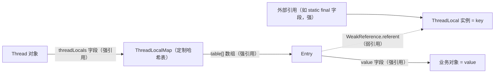
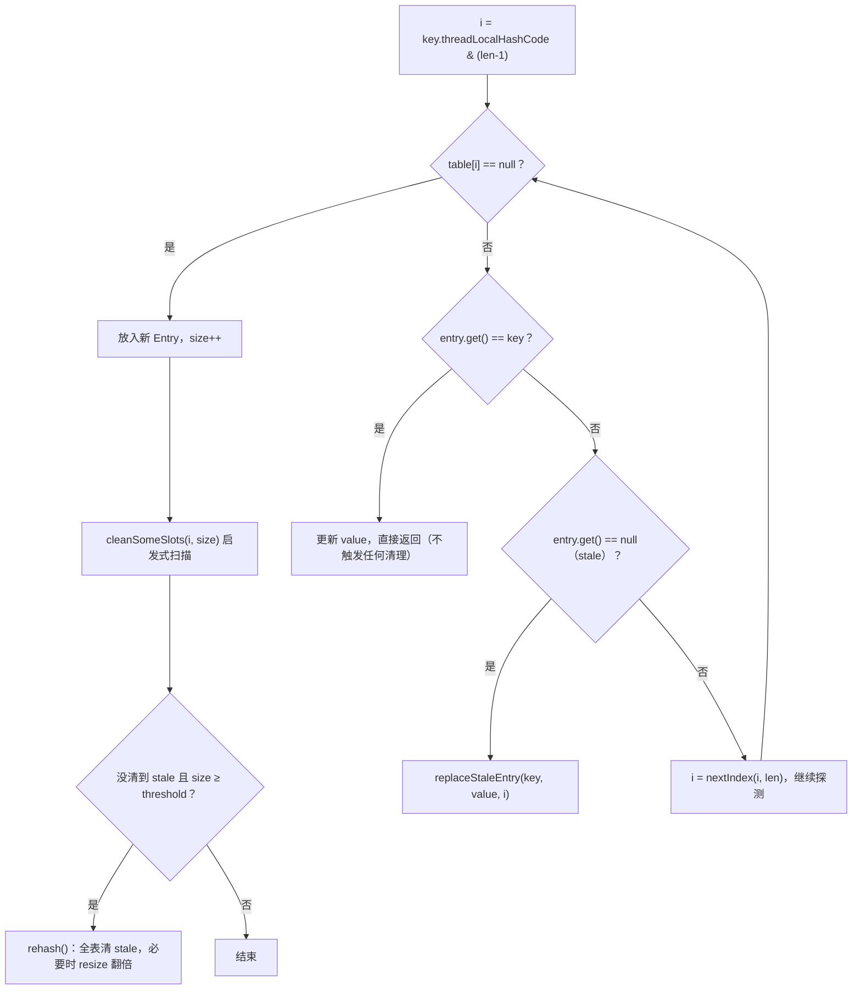
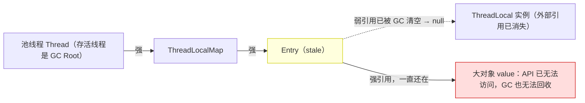
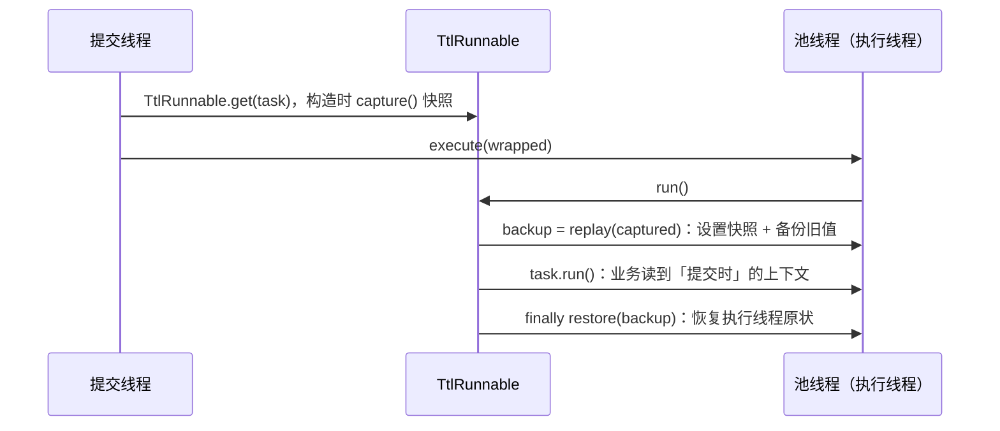

# ThreadLocal 与上下文传递

> 一句话概括：ThreadLocal 用「每线程一份副本」的**线程封闭**换取无锁访问——数据存在 **Thread 对象的 ThreadLocalMap** 里而不是 ThreadLocal 对象里；它的全部坑（内存泄漏、线程池串号、继承失效）都来自「**线程生命周期 ≠ 任务生命周期**」这一次错位。本文把存储结构、清理算法、泄漏引用链与跨线程传递方案（ITL / TTL / ScopedValue）讲到源码级。

预计阅读时间：大约 90 分钟

所属主题：[Java 并发编程常见面试题总结](summary.md)

**版本基线**：本文以 **JDK 8** 为主要基线，源码锚点已对照 OpenJDK `jdk8u` 仓库 master 分支逐行核实（行号为撰文时快照，随版本可能漂移，以 `类名#方法名` 为准）；JDK 17/21 的差异单独注明。**TransmittableThreadLocal（TTL）是阿里开源的第三方库**（`com.alibaba:transmittable-thread-local`，2.x 稳定线），不是 JDK 能力。**ScopedValue 在 JDK 25 转正（JEP 506）**，此前经历 incubator/preview，版本链单独注明。线程池内部机制归 [thread-pool.md](thread-pool.md)，虚拟线程与 StructuredTaskScope 全貌归 [virtual-threads.md](virtual-threads.md)，@Async 的上下文断层归 [../spring/async-annotation-principle.md](../spring/async-annotation-principle.md)，本文不复述，只在真正相关处链接。

---

## 0. 阅读路线

| 读者 | 建议阅读 | 关注点 |
| --- | --- | --- |
| 初级（1 年内） | 1、2.1、3.3、5.1~5.2、10 | ThreadLocal 是什么、数据存在哪、set(null)≠remove、串号怎么修 |
| 中级（1 年~3 年） | 2、3 全部，4.1~4.2、6、7.1~7.4 | ThreadLocalMap 结构与哈希、set/get/remove 源码、泄漏链、ITL 与 TTL 机制 |
| 高级（3 年+） | 3.4~3.5、4.3~4.5、5.3、6.2~6.3、7.5、8 | 启发式清理算法、static final 泄漏辨析、MAT 排查、浅拷贝边界、ScopedValue |
| 选型/架构 | 1.3、8.4~8.5、9 全部 | ThreadLocal vs synchronized、方案决策表、显式传参的工程判断 |

目录：

1. ThreadLocal 是什么：线程封闭，不是加锁
2. 存储结构：数据在 Thread 上，不在 ThreadLocal 里
3. set/get/remove 全流程与启发式清理
4. 内存泄漏：引用链、弱引用辨析与排查
5. 线程池复用污染：上下文串号事故
6. InheritableThreadLocal：只在「创建线程」时继承
7. TransmittableThreadLocal：把「提交时」的上下文带到「执行时」
8. ScopedValue：不可变、结构化、虚拟线程友好（JDK 25）
9. 工程实践与选型
10. 高频追问集
11. 参考资料
12. 附：一页速记

---

## 1. ThreadLocal 是什么：线程封闭，不是加锁

### 1.1 结论与最小示例

**结论**：ThreadLocal 提供**线程局部变量**——每个访问它的线程都持有自己独立初始化的副本，线程之间互不可见。它解决线程安全问题的思路不是「共享一个对象然后加锁」，而是「**根本不共享**」：这叫**线程封闭（thread confinement）**。JDK 8 源码类注释原文：

> These variables differ from their normal counterparts in that each thread that accesses one (via its get or set method) has its own, independently initialized copy of the variable. ThreadLocal instances are typically private static fields in classes that wish to associate state with a thread (e.g., a user ID or Transaction ID).
> —— `ThreadLocal` 类 javadoc（OpenJDK 8u，ThreadLocal.java L34~40）

最小示例（JDK 8 可直接运行）：

```java
public class ThreadLocalDemo {
    private static final ThreadLocal<String> CTX = new ThreadLocal<>();

    public static void main(String[] args) throws InterruptedException {
        CTX.set("main-context");
        Thread t = new Thread(() ->
                System.out.println("子线程读到: " + CTX.get()));  // 输出 null：普通 ThreadLocal 不继承
        t.start();
        t.join();
        System.out.println("主线程读到: " + CTX.get());           // 输出 main-context
    }
}
```

注意两个细节：

- `CTX` 是**同一个对象**（static final），但两个线程 `get()` 到不同的值——对象本身不存数据，它只是一把「钥匙」（见 2）；
- 子线程读到 `null` 而不是 `main-context`：**普通 ThreadLocal 没有继承语义**，继承是 InheritableThreadLocal 的事（见 6）。

### 1.2 典型场景

| 场景 | 为什么用 ThreadLocal | 典型实现 |
| --- | --- | --- |
| `SimpleDateFormat` 等非线程安全工具 | 内部有可变共享状态（Calendar），多线程 format/parse 会错乱甚至抛 `NumberFormatException`；每线程一份实例即可无锁使用 | `ThreadLocal.withInitial(() -> new SimpleDateFormat(...))` |
| 数据库连接 / Session 绑定 | 一个事务/请求内的多次 DAO 调用必须拿到**同一个连接**，又不能把连接当参数层层传 | Spring `TransactionSynchronizationManager`（见 9.2） |
| traceId / 用户上下文 | 横切信息贯穿整条调用链，显式传参会污染所有方法签名 | MDC、`RequestContextHolder`、自定义 UserContext |
| 线程私有缓存/计数器 | 如每线程独立的随机数种子、序列号，避免竞争 | `ThreadLocalRandom`（内部就是线程封闭思想） |

`SimpleDateFormat` 的标准写法：

```java
private static final ThreadLocal<SimpleDateFormat> FORMAT =
        ThreadLocal.withInitial(() -> new SimpleDateFormat("yyyy-MM-dd"));

public static String format(java.util.Date date) {
    return FORMAT.get().format(date);   // 每线程拿到自己的实例，无锁
}
```

**工程注**：JDK 8 起日期格式化优先用 `java.time.format.DateTimeFormatter`——它**不可变、天然线程安全**，连 ThreadLocal 都不需要。ThreadLocal 包装是「不得不复用非线程安全老类」时的手段，不是首选。

### 1.3 ThreadLocal vs synchronized

**结论**：两者是解决「多线程访问可变状态」的两种相反思路——synchronized 是**共享 + 互斥**（时间换空间），ThreadLocal 是**副本 + 封闭**（空间换时间）。

| 维度 | synchronized | ThreadLocal |
| --- | --- | --- |
| 思路 | 一份共享对象，排队访问 | N 个线程 N 份副本，根本不共享 |
| 资源账 | 省内存（1 份），花时间（锁竞争、阻塞、上下文切换） | 省时间（无锁），花内存（副本 ×N + 每线程一张哈希表） |
| 跨线程可见性 | 有 happens-before 语义，解锁前的写对后续加锁线程可见（见 [jmm-and-volatile.md](jmm-and-volatile.md)） | 副本之间**互不可见**，一个线程的 set 永远不影响另一个线程的 get |
| 适用状态 | 必须共享、必须一致的状态（账户余额、库存） | 可副本化的状态（格式化器、连接、上下文） |
| 失效场景 | 锁对象不对、锁粒度错 | 线程复用导致副本残留（见 5）、值对象本身被共享（见 1.4） |

锁的升级与开销细节见 [synchronized-and-lock-escalation.md](synchronized-and-lock-escalation.md)，本文不展开。

### 1.4 边界：副本不是线程安全的银弹

**结论**：ThreadLocal 只保证「**每个线程拿到不同的引用槽位**」，不保证「槽位里的对象不被共享」。如果把**同一个可变对象** set 进多个线程的 ThreadLocal，竞争照样发生。

```java
// 反例：所有线程的副本指向同一个 StringBuilder
StringBuilder shared = new StringBuilder();
ThreadLocal<StringBuilder> TL = ThreadLocal.withInitial(() -> shared); // ❌ 共享可变对象
// 两个线程同时 TL.get().append(...) 依然数据竞争
```

两条失效路径要记住：

1. **人为共享**：如上例，`initialValue`/`withInitial` 返回了外部同一个对象；
2. **继承浅拷贝**：InheritableThreadLocal 默认 `childValue` 直接返回父线程的引用，父子线程「副本」其实是同一个对象（见 6.2）。

**追问：ThreadLocal 能替代锁吗？** 期望答案：不能互相替代，是不同维度的手段。状态必须共享一致时用锁或原子类（见 [cas-and-atomic-classes.md](cas-and-atomic-classes.md)）；状态可以按线程副本化时用 ThreadLocal 消除竞争。把共享可变对象塞进 ThreadLocal 既不封闭也不安全，是最常见的误用。

---

## 2. 存储结构：数据在 Thread 上，不在 ThreadLocal 里

### 2.1 一张图看懂归属

**结论**：每个 `Thread` 对象内部有一个 `ThreadLocal.ThreadLocalMap threadLocals` 字段，**所有线程局部值都存在这张属于线程的表里**；ThreadLocal 实例本身不存任何线程的数据，它只充当 **key** 和一个固定的哈希值。



源码证据（OpenJDK 8u）：

```java
// Thread.java L182~190
/* ThreadLocal values pertaining to this thread. This map is maintained
 * by the ThreadLocal class. */
ThreadLocal.ThreadLocalMap threadLocals = null;

/* InheritableThreadLocal values pertaining to this thread. This map is
 * maintained by the InheritableThreadLocal class. */
ThreadLocal.ThreadLocalMap inheritableThreadLocals = null;
```

这个归属关系决定了三件事：

- **线程死，表才有机会整体回收**（`Thread#exit` 把两个字段置 null，见 4.4）——线程池线程不死，表就一直在；
- **ThreadLocal 对象可以被多个线程共用**（static final），因为数据根本不在它身上；
- **一个线程可以同时持有很多 ThreadLocal 的值**（表里多个 Entry），但一个 ThreadLocal 在同一个线程的表里只有一个 Entry。

### 2.2 set 的入口：getMap / createMap

`ThreadLocal#set` 的全部逻辑就是「找到当前线程的表，把自己当 key 放进去」：

```java
// ThreadLocal#set（ThreadLocal.java L218~226）
public void set(T value) {
    Thread t = Thread.currentThread();
    ThreadLocalMap map = getMap(t);
    if (map != null) {
        map.set(this, value);        // key 是 this：ThreadLocal 实例本身
    } else {
        createMap(t, value);         // 第一次 set 才懒创建表
    }
}

// ThreadLocal#getMap / #createMap
ThreadLocalMap getMap(Thread t) {
    return t.threadLocals;
}
void createMap(Thread t, T firstValue) {
    t.threadLocals = new ThreadLocalMap(this, firstValue);
}
```

`getMap`/`createMap` 是**包级私有、可被子类覆写**的——这正是 InheritableThreadLocal 的实现手法：覆写这两个方法，把操作目标换成 `t.inheritableThreadLocals`（见 6.1）。同一个 ThreadLocal 类体系，靠「换一张表」实现了两种语义。

### 2.3 ThreadLocalMap 与 Entry：key 弱引用、value 强引用

**结论**：`ThreadLocalMap` 是 `ThreadLocal` 的**静态内部类**（包级私有，专为 Thread 声明字段而开放），是一张**定制哈希表**；它的 `Entry` **继承 `WeakReference<ThreadLocal<?>>`**——**key（ThreadLocal 实例）是弱引用，value 是普通强引用字段**。

```java
// ThreadLocal.ThreadLocalMap.Entry（ThreadLocal.java L329~337）
static class Entry extends WeakReference<ThreadLocal<?>> {
    /** The value associated with this ThreadLocal. */
    Object value;

    Entry(ThreadLocal<?> k, Object v) {
        super(k);        // key 交给 WeakReference 的 referent：弱引用
        value = v;       // value 是 Entry 的普通字段：强引用
    }
}
```

类注释把设计意图写得很直白（ThreadLocal.java L309~318）：

> ThreadLocalMap is a customized hash map suitable only for maintaining thread local values. ... The class is package private to allow declaration of fields in class Thread. To help deal with very large and long-lived usages, the hash table entries use WeakReferences for keys. **However, since reference queues are not used, stale entries are guaranteed to be removed only when the table starts running out of space.**

三个关键词：**定制**（不是 HashMap）、**key 弱引用**（缓解长生命周期线程的内存问题）、**没有 ReferenceQueue**（stale 条目不靠 GC 通知清理，只靠表操作时的启发式扫描，「快满时才保证清掉」）。key 被 GC 清空后 `entry.get() == null` 的条目，源码称为 **stale entry**（失效条目），这是第 3、4 节全部清理逻辑的对象。

另外注意：**ThreadLocalMap 没有任何同步措施，也不需要**——它只被属主线程访问（线程封闭），不存在并发。这也是它敢用简单开放寻址的原因之一。

### 2.4 开放寻址 + 线性探测：为什么不用链地址法

**结论**：ThreadLocalMap 用**数组 + 开放寻址（open addressing）+ 线性探测**解决冲突：槽位被占就看下一个（`nextIndex` 环形 +1），直到找到 key 或空槽。**不是 HashMap 的「数组 + 链表/红黑树」**。

```java
// ThreadLocal.ThreadLocalMap#nextIndex / #prevIndex（L370~379）
private static int nextIndex(int i, int len) {
    return ((i + 1 < len) ? i + 1 : 0);      // 环形
}
```

为什么这样设计（结合源码结构的权衡分析）：

| 考量 | 开放寻址在这里的优势 |
| --- | --- |
| 表通常很小 | 一个线程用到的 ThreadLocal 数量有限（初始容量才 16），冲突概率低，线性探测几步就命中；链地址法的 `Entry.next` 指针和链表遍历反而是纯开销 |
| 内存紧凑 | Entry 只有「弱引用 key + value」两块，数组连续存储缓存友好；HashMap 的 Node 还要 next 指针、树化节点更重 |
| 与弱引用清理配合 | `expungeStaleEntry` 的清理单位是「**两个 null 槽之间的连续段（run）**」，顺序扫描即可完成局部重哈希（见 3.4）；链地址法没有连续段概念，stale 清理需要另设机制 |
| 无并发需求 | 线程封闭，不需要 HashMap 那套并发/树化/扩容迁移的复杂机制 |

**追问：开放寻址的删除为什么不能直接置 null？** 期望答案：直接置 null 会截断探测链——后面因冲突顺延存放的元素就找不到了。所以 ThreadLocalMap 删除一个 stale 槽后，必须把同一连续段内「家槽不在当前位置」的元素重新安插（`expungeStaleEntry` 的后半段），这正是它比链地址法删除复杂的地方。

### 2.5 哈希魔数 0x61c88647

**结论**：每个 ThreadLocal 实例构造时通过静态 `AtomicInteger` 累加分配一个**固定的** `threadLocalHashCode`，增量是魔数 `0x61c88647`；定位槽位用 `threadLocalHashCode & (len - 1)`（容量恒为 2 的幂）。

```java
// ThreadLocal.java L87~108
private final int threadLocalHashCode = nextHashCode();

private static AtomicInteger nextHashCode = new AtomicInteger();

/**
 * The difference between successively generated hash codes - turns
 * implicit sequential thread-local IDs into near-optimally spread
 * multiplicative hash values for power-of-two-sized tables.
 */
private static final int HASH_INCREMENT = 0x61c88647;

private static int nextHashCode() {
    return nextHashCode.getAndAdd(HASH_INCREMENT);
}
```

机制拆解：

- `0x61c88647` = 1640531527 ≈ **2³² × (1 − 1/φ)**（φ 为黄金分割比 1.618…），是与黄金分割相关的**乘法哈希常数**（Fibonacci hashing 一族）。它的作用：把「连续构造的 ThreadLocal 实例」这种**隐式顺序 ID**，在 2 的幂表长下散列得近乎均匀——第 1 个实例哈希 0、第 2 个 0x61c88647、第 3 个 0xc3910c8e……相邻实例的槽位间隔很大，常见场景（几个 static ThreadLocal 被同一批线程使用）几乎不冲突；
- 哈希值是**实例字段、final**：同一个 ThreadLocal 在所有线程的表里哈希相同；不同实例哈希不同。它**不是** `Object#hashCode`，也不随 value 变化；
- 用 `AtomicInteger#getAndAdd` 只是因为「分配 ID」这个动作发生在多线程构造 ThreadLocal 实例时，需要原子性——与线程封闭的数据访问无关。

**追问：为什么不用 ThreadLocal 的 hashCode() 或 System.identityHashCode？** 期望答案：默认 hashCode 无法保证「连续创建的实例在 2 的幂表长下均匀分布」，而 ThreadLocal 的典型用法恰恰是类加载期连续构造一批 static 实例；专用累加哈希把这种最常见模式的冲突降到近乎零（源码注释 L77~86 明说 eliminates collisions in the common case）。

### 2.6 容量、阈值与扩容

| 参数 | 值 | 源码锚点 |
| --- | --- | --- |
| 初始容量 | 16（必须是 2 的幂） | `ThreadLocalMap.INITIAL_CAPACITY`（L342） |
| 扩容阈值 | `len * 2 / 3`（16 → 10），即最坏 2/3 装填因子 | `ThreadLocalMap#setThreshold`（L363~365） |
| 扩容方式 | 容量翻倍，存活 Entry 重新探测安插 | `ThreadLocalMap#resize`（L702~728） |
| 扩容前奏 | **先全表清理 stale**，清完仍 `size >= threshold - threshold/4` 才翻倍 | `ThreadLocalMap#rehash`（L691~697） |

两个容易忽略的点：

1. **表是懒创建的**：第一次 `set`（或 `get` 触发初始化）才 new，构造器直接放入第一个 Entry（`ThreadLocalMap(ThreadLocal<?> firstKey, Object firstValue)`，L386~392）；
2. **真正的扩容触发线比 2/3 更低**：`rehash` 先 `expungeStaleEntries()` 全表清 stale，然后判断 `size >= threshold - threshold/4`，即 `size >= (2/3·len)·(3/4) = len/2`。注释写明这是「Use lower threshold for doubling to avoid hysteresis」——避免在阈值附近反复抖动。**面试说「2/3 扩容」只对了一半，完整口径是「2/3 触发 rehash，清理后仍达容量 1/2 才 resize」**。

---

## 3. set/get/remove 全流程与启发式清理

### 3.1 set：探测、命中更新、stale 替换

`ThreadLocalMap#set`（L475~506）的完整流程：



对应源码骨架：

```java
// ThreadLocal.ThreadLocalMap#set（节选）
int i = key.threadLocalHashCode & (len-1);
for (Entry e = tab[i]; e != null; e = tab[i = nextIndex(i, len)]) {
    ThreadLocal<?> k = e.get();
    if (k == key) { e.value = value; return; }        // 命中：更新
    if (k == null) { replaceStaleEntry(key, value, i); return; }  // 踩到 stale：替换
}
tab[i] = new Entry(key, value);                        // 空槽：新增
int sz = ++size;
if (!cleanSomeSlots(i, sz) && sz >= threshold)
    rehash();
```

`replaceStaleEntry`（L541~597）比「把 stale 槽占掉」多做三件事：

1. **向前回溯**找当前连续段里更靠前的 stale 槽（`slotToExpunge`），注释说明动机：GC 往往成批释放弱引用，「整段一次清掉」避免反复增量重哈希；
2. **向后扫描**找 key：若找到，把 key 的 Entry 与 stale 槽**交换位置**（维持开放寻址的探测顺序），再清理；若直到段尾都没找到，就把新 Entry 放进 stale 槽；
3. 收尾调用 `cleanSomeSlots(expungeStaleEntry(slotToExpunge), len)`，把连续段内其余 stale 一并处理。

**边界**：命中更新路径（`k == key`）**直接 return，不触发任何清理**——频繁 set 同一个 ThreadLocal 不会顺带打扫表，stale 清理只发生在新增、踩到 stale、get miss、remove、rehash 这些路径上。

### 3.2 get：快路径、getEntryAfterMiss 与「get 也会写入」

`ThreadLocal#get`（L161~173）：先取当前线程的表，`getEntry(this)` 命中就返回 `e.value`；否则走 `setInitialValue()`。

表内查找分两步（`ThreadLocalMap#getEntry`，L434~441）：

```java
private Entry getEntry(ThreadLocal<?> key) {
    int i = key.threadLocalHashCode & (table.length - 1);
    Entry e = table[i];
    if (e != null && e.get() == key)
        return e;                          // 快路径：家槽直接命中
    else
        return getEntryAfterMiss(key, i, e);  // 冲突/空槽/stale：线性探测
}
```

`getEntryAfterMiss`（L452~468）沿探测链前进：遇到目标 key 返回；**遇到 stale 顺手 `expungeStaleEntry(i)`**（读路径也参与清理）；遇到 null 说明不存在，返回 null。

**关键细节：`get()` 不只是读**。未命中时 `setInitialValue()`（L194~207）会调用 `initialValue()` 并**无条件 `map.set(this, value)` 写回表里**：

```java
private T setInitialValue() {
    T value = initialValue();      // 默认实现返回 null；withInitial 则调 supplier
    ...
    if (map != null) map.set(this, value);   // 即使 value 是 null 也会建 Entry
    else createMap(t, value);
    return value;
}
```

由此推出三条面试结论：

- 裸 `new ThreadLocal<>()` 第一次 `get()` 返回 null，但**表里已经多了一个 value 为 null 的 Entry**（key 活着，不是 stale）；
- `initialValue()` 每线程至多调一次，但 **`remove()` 之后再 `get()` 会再次调用**（javadoc L116~118 原文）；
- `withInitial(Supplier)`（JDK 8 引入，L142~144）返回内部类 `SuppliedThreadLocal`，只是把 `initialValue()` 委托给 supplier——**supplier 也是每线程首次 get 时才执行**，不是构造 ThreadLocal 时执行。

### 3.3 remove：clear + expunge；set(null) ≠ remove

`ThreadLocal#remove` → `ThreadLocalMap#remove`（L511~523）：

```java
private void remove(ThreadLocal<?> key) {
    Entry[] tab = table;
    int len = tab.length;
    int i = key.threadLocalHashCode & (len-1);
    for (Entry e = tab[i]; e != null; e = tab[i = nextIndex(i, len)]) {
        if (e.get() == key) {
            e.clear();              // 清空弱引用 referent：key 变 null（制造 stale）
            expungeStaleEntry(i);   // 立即清掉 value、槽位，并重排连续段
            return;
        }
    }
}
```

**`set(null)` 与 `remove()` 的本质区别**（高频追问）：

| 操作 | key（弱引用） | value | Entry 槽位 | 后果 |
| --- | --- | --- | --- | --- |
| `set(null)` | 仍指向 ThreadLocal，**活着** | null | **保留** | 下次 get 命中返回 null，不触发 initialValue；Entry 一直占着表 |
| `remove()` | `clear()` 置 null | 置 null | 置 null，size-- | 彻底移除；下次 get 重新走 initialValue |

所以「用完置 null」不能替代 remove：它既不清理 Entry，也不给启发式清理制造可识别的 stale 标记。**线程池场景的清理必须是 `remove()`**。

### 3.4 expungeStaleEntry：连续段清理与重哈希

**结论**：`expungeStaleEntry(staleSlot)`（L610~644）是全部清理逻辑的核心，做两件事：**清掉 stale 槽本身**，然后**向后扫描整个连续段直到 null 槽**，顺带清掉其他 stale、把「家槽错位」的存活 Entry 重新安插。

```java
// ThreadLocalMap#expungeStaleEntry（节选，省略局部变量声明）
private int expungeStaleEntry(int staleSlot) {
    // 1. 清掉自己：value 置 null（断开强引用）、槽位置 null、size--
    tab[staleSlot].value = null;
    tab[staleSlot] = null;
    size--;

    // 2. 向后扫描连续段，直到遇到 null 槽
    for (i = nextIndex(staleSlot, len); (e = tab[i]) != null; i = nextIndex(i, len)) {
        ThreadLocal<?> k = e.get();
        if (k == null) {                 // 另一个 stale：一并清掉
            e.value = null; tab[i] = null; size--;
        } else {
            int h = k.threadLocalHashCode & (len - 1);
            if (h != i) {                // 家槽不是当前位置：因冲突顺延过
                tab[i] = null;
                // Unlike Knuth 6.4 Algorithm R, we must scan until
                // null because multiple entries could have been stale.
                while (tab[h] != null) h = nextIndex(h, len);
                tab[h] = e;              // 从家槽起重新探测安插
            }
        }
    }
    return i;                            // 返回终止扫描的 null 槽下标
}
```

为什么必须重排：开放寻址中，元素可能因冲突存放在家槽之后。把中间某个槽清空后，若不把后面的元素前移安插，`getEntryAfterMiss` 探测到 null 就提前终止，**存活元素会「失踪」**。源码注释特意对比 Knuth TAOCP 6.4 的 Algorithm R：标准算法只需处理一个删除点，这里因为 GC 可能成批清空弱引用，必须扫到 null 为止。

**启发式（heuristic）的含义**：它只扫「当前连续段」，不扫全表——清理范围取决于 stale 出现的位置，不保证一次清干净所有 stale。全表清理只有 `expungeStaleEntries()`（L733~741，rehash 前调用）才做。

### 3.5 cleanSomeSlots 与 rehash：清理的时机与代价

`cleanSomeSlots(i, n)`（L670~684）是**对数级启发式扫描**：从 i 的下一个槽开始，扫 `log2(n)` 个槽；一旦发现 stale，把 n 重置为表长（再多扫 log2(len)−1 个），并调 `expungeStaleEntry`。注释原文说得很清楚：这是在「完全不扫（快但留垃圾）」和「扫描与元素数成正比（找全垃圾但插入退化成 O(n)）」之间取的折中。

把所有清理时机汇总成一张表：

| 触发路径 | 清理动作 | 范围 |
| --- | --- | --- |
| `set` 新增 Entry 后 | `cleanSomeSlots(i, size)` | log 级启发式 |
| `set` 踩到 stale | `replaceStaleEntry` → `expungeStaleEntry` + `cleanSomeSlots(…, len)` | 连续段 + log 级 |
| `get` 探测 miss 途中踩到 stale | `expungeStaleEntry(i)` | 连续段 |
| `remove` 命中 | `clear` + `expungeStaleEntry(i)` | 连续段 |
| `set` 新增后未清到 stale 且 size ≥ threshold | `rehash` → `expungeStaleEntries` 全表扫，再视情况 `resize` | 全表 |

**边界/代价**：这套设计意味着——**如果线程不再操作这张表（不再 set/get/remove），stale 条目就永远没人清**。弱引用 + 启发式清理只是「缓解」，不是自动回收；真正的兜底是线程退出（4.4）或主动 remove（4.5）。这也是类注释「stale entries are guaranteed to be removed only when the table starts running out of space」的准确含义。

**追问：为什么不用 ReferenceQueue 监听 key 被回收？** 期望答案：源码注释明说没有用 reference queue。用队列需要额外线程/轮询消费引用通知，而 ThreadLocalMap 是线程私有、操作频繁的小表，把清理摊到 set/get/remove 路径上（启发式）成本更低、无需跨线程协调；代价就是清理不及时、依赖表操作触发。

---

## 4. 内存泄漏：引用链、弱引用辨析与排查

### 4.1 泄漏引用链

**结论**：泄漏链是 **Thread → ThreadLocalMap → Entry → value，全程强引用**；key 是唯一的弱引用环节。当 ThreadLocal 实例的外部强引用消失、key 被 GC 清空后，Entry 变成 stale，但 **value 仍被 Entry 强引用、Entry 被 table 强引用、table 被 Thread 强引用**——只要线程活着，这条链就断不了。



逐环拆解：

1. **Thread 是 GC Root**：存活线程（尤其线程池核心线程）本身可达，它持有的 `threadLocals` 字段不会被回收；
2. **Entry 的 value 是普通字段**：`Object value` 没有任何弱/软语义，Entry 活着 value 就活着；
3. **key 没了，value 成了「孤儿」**：`get`/`remove` 都以 ThreadLocal 实例为 key，key 被回收后**没有任何 API 能再定位到这个 Entry**——业务代码想清都找不到门路，只能等启发式清理恰好扫到它，或线程退出；
4. **线程池放大**：池线程长期不死（复用机制见 [thread-pool.md](thread-pool.md)），null-key 的 value 可能驻留数天乃至整个进程生命周期。value 越大（大集合、字节数组、持有 ClassLoader 的对象），泄漏越致命。

### 4.2 key 为什么设计成弱引用：缓解，不是根治

**结论**：弱引用 key 是**缓解措施**——当 ThreadLocal 实例不再被外部使用时，至少 key 本身能被 GC 回收，Entry 被标记为 stale，给启发式清理一个「可识别、可清除」的目标；**它不能解决 value 的强引用驻留**。

反证：假如 key 也是强引用，那么即使外部早已不用这个 ThreadLocal，Entry 仍会强引用 ThreadLocal 实例，整条链（ThreadLocal + value）都回收不了，且连 stale 标记都没有，启发式清理无从下手。弱引用把「key 的生命周期」从「线程的生命周期」里解耦出来，是两害相权取其轻。

但要看清它的天花板：

- 没有 ReferenceQueue，GC 清空 key 后**不会主动通知**表来清理（2.3 类注释原文）；
- 启发式清理依赖后续表操作，线程若不再碰这张表，stale 永远躺着；
- **value 始终是强引用**，弱引用设计从头到尾没碰过 value。

所以标准答案的完整表述是：**弱引用 key 降低了泄漏概率，但根治只有一条——用完 `remove()`**。

### 4.3 static final 辨析：两种不同的失效模式

**这是本题最容易答混的层次**。ThreadLocal 实例「通常声明为 static final」（类注释原文），此时**外部强引用一直在，key 永远不会被 GC 回收，也就永远不会出现 null-key 的 stale Entry**。那泄漏从何而来？要区分两种模式：

| 模式 | 前提 | key 状态 | 泄漏/污染形态 | 弱引用是否起作用 |
| --- | --- | --- | --- | --- |
| A：值残留（最常见） | ThreadLocal 是 static final，任务 set 后不 remove | **活着**（外部强引用一直在） | 每个池线程的表里长期持有过期 value；下一任务读到上一任务的值（串号，见 5）；value 大则驻留内存 | **不起作用**——key 根本不会被回收 |
| B：null-key 泄漏（教科书图） | ThreadLocal 实例本身变得不可达（非 static 字段随对象丢弃、动态创建后丢弃、所属类被卸载） | 被 GC 清空 → null | stale Entry 的 value 无法通过 API 访问也不被回收，直到启发式清理或线程退出 | 起作用——至少 key 可回收、Entry 可被识别清理 |

**准确表述**：

- 「ThreadLocal 内存泄漏」的**通用根因**是「**value 被线程强引用链持有 + 没有 remove + 线程长生命周期**」，与 key 是否弱引用无关；
- 弱引用针对的是模式 B（ThreadLocal 实例先死）；模式 A（static final，绝大多数业务代码）里弱引用形同虚设，**泄漏主因就是 value 未 remove 叠加线程复用**；
- 面试只背「key 弱引用被回收导致泄漏」是不完整的——要能说出 static final 场景下 key 不会回收、问题出在 value 残留这一层。

### 4.4 线程退出回收与类加载器泄漏

线程正常终止时，JVM 调用 `Thread#exit`（Thread.java L758~774）主动断链：

```java
/* Speed the release of some of these resources */
threadLocals = null;
inheritableThreadLocals = null;
```

这与 ThreadLocal 类注释呼应（L67~71）：「after a thread goes away, all of its copies of thread-local instances are subject to garbage collection」。**线程死 → 表不可达 → 整表回收**，这是唯一的「自动兜底」。反过来就是线程池的问题本质：**池线程以「不死」为设计目标，恰好绕过了这个兜底**。

一个典型的进阶事故——**Web 容器类加载器泄漏**：应用里某个 ThreadLocal 的 value 引用了 WebappClassLoader 加载的类（或 value 本身就是应用类实例），而持有它的是**容器级线程池**（生命周期长于应用）。应用重部署后，旧 ClassLoader 本该卸载，却被容器线程的 ThreadLocalMap 强引用链拽住，反复重部署最终 Metaspace OOM。排查特征：heap dump 里旧 ClassLoader 的 GC Root 路径经过 `Thread → threadLocals → Entry → value`。

（版本注：较新的 JDK 在 `ThreadLocal#setInitialValue` 与 `Thread#exit` 中增加了内部类 `TerminatingThreadLocal` 的注册/回调，用于线程退出时清理特定内部用途的 ThreadLocal，近期 8u 已包含；它不改变本文主线，普通 ThreadLocal 的回收仍靠上述断链。）

### 4.5 根治与排查

**根治**：谁 set 谁 remove，`finally` 成对出现；Web 场景在拦截器 `afterCompletion` / Filter 的 finally 统一清理（见 9.4 军规）。

**排查路线**（heap dump 分析，通用 OOM 排查思路见 [deadlock-and-troubleshooting.md](deadlock-and-troubleshooting.md)）：

1. `jmap -dump:live,format=b,file=heap.hprof <pid>` 抓堆（或 OOM 时 `-XX:+HeapDumpOnOutOfMemoryError` 自动留现场）；
2. MAT 打开 **Dominator Tree**，按 Retained Heap 排序，找异常大的 `java.lang.Thread` → 展开 `threadLocals` → `table` → `Entry`；
3. 识别特征：**Entry 的 referent（key）为 null，value 却很大**——模式 B 的铁证；若 key 活着但 value 是过期业务对象，则是模式 A 的残留；
4. MAT OQL 示例（语法以 MAT 版本为准）：

```sql
SELECT * FROM java.lang.ThreadLocal$ThreadLocalMap$Entry e WHERE e.referent = null
```

5. 对可疑 value 查 **Path to GC Roots（exclude weak references）**，确认强引用链是否正是 Thread → ThreadLocalMap → Entry → value。

**追问：为什么排除弱引用后还能找到 GC Root 路径？** 期望答案：因为 value 一侧全程强引用，弱引用只在 key 一侧；排除弱引用恰恰能凸显「value 被强引用链拽住」这个泄漏本质。

### 4.6 附：四种引用类型简表

本文自带给 GC 基础薄弱的读者一张简表（深入 GC 机制另见专题）：

| 引用类型 | 回收时机 | 典型用途 |
| --- | --- | --- |
| 强引用（普通赋值） | 只要从 GC Roots 可达就不回收 | 绝大多数对象引用 |
| 软引用 `SoftReference` | 内存不足（将 OOM）时回收 | 内存敏感缓存 |
| 弱引用 `WeakReference` | 只要没有强/软引用，下次 GC 即回收 | **ThreadLocalMap 的 key**、`WeakHashMap` |
| 虚引用 `PhantomReference` | 不影响对象生命周期，仅配合 ReferenceQueue 做回收通知 | 堆外内存清理（如 `Cleaner`） |

Entry 的 key 走第三行，value 走第一行——**一行弱、一行强，泄漏的全部张力就在这两行之间**。

---

## 5. 线程池复用污染：上下文串号事故

### 5.1 反例：用户上下文串号

**结论**：线程池的线程被**反复复用**，上一个任务 set 的 ThreadLocal 值会原样留给下一个任务——即使下一个任务属于另一个用户。这是比内存泄漏更危险的**正确性事故**（权限串号、日志串 traceId）。

完整反例（JDK 8 可运行，单线程池放大问题）：

```java
import java.util.concurrent.*;

public class ContextPollutionDemo {
    private static final ThreadLocal<String> USER = new ThreadLocal<>();
    private static final ExecutorService POOL = Executors.newFixedThreadPool(1);

    public static void main(String[] args) throws Exception {
        // 任务 1：处理 user-A，set 之后忘记清理
        POOL.submit(() -> {
            USER.set("user-A");
            System.out.println("任务1 处理: " + USER.get());   // user-A
        }).get();

        // 任务 2：处理 user-B，入口没 set（比如走了缓存分支），直接读上下文
        POOL.submit(() ->
            System.out.println("任务2 读到: " + USER.get())    // user-A！串号事故
        ).get();
        POOL.shutdown();
    }
}
```

机制复盘：两个任务跑在**同一个池线程**上，共用同一张 ThreadLocalMap；任务 1 的 Entry（key 是 static final 的 USER，活着）一直留在表里。注意这正是 4.3 的**模式 A**——key 活得好好的，弱引用一点忙都帮不上。

### 5.2 修复：任务内清理 / 装饰 Runnable

修复一：**任务自己负责**，set 与 remove 在 try/finally 里成对：

```java
POOL.submit(() -> {
    USER.set("user-B");
    try {
        // 业务逻辑
    } finally {
        USER.remove();      // 无论正常/异常都清理
    }
});
```

修复二：**统一装饰**，把清理收敛到一处，避免每个任务各写一遍：

```java
public static Runnable cleanAfter(Runnable task) {
    return () -> {
        try {
            task.run();
        } finally {
            USER.remove();
        }
    };
}
// 提交处：POOL.submit(cleanAfter(() -> { ... }));
```

更完整的装饰语义是「**提交时捕获 → 执行时设置 → 执行后恢复/清理**」三段式——那正是 TTL 的 capture/replay/restore（见 7）；Spring 侧的对应物是 `TaskDecorator`，MDC 搬运的现成示例见 [../spring/async-annotation-principle.md](../spring/async-annotation-principle.md) 7.2 节，本文不重复。

**边界**：装饰必须覆盖**所有提交入口**，漏一个就留一个污染源；线程池机制本身（核心线程为何不死、任务如何排队）见 [thread-pool.md](thread-pool.md)。

### 5.3 与 InheritableThreadLocal 叠加的坑

把上面的 `ThreadLocal` 换成 `InheritableThreadLocal`，问题不会消失反而叠加：池线程**创建时**从当时的提交线程继承一份旧值（见 6），之后每个任务 set 的新值又残留——**「继承来的过期值」+「上一任务的残留值」双重污染**。结论：ITL 不是线程池上下文传递的解法，TTL 才是（7）。

**追问：为什么 TTL 的 replay 备份恢复能避免覆盖池线程原有值？** 期望答案：TTL 执行前 replay 会先**备份执行线程当前的值**，执行后 restore 恢复备份——池线程上属于其他机制的上下文不被本任务破坏。这正是「restore」这一步存在的意义（7.2）。

---

## 6. InheritableThreadLocal：只在「创建线程」时继承

### 6.1 机制：第二张表与 Thread#init 拷贝

**结论**：`InheritableThreadLocal`（ITL，JDK 1.2 引入）继承 ThreadLocal，把操作目标换成线程的**第二张表** `inheritableThreadLocals`；子线程**在构造时**从父线程的这张表拷贝一份初始值。仅此而已——**继承发生在「创建线程」那一刻，与任务提交无关**。

ITL 的全部实现就是覆写三个方法（InheritableThreadLocal.java，全文仅数十行）：

```java
public class InheritableThreadLocal<T> extends ThreadLocal<T> {
    protected T childValue(T parentValue) {
        return parentValue;                       // 默认：直接返回父值（浅拷贝！）
    }
    ThreadLocalMap getMap(Thread t) {
        return t.inheritableThreadLocals;         // 换成第二张表
    }
    void createMap(Thread t, T firstValue) {
        t.inheritableThreadLocals = new ThreadLocalMap(this, firstValue);
    }
}
```

拷贝发生在 `Thread#init`（Thread.java L420~422，由 Thread 构造器调用）：

```java
if (inheritThreadLocals && parent.inheritableThreadLocals != null)
    this.inheritableThreadLocals =
        ThreadLocal.createInheritedMap(parent.inheritableThreadLocals);
```

`ThreadLocal.createInheritedMap` → `ThreadLocalMap(ThreadLocalMap parentMap)` 构造器（L400~422）：遍历父表，对每个 key 存活的 Entry 调 `key.childValue(e.value)` 生成子值，再按子表容量重新探测安插。注意基类 `ThreadLocal#childValue` 默认**抛 UnsupportedOperationException**（L287~289）——只有 ITL 覆写了它，普通 ThreadLocal 根本不走继承路径。

三个时刻要分清（线程生命周期细节见 [thread-basics-and-lifecycle.md](thread-basics-and-lifecycle.md)）：

| 时刻 | 发生什么 |
| --- | --- |
| `new Thread(...)` 构造时 | `init` 在**父线程**上执行，此刻快照父线程的 inheritable 表（javadoc：called from within the parent thread before the child is started） |
| `start()` 时 | 不再拷贝；构造后、start 前父线程的修改**不会**反映给子线程 |
| 子线程运行中 | 与父线程完全独立，互不影响（各自一张表） |

### 6.2 childValue 与浅拷贝边界

默认 `childValue` 返回**同一个引用**：父子线程的「副本」指向同一个对象。值是不可变对象（String、Integer）时无所谓；值是可变对象（Map、List、StringBuilder）时，**父子线程共享可变状态，竞争回来了**——这是 1.4「副本不是银弹」的第二条失效路径。需要隔离就覆写 `childValue` 做深拷贝：

```java
InheritableThreadLocal<Map<String, String>> CTX =
    new InheritableThreadLocal<Map<String, String>>() {
        @Override protected Map<String, String> childValue(Map<String, String> parentValue) {
            return parentValue == null ? null : new HashMap<>(parentValue);  // 深拷贝一层
        }
    };
```

### 6.3 线程池反例：为什么池线程拿不到提交时的上下文

**结论**：线程池的 worker 线程**只在被创建时继承一次**，之后复用时不再重新继承——「提交任务的主线程」与「执行任务的池线程」之间**没有创建关系**，ITL 的继承语义在这里完全错位。

完整反例（JDK 8 可运行）：

```java
import java.util.concurrent.*;

public class ItlPoolDemo {
    private static final InheritableThreadLocal<String> CTX = new InheritableThreadLocal<>();
    private static final ExecutorService POOL = Executors.newFixedThreadPool(1);

    public static void main(String[] args) throws Exception {
        CTX.set("user-A");
        // 首次 submit 触发 worker 创建：此刻 main 是父线程，继承到 user-A
        POOL.submit(() -> System.out.println("任务1: " + CTX.get())).get();  // user-A

        CTX.set("user-B");
        // worker 复用，不会重新继承：读到的仍是创建时的快照
        POOL.submit(() -> System.out.println("任务2: " + CTX.get())).get();  // user-A！不是 user-B
        POOL.shutdown();
    }
}
```

更隐蔽的变体：若池线程由**别的线程**创建（预启动、另一个请求先触发建线程），连第一个任务继承到的都是「建线程那一刻、那个线程」的上下文——**继承结果取决于谁在何时创建了 worker，与任务语义毫无关系**。

**适用场景**：ITL 只适合「**真的每次 new 子线程**、且希望子线程带上父线程上下文」的场景（如简单的父子任务、每请求新建线程的老式模型）。线程池/异步执行场景请用 TTL（7）或显式传参。虚拟线程场景下，每个虚拟线程创建都拷贝一份父表的成本被海量线程放大，这正是 ScopedValue 的动机之一（8，JEP 506 Motivation「Expensive inheritance」）。

**追问：ITL 的值传递是深拷贝还是浅拷贝？拷贝发生在 start 还是构造？** 期望答案：默认浅拷贝（childValue 返回原引用）；拷贝发生在 Thread 构造（init）时、在父线程上执行，不是 start 时。两问答错任何一个都说明没读过源码。

---

## 7. TransmittableThreadLocal：把「提交时」的上下文带到「执行时」

> **第三方库声明**：TTL 是阿里开源的 `com.alibaba:transmittable-thread-local`（GitHub: alibaba/transmittable-thread-local），**不是 JDK 类**。以下机制对照其 2.x 稳定分支源码与官方 README 核实；2.13+ 要求 Java 8（Java 6 支持停留在 2.12.x），master 上的 v3 尚未发布。

### 7.1 定位与继承关系

**结论**：TTL 解决的是 ITL 解决不了的问题——官方 README 原文：「对于使用线程池等会池化复用线程的执行组件的情况……应用需要的实际上是把**任务提交给线程池时**的 ThreadLocal 值传递到**任务执行时**。」

类声明（2.x 源码 TransmittableThreadLocal.java L72）：

```java
public class TransmittableThreadLocal<T> extends InheritableThreadLocal<T> implements TtlCopier<T> {
```

即 **TTL 继承 ITL**：它天然保留「创建线程时继承」的行为，再叠加「任务粒度传递」的增强；`TtlCopier` 接口用于定制值的拷贝方式（缺省是简单赋值传递，浅拷贝边界与 6.2 同理）。用法与 ThreadLocal 一致：`set/get/remove`。

### 7.2 capture / replay / restore 三步

**结论**：TTL 把上下文传递规范化为 **CRR 模式**（README 原文：捕捉、回放、恢复，capture/replay/restore）：

| 步骤 | 时机 | 动作 | 源码锚点（2.x） |
| --- | --- | --- | --- |
| **capture** | **包装/提交任务时**（提交线程上） | 快照当前线程所有 TTL 实例的值 | `TransmittableThreadLocal.Transmitter#capture`（L498）；`TtlRunnable` 构造器 `capturedRef = new AtomicReference<>(capture())`（L43） |
| **replay** | **任务执行前**（执行线程上） | 把快照设置到执行线程，并**备份执行线程原有的值** | `Transmitter#replay`（L523）；`TtlRunnable#run` 中 `backup = replay(captured)`（L58） |
| **restore** | **任务执行后**（finally） | 用备份恢复执行线程原状，本任务设置的值不残留 | `Transmitter#restore`（L584）；`TtlRunnable#run` finally 中 `restore(backup)`（L62） |



对照 5.2 的三段式装饰可以发现：TTL 就是把「捕获→设置→恢复」做成了通用框架，且 restore 恢复的是**备份**而非简单清空——池线程上其他机制的上下文不被破坏。

### 7.3 三种接入方式

| 方式 | 写法 | 适用 |
| --- | --- | --- |
| 装饰任务 | `TtlRunnable.get(runnable)` / `TtlCallable.get(callable)` | 只有少数提交点需要传递 |
| 装饰线程池 | `TtlExecutors.getTtlExecutorService(pool)`（另有 `getTtlExecutor`、`getTtlScheduledExecutorService`） | 整个池的所有任务都要传递，一次包装处处生效 |
| Java Agent | `java -javaagent:path/to/transmittable-thread-local-2.x.y.jar` | 无侵入：字节码增强 JDK 执行组件，业务代码零改动 |

Agent 方式一句话展开：TTL Agent 通过 transformlet 装饰 `ThreadPoolExecutor`/`ScheduledThreadPoolExecutor`、`ForkJoinTask`（2.5.1+，因此 `CompletableFuture` 与并行 Stream 也透明支持）、`TimerTask`（2.7.0+，2.11.2 起默认开启）——相当于把「装饰线程池」自动 applied 到 JDK 组件上。

**关键使用约束（README 明确警告）**：`TtlRunnable.get(task)` 的快照发生在**包装那一刻**，所以**同一个任务每次提交都要重新包装**；复用上一次包装好的 TtlRunnable，回放的是旧快照。装饰线程池的方式没有这个问题（每次 execute 内部包装）。

### 7.4 完整示例：线程池传递 traceId

```java
import com.alibaba.ttl.TransmittableThreadLocal;
import com.alibaba.ttl.threadpool.TtlExecutors;
import java.util.concurrent.*;

// Maven: com.alibaba:transmittable-thread-local:2.14.4（2.x 稳定线，版本号以中央仓库为准）
public class TtlDemo {
    private static final TransmittableThreadLocal<String> TRACE = new TransmittableThreadLocal<>();
    private static final ExecutorService POOL =
            TtlExecutors.getTtlExecutorService(Executors.newFixedThreadPool(1));

    public static void main(String[] args) throws Exception {
        TRACE.set("trace-A");
        POOL.submit(() -> System.out.println("任务1: " + TRACE.get())).get();  // trace-A

        TRACE.set("trace-B");
        POOL.submit(() -> System.out.println("任务2: " + TRACE.get())).get();  // trace-B ✓
        // 对比 6.3 的 ITL 反例：同一份代码换成 ITL，任务2 会读到 trace-A
        POOL.shutdown();
    }
}
```

等价的任务装饰写法：`rawPool.submit(TtlRunnable.get(() -> System.out.println(TRACE.get())))`。

### 7.5 边界与代价

- **只传 TTL**：capture 只收集 `TransmittableThreadLocal` 实例的值；普通 ThreadLocal、ITL 的值**不在传递范围**。MDC 等基于普通 ThreadLocal 的上下文需要专门适配，不会自动跟着走；
- **每任务开销**：capture 快照、replay 设置 + 备份、restore 恢复，都是任务粒度的额外操作；海量小任务场景要算这笔账（对比：显式传参零运行时开销）；
- **覆盖要全**：漏装饰的池/执行器不传递；Agent 覆盖 JDK 组件，但自定义执行器、框架内部池仍需逐一确认；
- **CallerRunsPolicy**：拒绝策略让任务在**提交线程**执行时，朴素的「set→run→remove」会把提交线程自己的上下文清掉（README 点名的丢失场景）；TTL 的 replay/restore 备份恢复语义天然规避此坑；
- **浅拷贝**：缺省赋值传递，可变值对象跨线程共享仍需不可变或同步（同 6.2）；
- **异步框架组合**：`CompletableFuture` 默认走 ForkJoinPool，上下文传递可借 TTL Agent（7.3）；CompletableFuture 本身的组合语义见 [forkjoin-and-completable-future.md](forkjoin-and-completable-future.md)。

**追问：TTL 为什么继承 ITL 而不是 ThreadLocal？** 期望答案：保留「真正 new 子线程时继承」的兼容行为（ITL 语义是 TTL 语义的子集场景），同时通过 CRR 补上池化复用场景；继承 ITL 也让存量 ITL 代码可以平滑替换类型。

---

## 8. ScopedValue：不可变、结构化、虚拟线程友好（JDK 25）

### 8.1 版本链（已对照 JEP 官方页核实）

| JDK | JEP | 状态 |
| --- | --- | --- |
| 20 | JEP 429 | Incubator（孵化） |
| 21 | JEP 446 | Preview（预览） |
| 22 | JEP 464 | Second Preview |
| 23 | JEP 481 | Third Preview |
| 24 | JEP 487 | Fourth Preview |
| **25** | **JEP 506** | **转正（Final）**，唯一 API 变更：`orElse` 不再接受 null |

JEP 506 History 原文：「proposed for incubation by JEP 429 (JDK 20), proposed for preview by JEP 446 (JDK 21), and subsequently improved and refined by JEP 464 (JDK 22), JEP 481 (JDK 23), and JEP 487 (JDK 24)」。preview 阶段 API 有过调整，**本文示例以 JDK 25 转正 API 为准**；JDK 21~24 上使用需 `--enable-preview` 且注意版本差异。

### 8.2 三个设计变化

**结论**：ScopedValue 不是「更好的 ThreadLocal」，而是**换了一套契约**——针对 ThreadLocal 的三大缺陷（JEP 506 Motivation 原文归纳）：无约束可变性、无界生命周期、昂贵的继承。

1. **不可变绑定（write once）**：没有 `set` 方法。绑定只能由 `ScopedValue.where(KEY, value)` 建立，作用域内任何代码只能 `get` 不能改；想换值只能在**嵌套的新作用域**里重新 where——内层绑定不影响外层，出了内层自动恢复（JEP 原文：「The body of bar cannot change the binding seen by that method itself but can change the binding seen by its callees」）。数据流变成**单向的调用方→被调方**，一眼可读；
2. **结构化生命周期**：`where(...).run(...)` 的 run 结束，**绑定自动销毁**——不需要 remove，也没有「忘记清理」这个概念。作用域外 `get()` 抛 `NoSuchElementException`（JDK 25 javadoc），可用 `isBound()`/`orElse(...)`/`orElseThrow(...)` 探测与兜底；
3. **共享式继承，零拷贝**：配合 `StructuredTaskScope`（JDK 25 仍为 preview，JEP 505），绑定在**创建 scope 时捕获**、被 scope 内 fork 的所有子线程继承，**不复制**（JEP 506 原文：「there is no copying of a parent thread's scoped value bindings to the child thread」）。因为值不可变，共享是安全的；因为 fork/join 结构保证子线程先于作用域结束，生命周期依然有界。虚拟线程全貌与 StructuredTaskScope 用法见 [virtual-threads.md](virtual-threads.md)。

**虚拟线程的内存账**（JEP 506 原文）：「if each of a million virtual threads has its own copy of thread-local variables, the memory footprint may be significant」——ThreadLocal 的副本语义要求每个虚拟线程各存一份；ScopedValue 让百万虚拟线程**共享同一个不可变值**，空间成本从 O(线程数 × 值) 降到 O(值)。

### 8.3 示例（JDK 25 转正 API）

```java
// JDK 25+；21~24 为 preview，需 --enable-preview 且 API 有差异
public class ScopedValueDemo {
    private static final ScopedValue<String> TRACE = ScopedValue.newInstance();

    public static void main(String[] args) {
        ScopedValue.where(TRACE, "trace-123").run(() -> {
            System.out.println(TRACE.get());   // trace-123
            handle();                          // 调用链深处直接读，无需传参
        });
        // run 结束，绑定自动销毁：
        System.out.println(TRACE.isBound());   // false
        // TRACE.get();                        // 抛 NoSuchElementException
    }

    private static void handle() {
        System.out.println("handle: " + TRACE.get());   // trace-123
    }
}
```

嵌套重绑定（JEP 506 示例同构）：

```java
ScopedValue.where(TRACE, "outer").run(() -> {
    System.out.println(TRACE.get());                       // outer
    ScopedValue.where(TRACE, "inner").run(() ->
            System.out.println(TRACE.get()));              // inner
    System.out.println(TRACE.get());                       // outer：内层绑定不泄漏到外层
});
```

多值绑定用链式 where：`ScopedValue.where(K1, v1).where(K2, v2).run(...)`；需要返回值用 `call(CallableOp)`（可抛受检异常），无返回值用 `run(Runnable)`。

### 8.4 ThreadLocal vs ScopedValue

| 维度 | ThreadLocal | ScopedValue（JDK 25） |
| --- | --- | --- |
| 可变性 | 随时 set/remove，任何持有者都能改 | 绑定不可变，无 set；换值只能嵌套新作用域 |
| 生命周期 | 无界：set 之后一直活着，直到 remove/线程死 | 有界：where 的作用域结束自动解绑 |
| 清理责任 | 业务必须 finally remove（泄漏/串号之源） | 无需清理，结构保证 |
| 子线程传递 | 普通 TL 不传；ITL 创建时浅拷贝；池化需 TTL | StructuredTaskScope 内自动继承，**零拷贝共享** |
| 内存（海量线程） | 每线程一份副本，O(线程数 × 值) | 共享不可变值，O(值) |
| 读取性能 | 哈希表查找 | get 常快如读局部变量（JEP 原文） |
| 可用版本 | JDK 1.2+，任何生产环境 | JDK 25 转正；20~24 孵化/预览 |

### 8.5 边界与选型

- **JDK 25 之前，生产仍用 ThreadLocal / TTL**——这是当前（JDK 8/17/21 为主流）的现实答案，面试不要答反；
- **值对象本身要不可变**：javadoc 原文「A ScopedValue that is shared across threads requires that the value be an immutable object or for all access to the value to be appropriately synchronized」——不可变的是**绑定**，值对象的可变性要自己保证；
- **ForkJoinPool 不继承 ScopedValue**（JEP 506 原文：legacy 线程管理类无法保证子线程先于父作用域退出）——`CompletableFuture.supplyAsync` 这类场景 ScopedValue **不会自动传过去**，仍需显式传参（或 TTL Agent 方案，见 7.3）；
- StructuredTaskScope 在 JDK 25 仍是 preview（JEP 505，需 `--enable-preview`），ScopedValue 本体已转正、可独立使用；
- where 的 value 允许 null（javadoc 明示），但 JDK 25 起 `orElse(null)` 不允许（JEP 506 唯一 API 变更）。

**追问：ScopedValue 能完全替代 ThreadLocal 吗？** 期望答案：不能。需要「作用域内随时修改」的状态（如事务过程中累积的同步回调）ThreadLocal 仍是合适载体；ScopedValue 适合「绑定后只读、随调用链传递」的上下文。且 JDK 25 以下没有这个选项。

---

## 9. 工程实践与选型

### 9.1 上下文传递方案决策表

| 场景 | 方案 | 关键约束 |
| --- | --- | --- |
| 同一线程内隐式传参 | ThreadLocal | finally remove；值不可变或真封闭 |
| 每次真正 new 子线程 | InheritableThreadLocal | 浅拷贝边界（6.2）；构造时快照 |
| 线程池 / 异步复用线程 | **TTL**（装饰或 Agent）或 **显式参数传递** | ITL 在此无效（6.3）；装饰覆盖所有入口 |
| JDK 25+ 虚拟线程、只读上下文 | ScopedValue + StructuredTaskScope | 值不可变；FJP 不继承 |
| 跨服务（RPC/HTTP） | RPC attachment / HTTP header 透传 + 服务端 Filter 重建 MDC | ThreadLocal 只管进程内，跨进程必须显式协议透传 |

### 9.2 Spring 生态里的 ThreadLocal

| 组件 | 载体与锚点 | 边界 |
| --- | --- | --- |
| `RequestContextHolder` | ThreadLocal 持有 RequestAttributes（`RequestContextHolder#getRequestAttributes`），由 FrameworkServlet/Filter 在请求入口 set、出口 reset | 异步线程取不到 request；@Async 场景见 [../spring/async-annotation-principle.md](../spring/async-annotation-principle.md) 7.2 |
| `TransactionSynchronizationManager` | ThreadLocal<Map> 把 Connection 绑定到当前线程（`#bindResource`/`#getResource`），保证同事务同连接 | 换线程即换事务；连接绑定与传播行为详见 [../spring/transaction.md](../spring/transaction.md) |
| MDC（logback/log4j2） | 线程私有的日志上下文 Map | @Async/线程池丢 traceId，需 TaskDecorator 或 TTL 适配（现成示例见 async 专题 7.2，本文不重复） |
| `SecurityContextHolder` / `LocaleContextHolder` 等 | 默认 ThreadLocal 策略 | 同上，跨线程一律不自动传递 |

这张表说明一件事：**Spring 的「隐式上下文」几乎全部建立在 ThreadLocal 上**，因此本文的全部坑（泄漏、串号、跨线程丢失）会原样传导到 Spring 应用——@Async 上下文断层的完整清单与对策在 [../spring/async-annotation-principle.md](../spring/async-annotation-principle.md)，本文只补机制底座。

### 9.3 显式参数传递优于隐式上下文

**结论（资深层判断）**：ThreadLocal 本质是「**线程版全局变量**」。工程上应优先显式参数传递，ThreadLocal 只留给**横切基础设施上下文**（trace、事务、安全、locale），不要用它传业务数据。

| 维度 | 显式参数 | ThreadLocal 隐式上下文 |
| --- | --- | --- |
| 可读性 | 方法签名即依赖清单 | 依赖藏在调用链深处，读代码要「猜」上下文从哪来 |
| 可测试性 | 单测直接构造入参 | 要先 set 上下文、记得清理，测试间互相污染 |
| 编译期约束 | 缺参数编译报错 | 缺上下文运行期才炸（NPE/串号） |
| 跨线程 | 天然安全（值随任务走） | 需要 TTL/装饰等额外机制 |

判断口径：如果一个信息是「**业务逻辑的输入**」，传参；如果是「**与业务无关、贯穿全链路的环境信息**」（traceId、租户、连接），才考虑 ThreadLocal。滥用隐式上下文等于把全局状态撒进每个方法，排查成本极高。

### 9.4 使用军规（评审检查项）

1. 声明用 `private static final` + `withInitial`，语义清晰、避免模式 B 泄漏；
2. **谁 set 谁 remove，finally 成对**；Web 应用在拦截器 afterCompletion / Filter finally 统一兜底；
3. 线程池任务：入口统一装饰（TTL / TaskDecorator / cleanAfter），或任务内 finally remove——二选一，别都不做；
4. 值对象不可变，或确保真正线程封闭；**禁止把共享可变对象塞进多个线程的副本**（1.4）；
5. 池化/异步场景明确传递方案，**别指望 ITL**（6.3）；
6. 大对象、持有 ClassLoader 的值尤其要及时 remove（4.4）；
7. 评审三问：set 有没有对应 remove？值是不是共享可变对象？ITL 是不是配了线程池？

---

## 10. 高频追问集

1. **ThreadLocal 的数据存在哪？为什么不存在 ThreadLocal 对象里？**
   期望：存在 Thread 对象的 threadLocals 字段（ThreadLocalMap）里，ThreadLocal 只是 key。这样 ThreadLocal 实例可被多线程共用（static final），而数据天然线程封闭；线程退出时整表断链回收（Thread#exit）。

2. **ThreadLocalMap 的 key 是什么？为什么弱引用？value 为什么强引用？**
   期望：key 是 ThreadLocal 实例本身（Entry extends WeakReference）。弱引用让外部不再使用的 ThreadLocal 可被回收、Entry 可被识别为 stale；value 必须强引用否则业务对象随时可能被 GC，语义就错了。弱引用只是缓解，根治靠 remove。

3. **为什么用开放寻址而不是 HashMap 的链地址？**
   期望：表小、冲突少，省 next 指针、内存紧凑；清理算法依赖「连续段」顺序扫描；线程封闭无并发需求。删除后必须重排连续段内错位元素，否则探测链断裂。

4. **0x61c88647 是什么？**
   期望：黄金分割相关乘法哈希常数（≈2³²×(1−1/φ)），配合 AtomicInteger 累加给每个 ThreadLocal 实例分配固定哈希，使连续构造的实例在 2 的幂表长下近乎均匀分布。

5. **画出泄漏引用链。static final 的 ThreadLocal 还会泄漏吗？**
   期望：Thread→ThreadLocalMap→Entry→value 全强引用，key 弱引用被 GC 后 value 成孤儿。static final 时 key 不会回收（模式 A），泄漏主因是 value 未 remove + 线程复用；null-key 泄漏（模式 B）发生在 ThreadLocal 实例本身不可达时。两种模式都要能讲。

6. **set(null) 和 remove 的区别？**
   期望：set(null) 保留 Entry（key 活着、value 为 null），get 命中返回 null 不触发 initialValue；remove 清 key、清 value、清槽位，下次 get 重新初始化。清理必须 remove。

7. **get() 会写入吗？initialValue 何时调用？**
   期望：未命中时 setInitialValue 无条件写表（即使 null）；initialValue 每线程首次 get 调用，remove 后再 get 会再调；withInitial 的 supplier 也是首次 get 才执行。

8. **线程池为什么串号？怎么修？**
   期望：池线程复用，上一任务的 Entry 残留给下一任务（模式 A）。修：任务内 try/finally remove，或统一装饰 Runnable/TTL；装饰要覆盖所有提交入口。

9. **ITL 为什么在线程池失效？拷贝发生在什么时刻？**
   期望：ITL 只在 Thread 构造（init）时从父线程拷贝 inheritableThreadLocals；池线程创建后复用，与提交线程无创建关系，不再继承。默认 childValue 浅拷贝。

10. **TTL 三步是什么？为什么每次提交都要重新包装？**
    期望：capture（提交/包装时快照）、replay（执行前设置并备份旧值）、restore（finally 恢复备份）。快照在包装那一刻定格，复用旧 TtlRunnable 回放的是旧上下文。

11. **ScopedValue 与 ThreadLocal 的本质区别？为什么虚拟线程友好？**
    期望：不可变绑定 + 结构化生命周期（自动解绑）+ 零拷贝共享继承；百万虚拟线程共享一个不可变值而非各存副本。JDK 25 转正（JEP 506），此前生产仍用 ThreadLocal/TTL。

12. **什么场景不该用 ThreadLocal？**
    期望：必须共享一致的状态（用锁/原子类）；业务数据传递（用显式参数）；值对象本身被共享的场景；JDK 25+ 只读上下文可换 ScopedValue。

---

## 11. 参考资料

官方文档与 JEP：

- ThreadLocal javadoc（JDK 8）：https://docs.oracle.com/javase/8/docs/api/java/lang/ThreadLocal.html
- InheritableThreadLocal javadoc（JDK 8）：https://docs.oracle.com/javase/8/docs/api/java/lang/InheritableThreadLocal.html
- ScopedValue javadoc（JDK 25）：https://docs.oracle.com/en/java/javase/25/docs/api/java.base/java/lang/ScopedValue.html
- JEP 506: Scoped Values（JDK 25 转正）：https://openjdk.org/jeps/506
- JEP 446: Scoped Values (Preview)（JDK 21）：https://openjdk.org/jeps/446 ；版本链其余：JEP 429（20）、464（22）、481（23）、487（24）
- JEP 505: Structured Concurrency (Fifth Preview)（JDK 25，StructuredTaskScope 仍 preview）：https://openjdk.org/jeps/505
- TTL 官方 README 与源码：https://github.com/alibaba/transmittable-thread-local

源码锚点（OpenJDK jdk8u master，行号为撰文时快照）：

| 锚点 | 位置 | 内容 |
| --- | --- | --- |
| `ThreadLocal` 类 javadoc | ThreadLocal.java L34~75 | 副本语义、static 惯例、线程退出后 GC |
| `ThreadLocal#threadLocalHashCode` / `HASH_INCREMENT` | L87~108 | 0x61c88647 与累加分配 |
| `ThreadLocal#set` / `#getMap` / `#createMap` | L218~226（set） | 数据写入当前线程的表 |
| `ThreadLocal#get` / `#setInitialValue` | L161~207 | get 未命中无条件写表 |
| `ThreadLocal#withInitial` / `SuppliedThreadLocal` | L142~144 / L295~307 | supplier 懒初始化 |
| `ThreadLocal.ThreadLocalMap` 类注释 | L309~318 | 定制哈希表、弱 key、无 ReferenceQueue |
| `ThreadLocalMap.Entry` | L329~337 | extends WeakReference，value 强引用 |
| `ThreadLocalMap#setThreshold` / `#rehash` / `#resize` | L363 / L691 / L702 | 2/3 阈值、清 stale 后 len/2 才翻倍 |
| `ThreadLocalMap#set` / `#getEntry` / `#getEntryAfterMiss` / `#remove` | L475 / L434 / L452 / L511 | 三大操作全流程 |
| `ThreadLocalMap#replaceStaleEntry` / `#expungeStaleEntry` / `#cleanSomeSlots` | L541 / L610 / L670 | stale 替换、连续段清理、log 级启发式 |
| `ThreadLocalMap(ThreadLocalMap parentMap)` / `createInheritedMap` | L400~422 / L275 | ITL 继承拷贝、childValue |
| `Thread#threadLocals` / `#inheritableThreadLocals` | Thread.java L182~190 | 两张表挂在 Thread 上 |
| `Thread#init`（继承拷贝） | Thread.java L420~422 | 构造时从父线程拷贝 |
| `Thread#exit` | Thread.java L758~774 | 退出置 null 断链 |
| `InheritableThreadLocal#childValue` / `#getMap` / `#createMap` | InheritableThreadLocal.java 全文 | 浅拷贝钩子、换表 |
| `TransmittableThreadLocal`（2.x） | TransmittableThreadLocal.java L72 / L490~584 | extends ITL；Transmitter.capture/replay/restore |
| `TtlRunnable`（2.x） | TtlRunnable.java L43 / L52~62 / L115 | 构造 capture、run 中 replay/restore、get 工厂 |

---

## 附：一页速记

- **是什么**：线程封闭，每线程独立副本；不是加锁，是根本不共享。数据在 **Thread.threadLocals**，ThreadLocal 只是 key。
- **结构**：ThreadLocalMap 是 ThreadLocal 的静态内部类，定制哈希表；**Entry extends WeakReference：key 弱、value 强**；**开放寻址 + 线性探测**，无并发需求。
- **哈希**：`0x61c88647`（≈2³²×(1−1/φ)）累加分配实例哈希；容量 16、阈值 2/3；rehash 先全表清 stale，清后仍达 len/2 才翻倍。
- **清理**：expungeStaleEntry 扫「连续段」并重排错位元素；cleanSomeSlots 是 log 级启发式；**没有 ReferenceQueue，不操作表就没人清**。
- **泄漏链**：Thread→Map→Entry→value 全强；key 弱引用被 GC 后 value 成孤儿。**static final 时 key 不回收，泄漏主因是 value 未 remove + 线程复用**；弱引用只是缓解，根治 finally remove。
- **set(null) ≠ remove**：前者留 Entry，后者彻底清；get 未命中也会写入 initialValue（可为 null）。
- **串号**：池线程复用，上一任务的值留给下一任务；修 = 任务内 finally remove 或统一装饰。
- **ITL**：第二张表 inheritableThreadLocals，**只在 Thread 构造时**从父线程拷贝，默认浅拷贝；**线程池复用不重新继承**，池化场景失效。
- **TTL（第三方）**：extends ITL；**capture（提交时快照）/ replay（执行前设置+备份）/ restore（finally 恢复）**；TtlRunnable.get 每次提交重新包装，或 TtlExecutors 装饰池，或 Agent 无侵入；只传 TTL 值。
- **ScopedValue（JDK 25 转正，JEP 506）**：不可变绑定、作用域结束自动解绑、StructuredTaskScope 内零拷贝继承；百万虚拟线程共享一份值；FJP 不继承；JDK 25 前生产仍用 ThreadLocal/TTL。
- **选型**：同线程 TL；new 子线程 ITL；池化/异步 TTL 或显式传参；JDK 25+ 只读上下文 ScopedValue；跨服务走协议透传。**业务数据传参，横切上下文才用 ThreadLocal**。
