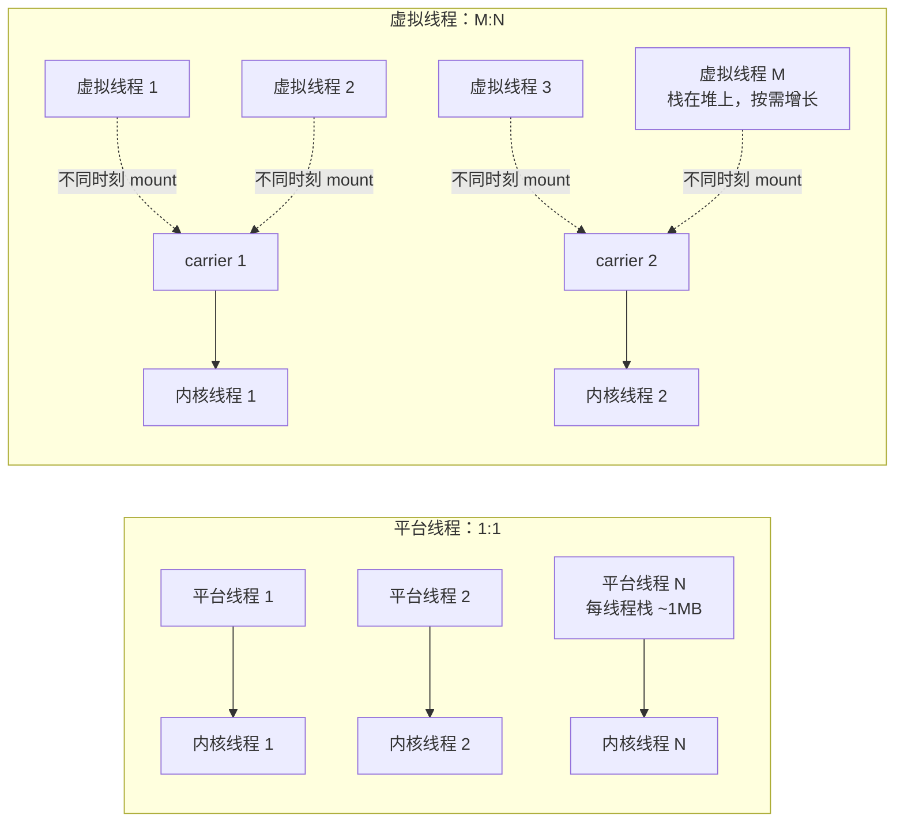
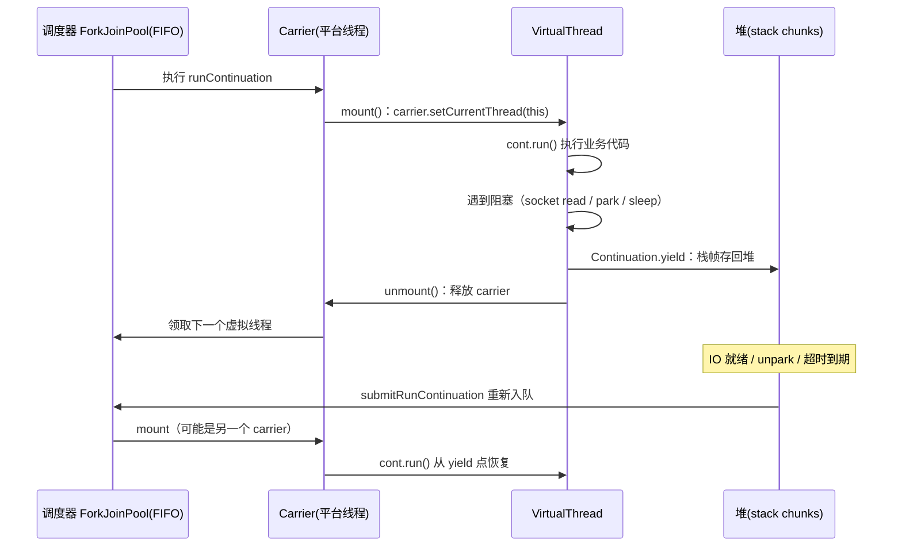
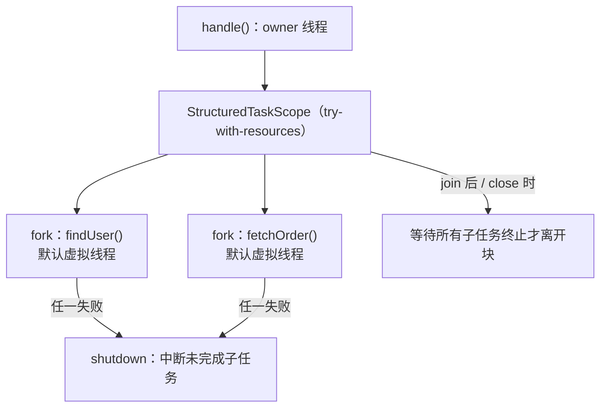

# 虚拟线程与结构化并发（JDK 21+）

> 一句话概括：虚拟线程把「线程」从昂贵的 OS 资源变成便宜的 JVM 对象——用 M:N 调度 + 堆上栈让同步写法获得异步的吞吐；
> 但它不是更快的线程，而是更便宜的线程，全部的坑集中在 **pinning 的版本归属、ThreadLocal 放大效应、限流语义变化**这三处。

预计阅读时间：大约 85 分钟

所属主题：[Java 并发编程常见面试题总结](summary.md)

本文以 **JDK 21 为基线**（虚拟线程 JEP 444 转正），JDK 24 JEP 491（synchronized 不再 pin）、JDK 25 JEP 505/506（结构化并发第五轮 preview / ScopedValue 转正）的演进**单独注明——版本归属是本文重点**。源码锚点用 `类名#方法名` 标注，除注明外均基于 OpenJDK `jdk21u` 分支；preview API 与转正 API 严格区分。总结文档给面试结论，本文给机制与源码证据，每个机制按「结论 → 机制 → 边界/代价 → 实践/追问」展开。

---

## 0. 阅读路线

| 读者 | 建议阅读 | 关注点 |
| --- | --- | --- |
| 初级（1 年内） | 1、2.1~2.2、4、6.1~6.3、10 | 虚拟线程是什么、怎么创建、为什么不要池化、什么时候用 |
| 中级（1~3 年） | 2.3~2.6、3.1~3.4、5、7.1~7.3、8 | 堆上栈与 mount/unmount、哪些阻塞会 unmount、pinning 检测、ThreadLocal 放大、StructuredTaskScope 基本用法 |
| 高级（3 年+） | 2.4 源码走读、3.3、3.5、5.4、7.4~7.7、9 | Continuation 状态机、补偿机制真相、JEP 491 机制、新式线程 dump、Joiner API、迁移与性能预期 |
| 选型/架构 | 1.3~1.4、3.6、6、7.5~7.6、9 | 同步 vs 响应式、版本时间线、适用边界、preview 风险、落地清单 |

目录：

1. 平台线程的瓶颈：为什么「线程是稀缺资源」
2. 虚拟线程原理：M:N 调度与 Continuation
3. Pinning：最重要的边界与版本归属
4. 怎么用：从一个线程到百万并发
5. 对现有代码的影响：synchronized、ThreadLocal、线程池与可观测性
6. 什么时候用 / 不用：选型与响应式对比
7. 结构化并发：StructuredTaskScope（preview）
8. ScopedValue 速览（JDK 25 转正）
9. 迁移清单与性能预期
10. 高频追问集
11. 参考资料
12. 附：一页速记

---

## 1. 平台线程的瓶颈：为什么「线程是稀缺资源」

### 1.1 1:1 映射的三笔成本

**结论**：Java 平台线程是 OS 内核线程的薄包装（1:1 映射），每个线程都要向内核「租」一份资源。线程贵，不是贵在 `new Thread()` 这个 Java 对象，而是贵在它背后绑定的内核线程。平台线程的生命周期与状态机细节见 [线程基础与生命周期](thread-basics-and-lifecycle.md)，本文只算成本账。

| 成本 | 量级 | 来源 |
| --- | --- | --- |
| 栈内存 | 默认约 1MB/线程（平台相关，`-Xss` 可调） | 线程创建时预留的栈地址空间，随调用深度实际触碰物理页 |
| 创建/销毁 | 系统调用 + 内核数据结构分配，远高于普通对象 | `pthread_create` 一类的内核路径 |
| 上下文切换 | 微秒级，陷入内核态 | 保存/恢复寄存器、切换页表与内核栈，还有缓存污染 |
| 调度规模 | 内核调度器面对成千上万线程时开销显著上升 | OS 按线程调度，不感知「这个线程其实在等 IO」 |

### 1.2 thread-per-request 的内存墙与调度墙

经典阻塞式服务用「一个请求一个线程」（thread-per-request）模型：请求进来 → 分配线程 → 同步调用 DB/RPC → 等待期间线程干耗着。并发到万级时撞两堵墙：

- **内存墙**：1 万并发 × ~1MB 栈 ≈ 10GB 栈地址空间预留（实际物理内存取决于触碰深度，但预留与内核结构开销已经可观）；10 万并发直接不可行。
- **调度墙**：绝大多数线程在等 IO，却仍占用内核调度实体；真正干活的 CPU 核只有几个，调度器在大量「睡眠线程」上空转。

于是「线程是稀缺资源」成了旧约束：**并发数被线程数卡死，而线程数被内存和内核卡死**。传统解法是线程池（见 [线程池](thread-pool.md)）——用几百个线程复用，但代价是请求排队、线程数成为隐式限流器，且阻塞调用依然占着线程。

### 1.3 异步/响应式为什么复杂

另一条路是异步非阻塞（NIO + 回调 / CompletableFuture / Reactor）：少量线程跑事件循环，IO 等待不占线程。吞吐上去了，但编程模型付出代价：

| 痛点 | 具体表现 |
| --- | --- |
| 回调地狱 / 链式编排 | 业务逻辑被拆进 `thenApply/thenCompose` 或 `flatMap` 链，控制流不再从上到下 |
| 栈不直观 | 异常栈里看不到业务调用链，只有事件循环与操作符帧 |
| 调试难 | 断点打在回调里，线程上下文与请求上下文对不上；ThreadLocal 失效 |
| 生态改造成本 | 阻塞 API（JDBC、大多数 SDK）不能直接用，需要全链路非阻塞驱动 |
| 背压与取消 | 要显式建模（Reactor 的背压协议、CompletableFuture 的手工取消传播） |

### 1.4 虚拟线程的目标

**结论**：虚拟线程（JEP 444，JDK 21 转正）的目标是**让同步写法获得异步的吞吐**——代码还是 `socket.read()` 这种阻塞风格，但阻塞时不再占用 OS 线程。它不是要取代平台线程，而是把「线程」这个抽象的成本降下来，让 thread-per-request 模型在百万并发下重新成立。

**追问：虚拟线程和协程（Kotlin/Go）什么关系？** 同为 M:N 用户态调度，但虚拟线程是 `java.lang.Thread` 实例、复用既有 Thread API 与阻塞式生态，且**不要求代码显式让出控制权**（JEP 444 原文："virtual threads are not cooperative"）——阻塞点由 JDK 改造，业务代码无感。Go 的 goroutine 需要运行时在函数调用等处插入抢占点，Kotlin 协程需要 `suspend` 标记，这是关键差异。

---

## 2. 虚拟线程原理：M:N 调度与 Continuation

### 2.1 总览：两种线程模型对比

**结论**：虚拟线程采用 **M:N 调度**——大量（M）虚拟线程由 **JVM 调度**到少量（N）平台线程上执行，被分配执行的平台线程称为 **carrier（载体线程）**。OS 只看到 N 个内核线程，M 个虚拟线程的切换完全在用户态完成。

| 维度 | 平台线程 | 虚拟线程 |
| --- | --- | --- |
| 映射 | 1:1 绑定 OS 内核线程 | M:N，由 JVM 调度到 carrier |
| 调度者 | OS 内核 | JDK 的 ForkJoinPool 调度器（FIFO） |
| 栈 | 固定预留（默认 ~1MB，`-Xss`） | 堆上 stack chunk 对象，按需增长/收缩 |
| 创建成本 | 系统调用 + 内核结构 | 普通 Java 对象级别 |
| 阻塞代价 | 占用内核线程 | 大多数阻塞会 unmount，释放 carrier |
| 数量级 | 数千已是极限 | 百万级可行 |
| 身份 | `java.lang.Thread` | 同样是 `java.lang.Thread`（`isVirtual()` 为 true） |
| 时间片抢占 | 有（OS 调度） | **无**（调度器不做 time sharing） |



注意右图：同一时刻一个 carrier 只 mount 一个虚拟线程，「多对一」是时间维度上的复用，不是同时执行。

### 2.2 虚拟线程的身份：它就是 java.lang.Thread

**结论**：虚拟线程不是新类型，而是 `Thread` 的子类实例，既有 API（`join`/`interrupt`/`ThreadLocal`/`synchronized`）全部可用。源码继承链（jdk21u）：

```java
// java/lang/BaseVirtualThread.java
sealed abstract class BaseVirtualThread extends Thread
        permits VirtualThread, ThreadBuilders.BoundVirtualThread { ... }

// java/lang/VirtualThread.java
final class VirtualThread extends BaseVirtualThread { ... }

// java/lang/Thread.java
public boolean isVirtual() { return this instanceof BaseVirtualThread; }
```

但若干语义被固定或改写（均有源码依据）：

| API | 虚拟线程行为 | 源码锚点 |
| --- | --- | --- |
| `isDaemon()` | 恒为 `true`（直接 `return true`） | `Thread#isDaemon` |
| `setDaemon(false)` | 抛 `IllegalArgumentException("'false' not legal for virtual threads")` | `Thread#setDaemon` |
| `getPriority()` | 恒为 `NORM_PRIORITY` | `Thread#getPriority` |
| `setPriority(int)` | 合法范围内**静默忽略**，不抛异常 | `Thread#setPriority` |
| `getThreadGroup()` | 返回名为 `"VirtualThreads"` 的占位组，不是活跃成员 | `Thread#getThreadGroup` |
| `stop()/suspend()/resume()` | 抛 `UnsupportedOperationException` | JEP 444 |
| 公开构造器 `new Thread(...)` | 只能创建平台线程；虚拟线程必须走 `Thread.ofVirtual()` 等工厂 | JEP 444 |

**边界/代价**：daemon 恒 true 意味着**虚拟线程不会阻止 JVM 退出**——`main` 结束后还在跑的虚拟线程会被直接抛弃。Spring Boot 3.2 为此新增 `spring.main.keep-alive=true`（见 6.5）。`Thread.Builder.OfVirtual` 没有 `daemon()`/`priority()`/`group()` 方法，从构建器层面就杜绝了这些设置。

**追问：为什么不能 setDaemon(false)？** 虚拟线程的设计定位是「海量、廉价、随任务生灭」，若允许非守护，百万虚拟线程会把 JVM 退出语义搅乱；JDK 直接在 `Thread#setDaemon` 里对 `isVirtual() && !on` 抛异常，把约束前置。

### 2.3 栈在堆上：Continuation 与 stack chunk

**结论**：虚拟线程的栈不在 OS 栈上，而是以 **stack chunk 对象**的形式存放在 Java 堆里（JEP 444 原文："The stacks of virtual threads are stored in Java's garbage-collected heap as stack chunk objects"），随执行按需增长/收缩。这是「百万线程」在内存上成立的根本原因。

**机制**：支撑这一切的是 JVM 内部的**有界续体（delimited continuation）**，源码在 `jdk/internal/vm/Continuation.java`：

```java
public class Continuation {
    public Continuation(ContinuationScope scope, Runnable target) { ... }
    public final void run() { ... }                       // 挂载并执行；挂起后从上次挂起点继续
    public static boolean yield(ContinuationScope scope) { ... } // 挂起当前续体，成功 true / 被 pin 则 false
    public boolean isDone() { ... }
}
```

- 每个虚拟线程持有一个 `VThreadContinuation`（`VirtualThread` 的内部类），scope 是全局的 `VTHREAD_SCOPE`（名为 `"VirtualThreads"`）。
- `Continuation#run` 首次执行进入任务体；`Continuation#yield` 把当前栈帧**从 carrier 栈复制回堆上的 chunk 链**（`Continuation` 内的 `tail` 字段指向 `StackChunk` 链表），然后返回到调度代码。
- 恢复时再次 `run`，把 chunk 里的帧**复制回 carrier 栈**，从 yield 点继续——对业务代码完全透明。
- 栈浅时只占几百字节到几 KB 量级（数量级估计，非保证值），深调用按需扩展，没有 `-Xss` 那种固定预留。

**边界/代价**：

1. **G1 的半 region 限制**：JEP 444 明确，若虚拟线程栈达到 G1 region 大小的一半（可能小到 512KB），可能抛 `StackOverflowError`——深递归在虚拟线程上比平台线程更早触顶（chunk 作为大对象受 region 约束）。
2. **栈不是 GC root**：JEP 444 原文 "virtual thread stacks are not GC roots"——一个阻塞中且不可达的虚拟线程可以被 GC 回收，这既是内存优势，也意味着「阻塞的线程一定活着」的旧直觉不再成立。
3. 栈的复制/恢复有用户态开销，但远低于内核上下文切换。

### 2.4 mount/unmount 全流程（源码走读）

**结论**：阻塞时 `yield` 保存栈到堆 → `unmount` 释放 carrier；就绪后重新提交调度器 → `mount`（可能换一个 carrier）→ 从 yield 点恢复。整个状态机在 `VirtualThread` 里，核心是一个 `state` 字段 + CAS。



关键源码（jdk21u `VirtualThread.java`，节选）：

```java
private void runContinuation() {
    // ... CAS 把 state 从 STARTED/UNPARKED/YIELDED 置为 RUNNING
    mount();
    try { cont.run(); }
    finally {
        unmount();
        if (cont.isDone()) afterDone(); else afterYield();
    }
}

private void mount() {
    Thread carrier = Thread.currentCarrierThread();
    setCarrierThread(carrier);          // 记录 carrier
    carrier.setCurrentThread(this);     // 让 Thread.currentThread() 返回虚拟线程
}

private void unmount() {
    Thread carrier = this.carrierThread;
    carrier.setCurrentThread(carrier);  // 恢复当前线程为平台线程
    setCarrierThread(null);             // 断开关联（与 interrupt 同步）
}

void park() {
    if (getAndSetParkPermit(false) || interrupted) return;
    setState(PARKING);
    boolean yielded = yieldContinuation();   // 内部调 Continuation.yield(VTHREAD_SCOPE)
    if (!yielded) parkOnCarrierThread(false, 0);  // yield 失败 = 被 pin，只能阻塞 carrier
}
```

状态机要点（`VirtualThread` 的状态常量）：`NEW → STARTED → RUNNING ⇄ PARKING/PARKED（或 PINNED）→ UNPARKED → RUNNING → … → TERMINATED`。

- `VirtualThread#afterYield`：yield 成功后置 `PARKED`/`TIMED_PARKED`；若此时已有 unpark 许可，CAS 到 `UNPARKED` 并重新提交调度器。
- `VirtualThread#unpark`：把 `PARKED` CAS 到 `UNPARKED` 后 `submitRunContinuation()`；若线程处于 `PINNED`，则直接 `Unsafe.unpark(carrier)`——**pin 住时唤醒的是 carrier**。
- `VirtualThread#submitRunContinuation`：`scheduler.execute(runContinuation)`，被拒绝时发 `jdk.VirtualThreadSubmitFailed` JFR 事件（`VirtualThread#submitFailed`）。
- `Thread.sleep` 走 `VirtualThread#parkNanos`，由一个独立的 `UNPARKER`（`ScheduledExecutorService`，默认 1 线程）定时 unpark。

**边界/代价**：

- **无亲和性**：JEP 444 明确调度器不维护虚拟线程与 carrier 的亲和关系，恢复时可能换 carrier。因此**不能依赖 carrier 的 ThreadLocal**（carrier 的 thread-local 对虚拟线程不可见，反之亦然），`Thread.currentThread()` 永远返回虚拟线程本身。
- **无时间片**：调度器不做 time sharing——一个跑 CPU 密集循环的虚拟线程会一直占着 carrier，直到它自己阻塞。这是「CPU 密集别用虚拟线程」的机制根源（见 6.2）。
- mount/unmount 本身有成本（栈复制 + CAS + 入队），极高频的短阻塞会放大这部分开销。

**追问：虚拟线程阻塞时，carrier 在干什么？** 立刻去执行别的虚拟线程。这要求阻塞点必须被 JDK 改造成「先 yield 再等」——没改造到的阻塞（native、部分文件 IO）会连 carrier 一起拖住，这就是下一节的 pinning。

### 2.5 哪些阻塞会 unmount，哪些不会

**结论**：JDK 21 中**绝大多数**阻塞操作已改造为 unmount；少数 OS/JVM 层限制的操作不会 unmount，但 JDK 用「临时扩并行度」补偿。这张表是面试与排障的核心（JDK 24 的变化见第 3 节）：

| 阻塞操作 | JDK 21 行为 | JDK 24+ 变化 |
| --- | --- | --- |
| `Socket`/`ServerSocket`/`SocketChannel`/`DatagramChannel` 网络 IO | unmount（`java.net`/`java.nio` 已重写为异步实现 + park） | 不变 |
| `InputStream`/`OutputStream`（socket 流） | unmount（JEP 444：`Buffered*`/`PrintStream`/`PrintWriter` 等**直接使用时**改显式锁，被子类化时仍走 monitor） | 不变 |
| `Thread.sleep` | unmount（`VirtualThread#parkNanos`） | 不变 |
| `LockSupport.park/parkNanos` | unmount | 不变 |
| `ReentrantLock`/`Semaphore`/`CountDownLatch`/`BlockingQueue.take` 等 j.u.c 阻塞 | unmount（底层都是 `LockSupport.park`，见 [AQS 与锁](aqs-and-locks.md)、[并发工具](concurrency-tools.md)） | 不变 |
| `Process.waitFor` | **unmount**：unix 版 `ProcessImpl#waitFor` 用 `ReentrantLock + Condition.await`（已核实源码），落到 park | 不变 |
| `Object.wait()` | **不 unmount**（JVM 层限制），但 JDK 临时扩调度器并行度补偿 | **JEP 491 修复：unmount** |
| 许多文件系统操作（如 `FileInputStream.read`） | **不 unmount**（OS 层限制），同样有临时补偿 | 仍不 unmount（OS 限制未变） |
| `synchronized` 内的一切阻塞 | **pin carrier**（见第 3 节） | **JEP 491 修复：不再 pin** |
| native 方法 / 外部函数（FFM）中的阻塞 | pin carrier | 仍 pin（与 native 代码交互的固有要求） |

**边界/代价**：文件 IO 的「不 unmount + 补偿」意味着大量并发文件读写会把 carrier 池临时撑大（受 `maxPoolSize` 上限约束），此时虚拟线程的「N 很小」假设被打破，行为接近平台线程池。网络 IO 才是虚拟线程的主场。

**追问：怎么确认某个阻塞 API 会不会 unmount？** 两条路：看它底层是否落到 `LockSupport.park`（j.u.c 基本都是）；或实测——JDK 21~23 用 `-Djdk.tracePinnedThreads=full` 跑一遍，JDK 24+ 看 `jdk.VirtualThreadPinned` JFR 事件。不要凭「它是阻塞 API」就推断会 pin。

### 2.6 carrier 调度器：一个 FIFO 的 ForkJoinPool

**结论**：默认调度器是一个 **FIFO 模式的 work-stealing ForkJoinPool**，与 parallel stream 用的 common pool **不是同一个**（common pool 是 LIFO）。work-stealing 机制本身见 [ForkJoin 与 CompletableFuture](forkjoin-and-completable-future.md)，本文只讲它作为 carrier 调度器的角色与参数。

源码锚点 `VirtualThread#createDefaultScheduler`（jdk21u，参数已逐项核实）：

```java
boolean asyncMode = true; // FIFO
return new ForkJoinPool(parallelism, factory, handler, asyncMode,
        0, maxPoolSize, minRunnable, pool -> true, 30, SECONDS);
```

| 参数/系统属性 | 默认值 | 说明 |
| --- | --- | --- |
| `jdk.virtualThreadScheduler.parallelism` | `Runtime.availableProcessors()` | 目标并行度（carrier 数） |
| `jdk.virtualThreadScheduler.maxPoolSize` | `max(parallelism, 256)` | 补偿阻塞时的平台上限；显式设置时 parallelism 会被压到不超过它 |
| `jdk.virtualThreadScheduler.minRunnable` | `max(parallelism / 2, 1)` | 补偿时维持的最小可运行线程数 |
| asyncMode | `true`（FIFO） | 任务按提交顺序执行，适合「请求」这种互相独立的任务 |
| corePoolSize / keepAlive | 0 / 30s | carrier 按需创建、空闲回收 |
| worker 类型 | `CarrierThread`（ForkJoinWorkerThread 子类） | 线程名形如 `ForkJoinPool-1-worker-N` |

**为什么是 FIFO 而不是 LIFO？** LIFO 利于 fork/join 分治任务的局部性（自己刚拆出的子任务自己先做）；虚拟线程的任务是海量独立请求，FIFO 保证公平、避免饥饿。

**边界/代价**：调度器参数是全局的，`parallelism` 调大不会让 CPU 密集任务更快（核数没变），只影响可并行的 carrier 数；`maxPoolSize` 是文件 IO/Object.wait 补偿的天花板，调小可能在大量非 unmount 阻塞时触发 `RejectedExecutionException`（对应 `jdk.VirtualThreadSubmitFailed` 事件）。

### 2.7 「不是更快的线程，是更便宜的线程」

**结论**：单个任务在虚拟线程上跑**不会更快**——CPU 执行速度一样，还多了 mount/unmount 开销。收益全在**并发数与吞吐**：原来 200 个线程排队处理的 IO 密集负载，现在 10 万个虚拟线程同时「在等」，等待不再消耗稀缺资源。

一个直观账：请求平均耗时 100ms，其中 99ms 在等下游。平台线程模型下 200 线程 ≈ 2000 QPS 上限；虚拟线程模型下并发数只受下游与内存约束，吞吐瓶颈回到下游本身。**单请求延迟不变（甚至略增），吞吐数量级提升**——这句话是面试的分水岭。

---

## 3. Pinning：最重要的边界与版本归属

### 3.1 两种 pin 场景（JDK 21 基线）

**结论**：JEP 444 原文定义了两种虚拟线程无法 unmount 的场景（称为 **pinned**）：

1. 执行 `synchronized` 块/方法**内部**的代码时（持有 monitor 期间）；
2. 执行 `native` 方法或外部函数（foreign function）时。

> "Pinning does not make an application incorrect, but it might hinder its scalability." —— JEP 444

pin 本身不产生错误，但阻塞发生时 carrier 被一起拖住，调度器无法复用它——并发一高，carrier 池被耗尽，吞吐崩塌甚至饿死。

### 3.2 机制：yield 失败就退回 carrier 阻塞

源码链条（jdk21u）：

- `Continuation#yield` 内部调 native 的 `doYield()`；栈上有 native 帧或持有 monitor 时无法搬栈，返回非 0 → `yield` 返回 `false`。
- `Continuation` 定义了 pin 原因枚举：`Pinned { NATIVE, MONITOR, CRITICAL_SECTION }`（JDK 21；JDK 24 后 MONITOR 场景消失）。
- `VirtualThread#park` 发现 `yieldContinuation()` 返回 false，走 `VirtualThread#parkOnCarrierThread`：置状态 `PINNED`/`TIMED_PINNED`，直接 `Unsafe.park` **阻塞 carrier 本身**，并发 `jdk.VirtualThreadPinned` JFR 事件。
- `VThreadContinuation#onPinned`：若开了 `jdk.tracePinnedThreads`，调 `PinnedThreadPrinter` 打印栈（full 模式高亮 native 帧与持 monitor 的帧）。

```java
// JDK 21~23 可复现的 pinning 示例：
// java -Djdk.tracePinnedThreads=full PinDemo.java
private final Object lock = new Object();
void pinned() throws InterruptedException {
    synchronized (lock) {
        Thread.sleep(Duration.ofSeconds(1)); // JDK 21：pin 住 carrier 1 秒；JDK 24+：正常 unmount
    }
}
```

### 3.3 补偿机制的真相（高频误区）

**结论**：要区分两类「carrier 被占住」，JEP 444 对它们的处理**不同**：

| 场景 | 是否补偿 | JEP 444 依据 |
| --- | --- | --- |
| `synchronized` 导致的 pinning（monitor 竞争、锁内 IO） | **不补偿** | "The scheduler does not compensate for pinning by expanding its parallelism" |
| JDK 明确知道「不会 unmount」的阻塞（`Object.wait`、许多文件 IO） | **临时扩并行度补偿** | "The implementations of these blocking operations compensate ... by temporarily expanding the parallelism of the scheduler" |

也就是说：`Object.wait()` 虽然不 unmount，但 JDK 会通过 ForkJoinPool 的 managed-block 补偿临时增加 carrier（上限 `maxPoolSize`，默认 `max(parallelism, 256)`）；而**在 synchronized 里做长 IO 是最危险的组合**——pin 住且不补偿，8 核机器上 8 个这样的请求就能让所有 carrier 停摆。这正是 JDK 21 时代官方建议「把守卫长 IO 的 synchronized 换成 `ReentrantLock`」的原因（`ReentrantLock` 底层是 park，会 unmount，见 [AQS 与锁](aqs-and-locks.md)）。

**追问：JDK 21 里 synchronized 内阻塞，ForkJoinPool 到底补不补偿？** 准确答案：synchronized 造成的 pin **不补偿**；`Object.wait` 这类被 JEP 点名的非 unmount 阻塞操作**有临时补偿**。把两者混为一谈（「pin 都会补偿」或「都不补偿」）都是错的。

### 3.4 检测手段（注意版本）

| 手段 | 适用版本 | 用法 |
| --- | --- | --- |
| `jdk.tracePinnedThreads` | **仅 JDK 21~23**（JDK 24 起移除，设置无效） | `-Djdk.tracePinnedThreads=full`（完整栈，高亮问题帧）/ `short`（只打问题帧） |
| JFR `jdk.VirtualThreadPinned` | JDK 21+（JDK 24 增强：携带 pin 原因与 carrier 身份） | 默认开启，阈值 20ms；`jfr print --events jdk.VirtualThreadPinned recording.jfr` |
| JFR `jdk.VirtualThreadSubmitFailed` | JDK 21+ | 默认开启；调度器拒绝提交（资源问题）时触发 |
| JFR `jdk.VirtualThreadStart/End` | JDK 21+ | 默认关闭，按需开启做线程生灭统计 |

```bash
# JDK 21~23：压测时打开 pinning 追踪
java -Djdk.tracePinnedThreads=full -jar app.jar
# JDK 21+：用 JFR 抓 60 秒，再看 pin 事件
jcmd <pid> JFR.start name=vt duration=60s filename=/tmp/vt.jfr
jfr print --events jdk.VirtualThreadPinned /tmp/vt.jfr
```

**边界/代价**：`tracePinnedThreads` 在关键路径上打印栈，本身有性能影响（JEP 491 移除它的理由之一），只用于压测/排障，不要常开生产。

### 3.5 JDK 24 JEP 491：synchronized 不再 pin

**结论**：JDK 24 的 JEP 491「Synchronize Virtual Threads without Pinning」改变了 monitor 的实现——**虚拟线程可以独立于 carrier 获取、持有、释放 monitor**，synchronized 内阻塞不再 pin。这是虚拟线程落地史上最重要的一次边界修复。

**机制**（JEP 491 原文要点）：

- 根因：JDK 21~23 中 JVM 把 monitor 的持有者记录为 **carrier 平台线程**而非虚拟线程，栈搬走了 monitor 归属就乱了，所以干脆不让搬。
- 修复：mount/unmount 时做必要的簿记，monitor 归属记到虚拟线程头上。阻塞获取 monitor（monitorenter 竞争）时 **unmount 释放 carrier**；monitor 释放后 JVM 把选中的虚拟线程重新提交调度器，mount（可能换 carrier）后**再次尝试获取**。
- `Object.wait()` 及其定时变体同样修复：等待时 unmount，被 notify 唤醒后重新竞争 monitor 而阻塞时也 unmount。

**仍然 pin 的场景**（JEP 491 明确保留）：

1. native 方法 / FFM 外部函数中回调 Java 并阻塞——与 native 代码交互的固有要求；
2. 类加载/类初始化相关的阻塞（符号解析时加载类、`<clinit>` 内阻塞、等待其他线程完成类初始化）——本质是栈上有 native 帧或阻塞在 JVM 内部，JEP 列为 future work，「rarely cause issues」。

**配套变化**：

- `jdk.tracePinnedThreads` 系统属性**被移除**，命令行设置不再有任何效果——检测统一走增强后的 `jdk.VirtualThreadPinned` 事件。
- **无需再为虚拟线程把 synchronized 换成 ReentrantLock**；已换的也不必改回。JEP 491 的建议回到《Java Concurrency in Practice》的经典口径：怎么合适怎么锁，但**尽量缩小锁范围、避免持锁做 IO**——这条在任何版本都成立。
- 代价：退出 monitor 时可能需要把虚拟线程入队调度器，比直接 unpark 平台线程略低效（JEP 491 Risks 节）。monitor 的底层结构与锁升级细节见 [synchronized 与锁升级](synchronized-and-lock-escalation.md)。

### 3.6 版本时间线（本文重点，务必记准）

| 版本 | JEP | 事件 | 对工程的影响 |
| --- | --- | --- | --- |
| JDK 19 / 20 | 425 / 436 | 虚拟线程第一、二轮 preview | 尝鲜阶段 |
| **JDK 21** | **444** | **虚拟线程转正**（final） | 生产可用；synchronized/native 会 pin；`tracePinnedThreads` 可用 |
| JDK 21~24 | 453/462/480/499 | 结构化并发第 1~4 轮 preview | `StructuredTaskScope` 子类 API，始终 preview |
| **JDK 24** | **491** | **synchronized/Object.wait 不再 pin** | 移除 `tracePinnedThreads`；锁内阻塞可 unmount；native 仍 pin |
| **JDK 25** | **505** | 结构化并发**第五轮 preview**（仍未转正） | API 大改：`open(Joiner)` 取代构造器与子类 |
| **JDK 25** | **506** | **ScopedValue 转正**（final） | 上下文传递首选；`orElse` 不再接受 null |
| JDK 26 | 525 | 结构化并发第六轮 preview（JEP 505 关联链接） | 仍未转正 |

**追问：面试被问「虚拟线程还有什么坑」，怎么答出版本感？** 先说 JDK 21 的两大 pin 场景与「synchronized 换 ReentrantLock」的旧建议，再立刻补一句「JDK 24 JEP 491 之后 synchronized 不再 pin，这条建议作废，只剩 native 帧与类初始化等少数场景」——能说出这个时间线，比背十条注意事项更有说服力。

---

## 4. 怎么用：从一个线程到百万并发

### 4.1 三种创建方式与平台线程对照

```java
// 方式一：Builder 直接启动
Thread vt = Thread.ofVirtual()
        .name("vt-worker")
        .start(() -> System.out.println(Thread.currentThread().isVirtual())); // true
vt.join();

// 方式二：先创建不启动（unstarted），name(prefix, start) 自动编号
Thread t = Thread.ofVirtual().name("vt-", 0).unstarted(task); // vt-0, vt-1, ...
t.start();

// 方式三：静态快捷方法
Thread t2 = Thread.startVirtualThread(task);

// 对照：平台线程 Builder（可设 daemon/priority/group，虚拟线程 Builder 没有这些方法）
Thread.ofPlatform().name("pt-", 0).daemon(false).start(task);

// 批量创建用工厂
ThreadFactory factory = Thread.ofVirtual().name("vt-", 0).factory();
```

以上全部是 **JDK 21 转正 API，无需 `--enable-preview`**。

### 4.2 newVirtualThreadPerTaskExecutor：每任务一个虚拟线程

```java
// 每个提交的任务都获得一个新虚拟线程——它不是池！
try (var executor = Executors.newVirtualThreadPerTaskExecutor()) {
    IntStream.range(0, 10_000).forEach(i ->
        executor.submit(() -> {
            Thread.sleep(Duration.ofSeconds(1)); // 阻塞即 unmount，不占 OS 线程
            return i;
        }));
} // try-with-resources 退出时 close()：shutdown() + 等待全部任务终止
```

**机制**：`Executors#newVirtualThreadPerTaskExecutor` 返回内部的 `ThreadPerTaskExecutor`，每次 `submit` 都 `Thread.ofVirtual().start(...)`。`ExecutorService` 自 JDK 19 起继承 `AutoCloseable`，`close()` 默认实现是 `shutdown()` 后无限期等待终止——所以 try-with-resources 天然就是「提交一批任务并等它们全部完成」的结构化写法。

**边界/代价**：它**没有队列、没有核心线程数、没有拒绝策略**（任务来者不拒），`ThreadPoolExecutor` 的那套调参经验全部不适用；想限制并发要用 Semaphore（见 4.3），想限制资源要限资源本身。线程池的完整语义见 [线程池](thread-pool.md)。

### 4.3 不要池化虚拟线程（准确理由）

**结论**：JEP 444 原文："Virtual threads are cheap and plentiful, and thus should never be pooled"。理由不是「池化有 bug」，而是**池化的动机消失了**：

1. 资源池的意义是**摊薄昂贵资源的创建成本**——虚拟线程创建成本是普通对象级别，无成本可摊；
2. 池化反而**人为设置并发上限**：把 10 万并发请求塞进 200 个「虚拟线程池」，等于把虚拟线程退化回平台线程的排队模型，白白丢掉吞吐；
3. 虚拟线程不复用，「池污染」（上一个任务的 ThreadLocal 残留给下一个任务）问题自然消失——但注意这不代表 ThreadLocal 没有别的坑（见 5.2）。

**那限流怎么办？** 很多旧系统用「线程池大小 = 20」保护下游。迁移后应改用**专门的限流构造**（JEP 444 点名 semaphores）：

```java
private static final Semaphore DOWNSTREAM_LIMIT = new Semaphore(20); // 下游只能扛 20 并发

void callDownstream(Request req) throws InterruptedException {
    DOWNSTREAM_LIMIT.acquire();          // 虚拟线程在 acquire 上阻塞会 unmount，等待几乎免费
    try {
        httpClient.send(req);            // 任意多虚拟线程可排队，但同时只有 20 个进入下游
    } finally {
        DOWNSTREAM_LIMIT.release();
    }
}
```

Semaphore 的用法与公平性细节见 [并发工具](concurrency-tools.md)。**关键区别**：线程池限流把「等待」和「执行」绑在同一个稀缺资源上；Semaphore 只限「进入下游的执行」，等待的虚拟线程不占 carrier——限流语义保住了，吞吐也保住了。

### 4.4 十万并发示例与内存账

```java
public class HundredThousandVT {
    public static void main(String[] args) throws Exception {
        int n = 100_000;
        var threads = new ArrayList<Thread>(n);
        long start = System.nanoTime();
        for (int i = 0; i < n; i++) {
            threads.add(Thread.ofVirtual().start(() -> {
                try { Thread.sleep(Duration.ofSeconds(10)); }
                catch (InterruptedException e) { Thread.currentThread().interrupt(); }
            }));
        }
        System.out.printf("创建 %d 个虚拟线程耗时 %d ms%n",
                n, (System.nanoTime() - start) / 1_000_000);
        for (Thread t : threads) t.join();
    }
}
```

| 模型 | 10 万并发的栈开销（量级估算） | 可行性 |
| --- | --- | --- |
| 平台线程 | 10 万 × ~1MB 预留 ≈ 100GB 地址空间 + 10 万内核线程 | 不可行 |
| 虚拟线程（浅栈 sleep） | 10 万 × 几百字节~几 KB chunk ≈ 数百 MB 堆 | 普通笔记本可跑 |

数字是数量级估算（栈深度、JVM 参数都会影响），但结论稳定：**虚拟线程把并发数的上限从「内核资源」挪到了「堆内存 + 下游容量」**。JEP 444 的官方示例同样用万级 sleep 线程演示这一点。

**追问：百万虚拟线程会不会把 GC 压垮？** 栈 chunk 是普通堆对象，百万浅栈线程的 chunk 总量可控；真正要防的是每线程挂载昂贵资源（ThreadLocal 缓存、每线程缓冲区）——那是 5.2 的主题。另外深栈线程的 chunk 可能触发 G1 半 region 限制（2.3）。

---

## 5. 对现有代码的影响：synchronized、ThreadLocal、线程池与可观测性

### 5.1 synchronized：按版本给建议

| 运行版本 | 建议 |
| --- | --- |
| JDK 21~23 | 审计「高频 + 长 IO」的 synchronized 块/方法，换 `ReentrantLock`（锁内阻塞会 pin 且不补偿，见 3.3）；短临界区、纯内存操作的 synchronized 无需动 |
| JDK 24+ | **无需为虚拟线程做任何 synchronized 迁移**（JEP 491）；已换 ReentrantLock 的不必改回；继续遵守「缩小锁范围、不持锁做 IO」的通用纪律 |

monitor 与锁升级机制本身见 [synchronized 与锁升级](synchronized-and-lock-escalation.md)，本文只强调版本归属：**「虚拟线程要把 synchronized 换成 ReentrantLock」是 JDK 21~23 的阶段性建议，不是永久结论**。

### 5.2 ThreadLocal：放大效应与 ScopedValue 出口

**结论**：虚拟线程让 ThreadLocal 的两个老问题换了形态——「池污染」消失，「每线程副本」被放大几个数量级。

- **池污染消失**：平台线程池里线程复用，任务 A set 的 ThreadLocal 会被任务 B 读到（泄漏的经典形态，详见 [ThreadLocal](threadlocal.md)）。虚拟线程一任务一线程、用完即弃，线程终止后其 `ThreadLocalMap` 随对象一起可回收，不存在跨任务污染。
- **副本放大**：JEP 506 原文警告："if each of a million virtual threads has its own copy of thread-local variables, the memory footprint may be significant"。100 万虚拟线程 × 每线程一个 1KB 缓冲 = 1GB；若 ThreadLocal 里缓存的是昂贵资源（DB 连接、大 buffer、`SimpleDateFormat`），就是灾难。JEP 444 明确反对「用 thread-local 在共享线程的多个任务间池化昂贵资源」的旧习。
- **泄漏仍在**：虚拟线程存活期间，set 了不 remove 的 ThreadLocal 依然占着内存；长生命周期虚拟线程（如常驻消费者）照样泄漏。
- **继承默认开启**：`Thread.Builder.OfVirtual#inheritInheritableThreadLocals` 默认继承 `InheritableThreadLocal`（已核实 javadoc）——百万线程 × 继承副本会进一步放大，可用 `.inheritInheritableThreadLocals(false)` 关闭。

**工程出口**：上下文传递（traceId、用户身份、请求上下文）改用 **ScopedValue**（JDK 25 转正，见第 8 节）：不可变、作用域有界、子任务零拷贝继承。排查存量 ThreadLocal 可用 JEP 444 提到的 `-Djdk.traceVirtualThreadLocals` 观察虚拟线程的 thread-local 使用。

### 5.3 线程池语义：平台线程池没有过时

**结论**：`ThreadPoolExecutor` 依然适用于 **CPU 密集任务**（线程数 ≈ 核数，避免过度调度）与**需要队列/拒绝策略做削峰**的场景；虚拟线程 executor 不是池，两者是分工不是替代。

| 需求 | 平台线程池 | 虚拟线程 |
| --- | --- | --- |
| CPU 密集计算 | ✅ 线程数对齐核数 | ❌ 无时间片，长计算霸占 carrier |
| IO 密集高并发 | 排队，吞吐受线程数限 | ✅ 每任务一线程 |
| 用线程数给下游限流 | 旧习，可行但耦合 | 改 Semaphore（4.3） |
| 队列缓冲 + 拒绝策略 | ✅ 内置 | ❌ 需自行组合（Semaphore/限流器） |

### 5.4 可观测性：旧工具看不见虚拟线程

**结论**：`jstack` 与传统 `jcmd Thread.print` **不包含虚拟线程**（JEP 444 明确不扩展传统 dump）；百万线程的扁平列表也没有意义。新工具链如下：

```bash
# 新式线程 dump（JDK 21+）：按结构分组，含虚拟线程；生成时不暂停应用
jcmd <pid> Thread.dump_to_file -format=json /tmp/threads.json
jcmd <pid> Thread.dump_to_file /tmp/threads.txt   # 纯文本格式
```

| 工具/API | 对虚拟线程的支持 |
| --- | --- |
| `jcmd Thread.dump_to_file -format=json` | ✅ 新式 dump，分组展示；**JDK 21~24 不含对象地址、锁、JNI/堆统计；JDK 25 起增补线程状态与锁信息（JDK-8356870）**；不暂停应用 |
| `jstack` / `Thread.print` | ❌ 只有平台线程 |
| `Thread.getAllStackTraces()` | 只返回平台线程（JEP 444 语义变更） |
| `ThreadMXBean` | 只支持平台线程；`findDeadlockedThreads()` **找不到虚拟线程的死锁环** |
| JFR | `VirtualThreadPinned`（默认开，20ms 阈值）/ `VirtualThreadSubmitFailed`（默认开）/ `VirtualThreadStart/End`（默认关） |
| `-Djdk.trackAllThreads=false` | Builder 直接创建的虚拟线程可能不被跟踪、不出现在新 dump 中（省开销的逃生门） |

`Thread.getState()` 对虚拟线程的语义（jdk21u `VirtualThread#threadState` 映射，已核实）：`PARKED/PINNED → WAITING`、`TIMED_PARKED/TIMED_PINNED → TIMED_WAITING`、`RUNNING` 且已 mount 时返回 carrier 的状态。即虚拟线程自己的状态机**不直接产生 BLOCKED**；JDK 21 里它竞争 monitor 被 pin 时，状态借 carrier 体现。getState 只是监控快照，不能用于同步控制（javadoc 原话）。死锁排查的完整方法论见 [死锁与排查](deadlock-and-troubleshooting.md)。

### 5.5 其他 API 语义变化（一句话清单）

- **ThreadGroup**：虚拟线程不是活跃成员，`getThreadGroup()` 返回占位组 `"VirtualThreads"`；依赖线程组做批量管理的旧代码失效。
- **SecurityManager**：设置 SecurityManager 时虚拟线程没有任何权限（JEP 444）；SecurityManager 本身已废弃待移除（JEP 411），新代码不应再碰。
- **中断语义增强**：中断一个阻塞在 socket 上的虚拟线程会 unpark 并**关闭该 socket**（JEP 444）——平台线程没有这个行为，依赖「中断后 socket 还可用」的代码要复查。
- **`stop()/suspend()/resume()`**：对虚拟线程抛 `UnsupportedOperationException`。

**追问：线上虚拟线程服务 CPU 不高但吞吐上不去，怎么排查？** 按序：① JFR 看 `VirtualThreadPinned`（JDK 21~23 还要怀疑 synchronized/native）；② 新式 dump 看虚拟线程都阻塞在哪（是不是都卡在 Semaphore/下游）；③ 看 `VirtualThreadSubmitFailed`（carrier 补偿是否撞 maxPoolSize）；④ 确认没有把虚拟线程池化或用线程数限流。

---

## 6. 什么时候用 / 不用：选型与响应式对比

### 6.1 适合的场景

**结论**：**高并发 + IO 密集 + 并发数远超核数**，三者同时满足时虚拟线程收益最大：

- HTTP 服务 / RPC 聚合：一个请求扇出多个下游调用，等待占绝大部分时间；
- DB 访问密集的 task-per-request 服务（JDBC 阻塞调用直接受益，无需换驱动）；
- 爬虫 / 批量外部 API 调用 / 消息消费等「大量时间在等」的负载。

### 6.2 不适合的场景

| 场景 | 原因 | 替代 |
| --- | --- | --- |
| CPU 密集计算 | 虚拟线程无时间片，长计算霸占 carrier；核数才是瓶颈，虚拟线程零收益 | 平台线程池 / ForkJoinPool（见 [ForkJoin 与 CompletableFuture](forkjoin-and-completable-future.md)） |
| JDK 21~23 上长期持有 synchronized 的遗留代码 | pin 且不补偿，carrier 饿死 | 先升 JDK 24+，或审计换 ReentrantLock |
| 靠线程池大小保护下游且不愿改造 | 虚拟线程来者不拒，会打垮下游 | 改 Semaphore 限流（4.3）后再迁 |
| ThreadLocal 重度依赖且未改造 | 每线程副本放大，内存爆炸风险 | 先审计（5.2），上下文改 ScopedValue |
| 大量文件系统 IO | OS 层限制不 unmount，靠补偿撑大 carrier 池 | 收益有限，实测决定 |
| 依赖 ThreadMXBean/线程组/jstack 的运维体系 | 工具链看不见虚拟线程 | 先换新式 dump + JFR |

### 6.3 吞吐 ≠ 延迟（预期管理）

虚拟线程**提升吞吐，不提升单请求延迟**：单请求的关键路径长度没变，还多了调度开销。想让单请求更快，靠的是并行扇出（结构化并发，第 7 节）或下游优化，不是换线程模型。压测时盯 P99 延迟与下游水位，而不是只看 QPS。

### 6.4 与响应式的对比

| 维度 | 虚拟线程 | 响应式（Reactor/WebFlux） |
| --- | --- | --- |
| 编程模型 | 同步阻塞写法，控制流直观 | 异步操作符链，声明式 |
| 栈/调试 | 完整业务栈，断点正常 | 栈碎片化，调试困难 |
| 背压 | **无内置背压**，需 Semaphore/限流器显式建模 | 协议级背压（request(n)） |
| 阻塞生态（JDBC 等） | 直接可用 | 需非阻塞驱动或隔离到弹性线程池 |
| 取消/错误传播 | 结构化并发（preview）或手工 | 操作符内置但学习成本高 |
| 改造成本 | 低（换 executor + 审计） | 高（全链路重写） |
| 适用 | 阻塞生态的高并发服务 | 流式处理、事件驱动、需要背压的管道 |

**结论**：对绝大多数「阻塞依赖 + 高并发」的业务服务，虚拟线程是比响应式**成本低得多**的吞吐方案；响应式保留给流式/背压刚需场景。两者不互斥（WebFlux 的阻塞执行支持也可以跑在虚拟线程上，见 6.5）。

### 6.5 Spring Boot 3.2+：一个开关

Spring Boot 3.2 Release Notes（已核实原文）：**运行在 Java 21 上**并设置：

```properties
spring.threads.virtual.enabled=true
```

生效范围（逐项来自官方 release notes）：

| 组件 | 行为 |
| --- | --- |
| Tomcat / Jetty | **请求处理跑在虚拟线程上**（controller 代码即虚拟线程） |
| `applicationTaskExecutor` | 变为使用虚拟线程的 `SimpleAsyncTaskExecutor`；`@Async`、Spring MVC 异步请求、WebFlux 阻塞执行都走它 |
| `taskScheduler` | 变为 `SimpleAsyncTaskScheduler`（虚拟线程） |
| RabbitMQ / Kafka listener | 自动配置虚拟线程 executor |
| Spring Data Redis `ClusterCommandExecutor`、Pulsar 容器工厂 | 使用虚拟线程 |
| `spring.main.keep-alive=true` | 新属性：全是虚拟/守护线程时保活 JVM（呼应 2.2 的 daemon 恒 true） |

**注意**：开启后 `spring.task.execution.*` / `spring.task.scheduling.*` 中**池化相关属性被忽略**（线程数、队列容量等），只有 thread-name-prefix 等少数仍生效——再次印证「虚拟线程 executor 不是池」。Boot 3.2 的最低 JDK 仍是 17，虚拟线程特性额外要求 21。

### 6.6 生态现状（一句话）

Quarkus 提供 `@RunOnVirtualThread` 支持阻塞端点跑虚拟线程；Helidon 4（Níma）直接以虚拟线程为执行模型；Micronaut 也支持虚拟线程 executor。主流框架的「阻塞式高并发」路线已全面倒向虚拟线程。

**追问：你们项目为什么没上虚拟线程？** 合格的回答不是「没听说过」，而是给出具体约束：JDK 版本没到 21/24、下游限流依赖线程池语义还没改 Semaphore、ThreadLocal 审计没做完、或者负载是 CPU 密集根本没有收益——选型题答「不该用」的理由比答「该用」更加分。

---

## 7. 结构化并发：StructuredTaskScope（preview）

### 7.1 问题：非结构化并发的四宗罪

**结论**：`ExecutorService`/`CompletableFuture` 的并发是**非结构化**的——子任务的生命周期与发起它的代码块没有绑定关系，导致四类问题（JEP 453 原文归纳，编排 API 细节见 [ForkJoin 与 CompletableFuture](forkjoin-and-completable-future.md)）：

```java
// 非结构化写法：看似简洁，实则四处漏风
Response handle() throws Exception {
    Future<String>  user  = esvc.submit(() -> findUser());
    Future<Integer> order = esvc.submit(() -> fetchOrder());
    return new Response(user.get(), order.get());
}
```

| 罪名 | 表现 |
| --- | --- |
| 子任务泄漏 | `findUser()` 抛异常 → `user.get()` 抛出 → handle 返回，但 `fetchOrder()` 线程**还在跑** |
| 取消不传播 | handle 所在线程被中断，两个子任务线程都收不到，继续泄漏 |
| 错误不短路 | `fetchOrder()` 早已失败，handle 仍傻等 `user.get()` |
| 观测性差 | 线程 dump 里三个方法散在互不相关的线程栈上，看不出父子关系 |

### 7.2 核心语义：fork / join / close 的结构化生命周期

**结论**：`StructuredTaskScope` 把并发约束成**树形结构**：子任务在 scope 内 fork，owner 线程 join 等待，scope 关闭时**自动取消未完成子任务并等它们终止**——子任务的生命周期被语法块（try-with-resources）框死，不可能泄漏到块外。



三条硬语义（fork 权限有版本差异，见第 2 条）：

1. **fork 默认启动虚拟线程**（"which by default is a virtual thread"），可自定义 ThreadFactory；
2. **fork/join 的调用权限随版本收紧**：join/close 始终仅 owner；fork 在 **JDK 21（JEP 453）允许 owner 及 scope 树内线程**（子任务/嵌套子任务）调用，树外线程抛 `WrongThreadException`；**JDK 25（JEP 505）收紧为仅 owner**（子任务要再拆任务须开自己的嵌套 scope）。未 join 就退出块、或不正确嵌套 close，会抛 `StructureViolationException`（JDK 25 命名）；
3. **close 永远等待子任务线程结束**——即使 scope 已取消。推论：不响应中断的子任务（阻塞在不可中断方法上）可能无限拖延 close，这是结构化并发的残留边界。

### 7.3 JDK 21 API 完整示例（第一轮 preview，JEP 453）

> ⚠️ 本节 API 是 **JDK 21~24 的 preview 形态**，编译运行必须 `--enable-preview`；JDK 25 起 API 大改（见 7.4），两套写法不兼容。

```bash
javac --release 21 --enable-preview Main.java
java --enable-preview Main
```

```java
import java.util.concurrent.StructuredTaskScope;
import java.util.concurrent.StructuredTaskScope.Subtask;

// invoke-all：全部成功才返回，任一失败立即取消其余
Response handle() throws ExecutionException, InterruptedException {
    try (var scope = new StructuredTaskScope.ShutdownOnFailure()) {
        Subtask<String>  user  = scope.fork(() -> findUser());
        Subtask<Integer> order = scope.fork(() -> fetchOrder());

        scope.join()            // 等待所有子任务
             .throwIfFailed();  // 任一失败则抛 ExecutionException（cause 为子任务异常）

        return new Response(user.get(), order.get()); // get() 永不阻塞，此时必已完成
    } // close：若还有未完成子任务，取消并等待终止
}

// invoke-any：竞速，取第一个成功结果
<T> T race(List<Callable<T>> tasks, Instant deadline)
        throws InterruptedException, ExecutionException, TimeoutException {
    try (var scope = new StructuredTaskScope.ShutdownOnSuccess<T>()) {
        for (var task : tasks) scope.fork(task);
        return scope.joinUntil(deadline).result(); // 全部失败或超时则抛异常
    }
}
```

API 要点（JEP 453，已核实）：

- `fork(Callable)` 返回 `Subtask<T>`（`extends Supplier<T>`），**不是 Future**——刻意不提供阻塞 get，`Subtask#get` 只在 join 后调用，未完成/未 join 时抛 `IllegalStateException`；
- `Subtask.State`：`SUCCESS / FAILED / UNAVAILABLE`（UNAVAILABLE = 未完成、或 shutdown 后才完成/才 fork）；
- `ShutdownOnFailure`：首个失败即 shutdown（invoke-all）；`ShutdownOnSuccess`：首个成功即 shutdown（invoke-any）；
- `join()` 返回 scope 自身支持链式；`joinUntil(Instant)` 带超时；自定义策略继承 `StructuredTaskScope` 覆写 `handleComplete`。

### 7.4 JDK 25 新 API：open(Joiner)（第五轮 preview，JEP 505）

> ⚠️ **仍是 preview**（第五轮），生产慎用；编译运行需 `--release 25 --enable-preview`。JDK 25 把类改为 `sealed interface StructuredTaskScope<T, R>`，**公开构造器与 ShutdownOnFailure/ShutdownOnSuccess 子类被静态工厂 + Joiner 取代**（JEP 505 API 摘要中已无这些类型）。

```java
// 默认策略：全部成功或任一失败（等价旧 ShutdownOnFailure 的完成策略）
Response handle() throws InterruptedException {
    try (var scope = StructuredTaskScope.open()) {
        Subtask<String>  user  = scope.fork(() -> findUser());
        Subtask<Integer> order = scope.fork(() -> fetchOrder());
        scope.join();   // 任一子任务失败 → 抛 FailedException（cause = 子任务异常）
        return new Response(user.get(), order.get());
    }
}

// 收集所有成功结果
<T> List<T> runConcurrently(Collection<Callable<T>> tasks) throws InterruptedException {
    try (var scope = StructuredTaskScope.open(Joiner.<T>allSuccessfulOrThrow())) {
        tasks.forEach(scope::fork);
        return scope.join().map(Subtask::get).toList(); // join() 返回 Stream<Subtask<T>>
    }
}

// 竞速 + 超时 + 自定义线程工厂
<T> T race(Collection<Callable<T>> tasks, Duration timeout) throws InterruptedException {
    try (var scope = StructuredTaskScope.open(
            Joiner.<T>anySuccessfulResultOrThrow(),
            cf -> cf.withTimeout(timeout))) {   // 超时 → 取消全部子任务，join 抛 TimeoutException
        tasks.forEach(scope::fork);
        return scope.join();                    // 直接返回第一个成功结果
    }
}
```

`Joiner` 工厂方法一览（JEP 505）：

| 工厂方法 | 语义 | join() 返回 |
| --- | --- | --- |
| `open()` 无参默认 | 全部成功或任一失败 | `null`（失败抛 `FailedException`） |
| `allSuccessfulOrThrow()` | 同上，但要结果 | `Stream<Subtask<T>>` |
| `anySuccessfulResultOrThrow()` | 首个成功即取消其余 | 该成功结果 `T` |
| `awaitAll()` | 等所有子任务结束（无论成败） | 所有子任务流 |
| `awaitAllSuccessfulOrThrow()` | 等所有成功 | 所有子任务流 |
| `allUntil(Predicate)` | 全部成功或某已完成子任务满足谓词即取消 | 所有子任务流 |

自定义 `Joiner` 实现 `onFork/onComplete/result` 三个方法（`onComplete` 可能被多线程并发调用，须线程安全）；**每个 scope 必须用新的 Joiner 实例，不可复用**。错误处理从 `throwIfFailed()` 变为捕获 `StructuredTaskScope.FailedException` 后对 `getCause()` 做模式匹配。

### 7.5 版本链（核实自 JEP 505 原文）

| JEP | JDK | 阶段 | API 形态 |
| --- | --- | --- | --- |
| 428 / 437 | 19 / 20 | incubator | fork 返回 Future |
| 453 | 21 | 第 1 轮 preview | fork 返回 Subtask；`new ShutdownOnFailure()` |
| 462 / 480 / 499 | 22 / 23 / 24 | 第 2~4 轮 preview | 同上微调 |
| **505** | **25** | **第 5 轮 preview** | `open(Joiner)` 静态工厂；FailedException |
| 525 | 26 | 第 6 轮 preview（JEP 505 关联） | 仍未转正 |

**结论**：截至 JDK 25/26，结构化并发**始终没有转正**，且 21→25 之间 API 不兼容。面试要能说出「JEP 453 是 JDK 21 第一轮 preview、JEP 505 是 JDK 25 第五轮 preview、API 从子类改成 open(Joiner)」这条链；生产引入要评估 preview 的编译绑定与升级成本。

### 7.6 与 CompletableFuture 对比

| 维度 | CompletableFuture | StructuredTaskScope |
| --- | --- | --- |
| 取消传播 | 手工（cancel 不中断运行中任务，需自行编排） | scope 取消/owner 中断自动传播到全部子任务 |
| 错误聚合 | exceptionally/handle 逐个接，易漏 | 默认策略短路 + FailedException 统一抛出 |
| 子任务泄漏 | 可能（生命周期无约束） | 不可能（close 等待所有子任务终止） |
| 线程模型 | 默认 commonPool（平台线程） | 默认每子任务一个虚拟线程 |
| 观测性 | 扁平、无父子关系 | 新式线程 dump 展示任务树 |
| 可读性 | 操作符链，异步范式 | 同步阻塞范式，代码即结构 |
| API 状态 | 转正（JDK 8+） | **preview**（JDK 21~26 仍未转正） |

**边界/代价**：结构化并发不是 CompletableFuture 的替代品——流水线式异步编排（thenCompose 链、跨请求组合）仍是 CF 的地盘；StructuredTaskScope 专治「一个任务扇出一组子任务并统一收口」的场景。另外它不实现 ExecutorService 接口（JEP 453 明确的非目标）。

### 7.7 ScopedValue 在 scope 内自动继承

JEP 453/505 一致保证：**scope 内 fork 的子任务自动继承 owner 的 ScopedValue 绑定，零拷贝**——owner 读到什么，每个子任务读到什么；且 `join` 保证子任务先于 `run` 返回而终止，绑定的动态作用域依然有界。这是「虚拟线程 + 结构化并发 + ScopedValue」三件套的闭环（见第 8 节与 [ThreadLocal](threadlocal.md)）。

**追问：结构化并发解决了什么 CompletableFuture 解决不了的问题？** 不是「更方便的 API」，而是**生命周期约束**：子任务不可能逃逸出 scope，取消与错误必然传播，dump 里能看到任务树。CF 的自由度（任何线程都能 get/cancel 任何 future）恰恰是泄漏的根源——JEP 453 原话："designed to offer degrees of freedom that are counterproductive in structured concurrency"。

---

## 8. ScopedValue 速览（JDK 25 转正，JEP 506）

**结论**：ScopedValue 是**虚拟线程时代上下文传递的首选**——不可变、作用域有界、子任务零拷贝继承；JDK 25 经 JEP 506 **转正**（此前 JDK 20 孵化 JEP 429，21~24 四轮 preview JEP 446/464/481/487）。ThreadLocal 的完整机制与泄漏排查见 [ThreadLocal](threadlocal.md)，本文只给结论与最小示例。

| 维度 | ThreadLocal | ScopedValue |
| --- | --- | --- |
| 可变性 | 任何代码随时 set | **写一次**，无 set 方法 |
| 生命周期 | 线程存活期间（或手动 remove） | `run/call` 返回即销毁，语法块框定 |
| 子任务继承 | InheritableThreadLocal 逐份拷贝 | StructuredTaskScope.fork **零拷贝共享** |
| 百万虚拟线程 | 每线程副本，内存放大 | 共享绑定，开销极小 |
| 读取性能 | map 查找 | JEP 506："often as fast as reading a local variable" |

最小示例（**JDK 25+ 转正 API，无需 --enable-preview**）：

```java
static final ScopedValue<String> TRACE_ID = ScopedValue.newInstance();

void serve(Request req) {
    ScopedValue.where(TRACE_ID, req.traceId())
               .run(() -> handle(req));      // run 返回后绑定销毁
}

String handle(Request req) {
    return TRACE_ID.get();                   // 调用链任意深度可读；未绑定时抛 NoSuchElementException
}

// 需要返回值/受检异常时用 call；多重绑定链式 where
var result = ScopedValue.where(TRACE_ID, id).where(USER, user).call(() -> doWork());
```

嵌套重绑定是**栈式**的：内层 `where(X, "goodbye").run(...)` 遮蔽外层值，内层返回后外层 `"hello"` 自动恢复——无需手动保存/还原。JDK 25 转正的唯一 API 变化：`orElse` 不再接受 null 参数（JEP 506 原文）。

**边界/代价**：ScopedValue 不是 ThreadLocal 的全面替代（JEP 506 明确不废弃 ThreadLocal）——「每线程可变状态」（如每线程缓冲区）仍是 ThreadLocal 的领域；旧式线程池（ForkJoinPool 等）**不支持** ScopedValue 继承，因为无法保证子线程先于父线程离开作用域。

---

## 9. 迁移清单与性能预期

### 9.1 迁移 checklist（资深层）

| # | 检查项 | 动作 |
| --- | --- | --- |
| 1 | JDK 版本 | ≥21 才能用；能上 24+ 就上（synchronized pin 问题直接消失） |
| 2 | 识别 IO 密集入口 | HTTP/RPC/DB 等待占比高的服务优先；CPU 密集服务不动 |
| 3 | 替换 executor | 任务执行换 `newVirtualThreadPerTaskExecutor` 或框架开关（Boot 3.2 `spring.threads.virtual.enabled=true`） |
| 4 | synchronized 审计（仅 JDK 21~23） | 高频 + 长 IO 的锁换 ReentrantLock；用 tracePinnedThreads/JFR 验证 |
| 5 | ThreadLocal 审计 | 上下文类改 ScopedValue（JDK 25+）或显式传递；昂贵每线程资源改共享池；关闭不需要的继承 |
| 6 | 限流改造 | 「线程池大小 = 下游容量」改 Semaphore；确认队列/拒绝策略语义有替代 |
| 7 | 可观测性 | 监控脚本从 jstack 换 `jcmd Thread.dump_to_file`；JFR 常开 VirtualThreadPinned/SubmitFailed |
| 8 | JVM 退出语义 | 全虚拟线程的进程确认保活（Boot `spring.main.keep-alive=true` 或平台线程兜底） |
| 9 | 压测验证 | 对比吞吐/P99/内存/GC；盯下游水位——虚拟线程会把压力如实传导给下游 |

### 9.2 性能预期管理

- **吞吐提升幅度取决于 IO 等待占比**：等待占 99% 的请求，并发数可放大几个数量级；等待占 10% 的请求，收益有限。CPU 密集**零收益**。
- **单请求延迟不降**：别拿虚拟线程当延迟优化手段；延迟优化靠扇出并行（结构化并发）与下游治理。
- **残留风险**：native/FFM 帧 pin（所有版本）、类加载/初始化阻塞 pin（JEP 491 future work）、文件 IO 不 unmount 靠补偿、深栈 G1 半 region 限制。
- **一个冷知识**：`-XX:+PreserveFramePointer` 对虚拟线程性能有严重负面影响（JEP 444 原文 "drastic negative impact"）——用 async-profiler 等依赖帧指针的工具压测时注意口径。

### 9.3 面试答法（三段式）

1. **先讲原理与版本**：M:N 调度 + 堆上栈 + Continuation yield；JDK 21 JEP 444 转正，JDK 24 JEP 491 修复 synchronized pin——版本链张口就来。
2. **再讲边界**：不是更快的线程是更便宜的线程；不要池化、限流改 Semaphore；ThreadLocal 放大效应；native 仍 pin；无时间片所以 CPU 密集不用。
3. **最后讲落地**：项目里怎么迁（checklist 挑 3 条）、怎么观测（新式 dump + JFR）、压测数据怎么解读（吞吐 vs P99 vs 下游水位）。有真实数字讲数字，没数字讲预期管理。

---

## 10. 高频追问集

**Q1：虚拟线程为什么不能池化？**
期望答案：池化是为了摊薄昂贵资源的创建成本，虚拟线程创建成本是对象级别，无成本可摊；池化反而人为限制并发，把吞吐打回排队模型。限流应该用 Semaphore 限「进入下游的执行」，而不是限线程数。（JEP 444 原文 "should never be pooled"）

**Q2：JDK 21 里 synchronized 内做 IO 会发生什么？JDK 24 呢？**
期望答案：JDK 21~23：虚拟线程被 pin 在 carrier 上，IO 阻塞连 carrier 一起拖住，且调度器**不为 pinning 补偿并行度**，高并发下 carrier 耗尽；官方建议换 ReentrantLock。JDK 24（JEP 491）：monitor 归属改记到虚拟线程，锁内阻塞正常 unmount，无需再迁移；native 帧仍 pin。

**Q3：虚拟线程阻塞时栈去哪了？谁负责恢复？**
期望答案：`Continuation.yield` 把栈帧从 carrier 栈复制到堆上的 stack chunk 链，unmount 释放 carrier；IO 就绪/unpark 后 `submitRunContinuation` 重新入队 ForkJoinPool（FIFO），mount 到（可能不同的）carrier，`Continuation.run` 把帧搬回栈从 yield 点继续。锚点：`VirtualThread#runContinuation/#mount/#unmount/#afterYield`、`Continuation#run/#yield`。

**Q4：虚拟线程是 daemon 吗？能改成非守护吗？**
期望答案：恒为 daemon，`isDaemon()` 直接返回 true；`setDaemon(false)` 抛 `IllegalArgumentException("'false' not legal for virtual threads")`（`Thread#setDaemon` 源码）；Builder 也没有 daemon 方法。推论：虚拟线程不阻止 JVM 退出。

**Q5：Process.waitFor 会 pin 吗？Object.wait 呢？**
期望答案：`Process.waitFor` 不会——unix 版 `ProcessImpl#waitFor` 用 ReentrantLock + Condition.await，落到 LockSupport.park，正常 unmount（已核实源码）。`Object.wait` 在 JDK 21 不 unmount（JVM 层限制）但有临时并行度补偿，JDK 24 起修复为 unmount。

**Q6：怎么发现线上有 pinning？**
期望答案：JDK 21~23 用 `-Djdk.tracePinnedThreads=full/short`（仅压测期）；JDK 21+ 通用方案是 JFR `jdk.VirtualThreadPinned`（默认开、20ms 阈值，JDK 24 增强携带原因与 carrier）；JDK 24 起 tracePinnedThreads 被移除，设置无效。

**Q7：虚拟线程比平台线程快吗？**
期望答案：单任务不更快（还多调度开销），快的是「并发规模」——阻塞不再占 OS 线程，吞吐随 IO 等待占比放大。无时间片，CPU 密集任务反而可能霸占 carrier。

**Q8：StructuredTaskScope 和 CompletableFuture 的本质区别？**
期望答案：生命周期约束。scope 内子任务不可能泄漏（close 必等待终止）、取消/错误自动传播、dump 呈现任务树；CF 的自由度导致泄漏与手工编排。注意 StructuredTaskScope 到 JDK 25 仍是第五轮 preview（JEP 505），21 的子类 API 与 25 的 open(Joiner) 不兼容。

**Q9：百万虚拟线程下 ThreadLocal 有什么问题？**
期望答案：池污染消失（线程不复用），但每线程副本被放大几个数量级，昂贵资源每线程一份会内存爆炸；存活期内不 remove 仍泄漏。上下文传递改 ScopedValue（JDK 25 转正，零拷贝继承），每线程可变状态保留 ThreadLocal 但审计容量。

**Q10：jstack 看不到虚拟线程，怎么排查问题？**
期望答案：`jcmd <pid> Thread.dump_to_file -format=json`（JDK 21+，分组展示、不暂停应用；JDK 21~24 无锁/地址信息，JDK 25 起增补锁信息）；JFR 看 Pinned/SubmitFailed；注意 ThreadMXBean 与 findDeadlockedThreads 不覆盖虚拟线程，`Thread.getAllStackTraces()` 只返回平台线程。

---

## 11. 参考资料

官方 JEP（版本归属的权威来源）：

- JEP 444: Virtual Threads（JDK 21 转正）— https://openjdk.org/jeps/444
- JEP 491: Synchronize Virtual Threads without Pinning（JDK 24）— https://openjdk.org/jeps/491
- JEP 453: Structured Concurrency（JDK 21 第一轮 preview）— https://openjdk.org/jeps/453
- JEP 505: Structured Concurrency (Fifth Preview)（JDK 25）— https://openjdk.org/jeps/505
- JEP 506: Scoped Values（JDK 25 转正）— https://openjdk.org/jeps/506
- 版本链相关：JEP 428/437（孵化）、462/480/499（第 2~4 轮 preview）、525（第 6 轮 preview）；ScopedValue 链 JEP 429/446/464/481/487

官方文档与源码（本文锚点出处，OpenJDK jdk21u 分支）：

- `Thread.java`（`Thread#setDaemon/#isDaemon/#setPriority/#getThreadGroup/#isVirtual`）— https://github.com/openjdk/jdk21u/blob/master/src/java.base/share/classes/java/lang/Thread.java
- `VirtualThread.java`（`VirtualThread#createDefaultScheduler/#runContinuation/#mount/#unmount/#park/#unpark/#yieldContinuation/#afterYield/#submitRunContinuation/#threadState`）— https://github.com/openjdk/jdk21u/blob/master/src/java.base/share/classes/java/lang/VirtualThread.java
- `BaseVirtualThread.java`（sealed 继承链）— https://github.com/openjdk/jdk21u/blob/master/src/java.base/share/classes/java/lang/BaseVirtualThread.java
- `Continuation.java`（`Continuation#run/#yield/#doYield`、`Pinned` 枚举）— https://github.com/openjdk/jdk21u/blob/master/src/java.base/share/classes/jdk/internal/vm/Continuation.java
- `ProcessImpl.java`（unix，`ProcessImpl#waitFor` 的 ReentrantLock+Condition 实现）— https://github.com/openjdk/jdk21u/blob/master/src/java.base/unix/classes/java/lang/ProcessImpl.java
- JDK 21 `Thread.Builder.OfVirtual` javadoc（inheritInheritableThreadLocals 默认继承）— https://docs.oracle.com/en/java/javase/21/docs/api/java.base/java/lang/Thread.Builder.OfVirtual.html
- Spring Boot 3.2 Release Notes（Support for Virtual Threads）— https://github.com/spring-projects/spring-boot/wiki/Spring-Boot-3.2-Release-Notes

兄弟专题（机制分工，不互相复述）：

- [线程基础与生命周期](thread-basics-and-lifecycle.md) · [线程池](thread-pool.md) · [synchronized 与锁升级](synchronized-and-lock-escalation.md) · [AQS 与锁](aqs-and-locks.md) · [并发工具](concurrency-tools.md) · [ForkJoin 与 CompletableFuture](forkjoin-and-completable-future.md) · [ThreadLocal](threadlocal.md) · [死锁与排查](deadlock-and-troubleshooting.md)

---

## 12. 附：一页速记

- **是什么**：虚拟线程 = `java.lang.Thread` 实例 + M:N 调度（JVM 的 FIFO ForkJoinPool，parallelism=核数）+ 堆上栈（Continuation 的 stack chunk）。JDK 21 JEP 444 转正。
- **核心动作**：阻塞 → `Continuation.yield` 存栈到堆 → unmount 释放 carrier → 就绪后重新 mount（可换 carrier）恢复。不是协程式显式让出，业务代码无感。
- **身份约束**：daemon 恒 true（setDaemon(false) 抛 IAE）、优先级恒 NORM（setPriority 静默忽略）、占位线程组、无时间片、无 carrier 亲和。
- **版本线（重点）**：21 转正（synchronized/native 会 pin）→ **24 JEP 491：synchronized/Object.wait 不再 pin**，tracePinnedThreads 移除，native 仍 pin → 25 JEP 505 结构化并发第五轮 preview（仍未转正）、**JEP 506 ScopedValue 转正**。
- **补偿真相**：synchronized 的 pin **不补偿**；Object.wait/文件 IO 等非 unmount 阻塞**临时扩并行度**（maxPoolSize 默认 max(核数,256)）。
- **怎么用**：`Thread.ofVirtual().start` / `newVirtualThreadPerTaskExecutor`（不是池，close 即等待）；**不要池化**，限流用 Semaphore；Boot 3.2 `spring.threads.virtual.enabled=true`（需 JDK 21）。
- **三大工程坑**：ThreadLocal 副本放大（改 ScopedValue）；线程池限流语义失效（改 Semaphore）；jstack 看不见（`jcmd Thread.dump_to_file -format=json` + JFR Pinned/SubmitFailed）。
- **选型**：IO 密集 + 高并发用；CPU 密集不用（无时间片）；提升吞吐不提升单请求延迟；响应式留给背压/流式刚需。
- **结构化并发**：fork（默认虚拟线程）/ join / close（必等待子任务终止）；取消与错误自动传播、任务树可观测；JDK 21 `new ShutdownOnFailure()` + `throwIfFailed()`，JDK 25 `open(Joiner)` + `FailedException`，两套不兼容，均须 `--enable-preview`。
- **ScopedValue**：写一次、run/call 框定作用域、scope 子任务零拷贝继承；JDK 25 转正无需 preview；不废弃 ThreadLocal，各管各的领域。
