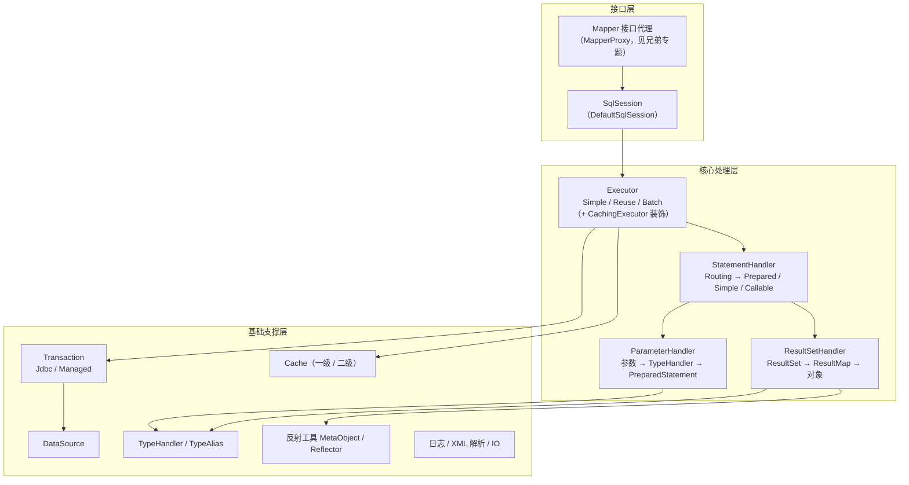
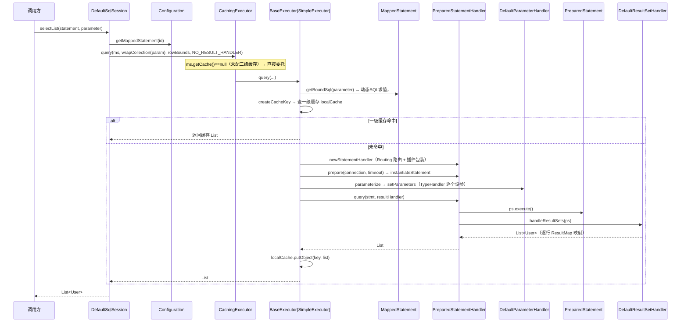

# MyBatis 核心架构与 SQL 执行全流程

> 一句话概括：MyBatis 把 JDBC 的样板代码收敛成一条「中央注册表 + 执行器 + 三大处理器」的流水线——
> 本文以 3.5.19 源码为证据，走读一条 select 从 `SqlSession` 到 `ResultSet` 的完整旅程，讲清每个组件的职责、边界与代价。

预计阅读时间：大约 105 分钟

所属主题：[MyBatis 常见面试题总结](summary.md)

本文以 MyBatis 3.5.x（源码基线 **3.5.19**，Java 8 基线）为基线，源码锚点用 `类名#方法名` 标注，均已对照官方仓库 `mybatis-3.5.19` tag 核实。**版本提示**：MyBatis 3.6.0（2026-10-23）起基线升为 **Java 11** 并移除 Java 8 回退代码（release notes 原文 "Drop java8 fallback"）；3.5.18 是官方预期的最后一个 Java 8 主版本（Support Notice 原文），官方宣布另建 support-java8 分支继续维护；3.5.19（2025-01-02）是其后的 Java 8 维护修订版（仅回退 #3349 回归），也是当前最新 3.5.x。本文机制在 3.6.0 中主体不变，涉及差异处单独注明。`SpringManagedTransaction` 属于 **mybatis-spring** 项目（仓库 `mybatis/spring`，本文按 mybatis-spring 3.0.5 核实），不在 mybatis-3 源码基线内。总结文档给结论，本文给机制与证据：每个机制按「结论 → 机制 → 边界/代价 → 实践/追问」展开。

---

## 0. 阅读路线

| 读者 | 建议阅读 | 关注点 |
| --- | --- | --- |
| 初级（1 年内） | 1、2.4、3.1~3.2、4.1、6.1、8.1~8.2 | 三层架构长什么样、SqlSession 怎么用、一条查询经过谁、主键怎么回填、报错怎么查 |
| 中级（1~3 年） | 全部，重点 2.2~2.3、3.3~3.6、5、6.2 | 配置解析顺序、一级缓存与 CacheKey、BoundSql 生成、参数设置、KeyGenerator 执行位置 |
| 高级（3 年+） | 3.3、3.7、4.3~4.4、5.2、6.3、7、8.3 | 占位符与延迟加载、对象创建成本、Batch 攒批规则、processBefore 时机、事务抽象与排查思路 |
| 选型/架构 | 1.1、4.1、4.6、7.3、8.3 | 半自动化 ORM 定位、Executor 选型、与 Spring 事务的分工、什么时候不该指望框架 |

目录：

1. 架构全景：三层划分与组件职责
2. 配置加载与启动：从 XML 到中央注册表
3. selectList 全链路走读（本文核心）
4. 三种 Executor：Simple / Reuse / Batch
5. StatementHandler 家族与参数设置
6. 主键生成：KeyGenerator 的两条路线
7. Transaction 抽象：连接到底归谁管
8. 边界与排查
9. 高频面试追问集
10. 参考资料

---

## 1. 架构全景：三层划分与组件职责

### 1.1 定位：半自动化 ORM

**结论**：MyBatis 是**半自动化 ORM**——SQL 由开发者手写，框架只自动化「参数设置」和「结果集 → 对象」这两段映射；Hibernate 是全自动 ORM，连 SQL 都由框架生成。这是两者一切差异（SQL 控制力、优化空间、脏检查、缓存体系）的根源，逐项对比留给 [MyBatis-Plus 与生态](mybatis-plus-and-ecosystem.md)，此处只给定位结论。

| 维度 | 裸 JDBC | MyBatis | Hibernate |
| --- | --- | --- | --- |
| SQL 谁写 | 人 | **人**（XML/注解） | 框架生成（HQL/Criteria 翻译） |
| 参数设置 | 人（`ps.setXxx`） | 框架（TypeHandler） | 框架 |
| 结果映射 | 人（逐列 `rs.getXxx`） | 框架（ResultMap/自动映射） | 框架（实体状态管理） |
| SQL 优化控制力 | 完全 | **完全**（DBA 可直接审 SQL） | 弱（需理解生成规则） |
| 定位 | 基础设施 | 半自动化 ORM / SQL 映射框架 | 全自动 ORM |

**追问：为什么国内互联网主流选 MyBatis？** 不是「性能更好」，而是**SQL 可控**：复杂报表、索引优化、分库分表改写都需要直接掌控 SQL；代价是映射与 SQL 维护成本回到开发者手里。

### 1.2 三层架构

**结论**：MyBatis 自顶向下分三层——**接口层**（对外暴露 `SqlSession`）、**核心处理层**（Executor 调度三大处理器完成 SQL 执行）、**基础支撑层**（连接、事务、缓存、反射、类型转换等通用能力）。核心处理层的每个组件都是接口 + 默认实现，都可以被插件拦截或替换。



组件职责表（默认实现与源码锚点均已核实）：

| 组件 | 层 | 职责 | 默认实现 | 关键锚点 |
| --- | --- | --- | --- | --- |
| SqlSession | 接口 | 门面：select/insert/update/delete、事务提交、关闭 | `DefaultSqlSession` | `DefaultSqlSession#selectList` |
| Executor | 核心 | 调度执行、一级缓存、攒批、事务边界 | `SimpleExecutor` | `BaseExecutor#query` |
| StatementHandler | 核心 | 创建 JDBC Statement、设置超时/fetchSize、驱动执行 | `PreparedStatementHandler`（经 Routing 路由） | `PreparedStatementHandler#query` |
| ParameterHandler | 核心 | 把用户参数按 ParameterMapping 设进 PreparedStatement | `DefaultParameterHandler` | `DefaultParameterHandler#setParameters` |
| ResultSetHandler | 核心 | 把 ResultSet 按 ResultMap 映射成对象列表 | `DefaultResultSetHandler` | `DefaultResultSetHandler#handleResultSets` |
| Transaction | 支撑 | 连接的获取/提交/回滚/关闭 | `JdbcTransaction` | `JdbcTransaction#getConnection` |
| Cache | 支撑 | 一级（Executor 内）/二级（namespace 级）缓存 | `PerpetualCache` | `BaseExecutor#queryFromDatabase` |
| TypeHandler | 支撑 | Java 类型 ⇄ JDBC 类型双向转换 | 按类型注册表分发 | `TypeHandlerRegistry#getTypeHandler` |
| MetaObject | 支撑 | 反射读写 Bean/Map 属性的统一工具 | `DefaultReflectorFactory` 缓存反射元数据 | `Configuration#newMetaObject` |

**机制**：四大核心对象（Executor、StatementHandler、ParameterHandler、ResultSetHandler）的创建全部收口在 `Configuration` 的工厂方法里，且**每个都过一遍 `interceptorChain.pluginAll(...)`**——这就是插件（Interceptor）能拦截四大对象的原因（`Configuration#newExecutor` / `#newStatementHandler` / `#newParameterHandler` / `#newResultSetHandler`）。插件机制与分页改写详见 [插件与分页](plugin-and-pagination.md)。

**设计模式视角**：Builder（`SqlSessionFactoryBuilder`、`MappedStatement.Builder`）、装饰器（`CachingExecutor` 包 `SimpleExecutor`）、代理（Mapper 代理、插件 `Plugin.wrap`、日志 `ConnectionLogger`）、模板方法（`BaseExecutor` 定义 query 骨架、`doQuery` 留给子类）。与 Spring 中的模式对照见 [Spring 中的设计模式](../spring/design-patterns.md)。

### 1.3 四个核心对象的生命周期

| 对象 | 作用域 | 最佳实践 |
| --- | --- | --- |
| `SqlSessionFactoryBuilder` | 方法级 |  build 完即丢弃，无需保留 |
| `SqlSessionFactory` | **应用级单例** | 一个数据库一个，应用存活期间不重建 |
| `SqlSession` | **请求/方法级** | 非线程安全，用完必须 close（try-with-resources） |
| Mapper 接口 | 方法级 | 从 session 获取，本质是动态代理，见 [Mapper 代理与绑定](mapper-proxy-and-binding.md) |

**追问：为什么 SqlSessionFactory 要单例？** 它持有 `Configuration`——所有 MappedStatement、ResultMap、TypeHandler、插件的中央注册表（见第 2 章）。重建意味着重新解析全部 XML，且二级缓存等状态全部丢失。

---

## 2. 配置加载与启动：从 XML 到中央注册表

### 2.1 build：一次性的装配流水线

**结论**：`SqlSessionFactoryBuilder#build` 只做一件事——把配置解析成 `Configuration`，再包一层 `DefaultSqlSessionFactory`。所有「重活」都在 `XMLConfigBuilder#parse` 里。

```java
// SqlSessionFactoryBuilder#build（3.5.19，原文）
public SqlSessionFactory build(InputStream inputStream, String environment, Properties properties) {
  try {
    XMLConfigBuilder parser = new XMLConfigBuilder(inputStream, environment, properties);
    return build(parser.parse());
  } catch (Exception e) {
    throw ExceptionFactory.wrapException("Error building SqlSession.", e);
  } finally { /* reset ErrorContext、关闭流 */ }
}

public SqlSessionFactory build(Configuration config) {
  return new DefaultSqlSessionFactory(config);
}
```

```java
// XMLConfigBuilder#parse（原文）
public Configuration parse() {
  if (parsed) {
    throw new BuilderException("Each XMLConfigBuilder can only be used once.");
  }
  parsed = true;
  parseConfiguration(parser.evalNode("/configuration"));
  return configuration;
}
```

**边界**：`XMLConfigBuilder` 一次性使用（`parsed` 标志防重入）；注解方式（`MapperAnnotationBuilder`）与 Spring 集成（`SqlSessionFactoryBean`）走的是同一套 `Configuration` 注册逻辑，只是入口不同。

### 2.2 parseConfiguration：节点顺序就是依赖顺序

`XMLConfigBuilder#parseConfiguration` 的解析顺序（3.5.19 原文顺序）：

| 顺序 | 节点 | 作用 |
| --- | --- | --- |
| 1 | `properties` | 外部属性，**必须最先读**（源码注释 issue #117），后面节点可能引用 |
| 2 | `settings`（先收集为 Properties） | 全局开关；`vfsImpl`/`logImpl` 在此立即加载 |
| 3 | `typeAliases` | 类型别名注册 |
| 4 | `plugins` | 拦截器注册进 `InterceptorChain` |
| 5 | `objectFactory` / `objectWrapperFactory` / `reflectorFactory` | 结果对象创建与反射策略 |
| 6 | `settingsElement(settings)` | settings 真正写入 Configuration（**在第 5 步之后**，issue #631） |
| 7 | `environments` | DataSource + TransactionFactory |
| 8 | `databaseIdProvider` | 需要 environments 里的 DataSource，故在其后 |
| 9 | `typeHandlers` | 类型处理器注册 |
| 10 | `mappers` | **最后**解析映射文件/接口（依赖前面所有注册项） |

与本文相关的 settings 默认值（`Configuration` 字段初始值 + `XMLConfigBuilder#settingsElement`，均已核实）：

| setting | 默认值 | 影响 |
| --- | --- | --- |
| `cacheEnabled` | `true` | 决定是否用 `CachingExecutor` 包装（见 4.5） |
| `defaultExecutorType` | `SIMPLE` | openSession 不指定时的执行器 |
| `localCacheScope` | `SESSION` | 一级缓存作用域（见 3.3） |
| `useGeneratedKeys` | `false` | 全局主键回填开关，**只影响 INSERT**（见 6.2） |
| `jdbcTypeForNull` | `OTHER` | null 参数的兜底 JdbcType（见 5.3） |
| `autoMappingBehavior` | `PARTIAL` | 自动映射策略，见 [结果映射与 TypeHandler](result-mapping-and-typehandler.md) |
| `mapUnderscoreToCamelCase` | `false` | 下划线转驼峰 |

### 2.3 XMLMapperBuilder#parse：每条语句注册为 MappedStatement

**结论**：每个 mapper XML 解析后，其中的每条 `<select>/<insert>/<update>/<delete>` 都变成一个 **`MappedStatement` 对象**，以 `namespace + '.' + id` 为键注册进 `Configuration`。运行期 `session.selectList("com.x.UserMapper.findById")` 查的就是这张表。

```java
// XMLMapperBuilder#parse（原文）
public void parse() {
  if (!configuration.isResourceLoaded(resource)) {
    configurationElement(parser.evalNode("/mapper"));
    configuration.addLoadedResource(resource);
    bindMapperForNamespace();
  }
  configuration.parsePendingResultMaps(false);
  configuration.parsePendingCacheRefs(false);
  configuration.parsePendingStatements(false);
}
```

`configurationElement` 内部顺序：`cache-ref` → `cache` → `parameterMap` → `resultMap` → `sql` 片段 → 语句节点。三个关键机制：

**① id 的命名空间化**（`MapperBuilderAssistant#applyCurrentNamespace` / `#addMappedStatement`）：

```java
// MapperBuilderAssistant#addMappedStatement（简化）
id = applyCurrentNamespace(id, false);   // id = namespace + "." + id
MappedStatement.Builder statementBuilder =
    new MappedStatement.Builder(configuration, id, sqlSource, sqlCommandType)
        .keyGenerator(keyGenerator).keyProperty(keyProperty).keyColumn(keyColumn)
        .resultMaps(getStatementResultMaps(resultMap, resultType, id))
        .flushCacheRequired(flushCache).useCache(useCache).cache(currentCache) /* ... */;
configuration.addMappedStatement(statementBuilder.build());
```

`applyCurrentNamespace` 对**声明**（isReference=false）有一条硬规则：id 里不允许出现点号，否则抛 `BuilderException("Dots are not allowed in element names...")`——因为点号是 namespace 分隔符。

**② StrictMap 注册**（`Configuration.StrictMap`）：`mappedStatements` 不是普通 HashMap，而是 `StrictMap`——put 时同时注册**全名**和**短名**（最后一段）；短名冲突时放入一个 `Ambiguity` 占位对象，get 命中就抛「is ambiguous」；get 不到直接抛异常而不是返回 null（见 8.1 错误速查）。

**③ 前向引用的延迟重试**：语句引用了尚未解析的 resultMap/cache-ref 时抛 `IncompleteElementException`，被捕获后存入 `configuration.addIncompleteStatement(...)`，每轮 parse 末尾统一重试（`parsePendingStatements`）。这解决了 mapper 文件之间的加载顺序问题。

**④ 接口绑定**（`XMLMapperBuilder#bindMapperForNamespace`）：尝试把 namespace 当类名加载（`Resources.classForName(namespace)`），成功则 `configuration.addMapper(boundType)`——这就是「XML 与接口自动关联」的入口，前提是 **namespace 必须等于接口全限定名**。代理如何把方法调用翻译成 statement id，见 [Mapper 代理与绑定](mapper-proxy-and-binding.md)。

**边界/代价**：`MappedStatement` 是**启动期构建、运行期只读**的元数据（SQL 模板、ResultMap、KeyGenerator、超时、缓存开关都在里面），运行期不会重复解析 XML——这是 MyBatis 启动后执行轻量的原因之一。但注意 `MappedStatement#getBoundSql` 每次调用仍可能重新计算动态 SQL（见 3.4）。

### 2.4 SqlSessionFactory 单例、SqlSession 非线程安全

**结论**：`SqlSessionFactory` 线程安全、应用级单例；`SqlSession` **非线程安全**，必须「用完即关」，绝不能做成成员变量共享。

**机制**：看 `DefaultSqlSession` 的字段与类注释（3.5.19 原文）：

```java
/**
 * The default implementation for {@link SqlSession}. Note that this class is not Thread-Safe.
 */
public class DefaultSqlSession implements SqlSession {
  private final Configuration configuration;
  private final Executor executor;
  private final boolean autoCommit;
  private boolean dirty;               // 是否发生过写操作
  private List<Cursor<?>> cursorList;  // 未关闭的游标
}
```

非线程安全的根源不在 SqlSession 本身这几个字段，而在它持有的 **Executor → Transaction → 一条 JDBC Connection**：连接是有状态的（autoCommit、隔离级别、未提交的事务），一级缓存也挂在 Executor 上（见 3.3）。两个线程共用一个 session，等于共用一条连接交错执行 SQL——事务互相污染、`dirty` 标志竞态、一级缓存串数据。

```java
// DefaultSqlSessionFactory#openSessionFromDataSource（原文，每次 openSession 都新建整套对象）
final Environment environment = configuration.getEnvironment();
final TransactionFactory transactionFactory = getTransactionFactoryFromEnvironment(environment);
tx = transactionFactory.newTransaction(environment.getDataSource(), level, autoCommit);
final Executor executor = configuration.newExecutor(tx, execType);
return createSqlSession(configuration, executor, autoCommit);   // new DefaultSqlSession(...)
```

**实践**：

```java
// 标准用法：try-with-resources 保证 close（close 内含 rollback 兜底与连接归还）
try (SqlSession session = sqlSessionFactory.openSession()) {
  UserMapper mapper = session.getMapper(UserMapper.class);
  User u = mapper.findById(1L);
  session.commit();   // 非 autoCommit 且有写操作时才真正提交（isCommitOrRollbackRequired）
}
```

在 Spring 中你几乎不会手写这段——`SqlSessionTemplate` 是线程安全的代理，把「每次方法调用绑定到当前事务的 session」这件事自动化了，机制见 [Spring 集成与事务](spring-integration-and-transaction.md)。

---

## 3. selectList 全链路走读（本文核心）

### 3.1 全链路时序图

以 `session.selectList("com.x.UserMapper.findById", 1L)` 为例（默认配置：SIMPLE 执行器、cacheEnabled=true、未配二级缓存）：



下面按链路顺序逐段给源码证据。

### 3.2 DefaultSqlSession#selectList：只做三件事

```java
// DefaultSqlSession#selectList（私有重载，原文）
private <E> List<E> selectList(String statement, Object parameter, RowBounds rowBounds, ResultHandler handler) {
  try {
    MappedStatement ms = configuration.getMappedStatement(statement);
    dirty |= ms.isDirtySelect();
    return executor.query(ms, wrapCollection(parameter), rowBounds, handler);
  } catch (Exception e) {
    throw ExceptionFactory.wrapException("Error querying database.  Cause: " + e, e);
  } finally {
    ErrorContext.instance().reset();
  }
}
```

三件事：**查注册表**（`getMappedStatement`，内部会先 `buildAllStatements()` 重试未完成语句）、**包装集合参数**（`wrapCollection`）、**委托 Executor**。SqlSession 层没有任何 SQL 逻辑——它是纯门面。

三个值得注意的细节：

- `wrapCollection` 委托 `ParamNameResolver.wrapToMapIfCollection(object, null)`：参数是 Collection 时包成含 `"collection"` 键（List 再加 `"list"` 键）的 ParamMap，数组则包成 `"array"` 键——这就是 `<foreach collection="list">` 能直接写 `list` 的原因。
- `dirty |= ms.isDirtySelect()`：`dirtySelect` 来自 `<select>` 节点的 `affectData` 属性（默认 false，`XMLStatementBuilder#parseStatementNode` 读取）——select 配 `affectData="true"` 即声明该查询会改数据，把 session 标记为 dirty，使后续 commit 真正提交。
- `selectOne` 就是 `selectList` 加断言：0 条返回 null，**多于 1 条抛 `TooManyResultsException`**；`insert`/`delete` 全部委托 `update`，并把 `dirty` 置 true。`commit()` 是否真正提交 JDBC 事务由 `isCommitOrRollbackRequired(force)` 决定：`!autoCommit && dirty || force`——**未发生写操作且未标记 affectData 的只读 session 调 commit 不会真正提交 JDBC 事务（required=false），但 `executor.commit` 仍会无条件清空一级缓存并 flushStatements——不是空操作**（`BaseExecutor#commit`：`clearLocalCache()` 与 `flushStatements()` 在 `if (required)` 之前执行）。

### 3.3 Executor#query：一级缓存与 CacheKey

**结论**：一级缓存是 **Executor 级别**（即 SqlSession 级别）的 `PerpetualCache`，默认开启、无法彻底关闭，只能把作用域缩到 STATEMENT。它挡在真正执行之前。

```java
// BaseExecutor#query（4 参入口，原文）
BoundSql boundSql = ms.getBoundSql(parameter);
CacheKey key = createCacheKey(ms, parameter, rowBounds, boundSql);
return query(ms, parameter, rowBounds, resultHandler, key, boundSql);
```

```java
// BaseExecutor#query（6 参重载，简化）
if (queryStack == 0 && ms.isFlushCacheRequired()) {
  clearLocalCache();                          // select 配 flushCache="true" 时先清缓存
}
try {
  queryStack++;
  list = resultHandler == null ? (List<E>) localCache.getObject(key) : null;
  if (list != null) {
    handleLocallyCachedOutputParameters(ms, key, parameter, boundSql);  // CALLABLE 出参
  } else {
    list = queryFromDatabase(ms, parameter, rowBounds, resultHandler, key, boundSql);
  }
} finally {
  queryStack--;
}
if (queryStack == 0) {
  for (DeferredLoad deferredLoad : deferredLoads) { deferredLoad.load(); }
  deferredLoads.clear();                      // issue #601
  if (configuration.getLocalCacheScope() == LocalCacheScope.STATEMENT) {
    clearLocalCache();                        // issue #482：语句级作用域，用完即清
  }
}
```

```java
// BaseExecutor#queryFromDatabase（原文）
localCache.putObject(key, EXECUTION_PLACEHOLDER);   // 占位：标记「正在执行」
try {
  list = doQuery(ms, parameter, rowBounds, resultHandler, boundSql);  // 模板方法，子类实现
} finally {
  localCache.removeObject(key);
}
localCache.putObject(key, list);
```

机制要点：

| 要点 | 说明 | 锚点 |
| --- | --- | --- |
| CacheKey 组成 | 六项：语句 id、RowBounds offset、RowBounds limit、**最终 SQL 串**、逐个非 OUT 参数值（取值逻辑与 DefaultParameterHandler 一致）、Environment id（非 null 时参与，issue #176） | `BaseExecutor#createCacheKey` |
| 占位符 | `EXECUTION_PLACEHOLDER` 标记执行中，配合 `deferredLoads` 处理嵌套查询的延迟加载时序 | `BaseExecutor#queryFromDatabase` |
| queryStack | 嵌套查询计数；只有归零时才处理延迟加载、才按 STATEMENT 作用域清缓存 | `BaseExecutor#query` |
| 写操作清缓存 | `update` 在 `doUpdate` 前 `clearLocalCache()`；commit/rollback 同样清 | `BaseExecutor#update` |
| ResultHandler 绕过缓存 | 传了自定义 ResultHandler 时不读一级缓存（流式处理语义） | `BaseExecutor#query` |

**边界/代价**：一级缓存的「一致性命门」是**同一个 SqlSession 内**——session 里查过的数据，即使数据库已被别的事务改掉，再查仍返回旧对象（缓存的是对象引用，改对象属性还会污染缓存）。`localCacheScope=STATEMENT` 可把窗口缩到单条语句，但无法完全关闭。二级缓存（namespace 级、跨 session）的开关、刷新与序列化代价见 [缓存机制](cache-mechanism.md)。

**追问：为什么一级缓存不能关？** 它不只是性能优化——嵌套查询/延迟加载依赖「同一 key 在执行中」的占位语义，MyBatis 把它作为执行模型的一部分，只允许缩小作用域。

### 3.4 MappedStatement#getBoundSql：动态 SQL 在这里变成 JDBC SQL

**结论**：`BoundSql` = 最终 SQL 文本（`?` 占位）+ ParameterMapping 列表 + 参数对象 + 附加参数。它是「XML 里的 SQL」与「JDBC 能执行的 SQL」之间的桥梁，**每次执行都重新获取**。

```java
// MappedStatement#getBoundSql（简化）
BoundSql boundSql = sqlSource.getBoundSql(parameterObject);
if (boundSql.getParameterMappings() == null || boundSql.getParameterMappings().isEmpty()) {
  boundSql = new BoundSql(configuration, boundSql.getSql(),
      parameterMap.getParameterMappings(), parameterObject);   // 兼容老式 parameterMap
}
```

`sqlSource` 有两种形态，启动期由 `XMLScriptBuilder#parseScriptNode` 选定：解析节点时只要遇到动态元素（`<if>` 等）或含 `${}` 的文本就把 `isDynamic` 置 true，最终 `isDynamic ? new DynamicSqlSource(...) : new RawSqlSource(...)`：

```java
// DynamicSqlSource#getBoundSql（scripting.xmltags 包，原文）——含 <if>/<where>/<foreach> 等
DynamicContext context = new DynamicContext(configuration, parameterObject);
rootSqlNode.apply(context);                       // ① 动态节点求值，拼出带 #{} 的 SQL
SqlSourceBuilder sqlSourceParser = new SqlSourceBuilder(configuration);
SqlSource sqlSource = sqlSourceParser.parse(context.getSql(), parameterType, context.getBindings());
BoundSql boundSql = sqlSource.getBoundSql(parameterObject);   // ② #{} → ?，生成 ParameterMapping
context.getBindings().forEach(boundSql::setAdditionalParameter); // ③ <bind>/<foreach> 的附加参数
return boundSql;
```

- **DynamicSqlSource**：每次执行都走「动态求值 + `#{}` 解析」两步，因为 SQL 形态依赖参数。
- **RawSqlSource**（`scripting.defaults` 包，@since 3.2.0）：纯静态 SQL 在**启动期**就完成 `#{}` → `?` 的解析（类注释原文："It is faster than DynamicSqlSource because mappings are calculated during startup"），运行期直接委托 StaticSqlSource 返回 BoundSql。

**边界**：`${}` 是文本替换、发生在动态求值阶段，**不产生 ParameterMapping、不走 TypeHandler**——SQL 注入风险与防范见 [动态 SQL 与注入](dynamic-sql-and-injection.md)。

### 3.5 StatementHandler：prepare → parameterize → query

`SimpleExecutor#doQuery` 是三大处理器的组装现场：

```java
// SimpleExecutor#doQuery（原文）
StatementHandler handler = configuration.newStatementHandler(wrapper, ms, parameter,
    rowBounds, resultHandler, boundSql);        // Routing 路由 + pluginAll 插件包装
stmt = prepareStatement(handler, ms.getStatementLog());
return handler.query(stmt, resultHandler);
// finally { closeStatement(stmt); }

// SimpleExecutor#prepareStatement（原文）
Connection connection = getConnection(statementLog);   // transaction.getConnection()，DEBUG 时包 ConnectionLogger
stmt = handler.prepare(connection, transaction.getTimeout());
handler.parameterize(stmt);
```

`BaseStatementHandler#prepare` 做三件事：`instantiateStatement(connection)`（子类创建具体 Statement）→ `setStatementTimeout`（语句 timeout 优先于全局 defaultStatementTimeout，再叠加事务剩余超时）→ `setFetchSize`。

真正执行在 `PreparedStatementHandler#query`——只有两行，却是最常被问的两行：

```java
// PreparedStatementHandler#query（原文）
PreparedStatement ps = (PreparedStatement) statement;
ps.execute();
return resultSetHandler.handleResultSets(ps);
```

**追问：为什么传 `wrapper` 而不是 `this`？** `wrapper` 是最外层执行器（可能被 CachingExecutor/插件装饰过），StatementHandler 上的插件需要拿到它才能正确回调执行器（如分页插件改写后重新路由）。

### 3.6 ResultSetHandler#handleResultSets：结果集 → 对象

```java
// DefaultResultSetHandler#handleResultSets（简化）
ResultSetWrapper rsw = getFirstResultSet(stmt);
List<ResultMap> resultMaps = mappedStatement.getResultMaps();
validateResultMapsCount(rsw, resultMapCount);
while (rsw != null && resultMapCount > resultSetCount) {
  ResultMap resultMap = resultMaps.get(resultSetCount);
  handleResultSet(rsw, resultMap, multipleResults, null);   // 逐行映射
  rsw = getNextResultSet(stmt);                             // 存储过程多结果集
  resultSetCount++;
}
return collapseSingleResultList(multipleResults);           // 单结果集时拆掉外层 List
```

骨架之外的一切——自动映射、构造器映射、嵌套查询/嵌套结果、`<discriminator>`、TypeHandler 取值、延迟加载代理——都在 `handleResultSet` 之下展开，完整机制见 [结果映射与 TypeHandler](result-mapping-and-typehandler.md)。本文只强调一个与架构相关的点：**RowBounds 是内存分页**。

```java
// DefaultResultSetHandler#skipRows（原文简化）：offset 靠滚动结果集跳过
if (rs.getType() != ResultSet.TYPE_FORWARD_ONLY) {
  rs.absolute(rowBounds.getOffset());
} else {
  for (int i = 0; i < rowBounds.getOffset(); i++) { if (!rs.next()) break; }
}
// shouldProcessMoreRows：resultCount < rowBounds.getLimit() 时继续取
```

**边界/代价**：SQL 本身**没有 LIMIT**，数据库把全部结果发给驱动，MyBatis 在客户端跳过 offset 行、只映射 limit 行。深分页（offset 十万级）时网络传输与滚动成本全价支付——物理分页要靠插件改写 SQL，见 [插件与分页](plugin-and-pagination.md)。

### 3.7 成本账：一次查询创建了什么（高级）

| 阶段 | 新建对象 | 备注 |
| --- | --- | --- |
| 入口 | ParamMap（集合参数时）、CacheKey | 轻量 |
| BoundSql | 动态 SQL 每次新建 BoundSql + ParameterMapping 列表 | 静态 SQL（RawSqlSource）省掉解析，但 BoundSql 仍每次新建 |
| 处理器 | RoutingStatementHandler + PreparedStatementHandler + DefaultParameterHandler + DefaultResultSetHandler | **每次执行都新建**，且每个都过 pluginAll（有插件时再生成代理） |
| JDBC | PreparedStatement、ResultSet | SimpleExecutor 用完即关 |
| 映射 | ResultSetWrapper、每行结果对象 + MetaObject | 行数多时这是大头；Reflector 缓存了类的反射元数据，但对象本身逐行新建 |

**结论**：MyBatis 的框架开销集中在「每次执行的处理器装配」与「逐行反射映射」，都是短生命周期小对象，GC 友好；真正的性能热点通常在**网络往返、结果集规模、N+1 查询**，而不是这几个 handler 的 new。优化优先级：减少查询列与行数 → 消除 N+1 → 批量写入（见 [批处理与性能](batch-and-performance.md)）→ 最后才考虑缓存。面试里能说出「处理器每次新建、反射元数据有缓存」这个层次，比笼统说「MyBatis 比 Hibernate 快」可信得多。

---

## 4. 三种 Executor：Simple / Reuse / Batch

### 4.1 对比总表

| 维度 | SimpleExecutor | ReuseExecutor | BatchExecutor |
| --- | --- | --- | --- |
| Statement 生命周期 | **每次新建，用完即关** | 按 **SQL 文本**缓存，flush 时统一关 | 攒批（addBatch），flush 时 executeBatch |
| update 返回值 | 真实影响行数 | 真实影响行数 | **哨兵值 `Integer.MIN_VALUE + 1002`**（尚未执行） |
| query 行为 | 直接执行 | 直接执行（可能复用 Statement） | **先 flushStatements 把攒的批打出去** |
| 缓存结构 | 无 | `Map<String, Statement>` | `List<Statement>` + `List<BatchResult>` |
| 典型场景 | 默认，绝大多数业务 | 同一 session 内反复执行同一条 SQL | 批量插入/更新 |
| 锚点 | `SimpleExecutor#doQuery` | `ReuseExecutor#prepareStatement` | `BatchExecutor#doUpdate` / `#doFlushStatements` |

三者都继承 `BaseExecutor`（一级缓存、事务、query 骨架共用），差异只在 `doUpdate`/`doQuery`/`doFlushStatements` 三个模板方法——**模板方法模式**的教科书案例。

### 4.2 SimpleExecutor：默认且最省心

机制见 3.5 的源码：每次 `doQuery`/`doUpdate` 新建 StatementHandler 与 Statement，`finally closeStatement(stmt)`。**边界**：没有 Statement 复用，同一条 SQL 执行一万次就 prepare 一万次——但现代驱动（如 MySQL Connector/J 的服务端预编译缓存）会弱化这个差距，所以「Simple 一定慢」并不成立。

### 4.3 ReuseExecutor：按 SQL 文本缓存 Statement

```java
// ReuseExecutor#prepareStatement（原文）
String sql = boundSql.getSql();
if (hasStatementFor(sql)) {                 // statementMap 里有且连接未关闭
  stmt = getStatement(sql);
  applyTransactionTimeout(stmt);
} else {
  Connection connection = getConnection(statementLog);
  stmt = handler.prepare(connection, transaction.getTimeout());
  putStatement(sql, stmt);                  // key 是 SQL 文本，不是 statement id
}
handler.parameterize(stmt);                 // 参数每次都重新设置
```

**边界/代价**（高频追问点）：

- 缓存键是**最终 SQL 文本**。动态 SQL 每次拼出不同文本（`<if>` 命中不同、`<foreach>` 长度不同）→ 全部 miss，statementMap 反而越攒越多，直到 `doFlushStatements` 才统一关闭。
- 缓存是 **Executor 级 = SqlSession 级**，不是全局缓存；session 关闭即清空。
- 所以 ReuseExecutor 的收益场景很窄：**同一 session 内高频重复执行同一条静态 SQL**（如循环里逐条查同一语句）。多数 Web 请求 session 短命，收益有限——这也是默认 SIMPLE 的原因。

### 4.4 BatchExecutor：攒批与 flush

```java
// BatchExecutor#doUpdate（简化）
final String sql = boundSql.getSql();
if (sql.equals(currentSql) && ms.equals(currentStatement)) {
  stmt = statementList.get(statementList.size() - 1);   // 只和「最后一个」批比较
  handler.parameterize(stmt);                           // 重新绑参
  batchResult.addParameterObject(parameterObject);      // 记下参数，供回填主键
} else {
  stmt = handler.prepare(connection, transaction.getTimeout());  // 开新批
  currentSql = sql; currentStatement = ms;
  statementList.add(stmt);
  batchResultList.add(new BatchResult(ms, sql, parameterObject));
}
handler.batch(stmt);                                    // PreparedStatementHandler#batch → ps.addBatch()
return BATCH_UPDATE_RETURN_VALUE;                       // Integer.MIN_VALUE + 1002，哨兵
```

机制要点：

| 要点 | 说明 |
| --- | --- |
| 分组规则 | SQL 文本 **且** MappedStatement 都相同才并入当前批；**只比较最后一个**——A→B→A 交替会拆成 3 个批 |
| 何时真正执行 | `doFlushStatements`：逐个 `stmt.executeBatch()`，随后取主键（Jdbc3 走 `processBatch`，见 6.2） |
| flush 触发点 | ① `doQuery` 开头先 flush（查询前必须把写打出去）；② commit/rollback；③ 手动 `session.flushStatements()` |
| 失败语义 | `BatchUpdateException` 包装成 `BatchExecutorException`，消息带 `(batch index #n)`，已成功的批**一并回滚** |
| rollback | `doFlushStatements(true)` 直接丢弃不执行，finally 关闭全部 Statement |

**边界/代价**：`insert` 返回的哨兵值**不能用来判断成败**，真实影响行数在 flush 后的 `BatchResult#getUpdateCounts` 里；把不同语句交错调用会打断攒批。批量导入的正确姿势（独立 BATCH session、分批 flush、`<foreach>` 与 BATCH 的取舍、驱动参数）见 [批处理与性能](batch-and-performance.md)。

### 4.5 CachingExecutor：二级缓存的装饰器

**一句话**：`cacheEnabled=true`（默认）时，`Configuration#newExecutor` 用 `CachingExecutor` 把三种执行器之一包一层——query 先查 namespace 级二级缓存（`TransactionalCacheManager`），miss 才委托内层；update 先按 `flushCacheRequired` 清缓存。装饰器模式，对内层完全透明。

```java
// CachingExecutor#query（简化）
Cache cache = ms.getCache();
if (cache != null) {
  flushCacheIfRequired(ms);
  if (ms.isUseCache() && resultHandler == null) {
    List<E> list = (List<E>) tcm.getObject(cache, key);
    if (list == null) {
      list = delegate.query(ms, parameterObject, rowBounds, resultHandler, key, boundSql);
      tcm.putObject(cache, key, list);
    }
    return list;
  }
}
return delegate.query(...);
```

注意 `ms.getCache()` 为 null（mapper 没配 `<cache>`）时直接走内层——**cacheEnabled=true 不等于开了二级缓存**。事务性缓存（commit 才生效）、序列化、脏读风险见 [缓存机制](cache-mechanism.md)。

### 4.6 ExecutorType 与 openSession

```java
// Configuration#newExecutor（原文）
executorType = executorType == null ? defaultExecutorType : executorType;
if (ExecutorType.BATCH == executorType)      executor = new BatchExecutor(this, transaction);
else if (ExecutorType.REUSE == executorType) executor = new ReuseExecutor(this, transaction);
else                                         executor = new SimpleExecutor(this, transaction);
if (cacheEnabled) executor = new CachingExecutor(executor);
return (Executor) interceptorChain.pluginAll(executor);
```

- `openSession()` 用 `defaultExecutorType`（settings 可改，默认 SIMPLE）；`openSession(ExecutorType.BATCH)` 显式指定。
- **Executor 在 openSession 时创建，session 存活期间不可更换**。
- Spring 集成时 `SqlSessionTemplate` 的 executorType 是构造器固定的 final 字段；**同一事务内不能切换执行器类型**——`SqlSessionUtils#getSqlSession` → `#sessionHolder`（mybatis-spring，实际抛出点在私有方法 `sessionHolder`）发现已有事务的 ExecutorType 不一致时抛 `TransientDataAccessResourceException("Cannot change the ExecutorType when there is an existing transaction")`。所以「事务方法里临时开 BATCH」必须用独立 session/新事务，详见 [Spring 集成与事务](spring-integration-and-transaction.md)。

**实践**：批量导入用独立的 `openSession(ExecutorType.BATCH, false)`，每 500~1000 条 `flushStatements()` + `commit()`，避免单批过大撑爆驱动内存。

---

## 5. StatementHandler 家族与参数设置

### 5.1 RoutingStatementHandler：按 StatementType 路由

**结论**：`Configuration#newStatementHandler` 永远先创建 `RoutingStatementHandler`，它按 `MappedStatement#getStatementType` 路由到具体实现，自身只做委托——**路由 + 委托**，让插件可以统一拦截 StatementHandler 而不关心具体类型。

```java
// RoutingStatementHandler 构造器（原文简化）
switch (ms.getStatementType()) {
  case STATEMENT: delegate = new SimpleStatementHandler(...); break;     // 裸 Statement
  case PREPARED:  delegate = new PreparedStatementHandler(...); break;   // PreparedStatement（默认）
  case CALLABLE:  delegate = new CallableStatementHandler(...); break;   // CallableStatement（存储过程）
  default: throw new ExecutorException("Unknown statement type: " + ms.getStatementType());
}
```

| StatementType | JDBC 对象 | 场景 | 风险/备注 |
| --- | --- | --- | --- |
| `PREPARED`（默认） | PreparedStatement | 绝大多数 | `#{}` 预编译占位，防注入 |
| `STATEMENT` | Statement | 极少数需要裸 SQL 的场景 | 配合 `${}` 拼接 = **注入面**，见 [动态 SQL 与注入](dynamic-sql-and-injection.md) |
| `CALLABLE` | CallableStatement | 存储过程 | 有 OUT 参数还想用二级缓存会直接抛异常，要求配 `useCache=false`（`CachingExecutor#ensureNoOutParams`） |

默认值有两处来源且一致：`MappedStatement.Builder` 构造器默认 `StatementType.PREPARED`；XML 的 `statementType` 属性缺省也是 `PREPARED`（`XMLStatementBuilder#parseStatementNode`）。

### 5.2 BaseStatementHandler：组装点与 prepare

构造器是 ParameterHandler/ResultSetHandler 的诞生地，还藏着一个关键时序（与第 6 章呼应）：

```java
// BaseStatementHandler 构造器（原文简化）
if (boundSql == null) {   // issue #435：先取主键，再计算语句
  generateKeys(parameterObject);                    // keyGenerator.processBefore(executor, ms, null, parameter)
  boundSql = mappedStatement.getBoundSql(parameterObject);
}
this.parameterHandler = configuration.newParameterHandler(mappedStatement, parameterObject, boundSql);
this.resultSetHandler = configuration.newResultSetHandler(executor, mappedStatement, rowBounds,
    parameterHandler, resultHandler, boundSql);
```

**关键边界**：`boundSql == null` 只发生在 **update 路径**（`SimpleExecutor#doUpdate` 传 null）；query 路径在 `BaseExecutor#query` 里已算好 BoundSql 传进来。所以 **`processBefore`（selectKey BEFORE）只在写操作路径触发**，且发生在主语句 SQL 计算之前——这正是「BEFORE 先查序列、再把 id 拼进 INSERT」的实现基础。

`prepare` 的骨架（`BaseStatementHandler#prepare`）：`instantiateStatement` → `setStatementTimeout` → `setFetchSize`，异常时关闭半成品 Statement。`PreparedStatementHandler#instantiateStatement` 还有一个与主键相关的分支：

```java
// PreparedStatementHandler#instantiateStatement（原文简化）
if (mappedStatement.getKeyGenerator() instanceof Jdbc3KeyGenerator) {
  String[] keyColumnNames = mappedStatement.getKeyColumns();
  return keyColumnNames == null
      ? connection.prepareStatement(sql, Statement.RETURN_GENERATED_KEYS)   // 告诉驱动：我要回填主键
      : connection.prepareStatement(sql, keyColumnNames);
}
return connection.prepareStatement(sql);   // 常规路径（ResultSetType 非 DEFAULT 时另带滚动参数）
```

### 5.3 DefaultParameterHandler#setParameters：参数如何落进 PreparedStatement

**先纠正一个高频误写**：`DefaultParameterHandler` 的包是 **`org.apache.ibatis.scripting.defaults`**，不是 `executor.parameter`（那里只有接口 `ParameterHandler`）。

```java
// DefaultParameterHandler#setParameters（原文简化）
for (int i = 0; i < parameterMappings.size(); i++) {
  ParameterMapping parameterMapping = parameterMappings.get(i);
  if (parameterMapping.getMode() != ParameterMode.OUT) {
    Object value;
    String propertyName = parameterMapping.getProperty();
    if (boundSql.hasAdditionalParameter(propertyName)) {        // ① <foreach>/<bind> 附加参数优先
      value = boundSql.getAdditionalParameter(propertyName);
    } else if (parameterObject == null) {                       // ② 无参
      value = null;
    } else if (typeHandlerRegistry.hasTypeHandler(parameterObject.getClass())) {
      value = parameterObject;                                  // ③ 简单类型：整个对象就是值
    } else {
      value = metaObject.getValue(propertyName);                // ④ Bean/Map：反射取属性
    }
    TypeHandler typeHandler = parameterMapping.getTypeHandler();
    JdbcType jdbcType = parameterMapping.getJdbcType();
    if (value == null && jdbcType == null) {
      jdbcType = configuration.getJdbcTypeForNull();            // 默认 OTHER
    }
    typeHandler.setParameter(ps, i + 1, value, jdbcType);       // 委托 TypeHandler
  }
}
```

取值优先级表：

| 优先级 | 条件 | 值来源 | 典型场景 |
| --- | --- | --- | --- |
| ① | `boundSql.hasAdditionalParameter` | 附加参数 | `<foreach>` 的 `__frch_item_0`、`<bind>` 变量 |
| ② | parameterObject == null | null | 无参语句 |
| ③ | 参数类型有 TypeHandler | 参数对象本身 | `findById(Long id)` 单简单参数 |
| ④ | 其余 | `MetaObject.getValue(propertyName)` | POJO 属性、Map 键、`@Param` 命名参数 |

**边界/代价**：null 值且未显式指定 jdbcType 时兜底 `jdbcTypeForNull=OTHER`——**Oracle 驱动对 OTHER 报错**（经典坑），需全局改 `NULL` 或逐处写 `#{prop,jdbcType=NULL}`。TypeHandler 的选择与自定义、`javaType`/`jdbcType` 推断规则见 [结果映射与 TypeHandler](result-mapping-and-typehandler.md)。**3.6.0 差异注记**：3.6.0 起改为基于 `java.lang.reflect.Type` 解析 TypeHandler（#3379），存在已知回归（#3829，官方计划 3.6.1 提供关闭参数元数据查找的选项），详见 [MyBatis 常见面试题总结](summary.md) 的版本演进章节。

---

## 6. 主键生成：KeyGenerator 的两条路线

### 6.1 两种实现对比

| 维度 | Jdbc3KeyGenerator | SelectKeyGenerator |
| --- | --- | --- |
| 配置 | `useGeneratedKeys="true" keyProperty="id"`（可选 `keyColumn`） | `<selectKey keyProperty="id" order="BEFORE/AFTER" resultType="long">` |
| 原理 | JDBC 标准 API `Statement#getGeneratedKeys` | **额外执行一条 SELECT**（如序列、`LAST_INSERT_ID()`） |
| 执行时机 | 主语句执行**后**（processAfter / 批量 processBatch） | BEFORE：主语句前；AFTER：主语句后（默认 AFTER） |
| 数据库依赖 | 驱动支持自增回填（MySQL/PG 等）；Oracle 传统自增不支持 | 任意数据库，SQL 自己写 |
| 额外往返 | 无（随执行结果返回） | 有（一次独立查询） |
| 典型用法 | MySQL 自增主键 | Oracle 序列（BEFORE）、MySQL `SELECT LAST_INSERT_ID()`（AFTER） |

### 6.2 执行位置：三个钩子，三条路径

**结论**：KeyGenerator 不是独立组件，而是嵌在 StatementHandler 执行流程里的三个钩子——`processBefore`（构造期）、`processAfter`（update 执行后）、`processBatch`（批量 flush 后）。

| 路径 | 钩子 | 触发位置（源码锚点） |
| --- | --- | --- |
| 单条 update + selectKey BEFORE | `processBefore` | `BaseStatementHandler#generateKeys`（构造器，boundSql==null 时，**早于主语句 SQL 计算**） |
| 单条 update + useGeneratedKeys / selectKey AFTER | `processAfter` | `PreparedStatementHandler#update`：`ps.execute()` → `getUpdateCount()` → `keyGenerator.processAfter(...)` |
| BATCH 执行器 | `processBatch`（Jdbc3）或逐参数 `processAfter`（其他） | `BatchExecutor#doFlushStatements`：`executeBatch()` 之后 |

选择逻辑在启动期就定死（`XMLStatementBuilder#parseStatementNode`，原文简化）：

```java
String keyStatementId = id + SelectKeyGenerator.SELECT_KEY_SUFFIX;   // id + "!selectKey"
keyStatementId = builderAssistant.applyCurrentNamespace(keyStatementId, true);
if (configuration.hasKeyGenerator(keyStatementId)) {
  keyGenerator = configuration.getKeyGenerator(keyStatementId);      // 有 <selectKey> → SelectKeyGenerator
} else {
  keyGenerator = context.getBooleanAttribute("useGeneratedKeys",
      configuration.isUseGeneratedKeys() && SqlCommandType.INSERT.equals(sqlCommandType))
          ? Jdbc3KeyGenerator.INSTANCE : NoKeyGenerator.INSTANCE;
}
```

**边界**：全局 `useGeneratedKeys=true` **只对 INSERT 生效**（上面两处默认值都带 `SqlCommandType.INSERT` 条件，`MappedStatement.Builder` 构造器同理）；`<selectKey>` 会被解析成一条独立的 MappedStatement（id 带 `!selectKey` 后缀、SELECT 类型、useCache=false），再从主语句节点中移除（`XMLStatementBuilder#processSelectKeyNodes`）。

### 6.3 Jdbc3KeyGenerator：getGeneratedKeys 与回填

```java
// Jdbc3KeyGenerator#processBatch（原文简化；processAfter 直接委托 processBatch）
final String[] keyProperties = ms.getKeyProperties();
if (keyProperties == null || keyProperties.length == 0) return;
try (ResultSet rs = stmt.getGeneratedKeys()) {
  final ResultSetMetaData rsmd = rs.getMetaData();
  if (rsmd.getColumnCount() < keyProperties.length) {
    // Error? —— 源码此处是静默 no-op：列数不够就不回填，不报错
  } else {
    assignKeys(configuration, rs, rsmd, keyProperties, parameter);
  }
}
```

`assignKeys` 按参数形态三分支：`parameter instanceof ParamMap || parameter instanceof StrictMap`（多参或单参带 `@Param`）→ 按参数名前缀分组回填；`ArrayList<ParamMap>`（批量多参）→ 逐行逐参回填；其余 → `collectionize` 把单对象/数组/集合统一成 Collection，**按行序逐个赋给下一个元素**。实际写值由内部类 `KeyAssigner` 完成：`MetaObject` + 按结果集列类型解析的 TypeHandler（`JdbcType.forCode(rsmd.getColumnType(...))`）。

**坑位清单**（高级）：

| 坑 | 表现 | 依据 |
| --- | --- | --- |
| 驱动返回列数不足 | **静默不回填**，id 仍为 null | `processBatch` 的 `// Error?` 分支 |
| 返回键多于参数对象 | 抛 "Too many keys are generated..."，消息点名驱动 bug #1523 | `assignKeysToParam` 等三处 |
| keyProperty 无 setter | 抛 "No setter found for the keyProperty..." | `KeyAssigner#assign` |
| 多参数未加前缀 | keyProperty 必须写 `paramName.id` 形式，否则报错 | `getAssignerForParamMap` |
| 批量取主键 | 部分驱动/写法只返回首个键或行为不一致 | 详见 [批处理与性能](batch-and-performance.md) |

### 6.4 SelectKeyGenerator：同事务的额外查询

```java
// SelectKeyGenerator#processGeneratedKeys（原文简化）
Executor keyExecutor = configuration.newExecutor(executor.getTransaction(), ExecutorType.SIMPLE);
// 注意源码注释：Do not close keyExecutor. The transaction will be closed by parent executor.
List<Object> values = keyExecutor.query(keyStatement, parameter, RowBounds.DEFAULT, Executor.NO_RESULT_HANDLER);
if (values.isEmpty())      throw new ExecutorException("SelectKey returned no data.");
if (values.size() > 1)     throw new ExecutorException("SelectKey returned more than one value.");
// 单 keyProperty：结果对象有对应 getter 取属性，否则把整个结果值赋过去；多属性走 handleMultipleProperties
```

机制要点：

- **复用父执行器的 Transaction**（同一条连接、同一事务），新建一个 SIMPLE 执行器执行 keyStatement，且不关闭它——事务由父执行器统一收尾。
- `order="BEFORE"` 时 `processBefore` 执行（`executeBefore` 标志在启动期由 `"BEFORE".equals(order)` 确定，默认 AFTER）；BEFORE 查出的 id 先写进参数对象，随后主语句的 `#{id}` 才能取到值——与 5.2 的构造期时序严丝合缝。
- `keyColumns` 与 `keyProperties` 数量必须一致（多属性时），否则抛 ExecutorException。

**边界/代价**：selectKey 多一次数据库往返；AFTER + `LAST_INSERT_ID()` 依赖**同一连接**（连接级函数），MyBatis 用同事务保证了这一点，但如果你把查 id 拆到别的 session 就会拿错。批量场景下 BatchExecutor 对非 Jdbc3 的 KeyGenerator 是**逐参数调 processAfter**，selectKey 在批量里语义受限——批量主键回填优先 Jdbc3，细节见 [批处理与性能](batch-and-performance.md)。

---

## 7. Transaction 抽象：连接到底归谁管

### 7.1 Transaction 接口与两种内置实现

**结论**：MyBatis 把「连接的获取/提交/回滚/关闭」抽象成 `Transaction` 接口，由 `TransactionFactory` 在 openSession 时创建。内置两种实现，差别只在**谁拥有事务决定权**。

| 维度 | JdbcTransaction | ManagedTransaction |
| --- | --- | --- |
| commit/rollback | `connection != null && !autoCommit` 时真正调用 | **空实现**（源码注释 "Does nothing"） |
| close | `resetAutoCommit()` 后 `connection.close()` | 仅当 `closeConnection=true` 才关（默认关，类 javadoc 明示） |
| 连接获取 | 懒加载：首次 `getConnection` 才 `dataSource.getConnection()` | 同样懒加载 |
| 隔离级别 | openConnection 时 `setTransactionIsolation(level)` | 同 |
| 设计意图 | MyBatis 自己管理事务 | **容器管理事务**：MyBatis 全程不插手提交/回滚 |
| 锚点 | `JdbcTransaction#commit` / `#close` | `ManagedTransaction#commit` / `#close` |

### 7.2 JdbcTransaction：懒连接与 autoCommit 复位

```java
// JdbcTransaction（原文简化）
public Connection getConnection() throws SQLException {
  if (connection == null) openConnection();      // 懒加载：openSession 时并不占连接
  return connection;
}
protected void openConnection() throws SQLException {
  connection = dataSource.getConnection();
  if (level != null) connection.setTransactionIsolation(level.getLevel());
  setDesiredAutoCommit(autoCommit);              // 与期望不一致才 setAutoCommit
}
public void commit() throws SQLException {
  if (connection != null && !connection.getAutoCommit()) connection.commit();
}
public void close() throws SQLException {
  if (connection != null) {
    resetAutoCommit();                           // 关前往回拨 autoCommit=true
    connection.close();
  }
}
```

两个值得讲的细节：

- **懒连接**：`openSession()` 不占连接，第一条 SQL 才取——所以「开了 session 不执行 SQL」几乎零成本。
- **resetAutoCommit 的注释**（原文大意）：MyBatis 对纯 select 不调 commit/rollback，但某些数据库 select 也会开事务、要求关连接前必须 commit/rollback，兜底做法是关前 `setAutoCommit(true)`（Sybase 会在这里抛异常，故失败只记 debug 日志）。`skipSetAutoCommitOnClose` 可跳过复位——Spring 集成场景用得上。

**边界**：`openSession()` 默认 autoCommit=false，**只读操作也处于事务中**（连接被占用直到 close）；只读场景可 `openSession(true)` 或交给连接池的 autoCommit 语义。`getTimeout()` 返回 null——JdbcTransaction 不提供事务级超时。

### 7.3 Spring 集成：SpringManagedTransaction

**结论**：与 Spring 集成时，`SqlSessionFactoryBean` 把 TransactionFactory 换成 `SpringManagedTransactionFactory`，产出的 `SpringManagedTransaction` 遵循一条规则——**连接被 Spring 事务管理时，commit/rollback/close 全部让位**。

```java
// mybatis-spring 3.0.5 SpringManagedTransaction（原文简化）
private void openConnection() throws SQLException {
  this.connection = DataSourceUtils.getConnection(this.dataSource);   // 优先取当前事务绑定的连接
  this.autoCommit = this.connection.getAutoCommit();
  this.isConnectionTransactional = DataSourceUtils.isConnectionTransactional(this.connection, this.dataSource);
}
public void commit() throws SQLException {
  if (this.connection != null && !this.isConnectionTransactional && !this.autoCommit) {
    this.connection.commit();      // 只有 Spring 不管时才自己提交
  }
}
public void close() throws SQLException {
  DataSourceUtils.releaseConnection(this.connection, this.dataSource); // 事务中不真正关闭，归还给 Spring
}
public Integer getTimeout() {
  // 从 TransactionSynchronizationManager 的 ConnectionHolder 读事务剩余超时
}
```

这就是「MyBatis 参与 Spring 事务」的物理基础：`@Transactional` 方法里，连接由 `DataSourceTransactionManager` 绑定到 ThreadLocal，MyBatis 通过 `DataSourceUtils` 拿到**同一条连接**，自己的 commit/rollback 变成 no-op，提交/回滚时机完全由 Spring 决定。类 javadoc 原文："If Spring's transaction handling is active it will no-op all commit/rollback/close calls... If it is not it will behave like JdbcTransaction."

完整链路（SqlSessionTemplate、事务同步、失效场景）见 [Spring 集成与事务](spring-integration-and-transaction.md)；Spring 侧的连接绑定与传播行为见 [Spring 事务详解](../spring/transaction.md)。

---

## 8. 边界与排查

### 8.1 常见错误速查表

以下错误消息均摘自 3.5.19 源码原文：

| 错误消息（关键词） | 时机 | 原因 | 修复 |
| --- | --- | --- | --- |
| `Mapped Statements collection does not contain value for xxx` | 运行 | statement 未注册：XML 没被 mappers 加载、namespace ≠ 接口全限定名、方法名 ≠ id、打包丢了 XML | 核对 mappers 注册与 `namespace.id`；`Configuration.StrictMap#get` 查不到直接抛异常 |
| `xxx is ambiguous in Mapped Statements collection` | 运行 | 两个 namespace 有同名语句，却用**短名**调用（StrictMap 短名冲突放 Ambiguity 占位） | 用全名 `namespace.id` |
| 重复 id（冲突消息带 `. please check 资源1 and 资源2`） | 启动 | 同一 namespace 下 id 重复（常见于 XML 与注解双写） | 删掉一处；StrictMap 全名冲突即报错 |
| `Mapper's namespace cannot be empty` | 启动 | mapper XML 缺 namespace | 补上接口全限定名 |
| `Dots are not allowed in element names` | 启动 | 语句 id 里写了点号 | id 不含点，namespace 才是分隔符 |
| `IncompleteElementException` / Cache-ref not yet resolved | 启动 | 前向引用重试后仍解析不了（resultMap/cache-ref 真缺失） | 检查被引用元素是否存在 |
| `TooManyResultsException` | 运行 | selectOne 查出多行 | 改 selectList 或收紧条件 |
| `Could not set parameters for mapping` | 运行 | TypeHandler 设参失败（类型不匹配、Oracle null + jdbcTypeForNull=OTHER） | 显式 jdbcType / 自定义 TypeHandler |
| `SelectKey returned no data.` / `more than one value` | 运行 | selectKey 查询空结果/多行 | 核对 selectKey SQL |
| `Too many keys are generated...` | 运行 | getGeneratedKeys 行数 > 参数对象数（keyProperty 配错或驱动 bug #1523） | 核对 keyProperty 与驱动版本 |
| `BatchExecutorException ... (batch index #n) failed` | 运行 | 第 n 个批执行失败，之前成功的批一并回滚 | 看内层 BatchUpdateException 定位具体语句 |

### 8.2 SQL 日志怎么开

**结论**：MyBatis 的 SQL 日志 logger 名就是 **statement id（namespace.id）**——`MappedStatement.Builder` 构造器里 `LogFactory.getLog(logId)`（可配 `logPrefix` 加前缀）。把对应 logger 调到 DEBUG 即可看到 SQL 与参数。

```xml
<!-- mybatis-config.xml：显式指定日志实现（不配则自动探测） -->
<settings>
  <setting name="logImpl" value="SLF4J"/>
</settings>
```

```xml
<!-- logback：按 namespace 开整个 mapper，或精确到单条语句 -->
<logger name="com.x.UserMapper" level="DEBUG"/>
<logger name="com.x.UserMapper.findById" level="TRACE"/>
```

| 要点 | 说明 |
| --- | --- |
| 级别语义 | **DEBUG 输出 SQL 与参数，TRACE 额外输出结果行数**（官方 logging 文档） |
| 自动探测顺序 | SLF4J → Commons Logging → Log4j 2 → Log4j（3.5.9 起废弃）→ JDK logging，都没有则禁用日志 |
| logImpl 合法值 | SLF4J / LOG4J / LOG4J2 / JDK_LOGGING / COMMONS_LOGGING / STDOUT_LOGGING / NO_LOGGING / 自定义 Log 实现类 |
| 实现机制 | `BaseExecutor#getConnection` 在 DEBUG 开启时用 `ConnectionLogger`（JDK 动态代理）包装 Connection，拦截 prepare/execute 打日志 |
| 实践 | 本地排障可临时 `STDOUT_LOGGING`；生产用 SLF4J 按 namespace 精细控制，**不要全局 TRACE**（结果行数日志量大） |

### 8.3 排查思路与成本意识

一条「查询行为不对」的排查动线：

1. **看 ErrorContext**：MyBatis 异常消息自带 resource/activity/object 上下文（`ErrorContext.instance()` 在每层入口设置），先确认是哪条 statement、哪个阶段。
2. **确认 statement id**：8.1 前两类错误占启动/运行问题的大头；`configuration.getMappedStatement(id)` 查不到就是注册问题，与 SQL 本身无关。
3. **开 DEBUG 看真实 SQL**：动态 SQL 的最终形态只有 BoundSql 知道；插件场景可在 StatementHandler 拦截点打印 `getBoundSql().getSql()`。
4. **「没发 SQL」先想缓存**：同一 session 重复查询命中一级缓存（3.3）、配了 `<cache>` 命中二级缓存——不是 bug，是机制；需要穿透就 `flushCache="true"` 或缩小 localCacheScope。
5. **「事务不对」先想连接归属**：Spring 管理时 MyBatis 的 commit 是 no-op（7.3），自调用/新线程导致拿不到绑定连接的问题按 Spring 事务失效清单排查（见 [Spring 事务详解](../spring/transaction.md)）。
6. **「慢」先量化再优化**：按 3.7 的成本账，优先查 N+1、深分页（RowBounds）、结果集列数，而不是先怀疑框架对象创建。

---

## 9. 高频面试追问集

**Q1：MyBatis 和 JDBC、Hibernate 的区别？**
期望答案：MyBatis 是半自动化 ORM——SQL 人写，框架自动化参数设置（ParameterHandler + TypeHandler）与结果映射（ResultSetHandler + ResultMap）；相比裸 JDBC 消灭样板代码，相比 Hibernate 保留 SQL 完全控制力（利于 DBA 审核与索引优化），代价是 SQL 与映射自己维护、没有实体状态管理/脏检查。选型结论：SQL 复杂、优化诉求强的互联网业务偏 MyBatis；领域模型驱动、CRUD 为主的系统 Hibernate 更省人力。

**Q2：SqlSession 为什么非线程安全？**
期望答案：类 javadoc 明示 not Thread-Safe；它持有 Executor → Transaction → 一条有状态的 JDBC Connection，还有 dirty 标志、一级缓存、游标列表。多线程共享等于共享连接交错执行，事务与缓存互相污染。正确姿势：每请求/每方法一个 session，try-with-resources 关闭；Spring 中用线程安全的 SqlSessionTemplate 代理（按事务绑定 session）。SqlSessionFactory 才是应用级单例。

**Q3：三种 Executor 怎么选？**
期望答案：默认 SIMPLE（每次新建 Statement，用完即关）；REUSE 按 SQL 文本缓存 Statement，只适合同一 session 内高频重复同一条静态 SQL，动态 SQL 文本多变时反而积压；BATCH 攒 addBatch、flush 时 executeBatch，适合批量写，注意返回哨兵值、查询前自动 flush、A→B→A 会拆批。Executor 在 openSession 时确定，session 内不可换；Spring 事务内不能切换执行器类型。

**Q4：一条 select 语句经过哪些组件？**
期望答案：SqlSession（查 Configuration 注册表拿 MappedStatement、wrapCollection）→ CachingExecutor（二级缓存，未配则直通）→ BaseExecutor（getBoundSql 动态求值、createCacheKey、一级缓存）→ SimpleExecutor#doQuery 装配 StatementHandler（Routing 路由到 PreparedStatementHandler，构造期创建 ParameterHandler/ResultSetHandler，均过插件链）→ prepare（创建 PreparedStatement、超时/fetchSize）→ parameterize（TypeHandler 设参）→ ps.execute → handleResultSets 逐行映射 → 结果写回一级缓存 → 关闭 Statement。

**Q5：useGeneratedKeys 的原理？**
期望答案：启动期把 KeyGenerator 定为 Jdbc3KeyGenerator；执行期 `PreparedStatementHandler#instantiateStatement` 用 `connection.prepareStatement(sql, RETURN_GENERATED_KEYS)`（或 keyColumnNames）告知驱动回填；`update` 里 execute 后调 `processAfter → processBatch`，从 `stmt.getGeneratedKeys()` 取键，按参数形态（单对象/集合/ParamMap）用 MetaObject + TypeHandler 写回 keyProperty。依赖驱动支持；批量走 BatchExecutor#doFlushStatements 的 processBatch；列数不足时静默不回填是经典坑。

**Q6：selectKey 和 useGeneratedKeys 什么区别？**
期望答案：selectKey 是额外执行一条 SELECT（启动期注册为 `id!selectKey` 的独立 MappedStatement），BEFORE 在主语句构造前执行（BaseStatementHandler#generateKeys）、AFTER 在执行后；用父执行器的 Transaction 保证同连接同事务。适合 Oracle 序列（BEFORE）等驱动不支持自增回填的场景；代价是多一次往返。useGeneratedKeys 走 JDBC 标准 API，无额外查询。

**Q7：BatchExecutor 的 insert 为什么返回一个巨大的负数？**
期望答案：那是哨兵值 `BATCH_UPDATE_RETURN_VALUE = Integer.MIN_VALUE + 1002`，表示「已攒批、尚未执行」。真实影响行数在 flushStatements 后的 BatchResult#getUpdateCounts 里。flush 触发点：查询前、commit/rollback、手动 flushStatements。

**Q8：一级缓存在哪、什么时候失效？**
期望答案：BaseExecutor 的 PerpetualCache（SqlSession 级），key 由六项组成：语句 id、RowBounds offset/limit、最终 SQL 串、逐个非 OUT 参数值、Environment id（非 null 时参与）。失效：任何 update/commit/rollback、select 配 flushCache=true、localCacheScope=STATEMENT 时语句结束即清。无法彻底关闭（嵌套查询占位语义依赖它）；跨 session 不共享，分布式下有一致性窗口，详见缓存专题。

**Q9：mapper 接口和 XML 是怎么关联的？报「does not contain value」怎么查？**
期望答案：XMLMapperBuilder#bindMapperForNamespace 把 namespace 当类名加载并 addMapper；语句以 namespace.id 注册进 StrictMap。报错按序查：XML 是否被 mappers 加载（打包是否丢资源）、namespace 是否等于接口全限定名、方法名是否等于 id、是否误用短名触发 ambiguous。

**Q10：ReuseExecutor 一定能提升性能吗？**
期望答案：不一定。缓存键是最终 SQL 文本且作用域是单个 session：动态 SQL 每次文本不同就全 miss；Web 请求 session 短命，复用窗口小；现代驱动自身有预编译缓存。真正的热点通常在网络往返与结果映射，ReuseExecutor 只在「长 session + 高频同一条静态 SQL」的窄场景有收益。

---

## 10. 参考资料

- MyBatis 官方文档：<https://mybatis.org/mybatis-3/>（入门 getting-started.html、配置 configuration.html、日志 logging.html、XML 映射 sqlmap-xml.html、Java API java-api.html）
- MyBatis 3.6.0 Release Notes（Java 11 基线、"Drop java8 fallback"）：<https://github.com/mybatis/mybatis-3/releases/tag/mybatis-3.6.0>
- mybatis-spring 官方文档：<https://mybatis.org/spring/>
- 本文源码锚点（mybatis-3.5.19，均已核实）：`SqlSessionFactoryBuilder#build`、`XMLConfigBuilder#parse` / `#parseConfiguration`、`XMLMapperBuilder#parse` / `#bindMapperForNamespace`、`XMLStatementBuilder#parseStatementNode`、`MapperBuilderAssistant#addMappedStatement` / `#applyCurrentNamespace`、`Configuration#newExecutor` / `#newStatementHandler` / `StrictMap`、`DefaultSqlSessionFactory#openSessionFromDataSource`、`DefaultSqlSession#selectList`、`BaseExecutor#query` / `#queryFromDatabase` / `#createCacheKey`、`SimpleExecutor#doQuery`、`ReuseExecutor#prepareStatement`、`BatchExecutor#doUpdate` / `#doFlushStatements`、`CachingExecutor#query`、`MappedStatement#getBoundSql`、`XMLScriptBuilder#parseScriptNode`、`DynamicSqlSource#getBoundSql`（scripting.xmltags）、`RawSqlSource`（scripting.defaults）、`RoutingStatementHandler`、`BaseStatementHandler#prepare` / `#generateKeys`、`PreparedStatementHandler#query` / `#update` / `#instantiateStatement`、`DefaultParameterHandler#setParameters`（**scripting.defaults 包**）、`DefaultResultSetHandler#handleResultSets` / `#skipRows`、`Jdbc3KeyGenerator#processBatch`、`SelectKeyGenerator#processGeneratedKeys`、`JdbcTransaction`、`ManagedTransaction`
- mybatis-spring 3.0.5 锚点：`SpringManagedTransaction#openConnection` / `#commit` / `#close`、`SqlSessionTemplate`（executorType 固定）、`SqlSessionUtils#getSqlSession` → `#sessionHolder`（事务内禁止切换 ExecutorType，抛出点在私有方法 sessionHolder）（仓库 `mybatis/spring`）
- 兄弟专题：[Mapper 代理与绑定](mapper-proxy-and-binding.md)、[动态 SQL 与注入](dynamic-sql-and-injection.md)、[结果映射与 TypeHandler](result-mapping-and-typehandler.md)、[缓存机制](cache-mechanism.md)、[插件与分页](plugin-and-pagination.md)、[Spring 集成与事务](spring-integration-and-transaction.md)、[批处理与性能](batch-and-performance.md)、[MyBatis-Plus 与生态](mybatis-plus-and-ecosystem.md)
- 已有 Spring 专题：[Spring 事务详解](../spring/transaction.md)、[Spring 中的设计模式](../spring/design-patterns.md)

---

## 附：一页速记

**架构与启动**
1. 三层：接口层 SqlSession / 核心处理层 Executor + 三大 Handler / 基础支撑层 Transaction、Cache、TypeHandler、反射。半自动化 ORM：SQL 人写，映射框架做。
2. build → XMLConfigBuilder#parse → Configuration 中央注册表；mappers 最后解析；每条语句 = MappedStatement，id = namespace + '.' + id，注册进 StrictMap（短名冲突 = ambiguous）。
3. SqlSessionFactory 应用级单例；SqlSession 非线程安全（持有连接 + 一级缓存 + dirty），用完必关。

**执行链路**
4. selectList 三件事：查注册表、wrapCollection（list/array/collection）、委托 Executor。
5. BaseExecutor：getBoundSql（动态 SQL 每次求值，#{} → ?）→ CacheKey（语句 id + RowBounds offset/limit + SQL 串 + 非 OUT 参数值 + Environment id）→ 一级缓存 → doQuery。
6. StatementHandler：Routing 按 PREPARED/STATEMENT/CALLABLE 路由；prepare（建 Statement + 超时 + fetchSize）→ parameterize（TypeHandler）→ query（ps.execute + handleResultSets）。
7. DefaultParameterHandler 在 scripting.defaults 包；取值顺序：附加参数 → null → 简单类型整体 → MetaObject 属性；null 兜底 jdbcTypeForNull=OTHER（Oracle 坑）。
8. RowBounds 是内存分页（skipRows 滚动跳过），不是 LIMIT；深分页要物理分页插件。

**执行器与主键**
9. SIMPLE 每次新建；REUSE 按 SQL 文本缓存（session 级，动态 SQL 不友好）；BATCH 攒批，返回哨兵 MIN_VALUE+1002，查询/commit/手动 flush 才执行。
10. CachingExecutor 是二级缓存装饰器；cacheEnabled=true ≠ 开了二级缓存（还要 mapper 配 <cache>）。
11. useGeneratedKeys：prepareStatement(RETURN_GENERATED_KEYS) → execute → getGeneratedKeys → MetaObject 回填；processAfter 在 update 里、processBatch 在 flush 里；列数不足静默不回填。
12. selectKey：独立 MappedStatement（!selectKey 后缀），BEFORE 在 BaseStatementHandler 构造期（早于主语句 SQL 计算），同事务新 SIMPLE 执行器执行。

**事务与排查**
13. JdbcTransaction 自己管（懒连接、关前复位 autoCommit）；ManagedTransaction 提交回滚全空；Spring 集成换 SpringManagedTransaction——连接被 Spring 管理时 commit/rollback/close 全 no-op。
14. 报错先对号：does not contain value = 没注册/id 错；ambiguous = 短名冲突；TooManyResults = selectOne 多行。
15. SQL 日志 logger 名 = namespace.id，DEBUG 出 SQL、TRACE 出行数；「没发 SQL」先想一级/二级缓存。

**一句话**
> MyBatis 的全部机制可以压缩成一次交接：**启动期把 SQL 变成注册表里的 MappedStatement，运行期让 Executor 带着三大处理器把它变成 JDBC 调用**——知道每个组件在哪一步接手、在哪里放手，就知道问题该去哪一层找。