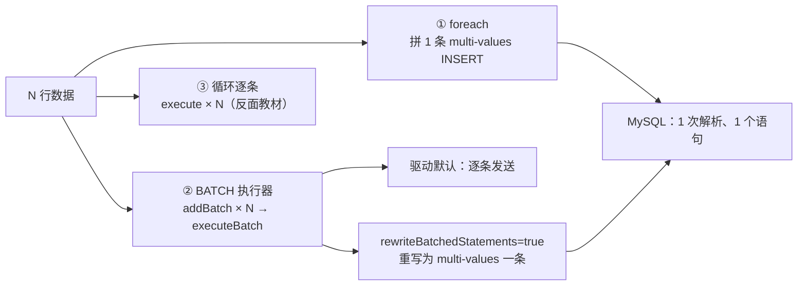
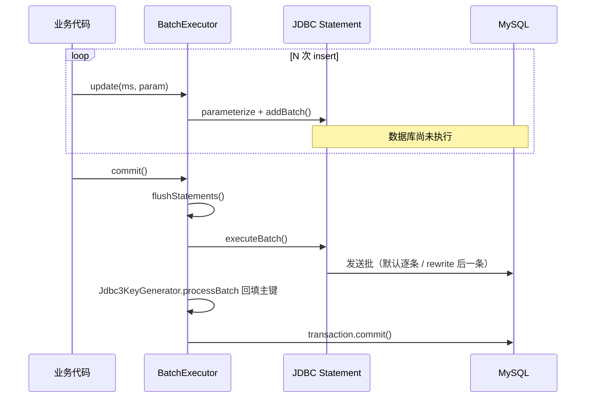

# MyBatis 批量操作与性能优化

> 一句话概括：批量写入的本质是「减少网络往返 + 减少解析与提交次数」，MyBatis 给了 foreach 拼大 SQL 与 ExecutorType.BATCH 两条路，MySQL 驱动又给了 rewriteBatchedStatements 第三条路；
> 大数据量读取的本质是「别让 ResultSet 一次性进堆」，靠流式查询 + ResultHandler/Cursor 逐行消费。本文讲清每条路的机制、源码证据、边界与选型。

预计阅读时间：大约 80 分钟

所属主题：[MyBatis 常见面试题总结](summary.md)

版本基线：本文源码锚点以 **MyBatis 3.5.19**（3.5.x 最新，Java 8 基线）为准，均已对照官方仓库 `mybatis-3.5.19` tag 核实；**MyBatis 3.6.0**（2026-10 发布，Java 11 基线）的差异单独注明。mybatis-spring 以 3.0.5 为参考；MySQL 以 8.x + Connector/J 8.x 为参考。未实测/未逐行核验之处文中明确标注。

---

## 0. 阅读路线

| 读者 | 建议阅读 | 关注点 |
| --- | --- | --- |
| 初级（1 年内） | 1、2.1、2.4、3.1、5、6.1、7.4~7.5、10 | 三条批量路怎么写、主键怎么回填、大读取怎么不 OOM |
| 中级（1~3 年） | 全部，重点 2.2~2.3、3.2~3.5、4、6.2~6.4、7.2~7.3 | 攒批与 flush 时机、驱动重写、回填源码、MySQL 流式条件 |
| 高级（3 年+） | 3.2~3.6、4.3、6.2、6.5、7.5~7.6、9 | BatchExecutor/Jdbc3KeyGenerator/DefaultCursor 源码、边界与排查、虚拟线程 |
| 选型/架构 | 1、4.4、5、7.6、8、9 | 三种批量方式取舍、分页 vs 流式、调优清单、连接池才是真瓶颈 |

目录：

1. 结论先行：批量写入三条路，大读取一条路
2. foreach 批量 insert：拼一条大 SQL
3. ExecutorType.BATCH 走读：攒 JDBC 批
4. MySQL rewriteBatchedStatements=true：驱动层重写
5. 三种批量方式对比总表与选型
6. 自增主键回填：Jdbc3KeyGenerator 与 SelectKeyGenerator
7. 流式查询与大数据量读取
8. 性能调优清单
9. 虚拟线程与 MyBatis（JDK 21+）
10. 高频追问集
11. 参考资料

---

## 1. 结论先行：批量写入三条路，大读取一条路

**结论**：往 MySQL 写 N 行数据，性能差异的根源不在「循环写得优不优雅」，而在**网络往返次数、SQL 解析次数、事务提交（fsync）次数**这三个量级上。MyBatis 生态里有三条批量路：

| 路径 | 本质 | N 行的网络往返 | 主键回填 | 一句话定位 |
| --- | --- | --- | --- | --- |
| ① foreach 拼 multi-values | 动态 SQL 把 N 行拼成**一条** `INSERT ... VALUES (...),(...),...` | 1 次 | 支持（getGeneratedKeys） | 应用层拼批，最直观，SQL 长度受限 |
| ② ExecutorType.BATCH | 循环 `addBatch()` 攒 JDBC 批，flush 时 `executeBatch()` | 取决于驱动：默认逐条发送，开 rewrite 后 1 次 | 支持（flush 时回填） | 框架层攒批，语句类型灵活 |
| ③ 简单循环逐条 insert | N 条独立 INSERT，各自执行 | N 次 | 支持 | **反面教材**：N 大时往返与提交开销线性放大 |

大数据量**读取**则是另一件事：默认 ResultSet 全量进堆，百万行直接 OOM；解法是流式查询（fetchSize）+ ResultHandler 或 Cursor 逐行消费（第 7 节）。



**追问：①和②最终不都是一条大 SQL 吗？** 开了 rewrite 的②确实殊途同归，但两者「谁拼的、何时拼、失败语义」不同：①在应用层拼，SQL 长度自己控制，一条语句要么全成要么全败；②在驱动层拼，攒批期间不占 SQL 长度（但重写后仍受 packet 限制），且 BATCH 执行器里不同 SQL 会分成多个批，失败语义更复杂（见 3.6）。选型见第 5 节。

---

## 2. foreach 批量 insert：拼一条大 SQL

### 2.1 用法与拼接原理

```xml
<insert id="insertBatch" useGeneratedKeys="true" keyProperty="id">
  INSERT INTO user (name, email) VALUES
  <foreach collection="list" item="u" separator=",">
    (#{u.name}, #{u.email})
  </foreach>
</insert>
```

```java
int insertBatch(@Param("list") List<User> users);
```

**机制**：`<foreach>` 由 `ForEachSqlNode#apply` 处理（动态 SQL 的完整机制见 [动态 SQL 与注入](dynamic-sql-and-injection.md)），三个关键动作：

1. **逐项绑定**：每个元素绑定到 `item` 名，同时绑定一个唯一化名 `__frch_<item>_<序号>`（源码 `itemizeItem`，前缀常量 `ITEM_PREFIX`）；`#{u.name}` 会被 `FilteredDynamicContext` 里的 `GenericTokenParser` 改写成 `#{__frch_u_0.name}`、`#{__frch_u_1.name}`……所以 N 行就是 N 组占位符，**参数仍走 PreparedStatement 预编译，不存在注入**；
2. **分隔符**：没有 `applySeparator` 方法——每项包一层 `PrefixedContext`，第一项前缀为空、后续项前缀为 `separator`，且只有真正追加了非空 SQL 才写前缀；
3. **开闭片段**：`applyOpen`/`applyClose` 在循环前后追加 `open`/`close` 属性。

最终 BoundSql 形如 `INSERT INTO user (name, email) VALUES (?,?),(?,?),(?,?)`，一次 prepare、一次 execute。

### 2.2 为什么 multi-values 比逐条快

| 开销项 | 逐条 insert（autocommit） | multi-values 一条 |
| --- | --- | --- |
| 网络往返 | N 次请求 + N 次响应 | 1 次 |
| SQL 解析/优化 | N 次（客户端预编译下每次仍要发送完整 SQL 文本） | 1 次 |
| 事务提交 | N 个事务 → N 次 redo/binlog fsync | 1 个事务 1 次提交 |
| 锁获取/释放 | N 轮 | 1 轮（语句内集中完成） |

**结论**：收益主要来自往返与提交次数的量级压缩，而不是「数据库执行单行变快了」。把逐条循环包进**一个事务**能消掉 N 次 fsync，但消不掉 N 次往返与解析——这就是「循环 + 事务」仍不如 multi-values 的原因。

### 2.3 边界：SQL 长度、原子性与单批大小

- **max_allowed_packet**：一条 SQL 就是一个通信包。MySQL 8.0 服务端默认 **64MB**（5.7 是 4MB，8.0 改的默认值），协议上限 1GB；超限报 `ER_NET_PACKET_TOO_LARGE` 并**直接断开连接**（官方手册 B.3.2.8）。客户端与服务端各有这个变量，mysql 命令行客户端默认 16MB。
- **占位符上限**：服务端预编译（`useServerPrepStmts=true`）的占位符数量是协议里的 16 位整数，上限 **65535**，超出报错误码 1390「Prepared statement contains too many placeholders」。默认客户端预编译不受此限，但仍受 packet 限制。
- **语句级原子性**：multi-values 是**一条语句**，要么全部成功要么全部失败（语句级回滚），不存在「插进去一半」。这既是优点（一致性好）也是代价（一行脏数据毁掉整批，重试粒度粗）。
- **大语句的连带代价**：单条大 INSERT 的 binlog event 大、从库回放慢；语句持锁时间随批量增大；应用侧参数 List 与拼接出的 SQL 字符串都占堆。

**实践：每批 500~1000 条**。依据不是玄学：按每行参数+占位符 ~1KB 估算，1000 行约 1MB，对 64MB packet 有充分余量；同时单批失败重试代价小、binlog event 不至于过大、持锁时间短。行特别宽（含 TEXT/BLOB）时按「单批 SQL 字节数」而不是行数控制。**不要试图一条 SQL 插十万行**——理论上限不等于工程上限。

### 2.4 空集合防御与分批代码

**边界（3.5.19 行为，已核验源码）**：`ForEachSqlNode#apply` 开头有

```java
if (iterable == null || !iterable.iterator().hasNext()) {
  return true;   // 空集合：open/close 都不追加
}
```

即空 List 时 `<foreach>` 什么都不输出，SQL 变成 `INSERT INTO user (name, email) VALUES` ——**缺 VALUES 内容，语法错误**。所以空集合防御必须在调用侧做，框架不会替你兜底：

```java
public void importUsers(List<User> users) {
    if (users == null || users.isEmpty()) {
        return;                              // 防御一：入口判空
    }
    int batchSize = 1000;
    for (int from = 0; from < users.size(); from += batchSize) {
        int to = Math.min(from + batchSize, users.size());
        userMapper.insertBatch(users.subList(from, to));   // 防御二：分批
    }
}
```

也可在 XML 里包 `<if test="list != null and list.size() > 0">`，但那样空集合会返回「执行成功」的假象，入口判空更干净。另外 3.5.x 的 `<foreach>` 支持 `nullable` 属性（缺省取 `Configuration#isNullableOnForEach`），控制 collection 求值为 null 时是否容忍——它解决的是「null 不抛异常」，不是「空集合生成合法 SQL」。

**追问：分批之间要不要各开一个事务？** 看业务语义：要求「全量原子」就包一个大事务（注意大事务代价，见 [Spring 事务](../spring/transaction.md)）；允许「部分成功 + 断点续传」就每批一个事务，失败记录批次号重试。导入类任务通常选后者。

---

## 3. ExecutorType.BATCH 走读：攒 JDBC 批

### 3.1 三种执行器对比

`SqlSessionFactory#openSession(ExecutorType)` 决定执行器实现（执行器在全链路中的位置见 [架构与 SQL 执行](architecture-and-sql-execution.md)）：

| 维度 | SIMPLE（默认） | REUSE | BATCH |
| --- | --- | --- | --- |
| Statement 生命周期 | 每次执行新建，用完即关（`SimpleExecutor#doUpdate` finally close） | 按 **SQL 字符串**缓存于 `statementMap`，会话内复用（`ReuseExecutor#prepareStatement`） | 同 SQL 复用最后一个 Statement，攒批不关闭（`BatchExecutor#doUpdate`） |
| update 何时真正执行 | 立即 `ps.execute()` | 立即 `ps.execute()` | **只 `ps.addBatch()`**，flush 时才 `executeBatch()` |
| update 返回值 | 真实影响行数 | 真实影响行数 | 常量 `BATCH_UPDATE_RETURN_VALUE`（不可靠，见 3.4） |
| flushStatements 行为 | 空操作 | 关闭并清空 statementMap | 逐批 executeBatch + 主键回填 |
| 典型场景 | 通用 | 会话内大量重复同构 SQL | 批量写 |

注意 REUSE 复用的是 **JDBC Statement 对象**（省 prepare），与 MySQL 驱动的 `cachePrepStmts`/服务端预编译缓存是不同层次的东西。

### 3.2 BatchExecutor#doUpdate：同 SQL 复用，异 SQL 开新批

```java
// BatchExecutor#doUpdate（3.5.19，节选）
public static final int BATCH_UPDATE_RETURN_VALUE = Integer.MIN_VALUE + 1002;

final String sql = boundSql.getSql();
if (sql.equals(currentSql) && ms.equals(currentStatement)) {
    int last = statementList.size() - 1;
    stmt = statementList.get(last);          // 复用最后一个 Statement
    handler.parameterize(stmt);
    batchResultList.get(last).addParameterObject(parameterObject);  // 参数攒入 BatchResult
} else {
    stmt = handler.prepare(connection, transaction.getTimeout());   // 新 SQL：开新批
    handler.parameterize(stmt);
    currentSql = sql;
    currentStatement = ms;
    statementList.add(stmt);
    batchResultList.add(new BatchResult(ms, sql, parameterObject));
}
handler.batch(stmt);                          // PreparedStatementHandler#batch → ps.addBatch()
return BATCH_UPDATE_RETURN_VALUE;
```

四个要点：

1. **攒批结构**：`statementList`（每批一个 Statement）与 `batchResultList`（每批一个 BatchResult，内含该批全部参数对象）平行增长；`currentSql`/`currentStatement` 只记录**最后一批**。
2. **复用条件是「与最后一批同 SQL 且同 MappedStatement」**：交替执行 insert A、update B、insert A 会开出 **3 个批**，A 不会合并。动态 SQL 若每行拼出不同文本（如 foreach 行数不同），同样各开一批。
3. `handler.batch(stmt)` 就是 `PreparedStatementHandler#batch` 里的一行 `ps.addBatch()`——**此时数据库什么都没执行**。
4. 返回值是常量 `Integer.MIN_VALUE + 1002`（-2147483646），不是行数（见 3.4）。

### 3.3 flushStatements 的触发时机（高频）

**结论**：攒下的批在四个时机被冲刷——**commit 前、query 前、手动 flush、rollback 时丢弃**。

| 时机 | 源码证据 | 说明 |
| --- | --- | --- |
| commit 前 | `BaseExecutor#commit`：`clearLocalCache(); flushStatements(); if (required) transaction.commit();` | 先执行批再提交事务，顺序保证「批内语句属于本事务」 |
| 执行 query 前 | `BatchExecutor#doQuery` 第一行 `flushStatements()`；`#doQueryCursor` 同样 | 查询要看到之前攒的写，必须先落库（官方文档：SELECT 夹在多个更新中间时把更新分隔开） |
| 手动 | `DefaultSqlSession#flushStatements()` → `executor.flushStatements()`；Mapper 接口可用 `@Flush`（3.3+）声明 `List<BatchResult> flush()` | 长循环里分批 flush 控制内存 |
| rollback | `BaseExecutor#rollback` → `flushStatements(true)`；`doFlushStatements(isRollback=true)` 直接返回空列表 | **不执行**，关闭 Statement 清空攒批 |



`doFlushStatements` 的细节（3.5.19）：逐批 `stmt.executeBatch()` → `batchResult.setUpdateCounts(...)` → 若 KeyGenerator 是 `Jdbc3KeyGenerator` 调 `processBatch(ms, stmt, parameterObjects)` 回填主键，其他非 NoKeyGenerator 则对每个参数调 `processAfter`；某批抛 `BatchUpdateException` 时包装成 `BatchExecutorException`，消息里明确写着「i prior sub executor(s) completed successfully, but will be rolled back」——**前面成功的批已执行但未提交，靠事务回滚兜底**；finally 里关闭所有 Statement、清空两个 List 与 currentSql。

**实践**：`flushStatements()` ≠ `commit()`。flush 只是把批执行掉（释放攒批内存、拿到更新计数与主键），事务边界仍由 commit 控制。百万行导入时「每 1000 条 flush + 每 1 万条 commit」是常见组合，但要注意 flush 后主键已回填、commit 前数据对外不可见。

### 3.4 BATCH 下 update 返回值不可靠

**结论**：BATCH 执行器里 `mapper.insert(u)` 的 int 返回值恒为 `Integer.MIN_VALUE + 1002`，**拿它判断「插没插成功」必错**。真实行数在 flush 之后从 `BatchResult#getUpdateCounts()` 取（`flushStatements()` 的返回值就是 `List<BatchResult>`）。

**边界**：即便 flush 后，更新计数也未必精确——开了 rewriteBatchedStatements 的 multi-values 重写，驱动无法逐行区分影响行数，可能返回 `Statement.SUCCESS_NO_INFO`（-2）；`INSERT ... ON DUPLICATE KEY UPDATE` 重写后官方文档明确说驱动按总数返回 0 或 SUCCESS_NO_INFO（见 4.3）。**需要精确行数的业务（如乐观锁扣减）不要用 BATCH**。

### 3.5 Spring 中的 BATCH：连接一致性与两个坑

mybatis-spring 里 `SqlSessionTemplate` 是线程安全的 SqlSession 代理，构造时可指定执行器（3.0.5 源码已核验）：

```java
@Bean
public SqlSessionTemplate batchSqlSessionTemplate(SqlSessionFactory factory) {
    return new SqlSessionTemplate(factory, ExecutorType.BATCH);
}
// 用法：UserMapper batchMapper = batchSqlSessionTemplate.getMapper(UserMapper.class);
```

**机制**：`SqlSessionTemplate.SqlSessionInterceptor#invoke` 每次方法调用都走 `SqlSessionUtils#getSqlSession`——有 Spring 事务时从 `TransactionSynchronizationManager` 取绑定的会话（与事务共用同一连接，`SpringManagedTransactionFactory` 保证）；**没有事务时新建会话，方法执行完立即 `sqlSession.commit(true)` 强制提交再关闭**。事务提交前则由 `SqlSessionUtils.SqlSessionSynchronization#beforeCommit` 调 `SqlSession#commit`，源码注释原话：「do cleanup the SqlSession / Executor, including flushing BATCH statements so they are actually executed」。

由此推出两个高频坑：

| 坑 | 现象 | 原因与解法 |
| --- | --- | --- |
| **无事务的 BATCH 模板不攒批** | 循环调 `batchMapper.insert()` 1000 次，性能与逐条无异甚至更差 | 每次调用独立会话、调用完即 commit+flush，批根本没攒起来。**必须包在 `@Transactional` 里**，让会话绑定到事务，commit 时统一 flush |
| **同事务混用执行器报错** | `TransientDataAccessResourceException: Cannot change the ExecutorType when there is an existing transaction` | `SqlSessionUtils#sessionHolder` 发现已绑定会话的 executorType 与请求不一致直接抛错。解法：BATCH 操作放独立事务（`REQUIRES_NEW`，注意两个连接），或整个事务统一用 BATCH 模板 |

```java
@Service
public class UserImportService {
    private final UserMapper batchMapper;   // 来自 batchSqlSessionTemplate.getMapper

    @Transactional                          // 没有它，BATCH 退化为逐条
    public void importUsers(List<User> users) {
        for (User u : users) {
            batchMapper.insert(u);          // 只 addBatch
        }
    }                                       // beforeCommit → flushStatements → executeBatch
}
```

不想动 Spring 配置时，也可手动开会话（连接自管，**不要**与 Spring 事务混用同一线程的数据源操作）：

```java
try (SqlSession session = sqlSessionFactory.openSession(ExecutorType.BATCH)) {
    UserMapper mapper = session.getMapper(UserMapper.class);
    for (int i = 0; i < users.size(); i++) {
        mapper.insert(users.get(i));
        if ((i + 1) % 1000 == 0) {
            session.flushStatements();      // 分批落库，控制攒批内存
        }
    }
    session.commit();                       // 先 flush 剩余批，再提交
}
```

事务边界与连接绑定的完整机制见 [Spring 集成与事务](spring-integration-and-transaction.md) 与 [Spring 事务详解](../spring/transaction.md)。

### 3.6 边界小结

- 攒批期间参数对象全部被 `BatchResult` 持有，**内存随批量线性增长**，长循环必须定期 flush；
- 不同 SQL 交替会切碎批次，BATCH 的收益前提是「连续同构语句」；
- 批内某条失败：`executeBatch` 抛 `BatchUpdateException`，已执行的批未提交、随事务回滚；但**哪些行成功哪些失败**要看驱动的 updateCounts（rewrite 后可能是 -2），精确对账困难；
- BATCH 会话里的一级缓存行为与 SIMPLE 一致（query 前会 flush），但 flush 前查询看不到攒批数据这一点常被忽略。

---

## 4. MySQL rewriteBatchedStatements=true：驱动层重写

### 4.1 驱动做了什么

**结论**：这是 **Connector/J 的连接属性**（默认 false，since 3.1.13），与 MyBatis 无关。官方描述（Performance Extensions 页）：开启后驱动在 `executeBatch()` 时「use multi-queries, regardless of the setting of 'allowMultiQueries', as well as rewriting of prepared statements for INSERT and REPLACE queries into multi-values clause statements」。

两条重写路径（驱动源码 `ClientPreparedStatement`，转引自 Vlad Mihalcea 的驱动走读文章）：

| 批的类型 | 重写方式 | 入口方法 |
| --- | --- | --- |
| PreparedStatement 的 INSERT/REPLACE 批 | 拼成**一条 multi-values INSERT** | `executeBatchWithMultiValuesClause` |
| 普通 Statement 的 `addBatch(String)` 批（>4 条） | 用分号拼成 **multi-queries** 一次发送（无视 allowMultiQueries） | `executeBatchUsingMultiQueries` |

**机制**：不开 rewrite 时，`executeBatch()` 对客户端预编译语句是**逐条发送执行**的——JDBC 批只是 API 层的攒，网络往返仍是 N 次；开了 rewrite，驱动把 N 组参数拼进一条 `INSERT ... VALUES (...),(...),...`，往返压到 1 次。**这就是「BATCH 执行器 + rewrite」与「foreach」殊途同归的原因：最终发给 MySQL 的都是 multi-values。**

### 4.2 收益量级

第三方基准（Vlad Mihalcea，5000 行、批大小 100、Hibernate 场景）：批插入平均耗时从 **~1072ms 降到 ~112ms**，吞吐约 9.6 倍。量级可参考，绝对值依赖行宽、网络与磁盘，**自己环境压测为准**。

### 4.3 边界与坑（官方文档原文核实）

| 限制 | 官方说明 | 工程含义 |
| --- | --- | --- |
| UPDATE/DELETE 无法 multi-values 重写 | 重写仅针对 INSERT/REPLACE 的 VALUES 结构 | UPDATE/DELETE 批仍是逐条执行（或普通 Statement 的 multi-queries 路径），别指望同等收益 |
| getGeneratedKeys 兼容性 | 「'Statement.getGeneratedKeys()', for statements that are rewritten only works when the entire batch consists of INSERT or REPLACE statements」 | **整批必须全是 INSERT/REPLACE** 才能拿生成主键。BATCH 执行器按 SQL 分批，每批天然同构，通常满足；普通 Statement 混型 addBatch(String) 不满足 |
| ON DUPLICATE KEY UPDATE | 重写后服务端对整批只返回一个 affected/found 行数，无法映射回各语句；驱动按总数返回 0 或 `SUCCESS_NO_INFO` | upsert 批的**更新计数不可靠**；主键回填也建议实测验证 |
| 流式参数 | 批里用了 `set*Stream()` 时驱动无法估算每批最优参数数，可能报 packet too large | 含 BLOB 流式参数的批谨慎开 rewrite |
| 服务端预编译 | 旧文档称服务端预编译无法利用重写；**8.0.30 修正了该描述**（Bug #34022110） | 默认 `useServerPrepStmts=false`（客户端预编译）下重写确定生效；服务端预编译路径本文未实测 |

**与 foreach 的关系**：两者是**替代**而非叠加——foreach 已经拼好一条 multi-values，rewrite 对它无额外作用；rewrite 的价值是让「BATCH 执行器的逐条 addBatch」也获得 multi-values 的收益。

### 4.4 配置示例

```
jdbc:mysql://127.0.0.1:3306/demo?rewriteBatchedStatements=true
```

```yaml
spring:
  datasource:
    url: jdbc:mysql://127.0.0.1:3306/demo?rewriteBatchedStatements=true&characterEncoding=utf8
    hikari:
      maximum-pool-size: 20
```

**实践**：MySQL 项目建议默认开启 rewriteBatchedStatements（对单条执行无副作用，只影响批），同时记住 4.3 的限制清单；需要精确更新计数或整批混型语句时关掉或改走 foreach。

---

## 5. 三种批量方式对比总表与选型

| 维度 | foreach multi-values | BATCH（默认驱动） | BATCH + rewrite | 简单循环逐条 |
| --- | --- | --- | --- | --- |
| 网络往返（N 行） | 1 | N（逐条发送） | 1（每批） | N |
| 性能量级 | 高 | 低≈逐条（省了部分 prepare） | 高 | 最低 |
| 主键回填 | 支持，execute 后立即 | 支持，**flush 后** | 支持，flush 后（整批须纯 INSERT/REPLACE） | 支持，每条立即 |
| SQL 长度风险 | **有**（packet/占位符上限），需分批 | 攒批期无；rewrite 后同样受 packet 限制 | 有（驱动拼批） | 无 |
| 事务/失败语义 | 单语句原子，全成全败 | 批间可部分执行，靠事务回滚 | 同左，且计数可能 -2 | 每条独立 |
| 语句类型 | 仅同构 INSERT（或 UPDATE CASE 拼接） | INSERT/UPDATE/DELETE 混合皆可 | INSERT/REPLACE 收益最大 | 任意 |
| 驱动依赖 | 无（标准 SQL） | 无 | **MySQL 专属属性** | 无 |
| 代码侵入 | 需要专用批量 Mapper 方法 | 循环调单条 Mapper 即可 | 同左 | 最低 |

**选型结论**：

- **同构数据批量导入**：首选 foreach + 每批 500~1000，简单、可控、跨数据库；
- **ORM 风格循环写、或混合语句类型**：BATCH 执行器（Spring 里务必包事务）；MySQL 下加 rewriteBatchedStatements 才有量级收益；
- **需要精确影响行数/乐观锁**：不要用 BATCH，逐条或 foreach 单语句；
- **超大批量（百万+）**：foreach 分批 + 每批独立事务 + 断点记录，或 BATCH 定期 flush/commit；同时评估 binlog 与主从延迟（大事务代价见 [Spring 事务](../spring/transaction.md)）；
- MyBatis-Plus 的 `saveBatch` 底层即「BATCH 执行器 + 按 batchSize 分批 flush」的封装（默认 batchSize 1000），生态细节见 [MyBatis-Plus 与生态](mybatis-plus-and-ecosystem.md)。

---

## 6. 自增主键回填：Jdbc3KeyGenerator 与 SelectKeyGenerator

### 6.1 useGeneratedKeys 链路走读

```xml
<insert id="insert" useGeneratedKeys="true" keyProperty="id" keyColumn="id">
  INSERT INTO user (name, email) VALUES (#{name}, #{email})
</insert>
```

**结论**：`useGeneratedKeys` 走 JDBC 标准 `getGeneratedKeys()`，由 `Jdbc3KeyGenerator` 在**语句执行后**把主键写回参数对象；`keyColumn` 只在部分数据库（Oracle、PostgreSQL 等）有意义，MySQL 自增列可省略（官方文档明确）。

**机制**（3.5.19 源码链）：

1. `PreparedStatementHandler#instantiateStatement`：KeyGenerator 是 Jdbc3KeyGenerator 时，用 `connection.prepareStatement(sql, Statement.RETURN_GENERATED_KEYS)`（指定了 keyColumn 则用 `prepareStatement(sql, keyColumnNames)`）——**告诉驱动要取生成键**；
2. `PreparedStatementHandler#update`：`ps.execute()` → `keyGenerator.processAfter(executor, ms, ps, parameterObject)`；
3. `Jdbc3KeyGenerator#processAfter` → `#processBatch`：

```java
// Jdbc3KeyGenerator#processBatch（节选）
final String[] keyProperties = ms.getKeyProperties();
if (keyProperties == null || keyProperties.length == 0) return;
try (ResultSet rs = stmt.getGeneratedKeys()) {
    ResultSetMetaData rsmd = rs.getMetaData();
    if (rsmd.getColumnCount() < keyProperties.length) {
        // Error?   ← 源码原注释：列数不够时静默跳过，不报错
    } else {
        assignKeys(configuration, rs, rsmd, keyProperties, parameter);
    }
}
```

4. `#assignKeys` 按参数形态分发：ParamMap/StrictMap → `assignKeysToParamMap`；ArrayList\<ParamMap\>（BATCH 攒批的多参数/@Param 形态）→ `assignKeysToParamMapList`；其余（单 POJO、普通对象集合）→ `assignKeysToParam`。三条路径都是**按位置一一对应**回填：

```java
// Jdbc3KeyGenerator#assignKeysToParam（节选）：单对象/对象集合路径
Collection<?> params = collectionize(parameter);   // Collection/数组/单对象统一成集合
Iterator<?> iterator = params.iterator();
while (rs.next()) {
    if (!iterator.hasNext()) {
        throw new ExecutorException(String.format(MSG_TOO_MANY_KEYS, params.size()));
    }
    Object param = iterator.next();
    assignerList.forEach(x -> x.assign(rs, param));   // 第 i 行主键 → 第 i 个参数对象
}
```

`KeyAssigner#assign` 用 `MetaObject` 写属性：先校验 `hasSetter`（没有 setter 抛 ExecutorException），再按属性类型 + 结果列 JDBC 类型选 TypeHandler 取值，`metaParam.setValue(propertyName, value)`。

**边界**：生成键行数**多于**参数个数时抛「Too many keys are generated. There are only %d target objects. You either specified a wrong 'keyProperty' or encountered a driver bug like #1523.」（源码常量 `MSG_TOO_MANY_KEYS`，#1523 是 MyBatis issue 编号）；**少于**参数个数时多出的对象静默不回填。回填完全依赖「驱动返回的键序 == 参数序」这一约定。

### 6.2 批量场景的回填：三条路都支持，时机不同

| 批量方式 | 回填入口 | 参数形态 |
| --- | --- | --- |
| foreach multi-values（单条执行） | `PreparedStatementHandler#update` → `processAfter` → `processBatch` → `assignKeys` 分发 | 单 POJO → `assignKeysToParam`；List 参数经 `DefaultSqlSession#wrapCollection` 包成含 `list`/`collection` 键的 ParamMap（`@Param` 同理）→ `assignKeysToParamMap`，collectionize 展开后逐行对应 |
| BATCH 执行器 | `BatchExecutor#doFlushStatements` → `jdbc3KeyGenerator.processBatch(ms, stmt, parameterObjects)`，parameterObjects 是该批攒下的**全部参数** | 单 POJO 循环攒成 ArrayList → `assignKeysToParam`；`@Param`/多参数 → ArrayList\<ParamMap\> → `assignKeysToParamMapList` |
| BATCH + rewrite | 同上；驱动重写后仍收集生成键（8.x 源码 `retrieveGeneratedKeys` 分支用 RETURN_GENERATED_KEYS 准备重写语句），前提是整批纯 INSERT/REPLACE | 同上 |

**结论**：「批量插入拿不到自增主键」是误传——三条路都支持，差别在**时机**（BATCH 必须 flush 后）与**驱动返回键的正确性**。

**坑（建议实测）**：multi-values 的生成键依赖 MySQL 协议「OK 包返回首个自增值 + 连续递增」的约定。`auto_increment_increment ≠ 1`（双主/组复制）、显式 id 与自增混插等场景，按位置推算可能错位或键数不符（触发 Too many keys）。本文未逐行核验 Connector/J 8.x 的键推算实现，生产前用目标环境验证。

### 6.3 keyProperty 嵌套属性与 Map 参数

**机制**（`Jdbc3KeyGenerator#getAssignerForParamMap`，已核验）：

- keyProperty 含 `.` 时，**第一个点之前是参数名，之后是属性路径**：`keyProperty="order.id"` 表示把键写到名为 `order` 的参数的 `id` 属性；路径本身还能再嵌套（`order.user.id`），由 MetaObject 解析；
- **多参数必须带参数名前缀**：`int insert(@Param("order") Order o, @Param("user") User u)` 时写 `keyProperty="id"` 会抛「Could not determine which parameter to assign generated keys to... 'keyProperty' must include the parameter name (e.g. 'param.id')」；
- 单参数判定：ParamMap 里不含 `param2`（`ParamNameResolver.GENERIC_NAME_PREFIX + "2"`）即视为单参数，此时 `keyProperty="id"` 可直接落到唯一参数上；
- **Map 参数**：MetaObject 对 Map 用 MapWrapper，`setValue` 即 `map.put(key, value)`，所以 `keyProperty="id"` 会往 Map 里塞一个 id 键——可用，但类型安全差，推荐 POJO。

### 6.4 selectKey：BEFORE/AFTER 与序列/UUID 场景

```xml
<insert id="insert">
  <selectKey keyProperty="id" resultType="long" order="BEFORE">
    SELECT user_seq.NEXTVAL FROM dual
  </selectKey>
  INSERT INTO user (id, name) VALUES (#{id}, #{name})
</insert>
```

**机制**（`SelectKeyGenerator`，已核验）：构造器直接接收 `boolean executeBefore`，`order="BEFORE|AFTER"` → 布尔的折叠发生在调用方 `XMLStatementBuilder#parseSelectKeyNode`；`processBefore`/`processAfter` 据此决定是否执行 `#processGeneratedKeys`：

- 用**同一个事务**新建一个 `ExecutorType.SIMPLE` 执行器跑 selectKey 语句（源码注释：不关闭 keyExecutor，事务由父执行器负责）；
- 结果**必须恰好一行**：0 行抛「SelectKey returned no data.」，多行抛「SelectKey returned more than one value.」；
- 单 keyProperty：结果对象有该属性 getter 就取属性值，否则把**整个结果值**赋过去（`SELECT UUID()` 这类单值查询靠这个分支）；
- 多 keyProperty：`#handleMultipleProperties` 按 keyColumns 与 keyProperties **数量必须相等**逐一对应（没配 keyColumns 则按属性名从结果取值）。

| 维度 | useGeneratedKeys（Jdbc3） | selectKey |
| --- | --- | --- |
| 时机 | 仅 AFTER（执行后取生成键） | BEFORE / AFTER 可选 |
| 依赖 | 驱动 getGeneratedKeys 支持 | 任意能返回一行的 SQL |
| 典型场景 | MySQL/SQL Server 自增 | Oracle/PostgreSQL 序列（BEFORE）、UUID、自定义编号规则 |
| 批量 | 原生支持整批回填 | **逐参数执行**：BEFORE 在每次 doUpdate 构造 StatementHandler 时经 `BaseStatementHandler#generateKeys` 执行，AFTER 在 flush 时循环 processAfter（`doFlushStatements` 的 else 分支）；N 行 = N 次查询，批量场景慎用 |

注解等价物 `@SelectKey(statement=..., keyProperty=..., before=true/false, resultType=...)`；官方文档明确：**标了 @SelectKey 后 @Options 的 useGeneratedKeys 配置被忽略**。MySQL 下用 UUID 主键更常见的做法是应用侧赋值（`UUID.randomUUID()`），省一次数据库往返。

### 6.5 回填坑清单

| 坑 | 原因 | 对策 |
| --- | --- | --- |
| BATCH 循环里 insert 后立刻读 id 为 null | 还没 flush，getGeneratedKeys 无从谈起 | flushStatements/commit 后再读 |
| Too many keys are generated | keyProperty 配错（如把集合参数当单对象）或驱动返回键数异常 | 核对参数形态与 keyProperty；升级/排查驱动 |
| 键列数 < keyProperties 个数时静默不回填 | processBatch 的「// Error?」分支 | 多列主键确保 keyColumn/keyProperty 对齐 |
| No setter found for the keyProperty | 属性无 setter（Lombok 未生成、字段名拼错） | 补 setter；嵌套路径逐层可写 |
| rewrite + ON DUPLICATE KEY UPDATE 计数/主键异常 | 4.3 官方限制 | upsert 批实测验证，必要时关 rewrite |
| 多参数 keyProperty 不带前缀 | getAssignerForParamMap 无法定位参数 | 写 `order.id` 形式 |

---

## 7. 流式查询与大数据量读取

### 7.1 默认全量加载的 OOM 风险

**结论**：Connector/J 官方实现说明原话：「By default, ResultSets are completely retrieved and stored in memory.」——**默认把整个结果集拉进 JVM 堆**。百万行 × 每行 1KB ≈ 1GB+，再经 MyBatis 映射成对象列表还要翻倍，OOM 是必然。`selectList` 返回 List 的语义决定了它不适合大结果集，与 SQL 写得多好无关。

### 7.2 fetchSize 与 MySQL 的特殊条件（核实后写）

JDBC 标准里 `Statement#setFetchSize(n)` 只是「每次取 n 行」的**提示**，各驱动实现不同。MySQL 有两种流式模式：

| 模式 | 开启条件 | 机制 | 备注 |
| --- | --- | --- | --- |
| **逐行流式**（row-by-row streaming） | ① Statement 为 `TYPE_FORWARD_ONLY` + `CONCUR_READ_ONLY`；② `setFetchSize(Integer.MIN_VALUE)` | 服务端把结果连续推给客户端，驱动**一行一行**读 socket，不整体缓冲 | 官方文档：三个条件的组合「serves as a signal to the driver to stream result sets row-by-row」；**其他 fetchSize 值默认被忽略** |
| **服务端游标**（cursor-based fetching） | 连接属性 `useCursorFetch=true`（默认 false，since 5.0.0）+ `defaultFetchSize>0` 或语句 `setFetchSize(正数)` | 服务端把结果放临时表，客户端按块 FETCH | 官方明确：此时 `useServerPrepStmts` **自动置 true**（游标只支持服务端预编译） |

```java
// 官方文档的逐行流式写法
stmt = conn.createStatement(ResultSet.TYPE_FORWARD_ONLY, ResultSet.CONCUR_READ_ONLY);
stmt.setFetchSize(Integer.MIN_VALUE);
```

**边界与代价**（官方 caveats）：

- **连接独占**：必须读完所有行（或 close ResultSet）才能在同一连接上发下一条查询，否则抛异常——流式期间这条连接干不了别的；
- **锁持有**：语句未完成则锁不释放，事务内则要到事务结束；消费越慢，锁与服务器资源占用越久，「process them as quickly as possible」；
- `Integer.MIN_VALUE` 严格说违反 JDBC 规范（负数 fetchSize 应抛 SQLException），是 Connector/J 的私有信号，**不可移植**：PostgreSQL 用正数 fetchSize + 关闭 autoCommit，Oracle 用正数 fetchSize 即可；
- 逐行流式不是「每行一次网络往返」——服务端连续推包，驱动逐行解析，网络效率并不差；代价在连接独占与消费速度约束。

### 7.3 MyBatis 侧怎么配

```xml
<select id="scanAll" resultType="com.example.User"
        fetchSize="-2147483648" resultSetType="FORWARD_ONLY">
  SELECT id, name, email FROM user
</select>
```

```java
@Select("SELECT id, name, email FROM user")
@Options(fetchSize = Integer.MIN_VALUE, resultSetType = ResultSetType.FORWARD_ONLY)
Cursor<User> scanAll();
```

**机制**：`BaseStatementHandler#prepare` → `#setFetchSize`：语句级 `fetchSize` 优先，否则取 `configuration.getDefaultFetchSize()`，透传给 `Statement#setFetchSize`。`PreparedStatementHandler#instantiateStatement` 在 `resultSetType=DEFAULT` 时用 `prepareStatement(sql)`——JDBC 默认就是 FORWARD_ONLY + READ_ONLY，**天然满足 MySQL 流式的类型条件**，所以 MySQL 下通常只配 fetchSize 即可。全局默认也可在 settings 里配 `defaultFetchSize`。

**版本注**：3.5.3 修复过「queryCursor() fails in streaming mode of MySQL Connector/J」（issue #1654，milestone 3.5.3）——老版本 Cursor + MySQL 流式有兼容 bug，基线 3.5.19 已修复。

### 7.4 ResultHandler：逐行回调，不攒 List

```java
try (SqlSession session = sqlSessionFactory.openSession()) {
    session.select("com.example.UserMapper.scanAll", null, context -> {
        User u = (User) context.getResultObject();
        writer.write(toCsv(u));          // 逐行消费：写文件/累加统计/发 MQ
        // context.stop();               // 需要提前终止时调用
    });
}
```

**机制**：`DefaultSqlSession#select(statement, parameter, handler)` 与 `selectList` 走**同一条** `executor.query` 路径，唯一区别是传入了 ResultHandler：行数据经 `DefaultResultSetHandler` 逐行回调 `ResultHandler#handleResult`，**不收集成 List**（方法返回 void）。`BaseExecutor#query` 里 `list = resultHandler == null ? localCache.getObject(key) : null`——**带 handler 时不读一级缓存**；官方文档两条限制原文：

> - 使用带 ResultHandler 参数的方法时，收到的数据不会被缓存。
> - 当使用高级的结果映射集（resultMap）时，MyBatis 很可能需要数行结果来构造一个对象。如果你使用了 ResultHandler，你可能会接收到关联（association）或者集合（collection）中尚未被完整填充的对象。

**边界**：第二条意味着 **ResultHandler 不适合嵌套 resultMap**（一对多集合可能拿到半成品）；大结果集扫描请用扁平 resultType。`ResultContext#stop()` 可提前终止读取。Mapper 接口方法也可以直接声明 ResultHandler 参数（绑定机制见 [Mapper 代理与绑定](mapper-proxy-and-binding.md)）。注意：**ResultHandler 只解决「不攒对象列表」，不解决「驱动全量拉取」**——必须配合 7.2/7.3 的 fetchSize 才是真流式。

### 7.5 Cursor<T>：惰性迭代器（源码走读）

`Cursor<T>` 是 `Iterable<T>` + `Closeable`，官方定义：「游标与列表返回的结果相同，不同的是，游标借助迭代器实现了数据的惰性加载」。

**机制**（`DefaultCursor`，3.5.19 已核验）：

- `DefaultSqlSession#selectCursor` → `executor.queryCursor(ms, wrapCollection(parameter), rowBounds)` → `PreparedStatementHandler#queryCursor` → `resultSetHandler.handleCursorResultSets(ps)` 构造 DefaultCursor；会话 `registerCursor` 登记，**会话关闭时 `closeCursors` 统一关闭**；
- 内部 `CursorIterator#hasNext` → `fetchNextUsingRowBound` → `fetchNextObjectFromDatabase`：调 `resultSetHandler.handleRowValues(rsw, resultMap, objectWrapperResultHandler, ...)`，而 `ObjectWrapperResultHandler#handleResult` 拿到一行就 `context.stop()`——**每次迭代只从 ResultSet 取一行**；
- 状态机 `CursorStatus`：CREATED（未开始消费）→ OPEN（消费中）→ CONSUMED（读完，自动 close）/ CLOSED（提前 close）；
- `iterator()` **只允许调用一次**（「Cannot open more than one iterator on a Cursor」），已关闭再取抛 IllegalStateException；类注释明确**非线程安全**；
- `close()` 只关 `rsw.getResultSet()`（吞掉 SQLException），Statement 由 `stmt.closeOnCompletion()`（SimpleExecutor#doQueryCursor）在结果集关闭时联动关闭。

**边界（高频）**：Cursor 持有活的 ResultSet 与连接，**必须在 SqlSession/事务存活期内消费完并 close**。把 Cursor 当普通返回值扔出事务方法、到 Controller 里再迭代，会话早已关闭，必然失败。正确姿势是 try-with-resources + 消费逻辑都在会话生命周期内：

```java
// 原生 API（官方文档示例形态）
try (SqlSession session = sqlSessionFactory.openSession();
     Cursor<User> cursor = session.selectCursor("com.example.UserMapper.scanAll")) {
    for (User u : cursor) {
        writer.write(toCsv(u));
    }
}
```

```java
// Spring：事务包住「打开 + 消费」全过程
@Transactional(readOnly = true)
public void export(Writer writer) throws IOException {
    try (Cursor<User> cursor = userMapper.scanAll()) {   // Mapper 返回 Cursor，官方支持
        for (User u : cursor) {
            writer.write(toCsv(u));
        }
    }
}
```

**版本差异（3.6.0，2026-10）**：① **嵌套 Cursor 支持**（issue #566，PR #3388）——resultMap 的 association/collection 列可以是 CURSOR 类型（`jdbcType=CURSOR` + `@Many(resultMap=...)`），3.5.x 不支持；② Cursor 的 Closeable 行为改进（PR #1494）；③ Java 基线升到 **11**（官方 support notice：3.5.x 为 Java 8 支持线，另建 support-java8 分支维护旧基线）。

### 7.6 百万级导出实践：分页 vs 流式

| 方案 | 机制 | 优点 | 代价 |
| --- | --- | --- | --- |
| 深分页 `LIMIT offset, n` | 每页一条 SQL，offset 行被扫描后丢弃 | 实现最简单 | offset 越大越慢（O(offset)）；页间数据变更导致重复/遗漏；**不推荐** |
| **keyset 分页**（游标分页） | `WHERE id > #{lastId} ORDER BY id LIMIT n`，记住上页末尾 id | 走索引恒定快；每页独立事务/连接，可断点续传；无连接独占 | N 次往返；需要有序唯一键；跨页非同一快照 |
| **流式**（fetchSize + Cursor/ResultHandler） | 一条 SQL，逐行/按块消费 | 1 次往返；内存恒定；同一读快照 | 连接独占全程；锁持有久；消费慢拖累库；中断需重来 |

```java
// keyset 分页导出（在线任务、需要断点续传时首选）
long lastId = 0;
List<User> page;
do {
    page = userMapper.pageAfter(lastId, 1000);   // WHERE id > #{lastId} ORDER BY id LIMIT #{size}
    if (!page.isEmpty()) {
        lastId = page.get(page.size() - 1).getId();
        write(page);
    }
} while (page.size() == 1000);
```

**选型结论**：在线导出/低频任务用 **keyset 分页**（稳、可续传、不霸占连接）；离线大批量扫描/迁移用**流式**（快、省内存），并给消费端限速与超时保护。物理分页插件（PageHelper 等）的拦截原理见 [插件与分页](plugin-and-pagination.md)；`RowBounds` 是**内存分页**（驱动仍全量拉取，MyBatis 跳过 offset 行），大结果集下它救不了 OOM。

---

## 8. 性能调优清单

| 项 | 建议 | 机制/边界 | 关联 |
| --- | --- | --- | --- |
| 连接池（HikariCP） | `maximumPoolSize` 压测定（默认 10，常见 10~30）；`connectionTimeout` 默认 30s；`maxLifetime` 默认 30min，须小于 MySQL `wait_timeout`；`minimumIdle` 建议等于池大小；开 `leakDetectionThreshold` 查泄漏 | 池是并发上限的闸门：池满时请求排队等连接，超时抛 SQLTimeoutException；连接不是越多越好（上下文切换与 DB 内存） | 第 9 节 |
| 避免 `SELECT *` | 只查需要的列 | 减少网络传输与堆占用；给覆盖索引留机会；宽表 TEXT 列是 OOM 放大器 | 7.1 |
| N+1 治理 | 嵌套 select（lazy）改 join + 嵌套 resultMap，或分批 IN 查询 | 1 + N 次查询的往返放大；懒加载在会话关闭后还会抛异常 | [结果映射与 TypeHandler](result-mapping-and-typehandler.md) |
| 缓存取舍 | 一级缓存默认 SESSION 作用域（可设 STATEMENT 降级）；二级缓存跨命名空间脏读风险，分布式下慎用 | 缓存省查询但引入一致性成本；批量写会频繁清空一级缓存 | [缓存机制](cache-mechanism.md) |
| SQL 日志 | 开发用 StdOutImpl/Slf4jImpl；生产关调试日志，用 p6spy 或慢查询日志采样 | 日志实现本身有开销（拼接完整 SQL 与参数）；p6spy 能拿到真实执行耗时 | — |
| 索引 | 慢 SQL 先看执行计划与索引（数据库侧功课） | 框架层优化救不了全表扫描 | — |
| 批量与事务大小 | 分批写入 + 分批提交；RPC/文件 IO 移出事务 | 大事务四宗罪：占连接、持锁久、回滚贵、主从延迟 | [Spring 事务](../spring/transaction.md) |
| 分页 | 物理分页（LIMIT/keyset），拒绝 RowBounds 内存分页与深 offset | 见 7.6 | [插件与分页](plugin-and-pagination.md) |
| 执行器 | 默认 SIMPLE 即可；会话内大量同构 SQL 可试 REUSE；批量写用 BATCH | REUSE 收益受驱动预编译缓存影响，先压测再改 | 3.1 |

---

## 9. 虚拟线程与 MyBatis（JDK 21+，热门）

**结论**：虚拟线程让「阻塞等待」变便宜，但 **MyBatis/JDBC 这条链路的瓶颈会从线程数转移到连接池与驱动内部锁**；JDK 21 上还有 synchronized pinning 问题，JDK 24（JEP 491）才根治。

**机制与版本线**：

| 版本 | 行为 |
| --- | --- |
| JDK 21（JEP 444 GA） | 阻塞 IO 通常会卸载虚拟线程、释放载体线程；但**在 synchronized 块/方法内阻塞会 pin 住载体线程**（native 帧同理）；调度器不扩容补偿，吞吐被钉死在 `jdk.virtualThreadScheduler.parallelism`（默认 = CPU 核数）量级 |
| JDK 22/23 | 同 21 |
| **JDK 24（JEP 491）** | synchronized 内阻塞不再 pin（监视器改为按虚拟线程记账）；`-Djdk.tracePinnedThreads` 不再生效，改用 JFR `jdk.VirtualThreadPinned` 事件 |
| JDK 25 | 首个带 JEP 491 的 LTS |

**为什么 JDBC 链路受影响**：MyBatis 本身是薄封装，阻塞发生在 Connector/J 与连接池内部；Connector/J 的 Connection/Statement 实现存在 synchronized 临界区，虚拟线程在监视器内做 socket 读写就会 pin 住载体线程——几万个虚拟线程挤在几个载体上，表现为「并发上去了吞吐没上去」，且**不抛任何异常**。排查手段（JDK 21~23）：`-Djdk.tracePinnedThreads=full` 打印 pinning 栈，或 JFR `jdk.VirtualThreadPinned`（默认阈值 20ms）。

**MyBatis 侧的跟进（版本归属）**：社区 issue #3082（2024-01）指出缓存等处的 synchronized 块在 Loom 下的问题，关联 PR #3017；**3.5.16（2024-04）release notes 明确列出「Improved compatibility with Virtual Threads introduced by Loom」**。具体替换点本文未逐行核验，3.5.19 基线下仍应以驱动侧 pinning 为主要排查对象。

**真瓶颈是连接池**：虚拟线程把「同时发起 DB 请求的并发」放大上百倍，HikariCP 默认 `maximumPoolSize=10` 瞬间打满，其余虚拟线程排队等连接，30s `connectionTimeout` 后一波 SQLTimeoutException。对策不是加线程，而是：压测重定池大小、监控 `hikaricp.connections.pending`/`timeout`、必要时入口限流。**线程便宜了，连接依然贵。**

**Boot 3.2+ 开虚拟线程时 MyBatis 的行为**（`spring.threads.virtual.enabled=true`，Java 21）：

- SqlSession **依然非线程安全**，一请求一会话的模型不变；Spring 事务的 ThreadLocal 连接绑定在虚拟线程上**照常工作**（虚拟线程支持 ThreadLocal）；
- 海量虚拟线程 × ThreadLocal（事务同步、ErrorContext、MDC）的内存开销要评估，用完即清；
- 不要把 SqlSession/Cursor 跨线程传递；`@Async` 等使用的自动配置执行器（applicationTaskExecutor）会换成虚拟线程版 SimpleAsyncTaskExecutor，池化语义消失，靠信号量/连接池做背压；**自定义线程池 Bean 不会被自动切换**（自动配置反而让位），需自行改造；
- 流式查询（第 7 节）在虚拟线程下连接独占问题不变——pinning 修了，连接还是那条连接。

**未实测声明**：本节 pinning 行为引自 JEP/官方文档与社区 issue，本文未在 JDK 21/24 + Connector/J 8.x 组合下实测吞吐数据；上线前用 JFR 验证。虚拟线程的完整机制（调度、pinning、结构化并发）见 [虚拟线程与结构化并发](../concurrency/virtual-threads.md)。

---

## 10. 高频追问集

**Q1：批量插入怎么拿自增主键？**
期望答案：三条路都支持。foreach multi-values 用 `useGeneratedKeys+keyProperty`，execute 后 `Jdbc3KeyGenerator#processBatch` 从 `getGeneratedKeys()` 按「键序 == 参数序」逐行回填；BATCH 执行器在 **flushStatements 时**才回填（攒批期读 id 是 null）；BATCH+rewrite 要求整批纯 INSERT/REPLACE。多参数时 keyProperty 必须带参数名前缀（`order.id`）。键数与参数数不符抛 Too many keys。

**Q2：BATCH 的原理？flushStatements 什么时候触发？**
期望答案：`BatchExecutor#doUpdate` 对「与最后一批同 SQL 同 MappedStatement」的更新复用 Statement，`parameterize + addBatch` 攒入 statementList/batchResultList，返回常量不执行。flush 时机：commit 前（`BaseExecutor#commit` 先 flush 再 transaction.commit）、执行 query/queryCursor 前（`doQuery` 第一行）、手动 `flushStatements()`/`@Flush`、rollback 时走 `flushStatements(true)` 直接丢弃。flush ≠ commit。

**Q3：rewriteBatchedStatements 做了什么？**
期望答案：Connector/J 属性（默认 false）。executeBatch 时把 INSERT/REPLACE 批重写为一条 multi-values INSERT（`executeBatchWithMultiValuesClause`），普通 Statement 批（>4 条）拼 multi-queries 一次发送；网络往返从 N 压到 1。限制：UPDATE/DELETE 不能 multi-values 重写；getGeneratedKeys 仅整批纯 INSERT/REPLACE 可用；ON DUPLICATE KEY UPDATE 的更新计数返回 0/SUCCESS_NO_INFO。与 foreach 是替代关系不是叠加。

**Q4：foreach 和 BATCH 怎么选？**
期望答案：同构批量导入选 foreach（1 条 SQL、语句级原子、跨数据库、需分批 500~1000 防 packet 超限）；混合语句/ORM 循环写选 BATCH（Spring 里必须包事务否则逐调用即提交不攒批），MySQL 下配 rewrite 才有量级收益。需要精确影响行数（乐观锁）不用 BATCH。

**Q5：百万级数据导出怎么防 OOM？**
期望答案：默认 ResultSet 全量进堆，selectList 必炸。两条路：流式（MySQL 需 FORWARD_ONLY+READ_ONLY+fetchSize=Integer.MIN_VALUE，或 useCursorFetch=true+正数 fetchSize）配 Cursor/ResultHandler 逐行消费，内存恒定但连接独占；或 keyset 分页（WHERE id>lastId LIMIT n）多次短查询，可断点续传。深 offset 分页与 RowBounds 内存分页都不行。Cursor 必须在会话/事务存活期内消费并 close。

**Q6：fetchSize 在 MySQL 为什么特殊？**
期望答案：JDBC 的 fetchSize 只是提示，多数驱动正数即生效；Connector/J 默认**忽略**普通 fetchSize、全量拉取，只认 `Integer.MIN_VALUE` 这个私有信号（配合 FORWARD_ONLY+READ_ONLY）开启逐行流式；要按块取需 `useCursorFetch=true`（自动开服务端预编译）+ 正数 fetchSize。MIN_VALUE 违反 JDBC 规范（负数应抛异常），不可移植到 PostgreSQL/Oracle。

**Q7：BATCH 下 insert 返回值为什么不可靠？**
期望答案：doUpdate 只 addBatch 不执行，返回常量 `Integer.MIN_VALUE+1002`；真实行数 flush 后从 BatchResult#getUpdateCounts 取，且 rewrite 后可能是 SUCCESS_NO_INFO(-2)。判断成功与否应看 flush/commit 是否抛异常，而不是返回值。

**Q8：Spring 里 BATCH 报「Cannot change the ExecutorType when there is an existing transaction」怎么回事？**
期望答案：`SqlSessionUtils#sessionHolder` 发现事务已绑定 SIMPLE 会话，又要取 BATCH 会话，直接抛 TransientDataAccessResourceException。解法：BATCH 操作独立事务（REQUIRES_NEW，占两个连接）或整个事务统一执行器。另一个孪生坑：无事务的 BATCH 模板每次调用即 commit，根本不攒批。

**Q9：Cursor 为什么必须在事务内消费？close 关了什么？**
期望答案：Cursor 持有活的 ResultSet 与连接，会话关闭（Spring 无事务时每次调用后即关）ResultSet 就没了。`DefaultCursor#close` 只关 ResultSet，Statement 靠 closeOnCompletion 联动；会话 close 时 closeCursors 兜底。iterator 只能取一次、非线程安全；读完自动 CONSUMED。3.6.0 才支持嵌套 Cursor。

**Q10：虚拟线程下 MyBatis 的瓶颈在哪？**
期望答案：JDK 21 上驱动 synchronized 内阻塞 IO 会 pin 载体线程（JDK 24 JEP 491 根治），用 tracePinnedThreads/JFR 排查；但更普遍的瓶颈是连接池——虚拟线程放大并发 DB 需求，默认 10 个连接秒满，排队超时。对策是压测定池 + 监控 pending + 限流，而不是加线程。MyBatis 3.5.16 起有 Loom 兼容改进；SqlSession 非线程安全、ThreadLocal 事务绑定照常工作。

---

## 11. 参考资料

- MyBatis 官方文档 · Java API（中文）：<https://mybatis.org/mybatis-3/zh_CN/java-api.html>（ExecutorType、flushStatements、@Flush、ResultHandler 两条限制、Cursor try-with-resources、openSession 重载）
- MyBatis 官方文档 · XML 映射（中文）：<https://mybatis.org/mybatis-3/zh_CN/sqlmap-xml.html>（insert/selectKey/fetchSize）；动态 SQL：<https://mybatis.org/mybatis-3/zh_CN/dynamic-sql.html>（foreach）
- MyBatis 源码（mybatis-3.5.19 tag）：`BatchExecutor#doUpdate/#doFlushStatements`、`BaseExecutor#query/#commit/#rollback`、`SimpleExecutor#doUpdate`、`ReuseExecutor#prepareStatement`、`PreparedStatementHandler#update/#batch/#instantiateStatement`、`BaseStatementHandler#prepare/#setFetchSize`、`Jdbc3KeyGenerator#processAfter/#processBatch/#assignKeys/#assignKeysToParam/#assignKeysToParamMapList/#getAssignerForParamMap`、`SelectKeyGenerator#processGeneratedKeys/#handleMultipleProperties`、`ForEachSqlNode#apply`、`DefaultSqlSession#selectCursor/#select/#flushStatements/#closeCursors`、`DefaultCursor#fetchNextObjectFromDatabase/#close` 与 `CursorIterator`、`ObjectWrapperResultHandler#handleResult`
- mybatis-spring 源码（mybatis-spring-3.0.5 tag）：`SqlSessionTemplate` 构造器与 `SqlSessionInterceptor#invoke`、`SqlSessionUtils#getSqlSession/#sessionHolder/#registerSessionHolder`、`SqlSessionUtils.SqlSessionSynchronization#beforeCommit`；官方文档：<https://mybatis.org/spring/zh/sqlsession.html>
- MyBatis 版本线：3.6.0 release（2026-10-23，Java 11、嵌套 Cursor #3388、Cursor Closeable #1494）<https://github.com/mybatis/mybatis-3/releases/tag/mybatis-3.6.0>；3.5.16 release（Loom 兼容）；3.5.3 修复 #1654（Cursor + MySQL 流式）；issue #3082 / PR #3017（虚拟线程 pinning 讨论）；issue #566（嵌套 Cursor）
- MySQL Connector/J · Performance Extensions（rewriteBatchedStatements/useCursorFetch/defaultFetchSize 官方描述与限制）：<https://dev.mysql.com/doc/connector-j/en/connector-j-connp-props-performance-extensions.html>
- MySQL Connector/J · JDBC API Implementation Notes（ResultSet 默认全量加载、Integer.MIN_VALUE 流式条件与 caveats）：<https://dev.mysql.com/doc/connector-j/en/connector-j-reference-implementation-notes.html>
- MySQL 8.0 手册 · Packet Too Large（max_allowed_packet 默认 64MB、超限断连）：<https://dev.mysql.com/doc/refman/8.0/en/packet-too-large.html>；8.0 默认值变更：<https://dev.mysql.com/doc/refman/8.0/en/upgrading-from-previous-series.html>
- Connector/J 8.0.30 release notes（rewriteBatchedStatements 文档修正，Bug #34022110）：<https://dev.mysql.com/doc/relnotes/connector-j/en/news-8-0-30.html>
- Vlad Mihalcea · MySQL rewriteBatchedStatements（驱动重写走读与 ~9.6× 基准）：<https://vladmihalcea.com/mysql-rewritebatchedstatements/>
- JEP 444（Virtual Threads，JDK 21）：<https://openjdk.org/jeps/444>；JEP 491（Synchronize Virtual Threads without Pinning，JDK 24）：<https://openjdk.org/jeps/491>；Oracle JDK 21 Virtual Threads 文档（pinning 与诊断）：<https://docs.oracle.com/en/java/javase/21/core/virtual-threads.html>
- 兄弟专题：[架构与 SQL 执行](architecture-and-sql-execution.md)、[Mapper 代理与绑定](mapper-proxy-and-binding.md)、[动态 SQL 与注入](dynamic-sql-and-injection.md)、[结果映射与 TypeHandler](result-mapping-and-typehandler.md)、[缓存机制](cache-mechanism.md)、[插件与分页](plugin-and-pagination.md)、[Spring 集成与事务](spring-integration-and-transaction.md)、[MyBatis-Plus 与生态](mybatis-plus-and-ecosystem.md)、[Spring 事务](../spring/transaction.md)、[虚拟线程与结构化并发](../concurrency/virtual-threads.md)

---

## 附：一页速记

**批量写入**
1. 性能根源 = 网络往返 + 解析次数 + 提交次数；逐条循环是反面教材。
2. foreach 拼 multi-values：1 条 SQL、语句级原子；受 max_allowed_packet（8.0 默认 64MB）与服务端预编译 65535 占位符限制；每批 500~1000。
3. 空集合 foreach 输出为空 → SQL 语法错误，入口判空（3.5.19 源码 early return）。
4. BATCH：同 SQL 复用 Statement + addBatch 攒批；flush 时机 = commit 前 / query 前 / 手动 @Flush / rollback 丢弃；flush ≠ commit。
5. BATCH 返回值恒为 Integer.MIN_VALUE+1002；真实行数 flush 后取 BatchResult，rewrite 后可能是 -2。
6. Spring BATCH 必须包事务（否则每调用即提交不攒批）；同事务混执行器抛 Cannot change the ExecutorType。
7. rewriteBatchedStatements：驱动把 INSERT/REPLACE 批重写 multi-values（往返 N→1）；UPDATE/DELETE 不重写；getGeneratedKeys 要求整批纯 INSERT/REPLACE；与 foreach 是替代不是叠加。

**主键回填**
8. useGeneratedKeys → prepareStatement(RETURN_GENERATED_KEYS) → processAfter/processBatch → getGeneratedKeys 按位置回填；BATCH 在 flush 时。
9. 多参数 keyProperty 必须带前缀（order.id）；Map 参数走 MetaObject put；键数不符抛 Too many keys。
10. selectKey：BEFORE/AFTER，恰好一行，同事务 SIMPLE 执行器；批量下逐参数执行 N 次，慎用；@SelectKey 会忽略 @Options 主键配置。

**大读取**
11. Connector/J 默认 ResultSet 全量进堆；MySQL 流式 = FORWARD_ONLY + READ_ONLY + fetchSize=Integer.MIN_VALUE（私有信号，不可移植），或 useCursorFetch=true + 正数 fetchSize（自动服务端预编译）。
12. ResultHandler 逐行回调不攒 List、不读一级缓存；嵌套 resultMap 会拿到半成品；必须配 fetchSize 才是真流式。
13. Cursor 惰性迭代：每次 hasNext 取一行；iterator 只取一次；必须在会话/事务存活期内消费并 close；3.6.0 支持嵌套 Cursor（Java 11 基线）。
14. 百万导出：在线用 keyset 分页（可续传），离线用流式（省内存）；深 offset 与 RowBounds 都不行。

**调优与虚拟线程**
15. 调优清单：池大小压测定、maxLifetime < wait_timeout、拒绝 select *、治 N+1、二级缓存慎用、生产关 SQL 调试日志、分批提交控事务大小。
16. JDK 21 synchronized 内阻塞 pin 载体线程（JDK 24 JEP 491 根治）；MyBatis 3.5.16 起 Loom 兼容改进；真瓶颈是连接池——线程便宜了，连接依然贵。

**一句话**
> 批量是「把 N 次往返压成 1 次」，流式是「把 N 行对象压成 1 行」——所有技巧都在压缩这两个 N，而所有坑都在压缩之后：SQL 太长、批没 flush、主键没回填、连接被独占。