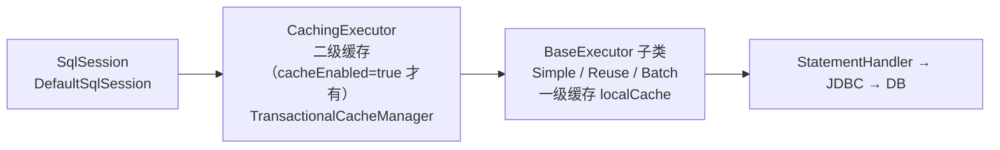
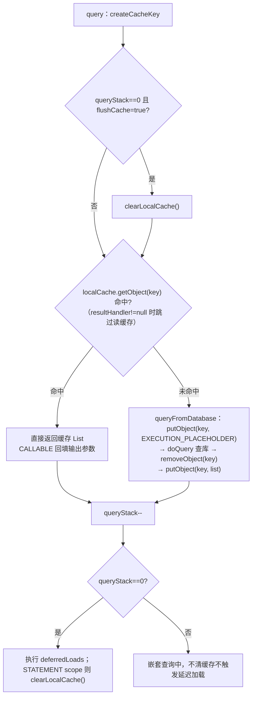
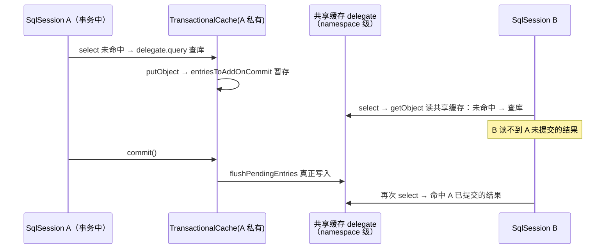
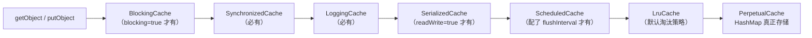

# MyBatis 一级与二级缓存机制

> 一句话概括：MyBatis 的两级缓存都是**进程内本地缓存**——一级缓存活在 `BaseExecutor` 的一个 `HashMap` 里、随 SqlSession 生灭；二级缓存挂在 namespace 上、靠「事务暂存区 + commit 才落盘」保证不泄露未提交数据。
> 本文讲清两级缓存的命中规则、源码链路、失效清单，以及为什么生产环境普遍关掉二级缓存改用 Redis。

预计阅读时间：大约 75 分钟

所属主题：[MyBatis 常见面试题总结](summary.md)

本文以 **MyBatis 3.5.x（源码基线 3.5.19，Java 8 基线）** 为准，源码锚点用 `类名#方法名` 标注，均已对照 `mybatis-3.5.19` tag 的源码核实；**MyBatis 3.6.0 已于 2026-10 发布（Java 11 基线）**，相关差异单独注明。mybatis-spring 部分以 master 分支（3.x 线，Spring 6+ / Java 17+）源码为据，2.x 线机制一致。总结文档给结论，本文给机制与证据：每个机制按「结论 → 机制 → 边界/代价 → 实践/追问」展开。

---

## 0. 阅读路线

| 读者 | 建议阅读 | 关注点 |
| --- | --- | --- |
| 初级（1 年内） | 1、2.1、3.1、4、8.1 | 两级缓存是什么、默认开关、失效场景必背清单、Spring 下还有效吗 |
| 中级（1~3 年） | 全部，重点 2.2~2.3、3.2~3.3、5、6 | CacheKey 组成、query 源码链路、commit 才写入的设计、装饰器家族 |
| 高级（3 年+） | 3.3、4 的源码依据列、5.3~5.4、6.3、7、8.2 | 占位符与延迟加载、flushCache 双语义、BlockingCache 锁、跨 namespace 脏读排查 |
| 选型/架构 | 1.3、6.2、7、8.3 | readWrite 取舍、为什么生产不开二级缓存、Redis 集中缓存替代方案 |

目录：

1. 结论先行：两级缓存全景
2. CacheKey：命中到底在比什么
3. 一级缓存机制走读
4. 一级缓存失效场景全清单（必背）
5. 二级缓存机制走读：为什么 commit 后才写入
6. 缓存装饰器家族与 readWrite 序列化
7. 二级缓存的边界：脏读、分布式与生产选型
8. Spring 集成下的一级缓存
9. 高频追问集
10. 参考资料

---

## 1. 结论先行：两级缓存全景

### 1.1 一张表说清两级缓存

| 维度 | 一级缓存（本地会话缓存） | 二级缓存（namespace 级缓存） |
| --- | --- | --- |
| 作用域 | **SqlSession 级**：一个会话内共享 | **namespace 级**：同一 SqlSessionFactory 下所有会话共享 |
| 实现位置 | `BaseExecutor` 的 `localCache` 字段 | `CachingExecutor` 装饰器 + `MappedStatement` 持有的 `Cache` |
| 底层存储 | `PerpetualCache`，本质 `HashMap<Object, Object>` | 默认同样是 `PerpetualCache`，外面套一圈装饰器（LRU 等） |
| 默认状态 | **开启，且没有开关能关掉**，只能降 scope | **关闭**，需在 mapper 里显式 `<cache/>`（或 `@CacheNamespace`） |
| 失效时机 | 任何 update、commit/rollback/close、手动 `clearCache()`、`flushCache=true` 的 select | 本 namespace 的 insert/update/delete（commit 时生效）、`flushInterval` 到期 |
| 配置项 | `localCacheScope`：`SESSION`（默认）/ `STATEMENT` | `<cache>` 属性：eviction / flushInterval / size / readOnly / blocking / type |
| 分布式 | 进程内，天然不跨实例 | 同样是**进程内本地缓存**，多实例各自一份，互不感知 |

两个最容易答错的点，先给源码级结论：

- **`cacheEnabled=false` 只关二级缓存，不关一级缓存**。`Configuration#newExecutor` 中只有二级缓存装饰器受这个开关控制：

```java
// Configuration#newExecutor（mybatis-3.5.19）
Executor executor;
if (ExecutorType.BATCH == executorType) {
  executor = new BatchExecutor(this, transaction);
} else if (ExecutorType.REUSE == executorType) {
  executor = new ReuseExecutor(this, transaction);
} else {
  executor = new SimpleExecutor(this, transaction);
}
if (cacheEnabled) {                        // 默认 true
  executor = new CachingExecutor(executor); // 只有这一层受开关控制
}
return (Executor) interceptorChain.pluginAll(executor);
```

`cacheEnabled=false` 时返回的直接是 `SimpleExecutor`/`ReuseExecutor`/`BatchExecutor`，**一级缓存 `localCache` 是 `BaseExecutor` 的实例字段，照样创建、照样工作**。想削弱一级缓存只能配 `localCacheScope=STATEMENT`（每条语句执行完即清空，见 3.3），没有「彻底关闭」的选项。

- **一级缓存不可关闭是设计使然**：它同时承担延迟加载的数据来源（`DeferredLoad` 直接从 `localCache` 取数，见 3.3）和嵌套查询的占位防重入职责，关掉它这些机制就没有地基了。

### 1.2 执行器装饰链：两级缓存在哪一层



**结论**：二级缓存是一级缓存的**外层装饰器**（装饰器模式，见 [Spring 中的设计模式](../spring/design-patterns.md)）。查询先问二级缓存，未命中才落到 `BaseExecutor` 走一级缓存，再未命中才查库；`CachingExecutor#createCacheKey` 直接委托 `delegate.createCacheKey`——**两级缓存用的是同一个 CacheKey**。执行器整体的创建与 SQL 执行链路见 [架构与 SQL 执行流程](architecture-and-sql-execution.md)。

### 1.3 选型先给立场

一级缓存留着（默认即是），它解决的是「同一会话内重复查询」的小问题，代价极低；二级缓存在**多实例部署、跨表 join、写多读少**的真实业务里几乎必然出一致性问题，生产主流做法是不开 `<cache/>`，把缓存上移到 Service 层用 Redis 集中管理（见第 7 章）。能说出「二级缓存默认关闭、我们生产也没开、原因是 namespace 粒度和分布式不一致」，比背属性表更能体现判断力。

---

## 2. CacheKey：命中到底在比什么

### 2.1 组成字段（核实后的完整清单）

**结论**：CacheKey 由 `BaseExecutor#createCacheKey` 按固定顺序 update 六项内容，**任何一项不同就不命中**：

| 顺序 | 内容 | 源码 | 说明 |
| --- | --- | --- | --- |
| 1 | MappedStatement id | `cacheKey.update(ms.getId())` | 全限定语句名，如 `com.example.mapper.UserMapper.selectById` |
| 2 | RowBounds offset | `cacheKey.update(rowBounds.getOffset())` | 默认 `RowBounds.DEFAULT`：offset=0 |
| 3 | RowBounds limit | `cacheKey.update(rowBounds.getLimit())` | 默认 limit=`Integer.MAX_VALUE` |
| 4 | **最终 SQL 串** | `cacheKey.update(boundSql.getSql())` | 动态 SQL 解析后的 `?` 占位 SQL，不是原始模板 |
| 5 | 每个非 OUT 参数的**值** | 遍历 `boundSql.getParameterMappings()` 逐个 `update(value)` | 依次取 additionalParameter（如 foreach 的 `__frch_item_0`）、null、简单类型参数本身、或 `metaObject.getValue(propertyName)` 反射取属性 |
| 6 | Environment id | `cacheKey.update(configuration.getEnvironment().getId())` | 仅当 environment 非 null（issue #176）；多数据源下不同环境天然隔离 |

```java
// BaseExecutor#createCacheKey（mybatis-3.5.19，节选）
CacheKey cacheKey = new CacheKey();
cacheKey.update(ms.getId());
cacheKey.update(rowBounds.getOffset());
cacheKey.update(rowBounds.getLimit());
cacheKey.update(boundSql.getSql());
// ... 遍历 parameterMappings，跳过 ParameterMode.OUT，逐个 update(value)
if (configuration.getEnvironment() != null) {
  cacheKey.update(configuration.getEnvironment().getId()); // issue #176
}
```

**追问：为什么参数取的是「值」而不是参数对象整体？** 源码注释写明 `mimic DefaultParameterHandler logic`——与真正绑定到 PreparedStatement 的参数逻辑保持一致：缓存键必须和「实际发给数据库的东西」一一对应，否则会出现「SQL 与参数都相同却键不同」或更危险的「键相同但实际查询不同」。

### 2.2 CacheKey 的哈希与 equals

`CacheKey` 不是简单拼接字符串，而是「滚动哈希 + 全量比对」双保险（`CacheKey#update` / `#equals`，3.5.19 中哈希计算直接写在 `update` 里，没有 `doUpdate` 方法）：

```java
// CacheKey#update
public void update(Object object) {
  int baseHashCode = object == null ? 1 : ArrayUtil.hashCode(object);
  count++;
  checksum += baseHashCode;
  baseHashCode *= count;
  hashcode = multiplier * hashcode + baseHashCode;  // multiplier=37，初始 hashcode=17
  updateList.add(object);
}

// CacheKey#equals（节选）
if ((hashcode != cacheKey.hashcode) || (checksum != cacheKey.checksum) || (count != cacheKey.count)) {
  return false;   // 三个聚合值快速筛掉绝大多数不等键
}
for (int i = 0; i < updateList.size(); i++) {
  if (!ArrayUtil.equals(updateList.get(i), cacheKey.updateList.get(i))) {
    return false; // 再逐元素全量比对，哈希冲突也不会误命中
  }
}
return true;
```

要点：

- `hashCode()` 直接返回滚动计算的 `hashcode`，HashMap 定位快；`equals` 先比 `hashcode/checksum/count` 三个聚合值，再按序逐元素 `ArrayUtil.equals`（数组深比较、普通对象委托自身 `equals`），**即使哈希碰撞也不会误命中**。
- `updateList` 保存原始对象引用，`clone()` 只复制列表不复制元素——所以**参数对象在查询后被修改，会影响已缓存键的后续 equals 比较**，这是「缓存键持有活引用」的隐含代价。
- 普通对象参数走自身 `equals`：**未重写 `equals` 的 POJO 参数按引用比较**，两次传「内容相同但 new 出来的对象」不会命中。用 Map/基本类型包装参数可规避。

### 2.3 为什么动态 SQL 不同参数不会误命中

**结论**：两道防线同时起作用——

1. **SQL 串本身参与键**：`<if>`/`<where>`/`<foreach>` 在不同参数下生成**不同的最终 SQL**（分支不同、占位符个数不同），第 4 项就不同；
2. **参数值参与键**：即使 SQL 串相同（如都是 `WHERE id = ?`），`id=1` 和 `id=2` 的第 5 项不同。

所以「同一条动态 SQL 语句、不同参数」要么 SQL 不同、要么参数值不同，不可能共享缓存条目。`${}` 是字符串直接替换，替换结果不同样改变 SQL 串（顺带改变键），其注入风险见 [动态 SQL 与注入](dynamic-sql-and-injection.md)。RowBounds 参与键意味着**逻辑分页的不同页码也是不同键**——分页插件改写 SQL 后同理，见 [插件与分页](plugin-and-pagination.md)。

---

## 3. 一级缓存机制走读

### 3.1 最小可运行示例

```xml
<!-- mybatis-config.xml（节选） -->
<settings>
  <setting name="logImpl" value="STDOUT_LOGGING"/>
  <!-- localCacheScope 默认 SESSION，可不写 -->
</settings>
```

```java
try (SqlSession session = sqlSessionFactory.openSession()) {
    UserMapper mapper = session.getMapper(UserMapper.class);
    User u1 = mapper.selectById(1);   // 控制台打印 SQL ①
    User u2 = mapper.selectById(1);   // 无 SQL：命中一级缓存
    System.out.println(u1 == u2);     // true！返回的是同一个 List 里的同一个对象
}
```

`u1 == u2` 为 true 不是巧合：一级缓存存的就是结果 List 的引用，命中时原样返回（`PerpetualCache#getObject` 就是 `HashMap.get`）。**推论：调用方修改返回对象会污染缓存**——同一会话里下一次相同查询拿到的是被你改过的对象。这是「一级缓存返回共享引用」与二级缓存 `readWrite` 序列化拷贝（见 6.2）的本质区别。Mapper 接口如何路由到 SqlSession 见 [Mapper 代理与绑定](mapper-proxy-and-binding.md)。

### 3.2 BaseExecutor#query 源码链路

```java
// BaseExecutor#query（mybatis-3.5.19，节选）
if (queryStack == 0 && ms.isFlushCacheRequired()) {
  clearLocalCache();                       // select 配 flushCache=true：先清空
}
List<E> list;
try {
  queryStack++;
  list = resultHandler == null ? (List<E>) localCache.getObject(key) : null;
  if (list != null) {
    handleLocallyCachedOutputParameters(ms, key, parameter, boundSql); // CALLABLE 输出参数回填
  } else {
    list = queryFromDatabase(ms, parameter, rowBounds, resultHandler, key, boundSql);
  }
} finally {
  queryStack--;
}
if (queryStack == 0) {
  for (DeferredLoad deferredLoad : deferredLoads) {
    deferredLoad.load();                   // 顶层查询结束才执行延迟加载
  }
  deferredLoads.clear();                   // issue #601
  if (configuration.getLocalCacheScope() == LocalCacheScope.STATEMENT) {
    clearLocalCache();                     // issue #482：STATEMENT scope 每条语句后清空
  }
}
return list;
```



未命中分支 `BaseExecutor#queryFromDatabase` 的三个动作值得逐个看：

```java
// BaseExecutor#queryFromDatabase
localCache.putObject(key, EXECUTION_PLACEHOLDER);  // ① 先放占位符
try {
  list = doQuery(ms, parameter, rowBounds, resultHandler, boundSql); // ② 真正查库
} finally {
  localCache.removeObject(key);                    // ③ 移除占位
}
localCache.putObject(key, list);                   // ④ 放入真实结果
if (ms.getStatementType() == StatementType.CALLABLE) {
  localOutputParameterCache.putObject(key, parameter); // 存储过程输出参数单独缓存
}
```

- **占位符防重入**：结果映射阶段的嵌套 select（`association`/`collection` 的 `select` 属性）可能触发**同一个 CacheKey 的递归查询**。占位符让内层查询「看到键存在但值不是结果」，从而继续查库而不是拿到半成品 List；`DeferredLoad#canLoad` 也显式排除占位符（`localCache.getObject(key) != EXECUTION_PLACEHOLDER`）。嵌套结果映射细节见 [结果映射与 TypeHandler](result-mapping-and-typehandler.md)。
- **`queryStack` 是嵌套深度计数器**：只有最外层查询（`queryStack==0`）才处理 `flushCache` 清空和 STATEMENT scope 清空——嵌套查询不能把外层正在用的缓存清掉。
- **`deferredLoads` 攒到顶层查询结束统一执行**：延迟加载需要从 `localCache` 取父查询结果，必须等结果真正放入缓存之后。

### 3.3 localCacheScope：SESSION vs STATEMENT

| 维度 | SESSION（默认） | STATEMENT |
| --- | --- | --- |
| 清空时机 | 会话生命周期内按第 4 章规则失效 | **每条顶层语句执行完立即 `clearLocalCache()`** |
| 效果 | 同会话重复查询命中 | 仅嵌套查询/延迟加载内部还能用缓存，跨语句复用归零 |
| 典型动机 | 默认即可 | 长会话下避免脏数据、与「每次查询都要最新」的语义对齐 |
| 源码 | `BaseExecutor#query` 末尾不清 | `configuration.getLocalCacheScope() == LocalCacheScope.STATEMENT` 分支 |

**边界**：STATEMENT 不是「关闭一级缓存」——`localCache` 仍然存在，嵌套查询与延迟加载仍依赖它；它只是把跨语句复用砍掉。配置方式：原生 `<setting name="localCacheScope" value="STATEMENT"/>`；Spring Boot 下 `mybatis.configuration.local-cache-scope=statement`。

**追问：一级缓存和数据库事务隔离级别什么关系？** 一级缓存是会话内的「可重复读」假象：即使数据库是 READ_COMMITTED，同一会话两次相同查询也返回第一次的结果（除非中间有 update/commit）。它**不是**数据库隔离级别的实现，反而可能掩盖其他事务已提交的变更——这正是长会话 + 一级缓存的脏读来源，也是 Spring 无事务时「每次调用新建会话」反而安全的原因（见第 8 章）。

---

## 4. 一级缓存失效场景全清单（必背）

**结论**：七条核心场景 + 三条进阶场景，每条都有源码依据，不是经验玄学。

| # | 场景 | 源码依据（mybatis-3.5.19） | 最小验证 |
| --- | --- | --- | --- |
| 1 | **不同 SqlSession** | `localCache` 是 `BaseExecutor` 实例字段，`openSession` 每次 `newExecutor` 新建 | 两个 session 各查一次 `selectById(1)`，打印两条 SQL |
| 2 | **同会话查询条件不同** | `BaseExecutor#createCacheKey`：SQL 串或参数值不同 → 键不同 | `selectById(1)` 后 `selectById(2)`，两条 SQL |
| 3 | **两次查询之间执行任何 insert/update/delete**（无论是否同表、是否同 namespace） | `BaseExecutor#update` **无条件** `clearLocalCache()`，在 `doUpdate` 之前 | 查 user → update order → 再查 user，两条 SQL |
| 4 | **手动 commit / rollback / close** | `BaseExecutor#commit` / `#rollback` 开头都 `clearLocalCache()`；`#close` 最终把 `localCache` 置 null | 查询 → `session.commit()` → 再查询，两条 SQL |
| 5 | **手动 `sqlSession.clearCache()`** | `DefaultSqlSession#clearCache` → `executor.clearLocalCache()` | 查询 → `session.clearCache()` → 再查询，两条 SQL |
| 6 | **select 配置 `flushCache="true"`** | `BaseExecutor#query`：`queryStack==0 && ms.isFlushCacheRequired()` → `clearLocalCache()` | 该 select 每次都发 SQL |
| 7 | **`localCacheScope=STATEMENT`** | `BaseExecutor#query` 末尾按 scope 清空 | 同会话连续两次相同查询，两条 SQL |
| 8 | 进阶：多数据源（Environment id 不同） | `createCacheKey` 末尾 update environment id | 不同 SqlSessionFactory 的会话键天然不同 |
| 9 | 进阶：带 `ResultHandler` 的流式查询 | `query` 中 `resultHandler == null ? localCache.getObject(key) : null`——**不读缓存**。边界怪癖：`queryFromDatabase` 仍会把 `doQuery` 返回的空 List `putObject` 进 `localCache`，后续同 key 的普通查询会命中这个空 List | `session.select(stmt, param, handler)` 每次都回调处理 |
| 10 | 进阶：`cacheEnabled=false` | **不构成一级缓存失效**！只跳过 `CachingExecutor` 包装（见 1.1） | 关掉后同会话重复查询仍命中 |

三个高频误解，单独澄清：

- **「update 只清同表的缓存」——错**。`BaseExecutor#update` 的 `clearLocalCache()` 没有任何表/namespace 判断，**任何写操作清空整个会话缓存**。这是保守但正确的设计：MyBatis 不解析 SQL 语义，无法知道 update 影响了哪些查询（触发器、join 都可能），全清最安全。
- **「update 配 `flushCache="false"` 就能保住一级缓存」——错**。`flushCache` 对一级缓存的清空**不起作用**：`BaseExecutor#update` 无条件清；`flushCache=false` 只是让 `CachingExecutor#flushCacheIfRequired` 跳过**二级缓存**的 `tcm.clear`。`flushCache` 默认值（`XMLStatementBuilder#parseStatementNode`）：

```java
boolean isSelect = sqlCommandType == SqlCommandType.SELECT;
boolean flushCache = context.getBooleanAttribute("flushCache", !isSelect); // select 默认 false，增删改默认 true
boolean useCache = context.getBooleanAttribute("useCache", isSelect);      // select 默认 true，其余 false
```

- **「commit 必须有脏数据才清缓存」——错**。`DefaultSqlSession#commit` 用 `isCommitOrRollbackRequired(force)`（`!autoCommit && dirty || force`）决定要不要真正提交事务，但 `BaseExecutor#commit` 里 `clearLocalCache()` 在判断之前**无条件执行**——只读会话调 `commit()` 同样清空一级缓存。

一个覆盖场景 2/3/4 的完整验证示例（开启 `STDOUT_LOGGING` 后数 SELECT 条数）：

```java
try (SqlSession session = sqlSessionFactory.openSession()) {
    UserMapper mapper = session.getMapper(UserMapper.class);
    mapper.selectById(1);          // SQL ①
    mapper.selectById(1);          // 命中，无 SQL
    mapper.selectById(2);          // SQL ②：条件不同（场景 2）
    mapper.updateName(1, "new");   // 任意 update：clearLocalCache（场景 3）
    mapper.selectById(1);          // SQL ③
    session.commit();              // clearLocalCache（场景 4）
    mapper.selectById(1);          // SQL ④
}                                  // close：localCache 置 null
// 预期：恰好 4 条 SELECT（updateName 另打印 1 条 UPDATE，共 5 条 SQL 输出）
```

**实践**：排查「为什么没命中缓存」按表逐条对号；排查「为什么读到旧数据」反过来查——是不是长会话里两次查询之间没有任何写操作和 commit。BATCH 执行器下 `flushStatements` 与缓存清理的配合见 [批处理与性能](batch-and-performance.md)。

---

## 5. 二级缓存机制走读：为什么 commit 后才写入

### 5.1 开启方式与 `<cache>` 属性表

```xml
<mapper namespace="com.example.mapper.UserMapper">
  <!-- 一行开启二级缓存；属性全部可省略，以下为默认值语义 -->
  <cache eviction="LRU" size="1024" readOnly="false" blocking="false"/>

  <select id="selectById" resultType="com.example.User">
    SELECT * FROM user WHERE id = #{id}
  </select>
</mapper>
```

| 属性 | 默认值 | 含义与源码落点 |
| --- | --- | --- |
| `eviction` | `LRU` | 淘汰策略装饰器：LRU / FIFO / SOFT / WEAK（`XMLMapperBuilder#cacheElement` 解析别名） |
| `flushInterval` | 不设置 | 毫秒级定时清空，设置后套 `ScheduledCache`；**不是过期时间，是到点全清** |
| `size` | `1024` | 最多缓存的**引用个数**（不是字节数），注入 `LruCache#setSize` |
| `readOnly` | `false`（即 readWrite） | true：返回共享引用，快但调用方不能改；false：走 `SerializedCache` 序列化拷贝（见 6.2） |
| `blocking` | `false` | true：套 `BlockingCache`，同 key 单飞防击穿（见 6.3）。官方中文文档 cache 章节未列出此属性，但 `XMLMapperBuilder#cacheElement` 确实解析它 |
| `type` | `PERPETUAL` | 自定义 `Cache` 实现类（须实现 `org.apache.ibatis.cache.Cache` + String 构造器）；**自定义实现不再套标准装饰器**，只补 `LoggingCache`（`CacheBuilder#build`，issue #352） |

**机制**：`MapperBuilderAssistant#useNewCache` 用 `CacheBuilder` 组装缓存并 `configuration.addCache(cache)`——缓存实例注册在 **Configuration（即 SqlSessionFactory）级**、以 namespace 为 id，这就是「跨 SqlSession 共享」的物理基础。`<cache-ref namespace="..."/>` 则走 `MapperBuilderAssistant#useCacheRef`，直接复用目标 namespace 的同一个 Cache 实例（目标尚未解析时抛 `IncompleteElementException` 挂起重试）。注解方式用 `@CacheNamespace`；**XML 与注解混用时，共用接口中的语句默认不进缓存，需 `@CacheNamespaceRef` 指定**（官方文档明确提示）。

### 5.2 CachingExecutor#query：读写链路

```java
// CachingExecutor#query（mybatis-3.5.19）
Cache cache = ms.getCache();
if (cache != null) {
  flushCacheIfRequired(ms);                       // flushCache=true → tcm.clear(cache)
  if (ms.isUseCache() && resultHandler == null) {
    ensureNoOutParams(ms, boundSql);              // 带 OUT 参数的存储过程禁止二级缓存
    List<E> list = (List<E>) tcm.getObject(cache, key);
    if (list == null) {
      list = delegate.query(ms, parameterObject, rowBounds, resultHandler, key, boundSql);
      tcm.putObject(cache, key, list);            // issue #578 / #116：先放暂存区！
    }
    return list;
  }
}
return delegate.query(ms, parameterObject, rowBounds, resultHandler, key, boundSql);
```

要点：

- `ms.getCache() == null`（没配 `<cache/>`）→ 完全不碰二级缓存，直达一级缓存层；
- **二级缓存命中时直接返回，`delegate.query` 不执行——一级缓存也不会被写入**；
- `useCache=false` 或 `resultHandler != null` → 绕过二级缓存读写（但 `flushCacheIfRequired` 已先执行，失效动作仍发生）；
- 写操作同样先失效：`CachingExecutor#update` 第一行就是 `flushCacheIfRequired(ms)`，再 `delegate.update`（后者清一级缓存）。

### 5.3 核心设计：TransactionalCache 暂存区

`tcm` 是 `TransactionalCacheManager`，内部一个 `Map<Cache, TransactionalCache>`，为每个共享缓存惰性创建**会话私有**的 `TransactionalCache` 装饰器（`TransactionalCacheManager#getTransactionalCache`，`computeIfAbsent`）。真正的玄机在 `TransactionalCache`：

```java
// TransactionalCache（mybatis-3.5.19）
private final Cache delegate;                    // 共享的 namespace 级缓存
private boolean clearOnCommit;
private final Map<Object, Object> entriesToAddOnCommit;  // 待写入暂存区
private final Set<Object> entriesMissedInCache;          // 未命中键登记

public Object getObject(Object key) {
  Object object = delegate.getObject(key);       // 读：直接读共享缓存（已提交数据）
  if (object == null) {
    entriesMissedInCache.add(key);               // issue #116
  }
  if (clearOnCommit) {
    return null;                                 // issue #146：本会话已触发清空，不再读旧值
  }
  return object;
}

public void putObject(Object key, Object object) {
  entriesToAddOnCommit.put(key, object);         // 写：只放暂存区，绝不直接写 delegate！
}

public void clear() {
  clearOnCommit = true;                          // 清空也延迟到 commit
  entriesToAddOnCommit.clear();
}

public void commit() {
  if (clearOnCommit) {
    delegate.clear();
  }
  flushPendingEntries();                         // 暂存区真正写入共享缓存
  reset();
}

public void rollback() {
  unlockMissedEntries();                         // 释放 BlockingCache 锁，不写任何数据
  reset();                                       // 暂存区直接丢弃
}
```

**为什么必须 commit 后才写入？** 二级缓存是**跨会话共享**的。如果查询结果立即写入共享缓存：会话 A 在事务里查到的数据（可能基于未提交的修改，或随后被回滚）会被会话 B 读到——**缓存泄露了未提交数据**，破坏隔离性。暂存区把「缓存可见性」对齐到「事务提交点」：



同理，**update 触发的清空也延迟到 commit**（`clearOnCommit` 标志）：事务未提交前，别的会话继续读旧缓存——与数据库「未提交的修改对外不可见」语义一致；本会话自己则因 `getObject` 里 `clearOnCommit → return null` 而读不到旧值。官方文档对此的表述：「二级缓存是事务性的……当 SqlSession 完成并提交时，或是完成并回滚但没有执行 flushCache=true 的增删改语句时，缓存会获得更新。」

两个配套细节（面试加分点）：

- `flushPendingEntries` 还会给 `entriesMissedInCache` 中**未补上结果的键写入 null**——这是为了释放 `BlockingCache` 对这些键持有的锁（见 6.3）；`rollback` 的 `unlockMissedEntries` 则通过 `delegate.removeObject(key)` 释放锁（`BlockingCache#removeObject` 被复用为「仅释放锁」钩子）。
- `CachingExecutor#close` 按 `forceRollback` 决定 `tcm.rollback()` 还是 `tcm.commit()`——**会话关闭也是一次「提交/回滚」决策点**，不是简单丢弃。

### 5.4 边界与代价

- **读已提交数据无锁**：`getObject` 直接读 delegate，线程安全由装饰器链中的 `SynchronizedCache` 保证（见 6.1），但「读到旧值」的窗口依然存在——别的会话刚提交、本会话的 `clearOnCommit` 还没执行时，读到的是清空前的数据。
- **存储过程 OUT 参数不支持**：`ensureNoOutParams` 直接抛 `ExecutorException`。
- **`flushCache=true` 的 select**：每次「清空 + 查库 + 重新暂存」，二级缓存对它的加速基本失效，语义是「这条查询必须读最新」。
- **size 计的是引用数不是内存**：1024 个大 List 照样能吃掉几百 MB，容量评估要按对象大小算（见 7.3）。

---

## 6. 缓存装饰器家族与 readWrite 序列化

### 6.1 装饰器全家福

`CacheBuilder#build` 的装配顺序（由内到外）：`PerpetualCache` → 自定义/默认淘汰装饰器（默认 `LruCache`）→ `setStandardDecorators` 标准层：

```java
// CacheBuilder#setStandardDecorators（mybatis-3.5.19）
if (size != null && metaCache.hasSetter("size")) {
  metaCache.setValue("size", size);
}
if (clearInterval != null) {
  cache = new ScheduledCache(cache);
  ((ScheduledCache) cache).setClearInterval(clearInterval);
}
if (readWrite) {
  cache = new SerializedCache(cache);
}
cache = new LoggingCache(cache);
cache = new SynchronizedCache(cache);
if (blocking) {
  cache = new BlockingCache(cache);
}
```



| 装饰器 | 职责 | 机制要点（源码锚点） | 代价/边界 |
| --- | --- | --- | --- |
| `LruCache` | 默认淘汰：最近最少使用 | `LinkedHashMap(size, .75F, true)` accessOrder + `removeEldestEntry` 记下 `eldestKey`，`cycleKeyList` 再从 delegate 删除；`getObject` 里 `keyMap.get(key)` 只为 touch 刷新顺序；默认容量 1024 | keyMap 只存 key 不存值；每次 put 最多淘汰一个 |
| `FifoCache` | 先进先出 | 队列记录进入顺序，超限移除最老 | 不关心访问热度 |
| `SoftCache` | 软引用 | 值包 `SoftReference`，GC 内存不足时回收 | 命中率受 GC 摆布，不可预测 |
| `WeakCache` | 弱引用 | 值包 `WeakReference`，下次 GC 即可能回收 | 比 SOFT 更激进 |
| `ScheduledCache` | 定时清空 | 每次读写前检查距上次清空是否超过 `clearInterval`，超过则 `delegate.clear()` | **惰性检查、到点全清**，不是逐条过期 |
| `SerializedCache` | readWrite 拷贝 | put 序列化为 `byte[]`，get 反序列化出新对象（见 6.2） | 序列化 CPU + 字节数组内存翻倍 |
| `LoggingCache` | 命中率统计 | 记录请求/命中次数，debug 日志输出 hit ratio | 排查缓存效果的第一入口 |
| `SynchronizedCache` | 线程安全 | 方法级 `synchronized` 委托 | 共享缓存的并发安全网；锁粒度粗 |
| `BlockingCache` | 防击穿单飞 | key 级 `CountDownLatch`（见 6.3） | 默认无限等待，使用不当会死锁 |
| `TransactionalCache` | 事务暂存 | 不在 build 链里，由 `TransactionalCacheManager` 按会话动态包装（见 5.3） | 每会话每缓存一个实例 |

这就是教科书级的**装饰器模式**：所有装饰器实现同一个 `Cache` 接口、持有 `Cache delegate`、构造器接收 `Cache`（`CacheBuilder#getCacheDecoratorConstructor` 强制校验），能力按需叠加、互不侵入。与 Spring 生态中的模式对照见 [Spring 中的设计模式](../spring/design-patterns.md)。

### 6.2 readWrite vs readOnly：序列化机制（高频）

**结论**：`readOnly=false`（默认，即 readWrite）时 `CacheBuilder` 套 `SerializedCache`——**缓存里存的是序列化字节数组，每次 get 反序列化出一个全新拷贝**；`readOnly=true` 不套这层，直接返回共享引用。

```java
// SerializedCache（mybatis-3.5.19）
public void putObject(Object key, Object object) {
  if ((object != null) && !(object instanceof Serializable)) {
    throw new CacheException("SharedCache failed to make a copy of a non-serializable object: " + object);
  }
  delegate.putObject(key, serialize((Serializable) object));   // ObjectOutputStream → byte[]
}

public Object getObject(Object key) {
  Object object = delegate.getObject(key);
  return object == null ? null : deserialize((byte[]) object); // 每次都是新对象
}
```

| 维度 | readWrite（默认） | readOnly |
| --- | --- | --- |
| 返回物 | 反序列化的**拷贝**，调用方随便改 | **共享引用**，改了就污染所有调用方 |
| 实体要求 | 结果对象必须 `Serializable`（含嵌套属性），否则 put 时抛 `CacheException` | 无要求 |
| 性能 | 每次读写都序列化/反序列化，慢 | 快（官方文档：「可观的性能提升」） |
| 安全 | 线程/调用方隔离 | 只适合真正只读的数据 |

细节：`deserialize` 前会执行 `SerialFilterChecker.check()`（JDK 反序列化过滤器检查），并用 `CustomObjectInputStream`（覆写 `resolveClass` 走 MyBatis 的 `Resources.classForName`）适配自定义类加载器。**追问：为什么一级缓存不做序列化拷贝？** 一级缓存会话私有、生命周期短，拷贝的 CPU/内存代价不划算；代价就是 3.1 的「修改返回对象污染缓存」，靠使用纪律约束。

### 6.3 BlockingCache：单飞防击穿与死锁风险

`blocking=true` 时最外层套 `BlockingCache`，机制是 key 级「单飞」（single-flight）：

```java
// BlockingCache#getObject（mybatis-3.5.19）
public Object getObject(Object key) {
  acquireLock(key);                 // ConcurrentHashMap<Object, CountDownLatch> putIfAbsent 抢锁
  Object value = delegate.getObject(key);
  if (value != null) {
    releaseLock(key);               // 命中：立即释放
  }
  return value;                     // 未命中：返回 null 但锁仍被本线程持有
}
```

线程 A 未命中持锁去查库，B/C 在 `latch.await()` 上等待；A `putObject` 后 `finally` 里 `releaseLock` 唤醒等待者——**同一 key 只有一个请求穿透到数据库**。`timeout` 默认 0 = 无限等待；设置正数后超时抛 `CacheException`。

**边界（源码注释原话：使用不当会死锁）**：持锁线程若既不 `putObject` 也不 `removeObject`（上层流程异常中断），等待者永久阻塞。5.3 中 `flushPendingEntries` 写 null、`unlockMissedEntries` 调 `removeObject` 正是为各种异常路径兜底释放锁。**版本注**：3.6.0 完整 release notes 未见缓存专项修复公告，本文机制以 3.5.19 为准；3.5.x 上这些异常路径要格外小心。

---

## 7. 二级缓存的边界：脏读、分布式与生产选型

### 7.1 跨 namespace 多表 join 脏读（二级缓存第一坑）

**结论**：二级缓存的失效粒度是 **namespace**，而查询的「数据依赖」是**表**——两者不对齐，join 查询必然有脏读窗口。

```xml
<!-- OrderMapper.xml：缓存了 join user 表的结果 -->
<mapper namespace="com.example.mapper.OrderMapper">
  <cache/>
  <select id="selectOrderDetail" resultMap="orderDetailMap">
    SELECT o.*, u.name AS user_name
    FROM orders o JOIN user u ON o.user_id = u.id
    WHERE o.id = #{id}
  </select>
</mapper>
```

时序：① `OrderMapper.selectOrderDetail` 结果进入 OrderMapper 的缓存；② 别处执行 `UserMapper.updateName`——只触发 **UserMapper namespace** 的 `flushCacheIfRequired`；③ OrderMapper 缓存里的 `user_name` 已是旧值，且**没有任何机制通知它**。MyBatis 不解析 SQL 依赖了哪些表，这个洞在框架层无解。

缓解方案与代价：

| 方案 | 写法 | 代价 |
| --- | --- | --- |
| `cache-ref` 共享缓存 | OrderMapper 里 `<cache-ref namespace="com.example.mapper.UserMapper"/>` | 两个 namespace 共用一个 Cache：**任何一方写操作清空全部**，命中率骤降；本质是把失效粒度粗化到「表组」 |
| join 查询不缓存 | 该 select 配 `useCache="false"` | 放弃这条查询的缓存收益 |
| 拆查询 | join 拆成两次单表查询，各自 namespace 缓存 | 多一次往返；组装逻辑上移 |
| 上移缓存层 | Service 层 Redis 缓存，失效逻辑自己写 | 见 7.3，生产主流 |

**排查手法**：怀疑二级缓存脏读时，先开 `LoggingCache` 的 debug 日志确认命中，再对照「缓存键所属 namespace」与「最近写操作所属 namespace」是否一致——不一致即命中此坑。

### 7.2 分布式多实例：各自本地缓存，互不感知

二级缓存实例注册在 `Configuration` 里（5.1），**每个 JVM 一份**。实例 A 上的 update 只清 A 的缓存，实例 B 的旧值要等自己的 `flushInterval` 到期或自己的写操作才消失——多实例部署下不一致窗口 = 刷新间隔，且**没有内置的失效广播**。这不是配置问题，是「进程内本地缓存」的固有属性，调任何 `<cache>` 属性都解决不了。

### 7.3 为什么生产普遍不开二级缓存

把边界汇总成一张成本账：

| 问题 | 根因 | 能否在框架内解决 |
| --- | --- | --- |
| 跨 namespace join 脏读 | 失效粒度 namespace ≠ 数据依赖粒度表 | 只能 cache-ref 粗化或放弃缓存 |
| 多实例不一致 | 进程内本地缓存 | 不能 |
| 内存不可控 | size 计引用数不计字节；SOFT/WEAK 命中率看 GC 脸色 | 只能保守估容量 |
| readWrite 序列化开销 | 每次 get 反序列化整棵对象图 | readOnly 换安全，得不偿失 |
| 失效逻辑不可编程 | 只能「写操作全清 + 定时全清」 | 不能按业务键精细失效 |

**替代方案一：Service 层集中缓存（主流）**。缓存上移到 Service，用 Spring Cache 抽象（`@Cacheable`/`@CacheEvict`）+ Redis：失效粒度由业务代码精确控制（按 key 而非 namespace）、多实例共享一份、TTL/淘汰策略成熟。事务与缓存的配合（先更新库还是先删缓存、提交后失效）见 [Spring 集成与事务](spring-integration-and-transaction.md) 与 [Spring 事务详解](../spring/transaction.md)；Redis 侧的过期、淘汰与一致性模式见 [Redis 常见面试题总结](../../../redis/summary.md)。

**替代方案二：mybatis-redis（把二级缓存搬到 Redis）**。官方扩展 `org.mybatis.caches:mybatis-redis`（仓库 mybatis/redis-cache）提供 `RedisCache` 实现 `Cache` 接口，`<cache type="org.mybatis.caches.redis.RedisCache"/>` 即可让多实例共享同一份缓存，解决 7.2 的分布式不一致。**维护状态（已核实）**：仓库活跃，最新 release 1.2.1（2026-07-11），README 无废弃声明。但注意：**它只换了存储介质，失效粒度仍是 namespace**——7.1 的 join 脏读原样保留；且 `RedisCache` 内部的序列化与连接配置细节本文未逐项核实，选型前请读其官方文档（<https://mybatis.org/redis-cache/>）。生态中 MyBatis-Plus 等增强框架的缓存实践见 [MyBatis-Plus 与生态](mybatis-plus-and-ecosystem.md)。

**什么场景二级缓存仍然合理**：单实例部署、单 namespace 单表、读多写少、能容忍短暂陈旧的数据——字典表、配置表、行政区划。配上 `flushInterval` 兜底，收益真实存在。**选型表达**：「不是二级缓存不好，是它的失效模型（namespace 全清 + 本地存储）和真实业务的数据依赖模型对不上；对得上的一小部分场景，它依然是零依赖的最简方案。」

---

## 8. Spring 集成下的一级缓存

### 8.1 结论与验证方法

**结论**：Spring 集成（mybatis-spring）下，一级缓存是否有效**取决于有没有 Spring 事务**：

| 场景 | SqlSession 生命周期 | 一级缓存效果 |
| --- | --- | --- |
| **无 `@Transactional`** | `SqlSessionTemplate` 每次 mapper 方法调用**新建 SqlSession**，调用结束 `commit(true)` + `close` | **跨调用实际失效**：每次调用都是新会话新缓存 |
| **有 `@Transactional`** | 同一事务内所有 mapper 调用**复用同一个 SqlSession**（绑定在事务同步管理器上） | **事务内生效**：重复查询命中；但事务内任何 update 仍清空 |

验证方法（不用读源码就能确认）：开启 SQL 日志（`mybatis.configuration.log-impl=org.apache.ibatis.logging.stdout.StdOutImpl`），写一个 Service 连续调两次 `mapper.selectById(1)`，分别在「无注解」和「加 `@Transactional`」下运行，数控制台 SQL 条数：前者 2 条，后者 1 条。

### 8.2 机制：SqlSessionTemplate 的代理与事务绑定

`SqlSessionTemplate` 是线程安全的 SqlSession 代理，所有 DAO 共享一个实例；每次方法调用都经过 `SqlSessionInterceptor#invoke`（mybatis-spring master）：

```java
// SqlSessionTemplate.SqlSessionInterceptor#invoke（节选）
var sqlSession = getSqlSession(sqlSessionFactory, executorType, exceptionTranslator);
try {
  var result = method.invoke(sqlSession, args);
  if (!isSqlSessionTransactional(sqlSession, sqlSessionFactory)) {
    sqlSession.commit(true);   // 非事务：强制 commit——顺带清空一级缓存、触发二级缓存落盘
  }
  return result;
} finally {
  closeSqlSession(sqlSession, sqlSessionFactory);  // 事务内只是引用计数 released()，非事务真 close
}
```

「新建还是复用」的决策在 `SqlSessionUtils#getSqlSession`：

```java
// SqlSessionUtils#getSqlSession（节选）
var holder = (SqlSessionHolder) TransactionSynchronizationManager.getResource(sessionFactory);
var session = sessionHolder(executorType, holder);   // holder 存在且已同步事务 → 复用
if (session != null) {
  return session;
}
session = sessionFactory.openSession(executorType);  // 否则新建
registerSessionHolder(sessionFactory, executorType, exceptionTranslator, session);
```

- **有事务**：`TransactionSynchronizationManager.isSynchronizationActive()` 为 true 且 `TransactionFactory` 是 `SpringManagedTransactionFactory` 时，`registerSessionHolder` 把 `SqlSessionHolder` 绑到 ThreadLocal 并注册 `SqlSessionSynchronization`——与 Spring 事务「连接绑 ThreadLocal」是同一套机制（见 [Spring 事务详解](../spring/transaction.md)）。事务提交/回滚后由同步回调关闭会话，一级缓存随之消亡。
- **无事务**：同步未激活，不注册 holder，每次调用 `openSession` 新建、`finally` 里真 `close`——一级缓存活不过一次方法调用。
- 细节：事务内复用要求 `executorType` 一致，否则抛 `TransientDataAccessResourceException`；`SqlSessionTemplate` 上手动 `commit()/close()` 一律抛 `UnsupportedOperationException`（生命周期归 Spring 管）。

完整的 SqlSessionTemplate / SpringManagedTransaction / 事务传播配合见 [Spring 集成与事务](spring-integration-and-transaction.md)，此处只记住结论：**「Spring 下一级缓存失效」这句话不完整——无事务时跨调用失效，事务内依然生效**。

### 8.3 配置速查与选型建议

| 目的 | 原生配置 | Spring Boot 配置 |
| --- | --- | --- |
| 关二级缓存（默认就没开） | `<setting name="cacheEnabled" value="false"/>` | `mybatis.configuration.cache-enabled=false` |
| 一级缓存降为语句级 | `<setting name="localCacheScope" value="STATEMENT"/>` | `mybatis.configuration.local-cache-scope=statement` |

建议：`cacheEnabled=false` 显式关掉二级缓存装饰器（省一层 `CachingExecutor` 包装，也杜绝有人误加 `<cache/>`）；`localCacheScope` 保持默认 SESSION——事务内复用是安全且有益的，无事务时它本来就活不过一次调用。长事务里担心一级缓存读到旧值，优先缩小事务边界（见 [Spring 事务详解](../spring/transaction.md)），而不是全局降 STATEMENT。

---

## 9. 高频追问集

**Q1：一级缓存的失效场景有哪些？（必背）**
期望答案：七条核心——不同 SqlSession；同会话查询条件不同（CacheKey 不同）；两次查询之间执行任何 insert/update/delete（`BaseExecutor#update` 无条件全清，不分表，`flushCache=false` 也照清）；手动 commit/rollback/close（只读 commit 也清）；手动 `clearCache()`（`DefaultSqlSession#clearCache` → `executor.clearLocalCache()`）；select 配 `flushCache=true`；`localCacheScope=STATEMENT`。进阶补充：多数据源 Environment id 不同、带 ResultHandler 的查询不读缓存。注意 `cacheEnabled=false` 不在此列——它只关二级缓存。

**Q2：二级缓存为什么不建议在生产用？**
期望答案：三个根因——失效粒度是 namespace 而数据依赖是表，跨 namespace join 必然脏读（cache-ref 只能粗化缓解）；进程内本地缓存，多实例各自一份互不失效；失效逻辑不可编程、size 计引用不计内存。替代：Service 层 Spring Cache + Redis 集中缓存（主流），或 mybatis-redis 换存储介质（解决分布式但解决不了 join 脏读）。单实例、单表、读多写少的字典数据仍可用。

**Q3：CacheKey 由什么组成？**
期望答案：按序六项——MappedStatement id、RowBounds offset、RowBounds limit、BoundSql 的最终 SQL 串、每个非 OUT 参数的值（与 DefaultParameterHandler 绑定逻辑一致）、Environment id（非 null 时）。equals 先比 hashcode/checksum/count 三个聚合值再逐元素全量比对，哈希碰撞不误命中；动态 SQL 不同参数要么 SQL 串不同要么参数值不同，不会误命中。

**Q4：readWrite 和 readOnly 的区别？**
期望答案：readWrite（默认）套 `SerializedCache`，put 序列化成 byte[]、get 反序列化出拷贝，调用方可安全修改，要求对象 Serializable，代价是序列化开销；readOnly 直接返回共享引用，性能高但修改会污染所有调用方。一级缓存不做拷贝（会话私有），所以修改返回对象会污染一级缓存。

**Q5：二级缓存为什么 commit 后才写入？**
期望答案：二级缓存跨会话共享，立即写入会让别的会话读到本会话未提交（可能回滚）的数据。`TransactionalCache` 把结果放 `entriesToAddOnCommit` 暂存区，`CachingExecutor#commit → tcm.commit` 时才 `flushPendingEntries` 写入共享缓存；rollback 丢弃暂存并释放 BlockingCache 锁。update 的清空同样延迟（clearOnCommit），与数据库提交可见性对齐。

**Q6：Spring 下一级缓存还有效吗？**
期望答案：分情况。无事务时 `SqlSessionTemplate` 每次 mapper 调用经 `SqlSessionUtils#getSqlSession` 新建会话、结束 commit(true)+close，跨调用实际失效；有 `@Transactional` 时同一事务复用绑定在 `TransactionSynchronizationManager` 上的 SqlSession，事务内生效。验证：开 SQL 日志数同一查询打印几次。

**Q7：cacheEnabled=false 关掉的是哪级缓存？**
期望答案：只关二级。`Configuration#newExecutor` 里该开关只决定是否包 `CachingExecutor`；一级缓存是 `BaseExecutor` 的 `localCache` 字段，不受影响。一级缓存没有关闭开关，只能 `localCacheScope=STATEMENT` 降为语句级。

**Q8：update 语句配 flushCache=false，一级缓存还会清吗？**
期望答案：会。`BaseExecutor#update` 无条件 `clearLocalCache()`；`flushCache` 只影响二级缓存（`CachingExecutor#flushCacheIfRequired`）。默认值：select 的 flushCache=false/useCache=true，insert/update/delete 的 flushCache=true（`XMLStatementBuilder#parseStatementNode`：`!isSelect` / `isSelect`）。

**Q9：一级缓存为什么不能关闭？STATEMENT 作用域是关闭吗？**
期望答案：不是关闭，是每条顶层语句后清空。`localCache` 还承担延迟加载数据源（DeferredLoad 直接读它）和嵌套查询占位防重入（EXECUTION_PLACEHOLDER）职责，彻底关掉这些机制就塌了。queryStack 保证嵌套查询不清外层缓存、延迟加载攒到顶层查询结束执行。

**Q10：BlockingCache 怎么防击穿？有什么风险？**
期望答案：key 级 `CountDownLatch` 单飞——未命中线程持锁查库，其余线程 await；putObject 后释放锁唤醒等待者，同 key 只穿透一次。风险：timeout 默认 0 无限等待，持锁线程异常中断且不 put/remove 时死锁；TransactionalCache 的写 null / removeObject 兜底释放锁。

---

## 10. 参考资料

- MyBatis 官方文档 · XML 映射「缓存」：<https://mybatis.org/mybatis-3/zh_CN/sqlmap-xml.html#cache>（`<cache>` 属性、readOnly 语义、事务性说明、cache-ref、flushCache/useCache 默认值）
- MyBatis 官方文档 · settings：<https://mybatis.org/mybatis-3/zh_CN/configuration.html>（cacheEnabled 默认 true、localCacheScope 默认 SESSION）
- mybatis-spring 官方文档 · SqlSessionTemplate：<https://mybatis.org/spring/zh_CN/sqlsession.html>
- 源码（mybatis-3.5.19 tag）：<https://github.com/mybatis/mybatis-3/tree/mybatis-3.5.19>
- MyBatis Releases（3.5.18 为官方预期最后一个 Java 8 主版本；3.5.19 为 Java 8 维护修订版、当前最新 3.5.x；3.6.0，2026-10-23，Java 11 基线）：<https://github.com/mybatis/mybatis-3/releases>
- mybatis-redis（RedisCache 扩展，最新 1.2.1 / 2026-07）：<https://github.com/mybatis/redis-cache>、<https://mybatis.org/redis-cache/>
- 本文源码锚点：`Configuration#newExecutor`、`BaseExecutor#createCacheKey` / `#query` / `#queryFromDatabase` / `#update` / `#commit` / `#rollback` / `#close`、`CacheKey#update` / `#equals`、`PerpetualCache`、`CachingExecutor#query` / `#update` / `#flushCacheIfRequired` / `#commit`、`TransactionalCacheManager#getTransactionalCache`、`TransactionalCache#getObject` / `#putObject` / `#commit` / `#rollback` / `#flushPendingEntries`、`CacheBuilder#build` / `#setStandardDecorators`、`LruCache#setSize` / `#cycleKeyList`、`SerializedCache#putObject` / `#getObject`、`BlockingCache#getObject` / `#acquireLock`、`XMLStatementBuilder#parseStatementNode`、`XMLMapperBuilder#cacheElement`、`MapperBuilderAssistant#useNewCache` / `#useCacheRef`、`DefaultSqlSession#commit` / `#isCommitOrRollbackRequired` / `#clearCache`；mybatis-spring：`SqlSessionTemplate.SqlSessionInterceptor#invoke`、`SqlSessionUtils#getSqlSession` / `#registerSessionHolder` / `#closeSqlSession`
- 兄弟专题：[架构与 SQL 执行流程](architecture-and-sql-execution.md)、[Mapper 代理与绑定](mapper-proxy-and-binding.md)、[动态 SQL 与注入](dynamic-sql-and-injection.md)、[结果映射与 TypeHandler](result-mapping-and-typehandler.md)、[插件与分页](plugin-and-pagination.md)、[Spring 集成与事务](spring-integration-and-transaction.md)、[批处理与性能](batch-and-performance.md)、[MyBatis-Plus 与生态](mybatis-plus-and-ecosystem.md)
- 相关主题：[Spring 事务详解](../spring/transaction.md)、[Spring 中的设计模式](../spring/design-patterns.md)、[Redis 常见面试题总结](../../../redis/summary.md)

**版本差异备注（3.6.0）**：3.5.18 是官方预期的最后一个 Java 8 主版本（Support Notice 原文），官方宣布另建 support-java8 分支继续维护；3.5.19（2025-01-02）是其后的 Java 8 维护修订版（仅回退 #3349 回归），也是当前最新 3.5.x；3.6.0（2026-10-23）起基线升为 Java 11（后续 3.7.0 计划升 Java 17）。3.6.0 完整 release notes 未见缓存专项修复公告，本文机制以 3.5.19 为准；机制走读基于 3.5.19 逐文件核实，**未对 3.6.0 逐文件比对**，两级缓存的整体架构（BaseExecutor + CachingExecutor + TransactionalCache）未见变更公告。

---

## 附：一页速记

**全景**
1. 一级 = SqlSession 级，`BaseExecutor.localCache`（PerpetualCache = HashMap），默认开、**关不掉**，只能 `localCacheScope=STATEMENT` 降scope。
2. 二级 = namespace 级，`CachingExecutor` 装饰器 + `<cache/>`，默认关；注册在 Configuration，跨会话共享。
3. **cacheEnabled=false 只关二级**（newExecutor 少包一层 CachingExecutor），一级照旧。
4. 两级都是进程内本地缓存；二级是一级的外层装饰器，共用同一个 CacheKey。

**CacheKey**
5. 六项：语句 id、RowBounds offset、RowBounds limit、最终 SQL 串、逐个非 OUT 参数值、Environment id（非 null 时参与，issue #176）。
6. 滚动哈希（17/37）+ equals 全量比对；动态 SQL 不同参数：SQL 串或参数值必有一项不同，不误命中。

**一级缓存**
7. query：命中直接返回**同一个 List 引用**（改结果对象会污染缓存）；未命中 queryFromDatabase：占位符 → 查库 → 放结果。
8. queryStack 保护嵌套查询；deferredLoads 顶层查询结束才执行；占位符防嵌套 select 重入。
9. 失效必背：不同 session / 条件不同 / 中间任何增删改（无条件全清，不分表，flushCache=false 也照清）/ commit、rollback、close（只读 commit 也清）/ 手动 clearCache() / select flushCache=true / STATEMENT scope。
10. update 的 flushCache=false 保不住一级缓存；只读会话 commit() 也清缓存。

**二级缓存**
11. 写走 `entriesToAddOnCommit` 暂存，**commit 才 flush 进共享缓存**，rollback 丢弃——防未提交数据泄露；清空也延迟（clearOnCommit）。
12. `<cache>` 默认：LRU、size=1024（引用数）、无 flushInterval、readWrite、blocking=false。
13. readWrite = SerializedCache 序列化拷贝（要 Serializable）；readOnly = 共享引用，快但危险。
14. 装饰器洋葱：Blocking → Synchronized → Logging → Serialized → Scheduled → Lru → Perpetual。
15. BlockingCache = key 级 CountDownLatch 单飞防击穿；默认无限等待，异常路径靠写 null/removeObject 解锁。

**边界与选型**
16. 二级第一坑：失效粒度 namespace ≠ 数据依赖表，跨 namespace join 脏读；cache-ref 共享缓存是粗化缓解。
17. 多实例各自本地缓存互不失效；生产主流：不开二级，Service 层 Spring Cache + Redis；mybatis-redis 换介质不换失效模型。
18. Spring 下：无事务每次调用新建会话（一级跨调用失效）；有事务复用会话（一级事务内生效）——SqlSessionUtils 按 TransactionSynchronizationManager 的 holder 决策。

**一句话**
> 一级缓存是「会话内的 HashMap」，二级缓存是「namespace 上的事务性暂存 + 共享 HashMap」——前者败在生命周期，后者败在失效粒度；知道它们各自在哪里失效，就知道缓存该放在哪一层。
