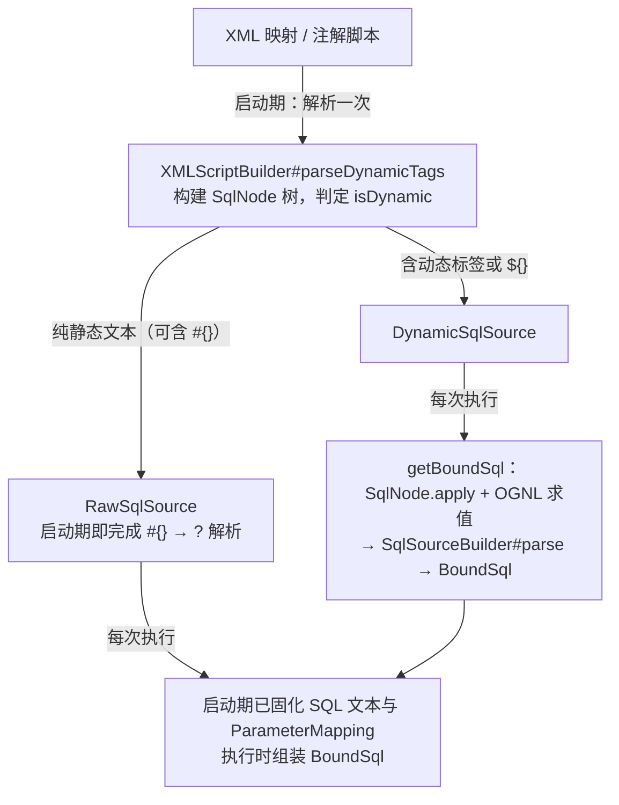
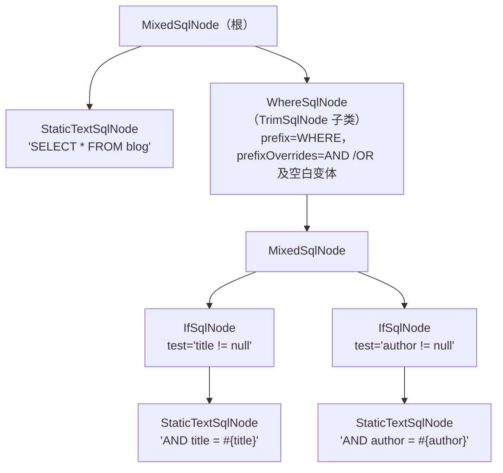
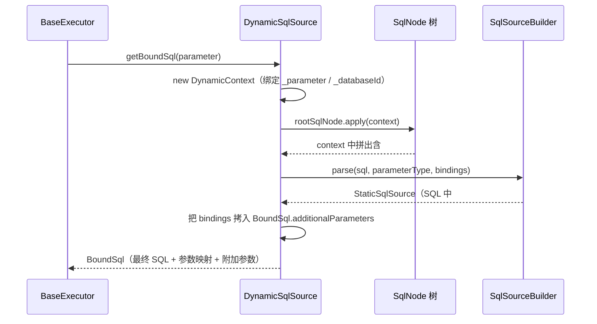

# 动态 SQL 原理与 SQL 注入防御

> 一句话概括：动态 SQL = 解析期把 XML 标签构建为 SqlNode 树 + 运行期用 OGNL 求值、拼接出最终 SQL；
> `#{}` 走预编译占位符、把参数当「值」绑定，`${}` 直接字符串替换、把参数当「SQL 的一部分」——两者的安全差异与各自的适用边界，是本文的主线。

预计阅读时间：大约 95 分钟

所属主题：[MyBatis 常见面试题总结](summary.md)

本文以 MyBatis 3.5.19（3.5.x 最新稳定版，Java 8 基线）为源码基线，源码锚点用 `类名#方法名` 标注；MyBatis 3.6.0（2026-10 发布，Java 11 基线）的行为差异单独注明。总结文档给结论，本文给机制与证据：每个机制按「结论 → 机制 → 边界/代价 → 实践/追问」展开。

---

## 0. 阅读路线

| 读者 | 建议阅读 | 关注点 |
| --- | --- | --- |
| 初级（1 年内） | 1、5.1~5.5、6.3、7.4 | `#{}` 与 `${}` 的区别、标签怎么写、like 的安全写法 |
| 中级（1~3 年） | 全部，重点 2、3、4、6 | SqlSource 分工、SqlNode 树与 apply、OGNL 求值、预编译完整链路 |
| 高级（3 年+） | 2.3、3.3~3.4、5.4、7、8 | CacheKey 关系、foreach 内部机制、注入防御、边界与排查 |
| 选型/架构 | 1.2、7.3、8.3~8.6 | 动态 SQL 的成本账、白名单设计、databaseId/Provider 取舍、3.6.0 升级评估 |

目录：

1. 结论先行：两个阶段与两种占位符
2. SqlSource 家族：解析期分工与运行期入口
3. SqlNode 树与 apply 责任链
4. OGNL 求值：test 表达式背后的引擎
5. 标签语义速查与示例
6. `#{}` 机制深挖：从占位符到预编译
7. `${}` 机制与 SQL 注入防御
8. 边界与代价
9. 高频面试追问集
10. 参考资料

---

## 1. 结论先行：两个阶段与两种占位符

### 1.1 动态 SQL 的两个阶段

**结论**：MyBatis 的动态 SQL 不是「每次执行都重新解析 XML」，而是**启动期把 XML 解析成一棵 SqlNode 树（解析一次），运行期对树求值拼出 SQL（每次执行）**。两个阶段的分界线就是 `SqlSource`。



- **解析期**（`XMLMapperBuilder` 加载映射文件时）：`XMLScriptBuilder#parseDynamicTags` 把每个标签映射为一个 `SqlNode`，组成树；同时判定语句是否「动态」，决定包成 `DynamicSqlSource` 还是 `RawSqlSource`（见第 2 节）。
- **运行期**（每次 `selectList`/`insert` 等调用）：`MappedStatement#getBoundSql` → `SqlSource#getBoundSql(parameterObject)`，动态语句在这里对 SqlNode 树做 `apply`，用 OGNL 对 `test`/`${}` 求值，拼出最终 SQL，再把 `#{}` 换成 `?` 并生成参数映射（见第 3、6 节）。

**边界**：「每次执行都求值」只针对 `DynamicSqlSource`。只含 `#{}`、没有任何标签和 `${}` 的语句是静态语句，走 `RawSqlSource`，`#{}` → `?` 的转换在启动期就完成，运行期零解析开销（见 2.2）。

**追问：为什么不在启动期把 SQL 拼好？** 因为拼接结果依赖运行期参数（`test` 条件、集合长度、`${}` 值），启动期没有参数。MyBatis 的折中是：**结构（树）启动期定，内容（SQL 文本）运行期定**。

### 1.2 `#{}` vs `${}`：必背对比

| 维度 | `#{}` | `${}` |
| --- | --- | --- |
| 本质 | JDBC 预编译占位符（`PreparedStatement` 的 `?`） | 字符串替换（直接拼进 SQL 文本） |
| 处理时机 | `SqlSourceBuilder#parse` 阶段替换为 `?`，执行时由 `ParameterHandler` 按 `TypeHandler` 设参 | `TextSqlNode#apply` 阶段（OGNL 求值后）直接替换 |
| 产物 | SQL 结构固定，参数作为**值**绑定 | 参数成为 **SQL 结构的一部分** |
| SQL 注入 | 天然免疫（参数不参与 SQL 解析） | **有风险**，必须白名单校验 |
| 典型用途 | where 条件值、insert/update 的值 | 动态 order by 列名/方向、动态表名/列名 |
| 对缓存的影响 | 参数值参与 CacheKey，SQL 文本不变 | 替换结果进入 SQL 文本，直接改变 CacheKey（见 2.3） |
| 能否用于列名/表名 | **不能**（占位符只能绑定值） | 能，但要白名单 |

```xml
<!-- #{ }：预编译，安全 -->
<select id="findByName" resultType="User">
  SELECT * FROM user WHERE name = #{name}
</select>

<!-- ${ }：字符串替换，name 来自用户输入时就是注入漏洞 -->
<select id="findByNameUnsafe" resultType="User">
  SELECT * FROM user WHERE name = '${name}'
</select>
```

**一句话立场**：值用 `#{}`，标识符（列名/表名/排序方向）才考虑 `${}`，且 `${}` 的输入必须来自服务端白名单，绝不来自用户原始输入。机制与防御代码见第 6、7 节。

---

## 2. SqlSource 家族：解析期分工与运行期入口

### 2.1 四种 SqlSource 的分工

**结论**：`SqlSource` 接口只有一个方法 `BoundSql getBoundSql(Object parameterObject)`——「给我参数，还你最终 SQL + 参数映射」。四个实现对应四种语句形态：

| 实现 | 所在包 | 职责 | 何时做重活 |
| --- | --- | --- | --- |
| `DynamicSqlSource` | `scripting.xmltags` | 含动态标签或 `${}` 的语句：持有 SqlNode 树 | **每次执行**：apply + OGNL + `#{}` 解析 |
| `RawSqlSource` | `scripting.defaults` | 静态语句（可含 `#{}`）：启动期渲染一次并解析 `#{}`，内部委托 `StaticSqlSource` | **启动期一次** |
| `StaticSqlSource` | `builder`（注意不在 `mapping` 包） | 持有最终 SQL 字符串 + `ParameterMapping` 列表，`getBoundSql` 只是组装 `BoundSql` | 无（纯数据对象） |
| `ProviderSqlSource` | `builder.annotation` | `@SelectProvider` 等注解：每次执行调用 Java provider 方法拿 SQL 字符串，再交给 `LanguageDriver` 解析 | **每次执行**：反射调方法 + 重新解析 |

**机制**：`RawSqlSource` 的「静态」是构造期完成的（源码，3.5.19）：

```java
// RawSqlSource（scripting.defaults 包）
public RawSqlSource(Configuration configuration, SqlNode rootSqlNode, Class<?> parameterType) {
  this(configuration, getSql(configuration, rootSqlNode), parameterType);
}

public RawSqlSource(Configuration configuration, String sql, Class<?> parameterType) {
  SqlSourceBuilder sqlSourceParser = new SqlSourceBuilder(configuration);
  Class<?> clazz = parameterType == null ? Object.class : parameterType;
  sqlSource = sqlSourceParser.parse(sql, clazz, new HashMap<>());   // 启动期就把 #{} 换成 ?
}

private static String getSql(Configuration configuration, SqlNode rootSqlNode) {
  DynamicContext context = new DynamicContext(configuration, null); // 参数传 null：静态树不依赖参数
  rootSqlNode.apply(context);
  return context.getSql();
}
```

类注释写得很直白：*It is faster than DynamicSqlSource because mappings are calculated during startup*（`@since 3.2.0`）。

**边界/代价**：`RawSqlSource` 启动期用**声明的 `parameterType`** 推断参数类型；`DynamicSqlSource` 每次执行用**实际参数对象的 `getClass()`** 推断。同一条动态语句传不同类型的参数，参数类型解析结果可能不同——这是动态语句的灵活性，也是它无法提前优化的原因。

### 2.2 isDynamic 判定：含 `${}` 的文本也算动态

`XMLScriptBuilder#parseDynamicTags`（3.5.19 源码，节选关键分支）：

```java
protected MixedSqlNode parseDynamicTags(XNode node) {
  List<SqlNode> contents = new ArrayList<>();
  NodeList children = node.getNode().getChildNodes();
  for (int i = 0; i < children.getLength(); i++) {
    XNode child = node.newXNode(children.item(i));
    if (child.getNode().getNodeType() == Node.CDATA_SECTION_NODE || child.getNode().getNodeType() == Node.TEXT_NODE) {
      String data = child.getStringBody("");
      TextSqlNode textSqlNode = new TextSqlNode(data);
      if (textSqlNode.isDynamic()) {          // 文本里含 ${} → 动态
        contents.add(textSqlNode);
        isDynamic = true;
      } else {
        contents.add(new StaticTextSqlNode(data));  // 纯文本（含 #{} 也算纯文本）
      }
    } else if (child.getNode().getNodeType() == Node.ELEMENT_NODE) {
      String nodeName = child.getNode().getNodeName();
      NodeHandler handler = nodeHandlerMap.get(nodeName);
      if (handler == null) {
        throw new BuilderException("Unknown element <" + nodeName + "> in SQL statement.");
      }
      handler.handleNode(child, contents);
      isDynamic = true;                       // 任何已知标签 → 动态
    }
  }
  return new MixedSqlNode(contents);
}
```

判定规则三条：

1. **任何已知动态标签**（`if`/`where`/`foreach`/`bind` 等）出现 → `isDynamic = true`；
2. **文本节点含 `${}`** → `TextSqlNode#isDynamic` 为 true → 动态；
3. 其余文本（**包括含 `#{}` 的文本**）→ `StaticTextSqlNode`。`#{}` 在 SqlNode 阶段只是普通字符，要到 `SqlSourceBuilder` 阶段才被处理（见第 6 节）。

随后 `XMLScriptBuilder#parseScriptNode` 按标志分流：

```java
public SqlSource parseScriptNode() {
  MixedSqlNode rootSqlNode = parseDynamicTags(context);
  SqlSource sqlSource;
  if (isDynamic) {
    sqlSource = new DynamicSqlSource(configuration, rootSqlNode);
  } else {
    sqlSource = new RawSqlSource(configuration, rootSqlNode, parameterType);
  }
  return sqlSource;
}
```

标签与处理器的注册表（`XMLScriptBuilder#initNodeHandlerMap`）：`trim`→`TrimHandler`、`where`→`WhereHandler`、`set`→`SetHandler`、`foreach`→`ForEachHandler`、`if`→`IfHandler`、`choose`→`ChooseHandler`、`when`→`IfHandler`（复用）、`otherwise`→`OtherwiseHandler`、`bind`→`BindHandler`。**未知标签在启动期直接抛 `BuilderException`**——拼错标签名不会拖到运行期。

**边界**：`<include>` 不在这张表里——它在更早的 `XMLStatementBuilder#parseStatementNode` 阶段就被 `XMLIncludeTransformer#applyIncludes` 展开成普通节点了（见 5.7），`parseDynamicTags` 看到的已是展开后的树。

### 2.3 getBoundSql 每次执行都调用：与缓存 CacheKey 的关系

**结论**：`BaseExecutor#query` 的第一行就是 `ms.getBoundSql(parameter)`——**动态 SQL 的求值发生在缓存查询之前**，缓存键用的是「求值后的最终 SQL」。

```java
// BaseExecutor#query（3.5.19）
BoundSql boundSql = ms.getBoundSql(parameter);
CacheKey key = createCacheKey(ms, parameter, rowBounds, boundSql);
return query(ms, parameter, rowBounds, resultHandler, key, boundSql);
```

`BaseExecutor#createCacheKey` 的组成（源码顺序）：

```java
cacheKey.update(ms.getId());
cacheKey.update(rowBounds.getOffset());
cacheKey.update(rowBounds.getLimit());
cacheKey.update(boundSql.getSql());          // 最终 SQL 文本（动态拼接的结果）
// 再逐个 update 每个 ParameterMapping 解析出的参数值（mimic DefaultParameterHandler logic）
cacheKey.update(configuration.getEnvironment().getId());
```

推论（高频追问）：

- 同一条动态语句，参数不同导致**拼接出的 SQL 结构不同**（如 `if` 命中不同）→ SQL 文本不同 → CacheKey 不同 → 缓存不命中。这是正确行为：结构不同的 SQL 本来就不是同一次查询。
- `${}` 的替换结果直接进入 SQL 文本，**`${}` 值不同 = SQL 不同 = 缓存键不同**；而 `#{}` 的值不进入 SQL 文本，作为参数值参与 CacheKey。
- 缓存的完整机制（一级/二级、刷新策略）见兄弟专题 [缓存机制](cache-mechanism.md)；Executor 的整体执行链路见 [架构与 SQL 执行流程](architecture-and-sql-execution.md)。

**实践**：排查「动态 SQL 缓存不命中」时，先打开 SQL 日志对比两次执行拼出的 SQL 文本是否一致（空格、换行都算），再看参数值——而不是怀疑缓存配置。

---

## 3. SqlNode 树与 apply 责任链

### 3.1 SqlNode 接口与节点家族

**结论**：`SqlNode` 只有一个方法 `boolean apply(DynamicContext context)`——「把自己负责的 SQL 片段追加进上下文，返回是否产出了内容」。整棵树的求值就是递归调用 `apply`，是**组合模式 + 责任链**的变体：每个节点只处理自己的语义，把其余部分委托给子节点。

| 节点 | 对应标签/内容 | apply 行为 |
| --- | --- | --- |
| `MixedSqlNode` | 根节点/容器 | 遍历子节点逐个 `apply` |
| `StaticTextSqlNode` | 纯文本（含 `#{}`） | 原样 `appendSql(text)` |
| `TextSqlNode` | 含 `${}` 的文本 | OGNL 求值后字符串替换再追加（见 7.1） |
| `IfSqlNode` | `<if>` / `<when>` | `test` 求值为 true 才 apply 子节点 |
| `TrimSqlNode` | `<trim>` | 子节点内容追加到独立缓冲，最后做前缀/后缀修剪 |
| `WhereSqlNode` | `<where>` | `TrimSqlNode` 子类：prefix=WHERE，去掉开头 AND/OR |
| `SetSqlNode` | `<set>` | `TrimSqlNode` 子类：prefix=SET，去掉首尾逗号 |
| `ForEachSqlNode` | `<foreach>` | 遍历集合，逐项 apply 并改写 `#{item}`（见 5.4） |
| `ChooseSqlNode` | `<choose>` | 第一个 apply 返回 true 的 when 胜出，否则 otherwise |
| `VarDeclSqlNode` | `<bind>` | OGNL 求值后绑定变量到上下文（**注意：bind 对应的类叫 `VarDeclSqlNode`，没有 `BindSqlNode` 这个类**） |

### 3.2 一个 `<where>` + `<if>` 例子的解析树

```xml
<select id="findBlog" resultType="Blog">
  SELECT * FROM blog
  <where>
    <if test="title != null">AND title = #{title}</if>
    <if test="author != null">AND author = #{author}</if>
  </where>
</select>
```

解析后的 SqlNode 树：



注意 `AND title = #{title}` 是 **StaticTextSqlNode**：`#{}` 不触发动态判定，它在这一步只是文本。运行期 `title != null` 且 `author == null` 时，where 的**内部缓冲**只收到 `AND title = #{title}`，`applyAll` 把它修剪成 `WHERE title = #{title}` 后追加到顶层上下文，与 `SELECT * FROM blog` 拼成完整 SQL，最后 `SqlSourceBuilder` 把 `#{title}` 换成 `?`。

### 3.3 走读 DynamicSqlSource#getBoundSql

```java
// DynamicSqlSource#getBoundSql（3.5.19，完整）
@Override
public BoundSql getBoundSql(Object parameterObject) {
  DynamicContext context = new DynamicContext(configuration, parameterObject);
  rootSqlNode.apply(context);                                    // ① 递归求值，拼出含 #{} 的 SQL
  SqlSourceBuilder sqlSourceParser = new SqlSourceBuilder(configuration);
  Class<?> parameterType = parameterObject == null ? Object.class : parameterObject.getClass();
  SqlSource sqlSource = sqlSourceParser.parse(context.getSql(), parameterType, context.getBindings()); // ② #{} → ?
  BoundSql boundSql = sqlSource.getBoundSql(parameterObject);    // ③ StaticSqlSource 组装 BoundSql
  context.getBindings().forEach(boundSql::setAdditionalParameter); // ④ 绑定变量拷入附加参数
  return boundSql;
}
```



第 ④ 步是 foreach/bind 能工作的关键：`<bind>` 绑定的变量、foreach 生成的 `__frch_*` 变量都在 `bindings` 里，拷入 `additionalParameters` 后，`DefaultParameterHandler` 设参时**优先从附加参数取值**（见 6.2）。

### 3.4 DynamicContext：绑定表与 SQL 拼接

`DynamicContext`（3.5.19）三个要点：

1. **bindings 是一张 `ContextMap`**（继承 HashMap），构造时放入两个内置变量：`_parameter`（原始参数对象）与 `_databaseId`（当前数据库标识）。`<bind>`、foreach 的 item/index 也绑在这里。
2. **OGNL 属性访问有兜底链**：`ContextAccessor#getProperty` 先查 map 本身；查不到且 `_parameter` 是 Map（多参数/@Param 场景）再查参数 Map。`ContextMap#get` 则先查绑定表，再走参数对象的 `MetaObject` 属性；**若参数是简单类型（注册了 TypeHandler），任何未命中的属性名都回退为参数对象本身**——这就是「单个 String 参数时 `test` 里写什么名字都能取到值」的源码依据（规范写法仍是用 `_parameter`）。
3. **SQL 用 `StringJoiner(" ")` 拼接**：顶层每次 `appendSql` 的片段之间自动加一个空格，`getSql()` 最后 `trim()`。这解释了为什么标签之间不写空格也不会粘成一团——但 `<trim>` 内部缓冲是例外（见 5.2 的 3.6.0 差异）。

另有 `getUniqueNumber()`（自增计数器），专供 foreach 生成不冲突的参数名（见 5.4）。

---

## 4. OGNL 求值：test 表达式背后的引擎

### 4.1 ExpressionEvaluator 与 OgnlCache

**结论**：`test` 属性与 `${}` 的内容都是 **OGNL 表达式**，由 `ExpressionEvaluator` 求值、`OgnlCache` 缓存表达式解析结果。`evaluateBoolean` 的「真值」规则比 Java 宽：

```java
// ExpressionEvaluator#evaluateBoolean（3.5.19，完整）
public boolean evaluateBoolean(String expression, Object parameterObject) {
  Object value = OgnlCache.getValue(expression, parameterObject);
  if (value instanceof Boolean) {
    return (Boolean) value;
  }
  if (value instanceof Number) {
    return new BigDecimal(String.valueOf(value)).compareTo(BigDecimal.ZERO) != 0;
  }
  return value != null;
}
```

| 表达式结果 | 判定 |
| --- | --- |
| Boolean | 直接用 |
| Number | **非 0 即 true**（`test="count"` 在 count=5 时为 true） |
| 其他对象 | **非 null 即 true**（`test="name"` 在 name="" 时也为 true！） |

`OgnlCache#getValue` 每次创建 OGNL 上下文并求值，但**表达式解析结果按字符串缓存在 `ConcurrentHashMap`**（`parseExpression`），避免重复解析 AST：

```java
// OgnlCache（3.5.19，scripting.xmltags 包）
public static Object getValue(String expression, Object root) {
  try {
    OgnlContext context = Ognl.createDefaultContext(root, MEMBER_ACCESS, CLASS_RESOLVER, null);
    return Ognl.getValue(parseExpression(expression), context, root);
  } catch (OgnlException e) {
    throw new BuilderException("Error evaluating expression '" + expression + "'. Cause: " + e, e);
  }
}
```

两个配套类：`OgnlMemberAccess` 允许反射访问非 public 成员（`setAccessible(true)`，且 `restore` 故意不回设——注释引用 issue #1648：回设 accessible 标志非线程安全）；`OgnlClassResolver` 定制类加载。

**版本归属（读旧文章注意）**：`OgnlCache` 位于 `org.apache.ibatis.scripting.xmltags` 包（至少 3.5.0 起即如此）。源码 import 的是上游 `ognl.*`，但 3.5.19 的 pom 用 maven-shade-plugin 把 `ognl:ognl:3.4.4` 打进 jar 并 **relocate 到 `org.apache.ibatis.ognl`**——所以反编译发布 jar 看到的 OGNL 类在 `org.apache.ibatis.ognl` 下，与 GitHub 源码包名不同，两者都对，只是视角不同。3.6.0 将 OGNL 升级到 3.4.16。

**边界/代价**：缓存的只是「表达式 → AST」，**求值本身每次执行都做**（反射属性访问 + 方法调用）。这是动态 SQL 运行期成本的一部分（见 8.3）。OGNL 能调用任意方法——**绝不要把用户输入拼进 `test` 表达式**（表达式注入），`test` 只能是开发者写死的字面量。

### 4.2 test 表达式常见坑

| 坑 | 现象 | 原因与正确写法 |
| --- | --- | --- |
| 单字符字符串比较 | `test="type == 'Y'"` 恒为 false | OGNL 把单引号单字符 `'Y'` 解析为 **Character**，与 String 不相等。改 `test='type == "Y"'`（XML 属性用单引号包裹）或 `test="type == 'Y'.toString()"` |
| null 与空串混淆 | `test="name"` 时空串也命中 | 非 null 即 true。要排除空串写 `test="name != null and name != ''"` |
| 集合判空 | `test="list != null"` 时空集合仍进 foreach | 加 `list.size() > 0`（OGNL 支持方法调用） |
| 单参数取值 | 单个 String 参数写 `test="name != null"` 也能跑 | `ContextMap` 对简单类型有兜底（见 3.4），但规范写法是 `_parameter != null`；POJO 参数直接用属性名 |
| XML 转义 | `test="a < b && c > d"` 解析报错 | XML 属性里 `<` 要写 `&lt;`；`&&` 建议直接用 OGNL 关键字 `and`/`or`/`not` |
| 数字与字符串比较 | `test="status == '1'"`（status 是 Integer） | 同单字符坑：`'1'` 是 Character。写 `status == 1` 或 `'1'.toString()` |

**实践**：把「单字符比较用双引号」「判空写全 `!= null and != ''`」列入团队 Mapper 评审清单；这两类问题不报错、只是条件静默不命中，比异常更难排查。

---

## 5. 标签语义速查与示例

### 5.1 if

```xml
<select id="findActiveBlogLike" resultType="Blog">
  SELECT * FROM blog WHERE state = 'ACTIVE'
  <if test="title != null">AND title like #{title}</if>
  <if test="author != null and author.name != null">AND author_name like #{author.name}</if>
</select>
```

机制即 `IfSqlNode#apply`：`evaluator.evaluateBoolean(test, context.getBindings())` 为 true 才 apply 子节点。多个 `if` 相互独立，可同时命中——「多选一」要用 `choose`（5.5）。

### 5.2 where 与 trim：自动去 AND/OR 的真相

**结论**：`<where>` 不是「智能语法分析」，就是一个配置好的 `<trim>`：**子内容非空才插入 WHERE，且只去掉开头的 AND/OR**。

```java
// WhereSqlNode（3.5.19，完整核心）
private static final List<String> prefixList = Arrays.asList("AND ", "OR ", "AND\n", "OR\n", "AND\r", "OR\r", "AND\t",
    "OR\t");

public WhereSqlNode(Configuration configuration, SqlNode contents) {
  super(configuration, contents, "WHERE", prefixList, null, null);
}
```

修剪逻辑在 `TrimSqlNode.FilteredDynamicContext#applyAll`：子节点内容先追加到**独立缓冲**，apply 结束后 `trim()` 并转大写，`applyPrefix` 用 `startsWith` 匹配 `prefixOverrides` 列表、**删除第一个命中的前缀**，再插入 `prefix + " "`；`applySuffix` 对称处理后缀。`prefixOverrides`/`suffixOverrides` 按 `|` 分割并转大写（`TrimSqlNode#parseOverrides`）。

**边界（高频追问）**：

- 只去**开头**的 AND/OR，不去结尾的；`<if test="...">a = 1 AND</if>` 这种尾部悬空 AND 它救不了。
- 只删**一个**命中前缀；`AND OR a = 1` 只会去掉 `AND `，剩下 `WHERE OR a = 1` 照样报错。
- 覆盖项带空白（`"AND "`）：内容恰好只有 `AND` 三个字母（后面没内容）时不匹配，`WHERE AND` 会保留。
- 所有子条件都不命中 → 缓冲为空 → **不插入 WHERE**，这正是 where 标签的价值。
- 官方文档强调 `prefixOverrides="AND |OR "` 里的空格是必要的——匹配是字面 `startsWith`，不是分词。

`<trim>` 是通用形式，四个属性自由组合：

```xml
<trim prefix="WHERE" prefixOverrides="AND |OR ">...</trim>   <!-- 等价 where -->
<trim prefix="SET" suffixOverrides=",">...</trim>            <!-- 等价 set -->
<trim prefix="(" suffix=")" suffixOverrides=",">...</trim>   <!-- 自定义：括号包裹去尾逗号 -->
```

**3.6.0 差异**：3.5.x 的 `TrimSqlNode.FilteredDynamicContext#appendSql` 是**裸拼接**（`sqlBuffer.append(sql)`），子片段之间不加空格——顶层 `DynamicContext` 有 `StringJoiner(" ")` 兜底，trim 内部没有。若 XML 里标签间恰好无空白，可能出现片段粘连。3.6.0 的 PR #3422 让 TrimSqlNode 像 MixedSqlNode 一样在拼接子内容时补空格。

### 5.3 set：去尾逗号，也去首逗号

```java
// SetSqlNode（3.5.19，完整核心）
private static final List<String> COMMA = Collections.singletonList(",");

public SetSqlNode(Configuration configuration, SqlNode contents) {
  super(configuration, contents, "SET", COMMA, null, COMMA);
}
```

注意 `COMMA` 同时传给了 `prefixOverrides` 和 `suffixOverrides`——**set 既去尾逗号也去首逗号**（官方文档只提了尾逗号，源码更完整）。

```xml
<update id="updateAuthorIfNecessary">
  update Author
  <set>
    <if test="username != null">username=#{username},</if>
    <if test="email != null">email=#{email},</if>
  </set>
  where id=#{id}
</update>
```

**边界**：所有 `if` 都不命中时，set 内容为空 → 不插入 SET → 拼出 `update Author where id=?`，**非法 SQL，运行期才报错**。防御：保留一个无条件更新列（如 `update_time = NOW()`），或在 Service 层校验「至少一个字段非空」。

### 5.4 foreach：属性、命名规则与内部机制

属性速查：

| 属性 | 含义 |
| --- | --- |
| `collection` | 要遍历的集合表达式（OGNL），命名规则见下 |
| `item` | 当前元素的变量名 |
| `index` | 迭代序号（List/数组）或键（Map） |
| `open` / `close` | 整体前缀/后缀，如 `(` 和 `)` |
| `separator` | 元素之间的分隔符 |
| `nullable` | 集合为 null 时是否跳过而非抛异常（**3.5.9 起**，默认取 `Configuration#nullableOnForEach`，默认 false） |

```xml
<select id="selectByIds" resultType="User">
  SELECT * FROM user
  <where>
    <foreach item="id" collection="ids" open="id IN (" separator="," close=")">
      #{id}
    </foreach>
  </where>
</select>
```

```java
List<User> selectByIds(@Param("ids") List<Long> ids);
```

**collection 的命名规则**（`ParamNameResolver`，mapper 代理调用时生效，详见 [Mapper 代理与绑定](mapper-proxy-and-binding.md)）：

| 参数形态 | 可用的 collection 名 | 依据 |
| --- | --- | --- |
| 单个 List，无 @Param | `list`、`collection`；3.5.5 起还可用真实参数名（需 `useActualParamName=true`（默认）且编译保留参数名 `-parameters`） | `ParamNameResolver#wrapToMapIfCollection`（`@since 3.5.5`） |
| 单个 Set/Collection，无 @Param | `collection`（+ 真实参数名，同上） | 同上 |
| 单个数组，无 @Param | `array`（+ 真实参数名，同上） | 同上 |
| 加了 `@Param("ids")` | **只有 `ids`**（及通用名 `param1`） | `getNamedParams` 走多参数分支，不再注入 collection/list 默认名 |
| 多参数 | 各 @Param 名或真实参数名，另有 `param1`/`param2`… | `ParamNameResolver#getNamedParams` |

```java
// ParamNameResolver#wrapToMapIfCollection（3.5.19，完整）
public static Object wrapToMapIfCollection(Object object, String actualParamName) {
  if (object instanceof Collection) {
    ParamMap<Object> map = new ParamMap<>();
    map.put("collection", object);
    if (object instanceof List) {
      map.put("list", object);
    }
    Optional.ofNullable(actualParamName).ifPresent(name -> map.put(name, object));
    return map;
  }
  if (object != null && object.getClass().isArray()) {
    ParamMap<Object> map = new ParamMap<>();
    map.put("array", object);
    Optional.ofNullable(actualParamName).ifPresent(name -> map.put(name, object));
    return map;
  }
  return object;
}
```

**实践**：团队统一「集合参数必加 `@Param`」，消灭 `list`/`collection` 默认名带来的歧义与版本差异。

**内部机制（高级）**：`ForEachSqlNode#apply`（3.5.19，节选）：

```java
final Iterable<?> iterable = evaluator.evaluateIterable(collectionExpression, bindings,
    Optional.ofNullable(nullable).orElseGet(configuration::isNullableOnForEach));
if (iterable == null || !iterable.iterator().hasNext()) {
  return true;                       // null（nullable 时）或空集合：什么都不追加，连 open/close 都没有
}
boolean first = true;
applyOpen(context);
int i = 0;
for (Object o : iterable) {
  DynamicContext oldContext = context;
  if (first || separator == null) {
    context = new PrefixedContext(context, "");
  } else {
    context = new PrefixedContext(context, separator);
  }
  int uniqueNumber = context.getUniqueNumber();
  // Map.Entry 时 index=键、item=值；否则 index=序号
  applyIndex(context, i, uniqueNumber);
  applyItem(context, o, uniqueNumber);
  contents.apply(new FilteredDynamicContext(configuration, context, index, item, uniqueNumber));
  if (first) {
    first = !((PrefixedContext) context).isPrefixApplied();
  }
  context = oldContext;
  i++;
}
applyClose(context);
```

三个关键设计：

1. **参数名改写**：每轮迭代把元素绑定为 `item` 和 `__frch_<item>_<uniqueNumber>`（`ITEM_PREFIX = "__frch_"`），`FilteredDynamicContext#appendSql` 用 `GenericTokenParser` 把片段里的 `#{item}` 改写为 `#{__frch_item_0}`、`#{__frch_item_1}`……（正则 `replaceFirst("^\\s*" + item + "(?![^.,:\\s])", ...)`，避免误伤 `#{item.name}` 这类属性路径的前缀匹配）。这样 N 个元素生成 N 个互不冲突的 `ParameterMapping`，值经 `additionalParameters` 在设参阶段取回（见 3.3 第 ④ 步、6.2）。
2. **分隔符的智能插入**：`PrefixedContext` 只在「本轮产出了非空 SQL」时才把 separator 追加到 delegate；`first` 标志直到某轮真正产出内容才翻 false——**某轮 `<if>` 全不命中产出空内容时，不会带出多余逗号**。
3. **空集合直接返回**：`iterable == null || !iterator().hasNext()` → `return true`，**open/close 也不输出**。后果与防御见 8.2。

**3.6.0 差异**：PR #2760 重构了这套机制——改为「脚本阶段直接求值参数并存入 `ParameterMapping`」，**不再做 `__frch_` 改写**，同时修复了 `<bind>` 在 foreach 内不是局部变量的问题（见 5.6）。官方基准（500 元素批量 insert；实测基线 3.5.11，PR #2760 的 JMH 对照）吞吐持平、**每操作分配内存约减半**（22.7MB/op → 11.2MB/op）。依赖 `__frch_` 内部行为的插件可能受影响。

### 5.5 choose / when / otherwise：多选一

```xml
<choose>
  <when test="title != null">AND title like #{title}</when>
  <when test="author != null">AND author_name like #{author.name}</when>
  <otherwise>AND featured = 1</otherwise>
</choose>
```

`ChooseSqlNode#apply`：按声明顺序遍历 when（就是 `IfSqlNode`），**第一个 apply 返回 true 的胜出并立即返回**；都不命中才 apply otherwise。解析期约束：`otherwise` 最多一个，多了启动期抛 `BuilderException("Too many default (otherwise) elements...")`。

**3.6.0 差异**：3.5.19 的 `ChooseHandler#handleWhenOtherwiseNodes` 对 choose 内的**未知子元素静默忽略**（既不是 IfHandler 也不是 OtherwiseHandler 就跳过）——`<choose>` 里拼错标签名不报错、条件悄悄丢失。3.6.0 的 PR #3456 改为**抛异常**。

### 5.6 bind：预计算变量

```xml
<select id="selectBlogsLike" resultType="Blog">
  <bind name="pattern" value="'%' + _parameter.getTitle() + '%'" />
  SELECT * FROM blog WHERE title LIKE #{pattern}
</select>
```

机制：`VarDeclSqlNode#apply` 用 `OgnlCache.getValue(expression, bindings)` 求值，`context.bind(name, value)` 放入绑定表；后续 `#{pattern}` 经 `additionalParameters` 取到拼好的值，**全程预编译，无注入风险**。这是 like 模糊查询的推荐写法之一（见 7.4），且不像 `concat` 那样依赖数据库方言。

**边界（3.5.x 已知问题）**：`<bind>` 放在 `<foreach>` 内部时，绑定写入的是**共享的 bindings**，而 `#{pattern}` 不会被改写成 `__frch_` 形式——所有迭代最终都解析到**最后一轮**的绑定值（issue #2754：bind 应表现为 foreach 内的局部变量）。3.6.0 的 PR #2760 修复。**3.5.x 的规避办法：把 bind 挪到 foreach 外，或改用 `#{item.xxx}` 直接引用元素属性。**

### 5.7 sql / include：解析期展开与 property 替换

```xml
<sql id="userColumns">id, username, email</sql>

<select id="selectUsers" resultType="User">
  SELECT <include refid="userColumns"/> FROM user
</select>

<!-- 带属性替换的片段 -->
<sql id="sometable">${prefix}user</sql>
<include refid="sometable"><property name="prefix" value="t_"/></include>
```

**结论**：include 是**解析期**行为，与运行期 `${}` 是两套机制。`XMLStatementBuilder#parseStatementNode` 在构建 SqlSource **之前**调用 `XMLIncludeTransformer#applyIncludes`：

- 按 `refid` 从 `configuration.getSqlFragments()` 找到片段（自动补当前 namespace，可跨文件用全限定 id），克隆后替换 include 节点；
- 片段内文本与属性中的 `${...}` 由 `PropertyParser.parse` 用「全局 configuration variables + `<property>` 声明值」替换——**这是启动期的配置占位符替换，取值不来自运行期参数**；
- `<property>` 的 value 本身也可引用上层变量；同一 include 内重复定义同名 property 启动期抛 `BuilderException`；`refid` 属性自身也支持 `${}`（同样来自配置变量）。

**边界**：展开后的片段就是普通节点，里面的动态标签照常参与 isDynamic 判定。找不到 refid 抛 `IncompleteElementException`，MyBatis 会把它挂入 incomplete 列表待后续重解析（跨文件引用顺序问题由此兜底）。

---

## 6. `#{}` 机制深挖：从占位符到预编译

### 6.1 GenericTokenParser + ParameterMappingTokenHandler

**结论**：`#{}` 的解析是一个通用的「token 扫描器 + 回调」结构：`GenericTokenParser` 负责找 `#{` 与 `}` 之间的内容，`ParameterMappingTokenHandler` 负责把内容解析成 `ParameterMapping` 并**返回 `"?"` 替换原文**。

```java
// SqlSourceBuilder#parse（3.5.19，完整）
public SqlSource parse(String originalSql, Class<?> parameterType, Map<String, Object> additionalParameters) {
  ParameterMappingTokenHandler handler = new ParameterMappingTokenHandler(configuration, parameterType,
      additionalParameters);
  GenericTokenParser parser = new GenericTokenParser("#{", "}", handler);
  String sql;
  if (configuration.isShrinkWhitespacesInSql()) {
    sql = parser.parse(removeExtraWhitespaces(originalSql));
  } else {
    sql = parser.parse(originalSql);
  }
  return new StaticSqlSource(configuration, sql, handler.getParameterMappings());
}

// ParameterMappingTokenHandler#handleToken
@Override
public String handleToken(String content) {
  parameterMappings.add(buildParameterMapping(content));
  return "?";
}
```

`#{property,attr=value,...}` 支持的属性（`PARAMETER_PROPERTIES` 常量）：`javaType`、`jdbcType`、`mode`、`numericScale`、`resultMap`、`typeHandler`、`jdbcTypeName`。写错属性名启动期/解析期抛 `BuilderException`。

`buildParameterMapping` 推断 propertyType 的顺序（源码分支）：**附加参数（additionalParameters）的 getter 类型 → parameterType 本身注册了 TypeHandler（简单类型）→ jdbcType=CURSOR → Map/无 property → parameterType 的 MetaClass getter 类型 → Object 兜底**。foreach 的 `__frch_item_0` 正是走第一个分支拿到元素类型。

`GenericTokenParser` 本身还支持反斜杠转义（`\#{` 输出字面 `#{`）；找不到闭合 `}` 时把剩余文本原样输出。**同一个解析器类被三处复用**：`#{}`（SqlSourceBuilder）、`${}`（TextSqlNode）、foreach 改写（FilteredDynamicContext）——开闭 token 与 handler 不同而已。

### 6.2 ParameterHandler#setParameters：按 TypeHandler 设参

执行阶段，`StatementHandler#parameterize` 调用 `ParameterHandler#setParameters`（默认实现 `DefaultParameterHandler`，3.5.19 节选）：

```java
for (int i = 0; i < parameterMappings.size(); i++) {
  ParameterMapping parameterMapping = parameterMappings.get(i);
  if (parameterMapping.getMode() != ParameterMode.OUT) {
    Object value;
    String propertyName = parameterMapping.getProperty();
    if (boundSql.hasAdditionalParameter(propertyName)) {   // ① 附加参数优先（bind / __frch_*）
      value = boundSql.getAdditionalParameter(propertyName);
    } else if (parameterObject == null) {                  // ② 无参数 → null
      value = null;
    } else if (typeHandlerRegistry.hasTypeHandler(parameterObject.getClass())) {
      value = parameterObject;                             // ③ 简单类型 → 参数对象本身
    } else {
      value = metaObject.getValue(propertyName);           // ④ POJO/Map → 反射取属性
    }
    TypeHandler typeHandler = parameterMapping.getTypeHandler();
    JdbcType jdbcType = parameterMapping.getJdbcType();
    if (value == null && jdbcType == null) {
      jdbcType = configuration.getJdbcTypeForNull();       // 默认 OTHER
    }
    typeHandler.setParameter(ps, i + 1, value, jdbcType);  // ⑤ 真正的设参
  }
}
```

- 取值顺序 ①~④ 与 `BaseExecutor#createCacheKey` 完全一致（源码注释：mimic DefaultParameterHandler logic）——保证缓存键与真实设参用同一套值。
- `TypeHandler` 是「Java 类型 ⇄ JDBC 类型」的转换器，`setParameter` 内部调 `ps.setXxx`；自定义 TypeHandler、注册与映射规则见 [结果映射与 TypeHandler](result-mapping-and-typehandler.md)。
- **经典坑**：值为 null 且未指定 jdbcType 时用 `jdbcTypeForNull`（默认 `OTHER`），Oracle 驱动不认 `OTHER` 会报错——解法是 `#{prop,jdbcType=NULL}` 或全局配置 `jdbcTypeForNull=NULL`。
- 整条执行链（Executor → StatementHandler → ParameterHandler/ResultSetHandler）的位置见 [架构与 SQL 执行流程](architecture-and-sql-execution.md)。

### 6.3 为什么预编译能防注入

**结论**：`#{}` 把 SQL 的**结构**与**数据**彻底分离——SQL 文本（含 `?`）先交给数据库/驱动确定语法结构，参数随后只作为**值**绑定，永远不参与 SQL 语法解析。

```java
// 用户输入 name = "x' OR '1'='1"
// #{} 路径：SQL 结构固定为 SELECT * FROM user WHERE name = ?
//         参数整个字符串作为「一个值」绑定，查的就是名字恰好等于这串字符的用户（查不到）
// ${} 路径：SQL 变成 SELECT * FROM user WHERE name = 'x' OR '1'='1'
//         OR '1'='1' 成为 SQL 结构的一部分，恒真，全表泄露
```

**机制细节（高级）**：JDBC 的 `PreparedStatement` 有服务端预编译与客户端预编译两种实现。MySQL Connector/J 默认 `useServerPrepStmts=false`，即**客户端预编译**——驱动在本地固定 SQL 结构、对参数做转义后拼装发送。但无论哪种实现，**参数都不进入 SQL 语法解析阶段**，注入都不成立；服务端预编译还额外带来执行计划复用。所以「防注入」的根据是结构与值分离，而不是「数据库缓存了执行计划」。

**边界**：占位符只能绑定**值**，不能绑定标识符——`ORDER BY ?` 绑定的是字符串常量（按常量排序等于不排序），`SELECT * FROM ?` 直接语法错误。标识符的动态化是 `${}` 的领地，必须配白名单（见 7.3）。

---

## 7. `${}` 机制与 SQL 注入防御

### 7.1 TextSqlNode：apply 阶段的字符串替换

**结论**：`${}` 在 `TextSqlNode#apply`（运行期、SqlNode 树求值阶段）就被替换成字符串，**早于** `SqlSourceBuilder` 的 `#{}` 解析——替换结果直接成为 SQL 结构的一部分。

```java
// TextSqlNode（3.5.19）
@Override
public boolean apply(DynamicContext context) {
  GenericTokenParser parser = createParser(new BindingTokenParser(context, injectionFilter));
  context.appendSql(parser.parse(text));
  return true;
}

// BindingTokenParser#handleToken
@Override
public String handleToken(String content) {
  Object parameter = context.getBindings().get("_parameter");
  if (parameter == null) {
    context.getBindings().put("value", null);
  } else if (SimpleTypeRegistry.isSimpleType(parameter.getClass())) {
    context.getBindings().put("value", parameter);      // 简单类型参数可用 ${value}
  }
  Object value = OgnlCache.getValue(content, context.getBindings());
  String srtValue = value == null ? "" : String.valueOf(value); // issue #274：null 输出 "" 而非 "null"
  checkInjection(srtValue);
  return srtValue;
}
```

要点：`${}` 的内容同样是 **OGNL 表达式**（可以 `${orderCol}`，也可以 `${_parameter.xxx}`）；null 替换为空串；`checkInjection` 是一个可选正则白名单口子（`injectionFilter`），**3.5.19 的 XML 路径并未启用它**（3.6.0 的 PR #2760 顺手移除了这个未使用字段）——不要指望框架替你校验。

**边界**：`${}` 替换发生在 `#{}` 解析之前，替换结果若恰好包含 `#{...}` 文本，还会被后续解析成占位符。两者作用阶段不同，混用时要想清楚顺序。另外 5.7 说过：include/注解脚本里还有一种**启动期**的 `${}`（配置变量替换），与这里的运行期替换同名不同机制。

### 7.2 注入案例（防御视角）

**案例一：登录绕过。**

```xml
<!-- 漏洞写法 -->
<select id="login" resultType="User">
  SELECT * FROM user WHERE username = '${username}' AND password = '${password}'
</select>
```

攻击者输入 `username = "admin' -- "`，拼出的 SQL：

```sql
SELECT * FROM user WHERE username = 'admin' -- ' AND password = '...'
```

`--` 注释掉密码校验，直接以 admin 登录。输入 `' OR '1'='1` 则恒真拖库。改成 `#{username}`/`#{password}` 后，这些输入只是「查不到对应用户」的普通字符串。

**案例二：order by 注入。**

```xml
<!-- 漏洞写法：排序列来自前端 -->
<select id="list" resultType="User">
  SELECT * FROM user ORDER BY ${sortCol} ${sortDir}
</select>
```

`sortCol` 传入 `(CASE WHEN (SELECT ...) THEN id ELSE username END)` 可做布尔盲注；传入 `id; DROP TABLE user; --` 在允许多语句的驱动配置下直接破坏数据；`sortDir` 传入 `ASC, (子查询)` 同理。**order by 位置无法用 `#{}`（见 6.3），所以这里是注入重灾区，防御只能靠白名单。**

### 7.3 `${}` 的正当用途与白名单实践

正当用途只有三类：**动态排序列/方向、动态表名（分表）、动态列名**——都是「标识符」而非「值」。防御原则：**`${}` 的每一个可能取值都必须由服务端枚举，用户输入只能用于「选择」，不能用于「构造」。**

```java
// 实践一：Service 层白名单（推荐，类型安全；Java 8 基线写法）
private static final Map<String, String> SORTABLE;
static {
  Map<String, String> m = new HashMap<>();
  m.put("createTime", "create_time");
  m.put("username", "username");
  m.put("id", "id");
  SORTABLE = Collections.unmodifiableMap(m);
}

public List<User> list(String sortKey, boolean asc) {
  String column = SORTABLE.get(sortKey);                 // 用户输入只用来查表
  if (column == null) {
    column = "id";                                       // 非法输入回退默认，而不是拼进 SQL
  }
  String direction = asc ? "ASC" : "DESC";               // 方向只有两个枚举值
  return userMapper.list(column, direction);
}
```

```java
// Mapper 接口：@Param 固定参数名，供 ${} 引用
List<User> list(@Param("column") String column, @Param("direction") String direction);
```

```xml
<select id="list" resultType="User">
  SELECT * FROM user ORDER BY ${column} ${direction}
</select>
```

```xml
<!-- 实践二：选项有限时直接用 choose，把「动态」收敛成静态分支，彻底不用 ${} -->
<choose>
  <when test='sort == "time"'>ORDER BY create_time DESC</when>
  <when test='sort == "name"'>ORDER BY username ASC</when>
  <otherwise>ORDER BY id DESC</otherwise>
</choose>
```

**边界与提醒**：

- 给标识符加反引号/双引号**不是消毒**——攻击者可以闭合引号；白名单才是。
- 分表场景的表名后缀若来自用户（如按租户分表），同样要校验格式（如纯数字/枚举），不能裸拼。
- MyBatis-Plus 的 `QueryWrapper` 拼接段 `${ew.customSqlSegment}` 也是 `${}` 机制（段内的值仍是 `#{ew.paramNameValuePairs...}` 占位符），`orderBy`/`last` 等直接拼 SQL 的 API 同样有注入面——详见 [MyBatis-Plus 与生态](mybatis-plus-and-ecosystem.md)。
- 代码评审把「Mapper 里出现 `${}`」设为强制审查项：每一处都要能回答「取值集合是什么、谁保证的」。

### 7.4 like 模糊查询的正确写法

| 写法 | 示例 | 评价 |
| --- | --- | --- |
| **错误** | `WHERE name LIKE '%${kw}%'` | 注入漏洞 |
| 数据库 concat | `WHERE name LIKE concat('%', #{kw}, '%')` | 安全；`concat` 是 MySQL 等方言，换库要改 |
| **bind（推荐）** | `<bind name="pattern" value="'%' + kw + '%'" />` + `LIKE #{pattern}` | 安全且不依赖方言 |
| Java 侧拼接 | Service 里 `kw = "%" + kw + "%"`，Mapper 写 `LIKE #{kw}` | 安全；注意别在多处重复拼 |

**高级边界**：即使用了 `#{}`，用户输入里的 `%` 和 `_` 仍会作为 **LIKE 通配符**生效（这不是注入，是语义问题——搜 `100%` 会匹配 `1000`、`100abc`）。需要字面匹配时在 Service 侧转义（以 MySQL 默认的反斜杠转义为例，先转义转义符自身）：

```java
String safe = kw.replace("\\", "\\\\").replace("%", "\\%").replace("_", "\\_");
userMapper.searchByName("%" + safe + "%");
```

```xml
<select id="searchByName" resultType="User">
  SELECT * FROM user WHERE name LIKE #{pattern}
</select>
```

MySQL 的 LIKE 默认以 `\` 为转义符，可省略 ESCAPE 子句；跨库移植时显式声明 `ESCAPE`（注意 MySQL 字符串字面量里反斜杠要写成 `ESCAPE '\\'`，PostgreSQL 标准字符串模式下写 `ESCAPE '\'`）。

---

## 8. 边界与代价

### 8.1 foreach 批量 insert 的 SQL 长度上限

```xml
<insert id="batchInsert">
  INSERT INTO user (username, email) VALUES
  <foreach item="u" collection="users" separator=",">
    (#{u.username}, #{u.email})
  </foreach>
</insert>
```

foreach 拼出的是一条**巨型单 SQL**，边界来自数据库而非 MyBatis：

| 限制 | 说明 |
| --- | --- |
| MySQL `max_allowed_packet` | 单条 SQL 超过该值直接报 `Packet for query is too large`。MySQL 8.0 默认 64MB（8.0.3 起，更早版本 4MB），`SHOW VARIABLES LIKE 'max_allowed_packet'` 可查 |
| 占位符数量硬上限 | 部分数据库有：如 SQL Server 单语句 2100 个参数、PostgreSQL 协议 65535 个绑定参数；MySQL 主要受 packet 大小与解析成本约束 |
| 解析与优化成本 | 万元素级别的 VALUES 让 SQL 文本达 MB 级，解析、网络传输、binlog 都变重；失败时整批回滚 |

**实践**：单批控制在数百到一千行（按行宽估算 SQL 体积），更大的批量用 `ExecutorType.BATCH`（JDBC batch 复用预编译语句）或分批提交。批量写入的完整方案对比见 [批量处理与性能](batch-and-performance.md)。

### 8.2 空集合与 null 集合的防御

`ForEachSqlNode#apply` 的行为（源码见 5.4）与 `ExpressionEvaluator#evaluateIterable` 的异常规则：

| 输入 | 默认行为（nullable=false） | nullable=true（3.5.9 起） |
| --- | --- | --- |
| null | 抛 `BuilderException("The expression '...' evaluated to a null value.")` | 跳过，不输出任何内容 |
| 空集合 | **跳过，连 open/close 都不输出** | 同左 |
| 非集合对象 | 抛 `BuilderException("... Return value (...) was not iterable.")` | 同左 |

空集合跳过的后果：`WHERE id IN <foreach open="(" close=")">` 拼出 `WHERE id IN`——**悬空 IN，运行期 SQL 语法错误**。防御三选一：

```xml
<!-- 方案一：外层 if 包住，空集合时整个条件不出现（语义：不过滤） -->
<if test="ids != null and ids.size() > 0">
  AND id IN <foreach item="id" collection="ids" open="(" separator="," close=")">#{id}</foreach>
</if>

<!-- 方案二：空集合时显式输出恒假条件（语义：查不到任何行） -->
<choose>
  <when test="ids != null and ids.size() > 0">
    AND id IN <foreach item="id" collection="ids" open="(" separator="," close=")">#{id}</foreach>
  </when>
  <otherwise>AND 1 = 0</otherwise>
</choose>
```

方案三：Service 层对空集合直接返回空列表/短路，不进 Mapper。**先想清楚业务语义是「不过滤」还是「零结果」，再选方案**——两者结果完全不同。

### 8.3 动态 SQL 每次求值的性能成本

**结论**：`DynamicSqlSource` 每次执行都要付出「OGNL 求值 + 字符串拼接 + `#{}` 重解析 + ParameterMapping 重建 + 附加参数拷贝」的成本；`RawSqlSource` 把这些全部前移到启动期。

| 成本项 | 每次执行做什么 | 能否避免 |
| --- | --- | --- |
| OGNL 求值 | 每个 `test`/`${}` 反射取属性、调方法（AST 已缓存，求值不缓存） | 减少不必要的标签嵌套 |
| SQL 拼接 | StringJoiner/trim 缓冲/foreach 逐轮 append | 静态语句走 RawSqlSource |
| `#{}` 重解析 | `SqlSourceBuilder#parse` 重新扫描 token、`buildParameterMapping` 重新反射推断类型 | 同上 |
| Provider 语句 | 额外反射调用 provider 方法 + 重新走 LanguageDriver 解析 | 热点语句改 XML/注解静态 SQL |

量化佐证（PR #2760 的 JMH 基准，500 元素 foreach insert，实测基线 3.5.11）：3.5.11 每操作分配约 22.7MB，3.6.0 重构后约 11.2MB——**运行期对象分配是真实成本**，高 QPS 热点语句值得在意。

**实践**：

- 没有条件分支的语句不要「以防万一」套 `<where>`/`<if>`——那会把静态语句变成动态语句；
- `shrinkWhitespacesInSql=true`（默认 false）可压缩 SQL 空白，减小 SQL 文本与缓存键体积（代价：日志里 SQL 挤成一行）；
- 分页插件拦截的是**求值之后**的 BoundSql，动态 SQL 的成本在插件之前已经发生——插件与分页的机制见 [插件与分页](plugin-and-pagination.md)。

### 8.4 databaseId：多数据库语句选择

**结论**：databaseId 的语句选择发生在**解析期**（`XMLStatementBuilder#databaseIdMatchesCurrent`），运行期动态 SQL 里则可用 `_databaseId` 变量做分支。

```java
// XMLStatementBuilder#databaseIdMatchesCurrent（3.5.19，完整）
private boolean databaseIdMatchesCurrent(String id, String databaseId, String requiredDatabaseId) {
  if (requiredDatabaseId != null) {
    return requiredDatabaseId.equals(databaseId);   // 配了 databaseIdProvider：只收匹配当前库的语句
  }
  if (databaseId != null) {
    return false;                                   // 没配 provider：带 databaseId 的语句一律跳过
  }
  id = builderAssistant.applyCurrentNamespace(id, false);
  if (!this.configuration.hasStatement(id, false)) {
    return true;
  }
  MappedStatement previous = this.configuration.getMappedStatement(id, false);
  return previous.getDatabaseId() == null;          // 同 id 已存在：带 databaseId 的覆盖不带的
}
```

| 场景 | 结果 |
| --- | --- |
| 配置了 `databaseIdProvider`（如 `VendorDatabaseIdProvider`），当前库 mysql | 只加载 `databaseId="mysql"` 与不带 databaseId 的语句；同 id 时**带 databaseId 的优先** |
| 未配置 provider | 所有带 databaseId 的语句被跳过 |
| 当前库无任何匹配语句 | 该 id 不存在，运行期报 `Invalid bound statement (not found)` |

运行期分支用内置变量 `_databaseId`（`DynamicContext` 构造时绑定，官方文档示例）：

```xml
<insert id="insert">
  <selectKey keyProperty="id" resultType="int" order="BEFORE">
    <if test="_databaseId == 'oracle'">select seq_users.nextval from dual</if>
    <if test="_databaseId == 'mysql'">SELECT LAST_INSERT_ID()</if>
  </selectKey>
  insert into users values (#{id}, #{name})
</insert>
```

**边界**：databaseId 匹配的是**整条语句**，不是语句内片段；`_databaseId` 比较同样受 OGNL 单字符坑影响（`'mysql'` 多字符没问题，单字符别名要小心）。

### 8.5 @SelectProvider：Java 代码写动态 SQL

```java
public interface UserMapper {
  @SelectProvider(type = UserSqlProvider.class, method = "findByName")
  List<User> findByName(@Param("name") String name);
}

public class UserSqlProvider {
  public String findByName(@Param("name") String name) {
    return new SQL() {{
      SELECT("*");
      FROM("user");
      if (name != null) {
        WHERE("name = #{name}");        // 返回的 SQL 里仍用 #{}，安全
      }
    }}.toString();
  }
}
```

机制（`ProviderSqlSource`，3.5.19）：

- `getBoundSql` **每次执行**调用 `createSqlSource(parameterObject)`：反射调用 provider 方法（非 static 方法**每次 new 一个 provider 实例**），返回值必须是 `CharSequence`（`SQL` 构建器只是帮你拼字符串的工具）；
- 拿到的 SQL 字符串交给 `languageDriver.createSqlSource(configuration, sql, parameterType)` 重新解析——`XMLLanguageDriver` 的 String 重载会先做配置变量替换，再按 `TextSqlNode#isDynamic` 分流 Dynamic/RawSqlSource；返回 `<script>...</script>` 包裹的字符串则支持全套 XML 动态标签；
- provider 方法可声明 `ProviderContext` 参数拿到 mapper 类型/方法/databaseId；`method` 缺省时默认找 `provideSql`，**不允许重载**。

```java
// XMLLanguageDriver#createSqlSource(String)（3.5.19，完整）
if (script.startsWith("<script>")) {
  XPathParser parser = new XPathParser(script, false, configuration.getVariables(), new XMLMapperEntityResolver());
  return createSqlSource(configuration, parser.evalNode("/script"), parameterType);
}
script = PropertyParser.parse(script, configuration.getVariables());
TextSqlNode textSqlNode = new TextSqlNode(script);
if (textSqlNode.isDynamic()) {
  return new DynamicSqlSource(configuration, textSqlNode);
} else {
  return new RawSqlSource(configuration, script, parameterType);
}
```

**边界/代价**：Provider 把「拼 SQL」从 XML 挪进 Java，换来 IDE 重构与类型检查，代价是**每次执行多一轮反射调用 + 完整解析**（比 XML 动态 SQL 更重），且 SQL 散落在 Java 字符串里可读性下降。**安全边界不变**：provider 里用字符串拼接用户输入，等价于 `${}` 注入；返回的 SQL 中值一律用 `#{}`。注解 SQL 不用 `<script>` 时也可写 `<if>` 等标签（`@Select("<script>...</script>")`），机制同上。

### 8.6 3.6.0 差异速览（升级评估）

MyBatis 3.6.0 于 2026-10 发布，**Java 基线从 8 升到 11**（3.5.18 是 master 上最后一个 Java 8 版本，3.5.x 后续维护在 support-java8 分支）。与本文相关的行为变化：

| 变化 | 3.5.x 行为 | 3.6.0 行为 | 出处 |
| --- | --- | --- | --- |
| foreach 内 `<bind>` | 绑定共享、最后一轮覆盖前面（非局部变量） | 脚本阶段求值存入 ParameterMapping，表现为局部变量；同时取消 `__frch_` 改写 | PR #2760 / issue #2754 |
| choose 内未知元素 | **静默忽略** | **抛异常** | PR #3456 |
| TrimSqlNode 子内容拼接 | 裸拼接，可能粘连 | 像 MixedSqlNode 一样补空格 | PR #3422 |
| OGNL 依赖 | 3.4.4（shade 进 jar） | 3.4.16 | release notes |
| 动态参数内部结构 | ParameterMapping 只存属性名，设参时求值 | 动态语句脚本阶段即求值存入 ParameterMapping | PR #2760 |

**升级提醒**：PR #2760 明确「正常使用向后兼容，但**操纵内部结构的插件可能受影响**」；依赖 `__frch_` 命名或「设参阶段才求值」行为的自定义插件/拦截器要重点回归（见 [插件与分页](plugin-and-pagination.md)）。choose 从静默到抛异常属于「把隐藏错误提前暴露」，升级后启动失败反而可能是发现了存量拼写错误。

---

## 9. 高频面试追问集

**Q1：`#{}` 和 `${}` 的区别？（必背）**
期望答案：`#{}` 是预编译占位符——`SqlSourceBuilder` 把它解析成 `ParameterMapping` 并替换为 `?`，执行时 `DefaultParameterHandler` 按 `TypeHandler` 调 `ps.setXxx` 绑值，SQL 结构与参数分离，参数不参与语法解析，天然防注入；`${}` 是 `TextSqlNode#apply` 阶段的 OGNL 求值 + 字符串替换，参数直接成为 SQL 结构的一部分，有注入风险。值用 `#{}`，标识符（order by 列名/表名）才用 `${}` 且必须服务端白名单。加分点：说出 MySQL 驱动默认客户端预编译也不影响防注入结论。

**Q2：动态 SQL 什么时候解析、什么时候求值？**
期望答案：启动期 `XMLScriptBuilder#parseDynamicTags` 把标签解析成 SqlNode 树并判定 isDynamic（任何动态标签或含 `${}` 的文本都算动态），分流 DynamicSqlSource/RawSqlSource；运行期每次执行 `getBoundSql` 时才对树 apply + OGNL 求值拼 SQL，再做 `#{}` → `?`。RawSqlSource 是例外：启动期就完成渲染与 `#{}` 解析，运行期零开销。

**Q3：`<where>` 标签做了什么？**
期望答案：它是配置好的 TrimSqlNode——子内容非空才插入 WHERE，并把**开头**的 AND/OR（含空白变体）去掉；实现是独立缓冲 + trim + 大写 startsWith 匹配 + 删第一个命中前缀。边界：不去尾部 AND/OR、只删一个、全不命中则无 WHERE。set 同理（prefix=SET，去首尾逗号）。

**Q4：foreach 传空集合会怎样？null 呢？**
期望答案：空集合直接 return，**连 open/close 都不输出**，`IN <foreach>` 拼出悬空 `IN` 导致运行期语法错误；null 默认抛 BuilderException，3.5.9 起可配 `nullable=true`（或全局 nullableOnForEach）改为跳过。防御：外层 if 判 `size() > 0`（语义=不过滤）、choose 补 `1=0`（语义=零结果）、或 Service 层短路——先定业务语义再选方案。

**Q5：order by 为什么不能用 `#{}`？怎么防注入？**
期望答案：占位符只能绑定值，`ORDER BY ?` 绑定的是字符串常量，按常量排序等于不排序；列名/方向是标识符，只能 `${}` 拼接。防注入靠服务端白名单：排序列用 Map/枚举映射（用户输入只用于选择，非法回退默认），方向只有 ASC/DESC 两个枚举；选项有限时直接用 choose 收敛成静态分支。加反引号不是消毒。

**Q6：foreach 的 `#{item}` 怎么变成 N 个不冲突的参数？**
期望答案：3.5.x 每轮迭代把元素绑定为 `__frch_<item>_<uniqueNumber>`，FilteredDynamicContext 用 GenericTokenParser 把 `#{item}` 改写成 `#{__frch_item_N}`，生成 N 个 ParameterMapping；bindings 拷入 BoundSql.additionalParameters，设参时优先从附加参数取值。3.6.0 改为脚本阶段直接求值存入 ParameterMapping，不再改写名字（内存约减半）。

**Q7：`test="type == 'Y'"` 为什么不生效？**
期望答案：OGNL 把单引号单字符解析为 Character，与 String 比较不相等，条件静默不命中。改 `test='type == "Y"'` 或 `'Y'.toString()`。顺带能答 evaluateBoolean 的真值规则（Boolean 直接用、Number 非 0 即真、其他非 null 即真）更加分。

**Q8：动态 SQL 和一级/二级缓存是什么关系？**
期望答案：`BaseExecutor#query` 先 `getBoundSql` 求值再 `createCacheKey`；CacheKey 包含 ms.getId、RowBounds、**最终 SQL 文本**、各参数值、environment id。动态拼接结构不同 → SQL 文本不同 → 键不同；`${}` 值进入 SQL 文本直接影响键，`#{}` 值作为参数值参与键。所以「同语句不同条件不命中缓存」是正确行为。

**Q9：like 模糊查询怎么写才安全？**
期望答案：`'%${kw}%'` 是注入；正确写法 `concat('%', #{kw}, '%')`（方言相关）、`<bind name="pattern" value="'%' + kw + '%'"/>` + `#{pattern}`（推荐，跨库）、或 Java 侧拼好再 `#{}`。进阶：`%`/`_` 是 LIKE 通配符，字面匹配要转义 + ESCAPE 子句。

**Q10：@SelectProvider 和 XML 动态 SQL 怎么选？**
期望答案：Provider 每次执行反射调方法 + 重新解析 SQL，成本高于 XML 动态 SQL；换来 Java 类型检查与重构友好。热点/复杂 SQL 用 XML，需要程序化构造（如通用查询构建器）用 Provider；两者安全边界一致——值必须 `#{}`，Java 里拼用户输入等价于 `${}` 注入。

**Q11：databaseId 是怎么选中语句的？**
期望答案：解析期 `XMLStatementBuilder#databaseIdMatchesCurrent`：配了 databaseIdProvider 只收匹配当前库的语句，同 id 带 databaseId 的覆盖不带的；没配 provider 则带 databaseId 的语句全部跳过。运行期片段级分支用 `_databaseId` 内置变量。

**Q12：3.6.0 升级要注意什么？**
期望答案：Java 11 基线；foreach 内 bind 变局部变量、取消 `__frch_` 改写（操纵内部结构的插件要回归）；choose 内未知元素从静默忽略改为抛异常；TrimSqlNode 拼接补空格。能把「静默错误提前暴露」当作升级收益来讲，体现工程判断。

---

## 10. 参考资料

- MyBatis 官方中文文档 · 动态 SQL：<https://mybatis.org/mybatis-3/zh_CN/dynamic-sql.html>
- MyBatis 官方中文文档 · XML 映射（sql/include、databaseId）：<https://mybatis.org/mybatis-3/zh_CN/sqlmap-xml.html>
- MyBatis 官方中文文档 · 配置（settings、databaseIdProvider）：<https://mybatis.org/mybatis-3/zh_CN/configuration.html>
- 源码基线（tag mybatis-3.5.19）：<https://github.com/mybatis/mybatis-3/tree/mybatis-3.5.19/src/main/java/org/apache/ibatis>
- 3.6.0 Release Notes：<https://github.com/mybatis/mybatis-3/releases/tag/mybatis-3.6.0>；关键 PR：[#2760（bind in foreach）](https://github.com/mybatis/mybatis-3/pull/2760)、[#3456（choose 未知元素抛异常）](https://github.com/mybatis/mybatis-3/pull/3456)、[#3422（TrimSqlNode 补空格）](https://github.com/mybatis/mybatis-3/pull/3422)
- 本文源码锚点：`XMLScriptBuilder#parseDynamicTags` / `#parseScriptNode` / `#initNodeHandlerMap`、`DynamicSqlSource#getBoundSql`、`RawSqlSource`（构造器）、`StaticSqlSource#getBoundSql`、`SqlSourceBuilder#parse`、`SqlSourceBuilder.ParameterMappingTokenHandler#handleToken` / `#buildParameterMapping`、`GenericTokenParser#parse`、`DynamicContext`（ContextMap/ContextAccessor）、`IfSqlNode#apply`、`TrimSqlNode.FilteredDynamicContext#applyAll` / `#applyPrefix`、`WhereSqlNode` / `SetSqlNode`（构造器）、`ForEachSqlNode#apply`（PrefixedContext/FilteredDynamicContext）、`ChooseSqlNode#apply`、`VarDeclSqlNode#apply`、`TextSqlNode#apply`（BindingTokenParser）、`ExpressionEvaluator#evaluateBoolean` / `#evaluateIterable`、`OgnlCache#getValue` / `#parseExpression`、`DefaultParameterHandler#setParameters`、`MappedStatement#getBoundSql`、`BaseExecutor#query` / `#createCacheKey`、`ParamNameResolver#getNamedParams` / `#wrapToMapIfCollection`、`XMLStatementBuilder#parseStatementNode` / `#databaseIdMatchesCurrent`、`XMLIncludeTransformer#applyIncludes`、`ProviderSqlSource#getBoundSql` / `#createSqlSource`、`XMLLanguageDriver#createSqlSource`
- 兄弟专题：[架构与 SQL 执行流程](architecture-and-sql-execution.md)、[Mapper 代理与绑定](mapper-proxy-and-binding.md)、[结果映射与 TypeHandler](result-mapping-and-typehandler.md)、[缓存机制](cache-mechanism.md)、[插件与分页](plugin-and-pagination.md)、[批量处理与性能](batch-and-performance.md)、[MyBatis-Plus 与生态](mybatis-plus-and-ecosystem.md)

---

## 附：一页速记

**两个阶段**
1. 启动期建树：`XMLScriptBuilder#parseDynamicTags` → SqlNode 树 + isDynamic（任何标签或 `${}` 文本都算动态；`#{}` 只是文本）。
2. 运行期求值：`DynamicSqlSource#getBoundSql` = apply + OGNL → `SqlSourceBuilder#parse`（`#{}` → `?` + ParameterMapping）→ BoundSql；RawSqlSource 启动期做完，运行期零开销。
3. 每次执行先求值再算 CacheKey：键含最终 SQL 文本 + 参数值；`${}` 值进 SQL 文本，`#{}` 值不进。

**两种占位符**
4. `#{}` = 预编译占位符，结构与值分离，天然防注入；`DefaultParameterHandler` 取值顺序：附加参数 → null → 简单类型 → MetaObject 属性。
5. `${}` = TextSqlNode apply 阶段 OGNL 求值 + 字符串替换，null 变 ""；只用于标识符，取值必须服务端白名单。
6. order by/表名不能用 `#{}`（占位符只能绑值）；like 用 bind 或 concat + `#{}`，`%`/`_` 要转义。

**标签机制**
7. where = trim（prefix WHERE，去**开头** AND/OR，只删一个，全空则无 WHERE）；set = trim（prefix SET，去**首尾**逗号，全空则非法 SQL）。
8. foreach：空集合连 open/close 都不输出（悬空 IN）；null 默认抛异常，nullable=true（3.5.9+）跳过；`#{item}` 改写为 `__frch_item_N`（3.6.0 取消改写）。
9. 集合默认名 collection/list/array（单参数无 @Param）；加了 @Param 只认注解名；3.5.5 起还支持真实参数名（需 -parameters）。
10. choose 第一个命中的 when 胜出；bind 对应 VarDeclSqlNode，3.5.x 在 foreach 内非局部变量（3.6.0 修复）；include 是解析期展开 + 配置变量替换。
11. OGNL 真值：Boolean 直接用、Number 非 0、其他非 null；单字符 `'Y'` 是 Character，比较要 `"Y"` 或 `'Y'.toString()`。

**边界与选型**
12. foreach 批量 insert 受 max_allowed_packet（MySQL 8.0 默认 64MB）与占位符上限约束；大批量走 ExecutorType.BATCH。
13. 动态 SQL 每次执行有 OGNL + 拼接 + 重解析成本；无条件分支别套标签；Provider 更重（每次反射 + 重解析）。
14. databaseId 解析期选语句（带 id 覆盖不带 id），运行期分支用 `_databaseId`。
15. 3.6.0：Java 11；bind-in-foreach 修复、choose 未知元素抛异常、trim 补空格；操纵内部结构的插件需回归。

**一句话**
> 动态 SQL 的全部机制可以压成一句：**结构启动期定、内容运行期定；值走 `#{}` 绑定、标识符走 `${}` 白名单**——知道每个标签在哪个阶段做了什么，就知道它在哪里失效、注入从哪里进来。