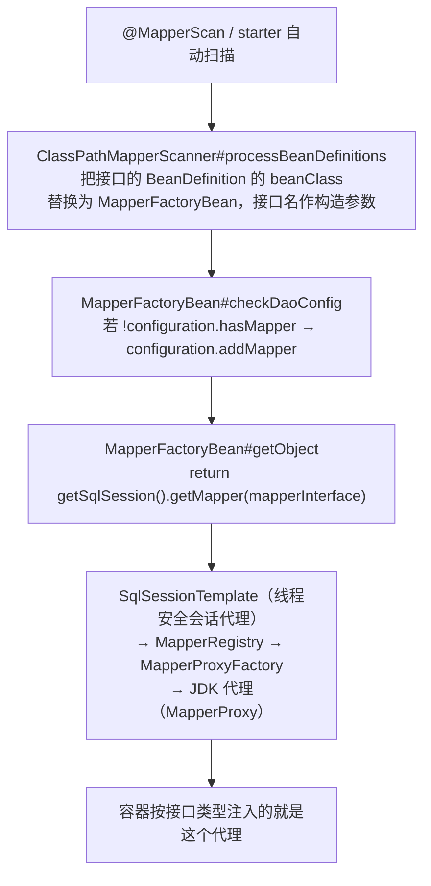
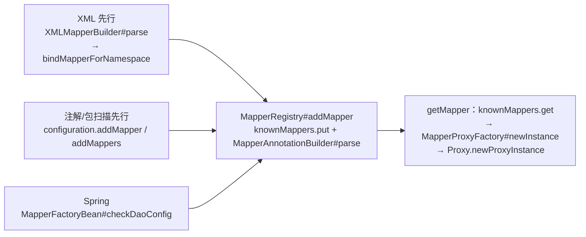
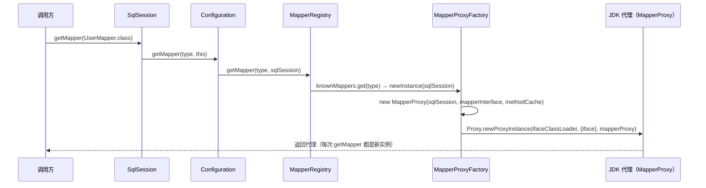
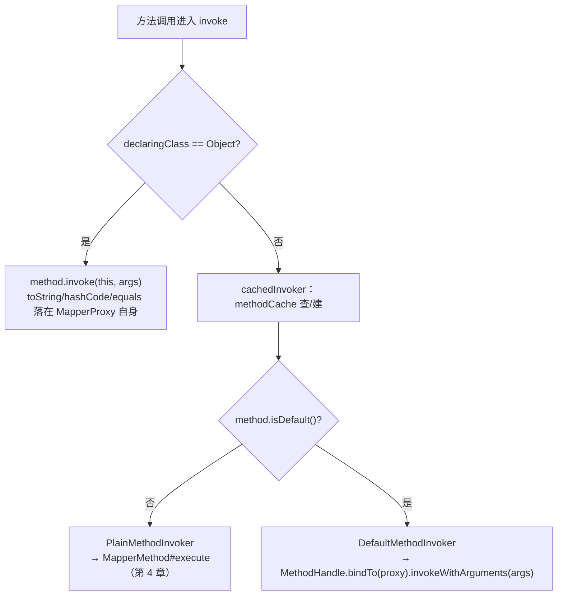

# Mapper 接口动态代理与参数绑定

> 一句话概括：Mapper 接口没有实现类，却能被注入、被调用——因为 MyBatis 用 JDK 动态代理把「方法调用」翻译成「按 statement id 查 SQL 并执行」，
> 再用 ParamNameResolver 把「方法参数」翻译成「SQL 能引用的命名参数」；本文讲清这两次翻译的机制、边界与代价。

预计阅读时间：大约 95 分钟

所属主题：[MyBatis 常见面试题总结](summary.md)

本文以 MyBatis 3.5.x（源码核验取 **3.5.19**，Java 8 基线）为源码基线，锚点用 `类名#方法名` 标注；**MyBatis 3.6.0**（2026-10 发布，Java 11 基线）的差异单独注明；mybatis-spring 侧机制按 **3.0.5** 核验。总结文档给结论，本文给机制与证据：每个机制按「结论 → 机制 → 边界/代价 → 实践/追问」展开。

---

## 0. 阅读路线

| 读者 | 建议阅读 | 关注点 |
| --- | --- | --- |
| 初级（1 年内） | 1、2.3、4.2~4.4、6.2、6.5、7.1 | 接口为什么能调用、返回类型怎么分派、@Param 什么时候加、Invalid bound statement 怎么查 |
| 中级（1~3 年） | 全部，重点 2.2、3、5、6 | 注册链、invoke 三分支、绑定规则与重载限制、参数命名全规则 |
| 高级（3 年+） | 3.3~3.4、4.1、5.4、6.3、7.3~7.4、8 | MethodHandle 版本演进、父接口递归、StrictMap 冲突、集合包装边界、线程安全 |
| 选型/架构 | 1.2、8 | 为什么是 JDK 代理、代理成本账、什么场景绕过 Mapper 接口 |

目录：

1. 从一个问题讲起：没有实现类的接口为什么能调用
2. 注册与代理生成链
3. MapperProxy#invoke 走读
4. MapperMethod：从方法签名到 SqlSession 调用
5. 绑定规则：namespace、statement id 与注解解析
6. 参数绑定：ParamNameResolver 全规则
7. 边界与排查
8. 选型与权衡
9. 高频面试追问集
10. 参考资料

---

## 1. 从一个问题讲起：没有实现类的接口为什么能调用

### 1.1 最小手写代理：复刻 MapperProxy 骨架

日常写法里只有接口，没有任何实现类：

```java
public interface UserMapper {
    User selectById(long id);
    int insert(User user);
}

// 既没有 UserMapperImpl，也没有 new——但就能注入、就能调
@Autowired
private UserMapper userMapper;
```

秘密只有一句话：**运行时生成了一个实现该接口的代理类，所有方法调用都被转发给一个 `InvocationHandler`，由它把「方法」翻译成「SQL」**。下面这个可运行示例就是 `MapperProxy` 的骨架（用 Map 模拟 `Configuration.mappedStatements`，用打印模拟执行器）：

```java
import java.lang.reflect.InvocationHandler;
import java.lang.reflect.Method;
import java.lang.reflect.Proxy;
import java.util.Arrays;
import java.util.HashMap;
import java.util.Map;

interface UserMapper {
    String selectName(long id);   // 对应 statement id：UserMapper.selectName
    int insert(String name);      // 对应 statement id：UserMapper.insert
}

public class MiniMapperProxyDemo {

    // 模拟 Configuration 里的 MappedStatement 注册表：statement id -> SQL
    static final Map<String, String> STATEMENTS = new HashMap<>();
    static {
        STATEMENTS.put("UserMapper.selectName", "SELECT name FROM user WHERE id = ?");
        STATEMENTS.put("UserMapper.insert", "INSERT INTO user(name) VALUES(?)");
    }

    static class MiniMapperProxy implements InvocationHandler {
        @Override
        public Object invoke(Object proxy, Method method, Object[] args) throws Throwable {
            if (Object.class.equals(method.getDeclaringClass())) {
                return method.invoke(this, args);          // toString/hashCode/equals 放行
            }
            // 核心翻译：方法 -> statement id -> SQL（真实实现用注册接口名，见 4.1）
            String statementId = method.getDeclaringClass().getName() + "." + method.getName();
            String sql = STATEMENTS.get(statementId);
            if (sql == null) {
                throw new RuntimeException("Invalid bound statement (not found): " + statementId);
            }
            System.out.println("execute: " + sql + " | args=" + Arrays.toString(args));
            if (method.getReturnType() == int.class) {
                return 1;                                  // 模拟写操作返回行数
            }
            return "tom";                                  // 模拟 selectOne 结果
        }
    }

    @SuppressWarnings("unchecked")
    static <T> T getMapper(Class<T> type) {
        return (T) Proxy.newProxyInstance(type.getClassLoader(),
            new Class<?>[]{type}, new MiniMapperProxy());
    }

    public static void main(String[] args) {
        UserMapper mapper = getMapper(UserMapper.class);
        System.out.println(mapper.selectName(1L));      // execute: SELECT ... | args=[1] → tom
        System.out.println(mapper.insert("jerry"));     // execute: INSERT ... → 1
        System.out.println(mapper.getClass().getName()); // JDK 8: com.sun.proxy.$Proxy0
    }
}
```

三个要点，后文逐一展开：

- **代理类是 JDK 在运行期生成的**（`$Proxy0`，JDK 17+ 为 `jdk.proxy2.$Proxy0`），它实现 `UserMapper`，每个方法体都是「转发给 InvocationHandler」；
- **statement id = 接口全限定名 + 方法名**，这是接口与 XML/注解之间唯一的桥（第 5 章）；
- **找不到 statement 就抛 `Invalid bound statement (not found)`**——和真实 MyBatis 的报错一字不差（第 7 章）。

### 1.2 与 Spring AOP 的 JDK 代理对照

两者用的是同一套 JDK 机制（`Proxy.newProxyInstance` + `InvocationHandler`，见 [Spring IoC & AOP](../spring/ioc-and-aop.md) 5.1），但 **InvocationHandler 的职责完全不同**：

| 维度 | MyBatis `MapperProxy` | Spring `JdkDynamicAopProxy` |
| --- | --- | --- |
| 有没有目标对象 | **没有**。接口无实现类，方法调用被翻译成 SQL 执行 | 有。持有 target，最终 `Method.invoke` 反射委托目标 |
| handler 职责 | 方法 → statement 映射 + 参数绑定 + 结果适配 | 拦截器链（事务/日志/缓存）+ 反射调目标 |
| 按方法缓存 | `methodCache`：Method → MapperMethodInvoker（工厂级共享，见 2.3） | `AdvisedSupport` methodCache：Method → 拦截器链 |
| Object 方法 | 反射到 MapperProxy 自身（见 3.2） | equals/hashCode 特殊处理 |
| default 方法 | **必须用 MethodHandle** 在代理上执行接口默认实现（见 3.3） | 目标类继承了默认实现，反射调目标即可，无需特殊处理 |

**关键差异的根源**：Spring 代理是「包装一个已有对象」，MyBatis 代理是「凭空实现一个接口」。没有 target 可以反射，所以 default 方法只能靠 `MethodHandle` 的 invokespecial 语义执行——这是 3.3 节全部复杂度的来源。代理模式与工厂模式的角色映射另见 [Spring 中的设计模式](../spring/design-patterns.md)。

### 1.3 Spring 里为什么能 @Autowired：FactoryBean 补上最后一环

MyBatis 本身只负责 `sqlSession.getMapper(...)`；「接口变成 Spring Bean」由 mybatis-spring 完成（以下按 mybatis-spring 3.0.5 核验）：



源码证据（`MapperFactoryBean`，简化）：

```java
public class MapperFactoryBean<T> extends SqlSessionDaoSupport implements FactoryBean<T> {

  @Override
  protected void checkDaoConfig() {
    super.checkDaoConfig();
    notNull(this.mapperInterface, "Property 'mapperInterface' is required");
    var configuration = getSqlSession().getConfiguration();
    if (this.addToConfig && !configuration.hasMapper(this.mapperInterface)) {
      configuration.addMapper(this.mapperInterface);   // 注册进 MyBatis（见第 2 章）
    }
  }

  @Override
  public T getObject() throws Exception {
    return getSqlSession().getMapper(this.mapperInterface);   // 产物是 Mapper 代理
  }

  @Override
  public boolean isSingleton() { return true; }
}
```

片段省略了真实源码中 `configuration.addMapper` 外层的 try/catch/finally：注册失败会 `logger.error` 记录并包装成 `IllegalArgumentException` 抛出（**启动即报错**），finally 中执行 `ErrorContext.instance().reset()` 清理错误上下文。

`ClassPathMapperScanner#processBeanDefinitions` 的关键一行是 `definition.setBeanClass(this.mapperFactoryBeanClass)`——**扫描到的是接口，注册进容器的却是 FactoryBean**，`getObject()` 的产物（代理）才是注入点拿到的对象。这正是 `FactoryBean` 与 `BeanFactory` 区别的经典实例（见 [Spring 总结](../spring/summary.md) 1.4）。`SqlSessionTemplate` 如何把每次调用路由到当前事务的 SqlSession、Mapper 单例为什么线程安全，见 [Spring 集成与事务](spring-integration-and-transaction.md) 与本文 7.4。

---

## 2. 注册与代理生成链

### 2.1 三条注册入口，一个收敛点

**结论**：无论 XML 先行、注解先行还是 Spring 扫描，最终都收敛到 `Configuration#addMapper` → `MapperRegistry#addMapper`；`getMapper` 则从注册表取工厂、现场生成代理。



- **XML 先行**：`XMLMapperBuilder#bindMapperForNamespace` 把 namespace 当类名加载（`Resources.classForName`），加载成功且未注册才 `addMapper`；加载失败静默忽略——**namespace 不是接口全限定名时，XML 照样能用 `sqlSession.selectList("ns.id")` 执行，但永远绑不到 Mapper 接口**（见 5.1）。
- **注解先行**：`MapperAnnotationBuilder#parse` 内部会 `loadXmlResource()` 主动找「接口同包同名 XML」（见 5.3），所以注解模式也能带上 XML。
- **包扫描**：`MapperRegistry#addMappers(packageName)` 用 `ResolverUtil` 扫包后逐个 `addMapper`。

### 2.2 MapperRegistry#addMapper 走读

```java
// MapperRegistry（3.5.19）
private final Map<Class<?>, MapperProxyFactory<?>> knownMappers = new ConcurrentHashMap<>();

public <T> void addMapper(Class<T> type) {
  if (type.isInterface()) {                              // ① 非接口：静默忽略，不报错
    if (hasMapper(type)) {
      throw new BindingException("Type " + type + " is already known to the MapperRegistry.");  // ②
    }
    boolean loadCompleted = false;
    try {
      knownMappers.put(type, new MapperProxyFactory<>(type));   // ③ 先注册工厂，再解析
      // It's important that the type is added before the parser is run
      // otherwise the binding may automatically be attempted by the mapper parser.
      MapperAnnotationBuilder parser = new MapperAnnotationBuilder(config, type);
      parser.parse();                                           // ④ 解析注解 + 同名 XML
      loadCompleted = true;
    } finally {
      if (!loadCompleted) {
        knownMappers.remove(type);                              // ⑤ 解析失败回滚注册
      }
    }
  }
}
```

四个设计点：

| 设计 | 原因 |
| --- | --- |
| ① 只处理接口 | JDK 代理只能基于接口；传入实现类会被**静默忽略**（不报错），这是「Mapper 必须是接口」的源码依据 |
| ② 重复注册抛异常 | 一个接口在一个 Configuration 里只有一份工厂与 statement 集合 |
| ③ **先 put 再 parse** | parse 会加载 XML，XML 解析末尾又回调 `bindMapperForNamespace` → `addMapper`；先注册使 `hasMapper` 为 true，**掐断递归** |
| ⑤ 失败回滚 | 解析抛异常时移除工厂，保证注册表与解析结果一致，不留半成品 |

`getMapper` 侧对称：工厂不存在抛 `BindingException("Type ... is not known to the MapperRegistry.")`——**未注册就取 Mapper，报错在 getMapper 这一刻**；而 statement 缺失的报错要等到首次方法调用（见 7.1），两者时机不同。

### 2.3 getMapper 完整路径与共享缓存



```java
// MapperProxyFactory（3.5.19）
private final Map<Method, MapperMethodInvoker> methodCache = new ConcurrentHashMap<>();

public T newInstance(SqlSession sqlSession) {
  final MapperProxy<T> mapperProxy = new MapperProxy<>(sqlSession, mapperInterface, methodCache);
  return newInstance(mapperProxy);
}

protected T newInstance(MapperProxy<T> mapperProxy) {
  return (T) Proxy.newProxyInstance(mapperInterface.getClassLoader(),
      new Class[] { mapperInterface }, mapperProxy);
}
```

**结论**：代理实例每次 `getMapper` 新建（很便宜），但 **`methodCache` 挂在工厂上、每个接口一份，被所有代理实例共享**。缓存的值 `MapperMethod` 只含 Configuration 级数据（statement id、类型、返回签名），不含会话状态；`sqlSession` 在每次 `invoke` 时传入。所以「解析一次、处处复用」，而会话隔离不受影响。

**边界与代价**：代理对象自身绑定创建时传入的 `sqlSession`——原生 MyBatis 里把一个会话的 Mapper 代理拿到另一个线程用是错的（SqlSession 非线程安全）；Spring 里因为传入的是 `SqlSessionTemplate`（线程安全代理）才没有这个问题（见 7.4）。

---

## 3. MapperProxy#invoke 走读

### 3.1 三分支总览

```java
// MapperProxy#invoke（3.5.19）
@Override
public Object invoke(Object proxy, Method method, Object[] args) throws Throwable {
  try {
    if (Object.class.equals(method.getDeclaringClass())) {
      return method.invoke(this, args);                 // 分支一：Object 方法放行
    }
    return cachedInvoker(method).invoke(proxy, method, args, sqlSession);  // 分支二/三
  } catch (Throwable t) {
    throw ExceptionUtil.unwrapThrowable(t);             // 解包反射异常，还原业务异常
  }
}

// MapperProxy#cachedInvoker（3.5.19）
private MapperMethodInvoker cachedInvoker(Method method) throws Throwable {
  try {
    return MapUtil.computeIfAbsent(methodCache, method, m -> {
      if (!m.isDefault()) {
        return new PlainMethodInvoker(new MapperMethod(mapperInterface, method, sqlSession.getConfiguration()));
      }
      try {
        if (privateLookupInMethod == null) {
          return new DefaultMethodInvoker(getMethodHandleJava8(method));   // JDK 8
        }
        return new DefaultMethodInvoker(getMethodHandleJava9(method));     // JDK 9+
      } catch (IllegalAccessException | InstantiationException | InvocationTargetException
          | NoSuchMethodException e) {
        throw new RuntimeException(e);
      }
    });
  } catch (RuntimeException re) {
    Throwable cause = re.getCause();
    throw cause == null ? re : cause;
  }
}
```



### 3.2 Object 方法：直接放行

`toString`/`hashCode`/`equals` 由 `Object` 声明，代理不会把它们翻译成 SQL，而是反射到 **MapperProxy 自身**。两个推论：

- `mapper.toString()` 输出的是 `org.apache.ibatis.binding.MapperProxy@xxxx`，不是接口名；
- `equals` 比较的是 MapperProxy 的对象同一性——同一接口两次 `getMapper` 得到的代理 **equals 为 false**（代理实例每次新建，见 2.3）。

**边界**：如果在 Mapper 接口里**显式声明** `String toString()`，它的 declaringClass 是接口而不是 Object，会被当成普通 Mapper 方法去找 statement，找不到就抛 `Invalid bound statement`。不要在 Mapper 接口里声明 Object 方法签名。

### 3.3 default 方法：为什么必须 MethodHandle

**结论**：default 方法有方法体、不对应 SQL，必须「原样执行接口默认实现」；但代理类对接口所有方法（含 default）都生成了转发到 handler 的实现，**直接 `Method.invoke(proxy, ...)` 会再次进入 invoke 造成无限递归**。唯一出路是 invokespecial 语义——绕过虚分派、直接执行接口里的那份默认实现，这正是 `MethodHandle` 的 `unreflectSpecial`/`findSpecial` 做的事：

```java
// DefaultMethodInvoker#invoke（3.5.19）
return methodHandle.bindTo(proxy).invokeWithArguments(args);   // receiver 绑定为代理本身

// JDK 9+：privateLookupIn + findSpecial
private MethodHandle getMethodHandleJava9(Method method) throws ... {
  final Class<?> declaringClass = method.getDeclaringClass();
  return ((Lookup) privateLookupInMethod.invoke(null, declaringClass, MethodHandles.lookup()))
      .findSpecial(declaringClass, method.getName(),
          MethodType.methodType(method.getReturnType(), method.getParameterTypes()), declaringClass);
}

// JDK 8：反射打开 Lookup(Class, int) 私有构造器 + unreflectSpecial
private MethodHandle getMethodHandleJava8(Method method) throws ... {
  final Class<?> declaringClass = method.getDeclaringClass();
  return lookupConstructor.newInstance(declaringClass, ALLOWED_MODES)   // PRIVATE|PROTECTED|PACKAGE|PUBLIC
      .unreflectSpecial(method, declaringClass);
}
```

JDK 9 引入模块系统后 `Lookup(Class, int)` 私有构造器被封装，`setAccessible` 不再可靠，所以 3.5.x 用**静态块探测** `MethodHandles.privateLookupIn` 是否存在：存在走 Java 9 路径，不存在回退 Java 8 路径；两者都没有直接抛 `IllegalStateException`。

**版本演进（逐版核验，注明者除外）**：

| 版本 | default 方法实现方式 |
| --- | --- |
| 3.4.2 | **引入支持**：手写 `isDefaultMethod` backport（modifiers 判断）+ 反射 `Lookup(Class,int)` 构造器（仅 `PRIVATE` 模式）+ `unreflectSpecial`；方法标 `@UsesJava7` |
| 3.5.0~3.5.1 | 结构不变；Lookup 模式扩为 PRIVATE\|PROTECTED\|PACKAGE\|PUBLIC |
| 3.5.2 | 改用 JDK 8 原生 `Method#isDefault()`，去掉手写 backport |
| 3.5.3 | **静态探测 `privateLookupIn`**：JDK 9+ 走 `findSpecial`，JDK 8 回退 Lookup 构造器（构造器缓存为静态字段） |
| 3.5.4 | **重构为 `cachedInvoker` + `MapperMethodInvoker`**（Plain/DefaultMethodInvoker），default 方法也进 methodCache |
| 3.5.5 | cachedInvoker 内先 `get` 再 `computeIfAbsent`（JDK-8161372 workaround，见 3.4） |
| 3.5.19（基线状态） | workaround 已收敛到 `MapUtil#computeIfAbsent`（收敛发生于 3.5.7~3.5.18 间某版，未逐版核验）；`MapperMethodInvoker` 仍是 MapperProxy 的**包级私有嵌套接口** |
| **3.6.0**（2026-10，Java 11 基线） | `MapperMethodInvoker` 提为**独立 public 接口**（`binding/MapperMethodInvoker.java`）；**删除 Java 8 分支**（无 `privateLookupIn` 直接类初始化失败）；直接用 `methodCache.computeIfAbsent` |

3.4.2 之前没有 default 分支，default 方法会被当普通 Mapper 方法去找 statement 而报错——「MyBatis 支持接口默认方法」的版本归属是 **3.4.2**。

**边界与代价**：

- `MapperAnnotationBuilder#canHaveStatement` 过滤条件是 `!method.isBridge() && !method.isDefault()`——**default 方法即使标了 `@Select` 也不会生成 statement**，注解被静默忽略；
- default 方法体内 `this` 就是代理，调用其他 Mapper 方法**仍然经过完整绑定链**——不存在 Spring AOP 那种自调用失效（对照 [Spring IoC & AOP](../spring/ioc-and-aop.md) 7.1，根源差异：Spring 的 this 是原始对象，MyBatis 的 this 是代理）；
- default 方法本身不产生 SQL，也**不被 MyBatis 插件拦截**——插件拦截的是 Executor/StatementHandler 等四大对象，不是 Mapper 代理层（见 [插件与分页](plugin-and-pagination.md)）。

**实践**：default 方法适合做「组合查询 + 内存加工」的便捷方法（如 `selectByIds` 分批调 `selectList` 再合并），把 SQL 语义留在抽象方法上。

### 3.4 methodCache 与 JDK-8161372

`methodCache` 是 `ConcurrentHashMap`，但 3.5.19 不直接调它的 `computeIfAbsent`，而是走 `MapUtil`：

```java
// MapUtil#computeIfAbsent（3.5.19）
// A temporary workaround for Java 8 specific performance issue JDK-8161372.
public static <K, V> V computeIfAbsent(Map<K, V> map, K key, Function<K, V> mappingFunction) {
  V value = map.get(key);
  if (value != null) {
    return value;
  }
  return map.computeIfAbsent(key, mappingFunction);
}
```

**机制**：JDK 8 的 `ConcurrentHashMap.computeIfAbsent` 即使 key 已存在也会锁住桶（JDK-8161372），热点 Mapper 方法高并发调用时产生无谓竞争；先 `get` 命中即返回，只有首次才进 `computeIfAbsent`。3.5.5 把这个 workaround 写在 `cachedInvoker` 里，3.5.19 收敛到 `MapUtil`；**3.6.0 因 Java 11 基线直接删掉 workaround**。这是「框架为 JDK 缺陷买单」的典型案例，面试讲出来很加分。

---

## 4. MapperMethod：从方法签名到 SqlSession 调用

### 4.1 SqlCommand：statement id 解析与父接口递归

`MapperMethod` 构造时创建两个组件：`SqlCommand`（查哪条 SQL、什么类型）与 `MethodSignature`（参数怎么转、结果怎么收）。

```java
// MapperMethod.SqlCommand 构造器（3.5.19，节选）
MappedStatement ms = resolveMappedStatement(mapperInterface, methodName, declaringClass, configuration);
if (ms == null) {
  if (method.getAnnotation(Flush.class) == null) {
    throw new BindingException("Invalid bound statement (not found): "
        + mapperInterface.getName() + "." + methodName);      // 首次调用才抛（见 7.1）
  }
  name = null;
  type = SqlCommandType.FLUSH;                                // @Flush：无 statement，纯刷新批处理
} else {
  name = ms.getId();
  type = ms.getSqlCommandType();
  if (type == SqlCommandType.UNKNOWN) {
    throw new BindingException("Unknown execution method for: " + name);
  }
}

// MapperMethod.SqlCommand#resolveMappedStatement
String statementId = mapperInterface.getName() + "." + methodName;   // 注册接口名优先
if (configuration.hasStatement(statementId)) {
  return configuration.getMappedStatement(statementId);
}
if (mapperInterface.equals(declaringClass)) {
  return null;
}
for (Class<?> superInterface : mapperInterface.getInterfaces()) {
  if (declaringClass.isAssignableFrom(superInterface)) {
    MappedStatement ms = resolveMappedStatement(superInterface, methodName, declaringClass, configuration);
    if (ms != null) { return ms; }
  }
}
return null;
```

三个要点：

- **id 只含方法名，不含参数签名**——这是不支持方法重载的根源（见 5.2）；
- **父接口递归**：方法声明在父接口（如泛型 `BaseMapper<T>`）时，先按子接口名找 statement，找不到再沿「与声明类相关的父接口」递归。MyBatis-Plus 的通用 CRUD 正是把 statement 注入到子接口 namespace 下复用这条链（见 [MyBatis-Plus 与生态](mybatis-plus-and-ecosystem.md)）；
- `configuration.hasStatement(id)` 默认会先 `buildAllStatements()` 补齐未完成的解析（pending resultMap/cache-ref/statement）——**首次调用还兼有「把启动期没解析完的尾巴收掉」的作用**。

### 4.2 MethodSignature：返回类型判定

构造时用 `TypeParameterResolver.resolveReturnType` 解析泛型（支持泛型父接口），再置标志位：

| 返回类型 | 标志位（判定依据） | SELECT 执行路径 |
| --- | --- | --- |
| `void` 且参数含 `ResultHandler` | `returnsVoid && hasResultHandler` | `executeWithResultHandler`：逐行回调，方法返回 null |
| Collection 子类型 / 数组 | `returnsMany`：`ObjectFactory.isCollection(returnType) \|\| returnType.isArray()` | `executeForMany` → `selectList`，必要时转换（见下） |
| `Map` 且标 `@MapKey` | `returnsMap`：**mapKey != null**，不是「是 Map 就算」 | `executeForMap` → `selectMap`，以 `@MapKey` 指定的属性为 key |
| `Cursor<T>` | `returnsCursor`：精确等于 `Cursor.class` | `executeForCursor` → `selectCursor`，流式游标 |
| `Optional<T>`（3.5.0+） | `returnsOptional`：精确等于 `Optional.class` | `selectOne` 后包 `Optional.ofNullable` |
| 其他单值（POJO/String/Map 无 @MapKey…） | 无标志 | `selectOne` |

`executeForMany` 的收尾转换（issue #510）：`selectList` 返回的是 `List`，若声明类型接不住——数组走 `convertToArray`（`Array.newInstance`，基本类型数组逐元素 `Array.set`）；其他集合走 `convertToDeclaredCollection`（`ObjectFactory.create` + `MetaObject.addAll`）。**声明 `Set<User>`、`User[]` 都能工作**，代价是一次额外拷贝。

**边界**：

- `RowBounds`/`ResultHandler` 是特殊参数：按类型找出下标、**各只允许一个**（多个抛 `cannot have multiple ... parameters`），不参与参数 Map（见 6.1）。`RowBounds` 是内存逻辑分页，不是物理分页（见 [插件与分页](plugin-and-pagination.md)）；
- `Cursor` 必须在会话存活期间消费完（try-with-resources 或事务内），会话关闭后游标失效（见 [批处理与性能](batch-and-performance.md)）；
- 返回 `Map` 但没加 `@MapKey` 时走 `selectOne`——语义是「单行映射成 Map」，多行直接 `TooManyResultsException`，不是「以某列为 key 的多行 Map」。

### 4.3 execute：按 SqlCommandType 分派

```java
// MapperMethod#execute（3.5.19，骨架）
switch (command.getType()) {
  case INSERT: {
    Object param = method.convertArgsToSqlCommandParam(args);
    result = rowCountResult(sqlSession.insert(command.getName(), param));
    break;
  }
  case UPDATE: { /* 同上 → sqlSession.update */ }
  case DELETE: { /* 同上 → sqlSession.delete */ }
  case SELECT:
    if (method.returnsVoid() && method.hasResultHandler()) { executeWithResultHandler(sqlSession, args); result = null; }
    else if (method.returnsMany())   { result = executeForMany(sqlSession, args); }
    else if (method.returnsMap())    { result = executeForMap(sqlSession, args); }
    else if (method.returnsCursor()) { result = executeForCursor(sqlSession, args); }
    else {
      Object param = method.convertArgsToSqlCommandParam(args);
      result = sqlSession.selectOne(command.getName(), param);
      if (method.returnsOptional() && (result == null || !method.getReturnType().equals(result.getClass()))) {
        result = Optional.ofNullable(result);
      }
    }
    break;
  case FLUSH:
    result = sqlSession.flushStatements();
    break;
  default:
    throw new BindingException("Unknown execution method for: " + command.getName());
}
if (result == null && method.getReturnType().isPrimitive() && !method.returnsVoid()) {
  throw new BindingException("Mapper method '" + command.getName()
      + "' attempted to return null from a method with a primitive return type (" + method.getReturnType() + ").");
}
return result;
```

| 命令类型 | SqlSession 方法 | 返回值处理 |
| --- | --- | --- |
| INSERT / UPDATE / DELETE | `insert` / `update` / `delete`（三者底层都委托 `DefaultSqlSession#update` → `executor.update`） | `rowCountResult` 适配 int/long/boolean/void |
| SELECT | 按 4.2 表分派到 `selectOne/selectList/selectMap/selectCursor/select` | 结果映射由 Executor + ResultSetHandler 完成（见 [结果映射与 TypeHandler](result-mapping-and-typehandler.md)） |
| FLUSH（`@Flush`） | `flushStatements()` | 返回批处理结果列表，配合 `ExecutorType.BATCH` 使用 |

注意 **SqlCommandType 来自 MappedStatement（XML 标签/注解类型），不是方法名或返回类型**——方法叫 `insertXxx` 但 XML 写成 `<select>`，执行的就是 SELECT 分派。

### 4.4 rowCountResult 与 selectOne 语义

```java
// MapperMethod#rowCountResult（3.5.19）
if (method.returnsVoid())                          result = null;
else if (Integer.class/Integer.TYPE 匹配)           result = rowCount;
else if (Long.class/Long.TYPE 匹配)                 result = (long) rowCount;
else if (Boolean.class/Boolean.TYPE 匹配)           result = rowCount > 0;
else throw new BindingException("... has an unsupported return type: " + method.getReturnType());
```

写操作返回类型**只支持 void / int / Integer / long / Long / boolean / Boolean**；`boolean` 的语义是「影响行数 > 0」。返回 `String`、POJO 一律启动后首次调用即报 `unsupported return type`。

查询侧 `selectOne` 的语义由 `DefaultSqlSession#selectOne` 保证：

```java
List<T> list = this.selectList(statement, parameter);
if (list.size() == 1) { return list.get(0); }
if (list.size() > 1) {
  throw new TooManyResultsException("Expected one result (or null) to be returned by selectOne(), but found: " + list.size());
} else { return null; }
```

**0 行 → null，1 行 → 对象，多行 → TooManyResultsException**。两个高频推论：

- 返回类型声明为基本类型 `int` 的查询方法，查不到行时 null 无法拆箱——`execute` 末尾的 primitive 校验直接抛 `BindingException`。**查询计数请用 `Integer`/`Long`，或保证 SQL 永远返回一行（如 `COUNT(*)`）**；
- 「按唯一键查询」也要防数据异常导致多行，`selectOne` 会炸而不是取第一条。

---

## 5. 绑定规则：namespace、statement id 与注解解析

### 5.1 双向绑定：XML ↔ 接口

**结论**：绑定契约只有两条——**XML namespace = 接口全限定名**，**statement id = 接口全限定名 + "." + 方法名**。两个方向的解析互相兜底：

| 方向 | 触发点 | 行为 |
| --- | --- | --- |
| XML → 接口 | `XMLMapperBuilder#bindMapperForNamespace` | namespace 当类名加载，成功且未注册 → `addLoadedResource("namespace:" + namespace)` + `configuration.addMapper(boundType)`；类不存在静默忽略 |
| 接口 → XML | `MapperAnnotationBuilder#loadXmlResource` | 按 `type.getName().replace('.', '/') + ".xml"` 找**同包同名** XML（先 `type.getResourceAsStream("/" + path)`，再 classpath 兜底）；找到就交给 XMLMapperBuilder 解析 |

```java
// XMLMapperBuilder#bindMapperForNamespace（3.5.19）
String namespace = builderAssistant.getCurrentNamespace();
if (namespace != null) {
  Class<?> boundType = null;
  try {
    boundType = Resources.classForName(namespace);
  } catch (ClassNotFoundException e) {
    // ignore, bound type is not required
  }
  if (boundType != null && !configuration.hasMapper(boundType)) {
    configuration.addLoadedResource("namespace:" + namespace);   // 防止接口侧再重复加载本 XML
    configuration.addMapper(boundType);
  }
}
```

**边界**：

- namespace 拼错/不是接口名：XML 语句仍注册成功（可用 `sqlSession.selectList("错误ns.selectXxx")` 执行），但接口方法找不到 statement → `Invalid bound statement`。**启动不报错，首次调用才炸**；
- XML 放在 `src/main/resources` 下与接口**不同包**时，`loadXmlResource` 找不到它，必须靠 Spring 的 `mybatis.mapper-locations` 显式加载（见 7.1）；
- 纯 XML（无接口）项目可以完全不走 Mapper 代理，直接 SqlSession + statement id——代理只是便利层，不是执行层（执行链见 [架构与 SQL 执行](architecture-and-sql-execution.md)）。

### 5.2 为什么 Mapper 接口不支持方法重载

**结论**：statement id 只有「接口名 + 方法名」，**没有参数签名**，重载方法在 MyBatis 眼里是同一条语句。

```java
User selectById(long id);
User selectById(long id, boolean forUpdate);   // 两个方法 → 同一个 id：com.x.UserMapper.selectById
```

两种模式的后果不同：

| 模式 | 后果 | 时机 |
| --- | --- | --- |
| 注解模式 | 两个方法都生成同一 id 的 MappedStatement，`StrictMap#put` 抛 `IllegalArgumentException: Mapped Statements collection already contains key ...` | **启动期** |
| XML 模式 | 只有一个 id，两个重载都解析到同一条 statement；但参数绑定按各自方法签名走（一个单参透传、一个 ParamMap），`#{}` 引用必然有一边错乱 | **运行期**，报错隐蔽 |

`resolveMappedStatement` 只拿 `method.getName()` 拼 id，没有任何按参数类型消歧的逻辑——**这不是 bug 而是设计取舍**：id 保持人类可读的字符串契约，代价是放弃重载。实践规范：Mapper 方法名唯一，语义不同就改名（`selectById` / `selectByIdForUpdate`）。

### 5.3 MapperAnnotationBuilder：@Select 如何变成 MappedStatement

```java
// MapperAnnotationBuilder#parse（3.5.19，骨架）
String resource = type.toString();
if (!configuration.isResourceLoaded(resource)) {
  loadXmlResource();                              // 先加载同包同名 XML
  configuration.addLoadedResource(resource);
  assistant.setCurrentNamespace(type.getName());
  parseCache(); parseCacheRef();
  for (Method method : type.getMethods()) {       // 所有 public 方法（含继承）
    if (!canHaveStatement(method)) { continue; }  // 跳过 bridge 与 default
    if (getAnnotationWrapper(method, false, Select.class, SelectProvider.class).isPresent()
        && method.getAnnotation(ResultMap.class) == null) {
      parseResultMap(method);
    }
    try {
      parseStatement(method);
    } catch (IncompleteElementException e) {
      configuration.addIncompleteMethod(new MethodResolver(this, method));   // 延迟重试
    }
  }
}
```

`parseStatement` 的核心：

```java
final String mappedStatementId = type.getName() + "." + method.getName();   // id 生成规则
getAnnotationWrapper(method, true, statementAnnotationTypes).ifPresent(statementAnnotation -> {
  SqlSource sqlSource = buildSqlSource(...);      // @Select 等：String.join(" ", value()) → LanguageDriver
  assistant.addMappedStatement(mappedStatementId, sqlSource, ...);
});
```

- 支持的语句注解：`@Select/@Insert/@Update/@Delete` 与四个 `@...Provider`；Provider 走 `ProviderSqlSource` 动态生成 SQL；
- `@Options` 覆盖 fetchSize/timeout/useGeneratedKeys 等；`@SelectKey` 额外注册一条 `...!selectKey` 语句；SELECT 默认 `useCache=true`、写操作默认 `flushCache=true`（缓存语义见 [缓存机制](cache-mechanism.md)）；
- **没有语句注解的方法静默跳过**（`ifPresent`）——注册期不报错，调用时才由 SqlCommand 抛 `Invalid bound statement`。接口里可以存在「暂时没写 SQL 的方法」，编译与启动都发现不了；
- 同一方法上同 databaseId 的多个语句注解（如 `@Select` + `@Insert`）→ `getAnnotationWrapper` 抛 `BuilderException: Detected conflicting annotations ...`。

### 5.4 XML 与注解混用：同 id 冲突与短名歧义

**结论**：同一个 statement id 在 XML 和注解里各写一份，**启动期直接失败**，不存在「谁覆盖谁」。冲突判定在 `Configuration.StrictMap#put`：

```java
// Configuration.StrictMap#put（3.5.19）
if (containsKey(key)) {
  throw new IllegalArgumentException(name + " already contains key " + key
      + (conflictMessageProducer == null ? "" : conflictMessageProducer.apply(super.get(key), value)));
}
if (key.contains(".")) {
  final String shortKey = getShortName(key);          // 同时注册短名（最后一段）
  if (super.get(shortKey) == null) {
    super.put(shortKey, value);
  } else {
    super.put(shortKey, (V) new Ambiguity(shortKey)); // 短名冲突 → 歧义占位
  }
}
return super.put(key, value);
```

`mappedStatements` 的 `conflictMessageProducer`（3.5.0 起）会把两份资源的出处拼进报错：`... please check <资源1> and <资源2>`——**报错信息直接告诉你哪两个文件打架**。

| 场景 | 行为 |
| --- | --- |
| 同接口同方法，XML + 注解各一份 | 启动期 `IllegalArgumentException: Mapped Statements collection already contains key ...`（无论谁先解析，后注册的一方触发） |
| 不同 namespace、相同短名（如两个 `selectById`） | 全限定 id 各自注册成功；短名被标记 Ambiguity，用短名 `get` 时抛 `... is ambiguous in Mapped Statements collection (try using the full name including the namespace...)` |
| 同方法多个同 databaseId 语句注解 | `BuilderException: Detected conflicting annotations` |

**实践**：一个方法只选一种 SQL 载体（推荐复杂 SQL 用 XML、简单 CRUD 用注解，但**不要对同一方法混用**）；`sqlSession` 直接调用时永远写全限定 id，避开短名歧义。

---

## 6. 参数绑定：ParamNameResolver 全规则

### 6.1 名字怎么来：构造器三级优先级

`MethodSignature` 构造时创建 `ParamNameResolver`，为每个**非特殊参数**确定名字：

```java
// ParamNameResolver 构造器（3.5.19，骨架）
this.useActualParamName = config.isUseActualParamName();     // 默认 true（3.4.1 起）
for (int paramIndex = 0; paramIndex < paramCount; paramIndex++) {
  if (isSpecialParameter(paramTypes[paramIndex])) { continue; }   // 跳过 RowBounds / ResultHandler
  String name = null;
  for (Annotation annotation : paramAnnotations[paramIndex]) {
    if (annotation instanceof Param) {
      hasParamAnnotation = true;
      name = ((Param) annotation).value();                   // ① @Param 最优先
      break;
    }
  }
  if (name == null) {
    if (useActualParamName) {
      name = getActualParamName(method, paramIndex);         // ② 实际参数名
    }
    if (name == null) {
      name = String.valueOf(map.size());                     // ③ 兜底：数字下标 "0","1"...
    }
  }
  map.put(paramIndex, name);
}
names = Collections.unmodifiableSortedMap(map);
```

| 优先级 | 名字来源 | 条件与代价 |
| --- | --- | --- |
| ① `@Param("name")` | 注解显式命名 | 永远可靠，与编译选项无关 |
| ② 实际参数名 | `ParamNameUtil#getParamNames` → `Executable.getParameters()` → `Parameter.getName()` | `useActualParamName=true`（默认）；**编译必须加 `-parameters`**，否则 JDK 反射返回合成名 `arg0/arg1`——arg0 不是 MyBatis 的回退逻辑，是 JDK 的行为 |
| ③ 数字下标 | `"0"`、`"1"`（按跳过特殊参数后的序号） | 前两者都拿不到时的兜底；`#{0}` 这种写法可用但极不推荐 |

官方文档对 `useActualParamName` 的说明（Since 3.4.1，默认 true）：*"To use this feature, your project must be compiled in Java 8 with `-parameters` option."* Maven 配置：

```xml
<plugin>
  <groupId>org.apache.maven.plugins</groupId>
  <artifactId>maven-compiler-plugin</artifactId>
  <configuration>
    <parameters>true</parameters>   <!-- 等价于 javac -parameters -->
  </configuration>
</plugin>
```

**边界**：`RowBounds`/`ResultHandler` 按 `isAssignableFrom` 识别并跳过，**不进入参数 Map**（SQL 里引用不到它们）；兜底编号用 `map.size()` 而非真实下标，所以 `(int a, RowBounds rb, int b)` 的名字是 `{0:"0", 2:"1"}`——取值仍按真实下标，不会错位。

### 6.2 getNamedParams：三分支决定 SQL 层拿到什么

```java
// ParamNameResolver#getNamedParams（3.5.19）
public Object getNamedParams(Object[] args) {
  final int paramCount = names.size();
  if (args == null || paramCount == 0) {
    return null;                                          // 分支一：无有效参数
  }
  if (!hasParamAnnotation && paramCount == 1) {
    Object value = args[names.firstKey()];
    return wrapToMapIfCollection(value, useActualParamName ? names.get(names.firstKey()) : null);
  } else {                                                // 分支三：多参数 或 任一 @Param
    final Map<String, Object> param = new ParamMap<>();
    int i = 0;
    for (Map.Entry<Integer, String> entry : names.entrySet()) {
      param.put(entry.getValue(), args[entry.getKey()]);          // 名字 → 值
      final String genericParamName = i < 10 ? GENERIC_NAME_CACHE[i] : GENERIC_NAME_PREFIX + (i + 1);
      if (!names.containsValue(genericParamName)) {
        param.put(genericParamName, args[entry.getKey()]);        // 补 param1/param2...，不覆盖 @Param 同名
      }
      i++;
    }
    return param;
  }
}
```

| 分支 | 条件 | SQL 层拿到的参数对象 |
| --- | --- | --- |
| 一 | 无参 / 全是特殊参数 | `null` |
| 二 | **单参数且无任何 @Param** | 原值透传；集合/数组经 `wrapToMapIfCollection` 包装（见 6.3） |
| 三 | 多参数，或**任一参数带 @Param**（哪怕只有一个参数） | `ParamMap`：`{名字→值, param1→值, param2→值...}` |

两个易错点：

- **`hasParamAnnotation` 是方法级的**：只要有一个参数标了 `@Param`，单参数也走分支三。`selectById(@Param("id") long id)` 必须写 `#{id}` 或 `#{param1}`；
- `param1/param2` 永远可用（按非特殊参数顺序），且不会覆盖用户恰好叫 `param1` 的 `@Param`。`ParamMap` 重写了 `get`：**引用不存在的名字直接抛 `BindingException: Parameter 'xxx' not found. Available parameters are [...]`**——报错自带可用参数清单，是排查参数名问题的第一现场。

### 6.3 wrapToMapIfCollection：集合/数组的特殊包装

```java
// ParamNameResolver#wrapToMapIfCollection（3.5.19，public static，@since 3.5.5）
if (object instanceof Collection) {
  ParamMap<Object> map = new ParamMap<>();
  map.put("collection", object);
  if (object instanceof List) { map.put("list", object); }
  Optional.ofNullable(actualParamName).ifPresent(name -> map.put(name, object));
  return map;
}
if (object != null && object.getClass().isArray()) {
  ParamMap<Object> map = new ParamMap<>();
  map.put("array", object);
  Optional.ofNullable(actualParamName).ifPresent(name -> map.put(name, object));
  return map;
}
return object;    // POJO / Map / 简单类型 / null：原样透传
```

| 单参数类型（无 @Param） | 包装后的键 | `#{}` / foreach 写法 |
| --- | --- | --- |
| `List<User>` | `collection`、`list`、（实际参数名，需 `-parameters` 且 useActualParamName=true） | `#{list}`；`<foreach collection="list" ...>` |
| `Set<User>` 等 Collection | `collection`、（实际参数名） | `#{collection}`；`collection="collection"` |
| `long[]` / `Long[]` | `array`、（实际参数名） | `#{array}`；`collection="array"` |
| POJO / Map / String / null | 不包装 | 见 6.4 |

**版本归属**：3.5.5 起该方法公开并支持把实际参数名一并放入；此前版本只包 `collection/list/array` 键。另外 `DefaultSqlSession#wrapCollection` 在 SqlSession 直调路径上也做同样包装（传 `null` 实际名）——**Mapper 路径与 SqlSession 直调路径的集合语义一致**。

**高频边界（面试分水岭）**：单集合参数**加了 `@Param("ids")` 后走分支三，不再包装**——`#{list}`、`#{collection}` 反而失效，必须写 `#{ids}`、`<foreach collection="ids">`。「为什么加了 @Param 之后 list 取不到了」的答案就在这两个分支的互斥上。

### 6.4 #{} 里能写什么：由参数结构决定

SQL 层最终由 `DefaultParameterHandler#setParameters` 取值：

```java
// DefaultParameterHandler#setParameters（3.5.19，取值分支）
if (boundSql.hasAdditionalParameter(propertyName)) {        // foreach 的 item/index 等动态绑定优先
  value = boundSql.getAdditionalParameter(propertyName);
} else if (parameterObject == null) {
  value = null;
} else if (typeHandlerRegistry.hasTypeHandler(parameterObject.getClass())) {
  value = parameterObject;                                  // 简单类型：整个参数就是值，名字被忽略
} else {
  value = metaObject.getValue(propertyName);                // POJO/Map：按属性名/key 取值
}
```

| 参数形态（无 @Param 单参） | SQL 层对象 | `#{}` 写法 |
| --- | --- | --- |
| POJO | POJO 本身 | `#{property}`，支持 `#{a.b}` 级联（MetaObject） |
| Map | Map 本身 | `#{key}` |
| String / long / Integer 等简单类型 | 值本身 | **`#{任意名}` 都行**（hasTypeHandler 分支直接取整值）——单参数 `#{id}`/`#{value}`/`#{abc}` 等价 |
| List / Set / 数组 | 包装 ParamMap | 见 6.3 |
| 多参数 / 有 @Param | ParamMap | `#{名字}` 或 `#{paramN}`，写错抛 Parameter not found |

`#{}` 的占位符解析、`<foreach>` 的 item/index 如何进入 additionalParameter、`${}` 的注入风险，见 [动态 SQL 与注入](dynamic-sql-and-injection.md)；值到 JDBC 类型的转换见 [结果映射与 TypeHandler](result-mapping-and-typehandler.md)。

### 6.5 @Param 什么时候必须加

**结论（实践规范）**：

| 场景 | 是否必须 | 原因 |
| --- | --- | --- |
| 多参数方法 | **强烈建议每个都加** | 不加则依赖 `-parameters`（实际名）或只能用 `param1/arg0`；编译选项一变全崩 |
| 单参数 POJO / Map / 简单类型 | 可不加 | 透传后按属性/任意名取值 |
| 单集合/数组，想用自定义名 | **必须加** | 否则只有 `collection/list/array` 键 |
| 单集合/数组，加了 @Param | 注意 | `list/collection` 键消失，foreach 的 collection 必须用 @Param 名（6.3） |
| `@SelectProvider` 等 Provider 方法引用参数名 | 建议加 | Provider 侧按名取参，显式命名最稳 |
| 动态 SQL 里 `<if test="...">` 引用参数 | 多参数必须加 | OGNL 按 ParamMap 的键求值 |

一句话立场：**多参数一律 `@Param`，把命名契约从「编译选项」变成「源码显式声明」**；单参数按类型决定。不要依赖 `arg0/param1` 写业务 SQL——它们是兜底机制，不是可读性方案。

---

## 7. 边界与排查

### 7.1 BindingException: Invalid bound statement (not found) 完整排查清单

**先明确报错时机**：异常在 `MapperMethod.SqlCommand` 构造时抛出，即**该方法首次被调用时**——不是启动期，也不是 `getMapper` 时。启动正常、注入正常，不代表绑定正确。

按命中概率排序：

| # | 检查项 | 具体动作 |
| --- | --- | --- |
| 1 | XML 没进 classpath | Maven 默认**不打包 `src/main/java` 下的 XML**。看 `target/classes`（或 jar 内）有没有对应 XML；没有就改放 `src/main/resources` 同包路径，或配 `<resources>` 包含 `**/*.xml` |
| 2 | namespace 不一致 | XML 的 namespace 必须逐字符等于接口全限定名（包名重构后最常见） |
| 3 | `mapper-locations` 未配/不匹配 | XML 与接口不同包时，`loadXmlResource` 找不到它；Boot 下必须 `mybatis.mapper-locations=classpath*:mapper/**/*.xml`（多模块用 `classpath*:`） |
| 4 | statement id 与方法名不一致 | 大小写、拼写；方法重载导致 id 歧义（5.2） |
| 5 | 接口没被注册 | `@MapperScan` 包路径不对、`@Mapper` 缺失、`addToConfig=false` 且 mybatis-config 未登记；多 SqlSessionFactory 时注册到了另一个 Configuration |
| 6 | 接口与 XML 方法签名不匹配 | 参数个数/类型对不上不会报 not found，但会报参数绑定错（6.2）；返回类型不合法报 unsupported return type（4.4） |
| 7 | 构建产物陈旧 | IDE 未重新编译、热部署残留旧 XML；clean 后重建 |

**快速定位命令**（在能拿到 Configuration 的地方）：

```java
Configuration cfg = sqlSessionFactory.getConfiguration();
System.out.println(cfg.hasStatement("com.x.mapper.UserMapper.selectById"));  // false → 根本没注册
cfg.getMappedStatements().stream()
   .filter(ms -> ms.getId().contains("UserMapper"))
   .forEach(ms -> System.out.println(ms.getId() + " <- " + ms.getResource()));  // 看 id 与出处
```

`hasStatement` 会先补齐 pending 解析，所以它返回 false 就是真没有——接着按上表从「XML 在不在 classpath」查起。

### 7.2 其他高频异常速查

| 报错 | 来源锚点 | 原因 |
| --- | --- | --- |
| `Invalid bound statement (not found): ...` | `MapperMethod.SqlCommand` 构造器 | statement 未注册（7.1） |
| `Type ... is already known to the MapperRegistry.` | `MapperRegistry#addMapper` | 重复注册同一接口 |
| `Type ... is not known to the MapperRegistry.` | `MapperRegistry#getMapper` | 未注册就 getMapper |
| `Parameter 'x' not found. Available parameters are [...]` | `MapperMethod.ParamMap#get` | `#{}` 名字不在参数 Map（6.2） |
| `... cannot have multiple RowBounds/ResultHandler parameters` | `MapperMethod.MethodSignature#getUniqueParamIndex` | 特殊参数出现多次 |
| `... has an unsupported return type: ...` | `MapperMethod#rowCountResult` | 写操作返回了 int/long/boolean/void 之外的类型 |
| `... attempted to return null from a method with a primitive return type` | `MapperMethod#execute` 末尾校验 | selectOne 无结果但返回类型是基本类型 |
| `Expected one result (or null) ... but found: N` | `DefaultSqlSession#selectOne`（TooManyResultsException） | 单值查询返回多行 |
| `Mapped Statements collection already contains key ...` | `Configuration.StrictMap#put`（IllegalArgumentException） | 同 id 冲突，启动期（5.4） |
| `... is ambiguous in Mapped Statements collection` | `Configuration.StrictMap#get` | 短名歧义，用全限定 id |

### 7.3 接口与方法的修饰符边界

| 问题 | 答案 | 依据 |
| --- | --- | --- |
| Mapper 为什么必须是接口 | JDK 代理只能基于接口；`MapperRegistry#addMapper` 对非接口**静默忽略** | 2.2 ① |
| 接口能不能是 final | **不能，编译就报错**：interface 隐含 abstract，final 与 abstract 互斥——这是 Java 语言规则，不是 MyBatis 限制 | JLS |
| 方法能不能 private | 接口 private 方法（Java 9+）不在 `getMethods()` 里，代理不实现它，**无法经代理调用**；它只能被同接口的 default 方法内部复用 | `Class#getMethods` 只返回 public |
| 方法能不能 static | 静态方法属于接口本身，`UserMapper.staticMethod()` 直接调用、不经代理；也不会被注册成 statement | 同上 |
| 方法能不能 final | 接口抽象方法隐含 public abstract，default 方法也不允许 final——编译报错 | JLS |
| 泛型桥接方法 | `canHaveStatement` 过滤 `isBridge()`，不会为桥接方法重复生成 statement | 5.3 |

### 7.4 线程安全：代理、会话与缓存

- **MapperProxy 持有 sqlSession 引用**：原生 MyBatis 中 SqlSession 非线程安全，从某会话拿到的 Mapper 代理不能跨线程/跨会话复用；
- **Spring 中单例 Mapper Bean 安全**：注入的会话是 `SqlSessionTemplate`——它本身是线程安全的 SqlSession 代理，每次调用路由到当前事务绑定的真实会话（无事务则即用即关），细节见 [Spring 集成与事务](spring-integration-and-transaction.md)；
- **methodCache 共享安全**：缓存值 `MapperMethod` 只含 Configuration 级不可变数据（id、类型、签名），会话状态每次 invoke 传入；`ConcurrentHashMap` + JDK-8161372 workaround 保证并发首次调用也只构建一次（3.4）。

---

## 8. 选型与权衡

### 8.1 为什么是 JDK 动态代理，而不是 CGLIB 或编译期生成

| 方案 | 对 Mapper 场景的适配 | 结论 |
| --- | --- | --- |
| **JDK 动态代理** | Mapper 本来就是接口、**没有实现类可继承**；JDK 内置零依赖；接口契约即 SQL 契约 | 唯一自然选择 |
| CGLIB | 生成目标类的子类——这里没有目标类；对「凭空实现接口」毫无帮助 | 不适用（对照 Spring 默认 CGLIB 的动机，见 [Spring IoC & AOP](../spring/ioc-and-aop.md) 5.4：那是为了按实现类注入，Mapper 没有这个问题） |
| 编译期生成实现类（APT） | 能把绑定错误前移到编译期、省去运行期反射 | MyBatis 未采用：XML 是运行期资源，编译期拿不到完整 statement 集合；动态 SQL/Provider 更无法静态化。代价是错误暴露推迟（7.1） |

MyBatis-Plus 等生态框架**没有替换这套代理机制**：它们往 Configuration 注入通用 MappedStatement，复用 `MapperProxy → MapperMethod` 原链（见 [MyBatis-Plus 与生态](mybatis-plus-and-ecosystem.md)）。理解本文就理解了整个生态的地基。

### 8.2 代理成本账

| 阶段 | 开销 | 说明 |
| --- | --- | --- |
| 启动期 | XML/注解解析、statement 注册、代理类生成 | 每接口一个 `$Proxy` 类；Mapper 数量大时启动变慢，但远小于 Spring 扫描 |
| 首次调用 | 构建 MapperMethod（解析 id + 签名）、default 方法构造 MethodHandle | 每接口每方法一次，进 methodCache |
| 稳态调用 | 缓存命中 + 参数绑定（ParamMap/MetaObject）+ 分派 | 相对 SQL 执行与网络往返可忽略；热点竞争已被 JDK-8161372 workaround 处理 |
| 排障期 | 栈里多出代理帧；**绑定错误延迟到首次调用** | 用 7.1 的 hasStatement/getMappedStatements 主动体检，别等线上第一枪 |

### 8.3 什么时候绕过 Mapper 接口

- **statement id 运行期才确定**（多租户动态表、通用导出）：直接 `sqlSession.selectList(id, param)`，接口反而碍事；
- **批处理/流式**：`ExecutorType.BATCH` 会话 + `@Flush`、`Cursor` 消费，需要精确控制会话生命周期（见 [批处理与性能](batch-and-performance.md)）；
- **极简单脚本/工具**：一个 SqlSession 两条 SQL，不必建接口与 XML。

能说出「Mapper 代理是便利层而非执行层，执行层永远是 SqlSession → Executor」，就抓住了架构分层（见 [架构与 SQL 执行](architecture-and-sql-execution.md)）。

---

## 9. 高频面试追问集

**Q1：为什么用 JDK 动态代理而不是 CGLIB？**
期望答案：Mapper 是接口、没有实现类，CGLIB「生成目标子类」的前提不存在；JDK 代理基于接口 + InvocationHandler，正好把方法调用翻译成 statement 执行，且 JDK 内置零依赖。Spring 默认 CGLIB 是为了支持按实现类注入，Mapper 场景没有这个诉求。

**Q2：Mapper 接口没有实现类，为什么能注入并调用？**
期望答案：两段接力——mybatis-spring 的 `ClassPathMapperScanner` 把接口注册成 `MapperFactoryBean`（FactoryBean），`getObject()` 返回 `sqlSession.getMapper()` 的产物；MyBatis 侧 `MapperRegistry` 取 `MapperProxyFactory`，`Proxy.newProxyInstance` 生成以 `MapperProxy` 为 handler 的 JDK 代理。调用时 handler 按「接口名 + 方法名」找 MappedStatement，转 SqlSession 执行。

**Q3：default 方法怎么执行的？为什么不能 Method.invoke？**
期望答案：代理类对 default 方法也生成转发到 handler 的实现，直接反射会无限递归；必须用 MethodHandle 的 invokespecial 语义（JDK 8 `Lookup(Class,int)` + `unreflectSpecial`，JDK 9+ `privateLookupIn` + `findSpecial`）执行接口默认实现，`bindTo(proxy)` 绑定接收者。3.4.2 引入支持，3.5.3 加 JDK 9 路径，3.5.4 重构为 MapperMethodInvoker，3.6.0 提为 public 接口并删除 Java 8 分支。default 方法里 this 是代理，内部调用其他 Mapper 方法不失效。

**Q4：@Param 什么时候必须加？**
期望答案：多参数方法强烈建议每个都加（否则依赖 `-parameters` 编译选项或只能用 param1/arg0）；单集合/数组想用自定义名必须加；单 POJO/Map/简单类型可不加。注意方法级开关：任一参数带 @Param，单参数也走 ParamMap 分支；单集合加 @Param 后 `#{list}` 反而失效，要用 @Param 名。

**Q5：为什么不支持方法重载？**
期望答案：statement id = 接口全限定名 + 方法名，不含参数签名，重载方法映射到同一条语句。注解模式启动期 StrictMap 报 id 冲突；XML 模式两个重载共享同一 statement，参数绑定按各自签名解析导致运行期错乱。这是「id 保持可读字符串契约」的设计取舍，规范上方法名唯一。

**Q6：一个 Mapper 方法调用的完整链路？**
期望答案：代理方法 → `MapperProxy#invoke`（Object 方法放行）→ `cachedInvoker` 查 methodCache → `PlainMethodInvoker` → `MapperMethod#execute`：SqlCommand 提供 id 与类型，MethodSignature 经 `ParamNameResolver#getNamedParams` 转参数 → 按类型分派 `SqlSession.insert/update/delete/selectOne/selectList/selectMap/selectCursor` → `DefaultSqlSession` 委托 Executor（query/update）→ StatementHandler 执行 JDBC → ResultSetHandler 映射结果 → 返回类型适配（rowCountResult / 集合转换 / Optional 包装）。

**Q7：单参数 List，为什么有时 #{list} 有时 #{ids}？**
期望答案：无 @Param 时走单参透传分支，`wrapToMapIfCollection` 包成 `{collection, list, (实际名)}`；加了 `@Param("ids")` 走 ParamMap 分支，只有 `{ids, param1}`，不再包装。两个分支互斥，foreach 的 collection 属性要跟着变。

**Q8：useActualParamName 和 -parameters 什么关系？arg0 哪来的？**
期望答案：useActualParamName 默认 true（3.4.1 起），开启后 MyBatis 通过 `ParamNameUtil` → `Executable.getParameters()` 取实际参数名；JDK 反射只有在编译加了 `-parameters` 时才保留真名，否则返回合成名 arg0/arg1——arg0 是 JDK 的行为，不是 MyBatis 的回退逻辑。拿不到名字时 MyBatis 自己的兜底是数字下标 "0"/"1"。

**Q9：Invalid bound statement (not found) 怎么排查？什么时候报？**
期望答案：首次调用该方法时（MapperMethod 构造）才报，启动期不报。按概率查：XML 是否打包进 classpath（src/main/java 下 XML 默认不打包）→ namespace 是否等于接口全限定名 → mapper-locations 是否配置 → id 与方法名是否一致/是否重载 → 接口是否注册进当前 Configuration。用 `configuration.hasStatement(id)` 与 getMappedStatements 的 resource 出处快速定位。

**Q10：selectOne 查不到/查多了/返回 int 分别什么行为？**
期望答案：0 行返回 null；多行抛 TooManyResultsException；返回类型是基本类型 int 时 null 无法承载，execute 末尾抛 BindingException（primitive return type）。写操作返回只支持 void/int/long/boolean，boolean 语义是影响行数 > 0。

**Q11：XML 和注解对同一方法都写了 SQL 会怎样？**
期望答案：启动期失败，StrictMap#put 抛 IllegalArgumentException（already contains key），报错附两份资源出处（3.5.0 起），不存在覆盖关系。不同 namespace 同短名则全限定 id 可用、短名歧义报错。

**Q12：Mapper 代理是线程安全的吗？methodCache 为什么能跨会话共享？**
期望答案：代理本身无会话状态，安全性取决于传入的 SqlSession——原生会话非线程安全，Spring 的 SqlSessionTemplate 是线程安全代理（按事务路由会话），所以单例 Mapper Bean 安全。methodCache 缓存的 MapperMethod 只含 Configuration 级不可变数据（id、类型、签名），会话每次 invoke 传入，故可工厂级共享。

**Q13：default 方法里调其他 Mapper 方法，会像 Spring 自调用那样失效吗？**
期望答案：不会。Spring 自调用失效是因为 this 是原始对象、绕过代理；MyBatis default 方法由 MethodHandle `bindTo(proxy)` 执行，this 就是代理，内部调用仍走完整绑定链。但 default 方法本身不被 MyBatis 插件拦截（插件在 Executor 层）。

---

## 10. 参考资料

- MyBatis 官方文档：<https://mybatis.org/mybatis-3/>（入门与 Mapper 注册见 `getting-started.html`；XML 映射见 `sqlmap-xml.html`；动态 SQL 见 `dynamic-sql.html`；SqlSession API 见 `java-api.html`）
- MyBatis 官方文档 · Settings（useActualParamName，Since 3.4.1）：<https://mybatis.org/mybatis-3/configuration.html>
- mybatis-spring 官方文档（MapperFactoryBean / @MapperScan / SqlSessionTemplate）：<https://mybatis.org/spring/>
- 源码（3.5.19 tag）：<https://github.com/mybatis/mybatis-3/tree/mybatis-3.5.19/src/main/java/org/apache/ibatis>
- 本文源码锚点：`MapperProxy#invoke` / `#cachedInvoker` / `#getMethodHandleJava8` / `#getMethodHandleJava9`、`MapperProxyFactory#newInstance`、`MapperRegistry#addMapper` / `#getMapper`、`Configuration#addMapper` / `#hasStatement`、`Configuration.StrictMap#put` / `#get`、`MapperMethod.SqlCommand#resolveMappedStatement`、`MapperMethod.MethodSignature`、`MapperMethod#execute` / `#rowCountResult` / `#executeForMany`、`MapperMethod.ParamMap#get`、`ParamNameResolver#getNamedParams` / `#wrapToMapIfCollection`、`ParamNameUtil#getParamNames`、`DefaultSqlSession#selectOne` / `#update` / `#selectList`、`DefaultParameterHandler#setParameters`、`MapperAnnotationBuilder#parse` / `#loadXmlResource` / `#parseStatement` / `#canHaveStatement`、`XMLMapperBuilder#bindMapperForNamespace`、`MapUtil#computeIfAbsent`；mybatis-spring 3.0.5：`MapperFactoryBean#checkDaoConfig` / `#getObject`、`ClassPathMapperScanner#processBeanDefinitions`
- 兄弟专题：[架构与 SQL 执行](architecture-and-sql-execution.md)、[动态 SQL 与注入](dynamic-sql-and-injection.md)、[结果映射与 TypeHandler](result-mapping-and-typehandler.md)、[缓存机制](cache-mechanism.md)、[插件与分页](plugin-and-pagination.md)、[Spring 集成与事务](spring-integration-and-transaction.md)、[批处理与性能](batch-and-performance.md)、[MyBatis-Plus 与生态](mybatis-plus-and-ecosystem.md)
- Spring 对照：[IoC & AOP 详解](../spring/ioc-and-aop.md)（JDK 代理机制、自调用失效）、[Spring 中的设计模式](../spring/design-patterns.md)（代理/工厂模式）

---

## 附：一页速记

**代理与注册**
1. Mapper 无实现类：JDK 代理（`Proxy.newProxyInstance` + `MapperProxy`）把方法调用翻译成「按 id 查 SQL 并执行」。
2. 注册链：`Configuration#addMapper` → `MapperRegistry#addMapper`（knownMappers，先 put 再 parse 防递归，失败回滚）→ `MapperProxyFactory#newInstance`。
3. 代理每次 getMapper 新建；methodCache 工厂级共享（MapperMethod 无会话状态）。
4. Spring 注入靠 `MapperFactoryBean`（FactoryBean）：checkDaoConfig 注册、getObject 返回代理。

**invoke 三分支**
5. Object 方法反射到 MapperProxy 自身；default 方法走 MethodHandle（3.4.2 引入，3.5.3 JDK9 路径，3.5.4 Invoker 重构，3.6.0 public 接口 + 删 Java8）；其余缓存为 MapperMethod。
6. default 方法里 this 是代理，内部调用不失效（对比 Spring 自调用）；default 方法标 @Select 无效。
7. methodCache 先 get 再 compute：JDK-8161372 workaround（MapUtil）。

**MapperMethod**
8. statement id = 接口全限定名 + 方法名（无参数签名 → 不支持重载）；父接口递归支持泛型 BaseMapper。
9. SELECT 分派：void+ResultHandler → many → map(@MapKey) → cursor → selectOne（Optional 3.5.0+）。
10. 写操作返回仅 void/int/long/boolean（boolean = 行数>0）；selectOne：0 行 null、多行 TooManyResults、primitive 接 null 报错。

**绑定与参数**
11. namespace = 接口 FQN；XML↔接口双向兜底（bindMapperForNamespace / loadXmlResource 同包同名）；同 id XML+注解启动期冲突。
12. 参数名优先级：@Param > 实际名（-parameters）> 数字下标；arg0 是 JDK 合成名。
13. 单参无 @Param 透传（集合包 collection/list/array，3.5.5 起加实际名）；多参或任一 @Param → ParamMap（名字 + param1..N）。
14. 单集合加 @Param 后 #{list} 失效；ParamMap 取错名直接报 Available parameters 清单。

**排查与边界**
15. Invalid bound statement 首次调用才报；先查 XML 进没进 classpath，再查 namespace/mapper-locations/注册。
16. Mapper 必须接口（非接口静默忽略）；接口不能 final（编译错误）；private/static 方法不经代理。
17. 线程安全取决于 SqlSession：Spring 的 SqlSessionTemplate 让单例 Mapper 安全。
18. Mapper 代理是便利层，执行层永远是 SqlSession → Executor；动态 id/批处理场景可绕过接口。

**一句话**
> 你调用的从来不是「接口的方法」，而是代理把方法名翻译成 statement id、把参数翻译成命名 Map 之后的一次 SQL 执行——知道这两次翻译的规则，就知道绑定在哪里断、参数在哪里错。
