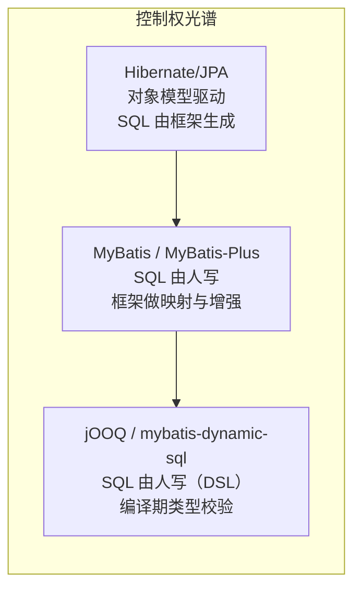
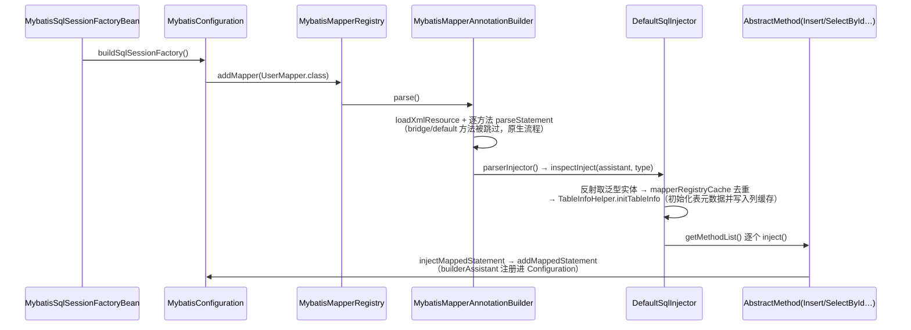
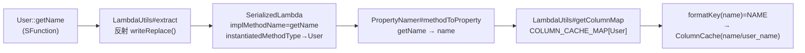
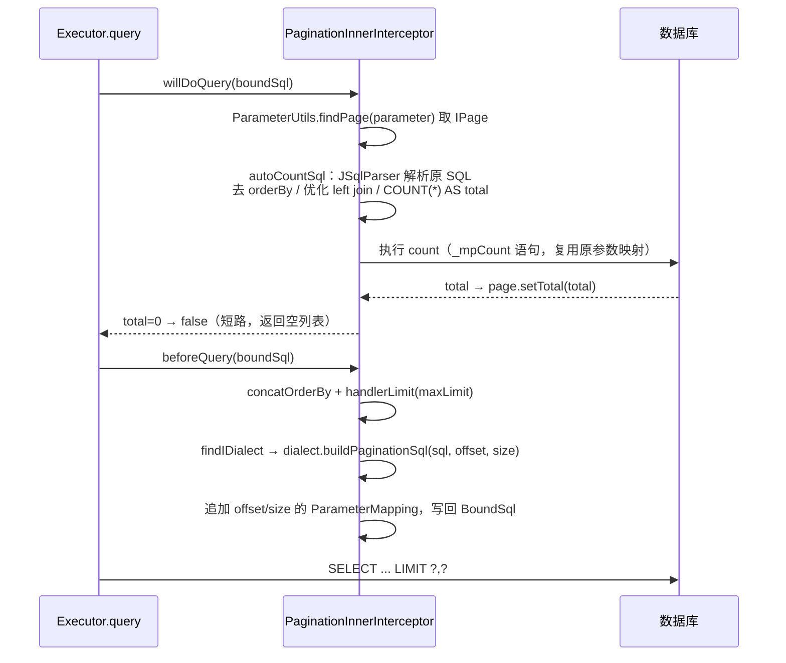

# MyBatis-Plus 与 ORM 生态选型

> 一句话概括：MyBatis-Plus 没有改变 MyBatis 的任何执行机制，它只是在**启动期替你注入单表 CRUD 的 MappedStatement**、在**运行期用 InnerInterceptor 链改写 SQL**——
> 理解这两次「代劳」的时机与边界，就理解了 MP 的全部能力与全部的坑；本文同时给出 MyBatis / Hibernate / jOOQ / MyBatis-Flex / mybatis-dynamic-sql 的选型判断依据。

预计阅读时间：大约 100 分钟

所属主题：[MyBatis 常见面试题总结](summary.md)

本文以 **MyBatis 3.5.x 为底座、MyBatis-Plus 3.5.18 为基线**（官网 <https://baomidou.com/>），源码锚点用 `类名#方法名` 标注，均对照 GitHub `v3.5.18` tag 与 Maven Central 发布产物核实。MyBatis 版本口径：**3.5.18 是官方预期的最后一个 Java 8 主版本**（Support Notice 原文），官方宣布另建 support-java8 分支继续维护；**3.5.19（2025-01-02）是其后的 Java 8 维护修订版**（仅回退 #3349 回归），也是当前最新 3.5.x；**3.6.0（2026-10-23）起基线升为 Java 11**。MP 自身的模块拆分（3.5.9）与包名迁移（3.5.17）是高频升级坑，见 5.5 与 7.2。总结文档给结论，本文给机制与证据：每个机制按「结论 → 机制 → 边界/代价 → 实践/追问」展开。

---

## 0. 阅读路线

| 读者 | 建议阅读 | 关注点 |
| --- | --- | --- |
| 初级（1 年内） | 1.1~1.2、2、4.4、6.1~6.3、7.2 | ORM 三条路线、MP 怎么用、Wrapper 速查、逻辑删除/填充/乐观锁、starter 怎么选 |
| 中级（1~3 年） | 全部，重点 3、4.1~4.3、5.1~5.4 | 注入链源码、Lambda 列名解析、InnerInterceptor 链、分页 count 与改写流程 |
| 高级（3 年+） | 3.4~3.5、5.3~5.5、6.1、9 | 注入冲突优先级、count 优化决策树、jsqlparser 拆分排障、隐式改写清单 |
| 选型/架构 | 1、7.2、8、9.5 | MyBatis vs Hibernate vs jOOQ、MP vs Flex vs 官方 DSL、团队规范 |

目录：

1. ORM 选型：MyBatis vs Hibernate/JPA vs jOOQ
2. MyBatis-Plus 定位：只做增强不做改变
3. BaseMapper 注入原理（源码级）
4. LambdaQueryWrapper 原理：类型安全列引用
5. MybatisPlusInterceptor 与内置插件
6. 常用增强特性：逻辑删除、自动填充、乐观锁、代码生成、批量
7. Starter 与自动装配
8. 新兴替代与官方 DSL：MyBatis-Flex、mybatis-dynamic-sql
9. 边界与代价：隐式改写与团队规范
10. 高频面试追问集
11. 参考资料

---

## 1. ORM 选型：MyBatis vs Hibernate/JPA vs jOOQ

### 1.1 三条路线

**结论**：三者不是「谁更好」，而是**把 SQL 的控制权交给谁**的三种回答：

- **MyBatis（半自动 ORM / SQL Mapper）**：SQL 由开发者写（XML/注解），框架负责参数绑定（`#{}` 预编译）与结果映射。对象和表之间没有「状态同步」，只有「一次映射」。
- **Hibernate/JPA（全自动 ORM）**：以对象模型驱动，持久化上下文（Persistence Context）跟踪实体状态，flush 时脏检查自动生成 INSERT/UPDATE/DELETE。开发者写 JPQL/Criteria 或依赖方法名派生查询，SQL 是「产物」不是「输入」。
- **jOOQ（类型安全 SQL DSL）**：不映射对象状态，只把 SQL 本身变成类型安全的 Java DSL——从数据库 schema 逆向生成表/列常量，`select(...).from(...).where(...)` 编译期校验列名与类型，渲染出 SQL 交给 JDBC 执行。



### 1.2 对比表

| 维度 | MyBatis（+MP） | Hibernate/JPA | jOOQ |
| --- | --- | --- | --- |
| SQL 控制力 | **完全可控**，每条 SQL 可见可优化 | 弱：生成 SQL 依赖方言与映射策略，需开日志核对 | 完全可控，且编译期校验 |
| 学习成本 | 低（会 SQL 就能上手） | 高：持久化上下文、flush 时机、懒加载、级联、N+1 | 中：DSL API + 代码生成工具链 |
| 复杂查询（多表 join、窗口函数、CTE） | 强：直接写 SQL | 弱~中：JPQL 表达力有限，复杂报表常退回 native SQL | 强：DSL 覆盖绝大多数 SQL 语法 |
| 缓存体系 | 一级（SqlSession）/二级（namespace）缓存，生产多关闭二级，见 [缓存机制](cache-mechanism.md) | 一级（持久化上下文）+ 二级缓存（Ehcache/Infinispan 等），体系完整 | 无内置缓存 |
| 数据库移植性 | 弱：SQL 方言手写，换库要改 SQL | **强**：Dialect 抽象，换库基本零改动 | 中：DSL 渲染按方言适配，但生成的代码绑定 schema |
| 单表 CRUD 效率 | 原生低（要写 XML）；**MP 注入后免 XML** | 高：`JpaRepository` 开箱即用 | 中：DSL 仍需逐条写 |
| 性能调优抓手 | SQL 即代码，explain/索引优化直接 | 需先理解生成的 SQL，调优隔一层 | SQL 即代码 |
| 典型适用 | 互联网业务、报表多、DBA 强管控、MySQL 为主 | 领域模型复杂、CRUD 为主、多数据库交付的产品 | 重度 SQL 团队、存储过程/分析型查询、schema 稳定 |

### 1.3 什么时候不该用谁

**不该用 MyBatis 的判断依据**：

- 需要**同一套代码交付多种数据库**（商业产品同时支持 MySQL/Oracle/SQL Server）——手写 SQL 的方言差异会让维护成本爆炸，Hibernate 的 Dialect 抽象是为此而生的；
- 领域模型复杂、**对象图操作远多于报表查询**（大量级联保存、状态跟踪），全自动 ORM 的脏检查比手写几百条 UPDATE 更不容易出错；
- 团队 SQL 能力弱且没有 DBA 把关——MyBatis 把 SQL 质量的责任完全交给了开发者。

**不该用 Hibernate 的判断依据**：

- **SQL 必须逐条评审**（金融核心、DBA 强管控）：生成的 SQL 不可预期，评审对象不稳定；
- 复杂报表/分析查询占比高：JPQL 表达力不足，native SQL 比例一旦过半，全自动 ORM 的收益就归零，还背着持久化上下文的内存与 flush 开销；
- 高并发下需要精确控制锁与批量：Hibernate 的隐式 flush 时机容易制造「意料之外的 SQL」，排查成本高于显式 SQL。

**不该用 jOOQ 的判断依据**：

- 使用**商业数据库**（Oracle/SQL Server 等）：jOOQ 需商业许可，许可成本要算进选型账；
- **schema 频繁变动**：生成代码要随 schema 重新生成并回归，维护成本高于手写 SQL；
- **团队 SQL 能力弱**：DSL 只是 SQL 的类型安全包装，并不降低 SQL 本身的门槛（与 MyBatis 同理）。

**追问：jOOQ 和 MyBatis 冲突吗？** 不冲突，两者都「以 SQL 为中心」，区别是 jOOQ 用编译期 DSL 替代手写字符串、且不做结果映射到实体的状态管理。jOOQ 对开源数据库（MySQL/PostgreSQL 等）免费，商业数据库（Oracle/SQL Server 等）需商业许可——这是选型时容易漏掉的成本项。

---

## 2. MyBatis-Plus 定位：只做增强不做改变

### 2.1 增强了什么，没改变什么

**结论**：MP 官方口号「只做增强不做改变」——**引入 MP 后，原生 MyBatis 的 XML、注解、动态 SQL、TypeHandler、插件、缓存全部照常工作**；MP 增加的是四类东西：

| 增强 | 内容 | 机制所在层 |
| --- | --- | --- |
| 单表 CRUD 免 XML | `BaseMapper<T>` 通用方法（20 个，不含已废弃）、`IService` 批量封装 | **启动期**注入 MappedStatement（第 3 章） |
| 条件构造器 | `QueryWrapper` / `LambdaQueryWrapper` / `UpdateWrapper` | 运行期拼 SQL 片段，仍走 `#{}` 预编译（第 4 章） |
| 插件 | 分页、乐观锁、多租户、防全表更新删除 | 运行期 `InnerInterceptor` 链改写 SQL（第 5 章） |
| 工程配套 | 逻辑删除、自动填充、代码生成器、ActiveRecord | 注解 + 参数处理器 + 生成器（第 6 章） |

没改变的：Mapper 代理执行链路（`MapperProxy` → `SqlSession` → `Executor` → `StatementHandler` → JDBC）与原生完全一致，见 [Mapper 代理与绑定](mapper-proxy-and-binding.md)、[架构与 SQL 执行](architecture-and-sql-execution.md)。**MP 的所有魔法都发生在「SQL 进入 Executor 之前」**。

### 2.2 与原生 MyBatis 的关系图

```mermaid
flowchart TD
    subgraph 业务代码
    A["BaseMapper&lt;T&gt; / IService<br/>（单表 CRUD）"]
    B["自定义 Mapper 方法<br/>XML / 注解（照常）"]
    end
    subgraph MP 增强层
    C["启动期：SqlInjector<br/>注入 MappedStatement"]
    D["运行期：MybatisPlusInterceptor<br/>分页 / 乐观锁 / 租户"]
    E["MybatisParameterHandler<br/>主键回填 / 自动填充"]
    end
    subgraph 原生 MyBatis（未改变）
    F["Configuration / MappedStatement"]
    G["MapperProxy → SqlSession → Executor"]
    H["StatementHandler → ParameterHandler → ResultSetHandler"]
    end
    A --> C --> F
    B --> F
    F --> G --> D --> H --> I["JDBC / 数据库"]
    E -.-> H
```

### 2.3 最小可运行示例（3.5.18 包名）

```java
@TableName("user")
public class User {
    @TableId(type = IdType.ASSIGN_ID)   // 雪花算法字符串/Long 主键
    private Long id;
    private String name;
    private Integer status;
    // getter/setter 省略（可用 Lombok @Data）
}

public interface UserMapper extends BaseMapper<User> {
    // 单表 CRUD 全部免 XML；复杂查询照常在这里加方法 + XML
}

// Service 层（注意：3.5.17 起包名迁移，见 7.2）
public interface UserService extends IService<User> {}

@Service
public class UserServiceImpl extends ServiceImpl<UserMapper, User> implements UserService {}

// 使用
List<User> users = userMapper.selectList(
    Wrappers.<User>lambdaQuery().eq(User::getStatus, 1).orderByDesc(User::getId));
userService.saveBatch(userList);   // 默认每 1000 条 flush 一次，见 6.5
```

**边界与代价**：「免 XML」只覆盖**单表**。多表 join、聚合报表仍要写 XML（MP 官方 Wrapper 不支持 join，见 9.1）；`IService` 的批量方法底层是 JDBC batch 而非一条多 values SQL（见 6.5），不要把它当成「高性能批量插入」的银弹。

---

## 3. BaseMapper 注入原理（源码级）

### 3.1 结论

**`BaseMapper` 的 SQL 不是运行期动态生成的，而是启动期注入的**：构建 `SqlSessionFactory`、注册 Mapper 接口时，MP 用自己的组件替换原生解析链，把 `Insert`/`SelectById` 等每个通用方法生成为一个 `MappedStatement` 注册进 `Configuration`。运行期调用 `userMapper.selectById(1)` 走的链路和 XML 语句**完全相同**——注入完成后零额外开销。

### 3.2 组件替换链

| 原生组件 | MP 替换 | 替换了什么 |
| --- | --- | --- |
| `SqlSessionFactoryBean` | `MybatisSqlSessionFactoryBean` | `buildSqlSessionFactory` 默认创建 `MybatisConfiguration`，并装配 `GlobalConfig` |
| `Configuration` | `MybatisConfiguration` | 默认 `mapUnderscoreToCamelCase=true`、默认语言驱动 `MybatisXMLLanguageDriver`、`addMapper` 委托自己的注册器 |
| `MapperRegistry` | `MybatisMapperRegistry` | `addMapper` 时使用 MP 的注解解析器 |
| `MapperAnnotationBuilder` | `MybatisMapperAnnotationBuilder` | `parse()` 末尾追加 `parserInjector()`——注入的触发点 |
| `DefaultParameterHandler` | `MybatisParameterHandler` | 构造期做主键回填与自动填充（见 6.2） |

```java
// MybatisConfiguration（v3.5.18，节选）
public MybatisConfiguration() {
    super();
    this.mapUnderscoreToCamelCase = true;                       // 原生默认 false！
    typeHandlerRegistry.setDefaultEnumTypeHandler(CompositeEnumTypeHandler.class);
    languageRegistry.setDefaultDriverClass(MybatisXMLLanguageDriver.class);
}
@Override
public <T> void addMapper(Class<T> type) {
    mybatisMapperRegistry.addMapper(type);                      // 字段内联 new MybatisMapperRegistry(this)
}
```

`MybatisSqlSessionFactoryBean#buildSqlSessionFactory` 的关键分支（源码原样）：

```java
} else {
    LOGGER.debug(() -> "Property 'configuration' or 'configLocation' not specified, using default MyBatis Configuration");
    targetConfiguration = new MybatisConfiguration();           // 不是原生 Configuration
    ...
}
...
GlobalConfigUtils.setGlobalConfig(targetConfiguration, this.globalConfig);  // GlobalConfig 挂到 Configuration 上
```

### 3.3 注入链：从 parse() 到 MappedStatement



触发点有**条件**：只有继承了 `BaseMapper`/`Mapper` 的接口才注入（`GlobalConfigUtils.isSupperMapperChildren` 判断），纯原生 Mapper 接口不受影响：

```java
// MybatisMapperAnnotationBuilder#parse（节选）
if (GlobalConfigUtils.isSupperMapperChildren(configuration, type)) {
    parserInjector();    // → GlobalConfigUtils.getSqlInjector(configuration).inspectInject(assistant, type)
}
```

`AbstractSqlInjector#inspectInject` 核心（v3.5.18，简化）：

```java
Class<?> modelClass = ReflectionKit.getSuperClassGenericType(mapperClass, Mapper.class, 0); // 取泛型实体
if (modelClass != null && !mapperRegistryCache.contains(className)) {   // 每个 mapper 只注入一次
    // 注入时初始化表元数据（首次解析实体并写入列缓存，触发 LambdaUtils.installCache）
    TableInfo tableInfo = TableInfoHelper.initTableInfo(builderAssistant, modelClass);
    List<AbstractMethod> methodList = this.getMethodList(mapperClass, tableInfo);   // 先调已废弃的 2 参版
    // 兼容旧代码：为空才回退 3 参新签名（3.5.6+）
    if (CollectionUtils.isEmpty(methodList)) {
        methodList = this.getMethodList(configuration, mapperClass, tableInfo);
    }
    methodList.forEach(m -> m.inject(builderAssistant, mapperClass, modelClass, tableInfo));
    mapperRegistryCache.add(className);
}
```

两个细节：TableInfo 是**注入链当场初始化的**（`initTableInfo` 首次解析实体并写入 Lambda 列缓存），不是「必须先初始化」；`inspectInject` 先调已废弃的 2 参 `getMethodList(mapperClass, tableInfo)`，返回为空才回退 3 参版——只覆写 2 参版的旧自定义注入器依然生效。

`DefaultSqlInjector#getMethodList` 给出的方法清单（v3.5.18 原样）：

```java
Stream.Builder<AbstractMethod> builder = Stream.<AbstractMethod>builder()
        .add(new Insert(dbConfig.isInsertIgnoreAutoIncrementColumn()))
        .add(new Delete()).add(new Update())
        .add(new SelectCount()).add(new SelectMaps()).add(new SelectObjs())
        .add(new SelectList()).add(new SelectWithCursor());
if (tableInfo.havePK()) {                       // 有 @TableId 才注入 xxById 系列
    builder.add(new DeleteById()).add(new DeleteByIds())
           .add(new UpdateById()).add(new SelectById()).add(new SelectByIds());
} else {
    logger.warn(... + " Not found @TableId annotation, Cannot use Mybatis-Plus 'xxById' Method.");
}
```

每个 `AbstractMethod#inject` → 子类 `injectMappedStatement` 拼 SQL 脚本 → `createSqlSource`（`languageDriver`）→ `addMappedStatement` → `MapperBuilderAssistant#addMappedStatement` 注册进 `Configuration`。**注入前查重**：

```java
// AbstractMethod#addMappedStatement（节选）
String statementName = mapperClass.getName() + DOT + id;
if (hasMappedStatement(statementName)) {
    logger.warn("[" + statementName + "] Has been loaded by XML or SqlProvider or Mybatis's Annotation, "
              + "so ignoring this injection for [" + getClass() + "]");
    return null;    // 用户已定义同名语句 → 放弃注入，不覆盖
}
```

### 3.4 注入方法 vs default 方法（高频细节）

`BaseMapper` 的方法分两类，**不是每个方法都有对应的 MappedStatement**：

| 类别 | 方法 | 说明 |
| --- | --- | --- |
| 注入型（13 个） | `insert`、`delete`、`update`、`selectCount`、`selectMaps`、`selectObjs`、`selectList`、`selectWithCursor`；有主键时加 `deleteById`、`deleteByIds`、`updateById`、`selectById`、`selectByIds` | 每个对应一个注入的 MappedStatement |
| default 型 | `selectOne`、`selectPage`、`exists`、`selectByMap`、`deleteByMap`、`insertOrUpdate`、批量 `insert(Collection)`（3.5.7+） | 接口默认方法，**组合调用注入型方法**，不单独注入 |

**划分口径是「有没有对应的 MappedStatement」，不是方法签名**：注入型指 13 个 MappedStatement；`deleteById(Serializable)` 与 `deleteByIds(Collection)` 自 3.5.7 起是 default 重载（为支持 useFill 填充），内部经 `MybatisUtils.getMapperProxy` 拿 SqlSession 直调对应的注入语句，真正抽象的注入型签名是 `deleteById(T entity)` 等。

两个值得记住的实现（`BaseMapper` v3.5.18 原样）：

```java
default T selectOne(Wrapper<T> queryWrapper, boolean throwEx) {
    List<T> results = this.selectList(queryWrapper, new RowBounds(0, 2));  // 只取 2 条判断唯一性
    ...
    if (size > 1) { if (throwEx) throw new TooManyResultsException(...); return results.get(0); }
}
default <P extends IPage<T>> P selectPage(P page, Wrapper<T> queryWrapper) {
    page.setRecords(selectList(page, queryWrapper));   // 分页插件在 selectList 上生效
    return page;
}
```

**推论**：`selectOne` 查到多条会抛 `TooManyResultsException`（可用 `selectOne(wrapper, false)` 取第一条）；`selectPage` 本身不做分页，**分页能力来自插件对 `selectList` 的改写**（第 5 章）——没配分页插件时 `selectPage` 会查全表。版本注意：`deleteBatchIds`（3.5.7 废弃）/`selectBatchIds`（3.5.8 废弃），改用 `deleteByIds`/`selectByIds`。

### 3.5 冲突优先级与边界

`MybatisConfiguration#addMappedStatement` 对重复 id 的策略是**忽略并打 error 日志**（原生是抛异常），源码注释给出优先级：

```java
if (mappedStatements.containsKey(ms.getId())) {
    // 说明已加载了xml中的节点； 忽略mapper中的 SqlProvider 数据
    logger.error("mapper[" + ms.getId() + "] is ignored, because it exists, maybe from xml file");
    return;
}
```

**`XmlSql > sqlProvider > CurdSql`**：你在 XML 里写了 `selectById`，注入器就让位——这就是「MP 不覆盖用户 SQL」的源码保证，也是重写 BaseMapper 个别方法的官方姿势。

**边界与代价**：

- 实体没有 `@TableId` → 所有 `xxById` 方法不可用（启动 warn，调用时报 statement 不存在）；
- 注入发生在启动期，**表结构变更不会反映到已注入的 SQL**（列名来自启动时解析的 `TableInfo`）；
- 自定义注入器：继承 `DefaultSqlInjector` 覆写 `getMethodList` 追加 `AbstractMethod`（如批量插入 `InsertBatchSomeColumn`），注册为 `ISqlInjector` Bean 即可被自动装配拾取（见 7.1）。注意 3.5.6 起 `getMethodList` 签名变为 `(Configuration, Class<?> mapperClass, TableInfo)`。

**追问：注入的 SQL 和 XML 的 SQL 运行期有区别吗？** 没有。都是 `Configuration` 里的 `MappedStatement`，走同一条 `MapperProxy → Executor` 链路；区别只在「谁在什么时候把它放进去」。二级缓存行为也一致：注入时 SELECT 语句 `useCache=true`、写语句 `flushCache=true`（`AbstractMethod#addMappedStatement` 的 `!isSelect`/`isSelect` 参数），见 [缓存机制](cache-mechanism.md)。

---

## 4. LambdaQueryWrapper 原理：类型安全列引用

### 4.1 结论

`LambdaQueryWrapper` 用**方法引用代替字符串列名**：`User::getName` 在编译期受 IDE 重构保护，运行期被解析成列名 `name`（再经驼峰映射到 `user_name`）。解析靠的是 **JDK 可序列化 lambda 的 `SerializedLambda` 元信息**，不是读数据库元数据，也不是注解扫描。

### 4.2 机制：从 lambda 到列名

入口是 `SFunction`——一个「可序列化的 Function」（v3.5.18 原样）：

```java
@FunctionalInterface
public interface SFunction<T, R> extends Function<T, R>, Serializable {
}
```

**`Serializable` 是关键**：JVM 对可序列化 lambda 会生成 `writeReplace()` 方法，调用它返回 `java.lang.invoke.SerializedLambda`，其中携带 `implMethodName`（`getName`）与 `instantiatedMethodType`（含实体类 `User`）。MP 的解析链（`AbstractLambdaWrapper#getColumnCache`，v3.5.18 原样）：

```java
protected ColumnCache getColumnCache(SFunction<T, ?> column) {
    LambdaMeta meta = LambdaUtils.extract(column);                          // ① 解析 lambda
    String fieldName = PropertyNamer.methodToProperty(meta.getImplMethodName()); // ② getName → name
    Class<?> instantiatedClass = meta.getInstantiatedClass();               // ③ 实体类 User
    tryInitCache(instantiatedClass);                                        // ④ 懒加载列缓存
    return getColumnCache(fieldName, instantiatedClass);                    // ⑤ 查表得列名
}
```



`LambdaUtils#extract` 的主路径与兜底（v3.5.18）：

- 主路径：反射调用 lambda 合成类的 `writeReplace()`（查找结果用 `ClassValue` 缓存），得到 JDK `SerializedLambda`，包装为 `ReflectLambdaMeta`；
- 兜底：反射失败时走 `ShadowLambdaMeta` + MP 自己的 `support.SerializedLambda#extract`——**把 lambda 序列化再反序列化**，用重写的 `resolveClass` 把 JDK 的 `SerializedLambda` 换成 MP 的镜像类读取字段；
- 特判：IDEA 调试模式下 lambda 是 `Proxy`（`IdeaProxyLambdaMeta`）、Kotlin 属性引用（`KotlinLambdaMeta`）各有分支。

列缓存结构（`LambdaUtils`）：

```java
private static final Map<String, Map<String, ColumnCache>> COLUMN_CACHE_MAP = new ConcurrentHashMap<>();
// 键：实体类全限定名 → (formatKey(属性名)=属性名大写 → ColumnCache(列名, select 片段))
public static void installCache(TableInfo tableInfo) { ... }   // TableInfoHelper 初始化表信息时写入
public static String formatKey(String key) { return key.toUpperCase(ENGLISH); }  // 兼容首字母大写字段
```

### 4.3 边界与代价

- **实体必须已初始化 `TableInfo`**（即 Mapper 被扫描注册过），否则抛 `MybatisPlusException: can not find lambda cache for this entity [xxx]`；属性对不上列抛 `can not find lambda cache for this property [xxx] of entity [xxx]`——看到这两条报错，先查实体是否被 MP 管理、字段是否被 `@TableField(exist=false)` 排除；
- 解析是**反射操作**，每次条件拼接都会走一遍；MP 用 `ClassValue` 缓存 `writeReplace` 查找、wrapper 实例内缓存 `columnMap` 来摊薄成本，但「Lambda 版比字符串版慢一点」的说法成立（Flex 官方对比也以此为卖点，见 8.1）；
- 方法引用必须是**getter**（`PropertyNamer#methodToProperty` 按 get/is 前缀剥离），传 `User::toString` 之类会解析失败；
- 旧版本资料常写 `LambdaUtils.resolve`，3.5.18 已重构为 `LambdaMeta` 体系（`ReflectLambdaMeta`/`ShadowLambdaMeta` 等分支），面试答「SerializedLambda + 列名缓存」的机制即可，类名以基线为准。

### 4.4 Wrapper 速查与示例

| Wrapper | 列引用方式 | 典型用途 |
| --- | --- | --- |
| `QueryWrapper<T>` | 字符串列名 | 查询条件 + `select("id","name")` 指定列 |
| `LambdaQueryWrapper<T>` | `SFunction` 方法引用 | 同上，类型安全（推荐） |
| `UpdateWrapper<T>` | 字符串列名 | `set("status", 2)` / `setSql("version = version + 1")` |
| `LambdaUpdateWrapper<T>` | `SFunction` | `set(User::getStatus, 2)` |

```java
// 查询：status=1 AND name LIKE '%zhang%' ORDER BY id DESC
LambdaQueryWrapper<User> qw = Wrappers.<User>lambdaQuery()
        .eq(User::getStatus, 1)
        .like(User::getName, "zhang")
        .orderByDesc(User::getId);
List<User> list = userMapper.selectList(qw);

// 条件嵌套：status=1 AND (age<20 OR age>30)
qw.and(w -> w.lt(User::getAge, 20).or().gt(User::getAge, 30));

// 更新：UPDATE user SET status=2 WHERE id=1
userMapper.update(Wrappers.<User>lambdaUpdate()
        .eq(User::getId, 1L).set(User::getStatus, 2));   // update(Wrapper) 是 3.5.4+ 的 default 方法
```

常用条件方法：`eq/ne/gt/ge/lt/le`、`like/likeLeft/likeRight`、`in/notIn`、`between`、`isNull/isNotNull`、`orderByAsc/orderByDesc`、`and/or`（支持 lambda 嵌套）、`apply("date_format(create_time,'%Y')={0}", 2026)`、`last("LIMIT 1")`。

**关键结论：条件值最终仍是 `#{}` 预编译参数**。Wrapper 把值存进 `paramNameValuePairs`，SQL 片段里生成 `#{ew.paramNameValuePairs.MPGENVAL1}` 占位符（`Constants.WRAPPER_PARAM = "MPGENVAL"`），由 MyBatis 预编译绑定——**eq/like/in 传用户输入是安全的**。两个例外要警惕：

- `last(String)` 原样拼接在 SQL 末尾、`apply` 中不用 `{0}` 占位而直接拼字符串、`orderBy` 的列名字符串——这些位置**没有预编译保护**，禁止传入用户输入（官方分页文档也要求 `OrderItem.column` 做白名单校验）；
- `QueryWrapper` 的字符串列名本身不参与参数绑定，列名来自代码常量才安全。

`${}` 与 `#{}` 的完整机制见 [动态 SQL 与注入](dynamic-sql-and-injection.md)。

---

## 5. MybatisPlusInterceptor 与内置插件

### 5.1 InnerInterceptor 链机制

**结论**：3.4.0 起 MP 的所有插件统一收进**一个** MyBatis `Interceptor`——`MybatisPlusInterceptor`，内部维护 `List<InnerInterceptor>`。它代理 `Executor#query/update` 与 `StatementHandler#prepare/getBoundSql`，在各时点依次回调 InnerInterceptor：

```java
// MybatisPlusInterceptor 类注解（v3.5.18 原样）
@Intercepts({@Signature(type = StatementHandler.class, method = "prepare", args = {Connection.class, Integer.class}),
        @Signature(type = StatementHandler.class, method = "getBoundSql", args = {}),
        @Signature(type = Executor.class, method = "update", args = {MappedStatement.class, Object.class}),
        @Signature(type = Executor.class, method = "query", args = {MappedStatement.class, Object.class,
                RowBounds.class, ResultHandler.class}),
        @Signature(type = Executor.class, method = "query", args = {MappedStatement.class, Object.class,
                RowBounds.class, ResultHandler.class, CacheKey.class, BoundSql.class})})
public class MybatisPlusInterceptor implements Interceptor { ... }
```

`intercept` 的分发逻辑（简化）：

```java
if (target instanceof Executor) {
    if (SELECT) {
        for (InnerInterceptor query : interceptors) {
            if (!query.willDoQuery(...)) return Collections.emptyList();  // 短路：count=0 不再查列表
            query.beforeQuery(...);                                       // 改写 BoundSql（分页在这）
        }
        return executor.query(ms, parameter, rowBounds, resultHandler, cacheKey, boundSql);
    } else if (isUpdate) {
        for (InnerInterceptor update : interceptors) {
            if (!update.willDoUpdate(...)) return -1;
            update.beforeUpdate(...);                                     // 乐观锁在这
        }
    }
} else {  // StatementHandler
    for (InnerInterceptor i : interceptors) i.beforePrepare(sh, connection, timeout); // 租户/防全表在这
}
return invocation.proceed();
```

**与原生插件体系的关系**：`MybatisPlusInterceptor` 自己就是标准 `Interceptor`，走原生 `InterceptorChain`（见 [插件与分页](plugin-and-pagination.md)）；InnerInterceptor 是 MP 在**一个拦截器内部**做的二级责任链，好处是多个增强共享一次代理、顺序可控。

### 5.2 内置插件与注册顺序

| InnerInterceptor | 功能 | 生效时点 | 所在模块（3.5.9+） |
| --- | --- | --- | --- |
| `PaginationInnerInterceptor` | 物理分页 + count | `willDoQuery`/`beforeQuery` | mybatis-plus-jsqlparser |
| `TenantLineInnerInterceptor` | 多租户行级隔离 | `beforeQuery`/`beforePrepare` 等 | mybatis-plus-jsqlparser |
| `DynamicTableNameInnerInterceptor` | 动态表名（字符串替换，不解析 SQL） | 同上 | mybatis-plus-extension（SQL 解析版 `DynamicTableNameJsqlParserInnerInterceptor` 在 jsqlparser 模块） |
| `OptimisticLockerInnerInterceptor` | 乐观锁 `@Version` | `beforeUpdate` | mybatis-plus-extension |
| `BlockAttackInnerInterceptor` | 防全表更新删除 | `beforePrepare` | mybatis-plus-jsqlparser |
| `IllegalSQLInnerInterceptor` | SQL 性能规范检查 | `beforePrepare` | mybatis-plus-jsqlparser |

官方建议顺序：**多租户/动态表名 → 分页/乐观锁 → SQL 规范/防全表**；原则是「对 SQL 做单次改造的插件先放，不改造 SQL 的最后放」。分页必须放在租户等改写插件之后，否则 count 与 limit 基于未改写的 SQL。

```java
@Configuration
@MapperScan("com.example.mapper")
public class MybatisPlusConfig {
    @Bean
    public MybatisPlusInterceptor mybatisPlusInterceptor() {
        MybatisPlusInterceptor interceptor = new MybatisPlusInterceptor();
        interceptor.addInnerInterceptor(new TenantLineInnerInterceptor(...));   // 先：改写 SQL
        interceptor.addInnerInterceptor(new PaginationInnerInterceptor(DbType.MYSQL)); // 单库建议显式指定 DbType
        interceptor.addInnerInterceptor(new OptimisticLockerInnerInterceptor());
        interceptor.addInnerInterceptor(new BlockAttackInnerInterceptor());     // 最后：只检查不改写
        return interceptor;
    }
}
```

**多租户插件机制**：`TenantLineInnerInterceptor` 在 `beforeQuery`（查询）与 `beforePrepare`（写入）两个时点用 JSqlParser 解析 SQL，自动给 where 追加 `tenant_id = ?`，INSERT 自动补租户列。租户值与规则来自 `TenantLineHandler`：`getTenantId()` 返回租户 ID 表达式（只支持单个值），`getTenantIdColumn()` 默认 `tenant_id`，`ignoreTable(tableName)` 决定某表是否跳过拼接，`ignoreInsert(columns, tenantIdColumn)` 在插入列已含租户列时跳过。个别语句可用 `@InterceptorIgnore(tenantLine = "true")` 或 `InterceptorIgnoreHelper` 排除。

### 5.3 分页插件：count 与改写流程

**结论**：分页 = **两次查询**。`willDoQuery` 先执行 count 拿 total（为 0 直接短路），`beforeQuery` 再按方言把原 SQL 改写成 limit 形式。全程基于 JSqlParser 解析。



count 优化的决策树（`PaginationInnerInterceptor#autoCountSql`，v3.5.18）：

| 情形 | 处理 |
| --- | --- |
| `page.optimizeCountSql()=false`、union（`SetOperationList`）、含 `distinct`/`groupBy`、select 列含 `?` 参数 | 降级 `lowLevelCountSql`：`SELECT COUNT(*) FROM (原SQL)` |
| order by 表达式不含 `?` | **移除 order by**（count 不需要排序） |
| `optimizeJoin=true`（默认）且全是 left join、where 不引用 join 表字段、on/子查询不含 `?` | **移除 join**（一对多场景可能改变行数语义，官方提示谨慎） |
| 其余 | select 列替换为 `COUNT(*) AS total` |
| JSqlParser 解析异常 | warn + 降级包裹 count |

count 语句以 `原msId + "_mpCount"` 缓存（`countMsCache`），**复用原 SQL 的 parameterMappings 与 additionalParameters**；也可用 `page.setCountId("selectPageVoCount")` 指向 XML 里手写的 count 语句（不含 `.` 时自动补当前 namespace 前缀）——复杂 join 分页的 count 不准时，这是官方逃生门。

改写阶段（`beforeQuery`）：方言选择优先级为 **显式 `dialect` > 显式 `dbType` > `JdbcUtils.getDbType(executor)` 从连接探测**；`dialect.buildPaginationSql` 生成 `DialectModel`，把 offset/size 作为**预编译参数**追加进 `ParameterMapping` 后写回 `BoundSql`。`Page` 默认 `size=10`、`current=1`、`searchCount=true`；`maxLimit` 限制单页上限，`overflow` 默认 false——页码超出总页数时**直接返回空列表**（`continuePage` 返回 false），置 true 才回到第一页。

**边界与代价**：

- `size < 0` 且未设 maxLimit → 不拼分页 SQL（查全部）；`searchCount=false` → 跳过 count（适合滚动加载）；
- count 与列表查询**不在同一快照**：两次查询之间数据变化会导致 total 与 records 轻微不一致，业务上可接受；
- 分页插件对**自定义 XML 查询同样生效**，只要 mapper 方法第一个参数是 `IPage`（`selectPageVo(IPage<UserVo> page, @Param("status") Integer status)`）。

### 5.4 与 PageHelper 对比

| 维度 | MP `PaginationInnerInterceptor` | PageHelper |
| --- | --- | --- |
| 分页参数传递 | `IPage` 对象作为 mapper 参数，**显式、可跨方法传递** | `PageHelper.startPage()` 存 **ThreadLocal**，必须紧跟查询，否则污染下一次查询 |
| 拦截实现 | `MybatisPlusInterceptor` 的 InnerInterceptor 链 | 独立 `PageInterceptor`（同样拦 `Executor.query`） |
| count | JSqlParser 优化 + `countId` 自定义 + `_mpCount` 缓存 | 自动生成 count SQL 并缓存，可配置 count 列 |
| 方言 | `IDialect`/`DialectFactory`，建议显式 `DbType` | 按连接 URL 自动识别，官方称支持 12 种常见数据库 |
| 页码溢出 | `overflow=false` 默认返回空 | `reasonable=true` 时合理化到有效页 |
| 生态 | MP 内置，与 Wrapper/租户插件协同 | 独立插件，原生 MyBatis 项目常用 |

**冲突**：两者同时配置 = 两个分页拦截器各自改写一次 SQL。官方 FAQ 的典型症状是「**出现 2 个 limit 语句**——原因：配了 2 个分页拦截器！检查配置文件或者代码，只留一个！」。混用 MP 与 PageHelper 还会叠加 ThreadLocal 与 IPage 两套参数语义，排查困难——**一个项目只保留一种分页方案**。

### 5.5 3.5.9+ jsqlparser 可选模块（升级高频坑）

**结论**：3.5.9 起，依赖 JSqlParser 的插件（分页、租户、动态表名、防全表等）从 starter 中**拆成可选模块**——因为 JSqlParser 5.0+ 不再支持 JDK 8，MP 把选择权交给用户。只引 starter 不引 jsqlparser 模块，启动或首次分页时就会报 `ClassNotFoundException` / `NoClassDefFoundError: net/sf/jsqlparser/...`（`PaginationInnerInterceptor` 的类加载直接失败）。

| 模块 | 适配 JSqlParser | JDK 要求 | 适用 |
| --- | --- | --- | --- |
| `mybatis-plus-jsqlparser` | 跟随最新版（5.x） | **11+** | Boot 3/4、JDK 11+ 项目 |
| `mybatis-plus-jsqlparser-4.9` | 固定 4.9 | 8+ | Boot 2、JDK 8 项目 |
| `mybatis-plus-jsqlparser-5.2` | 固定 5.2 | 11+ | 3.5.18 保留的特定版本模块（默认模块已升级至 JSqlParser 5.4，CHANGELOG v3.5.18） |

官方推荐用 BOM 对齐版本（安装页原文示例）：

```xml
<dependencyManagement>
    <dependencies>
        <dependency>
            <groupId>com.baomidou</groupId>
            <artifactId>mybatis-plus-bom</artifactId>
            <version>3.5.18</version>
            <type>pom</type>
            <scope>import</scope>
        </dependency>
    </dependencies>
</dependencyManagement>
<dependencies>
    <dependency>
        <groupId>com.baomidou</groupId>
        <artifactId>mybatis-plus-spring-boot3-starter</artifactId>
    </dependency>
    <dependency>   <!-- JDK 11+；JDK 8 换成 mybatis-plus-jsqlparser-4.9 -->
        <groupId>com.baomidou</groupId>
        <artifactId>mybatis-plus-jsqlparser</artifactId>
    </dependency>
</dependencies>
```

**排查清单**（升级 3.5.9+ 后分页相关报错）：

1. `ClassNotFoundException: net.sf.jsqlparser.*` / 找不到 `PaginationInnerInterceptor` → 没引 jsqlparser 模块，按上表补；
2. 引了模块但版本与 MP 不一致 → 用 `mybatis-plus-bom` 对齐，不要手写 jsqlparser 版本；
3. `Encountered unexpected token` / `Could not set parameters for mapping` → JSqlParser 对 SQL 中连续换行的处理差异（官方 FAQ 有专条），自定义 SQL 避免连续空行或按 FAQ 配置 `JsqlParserGlobal` 解析函数；
4. 注意 `PaginationInnerInterceptor` 的**包名仍是** `com.baomidou.mybatisplus.extension.plugins.inner`——模块拆了，包名没变，import 不用改。

---

## 6. 常用增强特性

### 6.1 逻辑删除 @TableLogic

**结论**：逻辑删除不是运行期拦截，而是**注入 SQL 时就写死的改写**——`deleteById` 注入成 UPDATE，查询/更新注入时自动带上「未删除」条件。

```yaml
mybatis-plus:
  global-config:
    db-config:
      logic-delete-field: deleted   # 实体属性名（不是列名），全局生效
      logic-delete-value: 1         # 已删除值，默认 1
      logic-not-delete-value: 0     # 未删除值，默认 0
```

或字段级 `@TableLogic(value = "0", delval = "1")`。官方工作原理：插入不受限；查找自动过滤已删除；更新防止更新已删除记录；删除转更新。源码证据（`DeleteById#injectMappedStatement`，v3.5.18）：

```java
if (tableInfo.isWithLogicDelete()) {
    sql = SqlMethod.LOGIC_DELETE_BY_ID.format(...);          // UPDATE 模板
    return addUpdateMappedStatement(mapperClass, modelClass, methodName, sqlSource);
} else {
    sql = SqlMethod.DELETE_BY_ID.format(...);                // DELETE 模板
    return this.addDeleteMappedStatement(...);
}
```

生成的 SQL：`UPDATE user SET deleted=1 WHERE id=? AND deleted=0`；查询：`SELECT ... FROM user WHERE deleted=0`。

**边界与坑（高级必考）**：

- **唯一索引冲突**：`username` 唯一索引 + 逻辑删除后，记录仍占着索引位，重新注册同名用户直接冲突。把索引改成 `(username, deleted)` **没用**——deleted 只有 0/1，同一用户名只能有一条已删除记录。官方方案：**已删除值各不相同、未删除值固定**：

```sql
CREATE TABLE user(
    id BIGINT NOT NULL PRIMARY KEY,
    username VARCHAR(64) NOT NULL,
    deleted BIGINT NOT NULL DEFAULT 0 COMMENT '0 未删除，删除时写入主键值',
    UNIQUE KEY uk_username_deleted (username, deleted));
```

```java
@TableLogic(value = "0", delval = "id")   // 生成 UPDATE user SET deleted=id WHERE id=? AND deleted=0
private Long deleted;
```

  注意：`delval` 写 `id`/`UNIX_TIMESTAMP()` 这类表达式**只对非字符串类型字段生效**（字符串会被加引号变成常量）；`UNIX_TIMESTAMP()` 方案同一秒删两条同名记录仍冲突；未删除值**不要用 null**（条件变 `IS NULL`，而 MySQL 唯一索引允许多个 NULL，未删除记录之间反而失去唯一约束）。
- **自定义 XML/注解 SQL 不会被自动改写**：逻辑删除条件只存在于注入的语句里，自己写的 SQL 要手动加 `deleted=0`——「数据明明在却查不到 / 明明删了却还在」多半是这条（完整排查清单见 9.3）。
- 删除时想触发更新填充：用 `deleteById(entity)`（3.5.7+ 支持传实体并按 `et` 填充）；旧的 `LogicDeleteByIdWithFill` 注入器 3.5.0 起已废弃。
- 官方态度：如果业务仍频繁查询「已删除」数据，说明该用状态字段而不是逻辑删除。

### 6.2 自动填充 MetaObjectHandler

**结论**：填充发生在**参数处理阶段**——`MybatisParameterHandler` 构造时（`setParameters` 绑定参数之前），不是拦截器、也不是数据库默认值。

```java
public class User {
    @TableField(fill = FieldFill.INSERT)          // 仅插入填充
    private LocalDateTime createTime;
    @TableField(fill = FieldFill.INSERT_UPDATE)   // 插入和更新都填充
    private LocalDateTime updateTime;
}

@Component
public class MyMetaObjectHandler implements MetaObjectHandler {
    @Override
    public void insertFill(MetaObject metaObject) {
        this.strictInsertFill(metaObject, "createTime", LocalDateTime.class, LocalDateTime.now());
        this.strictInsertFill(metaObject, "updateTime", LocalDateTime.class, LocalDateTime.now());
    }
    @Override
    public void updateFill(MetaObject metaObject) {
        this.strictUpdateFill(metaObject, "updateTime", LocalDateTime.class, LocalDateTime.now());
    }
}
```

源码证据（`MybatisParameterHandler`，v3.5.18，构造器内完成）：

```java
public MybatisParameterHandler(MappedStatement ms, Object parameter, BoundSql boundSql) {
    super(ms, parameter, boundSql);
    ...
    processParameter(parameter);   // INSERT/UPDATE 才处理
}
// process 内部：
if (SqlCommandType.INSERT == this.sqlCommandType) {
    populateKeys(tableInfo, metaObject, entity);   // 先回填主键
    insertFill(metaObject, tableInfo);             // 再插入填充
} else {
    updateFill(metaObject, tableInfo);
    fillLogicDeleteValue(metaObject, tableInfo);   // 逻辑删除值填充
}
```

**边界（官方文档明确）**：

- `strict` 系列按「`FieldFill` 策略 + 字段名 + 字段类型」三重匹配；默认策略是**属性已有值不覆盖、填充值为 null 不填充**；
- `update(entity, wrapper)`：**entity 不能为 null**，否则没有填充载体；`update(wrapper)`（3.5.4+ 的无实体重载）**不触发填充**，要自己 `set`；
- 自定义 mapper 方法想触发填充，实体参数必须命名为 `et`（`@Param("et")`）——参数处理器按 `Constants.ENTITY`/`MP_FILL_ET` 找实体；
- 填充是**给实体属性赋值**，没填充到的字段入库就是 null，别指望数据库默认值兜底（除非列定义了 DEFAULT 且 SQL 不含该列）。

### 6.3 乐观锁 @Version

```java
public class User {
    @Version
    private Integer version;   // 支持 int/Integer、long/Long、Date、Timestamp、LocalDateTime、Instant
}
// 插件注册：interceptor.addInnerInterceptor(new OptimisticLockerInnerInterceptor());
```

**机制**（`OptimisticLockerInnerInterceptor#beforeUpdate`，拦 `Executor.update`）：从参数 Map 取 `et` 实体 → 读 `@Version` 字段旧值 → 整型 +1 / 时间型取当前时间（`VersionFactory`）→ `updateById` 把旧值放进 `MP_OPTLOCK_VERSION_ORIGINAL` 供注入 SQL 拼 `AND version=?`；`update(et, wrapper)` 则往 wrapper 追加 `version = 旧值` 条件 → 新值写回实体。效果：

```sql
-- 无插件：UPDATE user SET name=? WHERE id=?
-- 有插件：UPDATE user SET name=?, version=2 WHERE id=? AND version=1
```

**边界与代价**：

- 插件**不检查影响行数**：并发冲突时 UPDATE 返回 0，`updateById` 静默返回 0——**调用方必须判断返回值**并重试或报错，这是乐观锁用法的第一坑；
- 旧版本值为 null 时直接跳过（不加锁）；只支持**单实体**更新，`update(wrapper)` 无实体模式需构造器开 `wrapperMode=true`；
- 与「先 select 再 update」配合才有意义：version 必须来自上次查询，自己 new 实体设 version 等于伪造锁。

### 6.4 代码生成器 FastAutoGenerator

3.5.1 起的新生成器（与旧 `AutoGenerator` 不兼容），builder 风格，依赖 `com.baomidou:mybatis-plus-generator`，模板引擎默认 Velocity（可选 Freemarker/Beetl/Enjoy）：

```java
FastAutoGenerator.create("jdbc:mysql://localhost:3306/demo", "root", "password")
    .globalConfig(b -> b.author("team").outputDir(System.getProperty("user.dir") + "/src/main/java"))
    .packageConfig(b -> b.parent("com.example").entity("entity").mapper("mapper"))
    .strategyConfig(b -> b.addInclude("user").addTablePrefix("t_")
        .entityBuilder().enableLombok()
        .addTableFills(new Column("create_time", FieldFill.INSERT)))
    .templateEngine(new FreemarkerTemplateEngine())
    .execute();
```

默认用 JDBC 元数据查询（`DefaultQuery`）读表结构，旧的 `SQLQuery` 方式不再维护。**实践**：生成器只负责「首版脚手架」，生成后的代码归人维护；不要把它接进 CI 反复覆盖手写逻辑。

### 6.5 批量与 ActiveRecord

**`IService#saveBatch` 的真相**：default 方法委托 `saveBatch(list, DEFAULT_BATCH_SIZE)`（`Constants.DEFAULT_BATCH_SIZE = 1000`），实现类（`CrudRepository#saveBatch`，标注 `@Transactional(rollbackFor = Exception.class)`）走：

```java
String sqlStatement = getSqlStatement(SqlMethod.INSERT_ONE);   // 单条 INSERT 的 statementId
return executeBatch(entityList, batchSize, (sqlSession, entity) -> sqlSession.insert(sqlStatement, entity));
```

`SqlHelper#executeBatch` 用 **BATCH 型 SqlSession** 逐条 `insert`，每累计 `batchSize` 条 `flushStatements()` 一次（处理 JDBC 的 `SUCCESS_NO_INFO=-2` 与 `EXECUTE_FAILED=-3`）；会话的开启/提交/关闭由 `CompatibleHelper` 的 SPI 适配（Spring 环境复用事务绑定的会话）。**它是「单条 INSERT 的 JDBC 批处理」，不是一条多 values SQL**；MySQL 驱动还需 `rewriteBatchedStatements=true` 才会真正重写为批量协议。大批量导入的性能账见 [批量与性能](batch-and-performance.md)。

**官方转向**：CHANGELOG v3.5.9 明确「重构 service 模块抽象为 CrudRepository，不再建议使用 IService 避免业务层数据混乱」——新代码可直接继承 `CrudRepository`（3.5.18 的 `ServiceImpl` 即其子类），IService/ServiceImpl 保留兼容存量代码。

**ActiveRecord 一句话**：实体继承 `Model`（3.5.18 为 `com.baomidou.mybatisplus.spring.activerecord.Model`，旧版本在 `extension.activerecord`），直接 `user.insert()`、`user.selectById()`——本质仍是拿实体类找到对应 BaseMapper 代理执行，适合脚本/原型，业务代码不推荐（实体耦合持久化 API）。

---

## 7. Starter 与自动装配

### 7.1 MybatisPlusAutoConfiguration 替换了什么

**结论**：MP starter 的自动配置类 `MybatisPlusAutoConfiguration` 与原生 `MybatisAutoConfiguration` 是**同位替换**关系——同样产出 `SqlSessionFactory`/`SqlSessionTemplate`，但工厂 Bean 换成 `MybatisSqlSessionFactoryBean`、配置换成 `MybatisConfiguration`。条件装配机制本身见 [Boot 自动配置](../spring/boot-autoconfiguration.md)。

```java
// MybatisPlusAutoConfiguration（boot3-starter 内，v3.5.18 原样）
@Configuration(proxyBeanMethods = false)
@ConditionalOnClass({SqlSessionFactory.class, SqlSessionFactoryBean.class})
@ConditionalOnSingleCandidate(DataSource.class)
@EnableConfigurationProperties(MybatisPlusProperties.class)
@AutoConfigureAfter({DataSourceAutoConfiguration.class, MybatisPlusLanguageDriverAutoConfiguration.class})
public class MybatisPlusAutoConfiguration implements InitializingBean {

    @Bean
    @ConditionalOnMissingBean
    public SqlSessionFactory sqlSessionFactory(DataSource dataSource) throws Exception {
        MybatisSqlSessionFactoryBean factory = new MybatisSqlSessionFactoryBean();  // 不是原生工厂
        ...
        if (!ObjectUtils.isEmpty(this.interceptors)) factory.setPlugins(this.interceptors); // 容器里的 Interceptor 全装上
        GlobalConfig globalConfig = this.properties.getGlobalConfig();
        this.getBeanThen(MetaObjectHandler.class, globalConfig::setMetaObjectHandler);   // 填充处理器
        this.getBeanThen(ISqlInjector.class, globalConfig::setSqlInjector);              // 自定义注入器
        this.getBeanThen(IdentifierGenerator.class, globalConfig::setIdentifierGenerator); // 主键生成器
        factory.setGlobalConfig(globalConfig);
        return factory.getObject();
    }
}
```

要点：

- `applyConfiguration` 里 `new MybatisConfiguration()` 并应用 `ConfigurationCustomizer`——**用户自定义 Bean 优先**的约定与原生一致；
- 容器中的 `MetaObjectHandler`、`ISqlInjector`、`IKeyGenerator`、`IdentifierGenerator`、`Interceptor` 会被**自动拾取**装进 GlobalConfig/插件链，所以 6.2 的填充处理器标 `@Component` 就生效；
- 内部类 `MapperScannerRegistrarNotFoundConfiguration`（`@ConditionalOnMissingBean({MapperFactoryBean.class, MapperScannerConfigurer.class})`）在没有显式 `@MapperScan` 时，按 `@Mapper` 注解扫描自动配置包——与原生 starter 行为对齐；
- 自动配置类**按 Boot 版本各有一份**：`mybatis-plus-boot-starter`、`mybatis-plus-spring-boot3-starter`、`mybatis-plus-spring-boot4-starter` 三个模块各自包含 `com.baomidou.mybatisplus.autoconfigure.MybatisPlusAutoConfiguration`，经 `AutoConfiguration.imports` 登记（适配各自的 Boot API）；Boot 2 starter 的 META-INF 下**同时保留 `spring.factories` 与 `AutoConfiguration.imports` 双注册兼容**（3.5.18 产物核实）。

### 7.2 Boot 2/3/4 starter 对应表与包名迁移

| Spring Boot | starter artifactId | 说明 |
| --- | --- | --- |
| Boot 2.x（javax） | `mybatis-plus-boot-starter` | JDK 8 项目配 `mybatis-plus-jsqlparser-4.9` |
| Boot 3.x（jakarta） | `mybatis-plus-spring-boot3-starter` | JDK 17+，配 `mybatis-plus-jsqlparser` |
| Boot 4.x | `mybatis-plus-spring-boot4-starter` | **3.5.13 起提供** |
| 纯 Spring（非 Boot） | `mybatis-plus` | 3.5.4 起需自行引入 `mybatis-spring` |

**包名迁移（升级 3.5.17+ 的破坏性变更，已对照 Maven Central 产物核实）**：

| 版本 | `MybatisSqlSessionFactoryBean` | `IService` / `ServiceImpl` |
| --- | --- | --- |
| ≤3.5.8 | `extension.spring.*`（extension jar 内） | `extension.service.*` |
| 3.5.9~3.5.16 | 包名不变，**物理拆到 `mybatis-plus-spring` 模块** | 同左 |
| **3.5.17+** | `com.baomidou.mybatisplus.spring.MybatisSqlSessionFactoryBean` | `com.baomidou.mybatisplus.spring.service.*` |

本文示例均用 3.5.18 包名；旧项目升级时 IDE 报「程序包 com.baomidou.mybatisplus.extension.service 不存在」即此原因。`IRepository`/`AbstractRepository` 仍在 `extension.repository`，`BaseMapper`/Wrapper/注入器仍在 core，不受影响。

### 7.3 与原生 starter 共存冲突

官方安装页明确：「**引入 MyBatis-Plus 之后请不要再次引入 MyBatis 以及 mybatis-spring-boot-starter 和 MyBatis-Spring**，以避免因版本差异导致的问题」。机制上的原因：

- 两个自动配置类都以 `@ConditionalOnMissingBean` 产出 `SqlSessionFactory`，**谁先注册谁生效**，另一个让位——结果取决于自动配置排序，不可预期；
- 若原生 `MybatisAutoConfiguration` 胜出，容器里是**原生 `Configuration`**：没有 MP 注入链，`BaseMapper` 的方法全部没有 MappedStatement，运行期抛 `Invalid bound statement (not found)`；
- 即便 MP 胜出，classpath 上两套 mybatis/mybatis-spring 版本也可能被 Maven 仲裁成不兼容组合。

**实践**：`mvn dependency:tree` 确认只有一套 mybatis 相关依赖；从原生迁移时删掉 `mybatis-spring-boot-starter`，配置前缀从 `mybatis.*` 换成 `mybatis-plus.*`（`mapper-locations`、`type-aliases-package`、`configuration.*` 等子项语义基本一致）。Spring 侧的 `MapperFactoryBean`/`SqlSessionTemplate` 集成机制见 [Spring 集成与事务](spring-integration-and-transaction.md)。

---

## 8. 新兴替代与官方 DSL

### 8.1 MyBatis-Flex

**定位**：官网首页口号是「一个优雅的 MyBatis 增强框架」，「更轻量、更灵活、以及更高的性能」（首页原文）。[「什么是 MyBatis-Flex」](https://mybatis-flex.com/zh/intro/what-is-mybatisflex.html)文档页展开：除 MyBatis 外无第三方依赖、没有任何拦截器、「其原理是通过 SqlProvider 的方式实现的」、执行过程无 SQL Parse；QueryWrapper 支持多表/链接/子查询，Db + Row 无需实体类 CRUD；内置复合主键、逻辑删除、乐观锁、数据填充、脱敏、审计等。

与 MP 的关键差异（节选自 Flex 官方对比页，**注意这是 Flex 单方口径**）：

| 维度 | MyBatis-Flex | MyBatis-Plus 3.5.18 |
| --- | --- | --- |
| 实现机制 | SqlProvider，无拦截器、无运行期 SQL 解析 | Interceptor 链 + JSqlParser 解析（分页/租户） |
| 列引用 | **APT 编译期生成** `TableDef`/`Tables`（`mybatis-flex-processor`，原理同 Lombok） | 运行期 SerializedLambda 反射解析 |
| Wrapper 多表 join/union | 支持 | 不支持（写 XML，或社区扩展 mybatis-plus-join） |
| 复合主键 | 支持 | 不支持（官方 FAQ 有专条解释） |
| 多数据源 | 内置，支持 Spring 事务 | 借助 dynamic-datasource 等第三方 |
| 无实体 CRUD | Db + Row | Db 静态工具（仍需实体类） |
| 脱敏/字段加密 | 内置 | 企业版（收费）能力 |
| 生态成熟度 | 较新 | 2016 年开源，社区与资料量大 |

APT 示例（编译期生成，`QueryWrapper` 里直接引用常量，IDE 可重构）：

```java
// 编译期由 mybatis-flex-processor 生成：
public class AccountTableDef extends TableDef {
    public static final AccountTableDef ACCOUNT = new AccountTableDef("", "tb_account");
    public QueryColumn ID = new QueryColumn(this, "id");
    public QueryColumn USER_NAME = new QueryColumn(this, "user_name");
}
// 使用：QueryWrapper.create().where(ACCOUNT.USER_NAME.like("zhang"))
```

**边界与代价**：Flex 的「无 SQL 解析」意味着分页等能力在 SqlProvider 层直接拼好，性能与可调试性更好，但**与 MP 生态不兼容**——Wrapper、注解、插件全部两套，迁移等于重写持久层；其性能对比数据出自官方 benchmark，选型时应按自己的业务 SQL 复测。MP 的「多表 ❌」仅指官方 Wrapper，XML 能力两者完全一致（都是 MyBatis）。

### 8.2 mybatis-dynamic-sql（MyBatis 官方 DSL）

**定位**（官网原文）：「MyBatis Dynamic SQL is an SQL DSL」，用 Java/Kotlin 以接近原生 SQL 的方式写语句，**渲染出标准 SQL 与参数**交给 MyBatis 或 Spring JDBC 执行。当前版本 2.0.0（2026-03）。它**不做 CRUD 注入、不做分页、不做结果映射增强**——纯粹是「类型安全的 SQL 构造器」，与 jOOQ 同赛道但出自 MyBatis 官方、与 MyBatis 注解 mapper 无缝集成。

```java
// 表/列建模：SqlColumn 带 Java 类型 + 列名 + JDBCType（+ 可选 TypeHandler）
public static final class Person extends AliasableSqlTable<Person> {
    public final SqlColumn<Integer> id = column("id", JDBCType.INTEGER);
    public final SqlColumn<String> firstName = column("first_name", JDBCType.VARCHAR);
    public Person() { super("Person", Person::new); }
}

// 查询 DSL：条件值类型受 SqlColumn<T> 约束，渲染为 MyBatis 参数映射
SelectStatementProvider stmt = select(id, firstName)
    .from(person)
    .where(id, isEqualTo(1))
    .build()
    .render(RenderingStrategies.MYBATIS3);

// mapper：StatementProvider 作为唯一参数，@SelectProvider 适配
@SelectProvider(type = SqlProviderAdapter.class, method = "select")
List<PersonRecord> selectMany(SelectStatementProvider selectStatement);
```

官方提供 `CommonCountMapper`/`CommonDeleteMapper`/`CommonInsertMapper`/`CommonUpdateMapper` 基础接口复用通用写操作；复杂 join 映射通常用 XML，简单场景可用 `@Results` 注解。**适用**：想要编译期列引用与类型安全、但不需要 MP 那套 CRUD/插件增强的团队；也可以与 MP 共存——MP 管单表，dynamic-sql 管复杂查询。

### 8.3 选型结论

| 场景 | 建议 |
| --- | --- |
| 存量 MP 项目 | 不必为「性能」迁移 Flex；先治理 Wrapper 滥用与隐式改写（第 9 章） |
| 新项目、单表为主、团队熟悉 MP | MP + XML 复杂查询，生态与招聘成本最低 |
| 新项目、多表/多数据源/复合主键多、追求轻量 | 评估 MyBatis-Flex（APT 列引用 + 内置多数据源），按业务 SQL 复测性能 |
| 只要类型安全 SQL、不要增强框架 | mybatis-dynamic-sql（官方维护）或 jOOQ（功能更全、商业库收费） |
| 多数据库交付、领域模型驱动 | 回到 Hibernate/JPA（1.3） |

---

## 9. 边界与代价（高级）

### 9.1 复杂查询仍要写 XML

MP 的增强边界是**单表**。多表 join、聚合、窗口函数：官方 Wrapper 不支持，正解是自定义 Mapper 方法 + XML（分页插件对自定义 SQL 同样生效，见 5.3）。社区有 mybatis-plus-join 等扩展用 Wrapper 风格写 join，但属于第三方，升级兼容性自负。**「用了 MP 就不用写 SQL」是错误预期**。

### 9.2 Wrapper 链式滥用

十几行的链式条件嵌套（`and(w -> w.or(...))`）可读性差、无法复用、难以 review。团队约定：超过 3 个嵌套层级或 8 个条件的查询改 XML；Wrapper 只用于**动态条件少、单表、条件来自程序内部**的场景。

### 9.3 隐式改写排查：「数据明明在却查不到」

MP 的多数坑来自**SQL 被隐式改写**。排查时先开 SQL 日志（`mybatis-plus.configuration.log-impl=org.apache.ibatis.logging.stdout.StdOutImpl`）看真实 SQL，再对照下表：

| 症状 | 可能的隐式改写 | 验证点 |
| --- | --- | --- |
| 数据在表里，selectById/selectList 查不到 | 逻辑删除自动加 `deleted=0` | 该行 deleted 是否为已删除值 |
| 自定义 XML 查得到、BaseMapper 查不到（或反之） | 自定义 SQL **不享受**逻辑删除/租户改写 | 对比两条 SQL 的 where |
| 多租户下查不到别家数据/查到别家数据 | TenantLine 自动拼 `tenant_id=?` | getTenantId() 返回值、ignoreTable 配置 |
| updateById 返回 0，数据没变 | 乐观锁 `AND version=?` 不匹配 | 实体 version 是否来自最新查询 |
| 分页返回空但 count>0 | 页码溢出（overflow=false）或 count 优化移除了 join | current/pages、optimizeJoinOfCountSql |
| 插入后 createTime 为 null | 填充未触发（update(wrapper) 无实体、参数名不是 et、字段没标 fill） | 6.2 边界清单 |
| 全表更新被拦截 | BlockAttack：无 where / 恒真式 / 仅逻辑删除字段条件 | 异常消息 Prohibition of ... |

### 9.4 其他默认行为差异

- `MybatisConfiguration` 默认 **`mapUnderscoreToCamelCase=true`**（原生 false）——从原生迁移时结果映射行为可能变化，见 [结果映射与 TypeHandler](result-mapping-and-typehandler.md)；
- 默认主键策略 `ASSIGN_ID`（雪花），不是数据库自增；`@TableId(type = IdType.AUTO)` 才走自增回填；
- 注入的 SELECT 语句默认 `useCache=true`（二级缓存语义与原生一致），生产是否开启见 [缓存机制](cache-mechanism.md)。

### 9.5 团队规范建议

1. **单表用 MP，复杂查询用 XML**，边界写进代码评审清单；
2. **禁止把用户输入传给 `last/apply/orderBy 列名/OrderItem.column`**（无预编译保护），排序字段走白名单；
3. 逻辑删除字段统一 `BIGINT` + `delval=id` 方案，唯一索引按 `(业务键, deleted)` 建；
4. 乐观锁更新**必须检查返回值**；分页只保留一种方案；
5. 升级 MP 前核对三件事：jsqlparser 模块（3.5.9）、包名迁移（3.5.17）、Boot starter 对应（7.2）。

---

## 10. 高频面试追问集

**Q1：MyBatis-Plus 和 MyBatis 什么关系？会改变原生用法吗？**
期望答案：MP 是增强工具不是新框架——启动期用 `MybatisSqlSessionFactoryBean`/`MybatisConfiguration` 替换原生组件并注入单表 CRUD 的 MappedStatement，运行期用 InnerInterceptor 链改写 SQL；XML/注解/动态 SQL/TypeHandler 全部照常，执行链路（MapperProxy→Executor）未变。

**Q2：BaseMapper 的 SQL 哪来的？什么时候生成的？**
期望答案：**启动期注入**。`MybatisMapperAnnotationBuilder#parse` 末尾 `parserInjector()` → `AbstractSqlInjector#inspectInject` → `DefaultSqlInjector#getMethodList` 返回 Insert/SelectById 等 AbstractMethod → 逐个 `inject` 生成 MappedStatement 注册进 Configuration；运行期与 XML 语句走同一条链路，零额外开销。实体无 `@TableId` 则不注入 xxById 系列。

**Q3：我在 XML 里写了同名 selectById，MP 会覆盖吗？**
期望答案：不会。`AbstractMethod#addMappedStatement` 先查重，已存在则 warn 并放弃注入；`MybatisConfiguration#addMappedStatement` 对重复 id 忽略并打 error。优先级 XmlSql > sqlProvider > CurdSql——这也是重写 BaseMapper 个别方法的官方方式。

**Q4：LambdaQueryWrapper 的列名怎么解析的？**
期望答案：`SFunction` 继承 Serializable，JVM 为其生成 `writeReplace()`；`LambdaUtils#extract` 反射调用得到 `SerializedLambda`（implMethodName=getName、实例化类型=实体类），`PropertyNamer#methodToProperty` 转属性名，再查 `COLUMN_CACHE_MAP`（TableInfo 初始化时 installCache，键为属性名大写）得列名。编译期类型安全 + 运行期反射解析 + 缓存摊薄。

**Q5：MP 分页和 PageHelper 的区别？能一起用吗？**
期望答案：MP 用 IPage 显式传参、InnerInterceptor 链内 count+方言改写；PageHelper 用 ThreadLocal 隐式传参、独立 PageInterceptor。不能一起用：两个分页拦截器会改写两次，官方 FAQ 症状是「出现 2 个 limit 语句」。count 优化（去 orderBy/优化 left join）两者思路类似，MP 额外支持 countId 自定义 count。

**Q6：逻辑删除有什么坑？**
期望答案：三点——① 唯一索引冲突：`(username, deleted)` 在 0/1 两值下只允许一条已删除记录，官方方案是 deleted 用 BIGINT、`delval=id` 让已删除值各不相同；② 自定义 XML 不被自动改写，要手写 deleted=0；③ 删除转 UPDATE 后想触发更新填充需 `deleteById(entity)`。本质：逻辑删除条件在注入期写死，不是运行期拦截。

**Q7：自动填充什么时候触发？update(wrapper) 为什么不填充？**
期望答案：`MybatisParameterHandler` 构造期（参数绑定前），INSERT 先回填主键再 insertFill，UPDATE 走 updateFill。填充载体是实体：`update(wrapper)` 没有实体参数所以不填充；`update(et, wrapper)` 的 et 不能为 null；自定义方法实体参数必须叫 `et`。strict 填充默认不覆盖已有值。

**Q8：乐观锁插件原理？更新返回 0 怎么办？**
期望答案：`beforeUpdate` 拦 Executor.update，读 @Version 旧值、整型+1/时间型取 now，新值写回实体、旧值拼进 where（updateById 走 MP_OPTLOCK_VERSION_ORIGINAL，update(et,wrapper) 追加 eq）。插件不检查影响行数，返回 0 表示版本冲突，**调用方必须判断返回值**决定重试或报错。

**Q9：MyBatis 和 Hibernate 怎么选？**
期望答案：看 SQL 控制权与移植性——互联网业务/复杂报表/DBA 强管控选 MyBatis（SQL 完全可控，MP 补齐单表效率）；领域模型复杂/多数据库交付选 Hibernate（对象状态跟踪 + Dialect 移植）。能说出「什么时候不该用」比背特性加分。

**Q10：升级 MP 3.5.9+ 后分页报 ClassNotFoundException: net.sf.jsqlparser？**
期望答案：3.5.9 起 JSqlParser 相关插件拆成可选模块（JSqlParser 5.0+ 不支持 JDK8）。JDK11+ 引 `mybatis-plus-jsqlparser`，JDK8 引 `mybatis-plus-jsqlparser-4.9`，用 mybatis-plus-bom 对齐版本。3.5.13+ 另有 Boot4 starter；3.5.17 起 spring 相关包名迁移到 `com.baomidou.mybatisplus.spring.*`。

**Q11：为什么不能同时引 mybatis-plus-boot-starter 和 mybatis-spring-boot-starter？**
期望答案：两个自动配置都以 @ConditionalOnMissingBean 产出 SqlSessionFactory，谁先注册谁生效；原生胜出时是原生 Configuration，没有 MP 注入，BaseMapper 方法全部 Invalid bound statement (not found)。官方明确要求只引 MP 一套。

---

## 11. 参考资料

- MyBatis-Plus 官方文档：<https://baomidou.com/>（[安装](https://baomidou.com/getting-started/install/)、[插件主体](https://baomidou.com/plugins/)、[分页插件](https://baomidou.com/plugins/pagination/)、[逻辑删除](https://baomidou.com/guides/logic-delete/)、[自动填充](https://baomidou.com/guides/auto-fill-field/)、[代码生成器](https://baomidou.com/guides/new-code-generator/)、[常见问题](https://baomidou.com/reference/question/)）
- MyBatis-Plus 源码：<https://github.com/baomidou/mybatis-plus>（本文锚点对照 `v3.5.18` tag；模块结构：core / extension / mybatis-plus-spring / mybatis-plus-jsqlparser-support / spring-boot-starter）
- MyBatis 官方：<https://mybatis.org/mybatis-3/>；3.6.0（Java 11 基线）与 3.5.18/3.5.19（Java 8 最后主版本与维护修订版）发布说明：<https://github.com/mybatis/mybatis-3/releases>
- MyBatis-Flex：<https://mybatis-flex.com/>（[功能对比](https://mybatis-flex.com/zh/intro/comparison.html)、[APT](https://mybatis-flex.com/zh/others/apt.html)）
- mybatis-dynamic-sql：<https://mybatis.org/mybatis-dynamic-sql/>（[Quick Start](https://mybatis.org/mybatis-dynamic-sql/docs/quickStart.html)）
- PageHelper：<https://pagehelper.github.io/>
- 本文源码锚点（v3.5.18）：`MybatisSqlSessionFactoryBean#buildSqlSessionFactory`、`MybatisConfiguration#addMapper` / `#addMappedStatement`、`MybatisMapperAnnotationBuilder#parse` / `#parserInjector`、`AbstractSqlInjector#inspectInject`、`DefaultSqlInjector#getMethodList`、`AbstractMethod#inject` / `#addMappedStatement`、`DeleteById#injectMappedStatement`、`LambdaUtils#extract` / `#getColumnMap` / `#installCache`、`AbstractLambdaWrapper#getColumnCache`、`SFunction`、`MybatisPlusInterceptor#intercept`、`PaginationInnerInterceptor#willDoQuery` / `#beforeQuery` / `#autoCountSql`、`OptimisticLockerInnerInterceptor#beforeUpdate`、`BlockAttackInnerInterceptor#beforePrepare`、`TenantLineHandler`、`MybatisParameterHandler#processParameter`、`CrudRepository#saveBatch`、`SqlHelper#executeBatch`、`MybatisPlusAutoConfiguration#sqlSessionFactory`、`FastAutoGenerator`
- 兄弟专题：[架构与 SQL 执行](architecture-and-sql-execution.md)、[Mapper 代理与绑定](mapper-proxy-and-binding.md)、[动态 SQL 与注入](dynamic-sql-and-injection.md)、[结果映射与 TypeHandler](result-mapping-and-typehandler.md)、[缓存机制](cache-mechanism.md)、[插件与分页](plugin-and-pagination.md)、[Spring 集成与事务](spring-integration-and-transaction.md)、[批量与性能](batch-and-performance.md)、[Boot 自动配置](../spring/boot-autoconfiguration.md)

**未验证项说明**：MyBatis-Flex 的性能优势数据出自其官方 benchmark（未独立复测）；Flex 对比表中「MP 脱敏/字段加密收费」为 Flex 单方口径；PageHelper 的 `reasonable` 等参数行为基于其公开文档常识，未逐条对照源码。

---

## 附：一页速记

**定位与选型**
1. MyBatis 半自动（SQL 人写）、Hibernate 全自动（对象驱动、可移植）、jOOQ 类型安全 DSL；MP 是 MyBatis 的增强，不是替代。
2. 多数据库交付/领域模型复杂 → Hibernate；SQL 强管控/报表多 → MyBatis 系；只要类型安全 SQL → dynamic-sql/jOOQ。

**注入（启动期）**
3. 替换链：MybatisSqlSessionFactoryBean → MybatisConfiguration → MybatisMapperRegistry → MybatisMapperAnnotationBuilder#parse → parserInjector。
4. AbstractSqlInjector#inspectInject → DefaultSqlInjector#getMethodList（8 个无条件 + 5 个有主键）→ AbstractMethod#inject → MappedStatement 进 Configuration。
5. 优先级 XmlSql > sqlProvider > CurdSql；selectOne/selectPage/exists 是 default 方法，不注入。
6. MybatisConfiguration 默认驼峰映射开启；无 @TableId 无 xxById。

**Lambda 与 Wrapper（运行期）**
7. SFunction = Function + Serializable；writeReplace → SerializedLambda → methodToProperty → COLUMN_CACHE_MAP（属性名大写键）。
8. eq/like/in 的值走 #{ew.paramNameValuePairs.MPGENVALx} 预编译；last/apply 直拼/orderBy 列名无保护，禁传用户输入。

**插件（运行期）**
9. MybatisPlusInterceptor 一个顶多个：willDoQuery/beforeQuery（分页）、beforeUpdate（乐观锁）、beforePrepare（租户/防全表）。
10. 分页两次查询：count（_mpCount，去 orderBy/优化 left join，可 countId 自定义）→ 方言 limit 改写；overflow 默认 false 超页返回空。
11. 顺序：租户/动态表名 → 分页/乐观锁 → 规范/防全表；与 PageHelper 二选一，否则两个 limit。
12. 3.5.9+ jsqlparser 拆可选模块：JDK11+ 用 mybatis-plus-jsqlparser，JDK8 用 -4.9；缺了报 ClassNotFoundException。

**增强特性**
13. 逻辑删除注入期改写：delete→update、查询带 deleted=0；唯一索引用 BIGINT + delval=id；自定义 XML 不改写。
14. 填充在 MybatisParameterHandler 构造期；update(wrapper) 无实体不填充；自定义方法参数名必须 et。
15. 乐观锁：旧值进 where、新值+1 写回实体；返回 0 要自己处理；saveBatch 是 BATCH 会话每 1000 条 flush，不是多 values SQL。

**装配与版本**
16. MybatisPlusAutoConfiguration 同位替换原生；两 starter 共存 → Invalid bound statement；Boot2/3/4 对应 boot-starter / spring-boot3-starter / spring-boot4-starter（3.5.13+）。
17. 3.5.9 拆 mybatis-plus-spring 模块（包名不变）；3.5.17 包名迁到 com.baomidou.mybatisplus.spring.*；MyBatis 3.5.18 是官方预期最后 Java 8 主版本（support-java8 分支续维护），3.5.19 为 Java 8 维护修订版，3.6.0（2026-10-23）起升 Java 11。

**一句话**
> MP 的全部能力 = 启动期替你写单表 SQL + 运行期替你改 SQL；知道它在哪两处「代劳」，就知道它在哪里失效、在哪里埋坑。
