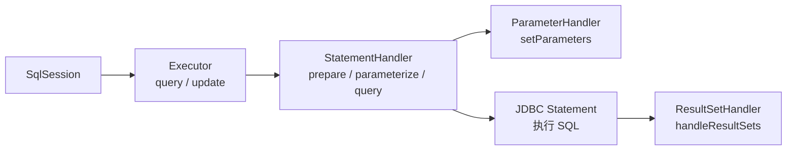
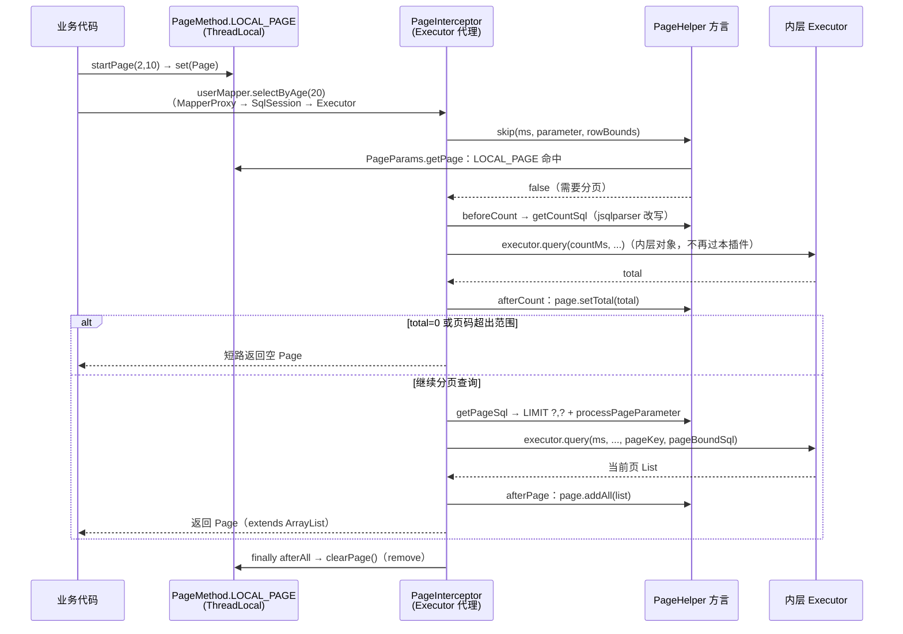

# MyBatis 插件机制与分页原理

> 一句话概括：MyBatis 插件 = 用 JDK 动态代理把四大核心对象包成「嵌套代理 + 责任链」，分页插件 = 在 Executor 层拦截查询、把逻辑分页改写成带 LIMIT 的物理分页 SQL——
> 看懂 `Plugin.wrap` 的包装顺序和 PageHelper 的 ThreadLocal 生命周期，就能解释插件与分页的全部机制与全部的坑。

预计阅读时间：大约 90 分钟

所属主题：[MyBatis 常见面试题总结](summary.md)

本文以 **MyBatis 3.5.19（Java 8 基线）** 为源码基线，源码锚点用 `类名#方法名` 标注，均已对照 tag `mybatis-3.5.19` 的官方源码核验。**MyBatis 3.6.0 已于 2026-10 发布（Java 11 基线，移除 Java 8 fallback）**，相关差异单独注明。PageHelper 以 **6.1.1** 为参考（核验自 GitHub master 分支 `pom.xml`：依赖 MyBatis 3.5.19、jsqlparser 4.7、Java 8 编译），5.x 主链路机制一致。总结文档给结论，本文给机制与证据：每个机制按「结论 → 机制 → 边界/代价 → 实践/追问」展开。

---

## 0. 阅读路线

| 读者 | 建议阅读 | 关注点 |
| --- | --- | --- |
| 初级（1 年内） | 1、2.1~2.3、5.1~5.2、6.1、7.1~7.2 | 插件是什么、四大对象、慢 SQL 插件怎么写、RowBounds 与 PageHelper 怎么用 |
| 中级（1~3 年） | 全部，重点 3、4、6.2~6.4、7.3~7.6 | Plugin.wrap 源码、包装/执行顺序、skipRows、PageHelper 全链路与 ThreadLocal 坑 |
| 高级（3 年+） | 3.5、4.3、5.4、7.4、8.2、9 | 代理成本账、BoundSql 反射改写、count SQL 解析、多数据源方言、缓存交互与排查 |
| 选型/架构 | 1.2、2.3、8、9.1~9.2、9.4 | 拦截层选择、物理分页方言差异、分页插件互斥、深分页治理 |

目录：

1. 结论先行：插件与分页各一句话
2. 四大对象：创建入口与可拦截方法全表
3. Interceptor 与 Plugin.wrap：代理机制源码走读
4. 包装顺序与执行顺序：后注册先执行
5. 实战：慢 SQL 监控插件与改 SQL 的正确姿势
6. RowBounds：内存分页的真相
7. PageHelper 原理深挖
8. 物理分页方言差异与多数据源
9. 边界与排查
10. 高频面试追问集
11. 参考资料

---

## 1. 结论先行：插件与分页各一句话

### 1.1 两句话结论

**结论一（插件）**：MyBatis 插件不是字节码增强，也不是 Spring AOP——它是**纯 JDK 动态代理**：`Configuration` 创建四大对象（Executor / StatementHandler / ParameterHandler / ResultSetHandler）时，统一经过 `InterceptorChain#pluginAll`，按注册顺序把对象层层包成代理；方法调用命中 `@Signature` 声明的签名就走 `Interceptor#intercept`，否则直接反射调目标。多个插件形成**嵌套代理的责任链**（洋葱模型）。

**结论二（分页）**：MyBatis 自带的 `RowBounds` 是**内存分页**（SQL 全量执行，结果映射时逐行跳过）；PageHelper 这类分页插件拦截 `Executor#query`，把查询**改写**成两条物理 SQL——一条 count 求总数、一条带 `LIMIT` 的分页查询——再执行并回填结果。「分页插件」本质是「SQL 改写插件」。

### 1.2 与 Spring AOP 的第一层对照

| 维度 | MyBatis 插件 | Spring AOP |
| --- | --- | --- |
| 代理技术 | **只有 JDK 动态代理**（四大对象全是接口，天然满足前提） | JDK / CGLIB 双轨（Boot 2.0+ 默认 CGLIB） |
| 织入时机 | 四大对象**每次创建时**包装（Executor 每个 SqlSession 一个，StatementHandler 每条语句一个） | Bean 初始化后由 BPP 包装，单例池里放代理 |
| 链结构 | **多层代理嵌套**，每层是完整 Proxy 对象 | **一层代理 + 拦截器 List**，`ReflectiveMethodInvocation#proceed` 索引递归 |
| 顺序控制 | 注册顺序（无 @Order 机制），**后注册先执行**（见第 4 章） | `@Order` 显式排序，值小在外先执行 |
| 拦截范围 | 四大接口的接口方法 | 任意 Spring Bean 的方法 |

JDK 代理与责任链的通用机制见 [IoC & AOP 详解](../spring/ioc-and-aop.md)；本文第 4.3 节做逐条对比。**追问：为什么 MyBatis 不需要 CGLIB？** 因为可拦截的四大对象全部以接口形态暴露（`Configuration` 工厂方法的返回类型就是接口），JDK 代理的前提天然成立——这是「框架设计决定了扩展机制形态」的典型例子。

---

## 2. 四大对象：创建入口与可拦截方法全表

### 2.1 四个工厂方法都经过 pluginAll

**结论**：四大对象不是 new 出来直接用，而是**全部经过 `Configuration` 的四个工厂方法创建、全部经过 `InterceptorChain#pluginAll` 包装**——这就是插件能生效的唯一入口，也是「为什么自己 new 的 Executor 没有插件」的答案。

```java
// Configuration#newExecutor（mybatis-3.5.19，完整）
public Executor newExecutor(Transaction transaction, ExecutorType executorType) {
  executorType = executorType == null ? defaultExecutorType : executorType;
  Executor executor;
  if (ExecutorType.BATCH == executorType) {
    executor = new BatchExecutor(this, transaction);
  } else if (ExecutorType.REUSE == executorType) {
    executor = new ReuseExecutor(this, transaction);
  } else {
    executor = new SimpleExecutor(this, transaction);
  }
  if (cacheEnabled) {
    executor = new CachingExecutor(executor);   // 二级缓存装饰器，默认开启
  }
  return (Executor) interceptorChain.pluginAll(executor);   // 插件包在最外层
}
```

另外三个工厂方法结构完全一致（源码核验）：

| 工厂方法 | 创建的裸对象 | 包装 |
| --- | --- | --- |
| `Configuration#newExecutor` | SimpleExecutor / ReuseExecutor / BatchExecutor，再包 CachingExecutor（cacheEnabled=true 时） | `interceptorChain.pluginAll` |
| `Configuration#newStatementHandler` | **RoutingStatementHandler**（按 StatementType 路由到 Simple/Prepared/Callable 三个 delegate） | 同上 |
| `Configuration#newParameterHandler` | `mappedStatement.getLang().createParameterHandler(...)`（默认 DefaultParameterHandler） | 同上 |
| `Configuration#newResultSetHandler` | DefaultResultSetHandler | 同上 |

两个容易忽略的细节：

- **插件包在 CachingExecutor 之外**：`pluginAll` 是 `newExecutor` 的最后一步。所以 Executor 层插件的拦截发生在二级缓存判断**之前**——插件短路返回时，二级缓存根本不会被读写（见 9.3）。
- **StatementHandler 被代理的是 RoutingStatementHandler**：它本身不干活，只把 `prepare/query` 等委托给内部的 `PreparedStatementHandler` 等 delegate。拿 `BoundSql` 要走接口方法 `getBoundSql()`（逐层委托），不要试图强转成具体实现类。

四大对象在一次查询中的协作位置（完整执行链路见 [架构与 SQL 执行流程](architecture-and-sql-execution.md)）：



### 2.2 可拦截方法全表：官方清单是「子集」

**结论**：官方文档列出的可拦截方法是**推荐子集**；插件匹配的本质是「接口上的 `Method` 对象精确相等」，所以**接口里声明的任何方法都能拦**，包括文档没列的 `queryCursor`、`createCacheKey` 等。

| 对象 | 官方文档列出的方法 | 接口中实际还有（同样可拦截） |
| --- | --- | --- |
| Executor | update、query、flushStatements、commit、rollback、getTransaction、close、isClosed | query 的 6 参重载、queryCursor、createCacheKey、isCached、clearLocalCache、deferLoad、setExecutorWrapper |
| StatementHandler | prepare、parameterize、batch、update、query | queryCursor、getBoundSql、getParameterHandler |
| ParameterHandler | getParameterObject、setParameters | （无，接口就这两个方法） |
| ResultSetHandler | handleResultSets、handleOutputParameters | handleCursorResultSets |

以上方法清单逐一对照 3.5.19 的 `Executor`、`StatementHandler`、`ParameterHandler`、`ResultSetHandler` 四个接口源码核验；官方子集见 [configuration.html#plugins](https://mybatis.org/mybatis-3/zh_CN/configuration.html#plugins)。

**机制**：为什么「任何接口方法都能拦」？`Plugin#getSignatureMap` 用 `sig.type().getMethod(sig.method(), sig.args())` 解析签名，`Plugin#invoke` 用 `signatureMap` 命中判断——整个过程只认接口方法对象，没有白名单过滤方法名。真正的白名单在 `Invocation` 构造器：`method.getDeclaringClass()` 必须是四大接口之一，否则抛 `IllegalArgumentException`（对应 3.5.16 release notes 中「防止 Invocation 被易受攻击的应用使用」的安全修复）。

**边界**：`@Signature(type = ...)` 必须写**接口**（如 `Executor.class`），不能写实现类（`SimpleExecutor.class`）——`getMethod` 在实现类上找不到接口声明的方法签名会直接抛 `PluginException`；实现类私有/特有方法（如 `SimpleExecutor#doQuery`）**不可拦截**，因为它们不在代理实现的接口里。

### 2.3 每个对象适合做什么增强

| 对象 | 拦截点能拿到什么 | 典型增强 |
| --- | --- | --- |
| Executor | MappedStatement、参数、RowBounds、BoundSql（6 参重载）、整个查询的执行控制权 | **分页**（PageHelper）、慢 SQL 监控、读写分离路由、自定义缓存短路、多租户查询改写 |
| StatementHandler | `prepare` 有 **Connection**；`getBoundSql()` 随时可拿最终 SQL | **SQL 文本改写**（租户条件、数据权限）、SQL 防火墙、执行计时（query/update） |
| ParameterHandler | 参数对象、PreparedStatement | 字段**加密**、自动填充（创建时间/操作人）、参数脱敏 |
| ResultSetHandler | 映射完成的 List / 游标 / 存储过程 OUT 参数 | 字段**解密**、结果脱敏、结果二次加工 |

**实践**：选型口诀——**要控制「执行不执行、执行几条 SQL」拦 Executor；要改「SQL 长什么样」拦 StatementHandler；要改「参数值」拦 ParameterHandler；要改「结果值」拦 ResultSetHandler**。加解密类插件通常 ParameterHandler + ResultSetHandler 成对出现。结果映射本身的机制见 [结果映射与 TypeHandler](result-mapping-and-typehandler.md)。

---

## 3. Interceptor 与 Plugin.wrap：代理机制源码走读

### 3.1 Interceptor 接口三方法

```java
// org.apache.ibatis.plugin.Interceptor（mybatis-3.5.19，完整）
public interface Interceptor {
  Object intercept(Invocation invocation) throws Throwable;   // 唯一必须实现的方法

  default Object plugin(Object target) {
    return Plugin.wrap(target, this);                          // 默认：交给 Plugin 生成代理
  }
  default void setProperties(Properties properties) {
    // NOP                                                     // 默认：不读配置属性
  }
}
```

| 方法 | 职责 | 什么时候被调 |
| --- | --- | --- |
| `intercept` | 拦截逻辑本体；`invocation.proceed()` 放行 | 每次命中签名的方法调用 |
| `plugin` | 决定「怎么包装目标对象」 | 四大对象创建时（`pluginAll` 循环内） |
| `setProperties` | 读取 `<plugin>` 下的 `<property>` 配置 | XML 方式注册、MyBatis 解析配置时 |

**版本归属**：3.4.x 三个方法**全是抽象方法**（核验 3.4.6 源码），实现类必须写满三个；3.5.x 起 `plugin`/`setProperties` 提供 default 实现（核验 3.5.19），只写 `intercept` 即可。老教程里「必须覆写 plugin 方法返回 Plugin.wrap」的模板代码在 3.5.x 是冗余的。

### 3.2 @Intercepts + @Signature：签名必须精确匹配

```java
@Documented @Retention(RetentionPolicy.RUNTIME) @Target(ElementType.TYPE)
public @interface Intercepts {
  Signature[] value();
}

@Documented @Retention(RetentionPolicy.RUNTIME) @Target({})   // 只能嵌套在 @Intercepts 里
public @interface Signature {
  Class<?> type();      // 四大接口之一
  String method();      // 方法名
  Class<?>[] args();    // 参数类型数组，必须与接口声明完全一致
}
```

**机制**：`Plugin#getSignatureMap` 的解析逻辑（源码核验）：

```java
// Plugin#getSignatureMap（简化）
Intercepts interceptsAnnotation = interceptor.getClass().getAnnotation(Intercepts.class);
if (interceptsAnnotation == null) {
  throw new PluginException("No @Intercepts annotation was found in interceptor " + ...);
}
for (Signature sig : interceptsAnnotation.value()) {
  Method method = sig.type().getMethod(sig.method(), sig.args());   // 精确匹配，找不到就抛
  methods.add(method);
}
```

三条硬规则：

1. **没有 @Intercepts 直接抛 PluginException**（issue #251），不是静默失效；
2. `args` 必须与**接口声明**的参数类型逐一相等——`Executor#query` 有 4 参和 6 参两个重载，想都拦就要写**两个 @Signature**（PageHelper 正是这么做的，见 7.3）。注意：MyBatis 核心的 4 参 → 6 参委托是 CachingExecutor/BaseExecutor 内部的 this 调用，**不经过代理**；真正到达代理的 6 参调用主要来自**其他插件重新发起的查询**（如 PageHelper 的 count/分页查询）——只写 4 参签名会漏掉这些被改写的查询；
3. 签名解析失败（方法名/参数写错）抛 `PluginException`，**错误暴露在对象创建时**而非编译期。

### 3.3 Plugin.wrap：有匹配才代理，否则原样返回

```java
// Plugin#wrap（mybatis-3.5.19，完整）
public static Object wrap(Object target, Interceptor interceptor) {
  Map<Class<?>, Set<Method>> signatureMap = getSignatureMap(interceptor);
  Class<?> type = target.getClass();
  Class<?>[] interfaces = getAllInterfaces(type, signatureMap);
  if (interfaces.length > 0) {
    return Proxy.newProxyInstance(type.getClassLoader(), interfaces,
        new Plugin(target, interceptor, signatureMap));
  }
  return target;   // 签名与目标接口无交集：原样返回，不代理
}
```

`getAllInterfaces` 沿目标类的继承链向上收集**出现在 signatureMap 里的接口**。这解释了两个行为：

- 一个只声明了 `StatementHandler#prepare` 的插件，在 `pluginAll(executor)` 时匹配不到任何接口，**Executor 原样穿过**——每个插件只包装自己声明的对象类型，`pluginAll` 对四大对象一视同仁地调用，靠签名匹配自动分流；
- 代理对象**只实现签名涉及的接口**。目标类实现的其他接口不会出现在代理上——这是 JDK 代理的固有边界，也是「代理对象不能强转成实现类」的原因。

### 3.4 Plugin#invoke 与 Invocation：命中走 intercept，未命中直接反射

```java
// Plugin#invoke（mybatis-3.5.19，完整）
@Override
public Object invoke(Object proxy, Method method, Object[] args) throws Throwable {
  try {
    Set<Method> methods = signatureMap.get(method.getDeclaringClass());
    if (methods != null && methods.contains(method)) {
      return interceptor.intercept(new Invocation(target, method, args));   // 命中
    }
    return method.invoke(target, args);                                     // 未命中：直调
  } catch (Exception e) {
    throw ExceptionUtil.unwrapThrowable(e);   // 解包 InvocationTargetException，保留原异常
  }
}
```

```java
// Invocation（核心字段与方法）
private final Object target;      // 被代理的目标（可能是下一层代理）
private final Method method;
private final Object[] args;

public Object proceed() throws InvocationTargetException, IllegalAccessException {
  return method.invoke(target, args);   // 放行 = 反射调用下一层
}
```

要点：

- `intercept` 拿到的 `Invocation` 封装了 target/method/args 三件套，`getArgs()` 可以**改参数**（如替换 RowBounds），`proceed()` 掌握放行控制权——与 Spring `@Around` 的 `ProceedingJoinPoint` 同构；不调 `proceed()` 就是短路（分页插件 count=0 时直接返回空列表正是短路）；
- `ExceptionUtil.unwrapThrowable` 把反射包装的 `InvocationTargetException` 解包成业务原始异常——插件里 catch 异常时拿到的是真实异常类型；
- 未命中签名的方法**也要经过一次代理分派 + HashSet 查找 + 反射**，不是零开销（见 3.5）。

### 3.5 边界与代价

| 代价 | 机制 | 量级/影响 |
| --- | --- | --- |
| 每次对象创建都解析注解 | `Plugin.wrap` 每次调用都执行 `getSignatureMap`（反射读注解 + getMethod），**没有全局缓存** | Executor 每开一个 SqlSession 创建一次；StatementHandler/ParameterHandler/ResultSetHandler **每条语句执行都创建一次**——插件越多，每条 SQL 的固定反射开销越大 |
| 每次方法调用多一层分派 | 命中：Invocation 构造 + intercept；未命中：signatureMap 查找 + `method.invoke` | 单次 µs 量级，但嵌套 N 层就是 N 次；热点路径上插件数量要克制 |
| 只能拦接口方法 | JDK 代理固有边界 | 实现类特有方法、static/final 逻辑不可拦截 |
| 异常语义被代理层改写 | 反射调用包 InvocationTargetException | MyBatis 已用 unwrapThrowable 兜底；自己写插件时 catch 后重抛要注意保留原始异常 |

**实践**：官方文档原话——「如果你想做的不仅仅是监控方法的调用，那么你最好相当了解要重写的方法的行为……使用插件的时候要特别当心」。插件是**底层扩展点**，不是业务逻辑的常规载体；能用 Mapper 层解决的不要下沉到插件。

---

## 4. 包装顺序与执行顺序：后注册先执行

### 4.1 pluginAll 源码与结论

**结论（高频易错）**：`pluginAll` 按**注册顺序**逐个包装，先注册的在内层、后注册的外层；方法调用先到达最外层代理，所以**后注册的插件先执行 intercept 逻辑**——与 Spring AOP「@Order 值小先执行」、Servlet Filter「先注册先执行」的直觉都相反。

```java
// InterceptorChain#pluginAll（mybatis-3.5.19，完整）
public Object pluginAll(Object target) {
  for (Interceptor interceptor : interceptors) {   // ArrayList，顺序 = addInterceptor 顺序
    target = interceptor.plugin(target);           // 后一个包装的是前一个的产物
  }
  return target;
}
```

`addInterceptor` 只是 `interceptors.add(interceptor)`，**没有去重、没有排序**——注册顺序就是唯一顺序依据，MyBatis 不支持 `@Order` 之类的优先级注解。

### 4.2 洋葱模型：注册 A 再注册 B

```java
configuration.addInterceptor(pluginA);   // 先注册 → 内层
configuration.addInterceptor(pluginB);   // 后注册 → 外层
// pluginAll 之后：proxyB( proxyA( CachingExecutor( SimpleExecutor ) ) )
```


每一层的 `proceed()` 都是 `method.invoke(target, args)`，target 是下一层代理——**洋葱模型不是比喻，是代理嵌套的字面行为**。

**一个有实际意义的推论**：PageHelper 的 count 查询与分页查询是在 `invocation.getTarget()`（**内层对象**）上执行的（`ExecutorUtil#pageQuery` / `#executeAutoCount`，源码核验），不会重新进入 PageInterceptor 自己，但**会穿过比它更内层的插件**。所以：

- 想让慢 SQL 监控统计到 count SQL 和分页 SQL → 监控插件注册在 PageHelper **之前**（内层）；
- 监控插件注册在 PageHelper 之后（外层）→ 只能看到「一次逻辑查询」的总耗时，看不到被改写后的两条物理 SQL。

### 4.3 与 Spring AOP 拦截器链的异同

| 维度 | MyBatis 插件链 | Spring AOP 拦截器链 |
| --- | --- | --- |
| 链的物理形态 | N 个插件 = N 层 Proxy 嵌套 | 1 层 Proxy + `List<MethodInterceptor>` |
| 推进方式 | 每层 `Invocation#proceed` 反射调下一层代理 | `ReflectiveMethodInvocation#proceed` 索引 +1 递归 |
| 顺序决定 | 注册顺序，**后注册先执行** | `@Order` 排序，**值小先执行**（外层） |
| 短路能力 | 不调 proceed 即短路 | 不调 proceed 即短路 |
| 共同本质 | 责任链变体 + 运行时代理，控制权在拦截器手里 | 同左 |

机制同源、形态不同：Spring 把「链」收敛进一个 invocation 对象，MyBatis 把「链」摊开成代理套代理。对照阅读 [IoC & AOP 详解 §6.4](../spring/ioc-and-aop.md)。

### 4.4 Spring Boot 下的注册顺序

核验 mybatis-spring-boot-autoconfigure（master）的 `MybatisAutoConfiguration`：

- 容器里所有 `Interceptor` Bean 通过 `ObjectProvider<Interceptor[]>` 收集，`sqlSessionFactory()` 中 `factory.setPlugins(this.interceptors)` 交给 `SqlSessionFactoryBean`，最终在 `SqlSessionFactoryBean#buildSqlSessionFactory` 里逐个 `configuration.addInterceptor(plugin)`（Spring 集成细节见 [Spring 集成与事务](spring-integration-and-transaction.md)）；
- `ConfigurationCustomizer` 在 `applyConfiguration` 阶段执行，**早于** `setPlugins`——所以 Customizer 里 addInterceptor 的插件在内层，Interceptor Bean 在外层；
- 数组顺序遵循 Spring 集合注入的排序规则（`@Order` 可影响），但**跨注册方式（XML / Bean / Customizer）的全局顺序没有显式保证**。

**实践**：对顺序敏感的插件组合（分页 + 监控 + 多租户），统一用一种注册方式，并写一个集成测试断言实际执行顺序——不要靠「看起来生效了」推断顺序。

---

## 5. 实战：慢 SQL 监控插件与改 SQL 的正确姿势

### 5.1 完整实现：拦截 Executor 层

```java
import org.apache.ibatis.cache.CacheKey;
import org.apache.ibatis.executor.Executor;
import org.apache.ibatis.logging.Log;
import org.apache.ibatis.logging.LogFactory;
import org.apache.ibatis.mapping.BoundSql;
import org.apache.ibatis.mapping.MappedStatement;
import org.apache.ibatis.plugin.*;
import org.apache.ibatis.session.ResultHandler;
import org.apache.ibatis.session.RowBounds;
import java.util.Properties;

@Intercepts({
    // query 两个重载都要声明：4 参覆盖业务调用，6 参覆盖其他插件重发的查询（如 PageHelper 的 count/分页 SQL）
    @Signature(type = Executor.class, method = "query",
        args = {MappedStatement.class, Object.class, RowBounds.class, ResultHandler.class}),
    @Signature(type = Executor.class, method = "query",
        args = {MappedStatement.class, Object.class, RowBounds.class, ResultHandler.class,
                CacheKey.class, BoundSql.class}),
    @Signature(type = Executor.class, method = "update",
        args = {MappedStatement.class, Object.class})
})
public class SlowSqlInterceptor implements Interceptor {
  private static final Log log = LogFactory.getLog(SlowSqlInterceptor.class);
  private long thresholdMillis = 1000;

  @Override
  public Object intercept(Invocation invocation) throws Throwable {
    MappedStatement ms = (MappedStatement) invocation.getArgs()[0];
    long start = System.nanoTime();
    try {
      return invocation.proceed();
    } finally {
      long cost = (System.nanoTime() - start) / 1_000_000;
      if (cost >= thresholdMillis) {
        log.warn("[SLOW-SQL] " + ms.getId() + " cost " + cost + " ms");
      }
    }
  }

  @Override
  public void setProperties(Properties properties) {
    String v = properties.getProperty("thresholdMillis");
    if (v != null) {
      thresholdMillis = Long.parseLong(v);
    }
  }
  // plugin() 不用写：3.5.x 默认实现就是 Plugin.wrap(target, this)
}
```

设计要点：计时放 `finally`（异常路径也要记录）；`ms.getId()` 定位到具体 Mapper 方法；生产环境把 log.warn 换成指标上报（Micrometer/自研监控），阈值走配置。

### 5.2 三种注册方式

| 方式 | 写法 | 属性注入 | 适用 |
| --- | --- | --- | --- |
| mybatis-config.xml | `<plugins><plugin interceptor="..."><property .../></plugin></plugins>` | MyBatis 解析配置时回调 `setProperties` | 原生 MyBatis / 统一 XML 配置 |
| Spring Boot 注入 Interceptor Bean | `@Bean`（或 `@Component`）返回 Interceptor | **没有 setProperties 回调**，属性靠构造器或手动调用 | Boot 项目主流方式 |
| ConfigurationCustomizer | `@Bean ConfigurationCustomizer` 里 `configuration.addInterceptor(...)` | 同上，自己负责 | 需要按条件动态注册、或拿到 Configuration 做更多定制 |

```xml
<!-- 方式一：mybatis-config.xml（plugins 元素位置固定：typeHandlers 之后、environments 之前） -->
<plugins>
  <plugin interceptor="com.example.plugin.SlowSqlInterceptor">
    <property name="thresholdMillis" value="500"/>
  </plugin>
</plugins>
```

```java
// 方式二：Spring Boot Bean
@Bean
public SlowSqlInterceptor slowSqlInterceptor() {
  SlowSqlInterceptor interceptor = new SlowSqlInterceptor();
  Properties props = new Properties();
  props.setProperty("thresholdMillis", "500");
  interceptor.setProperties(props);   // Bean 方式不会自动回调，必须手动
  return interceptor;
}

// 方式三：ConfigurationCustomizer
@Bean
public ConfigurationCustomizer slowSqlCustomizer() {
  return configuration -> configuration.addInterceptor(new SlowSqlInterceptor());
}
```

**边界（核验自 MybatisAutoConfiguration 源码）**：`ConfigurationCustomizer` 只在 `applyConfiguration` 创建了 Configuration 时才被调用——**如果只配了 `mybatis.config-location` 而没配任何 `mybatis.configuration.*` 属性，Configuration 由 XML 构建，Customizer 根本不会执行**（此时应改用 `SqlSessionFactoryBeanCustomizer`）。「Customizer 静默不生效」是 Boot 集成的高频坑。

### 5.3 计时语义：拦 Executor 还是 StatementHandler

**结论**：`StatementHandler#prepare` **不执行 SQL**——它只调 `connection.prepareStatement` 做预编译；真正的执行在 `query(Statement, ResultHandler)` / `update(Statement)` / `batch(Statement)`。拦 prepare 计时是经典错误。

| 拦截点 | 计时覆盖范围 | 适用 |
| --- | --- | --- |
| `Executor#query`（4 参） | 缓存判断 + SQL 执行 + **结果映射**，一次逻辑查询的全程 | 面向业务的慢查询监控（推荐） |
| `Executor#query`（6 参） | 其他插件在代理上重发的查询（如 PageHelper 的 count/分页查询）；核心内部 4→6 委托是 this 调用，不过代理 | 与 4 参同时声明才完整 |
| `StatementHandler#query/update` | 纯 JDBC 执行 + 结果映射，**不含缓存判断** | 面向 DB 的耗时分析 |
| `StatementHandler#prepare` | 只有预编译（网络往返 + 服务端解析） | 排查预编译开销，**不是执行耗时** |

注意 Executor 层计时包含一级/二级缓存命中的情况（命中时耗时极短，不会误报）；被 PageHelper 改写后，一次逻辑查询会变成 count + 分页两条物理 SQL，监控在内层时分别计时（见 4.2）。

### 5.4 插件里改 SQL 的正确姿势

**结论**：`BoundSql.sql` 是 `private final String`，**没有 setter**（源码核验）。改 SQL 有两条路：用 MyBatis 自带的 MetaObject 反射工具**原地改 sql 字段**（推荐，PageHelper 同款思路）；或**新建 BoundSql**——后者必须手工复制附加参数，否则动态 SQL 直接炸。

```java
// 路线 A：拦 StatementHandler#prepare，原地改写（适合加租户条件等文本改写）
@Intercepts(@Signature(type = StatementHandler.class, method = "prepare",
    args = {Connection.class, Integer.class}))
public class TenantSqlInterceptor implements Interceptor {
  @Override
  public Object intercept(Invocation invocation) throws Throwable {
    StatementHandler handler = (StatementHandler) invocation.getTarget();
    BoundSql boundSql = handler.getBoundSql();          // 接口方法，穿透代理拿最终 SQL
    String newSql = rewrite(boundSql.getSql());         // 自己的改写逻辑（建议 jsqlparser）
    // sql 字段 private final 无 setter：用 MyBatis 反射工具 MetaObject 赋值
    SystemMetaObject.forObject(boundSql).setValue("sql", newSql);
    return invocation.proceed();
  }
}
```

```java
// 路线 B：新建 BoundSql（PageHelper ExecutorUtil#pageQuery 的做法，源码核验）
BoundSql pageBoundSql = new BoundSql(ms.getConfiguration(), pageSql,
    boundSql.getParameterMappings(), parameter);
// 关键：复制附加参数！foreach 等动态 SQL 的临时参数都在这里
for (String key : boundSql.getAdditionalParameters().keySet()) {
  pageBoundSql.setAdditionalParameter(key, boundSql.getAdditionalParameter(key));
}
```

**为什么附加参数是坑**：`<foreach>` 会把每个元素绑定成形如 `__frch_id_0` 的附加参数存进 `BoundSql.additionalParameters`（动态 SQL 机制见 [动态 SQL 与注入](dynamic-sql-and-injection.md)），`DefaultParameterHandler` 设参时优先从附加参数取值（`BaseExecutor#createCacheKey` 中同样有 `hasAdditionalParameter` 分支，源码核验）。新建 BoundSql 时 `additionalParameters` 是**空 Map**——不复制的话，带 foreach 的 SQL 一执行就报「参数找不到」。PageHelper 源码里专门写着注释：「当使用动态 SQL 时，可能会产生临时的参数，这些参数需要手动设置到新的 BoundSql 中」。

**边界与代价**：

- 反射改 final 字段依赖 MyBatis 内部反射工具（`SystemMetaObject`/Reflector）的能力，**跨版本不保证稳定**，业务代码尽量走路线 B 或干脆在 Executor 层用新 BoundSql 重新发起查询；
- 改了 SQL 文本但**没改 parameterMappings**，占位符与参数会错位——新增 `?` 必须同步追加 ParameterMapping（PageHelper 在 `MySqlDialect#processPageParameter` 里正是这么做的，见 7.4）；
- 改了 SQL 还要考虑 **CacheKey**：缓存 key 含 SQL 文本与分页参数，改写后不更新 key 会串缓存（见 9.3）。

---

## 6. RowBounds：内存分页的真相

### 6.1 结论与用法

**结论**：`RowBounds` 是**逻辑分页（内存分页）**：SQL 原样全量执行，MyBatis 在**结果映射层**跳过 offset 行、只映射 limit 行。它不改 SQL、不发 LIMIT，数据库该扫多少行还扫多少行。

```java
// Mapper 接口：RowBounds 是 MyBatis 识别的特殊参数，不参与 #{} 绑定
List<User> selectByAge(@Param("age") int age, RowBounds rowBounds);

// 调用：取第 11~20 条
List<User> page2 = userMapper.selectByAge(20, new RowBounds(10, 10));
// 或 SqlSession 直接调用
List<User> users = sqlSession.selectList("com.example.UserMapper.selectByAge", 20, new RowBounds(0, 10));
```

```java
// RowBounds（mybatis-3.5.19，核心字段）
public static final int NO_ROW_OFFSET = 0;
public static final int NO_ROW_LIMIT = Integer.MAX_VALUE;
public static final RowBounds DEFAULT = new RowBounds();   // 0, MAX_VALUE
```

### 6.2 skipRows 源码：消费发生在 ResultSetHandler 层

**机制**：RowBounds 一路透传（Executor → StatementHandler → ResultSetHandler），**最终消费者是 `DefaultResultSetHandler`**，调用链：`handleResultSets` → `handleResultSet` → `handleRowValues` → `handleRowValuesForSimpleResultMap` → `skipRows`（源码核验）：

```java
// DefaultResultSetHandler#skipRows（mybatis-3.5.19，完整）
private void skipRows(ResultSet rs, RowBounds rowBounds) throws SQLException {
  if (rs.getType() != ResultSet.TYPE_FORWARD_ONLY) {
    if (rowBounds.getOffset() != RowBounds.NO_ROW_OFFSET) {
      rs.absolute(rowBounds.getOffset());      // 可滚动结果集：直接定位
    }
  } else {
    for (int i = 0; i < rowBounds.getOffset(); i++) {
      if (!rs.next()) {                        // 前向结果集（默认）：逐行 next() 跳过
        break;
      }
    }
  }
}

// 行数上限：映射够 limit 行就停
private boolean shouldProcessMoreRows(ResultContext<?> context, RowBounds rowBounds) {
  return !context.isStopped() && context.getResultCount() < rowBounds.getLimit();
}
```

**结论**：所谓「分页」只是 `rs.next()` 空转 offset 次 + 映射 limit 行后停止读取。SQL 层、网络层、驱动层没有任何裁剪。

### 6.3 为什么大数据量不能用

| 环节 | RowBounds 下的真实行为 | 代价 |
| --- | --- | --- |
| 数据库 | 全量执行查询（无 LIMIT），该扫的索引/行全扫 | DB CPU 与 IO 全付 |
| 网络 | 全量结果行传输到客户端 | 带宽全付 |
| JDBC 驱动 | MySQL Connector/J 默认把**整个结果集读进客户端内存**（流式读取需显式设置 fetchSize，属驱动行为） | **OOM 风险在驱动缓冲层**，不在 MyBatis 的 List |
| MyBatis | skipRows 逐行跳过，List 里只放 limit 行 | 跳过的行白白传输；offset 越大浪费越大 |

所以「RowBounds 会不会 OOM」的精确答案是：**MyBatis 返回的 List 只有 limit 条，但驱动默认全量缓冲结果集，百万行查询照样撑爆堆**；即便开了流式读取，DB 全扫 + 全量传输 + 逐行跳过的浪费也一分不少。深分页治理见 [批处理与性能](batch-and-performance.md)。

### 6.4 RowBounds 与 CacheKey、嵌套映射的边界

**CacheKey 包含 offset/limit**（`BaseExecutor#createCacheKey`，源码核验）：

```java
cacheKey.update(ms.getId());
cacheKey.update(rowBounds.getOffset());   // 分页范围是缓存 key 的独立分量
cacheKey.update(rowBounds.getLimit());
cacheKey.update(boundSql.getSql());
// ... 参数值、environment id
```

同一 SQL 同一参数、不同页 → 不同 key，一级/二级缓存不会跨页误命中；缓存里存的是「跳过 + 截断后」的 List。缓存机制全貌见 [缓存机制](cache-mechanism.md)。

**嵌套结果映射不支持 RowBounds**：`handleRowValues` 对 nested resultMap 会调 `ensureNoRowBounds()`——`safeRowBoundsEnabled=true` **且 RowBounds 非默认**（`limit < NO_ROW_LIMIT` 或 `offset > NO_ROW_OFFSET`，即真正限制了行范围）时抛 `ExecutorException`，RowBounds 为默认值时即使开了开关也不抛；**开关默认 false 时不报错**，但嵌套映射会把多行折叠成一个对象，「跳 10 行取 10 行」的语义在折叠后完全失真。PageHelper 官方「重要提示」同样明确：**分页插件不支持嵌套结果映射**（折叠导致总数减少）。需要分页 + 一对多时，改用嵌套查询（collection select）或手工分页。

---

## 7. PageHelper 原理深挖

### 7.1 全链路时序

**结论**：PageHelper = `startPage` 把 Page 放进 ThreadLocal + `PageInterceptor` 拦截 `Executor#query` + 方言生成 count/分页两条物理 SQL + finally 清理 ThreadLocal。四步缺一不可，坑也全在这四步的衔接上。



Mapper 接口方法如何一路走到 `Executor#query`（MapperProxy → MapperMethod → SqlSession）见 [Mapper 代理与绑定](mapper-proxy-and-binding.md)。

### 7.2 startPage 与 LOCAL_PAGE

```java
// PageMethod（PageHelper 6.1.1，核验源码）
protected static final ThreadLocal<Page> LOCAL_PAGE = new ThreadLocal<Page>();

public static <E> Page<E> startPage(int pageNum, int pageSize, boolean count,
                                    Boolean reasonable, Boolean pageSizeZero) {
  Page<E> page = new Page<E>(pageNum, pageSize, count);
  page.setReasonable(reasonable);
  page.setPageSizeZero(pageSizeZero);
  // ...
  setLocalPage(page);    // LOCAL_PAGE.set(page)
  return page;
}

public static void clearPage() {
  LOCAL_PAGE.remove();
}
```

`startPage` **只写 ThreadLocal，不碰任何 SQL**——它和后面的查询之间没有参数传递，全靠「同一线程 + 第一个查询消费」的隐式约定。这个设计是全部便利与全部风险的来源（见 7.6）。

### 7.3 PageInterceptor#intercept 走读

```java
// PageInterceptor（6.1.1）：两个重载都拦
@Intercepts({
    @Signature(type = Executor.class, method = "query",
        args = {MappedStatement.class, Object.class, RowBounds.class, ResultHandler.class}),
    @Signature(type = Executor.class, method = "query",
        args = {MappedStatement.class, Object.class, RowBounds.class, ResultHandler.class,
                CacheKey.class, BoundSql.class}),
})
public class PageInterceptor implements Interceptor { ... }
```

`intercept` 主干（源码核验，简化注释）：

```java
Object[] args = invocation.getArgs();
MappedStatement ms = (MappedStatement) args[0];
Executor executor = (Executor) invocation.getTarget();   // 内层对象
if (args.length == 4) {
  boundSql = ms.getBoundSql(parameter);                  // 4 参：自己解析动态 SQL
  cacheKey = executor.createCacheKey(ms, parameter, rowBounds, boundSql);
} else {
  cacheKey = (CacheKey) args[4]; boundSql = (BoundSql) args[5];   // 6 参：直接复用
}
if (!dialect.skip(ms, parameter, rowBounds)) {           // 判断是否需要分页
  if (dialect.beforeCount(ms, parameter, rowBounds)) {
    Long count = count(executor, ms, parameter, rowBounds, null, boundSql);
    if (!dialect.afterCount(count, parameter, rowBounds)) {
      return dialect.afterPage(new ArrayList(), parameter, rowBounds);   // 短路：空结果
    }
  }
  resultList = ExecutorUtil.pageQuery(dialect, executor, ms, parameter,
      rowBounds, resultHandler, boundSql, cacheKey);
} else {
  resultList = executor.query(ms, parameter, rowBounds, resultHandler, cacheKey, boundSql);
}
return dialect.afterPage(resultList, parameter, rowBounds);
// finally { dialect.afterAll(); }   ← 清理入口，见下
```

三个关键机制：

1. **「是否分页」的判断在 `PageParams#getPage`**，取 Page 的优先级（源码核验）：**LOCAL_PAGE（ThreadLocal）> 非默认 RowBounds > 参数对象**（参数实现 `IPage` 或开启 `supportMethodsArguments` 时从参数解析）。这解释了为什么 startPage 能「覆盖」RowBounds，也解释了为什么 ThreadLocal 残留会污染无关查询；
2. **count 与分页查询都在 `invocation.getTarget()`（内层 Executor）上执行**，天然不会重入 PageInterceptor 自己；count 用的 MappedStatement 是独立生成的（`MSUtils.newCountMappedStatement`），缓存在 PageInterceptor 的 `msCountMap`，key 是由 `countMsIdGen.genCountMsId(ms, parameter, boundSql, countSuffix)` 生成的 countMsId（默认实现即 `原msId + countSuffix`，`countMsIdGen` 可定制）；**手写 count 优先**：先找 countMsId 对应的现成语句（`countSuffix` 默认 `_COUNT`，可配）；
3. **finally 里调的是 `dialect.afterAll()`**，清理动作在 `PageHelper#afterAll`（源码核验）：

```java
// PageHelper#afterAll（6.1.1，完整）
@Override
public void afterAll() {
  AbstractHelperDialect delegate = autoDialect.getDelegate();
  if (delegate != null) {
    delegate.afterAll();
    autoDialect.clearDelegate();   // 清理方言 ThreadLocal（多数据源场景）
  }
  clearPage();                     // 无条件 LOCAL_PAGE.remove()
}
```

**注意**：`clearPage()` 在 finally 中**无条件执行**——只要查询经过了 PageInterceptor，无论分页与否、正常还是异常，ThreadLocal 都会被清。所以「消费过的」分页参数不会残留；**危险的只有「从未被消费」的参数**（见 7.6）。

### 7.4 方言：count SQL 与分页 SQL 怎么生成

**分页 SQL（MySqlDialect，源码核验）**：

```java
// MySqlDialect#getPageSql（6.1.1，完整）
StringBuilder sqlBuilder = new StringBuilder(sql.length() + 14);
sqlBuilder.append(sql);
if (page.getStartRow() == 0) {
  sqlBuilder.append("\n LIMIT ? ");      // 首页只有一个占位符
} else {
  sqlBuilder.append("\n LIMIT ?, ? ");   // startRow, pageSize
}
```

配套参数处理 `MySqlDialect#processPageParameter`：把 `startRow`/`pageSize` 放进参数 Map（`PAGEPARAMETER_FIRST/SECOND`），**向 BoundSql.parameterMappings 追加对应的 ParameterMapping**（首页只加 pageSize），并 `pageKey.update(startRow)` / `pageKey.update(pageSize)`——**分页参数计入缓存 key**，这是分页与缓存正确共存的关键（对照 5.4 的「改 SQL 必须同步改参数映射与 key」）。

执行时 `ExecutorUtil#pageQuery` 用**新 BoundSql**（复制附加参数，见 5.4）+ `RowBounds.DEFAULT` 调 `executor.query`——传 DEFAULT 是为了**关掉 MyBatis 的内存分页**，物理分页后不能再跳一次行。

**count SQL（DefaultCountSqlParser#getSmartCountSql，源码核验）**：用 jsqlparser（6.1.1 依赖 4.7）解析原 SQL 后智能改写：

| 规则 | 行为 |
| --- | --- |
| 解析失败 / 处理异常 | 回退包裹：`select count(0) from ( 原SQL ) tmp_count`，语义正确但失去优化 |
| order by | **去掉**（count 不需要排序）；但 order by 中含 `?` 占位符时保留（去掉会导致 JDBC 参数个数不匹配，issue #868）；`/*keep orderby*/` 注释或 keepOrderBy 配置可强制保留 |
| select 列简化 | 无 group by / distinct / having、select 列不含 `?`、不含聚合函数时，直接把 select 列替换为 `count(0)` |
| 有 group by / distinct / 聚合 | 不能简化（会改变语义），包裹成 `count(0) from (原SQL) table_count` |
| 数据库 hint | 原 SQL 的 `/*...*/` hint 会被拼回 count SQL 前缀 |

**实践**：复杂 SQL（大 foreach、多层子查询）自动 count 又慢又容易解析失败，**手写 count 语句**（id 为 `原查询id_COUNT`）是官方支持的逃生门，count 直接走你的语句，跳过解析与改写。`countColumn` 可指定 count 的列；`startPage(pageNum, pageSize, false)` 可整体关掉 count（total 回填 -1）。6.x 还提供异步 count（`asyncCount`，独立 Executor 执行、不加载拦截器，源码核验）。工程建议（作者判断，非官方文档结论）：**只在独立查询场景使用，混合增删改时不要开启**——异步 count 运行在独立的事务/会话上下文里，看不到当前事务未提交的写入，计数可能与业务数据不一致。

### 7.5 结果回填：Page、reasonable 与 PageInfo

**机制**（源码核验）：`Page<E> extends ArrayList<E>`——查询结果 `page.addAll(pageList)` 后**直接把 Page 当 List 返回**，所以 `List<User> list = mapper.selectXxx()` 拿到的实际是 Page，可以强转或包一层 `PageInfo`：

```java
PageHelper.startPage(2, 10);
List<User> list = userMapper.selectByAge(20);
PageInfo<User> pageInfo = new PageInfo<>(list);   // total/pages/navigatepageNums 等
```

- `afterCount`：`page.setTotal(count)`；返回 false 时**短路返回空 Page**，分页查询都不发。完整条件（源码核验）：`pageSizeZero=false && pageSize<=0`，或 `pageSizeZero=true && pageSize<0`，或 `pageNum>0 && count>startRow` 不成立（count=0 是后者的特例）；
- `afterPage`：未查 count 时 `total = -1`；`pageSizeZero=true && pageSize=0` 时查全部且 total=结果条数；
- **reasonable（分页合理化）**在 `Page#setPageNum` 与 `Page#setTotal` 中处理：`pageNum<=0` 修正为 1；count 回填后 `pageNum>pages` 修正为最后一页（pages=0 除外）。默认 false——非法页码原样查询（通常返回空）。注意 `offsetAsPageNum=false` 时用 RowBounds 分页会**强制 reasonable=false**（PageParams#getPage 源码注释）；
- `Page#doSelectPage(ISelect)` / `doSelectPageInfo(ISelect)`：lambda 形式把查询绑定在分页参数上，`PageHelper.startPage(2,10).doSelectPage(() -> mapper.selectByAge(20))`——官方推荐的安全写法之一。

### 7.6 ThreadLocal 坑与安全使用规范

**结论**：PageHelper 的分页参数与线程绑定，**只被紧跟其后的第一个 MyBatis 查询消费**（官方文档原话）。消费后 finally 自动清理；**没被消费的 Page 会一直留在线程上**，线程池复用线程时，下一个请求的第一个查询就会「莫名其妙被分页」。

官方文档给出的不安全示例（原文核验）：

```java
PageHelper.startPage(1, 10);
List<Country> list;
if (param1 != null) {
  list = countryMapper.selectIf(param1);   // param1 为 null 时查询不执行
} else {
  list = new ArrayList<Country>();         // Page 没被消费 → 残留在线程上
}
```

安全规范（按优先级）：

1. **startPage 后必须紧跟目标查询**，中间不插任何其他 MyBatis 查询（否则分页被别的查询消费，目标查询反而不分页）；把 startPage 挪进真正执行查询的分支里（官方修正写法）；
2. 优先用 **lambda 形式** `startPage(...).doSelectPage(() -> ...)`，参数与查询同生共死；
3. 无法保证紧跟时（复杂分支、提前 return、异常路径），`try { 查询 } finally { PageHelper.clearPage(); }` 兜底——官方认为这种写法「不好看且没必要」，但在线程池环境里它是防御性底线；
4. 排查残留：开 `debug=true` 插件属性，PageInterceptor 会打印触发分页时的调用堆栈（`debugStackTraceLog`），堆栈对不上就是「上次残留被本次消费」。

这与 Spring 事务连接绑 ThreadLocal、`@Async` 上下文丢失是同一类问题：**ThreadLocal 的生命周期必须与业务边界严格对齐**，机制与泄漏模型见 [ThreadLocal 与上下文传递](../concurrency/threadlocal.md)。

---

## 8. 物理分页方言差异与多数据源

### 8.1 方言对照表

**结论**：物理分页没有统一 SQL 标准，各数据库语法不同；分页插件的「方言」就是「把原 SQL 改写成该数据库的分页语法 + 绑定分页参数」的策略类。

| 数据库 | 分页语法 | 备注 |
| --- | --- | --- |
| MySQL / MariaDB | `LIMIT offset, size`（首页 `LIMIT size`） | MySqlDialect 源码核验（7.4） |
| PostgreSQL | `LIMIT size OFFSET offset` | 标准语法 |
| Oracle 12c+ | `OFFSET n ROWS FETCH NEXT m ROWS ONLY` | 标准语法 |
| Oracle 11g 及以下 | 三层 ROWNUM 子查询包裹 | PageHelper oracle 方言走 ROWNUM 方式 |
| SQL Server 2012+ | `OFFSET n ROWS FETCH NEXT m ROWS ONLY`（**必须带 ORDER BY**） | PageHelper 需**手动指定** `helperDialect=sqlserver2012`，否则按 2005 方式分页（官方文档明确） |
| SQL Server 2005/2008 | `ROW_NUMBER() OVER(ORDER BY ...)` 子查询 | 同上 |

PageHelper 官方支持的方言别名：`oracle, mysql, mariadb, sqlite, hsqldb, postgresql, db2, sqlserver, informix, h2, sqlserver2012, derby`；也可继承 `AbstractHelperDialect` 自定义。**核验说明**：本文逐行核验了 MySqlDialect 源码；其余方言的 SQL 形态为数据库标准语法与官方文档描述，对应实现类（`com.github.pagehelper.dialect.helper.*`）未逐一核验。

### 8.2 autoDialect vs autoRuntimeDialect：多数据源的关键开关

**机制**（`PageAutoDialect`，源码核验）：

| 配置 | 内部行为 | 适用 |
| --- | --- | --- |
| `helperDialect=mysql` | 启动即创建固定方言实例（共享 `delegate` 字段） | 单数据源，最省运行时开销 |
| 两者都不配（默认） | `autoDialect=true`：**第一次查询**时从 JDBC URL 识别方言，写入共享 delegate 后**永久固化** | 单数据源自动识别 |
| `autoRuntimeDialect=true` | `autoDialect=false`：**每次查询**都 `autoGetDialect(ms)`，从当前 MappedStatement 的 Environment 取 DataSource、按 JDBC URL 匹配方言，结果放 **dialectThreadLocal**，并按 URL 缓存在 urlDialectMap | **动态多数据源**（如 dynamic-datasource 读写分离/分库） |

```java
// PageAutoDialect#fromJdbcUrl（6.1.1，完整）：按 ":别名:" 匹配
public static String fromJdbcUrl(String jdbcUrl) {
  final String url = jdbcUrl.toLowerCase();
  for (String dialect : dialectAliasMap.keySet()) {
    if (url.contains(":" + dialect.toLowerCase() + ":")) {
      return dialect;
    }
  }
  return null;
}
```

**边界与代价**：

- 默认 autoDialect 的「识别一次、全局固化」在多数据源下是**错的**：第一个请求打到 MySQL，之后所有 Oracle 查询也用 MySQL 方言——多数据源必须 `autoRuntimeDialect=true`；
- `autoRuntimeDialect=true` **不支持自动选择 sqlserver2012**（官方文档明确），SQL Server 2012+ 需显式指定；
- 方言 ThreadLocal 由 `afterAll → clearDelegate` 清理（7.3），与 LOCAL_PAGE 同生命周期；异步 count 场景 PageHelper 会手工把方言 ThreadLocal 传递到异步线程并在 finally 清理（`PageHelper#asyncCountTask`，源码核验）——又一次印证「ThreadLocal 不跨线程，跨线程必须显式传递 + 清理」。

---

## 9. 边界与排查

### 9.1 拦截 Executor 还是 StatementHandler：拿到 BoundSql 的时机

| 维度 | Executor#query | StatementHandler#prepare |
| --- | --- | --- |
| BoundSql 获取 | 4 参需自己 `ms.getBoundSql(parameter)`（触发动态 SQL 解析）；6 参直接是 args[5] | `handler.getBoundSql()` 随时可拿（已完成动态解析） |
| 执行控制权 | **完整**：可短路、可换 SQL 重发、可发多条（count+分页） | 有限：只能改 SQL 文本/参数，放行后仍走原执行路径 |
| 与缓存的关系 | 在 CachingExecutor **之外**，先于缓存判断 | 在缓存判断之后（缓存命中根本不会创建 StatementHandler） |
| 额外资源 | 无 Connection | **有 Connection**（args[0]），可查元数据 |
| 典型选择 | 分页、读写分离、自定义缓存、监控 | SQL 文本改写（租户/数据权限）、SQL 防火墙 |

**结论**：分页必须拦 Executor——因为要「发两条新 SQL + 可能短路」，StatementHandler 层做不到；纯文本改写拦 StatementHandler 更直接（BoundSql 现成、不关心执行控制权）。

### 9.2 多个分页插件冲突

**结论**：**PageHelper 与 MyBatis-Plus 的 `PaginationInnerInterceptor` 不要同时启用**。两者都拦截 `Executor#query`、都生成 count + 分页 SQL：同时注册时外层插件改写完，内层插件可能再改写一次（双重 LIMIT、count 套 count），或一方消费了另一方的分页参数，结果不可预期。

依据与口径说明：PageHelper 官方「重要提示」明确写着「**请不要配置多个分页插件**」（含 XML 与 Spring Bean 重复配置同一插件的情形）；MyBatis-Plus 官方文档对多个 InnerInterceptor 的现行推荐顺序是「**多租户/动态表名 → 分页/乐观锁 → SQL 性能规范/防止全表更新删除**」，原则是「对 SQL 进行单次改造的插件优先放入，不改造 SQL 的插件最后放入」（旧版文档「分页最后添加」的说法已过时）。两份官方文档都没有直接点名对方，「二者互斥」的结论来自机制分析 + PageHelper 的通用警告——面试这样表述既准确又严谨。MP 侧机制见 [MyBatis-Plus 与生态](mybatis-plus-and-ecosystem.md)（注意 MP 3.5.9 起分页插件拆到 `mybatis-plus-jsqlparser` 单独依赖）。

### 9.3 插件与二级缓存的交互

三个由源码直接推出的结论（`Configuration#newExecutor`、`CachingExecutor#query`，核验）：

1. **Executor 插件在缓存判断之前**：插件短路返回时 `tcm.getObject/putObject` 都不会执行——自定义缓存插件要自己保证一致性；
2. **SQL 改写必须更新 CacheKey**：二级缓存 key 含 SQL 文本、参数、RowBounds offset/limit；PageHelper 把 orderBy/startRow/pageSize 逐一 `pageKey.update`，所以不同页不会串缓存。**自己写改写插件忘了更新 key，第二页会命中第一页的缓存**——这是自定义分页插件最隐蔽的 bug；
3. **ResultSetHandler 层的改写会进入缓存**：`tcm.putObject(cache, key, list)` 缓存的是结果映射完成后的 List（ResultSetHandler 插件在 `delegate.query` 内部执行）；缓存命中时**不再经过 ResultSetHandler**。所以该层的解密/脱敏结果会被缓存复用——语义上通常正确（缓存的就是加工后的数据），但设计加解密插件时必须意识到这一点。

缓存层级与失效规则全貌见 [缓存机制](cache-mechanism.md)。

### 9.4 分页与 foreach 大 SQL、深分页

| 场景 | 问题 | 对策 |
| --- | --- | --- |
| foreach 拼出上千占位符 | count SQL 要 jsqlparser 解析整条大 SQL，解析耗时与内存随 SQL 长度增长；解析失败回退包裹（语义对但无优化） | 手写 `_COUNT` 语句；控制 IN 列表规模（分批） |
| 深分页 `LIMIT 100000, 10` | DB 扫描并丢弃前 10 万行，越翻越慢 | 游标分页（where id > last_id）、延迟关联；见 [批处理与性能](batch-and-performance.md) |
| `for update` 语句 | PageHelper 官方明确**不支持**，抛运行时异常 | 手动分页 |
| 嵌套结果映射（collection 嵌套结果） | 行折叠导致分页数量失真，官方明确不支持 | 改嵌套查询或手动分页（对照 6.4 的 ensureNoRowBounds） |

### 9.5 排查清单

| 症状 | 第一嫌疑 | 验证手段 |
| --- | --- | --- |
| 分页不生效，返回全量 | startPage 与查询之间插了别的查询（参数被消费）；插件未注册；查询走了未被拦截的路径 | 开 `debug=true` 看触发堆栈；确认 Interceptor 注册 |
| 无关查询被莫名分页 | ThreadLocal 残留（startPage 后查询未执行） | 审查 if/提前 return/异常分支；线程池复用场景重点查 |
| 启动抛 PluginException | @Signature 的 args 与接口签名不符；type 写了实现类；缺 @Intercepts | 对照接口源码逐参核对（3.2） |
| 插件「静默不生效」 | 拦了实现类特有方法；只声明了 query 4 参漏了 6 参；ConfigurationCustomizer 因只配 config-location 未执行 | 只拦接口方法；两个重载都声明；检查 Boot 配置（5.2） |
| 多数据源分页 SQL 语法错 | 默认 autoDialect 固化了第一个数据源的方言 | `autoRuntimeDialect=true`（8.2） |
| count=0 但明明有数据 | 手写 `_COUNT` 语句条件与原查询不一致；countColumn 配错 | 核对 msId+_COUNT 的 SQL |
| 第二页数据与第一页相同 | 自定义改写插件没更新 CacheKey | 对照 PageHelper 的 pageKey.update（9.3） |
| 分页后条数不对（一对多） | 嵌套结果映射折叠 | 官方不支持场景，改嵌套查询（9.4） |

---

## 10. 高频面试追问集

**Q1：MyBatis 插件能拦截哪四个对象？各举几个方法。**
期望答案：Executor（update/query/commit/rollback 等）、StatementHandler（prepare/parameterize/query/update/batch）、ParameterHandler（getParameterObject/setParameters）、ResultSetHandler（handleResultSets/handleOutputParameters）。加分点：官方清单是子集，接口方法都能拦（如 queryCursor、createCacheKey）；四大对象都经 `Configuration#newXxx` → `InterceptorChain#pluginAll` 创建。

**Q2：插件的原理是什么？**
期望答案：JDK 动态代理 + 责任链。`Plugin.wrap` 解析 `@Intercepts/@Signature` 生成签名表，目标接口有匹配才 `Proxy.newProxyInstance`，否则原样返回；`Plugin#invoke` 命中签名走 `intercept(new Invocation(...))`，未命中直接反射调目标；`Invocation#proceed` 放行到下一层。不是字节码增强，与 Spring AOP 机制同源但只有 JDK 代理（四大对象全是接口）。

**Q3：多个插件的执行顺序？先注册先执行吗？**
期望答案：**不是**。pluginAll 按注册顺序包装，先注册在内层、后注册在外层，调用先到最外层——**后注册先执行**，与 Spring @Order「值小先执行」相反。MyBatis 没有优先级注解，顺序即注册顺序。加分点：PageHelper 的 count/分页查询在内层 target 上执行，想监控到它们，监控插件要注册在 PageHelper 之前。

**Q4：RowBounds 为什么是内存分页？大数据量会怎样？**
期望答案：SQL 全量执行，`DefaultResultSetHandler#skipRows` 在结果映射层逐行 `rs.next()` 跳过 offset（可滚动结果集用 absolute），`shouldProcessMoreRows` 映射够 limit 行就停。DB 全扫、网络全传、MySQL 驱动默认全量缓冲结果集——OOM 风险在驱动层；offset 越大浪费越大。生产分页一律物理分页。

**Q5：PageHelper 的原理？完整说一遍链路。**
期望答案：startPage 把 Page 放 ThreadLocal（LOCAL_PAGE）→ PageInterceptor 拦 Executor#query 两个重载 → `PageParams#getPage` 按 LOCAL_PAGE > RowBounds > 参数对象取 Page → 方言生成 count SQL（jsqlparser 去 order by、简化 count(0)，失败回退包裹；手写 _COUNT 优先）→ afterCount 回填 total，count=0 短路返回空 → getPageSql 拼 LIMIT ?,?、追加 ParameterMapping、pageKey.update 分页参数 → 新 BoundSql（复制附加参数）+ RowBounds.DEFAULT 在内层 Executor 执行 → afterPage 把结果 addAll 进 Page（extends ArrayList）返回 → finally afterAll 无条件 clearPage。

**Q6：PageHelper 的 ThreadLocal 有什么坑？怎么规范使用？**
期望答案：分页参数只被紧跟的第一个查询消费；startPage 后查询没执行（if 分支/提前 return/异常），Page 残留在线程上，线程池复用时污染下一个请求的第一个查询。规范：startPage 紧跟目标查询、中间不插别的查询；优先 lambda 形式 doSelectPage；复杂分支 try/finally clearPage 兜底；debug=true 打印堆栈排查。本质是 ThreadLocal 生命周期与业务边界对齐问题。

**Q7：写一个慢 SQL 监控插件的思路？**
期望答案：实现 Interceptor，@Intercepts 声明 Executor#query 两个重载 + update；intercept 里取 ms.getId()、nanoTime 计时、finally 里超阈值告警；阈值走 setProperties。注册三选一：XML plugins / Boot Interceptor Bean / ConfigurationCustomizer。加分点：拦 StatementHandler#prepare 计时是错的（prepare 只预编译不执行）；Executor 层计时含缓存判断与结果映射；query 两个重载都要声明——4 参覆盖业务调用，6 参覆盖其他插件重发的查询（如 PageHelper 的 count/分页 SQL），核心内部 4→6 委托是 this 调用、不过代理。

**Q8：PageHelper 和 MyBatis-Plus 分页插件能一起用吗？**
期望答案：不能。两者都拦 Executor#query 做 count + SQL 改写，同时启用会双重改写/参数互相消费。PageHelper 官方明确「请不要配置多个分页插件」；MP 官方 InnerInterceptor 推荐顺序为多租户/动态表名 → 分页/乐观锁 → SQL 规范/防全表更新删除（分页并非放最后）。一个系统只选一个分页方案。

**Q9：分页插件为什么要关心 CacheKey？**
期望答案：一级/二级缓存 key 由六项构成（BaseExecutor#createCacheKey）：语句 id、RowBounds offset、RowBounds limit、最终 SQL 串、逐个非 OUT 参数值、Environment id（非 null 时参与）。物理分页改写了 SQL 和参数，必须把分页参数 update 进 key（PageHelper 的 pageKey.update），否则不同页命中同一缓存。RowBounds 内存分页则天然把 offset/limit 计入 key。

**Q10：为什么分页插件拦 Executor 而不是 StatementHandler？**
期望答案：分页需要「执行控制权」——发 count 和分页两条新 SQL、count=0 时短路返回、替换 BoundSql 重新查询，这些只有 Executor#query 层做得到；StatementHandler 层只能改 SQL 文本，且缓存命中时根本不会创建 StatementHandler。纯文本改写（租户条件）才适合拦 StatementHandler#prepare（BoundSql 现成、还有 Connection）。

---

## 11. 参考资料

- MyBatis 官方文档 · 插件：<https://mybatis.org/mybatis-3/zh_CN/configuration.html#plugins>（四大对象官方方法清单、ExamplePlugin、覆盖配置类提示）
- MyBatis 源码（tag mybatis-3.5.19）：<https://github.com/mybatis/mybatis-3/tree/mybatis-3.5.19>
- MyBatis Releases（3.5.19 / 3.6.0 版本说明）：<https://github.com/mybatis/mybatis-3/releases>
- PageHelper 源码（master，pom 版本 6.1.1）：<https://github.com/pagehelper/Mybatis-PageHelper>
- PageHelper 官方使用文档：<https://pagehelper.github.io/docs/howtouse/>（安全调用、reasonable、helperDialect/autoRuntimeDialect）
- PageHelper 重要提示：<https://github.com/pagehelper/Mybatis-PageHelper/blob/master/wikis/zh/Important.md>（startPage 只作用第一个查询、for update/嵌套结果映射不支持、不要配置多个分页插件）
- MyBatis-Plus 分页插件文档：<https://baomidou.com/plugins/pagination/>（InnerInterceptor 顺序、3.5.9 拆分 jsqlparser 依赖）
- 本文源码锚点（MyBatis 3.5.19）：`InterceptorChain#pluginAll` / `#addInterceptor`、`Plugin#wrap` / `#invoke` / `#getSignatureMap` / `#getAllInterfaces`、`Interceptor#intercept` / `#plugin` / `#setProperties`、`Invocation#proceed`、`Intercepts` / `Signature`、`Configuration#newExecutor` / `#newStatementHandler` / `#newParameterHandler` / `#newResultSetHandler`、`DefaultResultSetHandler#skipRows` / `#shouldProcessMoreRows` / `#ensureNoRowBounds`、`BaseExecutor#createCacheKey` / `#queryFromDatabase`、`CachingExecutor#query`、`BoundSql`（sql/additionalParameters 字段）、`RowBounds`
- 本文源码锚点（PageHelper 6.1.1）：`PageMethod#startPage` / `#clearPage`（LOCAL_PAGE）、`PageInterceptor#intercept` / `#setProperties`、`PageHelper#skip` / `#afterAll` / `#asyncCountTask`、`PageParams#getPage`、`PageAutoDialect#initDelegateDialect` / `#autoGetDialect` / `#fromJdbcUrl`、`AbstractHelperDialect#getCountSql` / `#getPageSql` / `#afterCount` / `#afterPage`、`MySqlDialect#getPageSql` / `#processPageParameter`、`DefaultCountSqlParser#getSmartCountSql` / `#getSimpleCountSql`、`ExecutorUtil#pageQuery` / `#executeAutoCount`、`Page#setPageNum` / `#setTotal` / `#doSelectPage`
- 本文源码锚点（集成）：`MybatisAutoConfiguration#sqlSessionFactory` / `#applyConfiguration`、`SqlSessionFactoryBean#buildSqlSessionFactory`
- 兄弟专题：[架构与 SQL 执行流程](architecture-and-sql-execution.md)、[Mapper 代理与绑定](mapper-proxy-and-binding.md)、[动态 SQL 与注入](dynamic-sql-and-injection.md)、[结果映射与 TypeHandler](result-mapping-and-typehandler.md)、[缓存机制](cache-mechanism.md)、[Spring 集成与事务](spring-integration-and-transaction.md)、[批处理与性能](batch-and-performance.md)、[MyBatis-Plus 与生态](mybatis-plus-and-ecosystem.md)
- 跨主题：[IoC & AOP 详解（JDK 代理与责任链）](../spring/ioc-and-aop.md)、[ThreadLocal 与上下文传递](../concurrency/threadlocal.md)

**版本备注**：MyBatis 3.6.0（2026-10-23 发布）将基线升到 Java 11 并移除 Java 8 fallback，官方说明其为过渡版本（后续转向 Java 17+）；本文未逐行核验 3.6.0 源码，插件 API 未见破坏性变更公告，升级时以官方 release notes 为准。3.5.19（2025-01-02 发布）是 Java 8 基线 3.5.x 系列的回归修复版本。`Interceptor` 的 default 方法在 3.4.6 中尚不存在（三方法全抽象）、3.5.19 中已存在，确切引入版本未核验。

---

## 附：一页速记

**插件机制**
1. 插件 = JDK 动态代理包四大对象 + 嵌套代理责任链；不是字节码增强，不需要 CGLIB（四大对象全是接口）。
2. 四大对象都经 `Configuration#newXxx` → `InterceptorChain#pluginAll` 创建；Executor 插件包在 CachingExecutor 之外。
3. `Plugin.wrap`：解析 @Intercepts/@Signature → 接口有匹配才 Proxy.newProxyInstance，否则原样返回；签名必须精确匹配接口方法，重载要写多个 @Signature。
4. `Plugin#invoke`：命中走 intercept(Invocation)，未命中直接反射；proceed() = 放行，不调 = 短路。
5. **后注册先执行**（先注册在内层）；与 Spring @Order 值小先执行相反；MyBatis 无优先级注解。
6. 3.5.x 只需实现 intercept（plugin/setProperties 有 default）；3.4.x 三方法全抽象。
7. 官方方法清单是子集，接口方法都能拦；实现类特有方法拦不到；Invocation 构造器有四大接口白名单。

**分页**
8. RowBounds = 内存分页：SQL 全量执行，`DefaultResultSetHandler#skipRows` 逐行跳过、映射够 limit 停；驱动默认全量缓冲 → OOM 风险；offset/limit 计入 CacheKey。
9. PageHelper = startPage 写 ThreadLocal → 拦 Executor#query 两个重载 → count SQL（jsqlparser 去 order by/简化 count(0)，失败包裹，手写 _COUNT 优先）→ LIMIT ?,? 物理分页（新 BoundSql 复制附加参数 + RowBounds.DEFAULT）→ Page(extends ArrayList) 回填 → finally 无条件 clearPage。
10. 取 Page 优先级：LOCAL_PAGE > 非默认 RowBounds > 参数对象（IPage/supportMethodsArguments）。
11. ThreadLocal 坑：只被紧跟的第一个查询消费；没消费的残留污染线程池下一个请求。规范：紧跟查询 / lambda doSelectPage / try-finally clearPage。
12. reasonable：pageNum<=0 → 1，pageNum>pages → 最后一页（Page#setPageNum/#setTotal）；不查 count 时 total=-1。
13. 多数据源必须 autoRuntimeDialect=true（默认 autoDialect 识别一次就固化）；sqlserver2012 要手动指定。

**边界**
14. 改 SQL：BoundSql.sql 是 private final，MetaObject 反射原地改或新建 BoundSql（必须复制 additionalParameters，否则 foreach 炸）；新增占位符要同步 parameterMappings 和 CacheKey。
15. 拦 prepare 计时是错的（只预编译不执行）；分页拦 Executor（要执行控制权），文本改写拦 StatementHandler。
16. PageHelper 与 MP 分页插件互斥；for update、嵌套结果映射不支持分页；深分页用游标/延迟关联。

**一句话**
> 插件的全部能力来自「对象创建时包一层代理」，分页的全部魔法来自「把一条 SQL 换成两条」——代理的包装顺序决定执行顺序，ThreadLocal 的消费边界决定安全边界。
