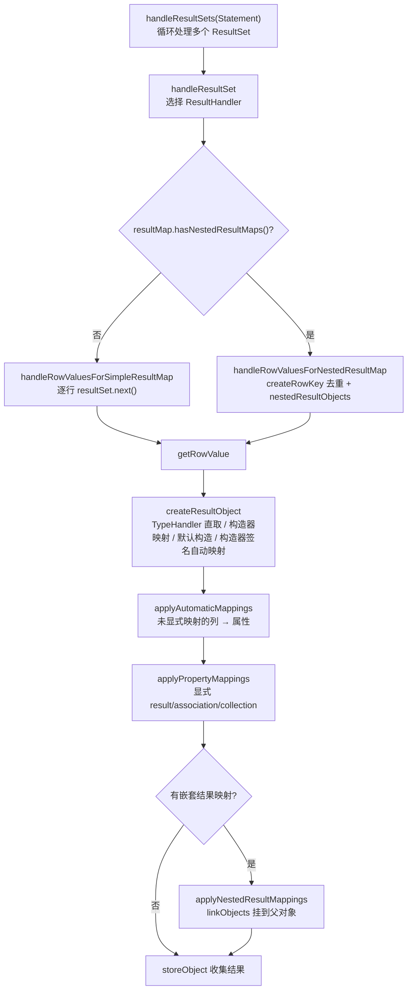
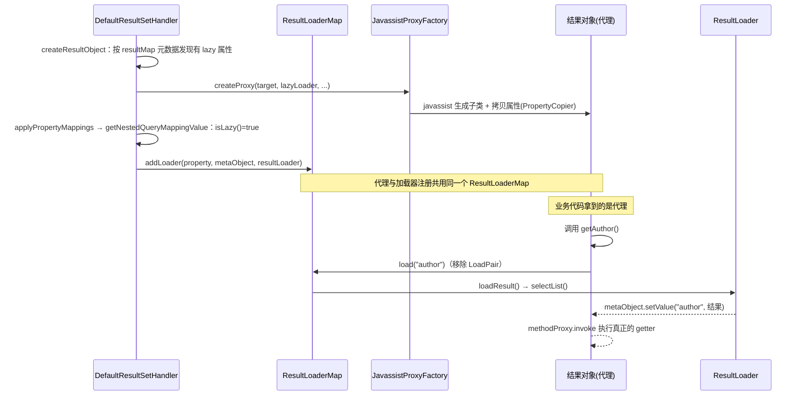

# 结果映射、TypeHandler 与懒加载

> 一句话概括：SQL 执行完之后，MyBatis 用 `ResultSetHandler` 把 JDBC `ResultSet` 组装成 Java 对象——`resultType` 走自动映射、`resultMap` 走显式映射，`TypeHandler` 负责 Java 类型 ⇄ JDBC 类型的双向转换，懒加载则用「代理 + 延迟执行器」把关联查询推迟到真正访问的那一刻；本文讲清这条「最后一公里」的机制、边界与代价。

预计阅读时间：大约 85 分钟

所属主题：[MyBatis 常见面试题总结](summary.md)

本文以 MyBatis 3.5.x（源码基线 3.5.19，Java 8）为基线，源码锚点用 `类名#方法名` 标注；MyBatis 3.6.0 已于 2026-10 发布（Java 11 基线），相关差异单独注明。每个机制按「结论 → 机制 → 边界/代价 → 实践/追问」展开。执行器与 SQL 执行全链路见 [架构与 SQL 执行](architecture-and-sql-execution.md)，本文聚焦查询返回之后的映射阶段。

---

## 0. 阅读路线

| 读者 | 建议阅读 | 关注点 |
| --- | --- | --- |
| 初级（1 年内） | 1、3.1~3.2、4.1~4.3、5.3、7.1 | resultType/resultMap 区别、驼峰开关、一对多怎么写、内置类型处理器、映射失败排查 |
| 中级（1~3 年） | 全部，重点 2、4.5、5.1~5.4、6.1~6.3 | 映射主链路源码、构造器映射、TypeHandler 注册与查找、懒加载触发时机 |
| 高级（3 年+） | 2.2~2.4、5.2、6.4~6.5、7.2~7.4、8 | 去重键与 NULL_CACHE_KEY、双键注册回退链、跨线程/序列化懒加载、N+1 量化 |
| 选型/架构 | 1.1、4.3、5.4、6.5、7.3~7.4 | 嵌套结果 vs 嵌套查询、自定义 TypeHandler 的注册边界、懒加载该不该开、大结果集方案 |

目录：

1. 结论先行：最后一公里的三个角色
2. DefaultResultSetHandler 走读
3. 自动映射：规则与开关
4. 关联映射：association / collection 的两种写法
5. TypeHandler：双向类型转换
6. 懒加载：代理、触发与边界
7. 边界与排查清单
8. 高频面试追问集
9. 参考资料

---

## 1. 结论先行：最后一公里的三个角色

### 1.1 三个角色各管什么

**结论**：一条 select 语句执行后，`Executor` 把 `Statement` 交给 `ResultSetHandler`（默认实现 `DefaultResultSetHandler`），由它完成「行 → 对象」的组装。三个概念分工明确：

| 角色 | 职责 | 一句话 |
| --- | --- | --- |
| `ResultSetHandler` | 遍历 `ResultSet`，创建对象、填充属性、组装关联 | 「谁来装配」：`DefaultResultSetHandler#handleResultSets` |
| `resultType` / `resultMap` | 描述「列 → 属性」的映射规则 | 「按什么图纸装配」：resultType 只有自动映射，resultMap 可显式指定每一列 |
| `TypeHandler` | Java 类型 ⇄ JDBC 类型的双向转换器 | 「零件怎么换算」：设参时 `setParameter`，取值时 `getResult` |

两个高频结论先给出：

- **resultType 走自动映射，resultMap 走显式映射 + 自动映射兜底**。resultMap 不是「关闭自动映射」，而是「显式映射优先，剩余列仍按全局策略自动映射」（见 2.3、3.1）。
- **TypeHandler 是双向的**：`#{}` 设参走 `setNonNullParameter`（见 5.5 与 [动态 SQL 与注入](dynamic-sql-and-injection.md)），结果取值走 `getNullableResult`。同一个处理器同时服务两个方向。

### 1.2 最小示例：resultType vs resultMap

```xml
<!-- resultType：列名与属性名能对上（含驼峰规则）就自动映射 -->
<select id="selectUser" resultType="User">
  SELECT id, user_name, email FROM t_user WHERE id = #{id}
</select>

<!-- resultMap：显式指定列与属性的对应关系，可处理列名不一致、嵌套关联、自定义类型转换 -->
<resultMap id="userMap" type="User">
  <id property="id" column="id"/>
  <result property="userName" column="user_name"/>
  <result property="email" column="email"/>
</resultMap>
<select id="selectUser2" resultMap="userMap">
  SELECT id, user_name, email FROM t_user WHERE id = #{id}
</select>
```

注意：上面 `resultType="User"` 的写法在 `mapUnderscoreToCamelCase=false`（默认）时 `user_name` **映射不上** `userName`——这正是第 3 章与 7.1 排查清单要解决的问题。

**追问：什么时候必须用 resultMap？** 列名与属性名对不上且不想开全局驼峰、一对多/多对一关联、构造器注入不可变对象、字段需要自定义 TypeHandler、鉴别器多态映射——这些 resultType 都做不到。

---

## 2. DefaultResultSetHandler 走读

### 2.1 主链路

**结论**：映射主链路是 `handleResultSets → handleResultSet → handleRowValues → getRowValue`；`getRowValue` 内部先 `createResultObject` 创建对象，再依次 `applyAutomaticMappings`（自动）与 `applyPropertyMappings`（显式），嵌套结果映射最后由 `applyNestedResultMappings` 组装。



关键方法速查（均在 `DefaultResultSetHandler`）：

| 方法 | 职责 |
| --- | --- |
| `#handleResultSets` | 入口；按 `resultMaps` 列表逐个处理 `ResultSet`（存储过程多结果集），最后 `collapseSingleResultList` 收敛单结果 |
| `#handleRowValues` | 分叉点：有嵌套结果映射走 nested 分支（并 `ensureNoRowBounds()` 禁止 RowBounds），否则走 simple 分支 |
| `#getRowValue` | 单行 → 单对象：创建对象 + 自动映射 + 显式映射 |
| `#createResultObject` | 决定对象怎么 new 出来（见 2.2） |
| `#applyAutomaticMappings` / `#createAutomaticMappings` | 自动映射（见第 3 章） |
| `#applyPropertyMappings` / `#getPropertyMappingValue` | 显式映射；后者分派：嵌套查询 → 嵌套 ResultSet → 普通列 TypeHandler 取值 |
| `#applyNestedResultMappings` / `#linkObjects` | 嵌套结果映射的组装与挂载（见 2.4） |

**边界**：`handleRowValues` 对嵌套结果映射分支会调用 `ensureNoRowBounds()`——**嵌套结果映射不支持 RowBounds 内存分页**（抛 `ExecutorException`）。该检查受 `safeRowBoundsEnabled`（默认 true）守卫，且仅当 RowBounds 非默认（limit/offset 有实际约束）时才抛，设 `safeRowBoundsEnabled=false` 可绕过。用 PageHelper 等物理分页插件时，join 一对多的「行数」是笛卡尔积行数而不是父对象数，分页会截断关联数据，这是分页插件的经典坑，详见 [插件与分页](plugin-and-pagination.md)。

### 2.2 createResultObject：四条创建路径

**结论**：对象创建有严格的优先级——**TypeHandler 直接取值 > 显式构造器映射 > 默认构造器 > 构造器签名自动映射**。源码（`DefaultResultSetHandler#createResultObject`，简化）：

```java
final Class<?> resultType = resultMap.getType();
final MetaClass metaType = MetaClass.forClass(resultType, reflectorFactory);
final List<ResultMapping> constructorMappings = resultMap.getConstructorResultMappings();
if (hasTypeHandlerForResultObject(rsw, resultType)) {
  return createPrimitiveResultObject(rsw, resultMap, columnPrefix);   // ① 单列简单类型：TypeHandler 直取
}
if (!constructorMappings.isEmpty()) {
  return createParameterizedResultObject(...);                        // ② <constructor> 显式构造器映射
} else if (resultType.isInterface() || metaType.hasDefaultConstructor()) {
  return objectFactory.create(resultType);                            // ③ 接口或无参构造：ObjectFactory 创建
} else if (shouldApplyAutomaticMappings(resultMap, false)) {
  return createByConstructorSignature(...);                           // ④ 无默认构造：按构造器签名自动映射
}
throw new ExecutorException("Do not know how to create an instance of " + resultType);
```

逐条解释：

| 路径 | 触发条件 | 机制 |
| --- | --- | --- |
| ① TypeHandler 直取 | `resultType` 是注册过 TypeHandler 的类型（String、Integer 等） | `#hasTypeHandlerForResultObject`：**单列时**按 `(javaType, 该列 jdbcType)` 查，多列时只按 javaType 查；命中则整行就是一个值，`resultType="long"` 的 count 查询走这里 |
| ② 构造器映射 | resultMap 里写了 `<constructor>` | `#createParameterizedResultObject` 按 arg 类型与顺序（或 name，见 4.5）定位构造器，逐列取值后反射调用 |
| ③ 默认构造 | 接口（如返回 `Map`）或有默认构造器 | `ObjectFactory#create`，之后靠 setter/字段反射填属性 |
| ④ 构造器签名自动映射 | 没有默认构造器且允许自动映射 | `#findConstructorForAutomapping` 选构造器，`#applyConstructorAutomapping` 按列顺序或参数名填参 |

路径④的构造器选择规则（`#findConstructorForAutomapping`，3.5.19）：

1. 只有一个构造器 → 直接用；
2. 多个构造器 → 找标注 `@AutomapConstructor` 的（必须恰好一个，否则抛异常）；
3. 开了 `argNameBasedConstructorAutoMapping`（3.5.10 新增，默认 false）→ 多构造器时必须标 `@AutomapConstructor`，否则抛异常；按**参数名**匹配列；
4. 否则按**参数类型与 JDBC 类型兼容**挑一个可用构造器（`findUsableConstructorByArgTypes`），按**列顺序**填参。

**边界/代价**：按列顺序填参意味着 **SELECT 列顺序必须与构造器参数顺序一致**，且类型要兼容——这是不可变对象映射最常见的翻车点（见 7.1）。`createResultObject` 外层还有一段关键逻辑：只要存在 `nestedQueryId != null && isLazy()` 的属性映射，就用 `configuration.getProxyFactory().createProxy(...)` 把结果对象包成懒加载代理（见第 6 章）。

**3.6.0 差异**：构造器自动选择增强——「当 `javaType` 未指定或只部分指定时，自动确定最佳匹配的构造器」（mybatis-3 PR #3378），并支持不可变集合的构造器创建（PR #3108）。3.5.x 里「部分 arg 不写 javaType + 多构造器」的模糊场景，3.6.0 给出了更确定的选择规则。

### 2.3 自动映射与显式映射的顺序

**结论**：**先自动映射，后显式映射**；显式映射过的属性不会被自动映射重复处理。`getRowValue`（simple 分支）核心：

```java
boolean foundValues = this.useConstructorMappings;
if (shouldApplyAutomaticMappings(resultMap, false)) {
  foundValues = applyAutomaticMappings(rsw, resultMap, metaObject, columnPrefix) || foundValues;
}
foundValues = applyPropertyMappings(rsw, resultMap, metaObject, lazyLoader, columnPrefix) || foundValues;
foundValues = lazyLoader.size() > 0 || foundValues;
rowValue = foundValues || configuration.isReturnInstanceForEmptyRow() ? rowValue : null;
```

三个细节：

- `applyAutomaticMappings` 只处理 `rsw.getUnmappedColumnNames(...)`（未被显式映射的列），且 `createAutomaticMappings` 里遇到 `resultMap.getMappedProperties().contains(property)` 会跳过——**显式映射优先**；
- `foundValues` 全为 false（整行所有映射列都是 NULL）时返回 **null 而不是空对象**，除非开启 `returnInstanceForEmptyRow`（默认 false）。这解释了「left join 查出来一个全 null 的关联对象」为什么有时是 null 有时是空壳；
- 取值为 null 时默认**不调 setter**，除非 `callSettersOnNulls=true`（默认 false）——对 Map 结果类型影响很大：默认情况下值为 null 的列不会出现在 Map 里。

`applyPropertyMappings` 对每个显式映射调 `getPropertyMappingValue`，分派顺序（源码）：

```java
if (propertyMapping.getNestedQueryId() != null) {
  return getNestedQueryMappingValue(...);      // 嵌套查询：发第二条 SQL（或注册懒加载）
}
if (propertyMapping.getResultSet() != null) {
  addPendingChildRelation(...); return DEFERRED; // 多结果集：延迟到对应 ResultSet 处理
}
final TypeHandler<?> typeHandler = propertyMapping.getTypeHandler();
return typeHandler.getResult(rs, column);      // 普通列：TypeHandler 取值
```

注意 `nestedResultMapId`（嵌套结果映射）的属性在这里被刻意置 `column = null` 跳过，留给后面的 `applyNestedResultMappings` 处理——**嵌套结果与嵌套查询走的是两条完全不同的代码路径**。

### 2.4 嵌套结果映射：createRowKey 去重

**结论**：join 一对多会产生「父对象重复出现」的行，MyBatis 用 `CacheKey` 行键 + `nestedResultObjects` 缓存把重复行合并到同一个父对象上。**`<id>` 元素决定行键怎么算，不写 id 会有严重性能问题**（官方文档原话）。

机制（`DefaultResultSetHandler#handleRowValuesForNestedResultMap` → `#createRowKey` → `#applyNestedResultMappings`）：

```java
// createRowKey：行键 = resultMap.id + 各键列的 (列名, 值) 对
final CacheKey cacheKey = new CacheKey();
cacheKey.update(resultMap.getId());
List<ResultMapping> resultMappings = getResultMappingsForRowKey(resultMap); // 优先 idResultMappings，没有才用全部 propertyResultMappings
...
if (cacheKey.getUpdateCount() < 2) {
  return CacheKey.NULL_CACHE_KEY;   // 没有任何键列贡献值 → 空键
}
```

```java
// applyNestedResultMappings：子对象按 combinedKey 查缓存，命中则复用（partialObject），不重复创建
final CacheKey rowKey = createRowKey(nestedResultMap, rsw, columnPrefix);
final CacheKey combinedKey = combineKeys(rowKey, parentRowKey);
Object rowValue = nestedResultObjects.get(combinedKey);
boolean knownValue = rowValue != null;
instantiateCollectionPropertyIfAppropriate(resultMapping, metaObject);
if (anyNotNullColumnHasValue(resultMapping, columnPrefix, rsw)) {
  rowValue = getRowValue(rsw, nestedResultMap, combinedKey, columnPrefix, rowValue);
  if (rowValue != null && !knownValue) {
    linkObjects(metaObject, resultMapping, rowValue);   // 只有新对象才挂载
  }
}
```

- `combineKeys` 把子行键与父行键合并，**父子都有效**才生成有效键，否则返回 `NULL_CACHE_KEY`；
- `NULL_CACHE_KEY` 不会写入 `nestedResultObjects`，于是每行都「查不到缓存」→ 每行都新建对象并挂载——**这就是不写 id 时一对多出现重复子对象的根源**；
- `linkObjects` 区分集合与单值：集合属性走 `MetaObject#add`（追加元素），association 走 `setValue`；`instantiateCollectionPropertyIfAppropriate` 负责在属性为 null 时先 new 一个集合（`ObjectFactory` 默认把 `List` 实例化为 `ArrayList`）。

**边界/代价**：

- 行键优先用 `<id>` 列；没有 id 时退化为「所有显式映射列」参与键计算——键更长、比较更慢，且**所有键列全为 NULL 时行键失效**（`getUpdateCount() < 2`），去重彻底失败；
- `nestedResultObjects` 在整个 ResultSet 处理期间持有所有已创建对象，大结果集时内存随「父对象数 × 关联数」增长；`resultOrdered="true"`（select 属性，默认 false）假设嵌套结果已按父行分组，可在父行切换时提前释放缓存，官方文档明确它只适用于嵌套结果查询；
- 循环引用（A 关联 B、B 又关联 A）靠 `ancestorObjects` 回填祖先对象解决（`applyNestedResultMappings` 中 issue #215/#385 的处理），但指定了 `columnPrefix` 的嵌套映射不参与循环回填。

**追问：为什么官方反复强调要写 id？** 因为 id 列被标记为对象标识符，行键只用最少的主键列计算，比较快、缓存命中率高；不写 id 时用全部映射列做键，既慢又容易在全 NULL 行上失效。

---

## 3. 自动映射：规则与开关

### 3.1 autoMappingBehavior 三档

**结论**：全局开关 `autoMappingBehavior` 默认 **PARTIAL**——只自动映射「没有嵌套结果映射」的 resultMap；FULL 连嵌套 resultMap 内部也自动映射；NONE 全关。判定逻辑（`DefaultResultSetHandler#shouldApplyAutomaticMappings`）：

```java
private boolean shouldApplyAutomaticMappings(ResultMap resultMap, boolean isNested) {
  if (resultMap.getAutoMapping() != null) {
    return resultMap.getAutoMapping();          // resultMap 级 autoMapping 属性优先
  }
  if (isNested) {
    return AutoMappingBehavior.FULL == configuration.getAutoMappingBehavior();
  } else {
    return AutoMappingBehavior.NONE != configuration.getAutoMappingBehavior();
  }
}
```

| 档位 | 行为 | 典型用途 |
| --- | --- | --- |
| NONE | 关闭一切自动映射 | 极端显式化，很少用 |
| **PARTIAL（默认）** | 只自动映射非嵌套的 resultMap；**嵌套 resultMap（association/collection 引用的）内部不自动映射** | 常规业务 |
| FULL | 任何 resultMap 都自动映射，包括嵌套内部 | 嵌套对象列名规范、想省 XML 时 |

**边界**：PARTIAL 下嵌套 resultMap 里没显式写的列会**静默丢失**——「association 里的对象只有 id 有值、其他字段全 null」多半是这个原因，解法是嵌套 resultMap 补全 `<result>`、或设 `autoMapping="true"`、或全局 FULL。官方文档同时提醒：FULL 时 `autoMappingUnknownColumnBehavior` 可能误报（false-positives）。

### 3.2 mapUnderscoreToCamelCase 的作用范围

**结论**：`mapUnderscoreToCamelCase`（默认 false）只影响**自动映射时「列名 → 属性名」的查找**，即 `A_COLUMN → aColumn`。源码证据（`#createAutomaticMappings`）：

```java
final String property = metaObject.findProperty(propertyName, configuration.isMapUnderscoreToCamelCase());
```

`MetaObject#findProperty` 在开关开启时先去掉列名中的下划线再查属性；属性查找本身基于 `Reflector` 的**大小写不敏感**属性表，所以 `USERNAME` 能匹配 `username`，但 `USER_NAME` 匹配 `userName` 必须靠这个开关。

作用范围边界（高频追问）：

| 场景 | 是否受影响 |
| --- | --- |
| resultType 自动映射、resultMap 未显式映射的列 | **受影响**（唯一主战场） |
| resultMap 显式 `<result column="user_name" property="userName"/>` | 不受影响——column 写什么就取什么，与开关无关 |
| `#{userName}` 设参 | 不受影响——参数名走 MetaObject 属性导航，与列名规则无关 |
| 构造器自动映射（按参数名模式） | 受影响（同样走 findProperty 的驼峰规则） |

**实践**：Spring Boot 里 `mybatis.configuration.map-underscore-to-camel-case=true` 一行开启；开了它之后大部分简单查询可以只写 resultType。但**不要指望它拯救显式 resultMap 里写错的 column**。

### 3.3 其余三个开关：unknownColumnBehavior / autoMapping / columnPrefix

| 配置 | 默认 | 作用 |
| --- | --- | --- |
| `autoMappingUnknownColumnBehavior`（3.4.0 新增） | NONE | 自动映射遇到「找不到属性 / 属性类型没有 TypeHandler」的列时的行为：NONE 无反应；WARNING 打警告日志（logger `org.apache.ibatis.session.AutoMappingUnknownColumnBehavior` 需设为 WARN）；FAILING 抛 `SqlSessionException`。源码里由 `configuration.getAutoMappingUnknownColumnBehavior().doAction(...)` 触发 |
| resultMap 的 `autoMapping` 属性 | 未设置 | 单个 resultMap 覆盖全局 `autoMappingBehavior`（见 3.1 源码第一行）；**不能与 `select`/`resultMap` 属性（外部映射）同用** |
| `columnPrefix` | 未设置 | 复用外部 resultMap 时给列名加前缀：join 同一张表两次（如作者与合著者），`authorResult` 本身映射 `author_id`/`author_name` 列，合著者列别名 `co_author_id`/`co_author_name` 配 `columnPrefix="co_"` 叠加前缀即可复用。源码里 `createAutomaticMappings` 会跳过不带前缀的列并截掉前缀再找属性；嵌套时前缀会**逐层拼接**（`getColumnPrefix`） |

```xml
<select id="selectBlogWithCoAuthor" resultMap="blogResult">
  SELECT B.id, B.title,
         A.id AS author_id, A.name AS author_name,
         C.id AS co_author_id, C.name AS co_author_name
  FROM blog B
  LEFT JOIN author A ON B.author_id = A.id
  LEFT JOIN author C ON B.co_author_id = C.id
</select>
<resultMap id="blogResult" type="Blog">
  <association property="author" resultMap="authorResult"/>
  <association property="coAuthor" resultMap="authorResult" columnPrefix="co_"/>
</resultMap>
<!-- authorResult 自身按 author_ 前缀列定义：第一个 association 无前缀直接命中；
     第二个 association 的 columnPrefix="co_" 与之拼接成 co_author_*，命中合著者别名 -->
<resultMap id="authorResult" type="Author">
  <id property="id" column="author_id"/>
  <result property="name" column="author_name"/>
</resultMap>
```

**实践**：开发环境把 `autoMappingUnknownColumnBehavior` 设为 WARNING，能在日志里尽早发现「列名拼错/属性缺失」这类静默丢字段问题；生产保持 NONE 避免日志噪音。

---

## 4. 关联映射：association / collection 的两种写法

### 4.1 嵌套结果：一条 join SQL + resultMap 嵌套

**结论**：`association`（多对一/一对一）与 `collection`（一对多）都可以用 `resultMap` 属性引用另一个 resultMap，把**一条 join SQL 的重复行**组装成对象树——官方称之为「嵌套结果映射」。

```xml
<select id="selectBlogWithPosts" resultMap="blogResult">
  SELECT B.id AS blog_id, B.title,
         P.id AS post_id, P.subject AS post_subject, P.body AS post_body
  FROM blog B LEFT JOIN post P ON P.blog_id = B.id
  WHERE B.id = #{id}
</select>

<resultMap id="blogResult" type="Blog">
  <id property="id" column="blog_id"/>
  <result property="title" column="title"/>
  <collection property="posts" ofType="Post" resultMap="postResult" columnPrefix="post_"/>
</resultMap>
<resultMap id="postResult" type="Post">
  <id property="id" column="id"/>
  <result property="subject" column="subject"/>
  <result property="body" column="body"/>
</resultMap>
```

要点：

- **列别名 + columnPrefix**：join 后列名必须唯一（`blog_id`/`post_id`），`columnPrefix="post_"` 让 `postResult` 可以原样复用；
- **`ofType` 是集合元素类型**，`javaType` 是集合本身类型（通常可省略，MyBatis 从属性签名推断）；
- **`notNullColumn`**：默认「至少一个被映射列非空」才创建子对象；left join 无匹配时所有子列为 NULL，默认就不会产生空壳子对象。显式指定 `notNullColumn="post_id"` 后只看这些列——当子表某些列本身可空、默认规则误判时用它收紧；
- **`<id>` 必须写**：去重机制见 2.4。

### 4.2 嵌套查询：select 属性发第二条 SQL

**结论**：`select` 属性指定另一条映射语句，MyBatis 把 `column` 指定列的值作为参数**再发一条 SQL** 加载关联——写法简单，但天然带着 N+1 问题。

```xml
<resultMap id="blogResult" type="Blog">
  <id property="id" column="id"/>
  <association property="author" column="author_id" javaType="Author"
               select="selectAuthor" fetchType="lazy"/>
  <collection property="posts" column="id" ofType="Post"
              select="selectPostsForBlog"/>
</resultMap>
<select id="selectAuthor" resultType="Author">
  SELECT * FROM author WHERE id = #{id}
</select>
```

机制（`DefaultResultSetHandler#getNestedQueryMappingValue`）：

```java
final Object nestedQueryParameterObject = prepareParameterForNestedQuery(rs, propertyMapping, ...);
if (nestedQueryParameterObject != null) {
  final CacheKey key = executor.createCacheKey(nestedQuery, nestedQueryParameterObject, ...);
  if (executor.isCached(nestedQuery, key)) {
    executor.deferLoad(...); value = DEFERRED;        // 二级缓存已有：延迟到缓存提交后填充
  } else {
    final ResultLoader resultLoader = new ResultLoader(configuration, executor, nestedQuery, ...);
    if (propertyMapping.isLazy()) {
      lazyLoader.addLoader(property, metaResultObject, resultLoader);  // 懒：注册加载器，返回 DEFERRED
      value = DEFERRED;
    } else {
      value = resultLoader.loadResult();              // 急：立刻执行第二条 SQL
    }
  }
}
```

- 复合外键用 `column="{prop1=col1,prop2=col2}"` 语法传多列；
- **外键列为 NULL 时直接跳过嵌套查询**（`nestedQueryParameterObject != null` 守卫），不发 SQL；
- `fetchType="lazy|eager"` 覆盖全局 `lazyLoadingEnabled`，只影响当前这条关联；
- 官方文档对 N+1 的警告原文：「你执行了一个单独的 SQL 语句来获取结果的一个列表（就是"+1"）；对列表返回的每条记录，你执行一个 select 查询语句来为每条记录加载详细信息（就是"N"）……会导致成百上千的 SQL 语句被执行」。懒加载只是把开销分散，「加载记录列表之后立刻就遍历列表以获取嵌套的数据，就会触发所有的延迟加载查询，性能可能会变得很糟糕」。

### 4.3 对比与选型

| 维度 | 嵌套结果（join + resultMap） | 嵌套查询（select） |
| --- | --- | --- |
| SQL 条数 | 1 条 | 1 + N 条（懒加载可推迟，但总量不变） |
| 数据库往返 | 1 次 | N+1 次，网络 RTT 放大 |
| 结果集形态 | 笛卡尔积重复行，需 id 去重 | 每条 SQL 结果独立、干净 |
| 内存 | 重复行传输 + nestedResultObjects 缓存 | 单条结果小，但对象总量相同 |
| 分页 | RowBounds 不支持；物理分页按「行」截断会切断关联 | 主查询分页安全，关联按需加载 |
| 懒加载 | 不支持（数据已在行内） | 支持 fetchType=lazy |
| 复用性 | resultMap 可 columnPrefix 复用 | 子查询可独立复用、可被二级缓存命中 |
| 适用 | 关联数据**一定要用**、列表页一次取全 | 关联数据**不一定用**、详情懒加载、子查询可缓存 |

**选型结论**：列表页要展示关联字段 → 嵌套结果（join）；详情页关联重、访问概率低 → 嵌套查询 + 懒加载；两者都不合适（关联表巨大、join 爆炸）→ 拆成两次独立查询在业务层组装，或存储过程多结果集（3.2.3 起支持 `resultSets` + `resultSet`/`column`/`foreignColumn`，一次访问拿到多个结果集，避免 join 也避免 N+1）。

**追问：懒加载能解决 N+1 吗？** 不能，只能**推迟和分散**。只要最终访问了全部关联，SQL 总量仍是 N+1；真正的解法是 join、批量 in 查询或缓存。

### 4.4 discriminator 鉴别器

**结论**：`discriminator` 按某列的值选择不同的 resultMap，类似 Java 的 switch，用于继承层次/多态结果。

```xml
<resultMap id="vehicleResult" type="Vehicle">
  <id property="id" column="id"/>
  <discriminator javaType="int" column="vehicle_type">
    <case value="1" resultMap="carResult"/>
    <case value="2" resultMap="truckResult"/>
  </discriminator>
</resultMap>
```

机制：每行处理前 `resolveDiscriminatedResultMap` 先按列值解析出实际使用的 resultMap，再走 `getRowValue`。边界（官方文档）：case 匹配是**互斥**的；case 的 resultMap 默认**只加载自己声明的属性**，要继承父映射需写 `extends="vehicleResult"`；都不匹配时用鉴别器块外定义的映射。

### 4.5 构造器映射：idArg / arg

**结论**：不可变对象（final 字段 + 构造器注入）用 `<constructor>` 映射，`idArg` 标记主键参数（参与行键，提高嵌套去重性能），`arg` 是普通参数。

```xml
<constructor>
  <idArg column="id" javaType="int"/>
  <arg column="username" javaType="String"/>
  <arg column="age" javaType="_int"/>
</constructor>
```

版本演进（均已对照官方文档核实）：

| 版本 | 变化 |
| --- | --- |
| 3.5.x 基线行为 | 按「参数个数 + javaType 顺序」定位构造器，**arg 顺序必须与构造器形参顺序一致** |
| 3.4.3 | arg 支持 `name` 属性：配合构造器参数上的 `@Param` 注解，或 `-parameters` 编译 + `useActualParamName`（3.4.1 新增，默认 true），可**任意顺序**书写 arg |
| 3.5.10 | `argNameBasedConstructorAutoMapping`（默认 false）：无 `<constructor>` 的构造器自动映射也按参数名匹配列，不再依赖列顺序；多构造器时需 `@AutomapConstructor` 指定 |
| 3.6.0 | javaType 未指定或部分指定时自动选择最佳匹配构造器（PR #3378）；支持不可变集合构造器创建（PR #3108） |

**边界**：`<constructor>` 与 setter 填充可以共存（构造器填一部分、其余属性走自动/显式映射）；但构造器参数类型不匹配、顺序错位是「对象创建失败/字段错位」的高发原因，排查见 7.1。

---

## 5. TypeHandler：双向类型转换

### 5.1 接口与 BaseTypeHandler 模板方法

**结论**：`TypeHandler<T>` 接口只有四个方法——一个设参方向、三个取值方向；`BaseTypeHandler<T>` 用模板方法把 **null 处理与异常包装**收敛到基类，子类只实现非空逻辑。

```java
public interface TypeHandler<T> {
  void setParameter(PreparedStatement ps, int i, T parameter, JdbcType jdbcType) throws SQLException;
  T getResult(ResultSet rs, String columnName) throws SQLException;
  T getResult(ResultSet rs, int columnIndex) throws SQLException;
  T getResult(CallableStatement cs, int columnIndex) throws SQLException;
}
```

`BaseTypeHandler#setParameter` 的 null 分支（源码）：

```java
if (parameter == null) {
  if (jdbcType == null) {
    throw new TypeException("JDBC requires that the JdbcType must be specified for all nullable parameters.");
  }
  ps.setNull(i, jdbcType.TYPE_CODE);
} else {
  setNonNullParameter(ps, i, parameter, jdbcType);   // 异常统一包成 TypeException
}
```

子类要实现的四个抽象方法：`setNonNullParameter`、`getNullableResult(ResultSet, String)`、`getNullableResult(ResultSet, int)`、`getNullableResult(CallableStatement, int)`。

**边界（3.5.0 行为变化）**：类注释明确——**3.5.0 起 BaseTypeHandler 不再调用 `ResultSet#wasNull()`**，SQL NULL 的判断完全交给子类。所以自定义处理器里 `rs.getInt()` 返回 0 时无法区分「真 0」与「NULL」，需要自己 `wasNull()`（内置 `EnumOrdinalTypeHandler` 就是这么做的，见 5.3）。取值异常被基类包成 `ResultMapException`，报错信息带列名——这是排查映射错误的第一线索。

### 5.2 TypeHandlerRegistry：双键注册与查找

**结论**：注册表按 **(javaType, jdbcType) 双键**存储处理器；查找时先精确匹配，再回退到「未指定 jdbcType」的注册，最后 `pickSoleHandler`。核心结构（`TypeHandlerRegistry`，3.5.19）：

```java
private final Map<Type, Map<JdbcType, TypeHandler<?>>> typeHandlerMap = new ConcurrentHashMap<>();
private final Map<JdbcType, TypeHandler<?>> jdbcTypeHandlerMap = new EnumMap<>(JdbcType.class);
private final Map<Class<?>, TypeHandler<?>> allTypeHandlersMap = new HashMap<>();
private Class<? extends TypeHandler> defaultEnumTypeHandler = EnumTypeHandler.class;
```

注册（`#register`）：外层键 javaType、内层键 jdbcType（**可以为 null**，表示「不限定 JDBC 类型」）；`@MappedJdbcTypes` 注解决定注册到哪些内层键，`includeNullJdbcType=true` 才额外注册 null 键。

查找（`#getTypeHandler(Type, JdbcType)`）的回退链：

```java
handler = jdbcHandlerMap.get(jdbcType);      // ① 精确 (javaType, jdbcType)
if (handler == null) {
  handler = jdbcHandlerMap.get(null);        // ② 未指定 jdbcType 的注册
}
if (handler == null) {
  handler = pickSoleHandler(jdbcHandlerMap); // ③ 内层所有 handler 是同一个类 → 取它
}
```

`getJdbcHandlerMap` 还有两条特殊路径：

- **枚举**：没有直接注册时，先查枚举实现的接口上有没有注册过处理器，再没有就用 `defaultEnumTypeHandler`（默认 `EnumTypeHandler`，3.4.5 起可配）**按枚举类型实例化并注册**——枚举处理器是**查找时懒注册**的，不是启动时全量注册；
- **父类链**：非枚举类找不到时沿 superclass 向上找（`getJdbcHandlerMapForSuperclass`），结果（包括「没有」）用 `NULL_TYPE_HANDLER_MAP` 哨兵缓存，避免重复查找。

实例化（`#getInstance`）：**优先找 `Constructor(Class)`**（把 javaType 传给处理器，枚举处理器就靠它拿到具体枚举类），没有再退无参构造。

**边界/代价**：

- `@MappedJdbcTypes(JdbcType.VARCHAR)` 且 `includeNullJdbcType=false`（默认）时，null 键没有注册——查找靠回退②失败后的 `pickSoleHandler` 兜底；若同一 javaType 注册了**多个不同类**的处理器且 jdbcType 又没写明，`pickSoleHandler` 返回 null，映射直接失败。这是「自定义 TypeHandler 不生效」的常见根因；
- 给 `List.class` 这种宽泛类型注册全局处理器会波及**所有** List 属性（见 5.4 的边界讨论）；
- `hasTypeHandler` 有副作用：会触发枚举懒注册与缓存写入。

### 5.3 内置 TypeHandler 速查

| Java 类型 | JDBC 类型 | 处理器 | 备注 |
| --- | --- | --- | --- |
| String | VARCHAR/CHAR/LONGVARCHAR | `StringTypeHandler` | CLOB → `ClobTypeHandler`；NCHAR/NVARCHAR → `NStringTypeHandler`；NCLOB → `NClobTypeHandler` |
| Integer / int | INTEGER | `IntegerTypeHandler` | Long/long → `LongTypeHandler`（BIGINT）；Short、Byte、Float、Double 同理 |
| Boolean / boolean | BOOLEAN / BIT | `BooleanTypeHandler` | |
| BigDecimal | DECIMAL / NUMERIC / REAL | `BigDecimalTypeHandler` | 金额首选 |
| byte[] | BLOB / LONGVARBINARY | `BlobTypeHandler` | 默认 byte[] → `ByteArrayTypeHandler` |
| java.util.Date | TIMESTAMP | `DateTypeHandler` | **jdbcType=DATE → `DateOnlyTypeHandler`（丢时分秒）；TIME → `TimeOnlyTypeHandler`** |
| java.time.* | TIMESTAMP/DATE/TIME | `LocalDateTimeTypeHandler`、`LocalDateTypeHandler`、`InstantTypeHandler` 等 | JSR-310 全家桶内置 |
| 枚举 | VARCHAR | `EnumTypeHandler`（默认） | 存 `name()` 字符串 |
| 枚举 | INTEGER | `EnumOrdinalTypeHandler` | 存 `ordinal()` 序号，需显式配置 |
| Object / JdbcType.OTHER | — | `UnknownTypeHandler` | 运行时按实际类型再解析具体处理器 |

> 注：表中「JDBC 类型」列为**查找效果示意**，并非都是双键注册。部分 JDBC 类型（如 REAL/DECIMAL/NUMERIC/TIMESTAMP）走 `register(JdbcType, handler)` 只注册进 JdbcType 单键表 `jdbcTypeHandlerMap`；BigDecimal、java.util.Date 的双键注册只覆盖部分组合（如 Date+DATE/TIME），其余靠单键表与回退链命中（见 5.2）。

枚举两个处理器的源码对比（均已核实）：

```java
// EnumTypeHandler#setNonNullParameter：存名字
ps.setString(i, parameter.name());
// EnumTypeHandler#getNullableResult：按名字还原
String s = rs.getString(columnName);
return s == null ? null : Enum.valueOf(type, s);

// EnumOrdinalTypeHandler#setNonNullParameter：存序号
ps.setInt(i, parameter.ordinal());
// EnumOrdinalTypeHandler#getNullableResult：getInt + wasNull 区分 NULL 与第 0 个常量
int ordinal = rs.getInt(columnName);
if (ordinal == 0 && rs.wasNull()) { return null; }
return enums[ordinal];
```

| 维度 | EnumTypeHandler | EnumOrdinalTypeHandler |
| --- | --- | --- |
| 存储 | 枚举名（字符串） | ordinal（int） |
| 可读性 | 数据库里直接可读 | 不可读，需对照代码 |
| 重构安全 | 改名会断（需数据迁移） | **在枚举中间插入常量会整体错位**——更危险 |
| 空间 | 略大 | 小 |

**实践结论**：默认用名字存储；确需 int 存储时，宁可自定义「code ⇄ 枚举」处理器（显式 code 字段），也不要用 ordinal——ordinal 是隐式契约，枚举顺序一改数据就错。全局切换默认枚举处理器：`defaultEnumTypeHandler`（3.4.5 新增）。

### 5.4 自定义 TypeHandler 完整示例

场景：`t_article.tags` 列存逗号分隔字符串（`"java,mybatis,spring"`），Java 侧是 `List<String>`。

```java
@MappedTypes(List.class)
@MappedJdbcTypes(value = JdbcType.VARCHAR, includeNullJdbcType = true)
public class CommaSeparatedListTypeHandler extends BaseTypeHandler<List<String>> {

  @Override
  public void setNonNullParameter(PreparedStatement ps, int i, List<String> parameter, JdbcType jdbcType)
      throws SQLException {
    ps.setString(i, String.join(",", parameter));
  }

  @Override
  public List<String> getNullableResult(ResultSet rs, String columnName) throws SQLException {
    return split(rs.getString(columnName));
  }

  @Override
  public List<String> getNullableResult(ResultSet rs, int columnIndex) throws SQLException {
    return split(rs.getString(columnIndex));
  }

  @Override
  public List<String> getNullableResult(CallableStatement cs, int columnIndex) throws SQLException {
    return split(cs.getString(columnIndex));
  }

  private List<String> split(String value) {
    return value == null || value.isEmpty()
        ? new ArrayList<>()
        : new ArrayList<>(Arrays.asList(value.split(",")));
  }
}
```

三种注册方式（作用范围从大到小）：

| 方式 | 写法 | 作用范围 |
| --- | --- | --- |
| 包扫描 | `<typeHandlers><package name="com.example.handler"/></typeHandlers>`；Boot：`mybatis.type-handlers-package=com.example.handler` | 全局：按 `@MappedTypes`/`@MappedJdbcTypes`（或 `TypeReference` 泛型自动发现）注册 |
| XML 显式指定 | `<typeHandler handler="com.example.handler.CommaSeparatedListTypeHandler" javaType="java.util.List" jdbcType="VARCHAR"/>` | 全局：显式双键，注解可省略 |
| 字段级 | resultMap：`<result property="tags" column="tags" typeHandler="com.example.handler.CommaSeparatedListTypeHandler"/>`；设参：`#{tags,typeHandler=com.example.handler.CommaSeparatedListTypeHandler}` | **仅该字段/该参数**，不影响其他 List 属性 |

包扫描的注册入口是 `TypeHandlerRegistry#register(String packageName)`（ResolverUtil 扫出 TypeHandler 实现类，跳过接口/抽象类/匿名类），再走 `#register(Class)` 读 `@MappedTypes`；没有注解时尝试 `TypeReference` 泛型推断（`BaseTypeHandler extends TypeReference<T>`，所以继承 BaseTypeHandler 并写明泛型即可自动发现）。

**边界/代价（重要）**：上例 `@MappedTypes(List.class)` 是**全局**注册——之后所有 `List` 类型属性默认都走逗号分隔逻辑，别的 JSON 数组字段就坏了。工程上更稳的做法是：**不注册全局，只在需要的字段上用 `typeHandler` 属性显式指定**；或者把处理器绑定到一个自定义包装类型（如 `TagList`）而非 `List.class`。JSON 字段 ⇄ 对象同理：处理器内部用 Jackson 序列化/反序列化，绑定到具体 DTO 类型或字段级使用，避免污染 `Object`/宽泛类型。

**追问：TypeHandler 和 ResultMap 的 typeHandler 属性什么关系？** resultMap/arg/参数上的 `typeHandler` 属性是**字段级覆盖**，优先级高于注册表查找；注册表是「按类型兜底」。两者最终都落到同一个 `TypeHandler` 实例的四个方法上。

### 5.5 TypeHandler 与 #{} 设参

**结论**：`#{}` 占位符最终变成 `ParameterMapping`，设参时由 `DefaultParameterHandler#setParameters` 逐个调用 `typeHandler.setParameter(ps, i + 1, value, jdbcType)`——**TypeHandler 是 `#{}` 预编译设参的最后一环**（SQL 解析与 `#{}`/`${}` 的区别见 [动态 SQL 与注入](dynamic-sql-and-injection.md)）。

源码要点（3.5.19）：

```java
TypeHandler typeHandler = parameterMapping.getTypeHandler();  // 解析 ParameterMapping 时已确定
JdbcType jdbcType = parameterMapping.getJdbcType();
if (value == null && jdbcType == null) {
  jdbcType = configuration.getJdbcTypeForNull();              // 默认 JdbcType.OTHER
}
typeHandler.setParameter(ps, i + 1, value, jdbcType);
```

- 处理器在**构建 ParameterMapping 时**就解析好了（字段级 `typeHandler=` 优先，否则查注册表），`setParameters` 阶段不再按值类型重查；
- 参数为 null 且没写 jdbcType 时用全局 `jdbcTypeForNull`（默认 OTHER）——某些驱动（如 Oracle）对 `setNull(i, OTHER)` 报错，这就是「插入 null 报 JdbcType OTHER 错误」的根因，解法是字段写 `#{email,jdbcType=VARCHAR}` 或全局改 `jdbcTypeForNull=NULL`；
- `parameterObject` 本身是简单类型（注册表里有它的处理器）时直接整体作为值，否则走 `MetaObject#getValue` 按属性名导航。

---

## 6. 懒加载：代理、触发与边界

### 6.1 开关与版本变化（核实后结论）

| 配置 | 3.5.19 默认 | 说明与版本归属 |
| --- | --- | --- |
| `lazyLoadingEnabled` | **false** | 全局懒加载开关；开启后所有关联（嵌套查询）默认延迟加载，`fetchType` 可逐条覆盖 |
| `aggressiveLazyLoading` | **false** | **3.4.1 及之前默认 true**（官方文档原文：「false（在 3.4.1 及之前的版本中默认为 true）」）。true 时调用对象**任一方法**都会加载全部懒属性；false 时按需加载 |
| `lazyLoadTriggerMethods` | `equals,clone,hashCode,toString` | 非激进模式下，调用这些方法会触发**全部**懒属性加载（`Configuration` 字段初始化核实） |
| `proxyFactory` | `JAVASSIST` | 3.3 起默认 javassist；**CGLIB 选项 3.5.10 起废弃**（官方文档标注） |

**结论**：现代版本（3.4.2+）的默认语义是「按需懒加载」——只有访问懒属性的 getter（或触发方法）才发 SQL；老资料里「调用任意方法就全量加载」描述的是 3.4.1 及之前的激进默认值，面试答错版本归属是高频扣分点。

### 6.2 代理生成：ResultLoaderMap + ProxyFactory

**结论**：懒加载不是「字段留空以后再说」，而是**创建对象时就按 resultMap 元数据生成代理**：`createResultObject` 发现存在懒属性映射即先行创建代理（此时 `ResultLoaderMap` 还是空的），随后属性映射阶段（`applyPropertyMappings → getNestedQueryMappingValue`）才把每个懒属性的 `ResultLoader`（封装了第二条 SQL 的全部执行材料）注册进**代理持有的同一个** `ResultLoaderMap`；方法调用先过代理拦截逻辑。



源码锚点（注意先后：**代理按 resultMap 元数据先行创建，加载器在属性映射阶段注册**）：

- `DefaultResultSetHandler#createResultObject`：遍历属性映射，`propertyMapping.getNestedQueryId() != null && propertyMapping.isLazy()` 命中即 `configuration.getProxyFactory().createProxy(...)`；
- `ResultLoaderMap#addLoader`：键是属性路径**首段大写**（`author.name` → `AUTHOR`），同一 resultMap 内懒属性的最左段必须唯一，否则抛 `ExecutorException`；
- `JavassistProxyFactory.EnhancedResultObjectProxyImpl#createProxy`：javassist 生成目标类的子类代理，`PropertyCopier.copyBeanProperties` 把原对象属性拷进代理——**业务拿到的是代理，原对象被丢弃**；
- `ResultLoader` 持有 `configuration/executor/mappedStatement/parameterObject/cacheKey/boundSql`——第二条 SQL 的「弹药」在创建时就备好了，触发时不再解析 SQL。

### 6.3 触发时机：EnhancedResultObjectProxyImpl#invoke

**结论**：触发规则完全由代理的 `invoke` 决定（3.5.19 源码，简化）：

```java
if (!lazyLoader.isEmpty() && !FINALIZE_METHOD.equals(methodName)) {
  if (aggressive || lazyLoadTriggerMethods.contains(methodName)) {
    lazyLoader.loadAll();                          // 激进模式 或 equals/clone/hashCode/toString → 全量加载
  } else if (PropertyNamer.isSetter(methodName)) {
    lazyLoader.remove(property);                   // setter：取消该属性的待加载（你自己赋值了）
  } else if (PropertyNamer.isGetter(methodName)) {
    if (lazyLoader.hasLoader(property)) {
      lazyLoader.load(property);                   // getter：只加载这一个属性
    }
  }
}
return methodProxy.invoke(enhanced, args);
```

整理成表：

| 调用 | aggressiveLazyLoading=true | =false（默认） |
| --- | --- | --- |
| 懒属性 getter（如 `getAuthor()`） | loadAll（全部懒属性） | **只 load 该属性** |
| 非懒属性 getter / 普通方法 | loadAll | 不触发 |
| `equals` / `hashCode` / `clone` / `toString` | loadAll | **loadAll**（默认触发方法清单） |
| 懒属性 setter | loadAll | 移除该属性的 loader，不加载 |
| `finalize` | 不触发（显式排除） | 不触发 |
| `writeReplace`（序列化） | 走序列化分支，不触发加载 | 同左 |

三个高频推论：

1. **日志/调试器是隐形触发器**：`log.info("{}", blog)` 调 `toString` → 默认配置下触发全部懒加载，SQL 在你看不到的地方发出去；IDEA 调试器展开对象属性同样会调 getter；
2. 整个 invoke 在 `ReentrantLock` 内执行，同一代理的并发方法调用串行化；
3. `load(property)` 会**先移除 LoadPair 再执行**——每个懒属性通过这条路径最多加载一次，加载完 `lazyLoader` 变空，代理退化为普通调用开销。

### 6.4 执行与序列化：ResultLoader 的边界

**结论**：懒加载触发时不一定用原来的执行器——**跨线程或原执行器已关闭时，新建独立执行器**；序列化后的对象要能继续懒加载，依赖一套「可序列化的加载配方」。

`ResultLoader#selectList`（3.5.19 源码）：

```java
Executor localExecutor = executor;
if (Thread.currentThread().getId() != this.creatorThreadId || localExecutor.isClosed()) {
  localExecutor = newExecutor();    // 从 Environment 取 DataSource，newTransaction(ds, null, false) + ExecutorType.SIMPLE
}
try {
  return localExecutor.query(mappedStatement, parameterObject, RowBounds.DEFAULT, NO_RESULT_HANDLER, cacheKey, boundSql);
} finally {
  if (localExecutor != executor) {
    localExecutor.close(false);
  }
}
```

边界逐条：

- **SqlSession 关闭后触发懒加载**：原执行器已 closed → 新建执行器直连数据源，**不在原事务里、不走 Spring 事务管理**，连接用完即关。能查到数据，但事务语义已经变了；
- **跨线程触发**（异步任务里访问懒属性）：`creatorThreadId` 检查同样触发新建执行器——执行器非线程安全，这是保护而非 bug；
- **序列化**：代理实现 `writeReplace`，序列化时重建原始对象；若还有未加载属性，返回 `JavassistSerialStateHolder`（携带 `ResultLoaderMap` 的 LoadPair）。`LoadPair` 只持久化「配方」：语句 id、可序列化参数、configurationFactory；`metaResultObject/resultLoader` 都是 transient。反序列化后首次 load 时按配方重建 `ResultLoader`（配 `ClosedExecutor` 占位，真正查询时再换新执行器）；
- **配方失效的场景**：原对象或嵌套查询参数**不可序列化** → LoadPair 不记录配方，反序列化后加载抛 `ExecutorException`；`configurationFactory` 未设置（需要一个提供静态 `getConfiguration()` 方法的工厂类）→ 无法重建 Configuration，同样抛异常。**把带未加载懒属性的对象放进 Redis/HTTP Session 是经典事故现场**。

**3.6.0 差异**：修复懒加载场景下 `ErrorContext` 的 ThreadLocal 内存泄漏（PR #3636）——3.5.x 中懒加载执行路径残留的 ErrorContext 在线程池复用线程时会累积；3.6.0 另支持嵌套 Cursor（PR #3388），并把 TypeHandler 解析改为基于 `java.lang.reflect.Type`（见 6.5 与 5.2 的版本说明）。

### 6.5 懒加载与缓存、序列化、Spring 的关系

| 关联点 | 机制 | 边界 |
| --- | --- | --- |
| 二级缓存 | `getNestedQueryMappingValue` 先查 `executor.isCached`，命中则 `deferLoad` 推迟填充（等缓存事务提交） | 开启二级缓存的命名空间，对象需可序列化；**序列化会触发 writeReplace 分支**，未加载属性以「配方」形式进缓存，反序列化后能否加载取决于 6.4 的条件。详见 [缓存机制](cache-mechanism.md) |
| Spring 事务 | SqlSession 由 Spring 管理，事务提交/方法返回后 session 关闭 | 懒加载在 session 关闭后触发会新建独立执行器（6.4），**脱离事务**；Web 场景「Open Session In View」式做法（把 session 生命周期拉长到视图渲染）能避免，但延长连接占用，需权衡。见 [Spring 集成与事务](spring-integration-and-transaction.md) |
| JSON 序列化 | Jackson 序列化会调用**所有 getter** | 等于把全部懒属性加载一遍——N+1 在序列化层复活；DTO 转换或 `@JsonIgnore` 是常规解法 |
| 3.6.0 TypeHandler 解析 | 基于 `java.lang.reflect.Type` 而非 Class 解析处理器，并尊重运行时 JDBC 类型（PR #3379） | 泛型信息（如 `List<String>` 的元素类型）参与解析；官方已知该增强引发若干回归（如 issue #3829），计划在 3.6.1 提供关闭参数元数据查找的选项——升级 3.6.0 时自定义 TypeHandler 项目要重点回归 |

**选型结论**：懒加载适合「关联访问概率低、单次会话内用完」的场景；**对外暴露的 API 返回值、要进缓存/消息队列的对象，一律在会话内加载完整或转 DTO**，不要把代理泄漏到会话边界之外。多数互联网团队的选择是：默认不开全局懒加载，个别关联用 `fetchType="lazy"` 精确控制。

---

## 7. 边界与排查清单

### 7.1 字段映射失败排查清单

「查出来对象某字段是 null」按顺序排查：

| # | 检查项 | 机制依据 |
| --- | --- | --- |
| 1 | 列名与属性名是否对得上 | 自动匹配大小写不敏感，但下划线需 `mapUnderscoreToCamelCase=true`（3.2） |
| 2 | SQL 是否真的查了该列 | `select *` 之外的显式列清单漏列；别名写错 |
| 3 | resultMap 显式 column 是否写错 | 显式映射不受驼峰开关影响，column 必须与结果集列名（大小写不敏感）一致 |
| 4 | 嵌套 resultMap 内字段丢失 | PARTIAL 不自动映射嵌套内部（3.1）：补 result / autoMapping=true / FULL |
| 5 | 类型不匹配 | 属性类型没有对应 TypeHandler → 该列被跳过（`autoMappingUnknownColumnBehavior` 可暴露）；jdbcType=DATE 配 java.util.Date 会丢时分秒（5.3） |
| 6 | 构造器映射参数顺序/类型 | 3.5.x 按顺序+类型定位构造器；错位用 name/@Param（4.5） |
| 7 | 整行全 NULL | 默认返回 null 对象而非空壳（`returnInstanceForEmptyRow`）；null 值默认不调 setter（`callSettersOnNulls`），Map 结果缺 key |
| 8 | 自定义 TypeHandler 未生效 | 双键查找回退链（5.2）：@MappedJdbcTypes 与 includeNullJdbcType、多处理器 pickSoleHandler 失败 |
| 9 | 懒属性「看起来是 null」 | 代理未触发时属性确实为空；检查是否被序列化/跨线程加载失败（6.4） |

**实践**：开 `autoMappingUnknownColumnBehavior=WARNING` + MyBatis 日志（`org.apache.ibatis` 包 DEBUG 可看 SQL 与参数），多数问题十分钟内定位。

### 7.2 一对多重复行与去重边界

- join 一对多：父表 1 行 × 子表 N 行 = N 行结果，靠 `<id>` 行键合并（2.4）；**不写 id → 全映射列做键 → 全 NULL 行键失效 → 子对象重复**；
- 多层嵌套（blog → posts → comments）行数是乘积关系，三层各 10 条就是 1000 行传输——join 层级越深越要评估，必要时拆查询业务层组装；
- `resultOrdered="true"` 可缓解大结果集内存（要求 SQL 按父行分组排序），但**不改变去重语义**。

### 7.3 N+1 的量化代价

算一笔账：列表页 100 条订单，每条嵌套查询加载用户信息，单次 SQL 往返 1ms（同机房）：

| 方案 | SQL 数 | 网络往返耗时（1ms/次） | 备注 |
| --- | --- | --- | --- |
| 嵌套查询 eager | 101 | ≈100ms+ | 每条还有一次解析/执行开销 |
| 嵌套查询 lazy + 全部访问 | 101 | ≈100ms+（分散） | 总量不变，只是推迟 |
| join 嵌套结果 | 1 | ≈1ms | 代价是重复行传输与去重内存 |
| 主查询 + 批量 in 组装 | 2 | ≈2ms | 业务层按 userId 分组回填，代码略多 |

跨机房 RTT 10ms 时 N+1 直接放大到秒级。**结论：N+1 的代价主要是往返次数而非单条 SQL 复杂度**，解法优先级：join > 批量 in > 缓存 > 懒加载（懒加载只是止痛药）。

### 7.4 大结果集：内存与流式

`selectList` 默认把全部行映射成对象放进 List——百万行导出直接 OOM。两条出路：

- **Cursor 流式查询**：`Cursor<T>` 逐行迭代，配合 `fetchSize`（MySQL 需 `Integer.MIN_VALUE` 或正向 fetchSize + useCursorFetch）控制驱动缓冲；注意 Cursor 依赖会话存活。另注意区分：3.6.0 新增嵌套 Cursor 支持（PR #3388）指 **association/collection 的列可以是 CURSOR 类型**（`jdbcType=CURSOR`，Oracle REF CURSOR 场景），3.5.x 不支持这种嵌套列映射——这与「`Cursor<T>` 流式迭代 join 型嵌套 resultMap」是两回事，后者本文未逐行核验 `DefaultCursor`/`handleCursorResultSets`，不作断言；
- **ResultHandler 回调**：逐行处理不攒 List，但嵌套结果映射同样受限（`checkResultHandler`：`safeResultHandlerEnabled` 默认 true 时抛 `ExecutorException`，语句设 `resultOrdered=true` 可豁免）。

完整方案（fetchSize 驱动差异、批处理、分页深翻页）见 [批处理与性能](batch-and-performance.md)。

---

## 8. 高频面试追问集

**Q1：resultType 和 resultMap 的区别？**
期望答案：resultType 只走自动映射（列名按规则匹配属性名），适合简单场景；resultMap 显式声明列→属性，支持关联、构造器、鉴别器、字段级 TypeHandler，且**显式映射之外仍按全局策略自动映射兜底**（不是二选一）。必须用 resultMap 的场景：列名对不上、一对多/多对一、不可变对象构造器注入、自定义类型转换。

**Q2：一对多怎么映射？重复行怎么处理？**
期望答案：collection + 嵌套结果映射（join 一条 SQL，列别名 + columnPrefix），MyBatis 用 `<id>` 列构造 CacheKey 行键，`nestedResultObjects` 缓存合并重复行到同一父对象，集合元素经 `linkObjects`/`MetaObject#add` 追加。不写 id 时退化为全映射列做键，全 NULL 时行键失效产生重复子对象，且官方明确有严重性能问题。另一条路是嵌套查询 select，但有 N+1。

**Q3：N+1 问题怎么解决？懒加载算解决吗？**
期望答案：join 嵌套结果（1 条 SQL）、主查询 + 批量 in 业务层组装（2 条）、存储过程多结果集（3.2.3+）、二级缓存命中子查询。懒加载**不减少 SQL 总量**，只推迟与分散；全部访问时仍是 N+1，且 toString/JSON 序列化会隐形触发全量加载。

**Q4：TypeHandler 的原理？什么场景自定义？**
期望答案：Java ⇄ JDBC 双向转换器，接口四个方法（setNonNullParameter + getNullableResult×3），BaseTypeHandler 模板方法收敛 null 与异常（3.5.0 起 null 判断下放子类）。注册表按 (javaType, jdbcType) 双键存储，查找走「精确 → null 键 → pickSoleHandler → 父类链/枚举懒注册」回退链。自定义场景：JSON 列 ⇄ 对象、逗号分隔串 ⇄ List、枚举 code、加解密字段。注册三方式：包扫描、XML 显式、字段级 typeHandler 属性；宽泛类型全局注册有污染风险，优先字段级。

**Q5：懒加载的原理与触发时机？**
期望答案：创建结果对象时把懒属性的 ResultLoader 注册进 ResultLoaderMap，javassist 生成子类代理（默认 proxyFactory）。触发规则：aggressiveLazyLoading=true 时任一方法全量加载；false（3.4.2+ 默认）时仅懒属性 getter 按需加载，equals/hashCode/clone/toString 默认触发全量（lazyLoadTriggerMethods），setter 取消待加载，finalize 排除。注意版本：**aggressiveLazyLoading 在 3.4.1 及之前默认 true**。执行时跨线程/原执行器关闭会新建独立执行器，脱离原事务。

**Q6：mapUnderscoreToCamelCase 的作用范围？**
期望答案：只影响自动映射的「列名→属性名」查找（`metaObject.findProperty(name, 开关)`，去下划线转驼峰）；显式 resultMap 的 column 不受影响，`#{}` 参数名不受影响。属性匹配本身大小写不敏感，但 USER_NAME→userName 必须靠开关。默认 false，Boot 一行配置开启。

**Q7：autoMappingBehavior 三档的区别？PARTIAL 下嵌套对象字段为 null 为什么？**
期望答案：NONE 全关；PARTIAL（默认）只自动映射非嵌套 resultMap；FULL 连嵌套内部也自动映射。PARTIAL 下 association/collection 引用的 resultMap 内部未显式声明的列静默丢失——补 result、设该 resultMap 的 autoMapping=true（覆盖全局）、或全局 FULL。

**Q8：枚举存数据库用 name 还是 ordinal？**
期望答案：默认 EnumTypeHandler 存 name()（可读、改名需迁移）；EnumOrdinalTypeHandler 存 ordinal()（省空间但**枚举中间插入常量会整体错位**，且读取要 wasNull 区分 NULL 与第 0 个常量）。工程推荐自定义 code 处理器，显式契约优于隐式顺序。defaultEnumTypeHandler（3.4.5+）可全局切换。

**Q9：插入 null 报「JdbcType OTHER」错误怎么回事？**
期望答案：BaseTypeHandler#setParameter 对 null 参数必须 setNull(jdbcType)；未指定时 DefaultParameterHandler 用全局 jdbcTypeForNull（默认 OTHER），部分驱动不认。解法：字段写 `#{x,jdbcType=VARCHAR}` 或全局设 jdbcTypeForNull=NULL。

**Q10：带懒加载的对象能放 Redis / 返回给前端吗？**
期望答案：不建议。序列化走 writeReplace，未加载属性变成「语句 id + 参数 + configurationFactory」配方，反序列化后加载要求对象与参数可序列化、工厂可重建 Configuration，否则抛 ExecutorException；JSON 序列化调全部 getter 等于触发全量 N+1。正确做法：会话内加载完整或转 DTO，代理不出会话边界。

---

## 9. 参考资料

- MyBatis 官方文档 · XML 映射器（resultMap/association/collection/discriminator/constructor）：<https://mybatis.org/mybatis-3/zh_CN/sqlmap-xml.html>
- MyBatis 官方文档 · 设置（lazyLoadingEnabled/aggressiveLazyLoading/autoMappingBehavior 等默认值与版本注记）：<https://mybatis.org/mybatis-3/zh_CN/configuration.html>
- MyBatis 官方文档 · Java API（TypeHandler/ResultSetHandler 接口）：<https://mybatis.org/mybatis-3/zh_CN/java-api.html>
- MyBatis 3.6.0 Release Notes（Java 11 基线、构造器选择增强 #3378、Type 解析 TypeHandler #3379、嵌套 Cursor #3388、ErrorContext 泄漏修复 #3636）：<https://github.com/mybatis/mybatis-3/releases/tag/mybatis-3.6.0>
- 本文源码锚点（mybatis-3.5.19，<https://github.com/mybatis/mybatis-3/tree/mybatis-3.5.19>）：`DefaultResultSetHandler#handleResultSets` / `#handleRowValues` / `#getRowValue` / `#createResultObject` / `#findConstructorForAutomapping` / `#shouldApplyAutomaticMappings` / `#createAutomaticMappings` / `#applyPropertyMappings` / `#getPropertyMappingValue` / `#getNestedQueryMappingValue` / `#applyNestedResultMappings` / `#createRowKey` / `#combineKeys` / `#linkObjects`、`TypeHandlerRegistry#register` / `#getTypeHandler` / `#getJdbcHandlerMap` / `#pickSoleHandler` / `#getInstance`、`BaseTypeHandler#setParameter` / `#getResult`、`EnumTypeHandler` / `EnumOrdinalTypeHandler`、`DefaultParameterHandler#setParameters`、`JavassistProxyFactory.EnhancedResultObjectProxyImpl#invoke`、`ResultLoaderMap#addLoader` / `#load`（LoadPair）、`ResultLoader#loadResult` / `#selectList` / `#newExecutor`、`Configuration`（lazyLoadingEnabled/aggressiveLazyLoading/lazyLoadTriggerMethods/proxyFactory 默认值）
- 兄弟专题：[架构与 SQL 执行](architecture-and-sql-execution.md)、[Mapper 代理与绑定](mapper-proxy-and-binding.md)、[动态 SQL 与注入](dynamic-sql-and-injection.md)、[缓存机制](cache-mechanism.md)、[插件与分页](plugin-and-pagination.md)、[Spring 集成与事务](spring-integration-and-transaction.md)、[批处理与性能](batch-and-performance.md)、[MyBatis-Plus 与生态](mybatis-plus-and-ecosystem.md)

---

## 附：一页速记

**映射主链路**
1. Executor → DefaultResultSetHandler#handleResultSets → handleRowValues → getRowValue：先 createResultObject，再自动映射，再显式映射，最后嵌套组装。
2. 对象创建优先级：TypeHandler 直取（单列简单类型）> `<constructor>` > 默认构造 > 构造器签名自动映射（列顺序或参数名）。
3. resultType 只有自动映射；resultMap 显式优先 + 自动兜底；显式映射过的属性不会被自动映射覆盖。
4. 整行全 NULL 默认返回 null（returnInstanceForEmptyRow）；null 默认不调 setter（callSettersOnNulls），Map 会缺 key。

**自动映射与关联**
5. autoMappingBehavior：NONE / PARTIAL（默认，嵌套内部不自动映射）/ FULL；resultMap 的 autoMapping 属性可逐个覆盖。
6. mapUnderscoreToCamelCase 只管自动映射的列名→属性查找；显式 column 与 #{} 不受影响；匹配本身大小写不敏感。
7. 嵌套结果 = join 一条 SQL + id 行键去重（NULL_CACHE_KEY 是重复子对象的根源）；嵌套查询 = select 第二条 SQL + N+1。
8. N+1 解法：join > 批量 in > 多结果集/缓存；懒加载只推迟不减少。columnPrefix 复用 resultMap，notNullColumn 控制空壳子对象。

**TypeHandler**
9. 四个方法：setNonNullParameter + getNullableResult×3；BaseTypeHandler 管 null 与异常，3.5.0 起 wasNull 下放子类。
10. 注册表 (javaType, jdbcType) 双键；查找：精确 → null 键 → pickSoleHandler → 父类链/枚举懒注册；getInstance 优先 Constructor(Class)。
11. 枚举默认存 name；ordinal 有插入错位风险，推荐自定义 code。注册三方式：包扫描 / XML / 字段级 typeHandler（宽泛类型全局注册会污染）。
12. #{} 设参最后一环是 typeHandler.setParameter；null 参数靠 jdbcTypeForNull（默认 OTHER），Oracle 报错就显式 jdbcType。

**懒加载**
13. lazyLoadingEnabled 默认 false；aggressiveLazyLoading 默认 false，**3.4.1 及之前默认 true**；proxyFactory 默认 JAVASSIST（CGLIB 3.5.10 起废弃）。
14. 原理：ResultLoaderMap 存加载配方 + javassist 子类代理；非激进模式仅懒属性 getter 按需加载，equals/hashCode/clone/toString 触发全量，setter 取消加载。
15. 跨线程/执行器关闭 → 新建独立执行器（脱离事务）；序列化靠 writeReplace + LoadPair 配方，对象/参数不可序列化则反序列化后加载失败。
16. 代理不出会话边界：Redis/JSON/前端返回前加载完整或转 DTO；toString 与调试器是隐形触发器。

**一句话**
> 结果映射的本质是「按图纸把行装配成对象」：resultMap 是图纸，TypeHandler 是零件换算器，懒加载是把部分装配推迟到访问时刻的代理——知道图纸怎么读、零件怎么换、代理何时触发，就知道字段为什么是 null、SQL 为什么多发了 N 条。
