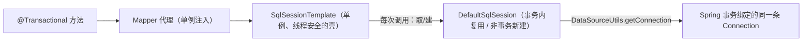
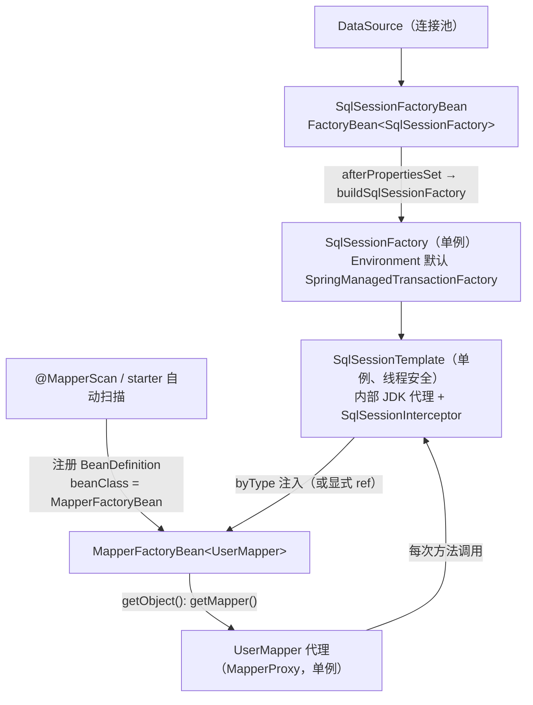
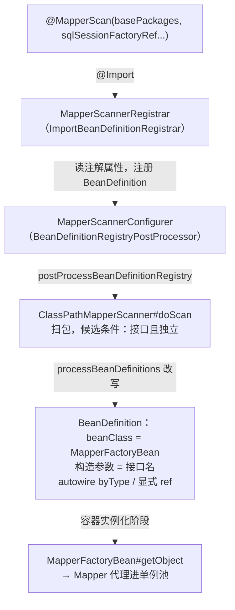
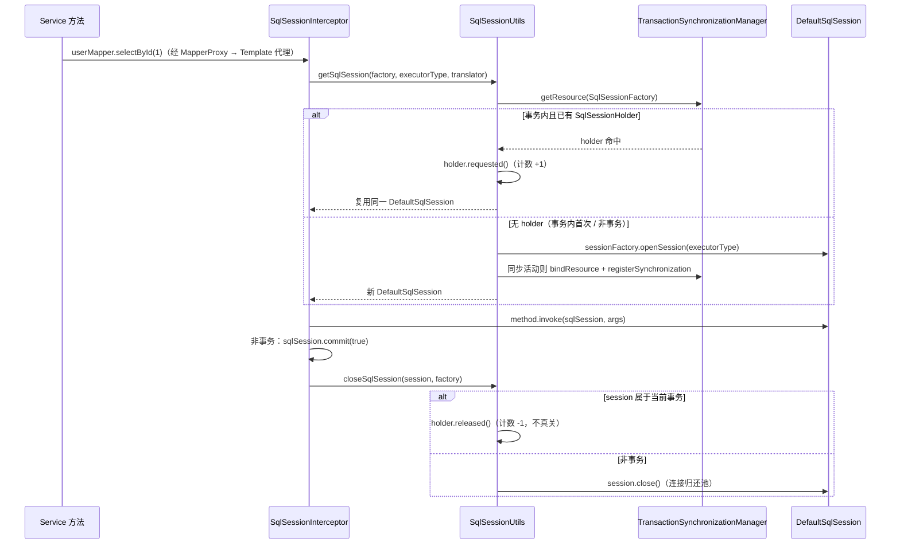
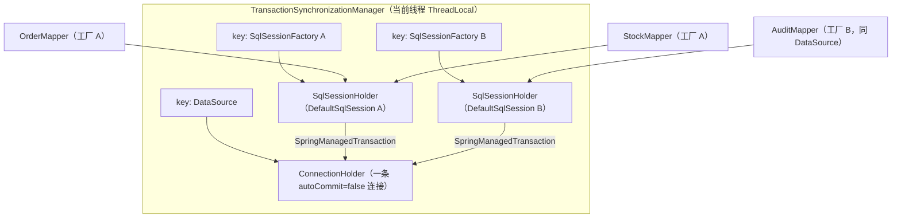

# MyBatis 与 Spring 集成及事务管理

> 一句话概括：mybatis-spring 用 **FactoryBean 把 Mapper 接口变成可单例注入的 Spring Bean**，用「**JDK 动态代理 + TransactionSynchronizationManager**」把 SqlSession 与 JDBC 连接绑定到 Spring 事务——
> 这就是「Mapper 为什么能注入、`@Transactional` 为什么能管住 MyBatis、一级缓存在 Spring 里为什么时灵时不灵」的全部物理基础。

预计阅读时间：大约 100 分钟

所属主题：[MyBatis 常见面试题总结](summary.md)

本文以 **MyBatis 3.5.19 + mybatis-spring 3.0.5**（对应 Spring Framework 6.x / Spring Boot 3.x，jakarta 命名空间）为基线，starter 以 **mybatis-spring-boot-starter 3.0.5**（对应 Boot 3.5）为参照；源码锚点用 `类名#方法名` 标注，均已对照 GitHub tag `mybatis-spring-3.0.5` / `mybatis-spring-boot-3.0.5` / `mybatis-3.5.19` 的源码核实。**mybatis-spring 4.x / starter 4.x**（2025 年 11 月底~12 月发布）对应 Spring 7 / Boot 4，**MyBatis 3.6.0**（2026-10，Java 11 基线）的差异单独注明。Spring 侧的事务传播、失效清单不在本文重复，只给结论并链接 [Spring 事务详解](../spring/transaction.md)。

---

## 0. 阅读路线

| 读者 | 建议阅读 | 关注点 |
| --- | --- | --- |
| 初级（1 年内） | 1、2.1、3.1、6.1、8.1、10.1、文末速记 | 三件套是什么、Mapper 怎么注入、`@Transactional` 怎么用、注入失败怎么查 |
| 中级（1~3 年） | 全部，重点 3、4、5、7 | 扫描注册链、SqlSessionTemplate 代理源码、commit 归属、缓存行为 |
| 高级（3 年+） | 4.3~4.5、5.3、6.3、7.3、9.3、10 | 引用计数与同步回调时序、ExecutorType 边界、二级缓存回滚风险、多数据源歧义 |
| 选型/架构 | 2.4、8.3、9、10.3 | 集成层的代价、版本对应与升级路线、多数据源方案取舍 |

目录：

1. 结论先行：mybatis-spring 到底做了什么
2. 集成三件套：SqlSessionFactoryBean / MapperFactoryBean / SqlSessionTemplate
3. Mapper 扫描注册链：从 @MapperScan 到 BeanDefinition
4. SqlSessionTemplate 线程安全原理（核心源码走读）
5. SpringManagedTransaction：MyBatis 的 commit 为什么"不生效"
6. 与 @Transactional 的协作
7. Spring 下的缓存行为
8. mybatis-spring-boot-starter 自动装配与版本对应
9. 多数据源
10. 边界与排查
11. 高频追问集
12. 参考资料

---

## 1. 结论先行：mybatis-spring 到底做了什么

### 1.1 没有集成层时的样子

纯 MyBatis 的官方推荐用法是「方法作用域」的 SqlSession——用完即关，绝不共享：

```java
// 纯 MyBatis：每个方法自己开 session、自己提交、自己关闭
public User findUser(long id) {
    try (SqlSession session = sqlSessionFactory.openSession()) {
        UserMapper mapper = session.getMapper(UserMapper.class);
        return mapper.selectById(id);
    }   // try-with-resources 保证 close
}
```

官方文档对此有明确要求（Getting Started · Scope and Lifecycle，原文）：

> "Each thread should have its own instance of SqlSession. Instances of SqlSession are not to be shared and are not thread safe. Therefore the best scope is request or method scope."
> "Never keep references to a SqlSession instance in a static field or even an instance field of a class."

这套用法放进 Spring 项目有三个直接冲突：

| 冲突 | 具体表现 |
| --- | --- |
| 生命周期冲突 | Spring Bean 默认单例、长期持有依赖；SqlSession 却要求用完即关，不能作为单例 Bean 的成员变量 |
| 事务冲突 | MyBatis 自己管 commit/rollback（`JdbcTransaction`），Spring 的 `@Transactional` 管的是另一条连接——两套事务各提交各的，无法原子 |
| 装配冲突 | Mapper 是接口、由 `SqlSession#getMapper` 运行时生成代理，不是 `@Component`，组件扫描根本扫不到它 |

### 1.2 集成层的两个交换

**结论**：mybatis-spring 的全部设计可以概括为两个交换：

1. **用 FactoryBean 换装配**：把「接口 → Mapper 代理」的创建过程包装成 `MapperFactoryBean`，让容器按标准 Bean 生命周期生产 Mapper，业务代码像注入 Service 一样注入 Mapper（第 2、3 章）；
2. **用「代理 + ThreadLocal 绑定」换事务**：`SqlSessionTemplate` 是一个**无状态的壳**，每次方法调用才去 `TransactionSynchronizationManager` 里取/建真正的 SqlSession；连接则经 `DataSourceUtils` 取，天然命中 Spring 事务绑定的那条连接（第 4、5、6 章）。



**边界与代价**：这两个交换不是免费的——Mapper 调用多穿两层代理（MapperProxy + SqlSessionInterceptor）、每次调用多一次 ThreadLocal 查找；换来的是「单例注入 + 声明式事务 + 异常翻译」。理解这层壳与真实 session 的区别，是本文后面所有边界问题（缓存失效、ExecutorType 冲突、手动 openSession 误用）的钥匙。

**追问**：为什么 Spring 不直接内置 MyBatis 支持？Spring 3 停止开发时 MyBatis 3 尚未正式发布（官方 index 页引用 SPR-5991），集成由 MyBatis 社区以子项目形式维护——所以版本对应关系要单独盯（8.3）。

---

## 2. 集成三件套：SqlSessionFactoryBean / MapperFactoryBean / SqlSessionTemplate

### 2.1 职责总表

| 组件 | 类型 | 产出 | 一句话职责 |
| --- | --- | --- | --- |
| `SqlSessionFactoryBean` | `FactoryBean<SqlSessionFactory>` + `InitializingBean` | `DefaultSqlSessionFactory`（单例） | 把 DataSource、XML、别名、插件等 Spring 化配置组装成 MyBatis 的 `Configuration`，**默认塞入 `SpringManagedTransactionFactory`** |
| `MapperFactoryBean<T>` | `FactoryBean<T>`（继承 `SqlSessionDaoSupport`） | Mapper 接口的 JDK 代理（单例） | `getObject()` 返回 `getSqlSession().getMapper(mapperInterface)`；`checkDaoConfig()` 校验并把接口注册进 `Configuration` |
| `SqlSessionTemplate` | `SqlSession` 的线程安全实现 + `DisposableBean` | 自身即产品（不是 FactoryBean） | 替代 `DefaultSqlSession` 作为注入对象；内部代理把每次调用路由到「当前事务的 / 新建的」真实 session |

三者与 Spring 机制的对应关系：`SqlSessionFactoryBean` 与 `MapperFactoryBean` 是 **FactoryBean 模式**（容器管理工厂、`getObject()` 的产物才是注入对象，取工厂本身要加 `&` 前缀）；`SqlSessionTemplate` 是**代理模式 + 模板方法**的混合——固定「取 session → 执行 → 提交/关闭」骨架，把真正的 SQL 执行委托出去。模式的角色映射见 [Spring 中的设计模式](../spring/design-patterns.md)，FactoryBean 与动态代理的容器机制见 [IoC 与 AOP 详解](../spring/ioc-and-aop.md)。

### 2.2 SqlSessionFactoryBean：组装 Configuration

`SqlSessionFactoryBean#afterPropertiesSet` 校验 `dataSource` 必填、`configuration` 与 `configLocation` **互斥**（同时配置直接启动失败），然后调 `buildSqlSessionFactory()`。关键源码（3.0.5 核实）：

```java
// SqlSessionFactoryBean#buildSqlSessionFactory（节选）
// 事务工厂默认值：这一行是 MyBatis 能被 Spring 事务接管的前提（见第 5 章）
targetConfiguration.setEnvironment(new Environment(this.environment,
    this.transactionFactory == null ? new SpringManagedTransactionFactory() : this.transactionFactory,
    this.dataSource));

// mapperLocations：逐个 XML 解析进 Configuration
for (Resource mapperLocation : this.mapperLocations) {
    var xmlMapperBuilder = new XMLMapperBuilder(mapperLocation.getInputStream(), targetConfiguration,
        mapperLocation.toString(), targetConfiguration.getSqlFragments());
    xmlMapperBuilder.parse();
}
return this.sqlSessionFactoryBuilder.build(targetConfiguration);
```

其余装配点：`typeAliasesPackage` 扫描注册别名、`typeHandlersPackage`/`typeHandlers` 注册类型处理器（细节见 [结果映射与 TypeHandler](result-mapping-and-typehandler.md)）、`plugins` 逐个 `targetConfiguration.addInterceptor(plugin)`（拦截器链见 [插件与分页](plugin-and-pagination.md)）。`getObject()` 返回构建好的工厂，`isSingleton()` 返回 true——**SqlSessionFactory 是应用级单例**，与官方「best scope is application scope」的建议一致。

### 2.3 MapperFactoryBean：接口变 Bean 的最后一环

```java
// MapperFactoryBean（3.0.5 核实）
public class MapperFactoryBean<T> extends SqlSessionDaoSupport implements FactoryBean<T> {

  @Override
  public T getObject() throws Exception {
    return getSqlSession().getMapper(this.mapperInterface);   // getSqlSession() 返回 SqlSessionTemplate
  }

  @Override
  protected void checkDaoConfig() {
    super.checkDaoConfig();                                    // 校验 sqlSessionTemplate 已注入
    notNull(this.mapperInterface, "Property 'mapperInterface' is required");
    var configuration = getSqlSession().getConfiguration();
    if (this.addToConfig && !configuration.hasMapper(this.mapperInterface)) {
      configuration.addMapper(this.mapperInterface);           // 解析接口上的注解 SQL / 绑定 XML
    }
  }

  @Override
  public Class<T> getObjectType() { return this.mapperInterface; }  // byType 注入按接口匹配的关键
  @Override
  public boolean isSingleton() { return true; }
}
```

三个要点：

- `checkDaoConfig()` 由 Spring 的 `DaoSupport#afterPropertiesSet`（`InitializingBean` 回调）在 Bean 初始化阶段触发——**Mapper 的注解解析与配置校验发生在启动期**，配错启动就炸，而不是第一次调用才炸。
- `getObjectType()` 返回 Mapper 接口，容器据此做 byType 匹配：注入点写 `UserMapper`，拿到的就是这个 FactoryBean 的产物。
- `getMapper` 返回的是 MyBatis 核心的 `MapperProxy`（JDK 动态代理，`MapperProxyFactory#newInstance`），方法调用如何绑定到 `MappedStatement` 见 [Mapper 代理与绑定](mapper-proxy-and-binding.md)。本文只强调：**Mapper 代理内部持有的 SqlSession 是 SqlSessionTemplate**，所以它才能单例共享。

不依赖扫描的最小手工装配（理解 FactoryBean 机制用，Boot 项目不需要这么写）：

```java
@Configuration
public class MyBatisConfig {
    @Bean
    public SqlSessionFactory sqlSessionFactory(DataSource dataSource) throws Exception {
        SqlSessionFactoryBean factory = new SqlSessionFactoryBean();
        factory.setDataSource(dataSource);
        return factory.getObject();
    }

    @Bean
    public MapperFactoryBean<UserMapper> userMapper(SqlSessionFactory sqlSessionFactory) {
        MapperFactoryBean<UserMapper> factoryBean = new MapperFactoryBean<>(UserMapper.class);
        factoryBean.setSqlSessionFactory(sqlSessionFactory);   // 继承自 SqlSessionDaoSupport
        return factoryBean;                                    // 注入点拿到的是 UserMapper 代理
    }
}
```

### 2.4 装配全景与代价



**边界与代价**：一次 Mapper 调用的完整路径是 `MapperProxy → SqlSessionTemplate 代理 → DefaultSqlSession → Executor → StatementHandler`，比裸 JDBC 多两层代理分派与一次 ThreadLocal 查找（单次 µs 级，相对 SQL 执行可忽略，但热点路径要心里有数）。真正的代价在**认知**：注入的对象全是壳，排查问题时必须分清「哪一层是单例、哪一层是每次调用/每个事务现取的」。SqlSession/Executor 的分层结构见 [架构与 SQL 执行](architecture-and-sql-execution.md)。

---

## 3. Mapper 扫描注册链：从 @MapperScan 到 BeanDefinition

### 3.1 结论

**结论**：`@MapperScan` 不是组件扫描的变体，而是一条「**注解 → ImportBeanDefinitionRegistrar → BeanDefinitionRegistryPostProcessor → 改写 BeanDefinition**」的注册链。链的终点是把每个 Mapper 接口注册成一个 `beanClass = MapperFactoryBean` 的 BeanDefinition——**接口能变成 Bean，是因为容器实例化的从来不是接口本身，而是 FactoryBean**。

### 3.2 注册链源码走读



逐环核实（3.0.5 源码）：

**① `MapperScannerRegistrar#registerBeanDefinitions`**：实现 `ImportBeanDefinitionRegistrar`，在配置类解析阶段执行。它读取 `@MapperScan` 的属性，构建一个 `MapperScannerConfigurer` 的 BeanDefinition 注册进容器：

```java
// MapperScannerRegistrar#registerBeanDefinitions（节选）
var builder = BeanDefinitionBuilder.genericBeanDefinition(MapperScannerConfigurer.class);
// sqlSessionFactoryRef → sqlSessionFactoryBeanName；sqlSessionTemplateRef → sqlSessionTemplateBeanName
var sqlSessionFactoryRef = annoAttrs.getString("sqlSessionFactoryRef");
if (StringUtils.hasText(sqlSessionFactoryRef)) {
    builder.addPropertyValue("sqlSessionFactoryBeanName", sqlSessionFactoryRef);
}
// basePackages 为空时回退到标注类所在包
if (basePackages.isEmpty()) {
    basePackages.add(getDefaultBasePackage(annoMeta));
}
builder.addPropertyValue("basePackage", StringUtils.collectionToCommaDelimitedString(basePackages));
builder.setRole(BeanDefinition.ROLE_INFRASTRUCTURE);
registry.registerBeanDefinition(beanName, builder.getBeanDefinition());
```

重复注解 `@MapperScans` 由内部类 `RepeatingRegistrar` 处理，逐个展开。

**② `MapperScannerConfigurer#postProcessBeanDefinitionRegistry`**：它是 `BeanDefinitionRegistryPostProcessor`（BFPP 家族），在 `refresh()` 的 `invokeBeanFactoryPostProcessors` 阶段执行——**早于一切 Bean 实例化**（容器启动骨架见 [IoC 与 AOP 详解](../spring/ioc-and-aop.md)）。方法体创建 `ClassPathMapperScanner`、透传全部属性、`registerFilters()` 后 `scanner.scan(basePackage)`。

**③ `ClassPathMapperScanner#doScan` → `processBeanDefinitions`**：候选组件的判定是 `isCandidateComponent`——**必须是接口且独立**（`isInterface() && isIndependent()`），所以扫描默认收下包内所有接口（`registerFilters` 在未指定 `annotationClass`/`markerInterface` 时加入 accept-all 过滤器）。改写 BeanDefinition 的核心四行：

```java
// ClassPathMapperScanner#processBeanDefinitions（节选，3.0.5 核实）
// the mapper interface is the original class of the bean
// but, the actual class of the bean is MapperFactoryBean
definition.getConstructorArgumentValues().addGenericArgumentValue(beanClassName); // 接口名作构造参数
definition.setBeanClass(this.mapperFactoryBeanClass);                             // 默认 MapperFactoryBean.class
definition.getPropertyValues().add("addToConfig", this.addToConfig);

if (!explicitFactoryUsed) {   // 未显式指定 sqlSessionFactoryRef / sqlSessionTemplateRef 时
    definition.setAutowireMode(AbstractBeanDefinition.AUTOWIRE_BY_TYPE);          // 按类型注入工厂/模板
}
```

显式指定时的优先级（同方法内核实）：`sqlSessionFactoryBeanName` 以 `RuntimeBeanReference` 写入属性；若同时给了 `sqlSessionTemplateBeanName`，打 warning「Cannot use both: sqlSessionTemplate and sqlSessionFactory together. sqlSessionFactory is ignored.」并**以 template 为准**——这与 `SqlSessionDaoSupport` 的 setter 语义一致：`setSqlSessionTemplate` 直接覆盖；`setSqlSessionFactory` 在 **template 为空、或传入工厂与当前 template 所持工厂不同**时重建 template（3.0.5 源码条件：`sqlSessionTemplate == null || sqlSessionFactory != this.sqlSessionTemplate.getSqlSessionFactory()`）。

**④ 实例化**：容器按改写后的定义创建 `MapperFactoryBean`（构造参数是接口名），byType 注入 `SqlSessionTemplate`（或按 ref 注入工厂），`checkDaoConfig()` 校验，`getObject()` 产出 Mapper 代理放入单例池。Bean 名默认是接口简名首字母小写（`userMapper`）。

### 3.3 @Mapper 与 starter 的自动扫描

`@Mapper` 是 MyBatis 核心提供的标记注解，**它自己不会触发任何注册**——必须有人按它过滤扫描。两条路：

| 方式 | 机制 | 边界 |
| --- | --- | --- |
| `@MapperScan(annotationClass = Mapper.class)` | 走 3.2 的注册链，`registerFilters` 加 `AnnotationTypeFilter` | 精确控制扫描范围，多数据源必用 |
| starter 自动扫描 | `MybatisAutoConfiguration` 的内部类 `AutoConfiguredMapperScannerRegistrar`（同为 `ImportBeanDefinitionRegistrar`）：取 `AutoConfigurationPackages.get(beanFactory)`（**主类所在包及子包**），注册 `MapperScannerConfigurer` 且 `annotationClass = Mapper.class` | 只扫主类包；Mapper 放在主类包之外就扫不到 |

自动扫描的让位条件（3.0.5 核实）：内部配置类 `MapperScannerRegistrarNotFoundConfiguration` 标着 `@ConditionalOnMissingBean({ MapperFactoryBean.class, MapperScannerConfigurer.class })`——**只要你用了 `@MapperScan`（它注册了 MapperScannerConfigurer）或手工注册了任何 MapperFactoryBean，自动扫描整体退位**。官方文档原话："The MyBatis-Spring-Boot-Starter will not start the scanning process if it finds at least one `MapperFactoryBean` in the Spring's context"。

**实践/追问**：「@Mapper 和 @MapperScan 什么关系？」——@Mapper 是标记，@MapperScan 是扫描动作；Boot 项目里只写 @Mapper 能跑，是因为 starter 替你做了按 @Mapper 过滤的包扫描，不是注解本身有魔法。混用时记住让位规则：出现 @MapperScan 后，没被它扫到的 @Mapper 接口不会再被自动兜底。

---

## 4. SqlSessionTemplate 线程安全原理（核心源码走读）

### 4.1 结论

**结论**：`SqlSessionTemplate` 线程安全，不是因为它把 `DefaultSqlSession` 做成了并发安全，而是因为它**根本不持有会话状态**——它持有的是一个 JDK 代理，每次方法调用由 `SqlSessionInterceptor` 现取「当前事务绑定的 session」或「新建的 session」，用完即还。可变状态（Executor、一级缓存、dirty 标记、连接）全部在短生命周期的 `DefaultSqlSession` 里，事务内靠 ThreadLocal 隔离线程、非事务靠「一次调用一个 session」隔离线程。

### 4.2 为什么 DefaultSqlSession 不能共享

MyBatis 核心源码的类注释与字段（3.5.19 核实）：

```java
/**
 * The default implementation for {@link SqlSession}. Note that this class is not Thread-Safe.
 */
public class DefaultSqlSession implements SqlSession {
  private final Configuration configuration;
  private final Executor executor;        // 持有一级缓存、事务对象、BATCH 语句列表
  private final boolean autoCommit;
  private boolean dirty;                  // 可变标记：update 置 true，commit/close 复位
  private List<Cursor<?>> cursorList;     // 可变集合
```

`update` 会写 `dirty = true`，`commit(force)`/`close` 依据 `isCommitOrRollbackRequired`（`!autoCommit && dirty || force`）决定提交/回滚。两个线程共享同一个实例：dirty 标记互相覆盖、一级缓存串读、BATCH 语句混批、一个线程 close 掉另一个线程正在用的连接——全是事故。**官方结论是「不要共享」，而不是「加锁共享」**。

### 4.3 SqlSessionTemplate 的构造：一个代理壳

```java
// SqlSessionTemplate（3.0.5 核实）
public class SqlSessionTemplate implements SqlSession, DisposableBean {
  private final SqlSessionFactory sqlSessionFactory;
  private final ExecutorType executorType;
  private final SqlSession sqlSessionProxy;                          // 真正的调用入口
  private final PersistenceExceptionTranslator exceptionTranslator;  // 默认 MyBatisExceptionTranslator

  public SqlSessionTemplate(SqlSessionFactory sqlSessionFactory, ExecutorType executorType,
      PersistenceExceptionTranslator exceptionTranslator) {
    // ...
    this.sqlSessionProxy = (SqlSession) newProxyInstance(SqlSessionFactory.class.getClassLoader(),
        new Class[] { SqlSession.class }, new SqlSessionInterceptor());   // 内部代理类：SqlSessionInterceptor
  }

  @Override
  public <T> T selectOne(String statement, Object parameter) {
    return this.sqlSessionProxy.selectOne(statement, parameter);     // 所有 SqlSession 方法同构委托
  }
```

注意区分两个「代理」：**内部代理类是 `SqlSessionTemplate.SqlSessionInterceptor`**（`InvocationHandler`），运行期生成的代理对象是 JDK 的 `$ProxyN`（实现 `SqlSession` 接口）；它代理的不是某个固定 session，而是「取 session 这件事」。Template 的四个字段全部 final 且无调用期可变状态——单例共享安全的根据就在这里。

还有一个容易答错的 API 细节（3.0.5 核实）：**Template 的 `commit()`/`rollback()`/`close()` 不走代理，直接抛异常**——

```java
// SqlSessionTemplate（3.0.5 核实）
@Override
public void commit() {
    throw new UnsupportedOperationException("Manual commit is not allowed over a Spring managed SqlSession");
}
// rollback() / close() 同构；DisposableBean#destroy() 是空方法，仅为避免容器销毁时误调 close()
```

生命周期完全归拦截器与事务同步回调管，手动提交/关闭被**显式拒绝**而非静默忽略。「commit 是空操作」发生在更底层的 `SpringManagedTransaction`（第 5 章），两层不要混。

### 4.4 SqlSessionInterceptor#invoke：每次调用的完整生命周期

```java
// SqlSessionTemplate.SqlSessionInterceptor#invoke（3.0.5 核实，日志与 SqlSessionTemplate.this 前缀略）
var sqlSession = getSqlSession(SqlSessionTemplate.this.sqlSessionFactory,
    SqlSessionTemplate.this.executorType, SqlSessionTemplate.this.exceptionTranslator);
try {
    var result = method.invoke(sqlSession, args);
    if (!isSqlSessionTransactional(sqlSession, SqlSessionTemplate.this.sqlSessionFactory)) {
        // force commit even on non-dirty sessions because some databases require
        // a commit/rollback before calling close()
        sqlSession.commit(true);                       // 非事务：强制提交（见第 5 章）
    }
    return result;
} catch (Throwable t) {
    var unwrapped = unwrapThrowable(t);                // 解包 InvocationTargetException
    if (exceptionTranslator != null && unwrapped instanceof PersistenceException) {
        closeSqlSession(sqlSession, sqlSessionFactory);  // 先释放连接再翻译，避免死锁（issue #22）
        sqlSession = null;
        Throwable translated = exceptionTranslator.translateExceptionIfPossible((PersistenceException) unwrapped);
        if (translated != null) { unwrapped = translated; }   // → Spring DataAccessException 体系
    }
    throw unwrapped;
} finally {
    if (sqlSession != null) {
        closeSqlSession(sqlSession, SqlSessionTemplate.this.sqlSessionFactory);
    }
}
```

取与还的两端都在 `SqlSessionUtils`（3.0.5 核实）：

```java
// SqlSessionUtils#getSqlSession
var holder = (SqlSessionHolder) TransactionSynchronizationManager.getResource(sessionFactory);
var session = sessionHolder(executorType, holder);     // 命中：holder.requested() 引用计数 +1，返回同一 session
if (session != null) { return session; }
session = sessionFactory.openSession(executorType);    // 未命中：新建 DefaultSqlSession
registerSessionHolder(sessionFactory, executorType, exceptionTranslator, session);
return session;

// SqlSessionUtils#closeSqlSession
var holder = (SqlSessionHolder) TransactionSynchronizationManager.getResource(sessionFactory);
if (holder != null && holder.getSqlSession() == session) {
    holder.released();                                 // 事务内：引用计数 -1，不真关
} else {
    session.close();                                   // 非事务：真关（Executor 关闭、连接归还）
}
```

`registerSessionHolder` 只在 `TransactionSynchronizationManager.isSynchronizationActive()` 且 Environment 的事务工厂是 `SpringManagedTransactionFactory` 时，才把 `SqlSessionHolder` 绑到 **SqlSessionFactory 这个 key** 上并注册 `SqlSessionSynchronization` 回调；`SqlSessionHolder` 继承 Spring 的 `ResourceHolderSupport`，`requested()/released()` 就是它的引用计数。



### 4.5 事务收尾：SqlSessionSynchronization 的回调时序

事务内复用的 session 由谁关？答案是注册进 Spring 事务同步的 `SqlSessionSynchronization`（3.0.5 核实）：

| 回调 | 行为 | 源码依据 |
| --- | --- | --- |
| `getOrder()` | 返回 `DataSourceUtils.CONNECTION_SYNCHRONIZATION_ORDER - 1`，**排在连接同步之前** | 保证 session 层的 flush 先于连接提交 |
| `suspend()` / `resume()` | unbind / 重新 bind SqlSessionHolder | 配合 REQUIRES_NEW 挂起外层事务 |
| `beforeCommit(readOnly)` | `holder.getSqlSession().commit()`——flush BATCH 语句、提交二级缓存暂存；JDBC 连接的 commit 由 SpringManagedTransaction 空操作让位 | 注释原话："do cleanup the SqlSession / Executor, including flushing BATCH statements" |
| `beforeCompletion()` | 若 `!holder.isOpen()`（引用计数归零）：unbind + `session.close()` | issue #18：afterCompletion 可能在别的线程被调 |
| `afterCompletion(status)` | 若 holder 仍活跃：`unbindResourceIfPossible` + `session.close()`；最后 `holder.reset()` | 兜底清理 |

回滚路径不触发 `beforeCommit`：session 在 `beforeCompletion`/`afterCompletion` 被关闭，`DefaultSqlSession#close` 里 `executor.close(isCommitOrRollbackRequired(false))` 对 dirty 会话执行回滚——BATCH 中未 flush 的语句随之丢弃，物理回滚由 `DataSourceTransactionManager` 完成。

**边界与代价**（三条都能从源码直接推出）：

1. **事务内不能换 ExecutorType**：`sessionHolder` 命中 holder 后校验 `holder.getExecutorType() != executorType` 直接抛 `TransientDataAccessResourceException("Cannot change the ExecutorType when there is an existing transaction")`。SIMPLE 事务里调 BATCH 模板必炸——批量要独立事务或独立模板边界（见 [批量与性能](batch-and-performance.md)）。
2. **事务工厂不是 SpringManagedTransactionFactory 时**：若当前线程已绑定该 DataSource 的连接（Spring 事务活动中），`registerSessionHolder` 抛 `TransientDataAccessResourceException("SqlSessionFactory must be using a SpringManagedTransactionFactory in order to use Spring transaction synchronization")`；DataSource 未绑定则只打 debug 日志、session 不参与同步。
3. **非事务调用 = 每次一个 session + 一次连接取还**：这是第 7 章一级缓存失效的根源，也是「无事务的循环单条写」比「有事务的批量」慢得多的原因之一。

**实践/追问**：排查「两次查询为什么不是同一个 session」，开 `org.mybatis.spring.SqlSessionUtils` 的 DEBUG：事务内复用会打 "Fetched SqlSession [...] from current transaction"，非事务每次都是 "Creating a new SqlSession" + "Closing non transactional SqlSession"。日志比断点快。

---

## 5. SpringManagedTransaction：MyBatis 的 commit 为什么"不生效"

### 5.1 结论

**结论**：`SqlSessionFactoryBean` 默认装配的 `SpringManagedTransactionFactory` 产出 `SpringManagedTransaction`，它把连接的**获取**委托给 `DataSourceUtils#getConnection`、把连接的**提交权**让渡给 Spring：连接属于 Spring 事务时，`commit()`/`rollback()` 是**空操作**。所以「MyBatis 的 commit 在 Spring 事务里不生效」不是 bug，是设计——提交权只能有一个所有者。注意分两层：对 `SqlSessionTemplate` 手动调 commit 会直接抛 `UnsupportedOperationException`（4.3）；「空操作」说的是底层 `SpringManagedTransaction` 对 JDBC 连接的 commit——拦截器内部与事务回调里的 `session.commit()` 最终都落到这里。

### 5.2 源码：三个方法定归属

```java
// SpringManagedTransaction（3.0.5 核实）
private void openConnection() throws SQLException {
    this.connection = DataSourceUtils.getConnection(this.dataSource);   // 命中事务绑定 → 同一条连接
    this.autoCommit = this.connection.getAutoCommit();
    this.isConnectionTransactional = DataSourceUtils.isConnectionTransactional(this.connection, this.dataSource);
}

@Override
public void commit() throws SQLException {
    if (this.connection != null && !this.isConnectionTransactional && !this.autoCommit) {
        this.connection.commit();      // 三个条件缺一不可，否则什么都不做
    }
}
// rollback() 同构；close() 走 DataSourceUtils.releaseConnection（事务内只是减引用计数）
```

`isConnectionTransactional` 是**字段**而非方法，在 `openConnection` 时一次性判定：连接是否就是 `TransactionSynchronizationManager` 里绑定的那条。`DataSourceUtils#getConnection` 的绑定/引用计数机制与 `DataSourceTransactionManager#doBegin` 的绑定端，见 [Spring 事务详解](../spring/transaction.md) 第 2 章，本文不重复。

另一个核实过的细节：`SpringManagedTransactionFactory#newTransaction(dataSource, level, autoCommit)` **忽略隔离级别与 autoCommit 参数**，只 `new SpringManagedTransaction(dataSource)`——这些属性归 Spring 事务管理器统一设置（`doBegin`），MyBatis 侧的 openSession 参数说了不算。

### 5.3 各场景下「谁提交」

| 场景 | 连接 autoCommit | isConnectionTransactional | 实际提交者 |
| --- | --- | --- | --- |
| `@Transactional` 事务内 | false（doBegin 设置） | true | `DataSourceTransactionManager#doCommit`；底层 `SpringManagedTransaction#commit` 空操作 |
| 无事务，连接池默认 autoCommit=true | true | false | JDBC 每条语句自动提交；Template 的 `commit(true)` 在 JDBC 层无事可做 |
| 无事务，autoCommit=false | false | false | Template 每次调用后 `commit(true)` → `SpringManagedTransaction#commit` 真提交 |
| 手动 `factory.openSession()`（工厂为默认的 SpringManagedTransactionFactory） | 由连接决定（工厂**忽略** openSession 的 autoCommit 参数） | 事务内 true / 无事务 false | 连接仍经 `DataSourceUtils` 获取：事务内照样归 Spring 提交；无事务时**你自己** commit/close |
| 手动 openSession，且工厂用纯 MyBatis 的 `JdbcTransactionFactory` 构建 | 取决于 openSession 参数 | false（`JdbcTransaction` 自取连接，不走 DataSourceUtils） | **你自己**：与 Spring 事务是两条连接，外层回滚管不到它 |

**边界与代价**：第 2 行解释了「没加 `@Transactional` 的写操作为什么也落库了」——autoCommit=true 时每条语句独立提交，多条写之间没有原子性；第 4、5 行分别对应 10.2 手动 openSession 的两种情形。另一个方向：`SqlSessionInterceptor` 非事务分支的 `commit(true)` 是**强制提交**（源码注释：某些数据库要求 close 前必须 commit/rollback），即使只做了查询也会走一遍——这是「为什么无事务的只读调用也有 commit 日志」的答案。

**追问**：「MyBatis 事务怎么被 Spring 接管？」标准答案三件套——`SpringManagedTransactionFactory` 让连接取自 `DataSourceUtils`（命中 ThreadLocal 绑定）、`isConnectionTransactional` 让提交权让位、`SqlSessionSynchronization` 让 session 生命周期挂进 Spring 事务回调。三者缺一，接管就不完整。

---

## 6. 与 @Transactional 的协作

### 6.1 两层绑定：同一事务的物理基础

**结论**：Spring 事务开启后，ThreadLocal 里有**两层绑定**——Spring 事务管理器绑的 `DataSource → ConnectionHolder`，mybatis-spring 绑的 `SqlSessionFactory → SqlSessionHolder`。同一事务内，绑定到**同一个 SqlSessionFactory** 的所有 Mapper 共用一个 SqlSession 和一条连接；绑定到不同工厂但**同一个 DataSource** 的 Mapper，各自有 session，但经 `DataSourceUtils` 拿到的是同一条连接——物理事务仍然是一个。



一个可复现的验证示例（DEBUG 日志走读）：

```java
@Service
@RequiredArgsConstructor
public class OrderService {
    private final OrderMapper orderMapper;
    private final StockMapper stockMapper;

    @Transactional
    public void placeOrder(Order order) {
        orderMapper.insert(order);        // Creating a new SqlSession → Registering transaction synchronization
        stockMapper.deduct(order.getSku(), order.getCount());
                                          // Fetched SqlSession [...] from current transaction（复用！）
    }                                     // beforeCommit: session.commit()（flush）→ doCommit: 连接真提交
}
```

把 `@Transactional` 去掉重跑：两次调用各自 "Creating a new SqlSession" + "Closing non transactional SqlSession"，两条独立连接、两次独立提交——中途失败无法整体回滚。

### 6.2 传播行为与失效场景：只给结论

事务的传播、回滚规则、失效清单属于 Spring 侧机制，完整推导见 [Spring 事务详解](../spring/transaction.md)，此处只给与 MyBatis 直接相关的结论：

| 场景 | 对 MyBatis 的影响 |
| --- | --- |
| REQUIRED 内层加入外层 | 内层 Mapper 复用外层 SqlSessionHolder，内层"提交"是空操作 |
| REQUIRES_NEW | `SqlSessionSynchronization#suspend` 把外层 SqlSessionHolder 一并摘除，内层新建 session + 新连接；外层挂起期间占着连接（连接池放大风险） |
| 类内自调用 / 吞异常 / 受检异常未配 rollbackFor | 自调用：事务根本没开，Mapper 走非事务分支、每条语句独立提交；吞异常/受检异常：事务照常提交，写入落库——**都与 MyBatis 配置无关** |
| 多线程调用 | 子线程 ThreadLocal 无绑定，Mapper 新建 session + autoCommit 连接，主事务回滚管不到它 |
| AFTER_COMMIT 回调里再写库 | 原事务资源仍绑定，写入会"参与"已提交的事务而静默丢失，必须 REQUIRES_NEW |

**MyBatis 特有的补充**：事务失效时 MyBatis 不报任何错——`SpringManagedTransaction` 只在 DEBUG 日志里打 "JDBC Connection [...] will not be managed by Spring"。这行日志是判断「事务有没有管住这条 SQL」的最直接证据。

### 6.3 批量操作在事务中的行为

`ExecutorType.BATCH` 的语句攒在 Executor 里，**flush 时机是 `SqlSessionSynchronization#beforeCommit` 里的 `session.commit()`**（4.5 已核实注释）——也就是说 BATCH 的 SQL 真正发往数据库是在事务提交前的回调里，而不是 Mapper 方法返回时。两个推论：

- BATCH 模板必须在**自己的事务边界**内使用：同一事务里混用 SIMPLE 与 BATCH 模板会抛 "Cannot change the ExecutorType when there is an existing transaction"（4.5）；
- 批量中途的查询看不到未 flush 的写入（语句还没发出去），需要 `flushStatements()` 手动冲刷。

批量的分页提交、rewriteBatchedStatements、性能账见 [批量与性能](batch-and-performance.md)。

---

## 7. Spring 下的缓存行为

### 7.1 一级缓存：时灵时不灵的真相

**结论**：一级缓存是 **SqlSession 级**（Executor 的 localCache）。Spring 下它是否有效，完全取决于「两次查询是否落在同一个 SqlSession 上」——由第 4 章的绑定机制直接决定：

| 场景 | session 归属 | 一级缓存表现 |
| --- | --- | --- |
| 无事务的两次 Mapper 查询 | 每次调用新建 session，用完即关 | **实际失效**：第二次查询必然发 SQL |
| 同一 `@Transactional` 方法内两次相同查询 | 复用同一 SqlSessionHolder | **生效**：第二次命中 localCache，不发 SQL |
| 事务内执行任意 insert/update/delete 后再查 | 同一 session | 更新清空 localCache（MyBatis 核心行为），重新发 SQL |
| 同一 Mapper 方法内的嵌套查询（association/collection 的 select） | 同一次调用、同一 session | 生效（与事务无关） |

这解释了两个高频现象：「为什么本地 demo 里一级缓存命中、线上加了 Service 层就不命中」（demo 在一个 session 里连查，线上无事务每次新 session）；「为什么事务内改了数据再查能查到新值」（update 清缓存）。一级缓存的结构、刷新与脏读边界见 [缓存机制](cache-mechanism.md)。

### 7.2 二级缓存：不受 session 生命周期影响

二级缓存是 **namespace 级**（跨 session），由 `CachingExecutor` + `TransactionalCacheManager` 暂存、session commit 时提交。Spring 下无事务调用每次都有 `commit(true)`，二级缓存照常写入——**「无事务一级缓存失效」不波及二级缓存**。

### 7.3 高级边界：二级缓存与回滚的竞态

`SqlSessionSynchronization#beforeCommit` 里有一行官方 TODO 注释（3.0.5 源码原话）：

```java
// TODO This updates 2nd level caches but the tx may be rolledback later on!
```

含义：session.commit() 在 `beforeCommit` 阶段就把暂存的二级缓存条目提交了，而 Spring 事务的物理提交在其后——若此刻连接提交失败、或其他同步回调抛异常导致整体回滚，**二级缓存里已经留下了数据库并不存在的数据**。这是「二级缓存 + Spring 事务」的已知一致性窗口，也是多数团队在写多读少、一致性敏感的业务里干脆关掉二级缓存、改用 Redis 等外部缓存的理由之一。细节与配置见 [缓存机制](cache-mechanism.md)。

**实践**：不要依赖一级缓存做业务正确性（它只是同 session 内的优化）；需要跨请求缓存就上显式方案，并把失效策略握在自己手里。

---

## 8. mybatis-spring-boot-starter 自动装配与版本对应

### 8.1 MybatisAutoConfiguration 做了什么

starter 的自动配置类 `MybatisAutoConfiguration`（mybatis-spring-boot-3.0.5 核实）：

```java
@Configuration(proxyBeanMethods = false)
@ConditionalOnClass({ SqlSessionFactory.class, SqlSessionFactoryBean.class })   // 引了依赖才装配
@ConditionalOnSingleCandidate(DataSource.class)                                 // 单候选 DataSource（多数据源需 @Primary）
@EnableConfigurationProperties(MybatisProperties.class)                         // mybatis.* 配置绑定
@AutoConfigureAfter({ DataSourceAutoConfiguration.class, MybatisLanguageDriverAutoConfiguration.class })
public class MybatisAutoConfiguration implements InitializingBean {

  @Bean
  @ConditionalOnMissingBean                       // 用户自定义 SqlSessionFactory 优先
  public SqlSessionFactory sqlSessionFactory(DataSource dataSource) throws Exception {
    SqlSessionFactoryBean factory = new SqlSessionFactoryBean();
    factory.setDataSource(dataSource);
    if (properties.getConfiguration() == null || properties.getConfiguration().getVfsImpl() == null) {
        factory.setVfs(SpringBootVFS.class);      // fat jar 内扫描别名/类的关键；用户配了 vfs-impl 则尊重用户配置
    }
    applyConfiguration(factory);                  // mybatis.configuration.* + ConfigurationCustomizer
    // typeAliasesPackage / typeHandlersPackage / plugins / mapperLocations 逐项透传
    Resource[] mapperLocations = this.properties.resolveMapperLocations();
    if (!ObjectUtils.isEmpty(mapperLocations)) { factory.setMapperLocations(mapperLocations); }
    applySqlSessionFactoryBeanCustomizers(factory);
    return factory.getObject();
  }

  @Bean
  @ConditionalOnMissingBean
  public SqlSessionTemplate sqlSessionTemplate(SqlSessionFactory sqlSessionFactory) {
    ExecutorType executorType = this.properties.getExecutorType();   // mybatis.executor-type
    return executorType != null ? new SqlSessionTemplate(sqlSessionFactory, executorType)
                                : new SqlSessionTemplate(sqlSessionFactory);
  }
}
```

条件装配、`@ConditionalOnMissingBean` 的用户优先语义、imports 文件机制属于 Boot 通用机制，见 [Boot 自动装配原理](../spring/boot-autoconfiguration.md)。这里只记 MyBatis 特有的四点：

1. **`@ConditionalOnSingleCandidate(DataSource.class)`**：容器里有多个 DataSource 且无 `@Primary` 时，**整个自动配置静默不生效**——多数据源项目必须手工装配（第 9 章），这是「加了 starter 却报缺 SqlSessionFactory」的头号原因。
2. **两个扩展点**：`ConfigurationCustomizer`（改 `Configuration`，在 `applyConfiguration` 里逐个回调）与 `SqlSessionFactoryBeanCustomizer`（改 `SqlSessionFactoryBean` 本身，如追加 mapperLocations）。插件/TypeHandler/LanguageDriver 也可以直接注册成 Bean，构造器用 `ObjectProvider` 收集后透传。
3. **自动扫描 @Mapper**：`MapperScannerRegistrarNotFoundConfiguration` → `AutoConfiguredMapperScannerRegistrar`（3.3 已述）。另有 `mybatis.lazy-initialization`（默认 false）、`mybatis.mapper-default-scope` 两个占位符属性透传给扫描器。
4. **`mybatis.configuration.*` 与 `mybatis.config-location` 互斥**（`SqlSessionFactoryBean#afterPropertiesSet` 的校验），同时配置启动失败。

```yaml
# application.yml（Boot 3.5 + starter 3.0.5）
mybatis:
  mapper-locations: classpath*:mapper/**/*.xml
  type-aliases-package: com.example.domain
  configuration:
    map-underscore-to-camel-case: true
    default-statement-timeout: 30
```

```java
@Bean
ConfigurationCustomizer mybatisCustomizer() {
    return configuration -> configuration.setCacheEnabled(false);   // 例：全局关二级缓存
}
```

### 8.2 自动扫描的一个隐蔽行为

`AutoConfiguredMapperScannerRegistrar` 在 `mybatis.inject-sql-session-on-mapper-scan`（默认 true）开启时，会取容器里**第一个** `SqlSessionTemplate` 的 bean name 写进扫描器（`getBeanNameForType` 返回 `beanNames[0]`）。多数据源场景若没写 `@MapperScan(sqlSessionFactoryRef=...)` 而依赖自动扫描，所有 @Mapper 会被绑到「第一个」模板上——**静默绑错库**。多数据源请显式 `@MapperScan` 按包隔离（第 9 章）。

### 8.3 版本对应表（升级必查）

mybatis-spring 版本与依赖要求（官方 requirements 表暂只列到 4.0；4.1.0 与 3.0.6 的发布据 GitHub Releases 核实）：

| mybatis-spring | MyBatis | Spring Framework | Spring Batch | Java |
| --- | --- | --- | --- | --- |
| **4.1.0**（2026-06-27，当前最新） | 3.5+ | **7.0+** | 6.0+ | 17+ |
| **4.0.0**（2025-11-30） | 3.5+ | **7.0+** | 6.0+ | 17+ |
| **3.0.x**（最新 3.0.6，2026-07-11） | 3.5+ | **6.x** | 5.x | 17+ |
| 2.0 / 2.1 | 3.5+ | 5.x | 4.x | 8+ |

注：4.1.0 行的依赖要求沿用官方 4.0 行（requirements 表尚未单列 4.1）；本文源码锚点仍以 3.0.5 为准。

starter 官方 requirements 表（2025-12-01 版文档核实）：

| mybatis-spring-boot-starter | mybatis-spring | Spring Boot | Java |
| --- | --- | --- | --- |
| **4.0+** | 4.0 | **4.0+** | 17+ |
| **3.0**（本文基线 3.0.5） | 3.0 | **3.2 ~ 3.5**（3.0.x 早期版本自 Boot 3.0 起支持） | 17+ |
| 2.3 | 2.1 | 2.7 | 8+ |
| 2.2（EOL） | 2.0（全功能需 2.0.6+） | 2.5 ~ 2.7 | 8+ |
| 2.1（EOL） | 2.0（全功能需 2.0.6+） | 2.1 ~ 2.4 | 8+ |
| 2.0（EOL） | 2.0 | 2.0 / 2.1 | 8+ |

时间线与差异注记：

- **mybatis-spring 4.0.0**：2025-11-30 发布，release note 唯一主题是「First support Spring Framework 7 / Spring Batch 6」（依赖升到 spring-core 7.0.1）；starter 4.0.0 文档于 2025-12-01 发布。**集成机制（本文第 2~7 章）在 4.x 未变**，变的是 Spring 基线。
- **mybatis-spring 3.0.x** 基于 Spring 6（jakarta 命名空间），不能与 Spring 5（javax）项目混用；2.1.2 是 Spring 5 线的末代版本——官方 release note 说明这大概率是 2.1.x 最后一个计划内发布，后续仅继续修复关键问题（含安全漏洞）。3.0.5（2025-06-10）对齐 MyBatis 3.5.19 / Spring 6.2.7。
- **MyBatis 核心 3.6.0**（2026-10-23 发布）：Java 基线从 8 升到 **11**，官方定位是**过渡版本**——3.5.19（2025-01-02）是最后一个 Java 8 版本，3.7.0 才升 Java 17 并承接原定的大特性。3.6 线已报告若干回归：官方 release notes 的 Known Issues 点名「基于参数元数据解析 TypeHandler」的改动引发多起 bug 报告（如 #3829），并计划在 3.6.1 增加禁用参数元数据查找的选项；社区另报告了 `<bind>` 变量在 `<where>` 等标签闭合后不可见（#3772，开于发布前）、构造器自动映射计入合成构造器（#3899）等问题。**生产升级建议观望补丁版或直奔 3.7.x**。mybatis-spring 3.0/4.0 的 requirements 均为「MyBatis 3.5+」，与 3.6.0 兼容，但本文源码锚点以 3.5.19 为准。

**选型立场**：Boot 3.x 项目锁定 starter 3.0.x + MyBatis 3.5.x 是当前最稳组合；升 Boot 4 时同步升 starter 4.x，不要跨线混搭（starter 2.x 的自动配置注册方式与 Boot 3 不兼容）。MyBatis-Plus 等生态有自己的工厂与 starter 版本线，见 [MyBatis-Plus 与生态](mybatis-plus-and-ecosystem.md)。

---

## 9. 多数据源

### 9.1 结论与标准写法

**结论**：多数据源的正解是「**一个数据源一套三件套 + 按包隔离的 @MapperScan**」：每套独立的 DataSource / SqlSessionFactory / SqlSessionTemplate / DataSourceTransactionManager，`@MapperScan` 用 `sqlSessionFactoryRef`（或 `sqlSessionTemplateRef`）把包内 Mapper 显式绑到对应工厂。starter 自动配置在多 DataSource 且无 @Primary 时整体退位（8.1），正好把装配权交还给你。

```java
@Configuration
@MapperScan(basePackages = "com.example.order.mapper", sqlSessionFactoryRef = "orderSqlSessionFactory")
public class OrderDbConfig {
    @Bean @Primary
    @ConfigurationProperties("app.datasource.order")
    public DataSource orderDataSource() { return DataSourceBuilder.create().build(); }

    @Bean @Primary
    public SqlSessionFactory orderSqlSessionFactory(@Qualifier("orderDataSource") DataSource ds) throws Exception {
        SqlSessionFactoryBean factory = new SqlSessionFactoryBean();
        factory.setDataSource(ds);
        factory.setMapperLocations(new PathMatchingResourcePatternResolver()
            .getResources("classpath*:mapper/order/*.xml"));   // 每套工厂只加载自己的 XML
        return factory.getObject();
    }

    @Bean @Primary
    public DataSourceTransactionManager orderTxManager(@Qualifier("orderDataSource") DataSource ds) {
        return new DataSourceTransactionManager(ds);
    }
}
// UserDbConfig 同构：userDataSource / userSqlSessionFactory / userTxManager，扫 com.example.user.mapper
```

业务侧用 `@Transactional("userTxManager")` 显式指定事务管理器——**管理器管的数据源必须与 Mapper 用的数据源一致**，错配是「事务开了但没管住 SQL」的隐蔽原因（推导见 [Spring 事务详解](../spring/transaction.md) 8.2）。

### 9.2 为什么必须显式 ref

不写 ref 时，扫描器给 BeanDefinition 设 `AUTOWIRE_BY_TYPE`（3.2 ③）。容器里有两个 `SqlSessionFactory`/`SqlSessionTemplate` 时，byType 注入出现多候选且无 `@Primary` 可消歧 → 启动抛 `NoUniqueBeanDefinitionException`/`UnsatisfiedDependencyException`；若给某一套加了 `@Primary`，**所有没写 ref 的 Mapper 会静默绑到 Primary 那套**——比报错更危险。显式 ref 写入的是 `RuntimeBeanReference`，绕开 byType 消歧，一锤定音。

### 9.3 边界：跨库事务与动态数据源

- **一个 `@Transactional` 只管一个数据源**：order 事务里调 user Mapper，user 的写走自己的连接、独立提交，order 回滚管不到它。跨库原子性按分布式事务选型处理（结论表见 [Spring 事务详解](../spring/transaction.md) 8.1）。
- **事务内切换数据源不生效**：`AbstractRoutingDataSource` 的路由只发生在 `getConnection()` 那一刻，事务已把连接绑到 ThreadLocal，后续取连接直接命中、不再路由。基于路由 DataSource 的 dynamic-datasource（baomidou）组件同理——`@DS` 切换在事务内失效，这是其文档明示的边界。组件生态见 [MyBatis-Plus 与生态](mybatis-plus-and-ecosystem.md)。
- **取舍**：按包隔离的多工厂方案配置重但边界清晰、事务语义可推理；路由 DataSource 方案配置轻但把「哪个库」变成了运行时状态，排查成本高。库数量少、访问模式固定选前者；读写分离/大量同构分库选后者 + 明确的「事务内不切换」纪律。

---

## 10. 边界与排查

### 10.1 Mapper 注入失败排查清单

| 症状 | 检查项 | 机制依据 |
| --- | --- | --- |
| `NoSuchBeanDefinitionException: UserMapper` | 包不在扫描范围：@MapperScan 的 basePackages / starter 只扫主类包 | 3.2、3.3 |
| 同上 | 只写 @Mapper 但容器里已有 MapperFactoryBean/MapperScannerConfigurer → 自动扫描让位，而 @MapperScan 又没覆盖该包 | 3.3 让位规则 |
| 同上 | 接口不是独立接口（内部非 static 接口等），`isCandidateComponent` 不收 | 3.2 ③ |
| 同上 | 多 DataSource 无 @Primary → MybatisAutoConfiguration 整体不生效，连 SqlSessionFactory 都没有 | 8.1 |
| `NoUniqueBeanDefinitionException: SqlSessionFactory` | 多套三件套没写 sqlSessionFactoryRef，byType 多候选 | 9.2 |
| Mapper 注入成功但查错库 | ref 配错 / 自动扫描绑到第一个模板 / @Primary 静默兜底 | 8.2、9.2 |
| `Invalid bound statement (not found)` | XML 没进 classpath（Maven 默认不打包 src/main/java 下的 XML，需 resources 配置）；mapper-locations 通配不匹配；namespace 与接口全名不一致；多工厂时 XML 被另一套工厂加载 | 2.2、9.1 |
| 启动报 `Property 'sqlSessionFactory' or 'sqlSessionTemplate' are required` | MapperFactoryBean 的模板/工厂没注入成功（ref 指向不存在的 bean name） | SqlSessionDaoSupport#checkDaoConfig |
| `SqlSessionFactory must be using a SpringManagedTransactionFactory...` | 自定义了 transactionFactory（如 JdbcTransactionFactory）却参与 Spring 事务 | 4.5 边界 2 |

### 10.2 手动 openSession 的误用：分两种情形说精确

`factory.openSession()` 产出的是裸 `DefaultSqlSession`：不走 `SqlSessionUtils#getSqlSession`、不注册事务同步回调、生命周期全靠自己。但**它的连接归属取决于工厂里的事务工厂**，两种情形后果不同（`DefaultSqlSessionFactory#openSessionFromDataSource` 与 `SpringManagedTransactionFactory#newTransaction` 均已核实）：

**情形 A：工厂用纯 MyBatis 方式构建（`SqlSessionFactoryBuilder` + `JdbcTransactionFactory`）——真正的事务逃逸**：

```java
// 工厂来自 mybatis-config.xml（<transactionManager type="JDBC"/>），不是 SqlSessionFactoryBean
@Transactional
public void transfer(long from, long to, BigDecimal amount) {
    try (SqlSession session = jdbcFactory.openSession()) {   // ❌ JdbcTransaction 自取连接
        AccountMapper mapper = session.getMapper(AccountMapper.class);
        mapper.debit(from, amount);
        session.commit();    // 独立连接、独立提交——与 @Transactional 是两条连接，外层回滚管不到它
    }
}
```

**情形 B：注入的是容器里的工厂（默认 SpringManagedTransactionFactory）——连接共享，但 session 脱管**。`openConnection` 仍走 `DataSourceUtils#getConnection`，事务内拿到的就是绑定的那条连接，写入仍参与 Spring 事务；问题在于这个 session 没有注册 `SqlSessionSynchronization`：独立的一级缓存与 BATCH 缓冲、必须自己 close（忘了 close 连接引用计数泄漏）、事务内调它的 `commit()` 是 JDBC 层空操作。语义混乱且无任何收益。

两种情形的共同结论：**Spring 项目里注入 Mapper 或 SqlSessionTemplate，不要注入工厂手动开 session**。确需编程式控制（如独立 BATCH 边界），用 `TransactionTemplate` + 对应 ExecutorType 的模板。相关误用还有对 `SqlSessionTemplate` 手动调 `commit()`/`rollback()`/`close()`——不是静默无效，而是直接抛 `UnsupportedOperationException`（4.3 源码），属于显式 fail-fast。

### 10.3 排查工具箱

| 手段 | 看什么 |
| --- | --- |
| DEBUG `org.mybatis.spring.SqlSessionUtils` | Creating / Fetched / Releasing / Closing SqlSession——session 复用与关闭时机一目了然 |
| DEBUG `org.mybatis.spring.transaction.SpringManagedTransaction` | "JDBC Connection [...] will (not) be managed by Spring"——事务接管与否的直接证据 |
| DEBUG `org.springframework.jdbc.datasource.DataSourceTransactionManager` | Creating new transaction / Participating in existing transaction（与 [Spring 事务详解](../spring/transaction.md) 5.10 排查套路衔接） |
| `AopUtils.isAopProxy(serviceBean)` | 确认 Service 注入的是事务代理（自调用失效排查） |
| 启动日志搜 "No MyBatis mapper was found" | 扫描包配错的明确信号（ClassPathMapperScanner#doScan 的 warning） |

**成本账**（选型视角）：mybatis-spring 集成层本身很薄——运行期开销是两层代理分派 + ThreadLocal 查找，启动期开销是扫描与 XML 解析；它换来的是声明式事务、单例注入、异常翻译（`MyBatisExceptionTranslator` 把 `PersistenceException` 翻成 Spring `DataAccessException` 体系，与 JdbcTemplate/JPA 的异常处理统一）。真正的复杂度成本在**多数据源与缓存语义**：本文第 7、9 章的边界都源于「壳与真实 session 的分离」，团队规范里写清「事务边界内才谈 session 复用」「多数据源必须显式 ref」，比事后排查便宜得多。

---

## 11. 高频追问集

**Q1：SqlSessionTemplate 为什么线程安全？DefaultSqlSession 为什么不是？**
期望答案：DefaultSqlSession 持有可变状态（Executor/一级缓存、dirty 标记、cursorList），官方 javadoc 明示 not Thread-Safe，最佳作用域是方法/请求级。SqlSessionTemplate 不持有会话状态：构造时用 `newProxyInstance` 生成以内部类 `SqlSessionInterceptor` 为 handler 的 JDK 代理，每次方法调用经 `SqlSessionUtils#getSqlSession` 取「事务绑定的 session（引用计数 +1）」或新建 session，finally 里 `closeSqlSession`（事务内计数 -1、非事务真关）。线程隔离靠 ThreadLocal 绑定 + 短生命周期 session，而不是加锁。

**Q2：Mapper 是接口，为什么能作为单例 Bean 注入？线程安全吗？**
期望答案：扫描器把接口注册成 `beanClass = MapperFactoryBean` 的 BeanDefinition，接口名作构造参数；`getObject()` 返回 `getSqlSession().getMapper()` 的 MapperProxy，`getObjectType()` 返回接口供 byType 匹配。Mapper 代理本身无调用期状态，它持有的 SqlSession 是线程安全的 SqlSessionTemplate，所以单例共享安全——「单例 ≠ 线程安全」的反例在这里不成立，是因为状态被移出了单例。

**Q3：MyBatis 的事务是怎么被 Spring 接管的？**
期望答案：三个接管点——SqlSessionFactoryBean 默认装 SpringManagedTransactionFactory，其 openConnection 走 DataSourceUtils#getConnection 命中事务绑定的连接；commit/rollback 以 `isConnectionTransactional` 判断，连接属于 Spring 事务就空操作，提交权归 DataSourceTransactionManager；SqlSessionUtils 把 SqlSessionHolder 绑到 SqlSessionFactory 并注册 SqlSessionSynchronization，session 的 flush/关闭挂进事务回调（beforeCommit/beforeCompletion/afterCompletion）。

**Q4：Spring 下 MyBatis 一级缓存还有效吗？**
期望答案：分场景。无事务时每次 Mapper 调用新建 session 用完即关，跨调用一级缓存实际失效；同一事务内复用同一 session，一级缓存生效，任意更新清空。二级缓存是 namespace 级不受影响，但 beforeCommit 阶段提交缓存与物理提交之间存在回滚竞态（源码有官方 TODO 注释），一致性敏感业务建议外部缓存。

**Q5：@MapperScan 做了什么？和 @Mapper 什么关系？**
期望答案：@MapperScan 经 @Import 引入 MapperScannerRegistrar（ImportBeanDefinitionRegistrar），注册 MapperScannerConfigurer（BeanDefinitionRegistryPostProcessor），后者在 BFPP 阶段用 ClassPathMapperScanner 扫包，把接口改写成 MapperFactoryBean 的 BeanDefinition（构造参数=接口名，autowire byType 或显式 ref）。@Mapper 只是标记注解，本身不触发注册；Boot 里只写 @Mapper 能跑是 starter 的 AutoConfiguredMapperScannerRegistrar 按主类包 + @Mapper 过滤自动扫描，且容器出现 MapperFactoryBean/MapperScannerConfigurer 时自动扫描让位。

**Q6：多数据源怎么配？要注意什么？**
期望答案：一源一套 DataSource/SqlSessionFactory/SqlSessionTemplate/事务管理器，@MapperScan(basePackages, sqlSessionFactoryRef) 按包隔离；多 DataSource 无 @Primary 时 starter 自动配置整体退位。不写 ref 会 byType 歧义启动失败，或被 @Primary/「第一个模板」静默绑错库。一个 @Transactional 只管一个数据源，事务内切数据源不生效（连接已绑定）；跨库原子性走分布式事务选型。

**Q7：MyBatis 的 commit 在 Spring 里为什么"不生效"？没加事务的写为什么也落库了？**
期望答案：分两层。对 SqlSessionTemplate 手动调 commit/rollback/close 直接抛 UnsupportedOperationException——生命周期归拦截器与事务同步回调。底层 SpringManagedTransaction#commit 有 `connection != null && !isConnectionTransactional && !autoCommit` 三条件守卫：事务内连接 isConnectionTransactional=true，空操作，提交由 DataSourceTransactionManager 在方法边界统一做。无事务时连接池默认 autoCommit=true，每条语句独立提交；Template 非事务分支的 commit(true) 是强制提交（兼容要求 close 前 commit/rollback 的数据库），在 autoCommit 连接上 JDBC 层无事可做。

**Q8：事务内能把 ExecutorType 从 SIMPLE 换成 BATCH 吗？**
期望答案：不能。sessionHolder 命中已有 SqlSessionHolder 时校验 ExecutorType，不一致抛 TransientDataAccessResourceException("Cannot change the ExecutorType when there is an existing transaction")。BATCH 要用独立事务边界；BATCH 语句的 flush 发生在事务 beforeCommit 回调的 session.commit()，中途查询看不到未 flush 的写入。

**Q9：非事务调用时 SqlSession 和连接什么时候创建、什么时候关闭？**
期望答案：每次 Mapper 方法调用进入 SqlSessionInterceptor 时创建（getResource 无 holder、同步未激活，不注册回调），方法返回前强制 commit(true)，finally 里 closeSqlSession 走 else 分支真关——Executor 关闭、SpringManagedTransaction#close 经 DataSourceUtils.releaseConnection 归还连接。一次调用 = 一个 session = 一次连接取还。

**Q10：mybatis-spring 和 starter 的版本怎么对应？升级看什么？**
期望答案：mybatis-spring 2.x↔Spring 5（Java 8）、3.0.x↔Spring 6（Java 17、jakarta）、4.x↔Spring 7（2025-11-30 发布 4.0.0）；starter 2.3↔Boot 2.7、3.0.x↔Boot 3（当前官方表 3.2~3.5）、4.x↔Boot 4。MyBatis 核心 3.5.19 是最后 Java 8 版本，3.6.0（2026-10）升 Java 11 属过渡版且有已报告回归，3.7.0 才升 Java 17。升级先查官方 requirements 表，不跨线混搭。

---

## 12. 参考资料

- MyBatis-Spring 官方文档：<https://mybatis.org/spring/>（requirements 版本表；`factorybean.html` SqlSessionFactoryBean、`sqlsession.html` SqlSessionTemplate、`mappers.html` Mapper 注入与扫描、`transactions.html` 事务）
- MyBatis Spring Boot Starter 官方文档：<https://mybatis.org/spring-boot-starter/mybatis-spring-boot-autoconfigure/>（版本表、mybatis.* 属性、Advanced scanning、ConfigurationCustomizer）
- MyBatis 官方文档 · Getting Started（Scope and Lifecycle，SqlSession 非线程安全的官方声明）：<https://mybatis.org/mybatis-3/getting-started.html>
- 源码（本文锚点均已对照核实）：
  - tag `mybatis-spring-3.0.5`（<https://github.com/mybatis/spring>）：`SqlSessionTemplate`（构造器 / `SqlSessionInterceptor#invoke` / `#commit` / `#close` / `#destroy`）、`SqlSessionUtils#getSqlSession` / `#sessionHolder` / `#registerSessionHolder` / `#closeSqlSession` / `#isSqlSessionTransactional`、`SqlSessionUtils.SqlSessionSynchronization`（getOrder/suspend/resume/beforeCommit/beforeCompletion/afterCompletion）、`SqlSessionHolder`（extends ResourceHolderSupport）、`SpringManagedTransaction#openConnection` / `#commit` / `#rollback` / `#close`、`SpringManagedTransactionFactory#newTransaction`、`SqlSessionFactoryBean#afterPropertiesSet` / `#buildSqlSessionFactory`、`MapperFactoryBean#getObject` / `#checkDaoConfig`、`SqlSessionDaoSupport#setSqlSessionFactory` / `#setSqlSessionTemplate`、`ClassPathMapperScanner#doScan` / `#processBeanDefinitions` / `#registerFilters`、`MapperScannerRegistrar#registerBeanDefinitions`、`MapperScannerConfigurer#postProcessBeanDefinitionRegistry`
  - tag `mybatis-spring-boot-3.0.5`（<https://github.com/mybatis/spring-boot-starter>）：`MybatisAutoConfiguration#sqlSessionFactory` / `#sqlSessionTemplate` / `#applyConfiguration`、`MybatisAutoConfiguration.MapperScannerRegistrarNotFoundConfiguration`、`AutoConfiguredMapperScannerRegistrar#registerBeanDefinitions`
  - tag `mybatis-3.5.19`（<https://github.com/mybatis/mybatis-3>）：`DefaultSqlSession`（类注释 / dirty 字段 / `#commit` / `#close`）、`DefaultSqlSessionFactory#openSessionFromDataSource`
- 发布信息：<https://github.com/mybatis/spring/releases>（4.0.0 / 3.0.5 release notes）、<https://github.com/mybatis/mybatis-3/releases>（3.6.0 Java 11、3.5.19 末代 Java 8）、<https://github.com/mybatis/mybatis-3/issues>（3.6 线回归：#3829、#3772、#3899 等，#3829 为官方 release notes Known Issues 点名项）
- 兄弟专题：[架构与 SQL 执行](architecture-and-sql-execution.md)、[Mapper 代理与绑定](mapper-proxy-and-binding.md)、[缓存机制](cache-mechanism.md)、[批量与性能](batch-and-performance.md)、[插件与分页](plugin-and-pagination.md)、[结果映射与 TypeHandler](result-mapping-and-typehandler.md)、[MyBatis-Plus 与生态](mybatis-plus-and-ecosystem.md)
- Spring 专题：[Spring 事务详解](../spring/transaction.md)（ThreadLocal 绑定、传播行为、失效清单、多数据源边界）、[IoC 与 AOP 详解](../spring/ioc-and-aop.md)（FactoryBean、动态代理、refresh 骨架）、[Boot 自动装配原理](../spring/boot-autoconfiguration.md)（条件装配与用户优先）、[Spring 中的设计模式](../spring/design-patterns.md)（FactoryBean/代理/模板方法）

---

## 附：一页速记

**装配层**
1. 三件套：SqlSessionFactoryBean 产工厂（默认 SpringManagedTransactionFactory）、MapperFactoryBean 产 Mapper 代理、SqlSessionTemplate 是线程安全的 SqlSession 壳。
2. Mapper 能注入 = BeanDefinition 的 beanClass 是 MapperFactoryBean，接口名只是构造参数；getObjectType 返回接口供 byType 匹配。
3. @MapperScan → MapperScannerRegistrar → MapperScannerConfigurer（BFPP）→ ClassPathMapperScanner 改写定义；未显式 ref 时 autowire byType。
4. @Mapper 只是标记；starter 按主类包自动扫 @Mapper，容器出现 MapperFactoryBean/MapperScannerConfigurer 即让位。

**事务层**
5. SqlSessionTemplate 无状态：每次调用 getSqlSession（事务内命中 SqlSessionHolder 复用、计数 +1；否则新建），finally closeSqlSession（事务内计数 -1、非事务真关）。
6. 两层 ThreadLocal 绑定：DataSource→ConnectionHolder（Spring 绑）、SqlSessionFactory→SqlSessionHolder（mybatis-spring 绑）；同工厂同 session，同 DataSource 同连接。
7. SpringManagedTransaction：连接取自 DataSourceUtils；isConnectionTransactional=true 时 commit/rollback 空操作——提交权归 DataSourceTransactionManager；对 SqlSessionTemplate 手动 commit/rollback/close 直接抛 UnsupportedOperationException。
8. 事务收尾靠 SqlSessionSynchronization：beforeCommit flush（BATCH 在此发 SQL）→ beforeCompletion/afterCompletion 关 session；order 排在连接同步之前。
9. 事务内换 ExecutorType 抛 TransientDataAccessResourceException；非 SpringManagedTransactionFactory 参与 Spring 事务直接报错。

**缓存与装配边界**
10. 无事务每次新 session → 一级缓存跨调用失效；事务内复用 → 生效；二级缓存 namespace 级不受影响，但 beforeCommit 提交缓存有回滚竞态（官方 TODO）。
11. starter：@ConditionalOnSingleCandidate(DataSource)——多源无 @Primary 整体退位；ConfigurationCustomizer / SqlSessionFactoryBeanCustomizer 是扩展点；configuration.* 与 config-location 互斥。
12. 版本线：mybatis-spring 2.x/3.x/4.x ↔ Spring 5/6/7；starter 2.3/3.0/4.0 ↔ Boot 2.7/3/4；MyBatis 3.6.0（2026-10）Java 11 过渡版，3.5.19 末代 Java 8。

**排查**
13. 多数据源：一源一套三件套 + @MapperScan 按包隔离 + 显式 ref + @Transactional 指定对应管理器；事务内切数据源不生效。
14. 注入失败查扫描路径/让位规则/多候选歧义；Invalid bound statement 查 XML 打包与 namespace；手动 openSession 的连接归属看事务工厂：JdbcTransactionFactory 是真事务逃逸，默认 SpringManagedTransactionFactory 连接共享但 session 脱管——都别用。
15. DEBUG 三件套日志：SqlSessionUtils（Creating/Fetched/Closing）、SpringManagedTransaction（will not be managed by Spring）、DataSourceTransactionManager（Creating/Participating）。

**一句话**
> Mapper 和 SqlSessionTemplate 都是无状态的壳，真正的会话与连接按「事务内复用、非事务现取现还」生存——分清壳与实体，MyBatis 在 Spring 里的一切行为与失效都能推出来。
