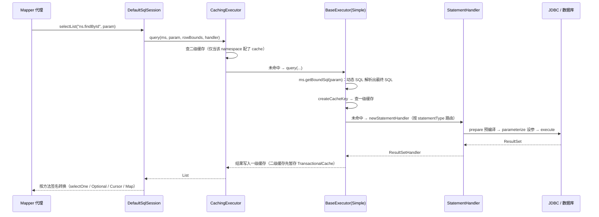
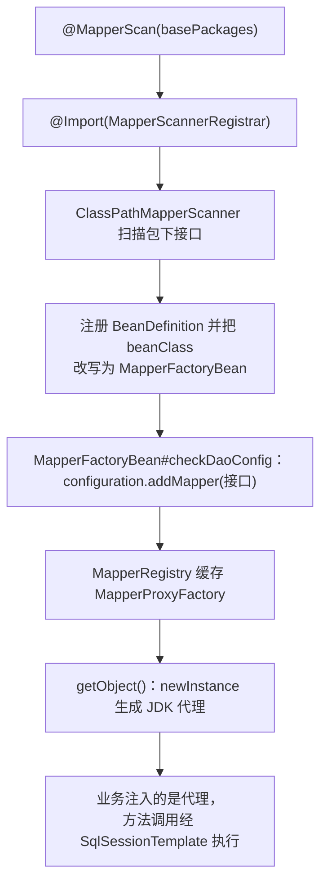

# MyBatis 常见面试题总结

> 一句话概括：MyBatis 面试考的从来不是"背标签"，而是"你能不能为 **动态代理 + SQL 映射**这套机制说清楚一条 SQL **从接口方法到 ResultSet 经历了什么、缓存在哪里会骗人、插件和分页的边界在哪、和 Spring 的事务怎么交接**"。

预计阅读时间：大约 90 分钟

本文按面试真实提问顺序组织：基础认知 → 架构与执行流程 → Mapper 代理 → 动态 SQL 与注入 → 结果映射 → 缓存 → 插件与分页 → Spring 集成与事务 → 批量与性能 → 生态选型 → 版本演进 → 快问快答。每题都给出**一句话结论 + 展开要点 + 追问方向**，方便临场组织语言。

**版本基线**：以 **MyBatis 3.5.x（最新 3.5.19，Java 8 基线）**为主流生产基线；**3.6.0 已于 2026-10 发布**（Java 11 基线，有已知 TypeHandler 解析问题，见 11.2）；mybatis-spring 3.0.x ↔ Spring 6 / Boot 3（jakarta），4.x ↔ Spring 7 / Boot 4；MyBatis-Plus 3.5.x（3.5.18，补丁 3.5.18.1，2026-10-27）。默认值、版本归属、缓存语义均已对照官方文档与 Release Notes 核实，见第 11 节与参考资料。

---

## 0. 怎么用这篇文档

### 0.1 答题四段式

面试官问"MyBatis 一级缓存什么时候失效"，答"执行增删改就失效"只能拿到 30 分。用四段式：

| 层次 | 内容 | 作用 |
| --- | --- | --- |
| ① 结论 | 一句话给出判断 | 让面试官知道你有整体认知 |
| ② 机制 | 关键实现原理，2~4 个点 | 证明不是背的 |
| ③ 边界 | 什么时候不成立 / 代价是什么 | **区分中级和高级的分水岭** |
| ④ 实践 | 你在项目里怎么用、踩过什么坑 | 把知识变成经验 |

例：

> 一级缓存是 **SqlSession 级别**的 `PerpetualCache`（本质 HashMap），key 由语句 id、RowBounds offset/limit、最终 SQL 串、非 OUT 参数值、environmentId（非 null 时）六项组成。**所以失效不止"增删改"一种**：不同 SqlSession、查询条件不同、中间执行过任何 insert/update/delete（哪怕改的是别的表，flushCache=false 也照清）、手动 commit/rollback/close（只读提交也清）、手动 clearCache、select 配了 `flushCache=true`、`localCacheScope=STATEMENT`，都会拿不到缓存。**边界在于 Spring 集成后**：没有事务时每次 Mapper 调用都是新 SqlSession，一级缓存形同虚设；有事务时同一事务共享 session，长事务里反而可能读到缓存里的旧数据。我们线上约定：不依赖一级缓存做业务一致性，读己之写靠事务内的查询顺序保证，必要时把 localCacheScope 设为 STATEMENT。

### 0.2 面试官的四个考察层次

| 层次 | 典型问法 | 期望 |
| --- | --- | --- |
| 会不会用 | `#{}` 和 `${}` 区别、动态 SQL 怎么写 | 知道常用标签与参数写法 |
| 懂不懂原理 | Mapper 接口为什么能调用、二级缓存何时写入 | 能讲清代理链、Executor、缓存提交时机 |
| 能不能扛事 | BindingException 怎么排查、批量导入 OOM 怎么办 | 有排查思路和工程预案 |
| 有没有判断力 | 分布式系统该不该开二级缓存、MyBatis 还是 JPA | 能说"不该用"的理由与替代方案 |

### 0.3 阅读路线

| 读者 | 建议章节 |
| --- | --- |
| 初级（1 年内） | 1、3.1/3.4、4.1、5.1、6.1~6.2、12 快问快答 |
| 中级（1~3 年） | 2、3、4、5、6、7 全部，8.1~8.3 |
| 高级（3 年+） | 6.4、7.3、8.5、9 全部、10 生态、11 版本演进 |
| 选型/架构 | 1.2/1.5、6.4、9.5、10、11，重点看每节的"边界"段落 |

### 0.4 本主题文档与目录

本主题按「一份总结 + 若干专题」组织，深入细节见下表（新增专题后请同步补充，并在专题文档开头加回本文的链接）：

| 文档 | 内容 |
| --- | --- |
| [MyBatis 核心架构与 SQL 执行全流程](architecture-and-sql-execution.md) | 三层架构、配置加载与 MappedStatement、selectList 全链路、三种 Executor、StatementHandler、KeyGenerator 主键生成 |
| [Mapper 接口动态代理与参数绑定](mapper-proxy-and-binding.md) | MapperProxy/MapperMethod 源码、namespace 绑定、方法重载问题、@Param 与 ParamNameResolver、BindingException 排查 |
| [动态 SQL 原理与 SQL 注入防御](dynamic-sql-and-injection.md) | SqlSource/SqlNode 树与 OGNL、动态标签全解、#{} 预编译 vs ${} 替换、注入案例与白名单实践 |
| [结果映射、TypeHandler 与懒加载](result-mapping-and-typehandler.md) | DefaultResultSetHandler 走读、autoMapping、association/collection 与 N+1、自定义 TypeHandler、懒加载代理 |
| [MyBatis 一级与二级缓存机制](cache-mechanism.md) | CacheKey 组成、一级缓存失效全清单、CachingExecutor 与 TransactionalCache、装饰器、分布式下慎用二级缓存 |
| [MyBatis 插件机制与分页原理](plugin-and-pagination.md) | 四大对象与 Interceptor、Plugin.wrap 代理链、自定义慢 SQL 插件、RowBounds 内存分页、PageHelper 原理 |
| [MyBatis 与 Spring 集成及事务管理](spring-integration-and-transaction.md) | 三件套与 @MapperScan 注册链、SqlSessionTemplate 线程安全、SpringManagedTransaction、starter 自动装配、多数据源 |
| [MyBatis 批量操作与性能优化](batch-and-performance.md) | foreach/BATCH/rewriteBatchedStatements、自增主键回填、流式查询 Cursor/ResultHandler、虚拟线程与 JDBC |
| [MyBatis-Plus 与 ORM 生态选型](mybatis-plus-and-ecosystem.md) | MyBatis vs Hibernate/jOOQ、BaseMapper 注入原理、LambdaQueryWrapper、MybatisPlusInterceptor、MyBatis-Flex 与 mybatis-dynamic-sql |

本文目录：

1. 基础认知
2. 架构与 SQL 执行流程
3. Mapper 接口代理与参数绑定
4. 动态 SQL 与 SQL 注入
5. 结果映射、TypeHandler 与懒加载
6. 一级与二级缓存
7. 插件机制与分页
8. Spring 集成与事务管理
9. 批量操作与性能优化
10. 生态与选型（加分项）
11. 版本演进（加分项）
12. 快问快答 40 题
13. 面试答题模板与反问
14. 参考资料

---

## 1. 基础认知

### 1.1 MyBatis 是什么

**结论**：MyBatis 是一个**半自动 ORM（SQL Mapper）**框架：SQL 由开发者手写并完全掌控，框架负责**参数绑定、动态 SQL 拼装、ResultSet 到对象的映射**，以及缓存、插件、主键生成等周边能力。它不做全自动 ORM 的对象状态管理（脏检查、级联持久化、自动生成 SQL）。

- "半自动"的分界线：**SQL 归你，映射归框架**。Hibernate 是"对象归你，SQL 归框架"。
- 核心交换：用"手写 SQL 的工作量"换"SQL 的完全可控与可优化"——复杂查询、报表、性能敏感场景的优势来源。
- MyBatis 的前身是 iBATIS（Clinton Begin 创建，2010 年迁到 Google Code 后更名 MyBatis，2013 年迁到 GitHub）。面试一般不考历史，但能说出"iBATIS 3 就是 MyBatis 3"可以佐证你读过老资料。

### 1.2 MyBatis vs JDBC vs Hibernate/JPA

| 维度 | 原生 JDBC | MyBatis | Hibernate / JPA |
| --- | --- | --- | --- |
| SQL 来源 | 手写，硬编码在 Java 里 | 手写，集中在 XML/注解，支持动态拼装 | 框架按对象操作自动生成（HQL/JPQL/Criteria 可补充） |
| 样板代码 | 连接/预编译/遍历/关闭全手动 | 全部消除，只留 SQL 与映射 | 全部消除，连 SQL 都不用写 |
| 结果映射 | 手动 getString/setXxx | 自动映射 + resultMap 精细控制 | 自动，按实体注解映射 |
| 对象状态管理 | 无 | 无（对象就是普通 POJO） | 有：持久化上下文、脏检查、级联、懒加载 |
| SQL 优化 | 完全可控但费力 | **完全可控且省力**（DBA 可直接审 SQL） | 受限：生成的 SQL 不直观，调优要懂框架 |
| 数据库移植 | 差 | 中（SQL 方言自己写，可用 databaseId 区分） | 好（方言由 Dialect 屏蔽） |
| 学习曲线 | 低 | 低~中 | 高（缓存/抓取策略/锁模式都是坑） |
| 典型场景 | 极简工具 | 互联网业务、复杂查询、性能敏感 | 领域模型驱动、CRUD 为主的企业应用 |

**追问：JPA 和 Hibernate 什么关系？**
JPA 是规范（接口 + 注解），Hibernate 是最流行的实现。MyBatis **不实现 JPA 规范**，两者不是同一层的竞争关系——面试说"MyBatis 和 JPA 二选一"时，实际是在"SQL 可控性"与"开发效率/领域建模"之间做取舍。

### 1.3 核心组件全景

| 组件 | 职责 | 生命周期/线程安全 |
| --- | --- | --- |
| `SqlSessionFactoryBuilder` | 读配置构建 Factory，用完即弃 | 方法局部 |
| `SqlSessionFactory` | 创建 SqlSession 的工厂，持有全局 `Configuration` | **应用级单例，线程安全** |
| `SqlSession` | 一次数据库会话：执行语句、获取 Mapper、管理事务与一级缓存 | **非线程安全**，请求/方法级，用完必须 close |
| `Mapper` 接口代理 | 把接口方法调用翻译成 SqlSession 调用 | 本身无状态，线程安全性取决于背后的 SqlSession 管理方式 |
| `Executor` | 执行器：缓存、事务、批处理调度（SIMPLE/REUSE/BATCH） | 与 SqlSession 一对一 |
| `StatementHandler` | 真正和 JDBC Statement 打交道：预编译、设参、执行 | 每次执行创建 |
| `ParameterHandler` | 把用户参数设置到 PreparedStatement | 每次执行创建 |
| `ResultSetHandler` | 把 ResultSet 映射成 Java 对象 | 每次执行创建 |
| `TypeHandler` | JDBC 类型 ⇄ Java 类型的双向转换 | 注册后全局复用 |
| `MappedStatement` | 一条语句的全部元数据（SQL 来源、参数映射、结果映射、缓存配置） | 启动期构建，全局只读 |

**追问：四大可拦截对象是哪四个？**
`Executor`、`StatementHandler`、`ParameterHandler`、`ResultSetHandler`——插件机制（第 7 节）只能拦截这四类，因为它们由 `Configuration` 的工厂方法创建并经过 `InterceptorChain#pluginAll`。

### 1.4 MyBatis 里的设计模式（高频）

| 模式 | 体现 |
| --- | --- |
| 建造者 | `SqlSessionFactoryBuilder`、`XMLConfigBuilder`/`XMLMapperBuilder` |
| 工厂 | `SqlSessionFactory`、`MapperProxyFactory`、`DefaultObjectFactory` |
| 代理 | Mapper 接口（JDK 动态代理）、插件 `Plugin.wrap`、懒加载（Javassist/CGLIB） |
| 模板方法 | `BaseExecutor`（query/update 骨架，doQuery/doUpdate 留给子类） |
| 装饰器 | 缓存：`LruCache`/`SerializedCache`/`LoggingCache` 层层包装 `PerpetualCache` |
| 责任链 | `InterceptorChain` 插件链、`SqlNode` 树递归 apply |
| 组合 | `MixedSqlNode` 组合 if/where/foreach 等节点 |
| 策略 | `KeyGenerator`（Jdbc3/SelectKey）、`LanguageDriver`、`TypeHandler` |

### 1.5 什么场景不该用 MyBatis

能主动说出"不该用"，比背十个特性更加分：

- **领域模型复杂、以对象图为中心的系统**：大量级联保存、状态跟踪、继承映射，手写 SQL 维护成本会超过 Hibernate 的自动化收益；
- **需要跨数据库无缝移植的产品**：SQL 方言差异要自己用 databaseId 维护多套语句；
- **想要编译期 SQL 校验**：XML 里的 SQL 错误要到运行期才暴露（MyBatis-Plus 的 Lambda 条件、mybatis-dynamic-sql 能部分弥补，见第 10 节）；
- **全链路响应式**：MyBatis 基于阻塞 JDBC，硬套 WebFlux 不会更快（同 Spring 总结 8.2 的结论）；追求非阻塞可看 R2DBC 生态，但那是另一套编程模型。

---

## 2. 架构与 SQL 执行流程

> 机制深挖见 [MyBatis 核心架构与 SQL 执行全流程](architecture-and-sql-execution.md)。

### 2.1 三层架构与配置加载

**结论**：MyBatis 分三层——**接口层**（SqlSession/Mapper）、**核心处理层**（Executor/StatementHandler/参数与结果处理/插件）、**基础支撑层**（数据源、事务、缓存、TypeHandler、反射工具）。一切配置最终沉淀为一个全局 `Configuration` 对象，每条语句是一个 `MappedStatement`。

配置加载两条路，殊途同归：

| 方式 | 入口 | 产物 |
| --- | --- | --- |
| XML | `XMLConfigBuilder#parseConfiguration` → `XMLMapperBuilder#configurationElement` | 每个 select/insert/update/delete 节点 → 一个 MappedStatement |
| 注解 | `MapperRegistry#addMapper` → `MapperAnnotationBuilder#parse` | @Select/@Insert 等注解 → MappedStatement |

要点：

- MappedStatement 的 id = **namespace + 语句 id**（XML 里是 `com.x.UserMapper.findById`），这是全局唯一键，也是 Mapper 绑定的依据（第 3 节）；
- SQL 被解析成 `SqlSource`：含动态标签 → `DynamicSqlSource`（每次执行解析）；纯静态 → `RawSqlSource`（启动期就解析成静态 SQL，运行期只做参数替换）——**"动态 SQL 每次执行都要解析"只对 DynamicSqlSource 成立**，这是常见的不严谨说法；
- 同一 namespace 下 XML 与注解可以共存，但**同一方法不能两边都定义语句**，否则启动报重复。

### 2.2 一条 select 的完整链路（必背）



能脱口而出这条链，再补三个细节就稳了：

1. **二级缓存在一级之前查**（CachingExecutor 装饰 BaseExecutor），但**写入要等事务提交**（见 6.3）；
2. `StatementHandler` 按语句类型路由：`PREPARED`（默认）→ PreparedStatementHandler，`STATEMENT` → SimpleStatementHandler，`CALLABLE` → CallableStatementHandler（`RoutingStatementHandler` 构造器分发）；
3. 插件可以拦截链上四大对象的任意方法——PageHelper 拦的就是 `Executor#query`（见 7.3）。

### 2.3 三种 Executor

| Executor | 行为 | 适用 | 边界 |
| --- | --- | --- | --- |
| **SIMPLE**（默认） | 每次执行新建 PreparedStatement，用完关闭 | 绝大多数场景 | 无语句复用 |
| REUSE | 以 SQL 为 key 缓存 PreparedStatement（executor 级 statementMap） | 同一会话反复执行同构 SQL | 缓存随 SqlSession 关闭释放；跨会话不复用 |
| BATCH | update 语句 addBatch 攒批，`flushStatements` 时 executeBatch | 批量写入 | **update 返回值是占位负数**（`BatchExecutor.BATCH_UPDATE_RETURN_VALUE`），真实影响行数在 flush 时才产生；执行查询前会先 flush 攒着的批 |

**追问：BATCH 为什么拿不到即时影响行数？**
JDBC 批处理本身就是"提交一批、统一返回计数"，addBatch 时数据库还没执行。所以**依赖"update 返回 1 才继续"的乐观锁/幂等判断在 BATCH 下全部失真**——这是批量导入事故的高频根因。批量场景要么 flush 后检查计数数组，要么改用 foreach 多 values（见 9.1）。

### 2.4 主键生成：useGeneratedKeys vs selectKey

**结论**：自增主键用 `useGeneratedKeys="true" + keyProperty`（走 JDBC `getGeneratedKeys`，由 `Jdbc3KeyGenerator` 回填）；不支持自增的数据库（如 Oracle 序列）用 `<selectKey>`（`SelectKeyGenerator`）。

```xml
<!-- MySQL 自增：insert 后把 id 回填到参数对象的 id 属性 -->
<insert id="insert" useGeneratedKeys="true" keyProperty="id">
  INSERT INTO user(name) VALUES(#{name})
</insert>

<!-- Oracle 序列：先取序列值再插入 -->
<insert id="insert">
  <selectKey keyProperty="id" resultType="long" order="BEFORE">
    SELECT user_seq.NEXTVAL FROM dual
  </selectKey>
  INSERT INTO user(id, name) VALUES(#{id}, #{name})
</insert>
```

| 维度 | useGeneratedKeys | selectKey |
| --- | --- | --- |
| 原理 | JDBC 标准 getGeneratedKeys | 额外执行一条 SELECT |
| order | 只有 AFTER（插入后取） | BEFORE / AFTER 可选 |
| 数据库要求 | 驱动支持自增键返回（MySQL/SQL Server/PG 等） | 任意，自己写取值 SQL |
| 多行回填 | MySQL 多 values 插入可一次回填整个 List | 不适合批量 |

边界：`useGeneratedKeys` 全局默认 **false**；3.5.0 起**必须显式写 keyProperty**（不再隐式默认 "id"）；PostgreSQL 主键列不是第一列时要配 keyColumn。批量回填细节见 9.3。

---

## 3. Mapper 接口代理与参数绑定

> 机制深挖见 [Mapper 接口动态代理与参数绑定](mapper-proxy-and-binding.md)。

### 3.1 为什么接口没有实现类也能调用（必背）

**结论**：MyBatis 用 **JDK 动态代理**为 Mapper 接口生成代理对象：`MapperProxyFactory#newInstance` 创建 `Proxy.newProxyInstance(..., new MapperProxy(...))`，方法调用进入 `MapperProxy#invoke`，再交给 `MapperMethod#execute` 按语句类型（INSERT/UPDATE/DELETE/SELECT）翻译成 `SqlSession` 的对应调用。

```text
userMapper.findById(1L)
 → MapperProxy#invoke
 → MapperMethod#execute
 → SqlCommand 解析出 statementId = 接口全限定名 + "." + 方法名
 → sqlSession.selectOne("com.x.UserMapper.findById", 1L)
```

要点：

- **接口方法不需要实现类，因为"实现"就是那条 MappedStatement**——代理只是把方法名翻译成 statementId；
- 接口的 **default 方法**（3.4.2+ 支持）不走 SQL，`MapperProxy` 用 `MethodHandles` 直接调用默认实现，常用于封装通用逻辑；
- `MapperRegistry` 里每个接口缓存一个 `MapperProxyFactory`，但**每次 getMapper 都 new 一个代理**，代理绑定的是当次的 SqlSession。

**追问：为什么用 JDK 代理而不是 CGLIB？**
Mapper 本来就是接口，JDK 代理天然匹配、无需生成子类；CGLIB 留给懒加载实体代理（可代理类）场景。

### 3.2 绑定规则与 BindingException 排查

绑定成立需要四个条件同时满足：

| 条件 | 说明 |
| --- | --- |
| namespace = 接口全限定名 | XML 的 `<mapper namespace>` 必须和接口包名类名完全一致 |
| 语句 id = 方法名 | `findById` 方法对应 `id="findById"` |
| 参数/返回类型兼容 | 方法签名能被 ParamNameResolver 与结果映射处理 |
| Mapper 被注册 | XML 被加载，或接口被 `addMapper`（Spring 下由扫描完成） |

`BindingException: Invalid bound statement (not found)` 排查清单（按命中率排序）：

1. XML 没被打进 classpath（Maven 默认不拷贝 `src/main/java` 下的 xml，要配 resources 或放 `src/main/resources` 同包路径）；
2. `mybatis.mapper-locations` 没配或路径不匹配（starter 默认**不扫**任意位置的 xml，只认配置）；
3. namespace 与接口全限定名不一致（改名/挪包后忘改 xml）；
4. 方法名与语句 id 不一致；
5. 多模块/多数据源下接口被另一个 SqlSessionFactory 注册，当前 factory 里没有这条语句。

### 3.3 为什么不支持方法重载

**结论**：statementId 只由 **namespace + 方法名**组成，**不含参数签名**。两个同名方法会映射到同一个 id：XML 里写两个同 id 语句启动即报 `Mapped Statements collection already contains key`（3.5.19 文案，3.5.0 旧版为 contains value）；只写一条则两个重载方法执行同一条 SQL，语义必然错乱。

- 这是"id 即方法名"设计的直接代价，不是 bug；社区有讨论但截至 3.5.x/3.6.0 仍未支持重载；
- 实践替代：方法名区分语义（`findById` / `findByIdWithOrders`），或用一个方法 + 条件参数。

### 3.4 参数传递：@Param 与 ParamNameResolver

**结论**：`ParamNameResolver#getNamedParams` 决定 SQL 里能用什么名字引用参数。

| 场景 | SQL 中可用的名字 |
| --- | --- |
| 单个简单参数（无 @Param） | 任意名字都能取到该值（`#{id}`、`#{value}` 均可）；集合/数组例外，见下 |
| 单个集合/数组（无 @Param） | `collection`/`list`（数组为 `array`），foreach 时常用 |
| 多参数无 @Param | `arg0, arg1...` 与 `param1, param2...`；若编译开了 `-parameters` 且 useActualParamName=true（默认），还能用真实参数名 |
| 有 @Param("name") | 用 `name`（同时保留 paramN） |
| POJO / Map | 直接引用属性名 / key |

```java
// 多参数必须 @Param（或依赖 -parameters 编译），否则 XML 里 #{name} 找不到
List<User> search(@Param("name") String name, @Param("status") Integer status);
```

**追问：为什么 Spring Boot 里不写 @Param 有时也能跑？**
Boot 的 parent 默认给编译器加 `-parameters`，字节码保留了真实参数名。但**显式 @Param 仍是团队规范**：不依赖编译选项、重构改名时 XML 报错更直白。RowBounds/ResultHandler 是特殊参数，不参与命名。

---

## 4. 动态 SQL 与 SQL 注入

> 机制深挖见 [动态 SQL 原理与 SQL 注入防御](dynamic-sql-and-injection.md)。

### 4.1 #{} vs ${}（必背）

**结论**：`#{}` 是**预编译占位符**——被替换成 JDBC 的 `?`，值由 `ParameterHandler` 通过 TypeHandler 设置，**防注入**；`${}` 是**字符串直接替换**——值原样拼进 SQL 文本，**有注入风险**，只用于无法参数化的结构性片段（表名、列名、order by 方向）。

```xml
<select id="find" resultType="User">
  SELECT * FROM user WHERE name = #{name} ORDER BY ${orderColumn}
</select>
<!-- name="x"  orderColumn="id desc" 时：
     SELECT * FROM user WHERE name = ? ORDER BY id desc
     name 走 PreparedStatement 设参；orderColumn 是裸拼接 -->
```

| 维度 | #{} | ${} |
| --- | --- | --- |
| 替换时机 | SqlSourceBuilder 解析期替换为 ?，执行期设参 | DynamicContext 拼装期直接替换文本 |
| 注入风险 | 无（值与 SQL 结构分离） | **有** |
| 预编译缓存 | 同构 SQL 可复用执行计划 | 每个不同值都是新 SQL |
| 适用 | 一切"值" | 表名/列名/排序方向等"结构"，且必须白名单 |

机制锚点：`SqlSourceBuilder#parse` 把 `#{}` 解析成 `ParameterMapping` 并替换为 `?`；`${}` 由 `TextSqlNode` 处理（含 `${}` 的语句被判定为动态，走 DynamicSqlSource）。

### 4.2 动态 SQL 原理：SqlNode 树 + OGNL

**结论**：`XMLScriptBuilder#parseDynamicTags` 把 XML 标签解析成一棵 **SqlNode 树**（组合模式）；执行期 `DynamicSqlSource#getBoundSql` 递归 `apply` 这棵树，把成立的片段拼进 `DynamicContext`，最后交给 SqlSourceBuilder 处理 `#{}`。

- `IfSqlNode`/`WhenSqlNode` 用 **OGNL** 求值 test 表达式（`OgnlCache#getValue`），所以 test 里能写 `name != null and name != ''`、调用方法、访问静态成员；
- `where`/`set`/`trim` 本质都是 `TrimSqlNode`：where 去掉开头 AND/OR，set 去掉结尾逗号；
- `foreach` 由 `ForEachSqlNode` 展开，item/index 放进上下文供 OGNL 访问；
- **每次执行都重新 apply**（参数不同结果不同），这是动态 SQL 的开销所在；纯静态语句走 RawSqlSource 没有这一步。

### 4.3 常用标签速查

| 标签 | 作用 | 高频坑 |
| --- | --- | --- |
| `if` | 条件拼接 | test 里单字符比较 `'Y'` 会被 OGNL 当 char，与 String 比较不等——用 `"Y"` 或 `.toString()` |
| `where` | 智能加 WHERE、去开头 AND/OR | 所有 if 都不成立时不产生 WHERE |
| `set` | 智能加 SET、去结尾逗号 | 全空时 SQL 语法错误，更新前要校验 |
| `choose/when/otherwise` | 多选一 | 只命中第一个成立的 when |
| `foreach` | 遍历集合拼 IN / 多 values | **空集合拼出 `IN ()` 语法错误**，调用前必须判空；separator 别漏 |
| `trim` | 自定义前后缀与剔除 | where/set 的底层 |
| `bind` | 用 OGNL 造变量 | like 模糊查询推荐 `bind name="pattern" value="'%' + kw + '%'"` |
| `sql/include` | 片段复用 | 跨 namespace 引用要写全限定 id |

### 4.4 注入防御与 order by 场景（必背）

**结论**：防御总原则——**值一律 `#{}`；`${}` 只接受白名单内的结构性输入**。

```java
// order by 白名单：枚举/映射表收敛合法列名与方向，拒绝一切用户自由文本
private static final Map<String, String> ORDERABLE = Map.of(
    "time", "create_time", "amount", "amount");

String column = ORDERABLE.get(req.getSortBy());   // 不在白名单 → null → 用默认排序
String dir = "asc".equalsIgnoreCase(req.getDir()) ? "ASC" : "DESC";
```

- like 查询：`concat('%', #{kw}, '%')` 或 bind，**不要** `'%${kw}%'`；
- in 查询：foreach + `#{item}`，**不要**把逗号分隔字符串 `${ids}` 直接拼进去；
- 分表场景表名用 `${}` 时，表名必须由服务端规则生成，绝不透传前端输入；
- 补充防线：数据库账号最小权限、SQL 审计（慢 SQL/注入特征插件）、WAF。**预编译不是万能的**——`#{}` 防不了"把用户输入当列名"这类结构性注入，白名单才是。

---

## 5. 结果映射、TypeHandler 与懒加载

> 机制深挖见 [结果映射、TypeHandler 与懒加载](result-mapping-and-typehandler.md)。

### 5.1 resultType vs resultMap

**结论**：`resultType` 靠**自动映射**（列名 ↔ 属性名匹配）适合简单场景；`resultMap` 是**显式映射声明**，处理列名不一致、association/collection 关联、构造器注入、鉴别器等复杂场景。两者互斥，一条语句只能选一个。

| 配置 | 默认值 | 说明 |
| --- | --- | --- |
| `autoMappingBehavior` | **PARTIAL** | 自动映射普通列；**嵌套 resultMap（association/collection 内部）不自动映射**；FULL 连嵌套也自动映射；NONE 全关 |
| `mapUnderscoreToCamelCase` | **false** | user_name → userName 驼峰开关；**Boot starter 也不会默认打开**，要显式配 `mybatis.configuration.map-underscore-to-camel-case=true` |
| `autoMappingUnknownColumnBehavior` | NONE | 未匹配列的处理：NONE 忽略 / WARNING 打日志 / FAILING 抛异常 |
| `callSettersOnNulls` | false | 列值为 null 时是否调 setter——影响 Map 结果里 key 是否存在 |

**追问：为什么 PARTIAL 对嵌套 resultMap 不自动映射？**
嵌套映射常伴随列名冲突与部分列缺失，自动映射容易把不属于该子对象的列错误注入，官方选择保守默认。开了 FULL 要自己保证列集合干净（配合 columnPrefix）。

### 5.2 一对多/多对一与 N+1

**结论**：`association` 映射多对一/一对一，`collection` 映射一对多；两种实现——**嵌套查询**（nested select，再发一条 SQL）与**嵌套结果**（nested results，join 一次查完按 resultMap 拆分）。

```xml
<!-- 嵌套结果：一条 join SQL，无 N+1 -->
<resultMap id="orderMap" type="Order">
  <id property="id" column="order_id"/>
  <collection property="items" ofType="OrderItem">
    <id property="id" column="item_id"/>
    <result property="sku" column="sku"/>
  </collection>
</resultMap>
<select id="findWithItems" resultMap="orderMap">
  SELECT o.id order_id, i.id item_id, i.sku
  FROM orders o LEFT JOIN order_item i ON i.order_id = o.id
  WHERE o.id = #{id}
</select>
```

**N+1 问题**：嵌套查询模式下，查 N 个订单的主查询 1 条 + 每个订单的 items 子查询 N 条 = N+1 条 SQL。列表页用嵌套查询是性能事故高发区。

| 解法 | 做法 | 代价 |
| --- | --- | --- |
| join + 嵌套结果 | 一条 SQL 查完，resultMap 拆分 | 多对多 join 行数膨胀、SQL 复杂 |
| 批量查询 + 内存组装 | 先查主表，再 `IN (ids)` 一次查子表，代码分组 | 多一次往返，但可控、可缓存 |
| 懒加载 | 用到才查（见 5.4） | 只是推迟 N+1，循环里逐个触发照样炸 |

### 5.3 TypeHandler

**结论**：TypeHandler 是 **JDBC 类型 ⇄ Java 类型**的转换器，设参（`setParameter`）与取结果（`getResult`）都经过它；继承 `BaseTypeHandler` 实现四个抽象方法即可自定义。

- 注册：XML `<typeHandlers>`、`@MappedTypes`/`@MappedJdbcTypes` 注解、Boot 的 `mybatis.type-handlers-package`；查找走 `TypeHandlerRegistry#getTypeHandler`（javaType + jdbcType 二维定位）；
- 典型自定义：JSON 字段 ⇄ 对象、加密字段透明加解密、枚举存 code；
- **枚举默认用 `EnumTypeHandler`（存 name 字符串）**，要存 ordinal 得显式换 `EnumOrdinalTypeHandler`（默认枚举处理器可配 defaultEnumTypeHandler）；
- **Oracle 经典坑**：`jdbcTypeForNull` 默认 **OTHER**，传 null 时 Oracle 驱动报"无效的列类型"——把该配置改成 `NULL` 即可。

### 5.4 懒加载

**结论**：懒加载默认**关闭**（`lazyLoadingEnabled=false`）；开启后关联对象返回的是**代理**（默认 Javassist，可配 CGLIB），首次访问关联属性才触发子查询。

| 配置 | 默认 | 说明 |
| --- | --- | --- |
| lazyLoadingEnabled | false | 总开关 |
| aggressiveLazyLoading | **false**（3.4.2 起；≤3.4.1 为 true） | true 时访问任意属性触发全部懒加载；false 按需逐个触发 |
| lazyLoadTriggerMethods | equals,clone,hashCode,toString | 调这些方法也会触发加载——**打日志 toString 就查库**的坑 |

边界与代价：

- 懒加载不消灭 N+1，只是把查询推迟到访问时刻；循环遍历照样 N+1；
- **代理对象序列化/JSON 化会触发加载或报错**（Jackson 序列化懒加载代理是经典事故）；
- Spring 集成下，会话关闭后触发懒加载会新建独立执行器（`ResultLoader#selectList`）、脱离原事务，连接用完即关——**改变的是事务语义而非必然报错**；要让懒加载留在原事务内，必须在事务/会话存活期内完成。

---

## 6. 一级与二级缓存

> 机制深挖见 [MyBatis 一级与二级缓存机制](cache-mechanism.md)。

### 6.1 一级缓存：SqlSession 级

**结论**：一级缓存默认开启、**无法全局关闭**（只能降级），作用域是 **SqlSession**，实现是 `BaseExecutor` 里的 `PerpetualCache`（HashMap）。`localCacheScope` 默认 **SESSION**：整个会话内同 key 查询直接命中；设为 STATEMENT 则每条语句执行完即清空（仍用于解决嵌套查询的循环引用）。

**CacheKey 的组成**（`BaseExecutor#createCacheKey`，共六项）：

1. MappedStatement 的 id；
2. RowBounds 的 offset；
3. RowBounds 的 limit；
4. 最终 SQL 字符串（BoundSql）；
5. 逐个非 OUT 参数值（逐个参与）；
6. Environment 的 id（**非 null 时才参与**，并非无条件缺一不可）。

**追问：一级缓存存的是什么？**
查询结果 List 的**引用**（不是副本）——拿到缓存对象后修改它，会污染同会话后续查询结果。这是"缓存对象被业务代码改脏"的根因。

### 6.2 一级缓存失效全清单（必背）

| # | 场景 | 机制 |
| --- | --- | --- |
| 1 | 不同 SqlSession | 缓存是 session 私有的 |
| 2 | 同 session 但查询条件/语句不同 | CacheKey 不同 |
| 3 | 两次查询之间执行了**任何** insert/update/delete | `BaseExecutor#update` 无条件 `clearLocalCache`，**哪怕改的是别的表、flushCache=false 也照清**（flushCache 只影响二级缓存） |
| 4 | 手动 commit/rollback/close | `BaseExecutor#commit/#rollback` 在 required 判断前无条件清一级缓存，**只读 commit 也清**；close 将缓存置 null |
| 5 | 手动 `sqlSession.clearCache()` | 显式清空 |
| 6 | select 配了 `flushCache="true"` | 执行前清本地缓存；二级缓存标记清空（clearOnCommit，本会话不再读旧值），commit 时才真正清空 |
| 7 | `localCacheScope=STATEMENT` | 语句级缓存，执行完即清 |
| 8 | Spring 集成且**无事务** | 每次 Mapper 调用新开 SqlSession（见 6.5） |

注意第 3 条的"宁可错杀"设计：MyBatis 无法知道某条 update 影响了哪些查询，只能全清——**一致性优先于命中率**。

### 6.3 二级缓存：namespace 级

**结论**：二级缓存跨 SqlSession、**以 namespace 为单位**，需要显式开启：全局 `cacheEnabled=true`（默认就是 true，只是总开关）+ 该 namespace 配 `<cache/>` 或 `@CacheNamespace`。执行链上由 `CachingExecutor` 装饰 BaseExecutor，**先查二级、再查一级**。

`<cache/>` 的默认语义（官方文档核实）：

| 属性 | 默认 | 说明 |
| --- | --- | --- |
| eviction | **LRU** | 可选 FIFO / SOFT / WEAK |
| size | **1024** | 缓存引用个数 |
| flushInterval | 不设 | 不按时间清，只靠语句触发 |
| readOnly | **false**（读写缓存） | 返回**序列化副本**，要求对象 Serializable；true 返回同一实例，快但调用方修改会污染缓存 |

**写入时机（高频追问）**：二级缓存是**事务性**的——查询结果先暂存在 `TransactionalCache`，**SqlSession commit 或 close 时才真正写入**（`TransactionalCache#commit`）；回滚则丢弃。所以"同一个事务里查完立刻能在别的会话命中"是不成立的。

清空规则：该 namespace 内任何 insert/update/delete（flushCache 默认 true）提交后清空整个 namespace 缓存；select 默认 flushCache=false、useCache=true。

装饰器链（责任链 + 装饰器模式的样板）：`SynchronizedCache → LoggingCache → SerializedCache → LruCache → PerpetualCache`，可加 ScheduledCache（flushInterval）、BlockingCache（blocking=true 防击穿）。

### 6.4 为什么生产慎用二级缓存（高级必答）

**结论**：默认实现是**单机 HashMap**，且粒度是 namespace——这两个属性决定了它在分布式与多表关联场景下必然出问题。

| 问题 | 机制 |
| --- | --- |
| 多实例不一致 | 每个节点各缓存各的，A 节点更新后 B 节点仍读旧值，**没有失效广播** |
| 跨 namespace 脏读 | 订单 namespace 缓存了 join 商品表的结果；商品 namespace 更新只清自己的缓存，订单缓存感知不到 |
| 粒度太粗 | 一条更新清整个 namespace，热点 namespace 命中率反而低 |
| 读写缓存开销 | readOnly=false 每次命中都要序列化/反序列化副本 |

实践立场：

- 分布式系统的缓存放**业务层**（Redis + 明确的失效策略），而不是 ORM 层；
- 确要用 MyBatis 二级缓存：只读、单 namespace 单表、可容忍短暂不一致的字典类数据，或用官方 mybatis-redis 缓存实现把存储换成 Redis（仍要自己处理跨 namespace 失效）；
- 面试能说出"跨 namespace join 脏读"这个具体场景，比泛泛说"分布式不一致"高一档。

### 6.5 Spring 集成下的缓存行为

**结论**：Spring 用 `SqlSessionTemplate` 管理会话——**无事务时每次 Mapper 调用都新开并关闭 SqlSession**，一级缓存基本失效；**有 @Transactional 时同一事务绑定同一个 SqlSession**，一级缓存在事务内生效。二级缓存因为"非事务调用结束即 commit/close"，反而在无事务场景也能写入生效。

- 推论：**"Spring + MyBatis 一级缓存是方法级缓存"是错误说法**——它是事务级（无事务时退化为单次调用级）；
- 长事务里一级缓存可能读到事务开始后的旧快照（缓存不感知外部更新），读己之写之外的跨连接更新要靠刷新查询（flushCache 或新事务）。

---

## 7. 插件机制与分页

> 机制深挖见 [MyBatis 插件机制与分页原理](plugin-and-pagination.md)。

### 7.1 四大对象与 Interceptor 原理

**结论**：插件只能拦截四大对象——`Executor`、`StatementHandler`、`ParameterHandler`、`ResultSetHandler`。它们在 Configuration 的工厂方法中创建时经过 `InterceptorChain#pluginAll`，每个 Interceptor 用 `Plugin.wrap` 生成 **JDK 动态代理**，多个插件形成**层层代理的责任链**。

```java
@Intercepts(@Signature(type = StatementHandler.class, method = "prepare",
                       args = {Connection.class, Integer.class}))
public class SlowSqlPlugin implements Interceptor {
    @Override
    public Object intercept(Invocation invocation) throws Throwable {
        long start = System.currentTimeMillis();
        try {
            return invocation.proceed();
        } finally {
            long cost = System.currentTimeMillis() - start;
            if (cost > 500) {
                StatementHandler sh = (StatementHandler) invocation.getTarget();
                log.warn("slow sql [{}ms]: {}", cost, sh.getBoundSql().getSql());
            }
        }
    }
}
```

要点：

- `@Signature` 三元组（type/method/args）精确匹配方法签名，**不匹配的方法直接反射放行**，所以插件开销集中在被拦截方法；
- `Plugin#invoke` 判断签名命中才调 `intercept`，否则直接调目标方法；
- 多插件按注册顺序包装，**后注册先执行**（与 Spring @Order 直觉相反，详见插件篇 §4）；
- 注册方式：XML `<plugins>`、Boot 里直接声明 Interceptor Bean（starter 自动收集）、`configuration.addInterceptor`；
- **边界**：插件拿到的 target 可能已被其他插件代理，强转具体实现类（如 PreparedStatementHandler）要先解包；拦截 Executor#query 时注意 4 参/6 参两个重载签名。

### 7.2 RowBounds 为什么不能用于生产分页

**结论**：RowBounds 是**内存分页**——SQL 不带 LIMIT，驱动默认把整个 ResultSet 缓冲到客户端，MyBatis 的 `DefaultResultSetHandler#skipRows` 再逐行跳过 offset 之前的行。深分页时网络传输与内存都是全量代价，百万行表翻到第 10000 页等于每次全表扫描 + 全量传输。

- 它的存在意义是给插件留一个"逻辑分页 → 物理分页"的改写钩子（PageHelper 等），以及存储过程等无法改写 SQL 的场景；
- 生产分页一律用**物理分页**：手写 LIMIT 或 PageHelper/MP 分页插件。

### 7.3 PageHelper 原理与 ThreadLocal 坑（高频）

**结论**：`PageHelper.startPage(pageNum, pageSize)` 把分页参数放进 **ThreadLocal**（`PageMethod.LOCAL_PAGE`）；紧随其后的第一条查询被 `PageInterceptor`（拦截 `Executor#query`）捕获：取出分页参数 → 可选执行 count → 按数据库方言把原 SQL 改写成 LIMIT 物理分页 → 结果包装成 `Page`（继承 ArrayList，带 total）。注意时序：**ThreadLocal 的清理发生在查询结束的 finally afterAll（无条件 clearPage）**，不是取出时。

```text
startPage(2, 10) → LOCAL_PAGE.set(Page)
mapper.selectByCond(cond)          ← 必须是紧挨着的下一条查询
 → PageInterceptor#intercept 取出 Page（查询结束 finally afterAll 无条件 clearPage）
 → SELECT count(0) FROM (...)（可配优化）
 → 原 SQL + LIMIT 10 OFFSET 10（方言适配）
 → 返回 Page<User>（total/pages 已填好）
```

三个必知的坑：

| 坑 | 机制 | 后果 |
| --- | --- | --- |
| startPage 与查询不相邻 | 中间插了别的查询，分页被那条查询"消费" | 目标查询没分页，别的查询被莫名分页 |
| startPage 后没执行查询（分支跳过/抛异常） | ThreadLocal 没被消费也没清理 | **线程池复用线程时污染下一个请求的查询**——最隐蔽的事故 |
| orderBy 参数透传用户输入 | 排序片段是拼接的 | 注入风险，白名单收敛 |

规范：**startPage 与目标查询写在一起、中间无任何语句**；用 `PageHelper.clearPage()` 兜底；更稳的替代是 MP 的 `Page` 参数式分页（分页参数显式传参，不依赖 ThreadLocal）。

---

## 8. Spring 集成与事务管理

> 机制深挖见 [MyBatis 与 Spring 集成及事务管理](spring-integration-and-transaction.md)。

### 8.1 三件套与 @MapperScan 注册链

**结论**：mybatis-spring 的核心是三个 FactoryBean/模板——`SqlSessionFactoryBean`（造工厂）、`MapperFactoryBean`（造单个 Mapper 代理并注册为 Bean）、`SqlSessionTemplate`（线程安全的 SqlSession 代理）。`@MapperScan` 把"每个接口手写一个 MapperFactoryBean"变成批量扫描注册。



- 扫描器把接口 BeanDefinition 的 beanClass 换成 MapperFactoryBean，**接口本身不能实例化，容器实际管理的是 FactoryBean**（呼应 Spring 的 FactoryBean 机制）；
- `@Mapper` 注解是 starter 自动扫描的标记；用了 `@MapperScan` 就不需要每个接口标 `@Mapper`；
- 异常翻译：`MyBatisExceptionTranslator` 把 PersistenceException 转成 Spring `DataAccessException` 体系，DAO 层不泄漏 MyBatis 类型。

### 8.2 SqlSessionTemplate 为什么线程安全（必背）

**结论**：`DefaultSqlSession` 本身非线程安全；`SqlSessionTemplate` 是它的**线程安全代理**——内部 `SqlSessionInterceptor`（InvocationHandler）在每次方法调用时通过 `SqlSessionUtils#getSqlSession` 获取**与当前 Spring 事务绑定的 SqlSession**：有事务则复用 ThreadLocal 里那个，无事务则新建、用完即关。

- 线程安全的本质不是"加锁"，而是**把会话状态外置到事务同步管理器**（TransactionSynchronizationManager），每个线程/事务各用各的会话；
- 所以 SqlSessionTemplate 可以做成单例注入所有 DAO；**不要**把原生 SqlSession 存成成员变量共享；
- 事务提交/回滚由 Spring 驱动，模板在事务同步回调里完成 commit/close（见 8.3）；
- 区分两层语义：对 SqlSessionTemplate **手动**调 commit/rollback/close 会**直接抛 UnsupportedOperationException**（fail-fast）；8.3 说的"空操作"仅指 SpringManagedTransaction 层（连接属于 Spring 事务时不提交）。

### 8.3 事务如何被 Spring 接管

**结论**：集成后 SqlSession 用的是 `SpringManagedTransaction`——它的 `commit()/rollback()` 在连接由 Spring 事务管理时是**空操作**，真正的提交回滚由 `DataSourceTransactionManager` 统一执行；连接的获取也委托 `DataSourceUtils.getConnection`，保证**同一事务内 MyBatis 与 JdbcTemplate 拿到同一个连接**。

| 场景 | 谁管事务 | 一级缓存 |
| --- | --- | --- |
| 原生 MyBatis | sqlSession.commit()/rollback() | session 生命周期内 |
| Spring 无事务 | 每次调用自动提交（模板关闭会话时） | 单次调用内 |
| Spring @Transactional | DataSourceTransactionManager | 整个事务内共享 |

追问：MyBatis 自己的 `<transactionManager type="JDBC">` 还有用吗？集成后事务工厂被 SqlSessionFactoryBean 替换为 `SpringManagedTransactionFactory`，XML 里的配置不再生效——**事务语义完全跟随 Spring**（传播行为、rollbackFor 等规则见 Spring 主题）。

### 8.4 starter 自动装配

**结论**：`mybatis-spring-boot-starter` 的 `MybatisAutoConfiguration` 在存在 DataSource 时自动注册 `SqlSessionFactory`（经 SqlSessionFactoryBean）与 `SqlSessionTemplate`，并自动扫描启动类包下带 `@Mapper` 的接口；已有自定义 SqlSessionFactory/SqlSessionTemplate Bean 时让位（@ConditionalOnMissingBean）；已存在 MapperFactoryBean/MapperScannerConfigurer 时不再自动扫描 @Mapper。

常用配置（前缀 `mybatis`）：

| 配置 | 作用 |
| --- | --- |
| `mybatis.mapper-locations` | XML 位置（如 classpath*:mapper/**/*.xml） |
| `mybatis.configuration.map-underscore-to-camel-case` | 驼峰映射（默认 false） |
| `mybatis.type-aliases-package` / `type-handlers-package` | 别名 / TypeHandler 扫描 |
| `mybatis.executor-type` | 默认执行器（SIMPLE/REUSE/BATCH） |
| `mybatis.configuration.*` | 直通 Configuration 的所有 setting |

扩展点：`ConfigurationCustomizer`（改 Configuration）、声明 Interceptor/TypeHandler Bean 自动收集。**注意**：starter 不会默认开启驼峰、不会默认扫描任意 XML——这两个"以为默认有"是新手最高频的配置坑。

### 8.5 多数据源

**结论**：每个数据源一套 **DataSource + SqlSessionFactory + DataSourceTransactionManager**，`@MapperScan` 按包拆分并指定 `sqlSessionFactoryRef`/`sqlSessionTemplateRef`。

- 跨库事务：两个本地事务管理器无法保证原子性，要么业务补偿，要么上分布式事务（Seata 等）；
- 动态数据源（如 baomidou dynamic-datasource）用路由 DataSource 按注解/上下文切换，**坑：事务内切换不生效**——连接已在事务开始时绑定（同 Spring 总结 9.5）；
- 读写分离同理：事务内的读默认走主库绑定连接，别指望事务中途切到从库。

---

## 9. 批量操作与性能优化

> 机制深挖见 [MyBatis 批量操作与性能优化](batch-and-performance.md)。

### 9.1 三种批量写入方式

| 方式 | 原理 | 优点 | 边界 |
| --- | --- | --- | --- |
| foreach 多 values | 拼成 `INSERT ... VALUES (...),(...),...` 一条 SQL | 一次网络往返，MySQL 下最快；可回填主键 | SQL 长度受 max_allowed_packet 限制；单条失败整批回滚；**分批 500~1000 条** |
| ExecutorType.BATCH | JDBC addBatch/executeBatch 攒批 | 语句预编译一次复用；适合超大批量 | update 返回值失真（2.3）；需 flushStatements；主键回填在 flush 时 |
| 原生 JDBC 批处理 | 手写 addBatch | 完全可控 | 样板代码回归，一般没必要 |

```xml
<insert id="batchInsert" useGeneratedKeys="true" keyProperty="id">
  INSERT INTO user(name, age) VALUES
  <foreach collection="list" item="u" separator=",">
    (#{u.name}, #{u.age})
  </foreach>
</insert>
```

```java
// BATCH 执行器：Spring 下用 SqlSessionTemplate 指定执行器，或注入 BATCH 型模板
try (SqlSession session = sqlSessionFactory.openSession(ExecutorType.BATCH)) {
    UserMapper mapper = session.getMapper(UserMapper.class);
    for (int i = 0; i < users.size(); i++) {
        mapper.insert(users.get(i));
        if (i % 1000 == 999) session.flushStatements();  // 分批 flush，防攒批过大
    }
    session.flushStatements();
    session.commit();
}
```

### 9.2 rewriteBatchedStatements（MySQL 专属加分点）

**结论**：MySQL Connector/J 默认把 executeBatch **逐条发送**；JDBC URL 加 `rewriteBatchedStatements=true` 后，驱动把批量的 INSERT/REPLACE **重写为多 values 语句**一次发送，吞吐提升一个数量级。

- 只对 INSERT/REPLACE 有多 values 重写收益；UPDATE/DELETE 批处理收益有限；
- 重写后仍受 max_allowed_packet 限制，驱动会按包大小拆分；
- 与 BATCH 执行器配合才是完整姿势：MyBatis 攒批 + 驱动重写；foreach 方式本身就是多 values，不依赖此参数。

### 9.3 批量取主键

- **foreach 多 values + useGeneratedKeys**：MySQL 支持一次回填整个 List 的 id（Jdbc3KeyGenerator#processBatch 按参数集合逐个赋值）；
- **BATCH 执行器 + useGeneratedKeys**：主键在 `flushStatements` 时才回填——flush 之前读 id 全是 null，这是"BATCH 插入后拿不到主键"的标准答案；
- 3.5.0 起 keyProperty 必填；回填要求参数是对象集合（Map 参数需指定 keyProperty 路径）。

### 9.4 流式查询防 OOM

**结论**：大结果集不要 selectList 全量加载，用 **Cursor**（3.4.0+）或 **ResultHandler** 边取边处理；MySQL 下必须配合流式 fetchSize，否则驱动仍会把整个结果集拉到客户端内存。

```java
// MySQL 流式：fetchSize = Integer.MIN_VALUE（或 URL 开 useCursorFetch=true 后设正数 fetchSize）
@Select("SELECT * FROM big_table")
@Options(resultSetType = ResultSetType.FORWARD_ONLY, fetchSize = Integer.MIN_VALUE)
Cursor<BigRow> scanAll();

@Transactional(readOnly = true)   // Cursor 必须在会话/事务存活期内消费
public void export() {
    try (Cursor<BigRow> cursor = bigMapper.scanAll()) {
        for (BigRow row : cursor) {
            writer.write(row);    // 逐行处理，内存恒定
        }
    }
}
```

边界：

- **Cursor 离开 SqlSession/事务就失效**——Spring 下必须包在 @Transactional 或 SqlSessionTemplate 回调里；try-with-resources 保证关闭；
- 流式期间该连接被独占，不能在同一连接上发其他查询；
- MySQL 流式（MIN_VALUE）逐行读、不可回退；useCursorFetch 是服务端游标分批取，两者机制不同；
- ResultHandler 适合"处理完即弃"的聚合/导出，不产生 List。

### 9.5 性能清单（高级视角）

| 层面 | 手段 |
| --- | --- |
| SQL 本身 | 索引与执行计划优先于一切框架技巧；避免 select *；深分页改游标/条件续查 |
| 写入 | foreach 分批 / BATCH + rewriteBatchedStatements；批量关自动提交 |
| 读取 | 大结果集 Cursor/ResultHandler；合理 fetchSize；只查需要的列 |
| 缓存 | 一级缓存不依赖、二级缓存慎用（6.4）；热点数据业务层 Redis |
| 会话 | 无事务场景避免长会话；连接池容量与 DB 承载匹配 |
| 观测 | 慢 SQL 插件（7.1）、p6spy/datasource-proxy 打印真实 SQL 与耗时 |
| 并发模型 | 虚拟线程提升阻塞 IO 并发吞吐，但**连接池仍是瓶颈**；JDK 21 中驱动内 synchronized 可能 pin 载体线程（JDK 24 改善）——详见专题 |

---

## 10. 生态与选型（加分项）

> 机制深挖见 [MyBatis-Plus 与 ORM 生态选型](mybatis-plus-and-ecosystem.md)。

### 10.1 MyBatis-Plus：定位与原理要点

**结论**：MyBatis-Plus（MP）是 MyBatis 的**增强而非替代**——"只做增强不做改变"，原生 XML/注解用法完全保留；它补上单表 CRUD 的自动化与一套工程化插件。

| 能力 | 原理要点 |
| --- | --- |
| BaseMapper 通用 CRUD | 启动期为每个 Mapper **注入 MappedStatement**（`AbstractSqlInjector#inspectInject` 按实体元数据生成 insert/selectById 等语句），不是运行时反射拼 SQL |
| LambdaQueryWrapper | `User::getName` 经 SerializedLambda 解析出属性名再映射列名（`AbstractLambdaWrapper#columnToString` + 列缓存），**编译期字段安全**，重构改名即报错 |
| MybatisPlusInterceptor | 统一插件入口，内部挂 InnerInterceptor：分页 PaginationInnerInterceptor、乐观锁、防全表更新删除 BlockAttack、多租户 TenantLine 等 |
| 代码生成 / 自动填充 / 逻辑删除 | 工程化周边，按团队规范启用 |

必知的坑：

- `updateById` **默认忽略 null 字段**（字段策略 NOT_NULL），想把字段置 null 要用 UpdateWrapper.set 或改字段策略；
- Wrapper 的 `last("limit 1")`、`apply` 是裸拼接，透传用户输入同样注入；
- **3.5.9 起 SQL 解析拆为可选模块**：分页/多租户/防全表等依赖 jsqlparser 的 InnerInterceptor 需显式引入 `mybatis-plus-jsqlparser`（JDK 11+）或 `mybatis-plus-jsqlparser-4.9`（JDK 8），否则运行期报缺类（见 11.4）。

### 10.2 MyBatis-Flex 与 mybatis-dynamic-sql

| 框架 | 定位 | 特点 |
| --- | --- | --- |
| MyBatis-Flex | 国产增强框架 | **APT 编译期生成表定义类**（Tables.USER.NAME），QueryWrapper 类型安全；核心轻量、性能取向；多数据源/逻辑删除等开箱即用 |
| mybatis-dynamic-sql | MyBatis 官方子项目 | **类型安全 SQL DSL**（SqlBuilder），编译期校验列与表，渲染出 SQL + 参数交给 MyBatis 执行；无运行时字符串拼接，适合想把 SQL 留在 Java 里又要编译期安全的团队 |

共同趋势：**把"列名/表名写错要到运行期才发现"的问题前移到编译期**——这正是原生 MyBatis 的最大短板。

### 10.3 选型判断

| 场景 | 倾向 | 理由 |
| --- | --- | --- |
| 互联网业务、SQL 复杂、DBA 深度参与 | MyBatis（+ MP 提效） | SQL 完全可控，优化路径清晰 |
| 领域模型驱动、CRUD 为主、快速交付 | Hibernate/JPA | 对象状态管理自动化，少写 SQL |
| 报表/分析型复杂查询、类型安全强诉求 | jOOQ / mybatis-dynamic-sql | 编译期校验 + fluent DSL 表达复杂 SQL |
| 团队已有 MyBatis 资产 | MP / Flex 增强 | 迁移成本最低，原生用法不丢 |

一句话立场：**选型不是"哪个框架强"，而是"SQL 控制权、开发效率、编译期安全三者你要哪个"**；国内互联网存量以 MyBatis 系为主，面试表达尊重存量、讲清取舍即可。

---

## 11. 版本演进（加分项）

### 11.1 3.5.x 关键特性（版本归属已核实）

| 版本 | 关键特性 | 备注 |
| --- | --- | --- |
| 3.4.0（2016） | **Cursor 流式查询**、JSR-310（java.time）TypeHandler 并入核心 | Cursor 不是 3.5 才有 |
| 3.4.1 | `-parameters` 编译参数名引用（useActualParamName） | 多参数可不写 @Param 的前提 |
| 3.4.2（2017-01） | **Mapper 接口 default 方法**、aggressiveLazyLoading 默认改 **false**、returnInstanceForEmptyRow | 懒加载默认语义的分水岭 |
| **3.5.0（2019-01）** | **Java 8 基线**、**Optional 作为 Mapper 返回类型**、keyProperty 必填、注解语句默认 resultSetType 改 UNSET | 3.5.x 的起点 |
| 3.5.x 后续 | SQL Provider 增强、defaultSqlProviderType（3.5.13）、affectData（3.5.12）等 | 渐进增强 |
| **3.5.19（2025-01-02）** | Java 8 维护修订版（仅回退 #3349 回归），当前最新 3.5.x | **主流生产基线** |

**Java 8 支持口径**：**3.5.18 是官方预期的最后一个 Java 8 主版本**（Support Notice 原文），官方宣布另建 `support-java8` 分支继续维护；3.5.19 是其后的 Java 8 维护修订版；**3.6.0（2026-10-23）起基线升为 Java 11**。

### 11.2 MyBatis 3.6.0（2026-10-23 发布）

| 变更 | 说明 |
| --- | --- |
| **Java 11 基线** | 移除 Java 8 回退代码（drop java8 fallback） |
| 构造器映射增强 | 支持不可变集合构造、javaType 缺省时自动匹配最佳构造器 |
| **基于 Type 的 TypeHandler 解析** | 用 `java.lang.reflect.Type` 替代 Class 解析，尊重运行时 JDBC 类型（泛型字段更准） |
| **嵌套 Cursor** | 支持嵌套游标；Cursor Closeable 行为改进 |
| **@NamedResultMap** | 注解方式命名 resultMap；注解 select 支持 resultOrdered |
| 其他 | `<bind>` 在 `<foreach>` 内正确处理、懒加载 ErrorContext ThreadLocal 泄漏修复、内联 ResultMap 内存优化 |

**已知问题（升级前必读）**：3.6.0 用**参数元数据**解析 TypeHandler，已有多起 bug 报告（如 issue #3829）；官方计划 **3.6.1 提供关闭参数元数据查找的选项**。生产建议：Java 8 存量项目留在 3.5.19；新项目升 3.6 前等 3.6.1 或充分回归自定义 TypeHandler/泛型参数场景。

### 11.3 mybatis-spring / starter 与 Spring Boot 对应表（官方文档核实）

| mybatis-spring | MyBatis | Spring Framework | Java |
| --- | --- | --- | --- |
| 2.0 / 2.1 | 3.5+ | 5.x | 8+ |
| **3.0**（最新 3.0.6，2026-07-11） | 3.5+ | **6.x** | **17+** |
| **4.0**（4.0.0，2025-11-30） | 3.5+ | **7.0+** | 17+ |

注：官方 requirements 表暂只列到 4.0；**mybatis-spring 4.1.0（2026-06-27）与 starter 4.1.0（2026-07-16，见下表）均为当前最新**，据 GitHub Releases 核实。

| mybatis-spring-boot-starter | mybatis-spring | Spring Boot | Java |
| --- | --- | --- | --- |
| 2.3 | 2.1 | 2.7 | 8+ |
| **3.0**（最新 3.0.5） | 3.0 | **3.2 ~ 3.5** | 17+ |
| **4.0**（4.0.0/4.0.1，2025-12） | 4.0 | **4.0+** | 17+ |
| **4.1**（4.1.0，2026-07-16，当前最新） | 4.x | **4.0+** | 17+ |

要点：Boot 3 的 jakarta 迁移同样约束 MyBatis 集成线——**mybatis-spring 2.x 不能配 Spring 6**（javax/jakarta 与 API 不兼容）；Boot 4 项目用 starter 4.x。升级顺序：JDK 17 → Boot 3 → mybatis-spring 3.0 / starter 3.0，三者必须同步。

### 11.4 MyBatis-Plus 3.5.9+ 模块拆分

- 背景：**jsqlparser 5.0+ 不再支持 JDK 8**，MP 自 **3.5.9** 把 SQL 解析依赖拆为可选模块；
- JDK 11+ 引 `mybatis-plus-jsqlparser`（跟随 jsqlparser 最新版）；JDK 8 引 `mybatis-plus-jsqlparser-4.9`（锁定 4.9）；推荐配合 `mybatis-plus-bom` 管理版本；
- **3.5.13 起提供 Boot 4 starter**：`mybatis-plus-spring-boot4-starter`（Boot 3 用 `mybatis-plus-spring-boot3-starter`，Boot 2 用 `mybatis-plus-boot-starter`）；当前最新 **3.5.18**（补丁 3.5.18.1，2026-10-27）；
- **3.5.17 起 spring 相关包名迁至 `com.baomidou.mybatisplus.spring.*`**（IService/ServiceImpl/MybatisSqlSessionFactoryBean），旧 import 编译失败，详见生态篇 §7.2；
- 症状记忆：**升级 MP 后分页/多租户插件报 NoClassDefFoundError（jsqlparser）**，就是忘了引解析模块；
- 另注意：不用官方 starter 时需自行引入匹配版本的 mybatis-spring（3.5.4 起明确此约定），且不要与原生 mybatis starter 混引。

---

## 12. 快问快答 40 题

| # | 问题 | 一句话答案 |
| --- | --- | --- |
| 1 | MyBatis 是什么定位 | 半自动 ORM / SQL Mapper：SQL 手写，映射自动 |
| 2 | 和 Hibernate 核心区别 | SQL 控制权归开发者 vs 对象状态管理全自动 |
| 3 | SqlSession 线程安全吗 | 不安全，方法级使用；Spring 下用 SqlSessionTemplate |
| 4 | SqlSessionFactory 作用域 | 应用级单例，线程安全 |
| 5 | 默认 Executor | SIMPLE；REUSE 复用语句，BATCH 攒批 |
| 6 | BATCH 的 update 返回值 | 占位负数，真实行数 flushStatements 时才产生 |
| 7 | Mapper 接口为何无实现能调用 | JDK 动态代理 MapperProxy → MapperMethod → SqlSession |
| 8 | 为什么不支持方法重载 | statementId = namespace + 方法名，不含参数签名 |
| 9 | @Param 的作用 | 给参数命名供 SQL 引用；多参数场景的规范写法 |
| 10 | 多参数不写 @Param 用什么名 | arg0/arg1 与 param1/param2（-parameters 时可用真实名） |
| 11 | #{} vs ${} | 预编译占位符防注入 vs 字符串替换有注入风险 |
| 12 | order by 动态列怎么办 | ${} + 服务端白名单，绝不透传用户输入 |
| 13 | like 模糊查询安全写法 | concat('%',#{kw},'%') 或 bind |
| 14 | foreach 集合为空会怎样 | 拼出 IN () 语法错误，调用前必须判空 |
| 15 | 动态 SQL 何时解析 | DynamicSqlSource 每次执行 apply SqlNode 树；静态走 RawSqlSource |
| 16 | resultType vs resultMap | 自动映射简单场景 vs 显式映射复杂关联 |
| 17 | 驼峰映射默认开吗 | 否，mapUnderscoreToCamelCase 默认 false，Boot 也不默认开 |
| 18 | autoMappingBehavior 默认 | PARTIAL：嵌套 resultMap 内不自动映射 |
| 19 | 什么是 N+1 | 1 条主查询 + N 条关联子查询（嵌套查询模式） |
| 20 | N+1 怎么解 | join + 嵌套结果 resultMap，或批量 IN 查询内存组装 |
| 21 | 懒加载默认与触发 | 默认关；开启后 equals/clone/hashCode/toString 也触发 |
| 22 | TypeHandler 干什么 | JDBC 类型 ⇄ Java 类型转换，设参与取结果都经过它 |
| 23 | Oracle 传 null 报错 | jdbcTypeForNull 默认 OTHER，改成 NULL |
| 24 | 一级缓存作用域 | SqlSession 级，localCacheScope 默认 SESSION |
| 25 | CacheKey 由什么组成 | 六项：语句 id + RowBounds offset/limit + SQL + 非 OUT 参数值 + environmentId（非 null 时） |
| 26 | 一级缓存失效场景 | 不同 session/条件、任何增删改（flushCache=false 也清）、commit/rollback/close、clearCache、select flushCache=true、STATEMENT |
| 27 | Spring 无事务时一级缓存 | 基本失效：每次调用新开 SqlSession |
| 28 | 二级缓存作用域与开启 | namespace 级；cacheEnabled + `<cache/>`/ @CacheNamespace |
| 29 | 二级缓存何时真正写入 | SqlSession commit/close 时（TransactionalCache 暂存） |
| 30 | 二级缓存默认策略 | LRU、1024 引用、读写缓存（序列化副本，需 Serializable） |
| 31 | 生产为何慎用二级缓存 | 单机存储多实例不一致 + 跨 namespace join 脏读 |
| 32 | 插件可拦截哪四大对象 | Executor / StatementHandler / ParameterHandler / ResultSetHandler |
| 33 | 插件实现原理 | Plugin.wrap JDK 动态代理 + InterceptorChain 责任链 |
| 34 | RowBounds 分页本质 | 内存分页：驱动全量缓冲再逐行 skip，生产禁用 |
| 35 | PageHelper 原理 | ThreadLocal 存 Page + 拦截 Executor#query 改写物理分页 |
| 36 | PageHelper 最大的坑 | startPage 必须紧邻查询，否则 ThreadLocal 污染后续请求 |
| 37 | SqlSessionTemplate 为何线程安全 | 代理每次调用获取事务绑定的会话，状态外置 |
| 38 | 集成后事务谁管 | Spring 事务管理器；SpringManagedTransaction 层 commit/rollback 空操作，手动对模板 commit 抛 UnsupportedOperationException |
| 39 | 自增主键怎么回填 | useGeneratedKeys + keyProperty（JDBC getGeneratedKeys） |
| 40 | 大结果集防 OOM | Cursor/ResultHandler + 流式 fetchSize，事务内消费 |

---

## 13. 面试答题模板与反问

### 13.1 万能结构：背景 → 排查 → 方案 → 权衡 → 结果

问"你排查过什么 MyBatis 相关的线上问题"：

> **背景**：运营后台导出任务偶发 OOM，堆 dump 显示百万级实体 List。
> **排查**：定位到导出用 selectList 全量加载，且 MySQL 驱动默认把整个 ResultSet 拉到客户端——SQL 没 LIMIT，框架也没流式。
> **方案**：改 Cursor + fetchSize=Integer.MIN_VALUE 流式逐行写文件，方法包 @Transactional(readOnly=true) 保证会话存活，try-with-resources 关闭；同时给导出加行数上限与异步化。
> **权衡**：没用分页循环查——深分页 offset 越翻越慢且有一致性问题；流式一次扫描内存恒定，代价是独占连接，导出走独立数据源/低峰执行。
> **结果**：导出内存从 GB 级降到恒定几十 MB；沉淀了"超过 1 万行的查询必须流式或分页"的评审规则。

### 13.2 不会答时怎么办

不要编。可以说：

- "这个配置项我没在生产调过，我的理解是……（讲机制），如果是我会先在测试环境用最小 demo 验证默认行为。"
- 把问题拉回熟悉的相邻领域："二级缓存的分布式一致性问题，和我们讨论 Redis 缓存失效广播是同一类问题……"

面试官更怕"张口就来"，不怕"知道边界"。

### 13.3 可以反问的问题

- 团队 MyBatis 用的是原生还是 MyBatis-Plus？版本升到 3.5 最新 / Boot 3 了吗？
- 分页用 PageHelper 还是参数式分页？有没有踩过 ThreadLocal 污染的坑？
- 批量导入和大数据量导出有没有规范（分批大小、流式查询）？二级缓存是开还是关，为什么？

这些问题能让面试官感觉你真的维护过 MyBatis 工程，而不是只写过 CRUD。

---

## 14. 参考资料

- MyBatis 3 官方文档：<https://mybatis.org/mybatis-3/>（configuration.html 设置默认值、sqlmap-xml.html 缓存与主键、java-api.html SqlSession/Cursor、dynamic-sql.html）
- MyBatis-Spring 官方文档：<https://mybatis.org/spring/>（Requirements 版本表、sqlsession.html、mappers.html、transactions.html）
- MyBatis-Spring-Boot-Starter 官方文档：<https://mybatis.org/spring-boot-starter/mybatis-spring-boot-autoconfigure/>（starter 版本对应表与自动装配行为）
- MyBatis-Plus 官方文档：<https://baomidou.com/>（getting-started/install 模块拆分与 starter 矩阵、plugins 分页/乐观锁）
- MyBatis 3.6.0 Release Notes：<https://github.com/mybatis/mybatis-3/releases/tag/mybatis-3.6.0>（Java 11 基线、Type 解析、已知 TypeHandler 问题与 3.6.1 计划）
- MyBatis 官方博客：<https://blog.mybatis.org/>（3.4.0/3.4.2/3.5.0 特性归属核实）
- MySQL Connector/J 文档：<https://dev.mysql.com/doc/connector-j/en/>（rewriteBatchedStatements、useCursorFetch、流式结果集）
- 源码锚点（MyBatis 3.5.x，类名#方法名）：`SqlSessionFactoryBuilder#build`、`XMLConfigBuilder#parseConfiguration`、`XMLMapperBuilder#configurationElement`、`MapperAnnotationBuilder#parse`、`DefaultSqlSession#selectList`、`CachingExecutor#query`、`BaseExecutor#query`/`#createCacheKey`、`SimpleExecutor#doQuery`、`BatchExecutor#doFlushStatements`、`RoutingStatementHandler`（构造器路由）、`PreparedStatementHandler#parameterize`、`DefaultParameterHandler#setParameters`、`DefaultResultSetHandler#handleResultSets`/`#skipRows`、`Jdbc3KeyGenerator#processBatch`、`SelectKeyGenerator#processBefore`、`MapperRegistry#addMapper`、`MapperProxyFactory#newInstance`、`MapperProxy#invoke`、`MapperMethod#execute`、`ParamNameResolver#getNamedParams`、`DynamicSqlSource#getBoundSql`、`SqlSourceBuilder#parse`、`XMLScriptBuilder#parseDynamicTags`、`TextSqlNode#apply`、`OgnlCache#getValue`、`TypeHandlerRegistry#getTypeHandler`、`InterceptorChain#pluginAll`、`Plugin#wrap`/`#invoke`、`TransactionalCache#commit`
- mybatis-spring 锚点：`MapperFactoryBean#checkDaoConfig`、`MapperScannerRegistrar#registerBeanDefinitions`、`ClassPathMapperScanner#processBeanDefinitions`、`SqlSessionTemplate.SqlSessionInterceptor#invoke`、`SqlSessionUtils#getSqlSession`、`SpringManagedTransaction#getConnection`/`#commit`、`MyBatisExceptionTranslator#translateExceptionIfPossible`、`MybatisAutoConfiguration#sqlSessionFactory`
- 生态锚点：`PageInterceptor#intercept`、`PageMethod#startPage`（PageHelper）；`AbstractSqlInjector#inspectInject`、`MybatisPlusInterceptor#intercept`、`AbstractLambdaWrapper#columnToString`（MyBatis-Plus）
- 说明：默认值、缓存语义、版本对应表已对照上述官方页面逐项核实；源码锚点按 MyBatis 3.5.x 公开源码结构标注（类名#方法名），未在本地逐行开源码验证；PageHelper/MyBatis-Flex 的实现细节以其官方文档与公开源码为准。

---

## 附：一页速记

**定位层**
1. MyBatis = 半自动 ORM：SQL 归你，映射归框架；换的是 SQL 完全可控，代价是手写 SQL 与运行期才暴露的错误。
2. SqlSessionFactory 应用级单例；SqlSession 非线程安全、用完即关；Spring 下 SqlSessionTemplate 靠"事务绑定会话"实现线程安全。

**执行层**
3. 一条 select：MapperProxy → MapperMethod → SqlSession → CachingExecutor（二级）→ BaseExecutor（一级）→ StatementHandler → ParameterHandler → JDBC → ResultSetHandler。
4. 三种 Executor：SIMPLE 默认 / REUSE 复用语句 / BATCH 攒批（update 返回占位负数，flush 才有真计数）。
5. statementId = namespace + 方法名 → 不支持重载；接口无实现靠 JDK 代理；default 方法走 MethodHandles。

**SQL 层**
6. #{} 预编译防注入，${} 裸拼接只配白名单；order by/表名是 ${} 的合法场景，值永远 #{}。
7. 动态 SQL = SqlNode 树 + OGNL，每次执行 apply；静态语句走 RawSqlSource 启动期解析。
8. foreach 空集合 = SQL 语法错误；like 用 concat/bind；主键回填 useGeneratedKeys + keyProperty（3.5.0 起必填）。

**映射层**
9. 驼峰默认关（Boot 也不开）；autoMappingBehavior 默认 PARTIAL（嵌套不自动映射）。
10. N+1 = 嵌套查询模式；解法 join + 嵌套结果或批量 IN 组装；懒加载默认关，toString 也会触发，代理序列化是坑。
11. Oracle null 参数报错 → jdbcTypeForNull 改 NULL；枚举默认存 name。

**缓存层**
12. 一级 = SqlSession 级 HashMap；失效：不同 session/条件、任何增删改（flushCache=false 也清）、commit/rollback/close、clearCache、select flushCache=true、STATEMENT；Spring 无事务时形同虚设。
13. 二级 = namespace 级，commit/close 才写入；默认 LRU/1024/读写副本；生产慎用：单机存储 + 跨 namespace join 脏读。

**插件与分页层**
14. 四大对象可拦截：Executor/StatementHandler/ParameterHandler/ResultSetHandler；Plugin.wrap 代理链。
15. RowBounds 是内存分页，生产禁用；PageHelper = ThreadLocal + 改写 LIMIT，startPage 必须紧邻查询，否则污染线程池。

**集成与性能层**
16. @MapperScan → MapperFactoryBean → addMapper → JDK 代理；事务由 Spring 接管（SpringManagedTransaction 空提交）。
17. 批量：foreach 分批 500~1000 / BATCH + rewriteBatchedStatements=true；BATCH 主键 flush 后才回填。
18. 大结果集：Cursor + fetchSize（MySQL MIN_VALUE 或 useCursorFetch），事务内消费、try-with-resources。

**版本层**
19. 3.4.0 Cursor、3.4.2 default 方法、3.5.0 Java 8 + Optional；3.5.18 是最后一个 Java 8 主版本（support-java8 分支续维），3.5.19 为 Java 8 维护修订版、当前生产基线；3.6.0（2026-10）Java 11 + Type 解析，有 TypeHandler 已知 bug，等 3.6.1 开关。
20. mybatis-spring 3.0↔Spring 6/Boot 3（3.0.5 对 Boot 3.2~3.5），4.0↔Spring 7/Boot 4（2025-12）；MP 3.5.9+ 分页等插件要另引 mybatis-plus-jsqlparser（JDK 8 用 -4.9），3.5.13+ 有 Boot 4 starter。

**一句话**
> MyBatis 的所有面试题，最终都指向同一个判断：**你知不知道自己正在用"手写 SQL + 运行期代理映射"换取 SQL 控制权，并且清楚缓存、插件、ThreadLocal 分页和 Spring 事务交接这四处的边界与代价。**
