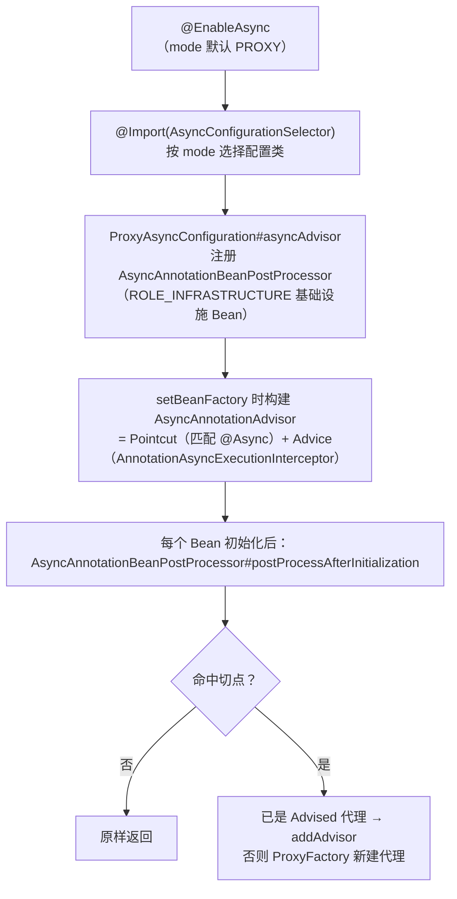
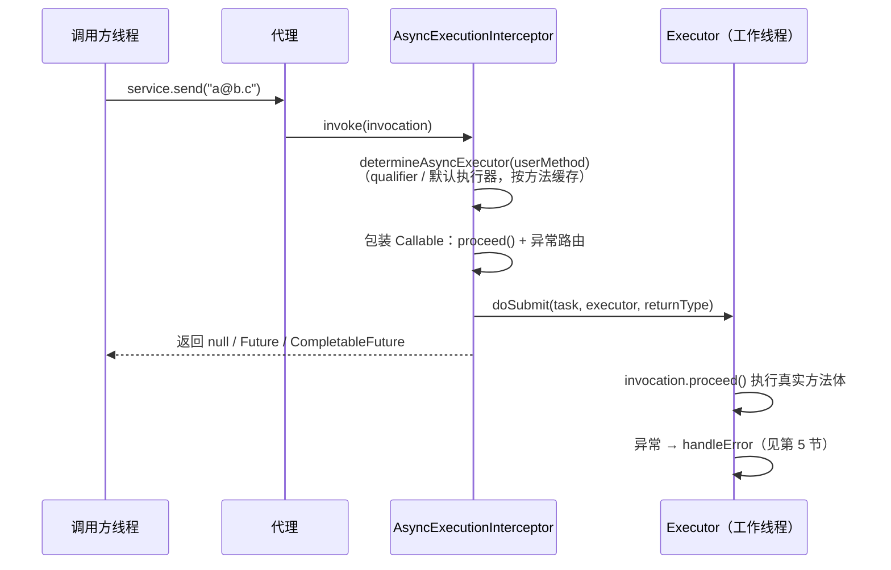

# @Async 注解原理分析

> 一句话概括：`@Async` = **AOP 代理 + `AsyncExecutionInterceptor` 把方法调用提交到 `Executor`**。注解本身不开线程——跑在哪个池、异常去了哪里、什么时候悄悄失效，全由代理链与执行器选择规则决定。

所属主题：[Spring 常见面试题总结](summary.md)

本文以 **Spring Framework 6.1.x / Spring Boot 3.2.x** 源码为基线，源码锚点用 `类名#方法名` 标注，版本差异单独注明。代理的通用边界（JDK/CGLIB、自调用、final）见 [ioc-and-aop.md](ioc-and-aop.md)，循环依赖与三级缓存见 [bean-lifecycle-and-circular-dependency.md](bean-lifecycle-and-circular-dependency.md)，事务上下文见 [transaction.md](transaction.md)，本文不重复展开。

---

## 0. 阅读路线

| 读者 | 建议章节 | 关注点 |
| --- | --- | --- |
| 初级（1 年内） | 1、5.3、6.2、7.1、10 | 会用、知道自调用失效、能配一个像样的线程池 |
| 中级（1~3 年） | 2、3、4、5、7 全部 | 注册链与执行链源码、执行器选择顺序、异常路由 |
| 高级（3 年+） | 2.2~2.3、3.2、4.3~4.4、8 | 循环依赖报错根因、advisor 顺序、虚拟线程边界、事务事件语义 |
| 选型/架构 | 4.4、6.1、9 | 线程池 vs 虚拟线程 vs MQ，背压与可靠性由谁承担 |

目录：

1. 一句话本质
2. 注册链：@EnableAsync 如何把注解变成代理
3. 执行链：一次 @Async 调用发生了什么
4. 执行器选择与默认执行器的坑
5. 返回值与异常处理
6. 正确姿势：自定义线程池
7. 失效与上下文边界
8. 异步事件：@EventListener 与 @TransactionalEventListener
9. 选型对照：@Async vs 注入 Executor vs MQ
10. 高频追问集
11. 参考资料

---

## 1. 一句话本质

**结论**：`@Async` 不创建线程，也不管理线程。它做的事只有一件——**让容器给 Bean 生成代理，把"调用方法"替换成"把方法调用打包成任务提交给 Executor"**，调用方立刻返回。

```java
@Service
public class MailService {
    @Async                          // 调用方拿到的是代理，方法体在别的线程执行
    public void send(String to) {
        // 耗时 IO...
    }
}
```

机制上它和 `@Transactional` 是同构的：都是「注解 → advisor → 代理 → 拦截器」，区别只在拦截器里干什么——事务拦截器管连接与提交，异步拦截器管选池与提交（代理模式的应用见 [design-patterns.md](design-patterns.md)）。

**边界/代价**：

- 只是**进程内**的线程切换：进程挂了任务就丢，没有持久化、没有重试、没有跨进程投递——这些是 MQ 的职责（见第 9 节）；
- 提交即返回，**调用方失去对执行时机的控制**：任务可能排队很久，也可能被拒绝；
- 一切 AOP 代理的固有边界它都继承：自调用失效、final/private/static 不可代理（见 7.1）。

**实践/追问**：面试开场可以直接说"它是 AOP 的一个特化应用，核心类是 `AsyncExecutionInterceptor`"，然后按第 2~4 节展开注册链、执行链、选池规则，层次感立刻出来。

---

## 2. 注册链：@EnableAsync 如何把注解变成代理

### 2.1 从注解到 advisor

**结论**：`@EnableAsync` 通过 `@Import` 注册一个**普通 BeanPostProcessor**——`AsyncAnnotationBeanPostProcessor`，由它在 Bean 初始化后挂上 `AsyncAnnotationAdvisor` 并生成代理。



各环节源码锚点（Spring 6.1.x）：

| 环节 | 类#方法 | 要点 |
| --- | --- | --- |
| 模式选择 | `AsyncConfigurationSelector#selectImports` | PROXY → `ProxyAsyncConfiguration`；ASPECTJ → `AspectJAsyncConfiguration`（AspectJ 织入，无代理边界，需织入器） |
| 注册 BPP | `ProxyAsyncConfiguration#asyncAdvisor` | 把 `@EnableAsync` 的 `proxyTargetClass`（默认 false）、`order`（默认 `LOWEST_PRECEDENCE`）透传给 BPP |
| 收集全局配置 | `AbstractAsyncConfiguration#setConfigurers` | 容器里**最多一个** `AsyncConfigurer`，多了抛 `IllegalStateException("Only one AsyncConfigurer may exist")`（懒校验，首次取执行器时才触发） |
| 构建 advisor | `AsyncAnnotationBeanPostProcessor#setBeanFactory` | `new AsyncAnnotationAdvisor(executor, exceptionHandler)` |
| 切点 | `AsyncAnnotationAdvisor#buildPointcut` | 类级 `AnnotationMatchingPointcut(Async, true)` ∪ 方法级，`checkInherited=true`；classpath 有 EJB/Jakarta Concurrent 时还识别 `jakarta.ejb.Asynchronous` 等 |
| 通知 | `AnnotationAsyncExecutionInterceptor` | 继承 `AsyncExecutionInterceptor`，只覆写 `getExecutorQualifier`：读 `@Async#value` |
| 织入 | `AbstractAdvisingBeanPostProcessor#postProcessAfterInitialization` | 命中则 `ProxyFactory.getProxy()`；已是 `Advised` 则直接 `addAdvisor` |

两个容易忽略的细节：

- **类级 `@Async` 生效**：切点是"类或方法任一命中"，标在类上等于全部方法异步；
- **包路径版本差异**：`AsyncExecutionInterceptor` / `AsyncExecutionAspectSupport` 在 Spring 6.x 位于 **spring-aop 模块的 `org.springframework.aop.interceptor` 包**；5.x 老博客里它们在 `scheduling.annotation` 包，对照源码时别找错地方。

### 2.2 它不是 AbstractAutoProxyCreator 体系——循环依赖报错的根因

**结论**：`@Transactional` 的代理由 `AnnotationAwareAspectJAutoProxyCreator`（`AbstractAutoProxyCreator` 体系）生成，实现了 `SmartInstantiationAwareBeanPostProcessor#getEarlyBeanReference`，能配合三级缓存提前暴露代理；**`AsyncAnnotationBeanPostProcessor` 只是普通 BPP，没有早期引用能力**。

于是当 `@Async` Bean 参与循环依赖时：对方从三级缓存拿到的是**裸对象**（没人替它提前代理），而它自己初始化后又被异步 BPP 包成了代理——`AbstractAutowireCapableBeanFactory#doCreateBean` 末尾的一致性检查发现"注入出去的和最终暴露的不是同一个对象"，直接抛 `BeanCurrentlyInCreationException`（报错信息关键词：`injected into other beans ... in its raw version ... but has eventually been wrapped`）。三级缓存如何工作、为什么 AOP 代理能提前而 @Async 不能，见 [bean-lifecycle-and-circular-dependency.md](bean-lifecycle-and-circular-dependency.md)。

**实践**：解法是 `@Lazy` 打断环、调整依赖方向，或重构消除环；Boot 2.6+ 默认 `spring.main.allow-circular-references=false`，循环依赖本就启动即失败。

### 2.3 与已有代理共存：async advisor 排在最外层

**结论**：同一个 Bean 既有 `@Transactional` 又有 `@Async` 时，**不会生成两个代理**——异步 BPP 发现 Bean 已是 `Advised`，直接 `addAdvisor`；且 `AsyncAnnotationBeanPostProcessor` 构造器调用 `setBeforeExistingAdvisors(true)`，拦截器 `AsyncExecutionInterceptor#getOrder` 返回 `HIGHEST_PRECEDENCE`，**异步通知排在既有 advisor（如事务）之前**。

这个顺序是刻意设计的：先切线程，再在**工作线程**里开事务。如果反过来（事务在外层），调用方线程的事务会在异步任务执行前就提交，语义全错。

**追问**：`@Async` 方法上的 `@Transactional` 在哪个线程开事务？——异步线程。调用方线程的事务上下文与它毫无关系（见 7.3）。

---

## 3. 执行链：一次 @Async 调用发生了什么

### 3.1 AsyncExecutionInterceptor#invoke

**结论**：拦截器把「目标方法调用」包成 `Callable`，选好执行器后提交，**调用方线程立刻返回**。



`AsyncExecutionInterceptor#invoke` 主干（6.1.x，有删节）：

```java
public Object invoke(final MethodInvocation invocation) throws Throwable {
    Class<?> targetClass = (invocation.getThis() != null ? AopUtils.getTargetClass(invocation.getThis()) : null);
    final Method userMethod = BridgeMethodResolver.getMostSpecificMethod(invocation.getMethod(), targetClass);

    AsyncTaskExecutor executor = determineAsyncExecutor(userMethod);   // 选池，见第 4 节
    if (executor == null) {
        throw new IllegalStateException("No executor specified and no default executor set ...");
    }

    Callable<Object> task = () -> {
        try {
            Object result = invocation.proceed();          // 工作线程里执行真实方法
            if (result instanceof Future<?> future) {
                return future.get();                       // 方法自己返回 Future 时解包
            }
        }
        catch (ExecutionException ex) {
            handleError(ex.getCause(), userMethod, invocation.getArguments());
        }
        catch (Throwable ex) {
            handleError(ex, userMethod, invocation.getArguments());
        }
        return null;
    };

    return doSubmit(task, executor, invocation.getMethod().getReturnType());
}
```

三个值得注意的点：

- `getMostSpecificMethod` 把接口方法/桥接方法还原到**实现类上的真实方法**，保证注解与 qualifier 读的是用户声明的那一份；
- 方法体自己返回 `Future`（如老式 `AsyncResult`）时，任务内部会 `future.get()` **解包成真实值**，调用方拿到的 Future 里不会套娃；`ExecutionException` 也被还原成 cause；
- `Callable` 里 catch 的是 `Throwable`——**方法体抛出的任何异常都进 `handleError` 路由**，不会直接炸掉工作线程（路由规则见第 5 节）。

### 3.2 doSubmit：返回值类型决定提交方式

`AsyncExecutionAspectSupport#doSubmit`（6.1.x）按**声明返回类型**分派：

| 返回类型 | 提交方式 | 调用方拿到 |
| --- | --- | --- |
| `CompletableFuture<T>` | `executor.submitCompletable(task)` | 可编排的 `CompletableFuture`，异常以 `CompletionException` 形式进入 future |
| `Future<T>` | `executor.submit(task)` | `Future`，`get()` 时异常包成 `ExecutionException` |
| `void`（含 Kotlin `Unit`） | `executor.submit(task)`，**丢弃返回的 Future** | `null` |
| `ListenableFuture`（已废弃） | `submitListenable` | 6.0 起废弃，新项目不要用 |
| **其他任何类型** | 抛 `IllegalArgumentException("Invalid return type for async method (only Future and void supported)")` | 首次调用即报错 |

**边界**：

- `@Async public String foo()` 这种写法**不是"异步返回 String"，而是运行期直接抛异常**——返回值只能是 void / Future 系；
- void 也走 `submit` 而非 `execute`：多包一层 Future 是为了让任务内异常统一走 `handleError`，代价是每次调用多一个 Future 对象（可忽略）；
- **提交阶段的异常是同步抛给调用方的**：`doSubmit` 在调用方线程执行，线程池拒绝（`RejectedExecutionException`）、执行器未初始化等异常**当场炸在调用方**，不会进 `AsyncUncaughtExceptionHandler`。这是"配了拒绝策略后调用方突然报错"的来源。

---

## 4. 执行器选择与默认执行器的坑

### 4.1 选择顺序（必考）

**结论**：`AsyncExecutionAspectSupport#determineAsyncExecutor` 的顺序是——**`@Async("qualifier")` 指定 → 容器唯一 `TaskExecutor` Bean → 名为 `taskExecutor` 的 `Executor` Bean →（Framework 兜底）`new SimpleAsyncTaskExecutor()`**，结果按方法缓存。

```java
protected AsyncTaskExecutor determineAsyncExecutor(Method method) {
    AsyncTaskExecutor executor = this.executors.get(method);      // ConcurrentHashMap 按方法缓存
    if (executor == null) {
        Executor targetExecutor;
        String qualifier = getExecutorQualifier(method);          // 读 @Async#value
        if (this.embeddedValueResolver != null && StringUtils.hasLength(qualifier)) {
            qualifier = this.embeddedValueResolver.resolveStringValue(qualifier);  // 支持 ${...}
        }
        if (StringUtils.hasLength(qualifier)) {
            targetExecutor = findQualifiedExecutor(this.beanFactory, qualifier);
        }
        else {
            targetExecutor = this.defaultExecutor.get();          // 懒解析默认执行器
        }
        if (targetExecutor == null) {
            return null;
        }
        executor = (targetExecutor instanceof AsyncTaskExecutor asyncTaskExecutor ?
                asyncTaskExecutor : new TaskExecutorAdapter(targetExecutor));   // 普通 Executor 包一层适配
        this.executors.put(method, executor);
    }
    return executor;
}
```

默认执行器的查找在 `AsyncExecutionAspectSupport#getDefaultExecutor`：

```java
try {
    // 按类型找唯一 TaskExecutor——不用 Executor，避免匹配到 ScheduledExecutorService
    return beanFactory.getBean(TaskExecutor.class);
}
catch (NoUniqueBeanDefinitionException ex) {          // 多个 TaskExecutor
    return beanFactory.getBean("taskExecutor", Executor.class);   // 退而按名字找
}
catch (NoSuchBeanDefinitionException ex) {            // 一个 TaskExecutor 都没有
    return beanFactory.getBean("taskExecutor", Executor.class);   // 同样按名字找
}
// 都找不到 → 返回 null
```

而 `AsyncExecutionInterceptor#getDefaultExecutor` 覆写了兜底：

```java
Executor defaultExecutor = super.getDefaultExecutor(beanFactory);
return (defaultExecutor != null ? defaultExecutor : new SimpleAsyncTaskExecutor());
```

| 优先级 | 规则 | 源码锚点 |
| --- | --- | --- |
| 1 | `@Async("name")`：按 `@Qualifier` 值或 Bean 名匹配 `Executor` | `findQualifiedExecutor` → `BeanFactoryAnnotationUtils#qualifiedBeanOfType` |
| 2 | 容器中**唯一**的 `TaskExecutor` 类型 Bean（`@Primary` 可消歧） | `getDefaultExecutor`：`getBean(TaskExecutor.class)` |
| 3 | 名为 `taskExecutor` 的 `Executor` Bean | `getDefaultExecutor`：`getBean("taskExecutor", Executor.class)` |
| 4 | 都没有 → `new SimpleAsyncTaskExecutor()`（每任务新线程） | `AsyncExecutionInterceptor#getDefaultExecutor` |

**边界/易错点**：

- 注意第 2 步找的是 `TaskExecutor` 而非任意 `Executor`：一个名为 `myPool` 的**唯一** `ThreadPoolExecutor` Bean **不会**被默认选中（类型不匹配且名字不对），这是"我明明定义了池怎么没生效"的常见原因；
- qualifier 支持 `${app.async.executor}` 占位符；方法级 `@Async` 的 value 覆盖类级，**方法级写空串表示"强制走默认执行器"**（`AnnotationAsyncExecutionInterceptor#getExecutorQualifier`）；
- qualifier 写错**启动期不报错**，首次调用该方法时才抛 `NoSuchBeanDefinitionException`——解析结果按方法缓存，每个方法只解析一次；
- `AsyncConfigurer#getAsyncExecutor` 返回的执行器优先于容器查找（`configure` 里作为 `defaultExecutor` 的首选 supplier）。

### 4.2 默认执行器的坑（必考）

**结论**：默认执行器在两种环境下都不能用于生产——纯 Framework 是"每任务新线程"，Boot 是"8 线程 + 无界队列"。

| 环境 | 默认执行器 | 参数 | 问题 |
| --- | --- | --- | --- |
| 纯 Framework（无 executor Bean） | `new SimpleAsyncTaskExecutor()` | 不复用线程，`concurrencyLimit` 默认 -1 无上限 | 每任务新建线程，高并发下线程数爆炸，直接打爆内存/调度 |
| Boot 自动配置 | `applicationTaskExecutor`（`ThreadPoolTaskExecutor`） | core=8，queueCapacity=`Integer.MAX_VALUE`，maxSize=`Integer.MAX_VALUE` | 队列永远填不满 → **max 形同虚设，实际恒为 8 线程**；任务无限堆积 → OOM |
| Boot 3.2+ 且 `spring.threads.virtual.enabled=true`（Java 21） | `SimpleAsyncTaskExecutor`（虚拟线程版） | 每任务新虚拟线程，默认不限流 | 线程廉价了，但**无背压**，下游容量成为瓶颈（见 4.3） |

Boot 侧源码锚点（3.2.x）：`TaskExecutionAutoConfiguration`（`@ConditionalOnClass(ThreadPoolTaskExecutor.class)`）导入 `TaskExecutorConfigurations`；其中 `TaskExecutorConfiguration` 标 `@ConditionalOnMissingBean(Executor.class)`，平台线程分支注册 `@Lazy` 的 `ThreadPoolTaskExecutor`，**Bean 名同时是 `applicationTaskExecutor` 和 `taskExecutor`**（正好命中 4.1 的第 3 优先级）。默认参数来自 `TaskExecutionProperties`（前缀 `spring.task.execution`）：

| 属性 | 默认值 | 说明 |
| --- | --- | --- |
| `pool.core-size` | 8 | 核心线程数 |
| `pool.max-size` | `Integer.MAX_VALUE` | 无界队列下永远达不到 |
| `pool.queue-capacity` | `Integer.MAX_VALUE` | 无界 `LinkedBlockingQueue` |
| `pool.allow-core-thread-timeout` | true | 空闲 60s（`keep-alive`）后核心线程也回收 |
| `thread-name-prefix` | `task-` | 线程名 `task-1`、`task-2`... |
| `simple.concurrency-limit` | 不限（-1） | 仅 SimpleAsyncTaskExecutor 分支生效 |

自动装配的条件机制（`@ConditionalOnMissingBean` 为何让用户 Bean 优先）见 [boot-autoconfiguration.md](boot-autoconfiguration.md)。这里只强调一个实践后果：**只要你定义了任意一个 `Executor` 类型的 Bean，Boot 的 `applicationTaskExecutor` 就整体退让**——`spring.task.execution.*` 配置随之全部失效，默认执行器改按 4.1 的规则重新解析。

**追问：为什么无界队列让 max 失效？** `ThreadPoolExecutor` 的扩容时机是"队列满且线程数 < max"；`LinkedBlockingQueue(Integer.MAX_VALUE)` 永远不满，线程数永远停在 core。所以 Boot 默认池的真实画像就是**固定 8 线程 + 无限排队**。

### 4.3 Boot 3.2+ 虚拟线程分支

**结论**：开 `spring.threads.virtual.enabled=true`（需 Java 21）后，`TaskExecutorConfigurations` 走 `@ConditionalOnThreading(Threading.VIRTUAL)` 分支，`applicationTaskExecutor` 换成 `SimpleAsyncTaskExecutorBuilder.virtualThreads(true)` 构建的 **`SimpleAsyncTaskExecutor`**——每个任务一个新虚拟线程，不再复用，但创建成本极低。

**边界**（面试分水岭，与总结 8.3 一致）：

- **没有背压**：默认不限流，十万个任务就是十万个虚拟线程同时冲向下游——数据库连接池、HTTP 连接池、下游服务容量才是真瓶颈，必要时用 `spring.task.execution.simple.concurrency-limit` 限流；
- **pin 问题**：JDK 21 中虚拟线程在 `synchronized` 块内阻塞会钉住载体线程（可 `-Djdk.tracePinnedThreads=full` 诊断）；**JDK 24（JEP 491）起该限制基本消除**；
- CPU 密集任务不会因虚拟线程变快；海量虚拟线程各自持有 ThreadLocal 时内存也要算账；
- 平台线程分支的 `ThreadPoolTaskExecutor` 是 `@Lazy` 的，虚拟线程分支不是——细节但能体现读过源码。

**实践**：IO 密集的新项目可以直接用虚拟线程分支 + 下游限流；需要精确控制并发度、队列缓冲、拒绝语义的场景，仍用自定义 `ThreadPoolTaskExecutor`（第 6 节）。

---

## 5. 返回值与异常处理

### 5.1 异常路由：handleError

**结论**：工作线程里的异常按返回类型分流——**Future 系重新抛出（进 future），void 交给 `AsyncUncaughtExceptionHandler`（默认只打日志）**。

`AsyncExecutionAspectSupport#handleError`：

```java
protected void handleError(Throwable ex, Method method, Object... params) throws Exception {
    if (Future.class.isAssignableFrom(method.getReturnType())) {
        ReflectionUtils.rethrowException(ex);      // 抛回任务 → future 异常完成
    }
    else {
        try {
            this.exceptionHandler.obtain().handleUncaughtException(ex, method, params);
        }
        catch (Throwable ex2) {
            logger.warn("Exception handler for async method ... threw unexpected exception itself", ex2);
        }
    }
}
```

| 返回类型 | 异常去向 | 调用方如何感知 |
| --- | --- | --- |
| `void` | `AsyncUncaughtExceptionHandler`；默认 `SimpleAsyncUncaughtExceptionHandler` 仅 `log.error` | **感知不到**——这就是"异常被吞"的准确含义：不是没处理，是默认处理只有日志 |
| `Future` / `CompletableFuture` | 重新抛出 → future 异常完成 | `get()` 抛 `ExecutionException` / `join()` 抛 `CompletionException`，或 `exceptionally` 编排 |
| 提交阶段异常（拒绝等） | 不经过 handleError，**同步抛给调用方** | 调用方 try-catch |

**边界**：自定义 handler 自己抛异常只会被 `warn` 一行，不会有任何补偿——handler 里别再抛；handler 是全局兜底，**不是业务重试机制**，要重试请显式编排。

### 5.2 自定义异常处理器与执行器：AsyncConfigurer

```java
@Configuration
@EnableAsync
public class AsyncConfig implements AsyncConfigurer {

    @Bean("bizExecutor")
    public ThreadPoolTaskExecutor bizExecutor() {
        ThreadPoolTaskExecutor executor = new ThreadPoolTaskExecutor();
        executor.setCorePoolSize(8);
        executor.setMaxPoolSize(16);
        executor.setQueueCapacity(200);                 // 有界队列，max 才有意义
        executor.setThreadNamePrefix("biz-async-");     // 命名线程，排障看栈一眼定位
        executor.setRejectedExecutionHandler(new ThreadPoolExecutor.CallerRunsPolicy());
        executor.setWaitForTasksToCompleteOnShutdown(true);
        executor.setAwaitTerminationSeconds(30);
        executor.initialize();
        return executor;
    }

    @Override
    public Executor getAsyncExecutor() {
        return bizExecutor();      // 全局默认执行器（@Configuration Full 模式保证拿到的是容器单例）
    }

    @Override
    public AsyncUncaughtExceptionHandler getAsyncUncaughtExceptionHandler() {
        return (ex, method, params) ->
            log.error("异步任务失败 method={} args={}", method.getName(), Arrays.toString(params), ex);
        // 生产上这里接告警：埋点、发通知、写失败记录表，而不是只打日志
    }
}
```

注意 `AsyncConfigurer` 全容器只能有一个（2.1），且它设置的是**默认**执行器——`@Async("otherPool")` 仍可指向别的池。

### 5.3 要拿异常/拿结果：CompletableFuture

```java
@Service
public class ReportService {

    @Async("bizExecutor")
    public CompletableFuture<Report> generate(String id) {
        Report report = doGenerate(id);            // 抛异常会进入 future
        return CompletableFuture.completedFuture(report);
    }

    @Async
    public void fireAndForget(String id) {
        throw new IllegalStateException("boom");   // void：只能靠 handler 兜底
    }
}

// 调用方：异常显式编排，不再"消失"
reportService.generate("A1")
    .thenAccept(report -> log.info("报表完成 {}", report.getId()))
    .exceptionally(ex -> {                          // ex 是 CompletionException，getCause() 是原始异常
        log.error("报表生成失败", ex.getCause());
        return null;
    });
```

**实践/追问**：需要结果或异常可见 → `CompletableFuture`；纯通知类 fire-and-forget → void + 全局 handler 接告警。多个异步任务聚合用 `CompletableFuture.allOf`，但注意它们默认各跑各的池，聚合等待要设超时（`orTimeout`，JDK 9+）。

---

## 6. 正确姿势：自定义线程池

### 6.1 参数评估

**结论**：线程池参数没有万能公式，只有起点 + 压测校准；**有效并发度永远受下游容量约束**。

| 任务类型 | 起点 | 说明 |
| --- | --- | --- |
| CPU 密集 | `N_cpu + 1` | 多了只增加切换；+1 防偶发缺页暂停 |
| IO 密集 | `N_cpu × (1 + 等待时间/计算时间)` | 等待占比越高线程越多；但**不能超过下游承载力**（DB 连接池只有 20，开 200 线程只是把排队从队列挪到连接池） |

队列与拒绝策略是**背压设计**的一部分：有界队列 + 明确拒绝策略，把"扛不住"显式暴露出来，而不是堆到 OOM。

### 6.2 拒绝策略对照

| 策略 | 行为 | 适用 |
| --- | --- | --- |
| `AbortPolicy`（默认） | 抛 `RejectedExecutionException` | 调用方能处理失败、需要快速失败 |
| `CallerRunsPolicy` | **调用方线程自己执行** | 天然反压：提交方被拖慢从而降速；但调用方是 Tomcat 线程时会阻塞请求，且"异步"语义被破坏 |
| `DiscardPolicy` | 静默丢弃 | 仅可丢任务（如采样上报），否则是事故 |
| `DiscardOldestPolicy` | 丢队首再提交 | 只关心最新数据的场景，慎用 |

### 6.3 绑定方式与监控

`@Async` 与池的绑定按 4.1 的顺序，工程上推荐**显式 qualifier**，不依赖默认解析：

| 方式 | 写法 | 评价 |
| --- | --- | --- |
| 显式指定 | `@Async("bizExecutor")` | **最推荐**：多池隔离（核心业务/边缘任务分开），意图清晰 |
| 唯一 TaskExecutor | 容器只定义一个 `ThreadPoolTaskExecutor` | 小项目够用 |
| 命名 taskExecutor | Bean 名/别名 `taskExecutor` | 兼容默认解析的约定 |
| AsyncConfigurer | `getAsyncExecutor()` | 全局默认 + 全局 handler 一起配 |

监控（队列深度是 OOM 的前置指标）：

```java
ThreadPoolExecutor pool = bizExecutor.getThreadPoolExecutor();
int queueSize = pool.getQueue().size();        // 队列深度
int active = pool.getActiveCount();            // 活跃线程
// 接 Micrometer：ExecutorServiceMetrics.monitor(registry, pool, "biz-async")
// 暴露 executor.queue.remaining / executor.active 等指标，配告警
```

**实践**：线程名前缀、有界队列、拒绝策略、优雅停机（`setWaitForTasksToCompleteOnShutdown`）、队列深度告警，五件套一个都不能少。

---

## 7. 失效与上下文边界

### 7.1 自调用失效

**结论**：`this.asyncMethod()` 走原始对象，绕过代理，**同步执行**——不报错、不异步，是最隐蔽的失效。

```java
@Service
public class OrderService {
    public void createOrder() {
        this.sendNotify();      // ❌ 同步执行，@Async 完全失效
    }
    @Async
    public void sendNotify() { ... }
}
```

解法与 `@Transactional` 完全一致（拆 Bean 最推荐，其次 `@Lazy` 自注入、`AopContext.currentProxy()`），通用代理边界见 [ioc-and-aop.md](ioc-and-aop.md)。其余失效场景也同源：private/final/static 方法、final 类、自己 new 的对象（不是 Bean 就没有代理）。

### 7.2 ThreadLocal 全部丢失

**结论**：线程切换后，**调用方线程的 ThreadLocal 一律不带过去**——这是 `@Async` 最容易被忽视的语义断层。

| 上下文 | 载体 | 后果与对策 |
| --- | --- | --- |
| MDC 日志 traceId | `ThreadLocal`（logback/log4j2） | 异步日志丢 traceId；用 `TaskDecorator` 显式搬运 |
| 事务连接 | `TransactionSynchronizationManager` | 异步方法**不在调用方事务里**，各自管理事务，见 [transaction.md](transaction.md) |
| SecurityContext | `SecurityContextHolder` | 异步线程拿不到登录态；Spring Security 提供 `DelegatingSecurityContextAsyncTaskExecutor` |
| 请求上下文 | `RequestContextHolder` | 异步线程里取 request 直接报错；需要的数据在提交前取好传参 |

MDC 搬运示例（`TaskDecorator` 在**提交时**捕获、**执行时**恢复、finally 清理）：

```java
executor.setTaskDecorator(runnable -> {
    Map<String, String> context = MDC.getCopyOfContextMap();   // 调用方线程捕获
    return () -> {
        try {
            if (context != null) { MDC.setContextMap(context); }
            runnable.run();
        } finally {
            MDC.clear();                                       // 线程池线程复用，必须清理
        }
    };
});
```

### 7.3 事务可见性坑：异步任务读不到未提交数据

**结论**：在事务方法里提交异步任务，异步线程去查库，**大概率查不到——因为调用方事务还没提交**。

```java
@Transactional
public void createOrder(Order order) {
    orderMapper.insert(order);
    notifyService.asyncNotify(order.getId());   // 异步线程立刻查 order → 可能为空！
}
```

这不是 bug 而是隔离级别的正常表现。正确做法：把异步动作挂到**提交之后**——`@TransactionalEventListener(AFTER_COMMIT)`（第 8 节）或 `TransactionSynchronization#afterCommit`。事务传播与失效的完整清单见 [transaction.md](transaction.md)。

---

## 8. 异步事件：@EventListener 与 @TransactionalEventListener

### 8.1 @Async + @EventListener

**结论**：`publishEvent` 默认**同步、同线程**执行监听器；给监听方法加 `@Async` 才异步——监听器 Bean 同样被异步代理包装，事件分发调用的是代理。

```java
@Component
public class OrderListeners {
    @Async("bizExecutor")
    @EventListener
    public void onCreated(OrderCreatedEvent event) { ... }
}
```

官方文档明确异步监听器的两个限制：

- 监听器抛异常**不回传发布者**（走 `AsyncUncaughtExceptionHandler`，见第 5 节）；
- **不能靠返回值级联发布新事件**（同步监听器返回对象会被当作新事件发布，异步下不行）——需要后续事件就注入 `ApplicationEventPublisher` 手动发。

### 8.2 @Async + @TransactionalEventListener

`@TransactionalEventListener` 把监听器注册为事务同步回调，按阶段触发：

| 阶段 | 触发时机 |
| --- | --- |
| `BEFORE_COMMIT` | 提交前（仍在原事务内） |
| `AFTER_COMMIT`（默认） | 提交成功后 |
| `AFTER_ROLLBACK` | 回滚后 |
| `AFTER_COMPLETION` | 事务完成（无论提交/回滚） |

**组合语义**：阶段判断发生在**发布者线程的事务回调**里，命中后再经异步代理把方法体提交到线程池——即"提交之后 + 另一个线程"。两个高频坑：

- **没有活动事务时默认不触发**（`fallbackExecution=false`）：无事务上下文里 `publishEvent`，监听器直接被跳过，需要兜底就设 `fallbackExecution=true`；
- **AFTER_COMMIT 阶段写库默认没有事务**（原事务已提交，且异步线程更没有）——要写库需 `@Transactional(propagation = REQUIRES_NEW)`，详见 [transaction.md](transaction.md) 与总结 9.3。

---

## 9. 选型对照：@Async vs 注入 Executor vs MQ

**结论**：三者解决的不是同一层问题——`@Async` 是"语法糖化的进程内异步"，注入 Executor 是"显式的进程内任务编排"，MQ 是"跨进程的可靠投递"。

| 维度 | @Async | 直接注入 Executor | MQ |
| --- | --- | --- | --- |
| 本质 | AOP 代理 + 提交 | 手工 `submit/execute` | 跨进程消息中间件 |
| 解耦范围 | 进程内，调用方仍依赖目标 Bean | 进程内，只依赖池 | **跨进程/跨服务**，生产消费互不感知 |
| 可靠性 | 进程挂 = 任务丢 | 同左 | 持久化 + 确认 + 重试，可堆积 |
| 背压 | 靠池的队列/拒绝策略 | 同左，且可显式控制提交节奏 | 天然削峰，消费者按能力拉取 |
| 结果/异常 | Future 或 handler | Future 完全可控 | 回执/死信队列，链路更长 |
| 代理边界 | 自调用失效等全套 | **无代理边界**，自调用也异步 | 无 |
| 适用 | 通知、日志、报表等"丢了可容忍/可补偿"的旁路 | 需要精细编排（批量、聚合、超时）的进程内并发 | 订单→库存、支付→发货等**必须送达**的跨服务链路 |

判断口径：**必须送达、跨进程、要削峰 → MQ；进程内旁路加速 → @Async 或 Executor；需要复杂编排 → 显式 Executor + CompletableFuture**。`@Async` 的便利是用"隐式代理 + 隐式选池"换的，团队没有线程池规范时，显式注入 Executor 反而更可控。

顺带对照：`@Scheduled` 的默认调度器**只有 1 个线程**，一个任务卡住全体陪葬——与 `@Async` 的"默认池不可靠"是同一类"默认值陷阱"，详见总结 9.2。

---

## 10. 高频追问集

**Q1：@Async 为什么自调用失效？**
期望答案：注入的是代理，`this` 是原始对象，`this.method()` 不经过 `AsyncExecutionInterceptor`，直接同步执行。解法：拆 Bean（推荐）、`@Lazy` 自注入、`AopContext.currentProxy()`。追问方向：和 `@Transactional` 失效同源，能不能画出代理调用链。

**Q2：默认线程池是什么参数？**
期望答案：纯 Framework 兜底 `SimpleAsyncTaskExecutor`，每任务新线程、不复用、无上限；Boot 自动配置 `applicationTaskExecutor`（`ThreadPoolTaskExecutor`），core=8、队列与 max 都是 `Integer.MAX_VALUE`，无界队列导致 max 失效、任务堆积 OOM；Boot 3.2+ 开虚拟线程后换成虚拟线程版 `SimpleAsyncTaskExecutor`。追问方向：为什么无界队列让 max 失效（扩容时机是队列满）。

**Q3：@Async 抛的异常去哪了？**
期望答案：工作线程内异常进 `handleError`：Future 系重新抛出进入 future（`get()/join()` 可感知）；void 交给 `AsyncUncaughtExceptionHandler`，默认实现只打 error 日志，所以"看起来被吞"。提交阶段的拒绝异常同步抛给调用方。追问方向：怎么接告警、为什么 handler 里不能再抛。

**Q4：执行器选择顺序？**
期望答案：`@Async("qualifier")`（支持 `${}`，方法级覆盖类级）→ 容器唯一 `TaskExecutor` → 名为 `taskExecutor` 的 `Executor` → `new SimpleAsyncTaskExecutor()`；按方法缓存。追问方向：为什么按类型找 `TaskExecutor` 而不是 `Executor`（避免匹配 `ScheduledExecutorService`）；qualifier 写错何时报错（首次调用）。

**Q5：@Async 的 Bean 参与循环依赖为什么报错？**
期望答案：异步代理由普通 BPP 在初始化后生成，不属于 `AbstractAutoProxyCreator` 体系、没有 `getEarlyBeanReference`；对方注入的是裸对象，最终暴露的是代理，一致性检查抛 `BeanCurrentlyInCreationException`。追问方向：三级缓存为什么救得了 `@Transactional` 救不了 `@Async`。

**Q6：@Async 方法能返回 String 吗？**
期望答案：不能。`doSubmit` 只支持 void/Future/CompletableFuture（及废弃的 ListenableFuture），其他返回类型首次调用抛 `IllegalArgumentException`。追问方向：void 为什么也走 submit（统一异常路由）。

**Q7：@Async + @Transactional 同一方法，事务在哪个线程开？**
期望答案：异步 advisor 排在既有 advisor 之前（`setBeforeExistingAdvisors(true)`），先切线程再开事务，事务在**异步线程**；调用方事务上下文不跨线程。追问方向：事务里提交异步任务读不到未提交数据怎么办（AFTER_COMMIT）。

**Q8：虚拟线程是不是让线程池调优过时了？**
期望答案：IO 密集场景大幅简化并发，但没消灭瓶颈——连接池/下游容量仍在，默认无背压需要限流；JDK 21 有 synchronized pin 问题（JDK 24 改善）；CPU 密集无收益。需要精确并发控制与拒绝语义时仍用有界线程池。

---

## 11. 参考资料

- Spring Framework 官方文档：*Task Execution and Scheduling*（@Async 用法、执行器选择、异常处理）<https://docs.spring.io/spring-framework/reference/integration/scheduling.html>
- Spring Boot 官方文档：*Task Execution and Scheduling*（`spring.task.execution.*`、虚拟线程）<https://docs.spring.io/spring-boot/reference/features/task-execution-and-scheduling.html>
- 源码锚点（Spring 6.1.x）：`AsyncConfigurationSelector#selectImports`、`ProxyAsyncConfiguration#asyncAdvisor`、`AbstractAsyncConfiguration#setConfigurers`、`AsyncAnnotationBeanPostProcessor#setBeanFactory`、`AsyncAnnotationAdvisor#buildPointcut`、`AsyncExecutionInterceptor#invoke`、`AsyncExecutionAspectSupport#determineAsyncExecutor / getDefaultExecutor / doSubmit / handleError`、`AnnotationAsyncExecutionInterceptor#getExecutorQualifier`
- 源码锚点（Boot 3.2.x）：`TaskExecutionAutoConfiguration`、`TaskExecutorConfigurations`（`@ConditionalOnThreading` 分支）、`TaskExecutionProperties`
- JEP 491: *Synchronize Virtual Threads without Pinning*（JDK 24）<https://openjdk.org/jeps/491>
- 本库相关：[Spring 常见面试题总结](summary.md) 9.1~9.3、[ioc-and-aop.md](ioc-and-aop.md)、[bean-lifecycle-and-circular-dependency.md](bean-lifecycle-and-circular-dependency.md)、[transaction.md](transaction.md)、[boot-autoconfiguration.md](boot-autoconfiguration.md)、[design-patterns.md](design-patterns.md)

---

## 附：一页速记

1. **本质**：@Async = AOP 代理 + `AsyncExecutionInterceptor` 把调用提交给 Executor；注解不开线程。
2. **注册链**：`@EnableAsync` → `ProxyAsyncConfiguration` → `AsyncAnnotationBeanPostProcessor`（普通 BPP）→ `AsyncAnnotationAdvisor` → 初始化后代理。
3. **不是 APC 体系**：没有早期引用 → 参与循环依赖直接 `BeanCurrentlyInCreationException`。
4. **advisor 顺序**：async 排最外层（`beforeExistingAdvisors=true`），先切线程再开事务。
5. **选池顺序**：qualifier → 唯一 TaskExecutor → 名为 taskExecutor → SimpleAsyncTaskExecutor 兜底；按方法缓存，qualifier 错误首次调用才炸。
6. **默认池皆坑**：Framework 每任务新线程；Boot core=8 + 无界队列（max 失效）→ OOM；Boot 3.2 虚拟线程分支无背压。
7. **返回值**：只支持 void / Future / CompletableFuture，其他类型抛 IllegalArgumentException；void 也走 submit。
8. **异常路由**：Future 系进 future；void 进 `AsyncUncaughtExceptionHandler`（默认只打日志）；拒绝异常同步抛调用方。
9. **上下文断层**：MDC/事务/SecurityContext 全是 ThreadLocal，不跨线程；事务内发异步任务读不到未提交数据 → AFTER_COMMIT。
10. **选型**：进程内旁路用 @Async/Executor，必须送达跨进程用 MQ；线程池五件套：命名、有界队列、拒绝策略、优雅停机、队列监控。
