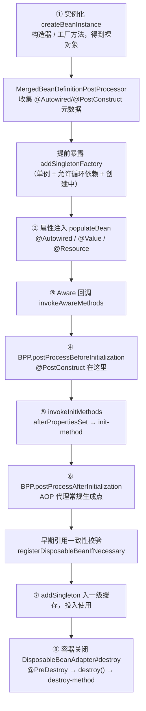
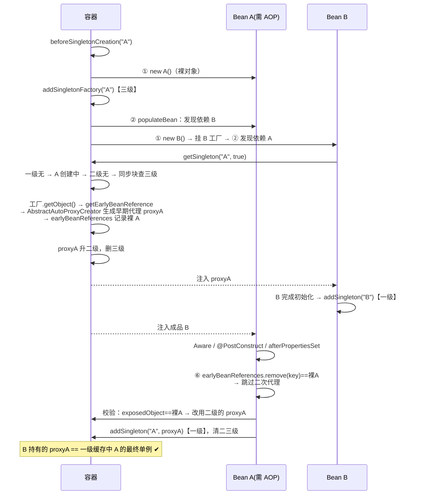
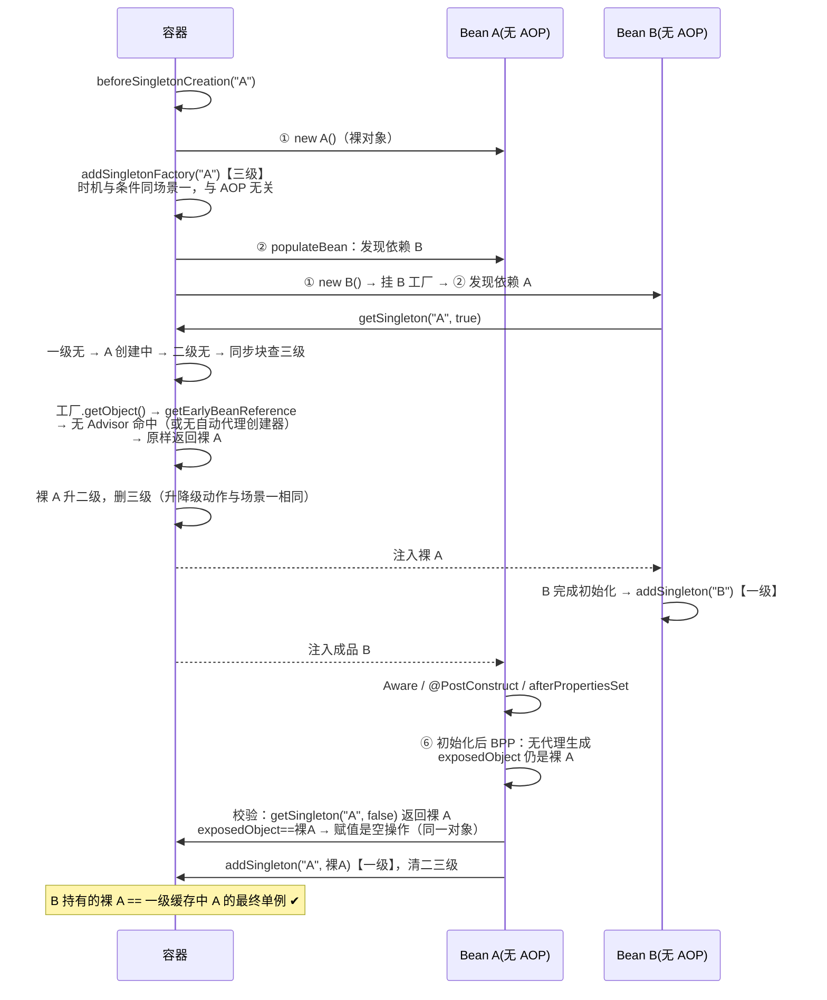

# Bean 生命周期与循环依赖（三级缓存）源码详解

> 一句话概括：Bean 生命周期是 `doCreateBean` 里「实例化 → 注入 → 初始化」三段流水线加上一串可插拔回调；循环依赖能解，靠的是**把「实例化」和「初始化」拆开、用三级缓存提前暴露半成品**——而三级缓存存在的真正理由，是让 AOP 代理的生成时机不被循环依赖破坏。

预计阅读时间：大约 80 分钟

所属主题：[Spring 常见面试题总结](summary.md)

本文以 **Spring Framework 6.1.x / Spring Boot 3.2.x** 源码为基线做源码级走读，锚点用 `类名#方法名` 标注，关键片段摘自对应分支源码（删节处已注明）。与 [summary.md](summary.md) 第 3 章的分工：那里给结论与面试表达，这里给**每行结论对应的源码证据**，并补齐 `refresh()` 骨架、Full/Lite 配置类、早期代理一致性校验等机制。

**版本差异速览**（正文就地标注）：

| 差异点 | 说明 |
| --- | --- |
| `earlyProxyReferences` → `earlyBeanReferences` | `AbstractAutoProxyCreator` 记录「已提前代理」的 Map，6.0 及以前叫 `earlyProxyReferences`，**6.1 起更名**，语义不变 |
| javax → jakarta | Spring 6.0 起 `@PostConstruct`/`@PreDestroy`/`@Resource` 迁到 `jakarta.annotation`；`CommonAnnotationBeanPostProcessor` 同时兼容 javax 旧注解 |
| 循环依赖默认开关 | Framework `allowCircularReferences` 默认 true；**Boot 2.6 起 `spring.main.allow-circular-references` 默认 false** |
| `enforceUniqueMethods` | 6.0 起默认禁止同类中重载的 `@Bean` 方法 |

---

## 0. 阅读路线

| 读者 | 建议阅读 | 关注点 |
| --- | --- | --- |
| 初级（1 年内） | 1.1~1.2、1.5~1.6、6.6、8 | 八阶段全景、初始化/销毁三件套、哪些循环依赖无解 |
| 中级（1~3 年） | 1、4、5、6 全部 | `doCreateBean` 走读、三级缓存逐级查找、A⇄B 有/无 AOP 时序对照 |
| 高级（3 年+） | 2、3、4.6、5、7 | `refresh()` 骨架、CGLIB 增强配置类、一致性校验、扩展点选型 |
| 选型/架构 | 3.3、6.5、7.1 | Lite 的启动收益、官方对循环依赖的态度、团队扩展点规范 |

目录：

1. 生命周期全景：八阶段与 doCreateBean
2. refresh() 骨架：每件事发生在哪一步
3. @Configuration Full vs Lite：CGLIB 增强配置类
4. 三级缓存：源码级走读
5. 为什么是三级而不是二级
6. 四种解决不了的循环依赖
7. 实践：扩展点选型与常见坑
8. 高频追问集
9. 参考资料

---

## 1. 生命周期全景：八阶段与 doCreateBean

**结论**：单例 Bean 经历 **实例化 → 属性注入 → Aware 回调 → 初始化前 BPP → 初始化（@PostConstruct → afterPropertiesSet → init-method）→ 初始化后 BPP（AOP 代理）→ 使用 → 销毁** 八阶段，编排集中在 `AbstractAutowireCapableBeanFactory#doCreateBean` 与 `#initializeBean`。

### 1.1 八阶段与源码锚点

| # | 阶段 | 源码锚点 | 说明 |
| --- | --- | --- | --- |
| 1 | 实例化 | `AbstractAutowireCapableBeanFactory#createBeanInstance` | 构造器/工厂方法 new 出裸对象 |
| 2 | 属性注入 | `#populateBean` | `@Autowired`/`@Value` 由 `AutowiredAnnotationBeanPostProcessor#postProcessProperties` 完成 |
| 3 | Aware 回调 | `#invokeAwareMethods` | 只处理 BeanFactory 级三个 Aware（见 1.4） |
| 4 | 初始化前 BPP | `#applyBeanPostProcessorsBeforeInitialization` | `@PostConstruct` 在此执行（见 1.5） |
| 5 | 初始化 | `#invokeInitMethods` | `afterPropertiesSet()` → 自定义 `init-method` |
| 6 | 初始化后 BPP | `#applyBeanPostProcessorsAfterInitialization` | AOP 代理常规生成点 |
| 7 | 使用 | `DefaultSingletonBeanRegistry#addSingleton` | 成品放入一级缓存 |
| 8 | 销毁 | `DisposableBeanAdapter#destroy` | `@PreDestroy` → `destroy()` → `destroy-method` |



### 1.2 doCreateBean：编排源码

`AbstractAutowireCapableBeanFactory#doCreateBean`（6.1.x，节选）：

```java
protected Object doCreateBean(String beanName, RootBeanDefinition mbd, @Nullable Object[] args) {
    // ① 实例化
    BeanWrapper instanceWrapper = createBeanInstance(beanName, mbd, args);
    Object bean = instanceWrapper.getWrappedInstance();
    // MergedBeanDefinitionPostProcessor 扫描 @Autowired/@Value/@PostConstruct/@Resource 元数据
    applyMergedBeanDefinitionPostProcessors(mbd, beanType, beanName);

    // 提前暴露：循环依赖可解的关键一行（条件见 4.3）
    boolean earlySingletonExposure = (mbd.isSingleton() && this.allowCircularReferences &&
            isSingletonCurrentlyInCreation(beanName));
    if (earlySingletonExposure) {
        addSingletonFactory(beanName, () -> getEarlyBeanReference(beanName, mbd, bean));
    }

    // ②③④⑤⑥ 注入 + 初始化
    Object exposedObject = bean;
    populateBean(beanName, mbd, instanceWrapper);
    exposedObject = initializeBean(beanName, exposedObject, mbd);

    // 早期引用一致性校验（展开见 4.6，@Async 循环依赖报错在这）
    if (earlySingletonExposure) {
        Object earlySingletonReference = getSingleton(beanName, false);
        if (earlySingletonReference != null) {
            if (exposedObject == bean) {
                exposedObject = earlySingletonReference;
            }
            else if (!this.allowRawInjectionDespiteWrapping && hasDependentBean(beanName)) {
                // ……收集真实依赖方，非空则抛 BeanCurrentlyInCreationException
            }
        }
    }
    registerDisposableBeanIfNecessary(beanName, bean, mbd);   // prototype 不注册，见 7.3
    return exposedObject;
}
```

三个结构细节：**提前暴露插在实例化与注入之间**——对象已存在但未注入属性，就可以先挂出「获取它的工厂」；**`bean` 始终是裸对象、`exposedObject` 可能被换成代理**，两者是否相等是 4.6 校验的依据；**销毁回调注册的是裸对象 `bean`**，销毁作用于目标本身。

### 1.3 实例化 vs 初始化（高频追问）

| 维度 | 实例化（instantiation） | 初始化（initialization） |
| --- | --- | --- |
| 做什么 | 分配内存、执行构造器，得到裸对象 | 注入依赖、执行回调，变成可用 Bean |
| 源码 | `createBeanInstance` | `populateBean` + `initializeBean` |
| 对象状态 | 字段全是默认值 | 依赖就绪、初始化逻辑已执行 |
| 循环依赖 | **构造器循环无解**：没完成就没有对象可暴露 | setter/字段循环可解：裸对象可提前暴露 |

`createBeanInstance` 先给 `SmartInstantiationAwareBeanPostProcessor#determineCandidateConstructors` 推断构造器的机会（`AutowiredAnnotationBeanPostProcessor` 借此选中 `@Autowired` 构造器），再由 `InstantiationStrategy` 执行。`populateBean` 顺序：`postProcessAfterInstantiation`（可短路注入）→ byName/byType 自动装配 → **`postProcessProperties`**（注解注入真正落点）→ 依赖检查 → `applyPropertyValues`。注入方式取舍见 [IoC 与 AOP 专题](ioc-and-aop.md)。

### 1.4 initializeBean 与两层 Aware

```java
protected Object initializeBean(String beanName, Object bean, @Nullable RootBeanDefinition mbd) {
    invokeAwareMethods(beanName, bean);                                            // ③
    Object wrappedBean = bean;
    if (mbd == null || !mbd.isSynthetic()) {
        wrappedBean = applyBeanPostProcessorsBeforeInitialization(wrappedBean, beanName);  // ④
    }
    invokeInitMethods(beanName, wrappedBean, mbd);                                 // ⑤
    if (mbd == null || !mbd.isSynthetic()) {
        wrappedBean = applyBeanPostProcessorsAfterInitialization(wrappedBean, beanName);   // ⑥
    }
    return wrappedBean;
}
```

**Aware 分两层**（常背漏的细节）：`invokeAwareMethods` 硬编码只处理 `BeanNameAware`/`BeanClassLoaderAware`/`BeanFactoryAware`；`EnvironmentAware`/`ResourceLoaderAware`/`ApplicationEventPublisherAware`/`MessageSourceAware`/`ApplicationContextAware` 等由 `ApplicationContextAwareProcessor`（`prepareBeanFactory` 阶段注册的普通 BPP）在 ④ 阶段执行。所以 `setApplicationContext` 严格说属于「初始化前 BPP」。

### 1.5 初始化三件套：@PostConstruct 到底谁执行

**结论**：`@PostConstruct` 由 `CommonAnnotationBeanPostProcessor`（继承 `InitDestroyAnnotationBeanPostProcessor`）在 `postProcessBeforeInitialization` 里反射执行。顺序：`@PostConstruct` → `afterPropertiesSet` → `init-method`。

注册（`CommonAnnotationBeanPostProcessor` 构造器，节选）：`addInitAnnotationType(loadAnnotationType("jakarta.annotation.PostConstruct"))`、`addDestroyAnnotationType(...PreDestroy)`，并同样注册 javax 旧注解以兼容迁移；`setOrder(Ordered.LOWEST_PRECEDENCE - 3)`。

执行入口（`InitDestroyAnnotationBeanPostProcessor#postProcessBeforeInitialization`）：

```java
public Object postProcessBeforeInitialization(Object bean, String beanName) throws BeansException {
    LifecycleMetadata metadata = findLifecycleMetadata(bean.getClass());
    metadata.invokeInitMethods(bean, beanName);   // 反射调用所有 @PostConstruct 方法
    return bean;                                  // 返回原对象，不做包装
}
```

`AbstractAutowireCapableBeanFactory#invokeInitMethods` 的顺序规则：先调 `InitializingBean#afterPropertiesSet`（若未被外部托管），再遍历 `initMethodNames` 调自定义方法；**init-method 名恰为 `afterPropertiesSet` 或与 `@PostConstruct` 方法同名时不会重复调用**（`checkInitDestroyMethods` 标记「外部已管理」）。

**边界与细节**：`@PostConstruct` 必须**无参**（`LifecycleMethod` 构造时校验，有参直接抛 `IllegalStateException`），抛异常中断创建；继承场景 `buildLifecycleMetadata` 沿父类链收集，**init 子类先执行、destroy 父类先执行**；三件套取舍——`@PostConstruct` 无侵入（业务首选）、`InitializingBean` 侵入接口但契约明确、`init-method` 适合第三方类。

### 1.6 销毁三件套：DisposableBeanAdapter#destroy

`DefaultSingletonBeanRegistry#destroySingletons` 按注册逆序销毁（先销毁依赖方），每个 Bean 委托 `DisposableBeanAdapter#destroy`（6.1.x，节选）：

```java
public void destroy() {
    // ① DestructionAwareBeanPostProcessor#postProcessBeforeDestruction
    //    （CommonAnnotationBeanPostProcessor 在此执行 @PreDestroy）
    for (DestructionAwareBeanPostProcessor processor : this.beanPostProcessors) {
        processor.postProcessBeforeDestruction(this.bean, this.beanName);
    }
    if (this.invokeDisposableBean) {
        ((DisposableBean) this.bean).destroy();          // ②
    }
    if (this.invokeAutoCloseable) {
        ((AutoCloseable) this.bean).close();             // ③ 推断出的 close
    }
    else if (this.destroyMethods != null) {
        for (Method destroyMethod : this.destroyMethods) {
            invokeCustomDestroyMethod(destroyMethod);    // ③ 自定义 destroy-method
        }
    }
}
```

| 顺序 | 回调 | 执行者 |
| --- | --- | --- |
| ① | `@PreDestroy` | `CommonAnnotationBeanPostProcessor#postProcessBeforeDestruction` |
| ② | `DisposableBean#destroy()` | `DisposableBeanAdapter` |
| ③ | 自定义 `destroy-method` | `#invokeCustomDestroyMethod` |

**边界与代价**：`@Bean` 的 `destroyMethod` 默认 `"(inferred)"`，自动探测 public 无参 `close()`/`shutdown()`（DataSource 因此免配置优雅关闭），`destroyMethod = ""` 显式关闭推断；**销毁异常只记 warn 不外抛**（初始化异常则中断创建）——销毁目标是尽力释放所有资源；**prototype 不注册销毁回调**（见 7.3）；销毁方法返回 `Future` 会被同步等待。

**实践/追问**：扩展点怎么选 → 7.1 选型表；「@PostConstruct 里能调依赖 Bean 吗」→ 能，但涉环时对方可能还是半成品（7.5）。

---

## 2. refresh() 骨架：每件事发生在哪一步

**结论**：`AbstractApplicationContext#refresh()` 是容器启动的**模板方法**（见 [设计模式专题](design-patterns.md)）。记三个定位：**配置类解析在 BFPP 阶段、单例实例化在 finishBeanFactoryInitialization、Web 服务器「创建」在 onRefresh 而「开端口」在 finishRefresh**。

### 2.1 十二步全景

| # | 步骤 | 做什么 |
| --- | --- | --- |
| 1 | `prepareRefresh` | 启动时间、active 标志、占位符初始化、必需属性校验 |
| 2 | `obtainFreshBeanFactory` | 创建/刷新内部 `DefaultListableBeanFactory`，加载 BeanDefinition |
| 3 | `prepareBeanFactory` | ClassLoader、SpEL 解析器、`ApplicationContextAwareProcessor`、环境单例 |
| 4 | `postProcessBeanFactory` | 子类扩展点 |
| 5 | `invokeBeanFactoryPostProcessors` | **BFPP：`ConfigurationClassPostProcessor` 解析配置类**，注解变成 BeanDefinition |
| 6 | `registerBeanPostProcessors` | **注册（并提前实例化）所有 BPP** |
| 7 | `initMessageSource` | 国际化 |
| 8 | `initApplicationEventMulticaster` | 事件广播器 |
| 9 | `onRefresh` | 子类扩展点：**Boot 创建内嵌 Web 服务器（不开端口）** |
| 10 | `registerListeners` | 注册事件监听器 |
| 11 | `finishBeanFactoryInitialization` | **`preInstantiateSingletons`：实例化所有非懒加载单例**，生命周期与三级缓存发生地 |
| 12 | `finishRefresh` | `LifecycleProcessor` 回调、发布 `ContextRefreshedEvent`；**Boot 在此开端口** |

失败路径：任一步抛异常 → `destroyBeans()` 销毁已创建单例 → `cancelRefresh(ex)` → 外抛，**不留半初始化容器**。

### 2.2 invokeBeanFactoryPostProcessors：改图纸

`PostProcessorRegistrationDelegate` 编排：先执行所有 `BeanDefinitionRegistryPostProcessor`（`PriorityOrdered` → `Ordered` → 其余，每轮后重查新注册的），再执行普通 BFPP。主角 `ConfigurationClassPostProcessor`（`BeanDefinitionRegistryPostProcessor` + `PriorityOrdered`，保证最先）：

```text
postProcessBeanDefinitionRegistry → processConfigBeanDefinitions
 → ConfigurationClassParser#parse：递归解析 @Configuration/@ComponentScan/@Import/@Bean
 → reader.loadBeanDefinitions：解析结果注册为 BeanDefinition
```

Boot 自动配置类也在这一步经 `AutoConfigurationImportSelector`（`DeferredImportSelector`，延迟到用户配置之后）进入容器，见 [Boot 自动配置专题](boot-autoconfiguration.md)。

### 2.3 registerBeanPostProcessors：BPP 自己也是 Bean

分组注册顺序：`PriorityOrdered`（立即 `getBean` → 排序 → 注册）→ `Ordered` → 普通（不排序）→ 内部 `MergedBeanDefinitionPostProcessor` 重排注册 → 追加 `ApplicationListenerDetector`。

**关键边界**：注册 BPP 就要 `getBean` 实例化它们，**BPP 依赖的普通 Bean 被连带提前创建**，此时其他 BPP 未注册齐，这些 Bean 可能错过自动代理。`BeanPostProcessorChecker` 检测并告警：「Bean 'xxx' ... is not eligible for getting processed by all BeanPostProcessors (for example: not eligible for auto-proxying)」。工程推论见 7.4。

### 2.4 finishBeanFactoryInitialization：preInstantiateSingletons

`DefaultListableBeanFactory#preInstantiateSingletons`（6.1.x，节选）：

```java
List<String> beanNames = new ArrayList<>(this.beanDefinitionNames);   // 快照
for (String beanName : beanNames) {
    RootBeanDefinition bd = getMergedLocalBeanDefinition(beanName);
    if (!bd.isAbstract() && bd.isSingleton() && !bd.isLazyInit()) {
        if (isFactoryBean(beanName)) {
            Object bean = getBean(FACTORY_BEAN_PREFIX + beanName);    // 先造 FactoryBean 本身
            if (bean instanceof SmartFactoryBean<?> smartFactoryBean && smartFactoryBean.isEagerInit()) {
                getBean(beanName);                                    // 声明 eager 才提前造产物
            }
        }
        else {
            getBean(beanName);
        }
    }
}
// 第二个循环：所有单例就绪后回调 SmartInitializingSingleton#afterSingletonsInstantiated
```

`@Lazy` 单例不预实例化；普通 `FactoryBean` 只提前造工厂本身；`SmartInitializingSingleton` 是「**所有**单例就绪后」的全局回调（`@EventListener` 解析器 `EventListenerMethodProcessor` 靠它工作），远晚于单个 Bean 的 `@PostConstruct`。

### 2.5 onRefresh 与 finishRefresh：两段式 Web 服务器

`ServletWebServerApplicationContext#onRefresh` → `createWebServer()`（Boot 3.2.x，节选）：

```java
ServletWebServerFactory factory = getWebServerFactory();       // 容器中唯一的工厂 Bean
this.webServer = factory.getWebServer(getSelfInitializer());   // 创建 Tomcat 等，不 start
getBeanFactory().registerSingleton("webServerStartStop",
        new WebServerStartStopLifecycle(this, this.webServer));
// 另注册 webServerGracefulShutdown（优雅停机）
```

`getSelfInitializer()` 指向 `selfInitialize`：挂 ApplicationContext 到 ServletContext、注册 request/session 作用域、遍历 `ServletContextInitializer`（`DispatcherServlet` 注册在此，请求链路见 [MVC 请求流程专题](mvc-request-flow.md)）。端口绑定在 `finishRefresh` → `DefaultLifecycleProcessor#onRefresh` → `WebServerStartStopLifecycle#start`：

```java
public void start() {
    this.webServer.start();        // 此刻才绑定端口
    this.running = true;
    this.applicationContext.publishEvent(new ServletWebServerInitializedEvent(this.webServer, this.applicationContext));
}
```

**为什么拆两段**：创建时单例未就绪，开端口会让请求打进半成品容器；`finishRefresh` 时一切就绪，`SmartLifecycle` 的 phase 机制又保证停机时先停流量再销毁 Bean。

### 2.6 BFPP vs BPP：改图纸 vs 改成品

| 维度 | BeanFactoryPostProcessor | BeanPostProcessor |
| --- | --- | --- |
| 作用对象 | **BeanDefinition**（图纸） | **Bean 实例**（成品/半成品） |
| 执行时机 | 定义加载后、普通 Bean 实例化前 | 每个 Bean 初始化前后（及实例化前后扩展点） |
| 典型实现 | `ConfigurationClassPostProcessor`、`PropertySourcesPlaceholderConfigurer` | `AutowiredAnnotationBeanPostProcessor`、`CommonAnnotationBeanPostProcessor`、`AbstractAutoProxyCreator` |
| 能做什么 | 改类名/scope/属性值、注册新定义 | 注入、执行回调、包装代理 |
| 子接口 | `BeanDefinitionRegistryPostProcessor` | `InstantiationAware` / `SmartInstantiationAware` / `MergedBeanDefinition` / `DestructionAware` |

**实践/追问**：「BFPP 里为什么不能 `getBean` 业务 Bean」→ 迫使提前实例化、错过后续 BPP（同 2.3 告警）。「`@Value` 占位符谁解析」→ 定义中的占位符由 `PropertySourcesPlaceholderConfigurer`（BFPP）处理，注入值由 `prepareBeanFactory` 注册的 `embeddedValueResolver` 解析。

---

## 3. @Configuration Full vs Lite：CGLIB 增强配置类

**结论**：Full 模式（`proxyBeanMethods = true`，默认）配置类被 CGLIB 增强，`@Bean` 互调被拦截转为 `getBean`，保证单例语义；Lite 是普通 Java 调用，互调每次 new 新对象。**增强的是配置类本身，不是 @Bean 产物**。

### 3.1 Full vs Lite 对照与判定源码

| 维度 | Full | Lite |
| --- | --- | --- |
| 触发条件 | `@Configuration` 且 `proxyBeanMethods != false` | `proxyBeanMethods = false`；`@Component`/`@ComponentScan`/`@Import`/`@ImportResource` 类；仅含 `@Bean` 方法的普通类 |
| 配置类被代理 | 是（CGLIB 子类） | 否 |
| `@Bean` 互调 | 走容器 `getBean`，单例/作用域/AOP 语义完整 | 普通调用，每次 new |
| 启动开销 | 每个 Full 类生成一个 CGLIB 子类 | 无 |
| 限制 | 类不能 final（有实例 `@Bean` 方法时）；`@Bean` 不能 private/final | 无 CGLIB 限制 |

判定（`ConfigurationClassUtils#checkConfigurationClassCandidate`，节选）：

```java
Map<String, Object> config = metadata.getAnnotationAttributes(Configuration.class.getName());
if (config != null && !Boolean.FALSE.equals(config.get("proxyBeanMethods"))) {
    beanDef.setAttribute(CONFIGURATION_CLASS_ATTRIBUTE, CONFIGURATION_CLASS_FULL);   // "full"
}
else if (config != null || Boolean.TRUE.equals(beanDef.getAttribute(CANDIDATE_ATTRIBUTE)) ||
        isConfigurationCandidate(metadata)) {
    beanDef.setAttribute(CONFIGURATION_CLASS_ATTRIBUTE, CONFIGURATION_CLASS_LITE);   // "lite"
}
```

细节：`ConfigurationClassParser#parse` 中，**Full 类若只有 static `@Bean` 方法会降级 Lite**——没有实例方法可拦截，增强无意义。

### 3.2 增强机制：ConfigurationClassEnhancer

增强发生在 `ConfigurationClassPostProcessor#postProcessBeanFactory` → `enhanceConfigurationClasses`。CGLIB 以配置类为父类生成子类，实现 `EnhancedConfiguration` 标记接口，注入 `$$beanFactory` 字段。三个回调按序匹配：`BeanMethodInterceptor`（拦 `@Bean` 方法）→ `BeanFactoryAwareMethodInterceptor`（拦 `setBeanFactory` 写入字段）→ `NoOp`。

`BeanMethodInterceptor#intercept` 核心判断（6.1.x，节选）：

```java
ConfigurableBeanFactory beanFactory = getBeanFactory(enhancedConfigInstance);
String beanName = BeanAnnotationHelper.determineBeanNameFor(beanMethod);
// ……scoped-proxy 与 FactoryBean 特判（SPR-6602）省略
if (isCurrentlyInvokedFactoryMethod(beanMethod)) {
    // 容器正经工厂方法创建该 Bean → 执行原方法体，真正 new
    return cglibMethodProxy.invokeSuper(enhancedConfigInstance, beanMethodArgs);
}
// 用户代码互调 → 转容器查找，拿到受管单例（可能已是 AOP 代理）
return resolveBeanReference(beanMethod, beanMethodArgs, beanFactory, beanName);
```

区分「容器调用 vs 用户互调」靠 `SimpleInstantiationStrategy` 线程绑定的 `currentlyInvokedFactoryMethod` 记录（比对方法名+参数类型）；`resolveBeanReference` 内部就是 `beanFactory.getBean(beanName)` 并 `registerDependentBean`。于是 `@Bean public A a() { return new A(b()); }` 里的 `b()` 被拦截为 `getBean("b")`，拿到容器单例。

### 3.3 边界与代价

- **final 限制**：`ConfigurationClass#validate` 在 Full 模式下校验——类 final 且有非 static `@Bean` 方法时报「@Configuration class 'X' may not be final. Remove the final modifier to continue.」；private/final `@Bean` 方法的校验委托 `BeanMethod#validate`（CGLIB 靠子类覆写拦截，private/final 无法覆写）；static `@Bean` 不受此限；
- **重载限制**：6.0 起 `enforceUniqueMethods` 默认 true，同类重载 `@Bean` 方法直接报错（方法名即默认 bean name）；
- **Lite 语义陷阱**：`a()` 里调 `b()` 得到新对象，与容器里的 `b` 不是同一个——若 `b` 需 AOP 或单例状态即是 bug。正确写法：依赖声明为 `@Bean` 方法**参数**（`@Bean public A a(B b)`），Full/Lite 语义一致；
- **启动收益**：Boot 自动配置类全部 Lite，省去几十上百个配置类的 CGLIB 生成（见 [Boot 自动配置专题](boot-autoconfiguration.md)）；业务配置类无互调也建议显式 Lite。

**实践/追问**：「Full 保单例的原理」→ CGLIB 拦截 + `isCurrentlyInvokedFactoryMethod` 区分调用来源 + `getBean` 兜底，三层缺一不可。「Boot 自动配置为何敢用 Lite」→ `@Bean` 依赖全走方法参数注入，不存在互调。

---

## 4. 三级缓存：源码级走读

**结论**：三级缓存都在 `DefaultSingletonBeanRegistry`：一级存成品、二级存已被取用的早期引用、三级存「按需生产早期引用」的 `ObjectFactory`。解法 = **实例化后提前挂工厂 + 依赖方取早期引用 + 完成后用早期引用对齐最终对象**。

### 4.1 缓存字段（6.1.x 源码原文）

```java
private final Map<String, Object> singletonObjects = new ConcurrentHashMap<>(256);        // 一级：成品
private final Map<String, ObjectFactory<?>> singletonFactories = new HashMap<>(16);       // 三级：工厂
private final Map<String, Object> earlySingletonObjects = new ConcurrentHashMap<>(16);    // 二级：早期引用
private final Set<String> registeredSingletons = new LinkedHashSet<>(256);                // 注册顺序
private final Set<String> singletonsCurrentlyInCreation =
        Collections.newSetFromMap(new ConcurrentHashMap<>(16));                           // 创建中
```

| 缓存 | 字段名 | 存什么 | 何时写入 | 何时移除 |
| --- | --- | --- | --- | --- |
| 一级 | `singletonObjects` | 完整成品 | `addSingleton`（创建完成） | 销毁时 |
| 二级 | `earlySingletonObjects` | 早期引用（裸对象**或早期代理**） | `getSingleton` 中工厂被调用后 | `addSingleton` |
| 三级 | `singletonFactories` | `ObjectFactory` lambda | `addSingletonFactory`（实例化后、注入前） | 工厂被调用后 / `addSingleton` |

一、二级是 `ConcurrentHashMap`，三级是普通 `HashMap`——三级的读写都在 `synchronized (singletonObjects)` 块内，无需自身并发安全。

### 4.2 getSingleton(beanName, allowEarlyReference)：逐级查找

`DefaultSingletonBeanRegistry#getSingleton(String, boolean)`（6.1.x 源码原文）：

```java
protected Object getSingleton(String beanName, boolean allowEarlyReference) {
    // 无锁快查一级
    Object singletonObject = this.singletonObjects.get(beanName);
    if (singletonObject == null && isSingletonCurrentlyInCreation(beanName)) {
        singletonObject = this.earlySingletonObjects.get(beanName);      // 查二级
        if (singletonObject == null && allowEarlyReference) {
            synchronized (this.singletonObjects) {
                // 同步块内双重检查一级、二级
                singletonObject = this.singletonObjects.get(beanName);
                if (singletonObject == null) {
                    singletonObject = this.earlySingletonObjects.get(beanName);
                    if (singletonObject == null) {
                        ObjectFactory<?> singletonFactory = this.singletonFactories.get(beanName);  // 查三级
                        if (singletonFactory != null) {
                            singletonObject = singletonFactory.getObject();            // 按需生产
                            this.earlySingletonObjects.put(beanName, singletonObject); // 升二级
                            this.singletonFactories.remove(beanName);                  // 删三级
                        }
                    }
                }
            }
        }
    }
    return singletonObject;
}
```

五步拆解：① 一级命中直接返回（绝大多数 `getBean` 走这条无锁路径）；② 只有「一级没有**且**正在创建中」才继续——`singletonsCurrentlyInCreation` 是循环探测；③ 二级命中直接复用（多方拿同一对象）；④ `allowEarlyReference = true` 才进同步块查三级，工厂调用后**升二级、删三级，只执行一次**；⑤ `allowEarlyReference = false`（如 `doCreateBean` 尾部校验）只查看、不触发生产。

### 4.3 addSingletonFactory：时机与条件

时机在 `doCreateBean` 中**实例化后、`populateBean` 前**（见 1.2），三条件同时满足：`mbd.isSingleton()`（prototype 不进缓存）、`this.allowCircularReferences`（Framework 默认 true，Boot 2.6+ 置 false，见 6.5）、`isSingletonCurrentlyInCreation(beanName)`。挂入的工厂是捕获裸对象的 lambda：

```java
addSingletonFactory(beanName, () -> getEarlyBeanReference(beanName, mbd, bean));
```

`addSingletonFactory` 在同步块内：一级已存在则跳过，否则 `singletonFactories.put` + `earlySingletonObjects.remove` + `registeredSingletons.add`。创建完成时 `addSingleton` 把成品放入一级并**同时清空二、三级**。

### 4.4 ObjectFactory#getObject → getEarlyBeanReference：提前代理入口

`AbstractAutowireCapableBeanFactory#getEarlyBeanReference`（源码原文）：

```java
protected Object getEarlyBeanReference(String beanName, RootBeanDefinition mbd, Object bean) {
    Object exposedObject = bean;
    if (!mbd.isSynthetic() && hasInstantiationAwareBeanPostProcessors()) {
        for (SmartInstantiationAwareBeanPostProcessor bp : getBeanPostProcessorCache().smartInstantiationAware) {
            exposedObject = bp.getEarlyBeanReference(exposedObject, beanName);
        }
    }
    return exposedObject;
}
```

AOP 的 `AbstractAutoProxyCreator` 覆写了该方法（6.1.x 源码原文）：

```java
public Object getEarlyBeanReference(Object bean, String beanName) {
    Object cacheKey = getCacheKey(bean.getClass(), beanName);
    this.earlyBeanReferences.put(cacheKey, bean);      // 记录「裸对象已被提前处理」
    return wrapIfNecessary(bean, beanName, cacheKey);  // 需要 AOP 就此刻生成代理
}
```

`wrapIfNecessary` 匹配到 Advisor 则 `createProxy`（`SingletonTargetSource` 包住裸对象），否则原样返回。**没有循环依赖时这段根本不执行**——工厂没人调，代理照旧在初始化后生成。

### 4.5 初始化后去重：earlyBeanReferences

`AbstractAutoProxyCreator#postProcessAfterInitialization`（6.1.x 源码原文）：

```java
public Object postProcessAfterInitialization(@Nullable Object bean, String beanName) {
    if (bean != null) {
        Object cacheKey = getCacheKey(bean.getClass(), beanName);
        if (this.earlyBeanReferences.remove(cacheKey) != bean) {
            return wrapIfNecessary(bean, beanName, cacheKey);   // 没提前代理过 → 正常代理
        }
    }
    return bean;   // 提前代理过 → 跳过，避免二次代理
}
```

`earlyBeanReferences`（6.0 及以前叫 `earlyProxyReferences`）记录的是**裸对象**：`remove` 取出的值 `== bean` 说明早期阶段已处理过同一对象，直接返回，**防止同一 Bean 被代理两次**。

### 4.6 doCreateBean 尾部：早期引用一致性校验

展开 1.2 的校验段：`getSingleton(beanName, false)` 只查不生产，**返回非 null 说明真有人取过早期引用**（循环实际发生）；`exposedObject == bean`（初始化后没换对象）→ 把早期引用作为最终对象返回，**保证 B 注入的和容器里的是同一个**；`exposedObject != bean` 且有真实依赖方 → 说明「别人注入的是裸对象/早期代理，最终成品却是另一个新包装」，抛 `BeanCurrentlyInCreationException`：「...has been injected into other beans [...] in its raw version as part of a circular reference, but has eventually been wrapped...」。`@Async` 循环就死在这（6.3）。

### 4.7 A⇄B 完整时序：有 AOP 与无 AOP 对照

同样是 A⇄B 字段注入，唯一变量是「A 是否需要 AOP」。两个场景里**缓存升降级的骨架完全一致**，AOP 改变的只是工厂的「产物」和尾部对齐的实际效果。先走场景一，再对照场景二，就能分清三级缓存里哪些步骤是固定流水线、哪些步骤只为 AOP 而存在。

#### 场景一：A 需要 AOP、B 不需要（早期代理路径）



#### 场景二：A、B 都不需要 AOP（裸对象路径）

A、B 都不匹配任何 Advisor，全程不产生代理。对照场景一逐行看：**挂工厂、调工厂、升二级删三级的动作一步不少**，变的只是工厂的产物和尾部校验的实际效果：



一个容易忽略的细节：场景二里若容器存在自动代理创建器（Boot 的 AOP 自动配置默认开启），`getEarlyBeanReference` 仍会把裸对象记入 `earlyBeanReferences`、`wrapIfNecessary` 仍会执行 Advisor 匹配——只是匹配不到就原样返回。所以第 ⑥ 步的去重检查照样命中，只不过本来就没有代理，去重没有实际作用。

#### 逐步对照：AOP 到底改变了哪几步

| 步骤 | 场景一：A 需 AOP | 场景二：都不需 AOP |
| --- | --- | --- |
| 挂工厂入三级 | 实例化后、注入前；条件 = 单例 + 开关 + 创建中 | **完全相同**——挂不挂工厂与 AOP 无关 |
| 工厂调用时机 | B 取 A 早期引用时按需调用 | **完全相同**——调用后升二级、删三级 |
| 工厂产物 | `wrapIfNecessary` 命中 Advisor → 生成 `proxyA` | 无 Advisor 命中 → **原样返回裸 A** |
| 二级缓存内容 | `proxyA`（早期代理） | 裸 A（裸对象） |
| B 注入的对象 | `proxyA` | 裸 A |
| 初始化后 BPP | `earlyBeanReferences` 去重，**跳过二次代理** | 无代理生成，去重无实际作用 |
| 尾部校验 | `exposedObject==裸A` → **改用二级的 `proxyA`**，完成关键对齐 | 早期引用 == 裸对象 == 成品，赋值是空操作 |
| 一级最终单例 | `proxyA` | 裸 A |

**这组对照说明三级缓存的三件事**：

- **升降级流水线与 AOP 无关**：只要「单例 + 允许循环依赖 + 创建中」就挂工厂，只要有人取早期引用就调工厂、升二级删三级。场景二里三级工厂退化成「原样返回裸对象」的恒等工厂——Spring 并没有为两种场景维护两套流程，同一套代码通吃，场景二只是多付一次 lambda 调用的成本。
- **三级（工厂）的价值只在场景一兑现**：场景二的工厂产物是现成的裸对象，「延迟决策」无决策可做；场景一才真正面临「返回裸对象还是生成早期代理」的选择，把这个选择推迟到真正涉环的那一刻，才保护了「代理在初始化后生成」的默认时序（5.1）。
- **二级的不可替代性也只在场景一兑现**：场景二的工厂幂等——调多少次都返回同一个裸对象，即使没有二级，多方取到的也是同一对象；场景一的工厂产物是新造的代理，必须靠二级「只生产一次、缓存结果」才能保证 B、C 拿到同一个 `proxyA`（5.2）。这正是「无 AOP 时两级够用」的具体含义。

**边界与代价**：早期引用是「属性未注入、初始化未执行」的半成品——B 拿到后**在 B 的构造/注入阶段调 A 的业务方法是危险的**。容器只保证「引用一致」，不保证「状态就绪」；且早期引用生产在 `synchronized (singletonObjects)` 内，涉环解析是串行的。

**实践/追问**：「三级缓存存什么、何时升降级」→ 4.1 表 + 4.2 五步；「工厂里为什么是 lambda 不是对象」→ 第 5 章；「无 AOP 时流程有什么不同」→ 上方对照表：流水线不变，变的只是工厂产物与尾部对齐。

---

## 5. 为什么是三级而不是二级（最高频追问）

**结论**：没有 AOP 时两级确实够用；第三级（工厂）把「是否提前生成代理」的决策**推迟到真正发生循环依赖的那一刻**，保护「代理在初始化后生成」的默认生命周期；第二级的独立价值是**缓存已生产的早期引用，保证多个依赖方拿到同一个代理**。

### 5.1 反证：只有二级的两种设计都不行

假设去掉三级、实例化后直接放二级，只有两种放法：

| 方案 | 做法 | 问题 |
| --- | --- | --- |
| A：放裸对象 | 循环时注入裸对象 | A 需 AOP 时，B 注入裸对象、容器最终是代理 → **两个对象，单例语义破坏** |
| B：放代理 | 实例化后**立即**为每个 Bean 判断并生成代理 | AOP 织入时机整体前移，**所有 Bean**（哪怕不涉环）都提前走代理判断，`@PostConstruct` 等回调将作用在代理上，默认生命周期被破坏 |

三级方案 C：**二级暂不放对象，三级放工厂**。没人取 → 工厂永不执行 → 代理照旧初始化后生成（默认路径零损伤）；有人取 → 此刻才决定返回裸对象还是早期代理并升二级。**循环依赖是少数路径，代理提前的代价只由真正涉环的 Bean 承担**。

### 5.2 二级的独立价值：多方一致性

设 A⇄B、A⇄C。若只有三级没有二级：B 取早期引用调工厂生成代理 P1，C 再取又生成 P2——**两个代理包装同一目标，单例语义再次破坏**。二级让工厂只执行一次，B、C 同拿 P1。所以：**三级解决「要不要提前代理、何时代理」（延迟决策），二级解决「提前代理只造一次」（结果缓存）**，需要 AOP 时缺一不可。

### 5.3 时序推演：B 注入的早期代理 == A 最终单例

沿 4.7 场景一时序，把对象同一性逐步写死（`rawA` = 裸对象，`proxyA` = 早期代理）：

| 步骤 | 动作 | 同一性证据 |
| --- | --- | --- |
| 1 | B 取 A 早期引用 | `wrapIfNecessary(rawA)` 生成 `proxyA`（TargetSource 包住 `rawA`），存二级 |
| 2 | B 注入完成 | B 字段持有 `proxyA` |
| 3 | A 初始化后 BPP | `earlyBeanReferences.remove(key)` 返回 `rawA == bean` → **跳过 wrapIfNecessary**，不产生第二个代理 |
| 4 | doCreateBean 校验 | `exposedObject == bean`（都是 `rawA`）→ 取回二级的 `proxyA` 作为最终对象 |
| 5 | addSingleton | 一级放入 `proxyA` |
| 结论 | `getBean("A") == B 注入的对象` | 同一个 `proxyA` ✔ |

第 3、4 步是闭环关键：**`earlyBeanReferences` 防二次代理，尾部校验把最终对象对齐到早期引用**。`@Transactional` 的代理同走此路径（`TransactionInterceptor` 由 `AbstractAutoProxyCreator` 织入），所以「事务 Bean 参与 setter 循环」安全，见 [事务专题](transaction.md)。

### 5.4 边界与代价

该设计只覆盖**单例 + setter/字段注入 + 走 `AbstractAutoProxyCreator` 的代理**；构造器循环、prototype、不走早期引用的代理（`@Async`）无解（第 6 章）。提前代理意味着 Advisor 匹配在「属性未注入」时执行，切点若依赖注入后状态（极少见）行为会不同。面试表达：先说「无 AOP 两级就够」，再说「三级延迟决策、二级缓存结果」，最后 A⇄B 时序收尾——正好对应结论/机制/边界三层。

**实践/追问**：「只留一级行吗」→ 不行，成品缓存无法表达「创建中」，循环时死循环或报错。「为何不实例化后统一提前代理」→ 方案 B 的代价：破坏默认时序、所有 Bean 无差别付出代理判断成本。

---

## 6. 四种解决不了的循环依赖

**结论**：三级缓存的能力边界 = **对象必须已存在（实例化完成）+ 必须是单例 + 代理必须走早期引用通道**，缺一即无解；Boot 2.6+ 更默认把所有循环判为失败。

### 6.1 构造器循环：对象不存在，无从暴露

A 构造器要 B、B 构造器要 A：

```text
getBean(A) → beforeSingletonCreation("A") 标记创建中
 → createBeanInstance(A)：解析构造参数 → getBean(B)
   → createBeanInstance(B)：解析构造参数 → getBean(A)
     → getSingleton("A", true)：一二三级全无（A 没实例化完，工厂没挂）→ null
     → 再走 getSingleton("A", ObjectFactory) → beforeSingletonCreation("A") 抛异常
```

`DefaultSingletonBeanRegistry#beforeSingletonCreation`（源码原文）：

```java
protected void beforeSingletonCreation(String beanName) {
    if (!this.inCreationCheckExclusions.contains(beanName) && !this.singletonsCurrentlyInCreation.add(beanName)) {
        throw new BeanCurrentlyInCreationException(beanName);
    }
}
```

**本质**：提前暴露在实例化**之后**，构造器循环卡在实例化**之中**，时间窗不存在。解法：参数 `@Lazy`（6.4）、改 setter/字段注入、重构。Boot 的 `BeanCurrentlyInCreationFailureAnalyzer` 会打印依赖环图。

### 6.2 prototype 循环：不进缓存

`AbstractBeanFactory#doGetBean` 开头检查 `isPrototypeCurrentlyInCreation`（ThreadLocal），命中即抛 `BeanCurrentlyInCreationException`。prototype 每次新建、不进任何单例缓存、无提前暴露——A 造一半要 B、B 造一半要 A，无限递归。只能重构或一方改单例。

### 6.3 @Async Bean 循环：代理不走早期引用通道

继承链（6.1.x 源码核实）：`AsyncAnnotationBeanPostProcessor` → `AbstractBeanFactoryAwareAdvisingPostProcessor` → `AbstractAdvisingBeanPostProcessor`（**实现了 `SmartInstantiationAwareBeanPostProcessor`**）。关键差异在是否覆写 `getEarlyBeanReference`：

| 维度 | `AbstractAutoProxyCreator`（AOP/@Transactional） | `AsyncAnnotationBeanPostProcessor`（@Async） |
| --- | --- | --- |
| 覆写 `getEarlyBeanReference` | 是：提前 `wrapIfNecessary` 并记录 | **否**：走接口 default 实现，原样返回裸对象 |
| 代理生成点 | 早期引用被取时**或**初始化后 | **只在** `postProcessAfterInitialization`（父类用 `ProxyFactory` 生成） |
| 循环结果 | 早期代理 == 最终单例，安全 | 对方注入裸对象、最终是代理 → 一致性校验抛异常 |

于是 A（`@Async`）⇄B：B 取早期引用时无人包装 A，注入**裸 A**；A 初始化后生成异步代理，`exposedObject != bean` 且 `hasDependentBean("A")` → `doCreateBean` 抛「in its raw version ... eventually been wrapped」（4.6）。同类问题：`@Validated` 的 `MethodValidationPostProcessor`（同一父类）。解法：`@Lazy`、调整依赖方向、异步方法拆独立 Bean。`@Async` 完整机制见 [异步注解专题](async-annotation-principle.md)。

### 6.4 @Lazy 解法：注入代理占位，延迟真实解析

`@Lazy` 标在注入点时，`ContextAnnotationAutowireCandidateResolver#getLazyResolutionProxyIfNecessary` 返回代理而非真实 Bean（`isLazy(descriptor) ? buildLazyResolutionProxy(...) : null`）。核心是自定义 `TargetSource`（节选）：

```java
TargetSource ts = new TargetSource() {
    public Object getTarget() {
        // 每次方法调用时才真正解析依赖（此时对方早已创建完成）
        Object target = dlbf.doResolveDependency(descriptor, beanName, autowiredBeanNames, null);
        // ……空值处理、registerDependentBean
        return target;
    }
};
ProxyFactory pf = new ProxyFactory();
pf.setTargetSource(ts);   // 依赖是接口 → JDK 代理；具体类 → CGLIB
```

**原理**：注入期拿到代理占位符，不触发对方 `getBean`，环被「断开」；首次方法调用 `getTarget()` 才 `doResolveDependency`，此时容器已就绪。所以 `@Lazy` 能救**构造器循环**与 `@Async` 循环。代价：每次调用多一层解析、依赖错误从启动期推迟到运行期。

### 6.5 Boot 2.6+ 的官方态度：默认禁止

`SpringApplication`（Boot 3.2.x 源码核实）：`private boolean allowCircularReferences;`（boolean 默认 false，setter 注明 `@since 2.6.0`），在 `prepareContext` 中 `autowireCapableBeanFactory.setAllowCircularReferences(this.allowCircularReferences)` 应用；配置项 `spring.main.allow-circular-references` 经 `Binder.bind("spring.main", …)` 绑定。默认 false → `earlySingletonExposure` 恒 false，**连工厂都不挂**，任何单例循环直接失败。

官方立场：循环依赖是**设计坏味道**（职责纠缠、初始化顺序脆弱），优先重构，开关只是存量系统逃生门。注意 Framework 自身默认仍 true——「Spring 支持循环依赖」与「Boot 默认禁止」都对，主语不同。

### 6.6 无解场景汇总

| 场景 | 根因 | 报错/现象 | 解法 |
| --- | --- | --- | --- |
| 构造器循环 | 实例化未完成，无对象可暴露 | `BeanCurrentlyInCreationException` | 参数 `@Lazy` / 改注入方式 / 重构 |
| prototype 循环 | 不进缓存、无提前暴露 | `BeanCurrentlyInCreationException` | 重构 / 一方改单例 |
| `@Async`（及 `@Validated`）循环 | 代理不走 `getEarlyBeanReference`，裸对象 vs 代理不一致 | 「in its raw version ... eventually been wrapped」 | `@Lazy` / 拆 Bean |
| Boot 2.6+ 默认 | `allowCircularReferences=false`，不挂工厂 | 启动失败 + 依赖环报告 | 重构优先；开关逃生 |

**实践/追问**：「线上循环依赖报错怎么排查」→ 读 Boot 依赖环报告定位 → 判断注入方式与代理类型 → 重构（事件/中间层解耦）优先，`@Lazy` 次之，开关最后。

---

## 7. 实践：扩展点选型与常见坑

### 7.1 生命周期扩展点选型表

| 扩展点 | 时机 | 适用场景 | 不适用 |
| --- | --- | --- | --- |
| `BeanDefinitionRegistryPostProcessor` | 定义注册期 | 动态注册定义（Mapper 扫描） | 碰不到实例 |
| `BeanFactoryPostProcessor` | 定义加载后 | 改定义/占位符 | 不要 `getBean` 业务 Bean |
| `BeanPostProcessor` | 每个 Bean 初始化前后 | 通用包装/校验/注解处理 | 自身依赖要极简 |
| `SmartInstantiationAwareBeanPostProcessor` | 实例化前/早期引用 | 构造器推断、提前代理 | 仅框架级组件需要 |
| `Aware` 系列 | 初始化前 | 获取容器基础设施 | 业务逻辑别写在这 |
| `@PostConstruct` | 初始化前 BPP | **业务初始化首选**：无侵入、依赖已注入 | 耗时操作拖慢启动；涉环时对方可能半成品 |
| `InitializingBean` | 初始化 | 框架类/明确契约 | 业务类侵入接口 |
| `init-method` / `@Bean(initMethod)` | 初始化 | 第三方类初始化 | 方法名重构易失联 |
| `SmartInitializingSingleton` | **所有**单例就绪后 | 全局收尾（扫全部 Bean 建索引） | 单个 Bean 初始化 |
| `SmartLifecycle` | finishRefresh / 停机 | 按 phase 控制启停（Web 服务器、MQ 消费者） | 简单初始化杀鸡用牛刀 |

### 7.2 坑一：构造器里使用字段注入的依赖

```java
@Service
public class ReportService {
    @Autowired private UserClient userClient;
    public ReportService() {
        userClient.ping();   // ❌ NPE：实例化阶段字段注入还没发生
    }
}
```

实例化（①）先于注入（②），构造器执行时字段全 null。修复：改构造器注入（时序天然正确）或挪到 `@PostConstruct`——这也是「构造器注入最推荐」的又一论据。

### 7.3 坑二：prototype 的销毁回调不执行

`registerDisposableBeanIfNecessary` 只对非 prototype 注册 `DisposableBeanAdapter`：原型 Bean 的 `@PreDestroy`/`DisposableBean` **永不被容器调用**，容器交出对象后不再跟踪。持有连接/句柄的 prototype 必须调用方手动释放，或改「单例 + `ObjectProvider` 按需取」。

### 7.4 坑三：BPP/BFPP 自身过早实例化

两类触发：① `@Configuration` 用**非 static** `@Bean` 声明 BFPP/BPP → 先实例化配置类才能调工厂方法 → 配置类的 `@Autowired`/`@PostConstruct` 可能得不到完整处理（`BeanMethodInterceptor` 会打 info 日志提醒加 `static`）；② BPP 注入业务 Bean → 业务 Bean 在 `registerBeanPostProcessors` 阶段被连带创建、错过后续 BPP（`BeanPostProcessorChecker` warn），典型后果是**该 Bean 没被 AOP 代理、事务悄悄失效**。规范：BFPP/BPP 的 `@Bean` 一律 `static`；BPP 确需依赖业务 Bean 用 `ObjectProvider` 延迟获取。

### 7.5 坑四：循环依赖中调用半成品的业务方法

B 注入 A 的早期引用后，若在 B 的 `@PostConstruct` 调 `a.init()`，而 A 的初始化还没执行（A 在等 B 创建完），读到的是未初始化状态。容器保证引用一致，**不保证状态就绪**。涉环 Bean 的初始化应幂等、延迟到首次业务调用，或重构消环。

### 7.6 调试手段

条件断点打在 `DefaultSingletonBeanRegistry#getSingleton`（按 beanName 过滤）观察缓存升降级；`doCreateBean` 的 `earlySingletonExposure` 与尾部校验是两个观察点；TRACE 日志（`org.springframework.beans.factory.support`）可见「Eagerly caching bean 'x' to allow for resolving potential circular references」；用两个互相字段注入的 `@Component` 在 Boot 默认/开关打开/构造器注入三种配置下做最小复现。

---

## 8. 高频追问集

**Q1：实例化和初始化的区别？为什么对循环依赖重要？**
实例化 = `createBeanInstance` 调构造器得裸对象；初始化 = `populateBean` + `initializeBean`。拆开才有「已存在但未就绪」的中间态，三级缓存暴露的就是它。

**Q2：@PostConstruct 由谁执行？和 afterPropertiesSet 谁先？**
`CommonAnnotationBeanPostProcessor`（继承 `InitDestroyAnnotationBeanPostProcessor`）在 `postProcessBeforeInitialization` 反射执行，先于 `afterPropertiesSet`，再先于 `init-method`；方法必须无参。

**Q3：AOP 代理一定在初始化后生成吗？**
常规是；涉环且早期引用被取时提前到 `getEarlyBeanReference`。`earlyBeanReferences`（6.0 前叫 `earlyProxyReferences`）防二次代理。

**Q4：三级缓存各存什么？为什么三级不是二级？**
成品 / 已取用的早期引用 / `ObjectFactory`。三级延迟「是否提前代理」的决策保护默认生命周期；二级保证早期代理只造一次、多方一致。无 AOP 时两级够用。

**Q5：构造器循环为什么无解？@Lazy 为什么能解？**
提前暴露在实例化之后，构造器循环卡在实例化之中，`beforeSingletonCreation` 检测重复创建抛异常。`@Lazy` 注入 `TargetSource` 代理占位，首次调用才 `doResolveDependency`，注入期环被断开。

**Q6：@Async 参与循环为什么报错？**
`AsyncAnnotationBeanPostProcessor` 不覆写 `getEarlyBeanReference`（default 返回裸对象），代理只在初始化后生成；对方注入裸对象、最终是代理，尾部一致性校验抛 `BeanCurrentlyInCreationException`。

**Q7：BFPP 和 BPP 的区别？各举一例。**
BFPP 改 BeanDefinition（图纸），如 `ConfigurationClassPostProcessor`；BPP 处理实例（成品），如 `AutowiredAnnotationBeanPostProcessor`。BFPP 阶段普通 Bean 尚未实例化。

**Q8：Web 服务器何时创建、何时开端口？**
`onRefresh` → `createWebServer` 创建（不 start）；`finishRefresh` → `WebServerStartStopLifecycle#start` 绑定端口并发 `ServletWebServerInitializedEvent`，保证请求进来时单例已就绪。

**Q9：Full 配置类为什么不能 final？@Bean 为什么不能 private/final？**
CGLIB 靠子类覆写拦截：final 类无法继承、private/final 方法无法覆写，`ConfigurationClass#validate` 强制校验。

**Q10：proxyBeanMethods=false 的收益和风险？**
收益：免 CGLIB 增强、启动快（Boot 自动配置全 Lite）。风险：互调每次 new 新对象；依赖应改方法参数注入。

**Q11：单例销毁顺序？prototype 呢？**
按注册逆序、先销毁依赖方；每 Bean 走 `@PreDestroy` → `destroy()` → `destroy-method`（`@Bean` 默认推断 close/shutdown）。prototype 不注册销毁回调。

**Q12：Boot 2.6 为什么默认禁循环？Framework 也禁吗？**
官方视为设计坏味道，默认失败倒逼重构；Framework 仍默认 true，Boot 在 `prepareContext` 显式置 false。开关只是逃生门。

---

## 9. 参考资料

- Spring Framework 6.1.x 源码（本文片段出处）：`spring-beans` 的 `AbstractAutowireCapableBeanFactory`、`DefaultSingletonBeanRegistry`、`DefaultListableBeanFactory#preInstantiateSingletons`、`DisposableBeanAdapter`、`InitDestroyAnnotationBeanPostProcessor`；`spring-context` 的 `AbstractApplicationContext#refresh`、`PostProcessorRegistrationDelegate`、`ConfigurationClassPostProcessor`/`ConfigurationClassUtils`/`ConfigurationClass`/`ConfigurationClassEnhancer`、`CommonAnnotationBeanPostProcessor`、`ContextAnnotationAutowireCandidateResolver`；`spring-aop` 的 `AbstractAutoProxyCreator`、`AbstractAdvisingBeanPostProcessor`
- Spring Boot 3.2.x 源码：`SpringApplication`、`ServletWebServerApplicationContext`、`WebServerStartStopLifecycle`
- 官方文档：Core Technologies 之 [Bean Lifecycle Callbacks](https://docs.spring.io/spring-framework/reference/core/beans/factory-nature.html)；Boot 配置项 `spring.main.allow-circular-references`
- 《Spring 揭秘》王福强；《Spring 源码深度解析》郝佳
- 兄弟专题：[IoC 与 AOP](ioc-and-aop.md)、[事务](transaction.md)、[Boot 自动配置](boot-autoconfiguration.md)、[@Async 原理](async-annotation-principle.md)、[MVC 请求流程](mvc-request-flow.md)、[设计模式](design-patterns.md)

---

## 附：一页速记

1. **八阶段**：实例化 → 注入 → Aware → BPP 前（@PostConstruct）→ afterPropertiesSet → init-method → BPP 后（AOP）→ 销毁（@PreDestroy → destroy → destroy-method）。编排在 `doCreateBean` + `initializeBean`。
2. **实例化 ≠ 初始化**：前者 new 裸对象，后者注入 + 回调；拆开才有循环依赖的解。
3. **refresh 三定位**：配置类解析在 BFPP 阶段；单例预实例化在 `finishBeanFactoryInitialization`；Web 服务器 onRefresh 创建、finishRefresh 开端口。BFPP 改图纸，BPP 改成品。
4. **三级缓存**：`singletonObjects` 成品 / `earlySingletonObjects` 早期引用 / `singletonFactories` 工厂；实例化后挂工厂，取用时升二级删三级，完成时进一级清二三级。
5. **为什么三级**：延迟「是否提前代理」到真正涉环时；二级保证早期代理只造一次。`earlyBeanReferences` 防二次代理，尾部校验对齐最终对象。
6. **无解四件套**：构造器循环、prototype 循环、@Async 循环、Boot 2.6+ 默认禁止。`@Lazy` 代理占位可救构造器与 @Async。
7. **Full vs Lite**：CGLIB 拦截 @Bean 互调转 getBean 保单例；Lite 免代理启动快，互调会 new 新对象，依赖走方法参数。
8. **工程规范**：BFPP/BPP 的 @Bean 用 static；业务初始化用 @PostConstruct；prototype 自己管销毁；循环依赖优先重构而不是开开关。