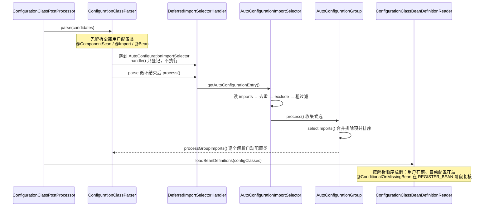

# Spring Boot 自动装配原理详解

> 一句话概括：自动装配不是魔法，而是一条「**候选清单 → 延迟导入 → 条件过滤 → 按序注册**」的流水线——Boot 从各 jar 的 `AutoConfiguration.imports` 读出自动配置类，在**用户配置解析完之后**才处理它们，用 `@Conditional` 逐个筛选，最后只把存活的 `@Bean` 注册进 IoC 容器；底层仍然是 Spring Framework 的 `refresh()`，没有任何新容器机制。

预计阅读时间：大约 65 分钟

所属主题：[Spring 常见面试题总结](summary.md)

本文以 **Boot 3.x 为源码基线**（锚点已对照 3.2.1 / 3.5.x 源码与 Framework 6.1.x 核实），在关键处注明 2.7 / 3.0 / 4.0 的演进差异。入门结论见 [summary 7.2 / 7.3](summary.md)，本文不复述口号，直接走源码、讲边界、给可运行示例。

---

## 0. 阅读路线

| 读者 | 建议章节 | 关注点 |
| --- | --- | --- |
| 初级（1 年内） | 1、3.1、6.1~6.2、文末速记 | 三合一注解是什么、Starter 怎么用、能答"自动配置原理" |
| 中级（1~3 年） | 2、3、4、5、6 全部 | 主链路源码、条件注解、用户 Bean 优先、排障、手写 Starter |
| 高级（3 年+） | 2.3~2.5、3.3、4.2、8 | 两级过滤、`ConfigurationPhase`、注册时序、启动成本与 AOT |
| 选型/架构 | 6.3、7.3、8.3~8.4 | Starter 治理、配置绑定取舍、Boot 4 模块化迁移 |

目录：

1. `@SpringBootApplication`：三合一拆解
2. 自动装配主链路：源码走读
3. 条件注解全景与实现思路
4. 用户 Bean 优先与自动配置排序
5. 装配排障：报告、端点与排查清单
6. Starter 机制与完整自定义 Starter
7. 配置绑定：`@ConfigurationProperties`
8. 边界、代价与版本演进
9. 高频追问集
10. 参考资料

---

## 1. `@SpringBootApplication`：三合一拆解

**结论**：Boot 不是新框架，是 Framework 的"自动化配置层"。`SpringApplication#run` 底层仍是创建 `ApplicationContext` 并调用 `AbstractApplicationContext#refresh`（容器启动骨架见 [IoC 与 AOP 专题](ioc-and-aop.md)）；`@SpringBootApplication` 只是把三个既有注解组合成一个入口。

### 1.1 注解组合与属性透传

Boot 3.2.1 `SpringBootApplication.java` 的注解声明原文：

```java
@SpringBootConfiguration
@EnableAutoConfiguration
@ComponentScan(excludeFilters = {
    @Filter(type = FilterType.CUSTOM, classes = TypeExcludeFilter.class),
    @Filter(type = FilterType.CUSTOM, classes = AutoConfigurationExcludeFilter.class) })
public @interface SpringBootApplication { ... }
```

| 组成 | 本质 | 职责 |
| --- | --- | --- |
| `@SpringBootConfiguration` | 元注解就是 `@Configuration` | 标记"这是 Boot 应用的主配置类"，`@SpringBootTest` 等测试切片靠它向上查找配置 |
| `@EnableAutoConfiguration` | `@AutoConfigurationPackage` + `@Import(AutoConfigurationImportSelector.class)` | 打开自动装配主链路（第 2 节） |
| `@ComponentScan` | Framework 原生扫描 | 默认扫描**主类所在包及子包**，两个自定义 excludeFilter 见 1.2 |

常用属性全部是 `@AliasFor` 透传，没有新逻辑：

| 属性 | 透传给 | 用途 |
| --- | --- | --- |
| `exclude` / `excludeName` | `@EnableAutoConfiguration` | 排除自动配置类 |
| `scanBasePackages` / `scanBasePackageClasses` | `@ComponentScan.basePackages` | 显式指定扫描范围 |
| `nameGenerator` | `@ComponentScan.nameGenerator` | Bean 命名策略 |
| `proxyBeanMethods`（2.2+） | `@Configuration.proxyBeanMethods` | 主类默认 `true`（Full 模式） |

两个容易忽略的细节：

- **`@AutoConfigurationPackage`**：通过 `AutoConfigurationPackages.Registrar` 把主类所在包登记进容器，供 JPA 实体扫描等"需要知道应用根包"的自动配置使用——它和 `@ComponentScan` 是两件事。
- **主类默认 Full 模式，自动配置类全部 Lite 模式**：`@AutoConfiguration` 元注解固定 `@Configuration(proxyBeanMethods = false)`，省去配置类的 CGLIB 代理（Full/Lite 对比见 [summary 3.4](summary.md)）。

### 1.2 默认扫描的两个排除过滤器

`AutoConfigurationExcludeFilter#match` 的逻辑（3.2.1 源码）：

```java
public boolean match(MetadataReader reader, MetadataReaderFactory factory) {
    return isConfiguration(reader) && isAutoConfiguration(reader);
}
// isAutoConfiguration：标了 @AutoConfiguration，或类名出现在 imports 候选清单里
```

即：**凡是登记在案的自动配置类，默认组件扫描会主动跳过**，防止它们被当成用户配置提前处理（这个坑的完整分析见 5.3）。`TypeExcludeFilter` 则是留给测试切片（如 `@WebMvcTest`）动态排除 Bean 的扩展点。

**边界/代价**：扫描范围由主类位置决定——把主类挪到深层包，上层包的 `@Component` 全部失联；这是"Bean 注入不进来"排查清单的第一项（[summary 9.4](summary.md)）。

**实践/追问**：面试问"`@SpringBootApplication` 能拆开写吗？"——能，三个注解独立声明完全等价，组合注解只是约定入口；追问"为什么主类要放根包"，答扫描范围 + `AutoConfigurationPackages`。

---

## 2. 自动装配主链路：源码走读

**结论**：主链路一句话——`@EnableAutoConfiguration` 通过 `@Import` 引入 `AutoConfigurationImportSelector`，它是 `DeferredImportSelector`，**延迟到所有用户配置类解析完成后**才读取候选清单、过滤、排序，最后由 `ConfigurationClassBeanDefinitionReader` 把存活的配置类注册成 BeanDefinition。

### 2.1 全景时序



入口在 `ConfigurationClassPostProcessor#processConfigBeanDefinitions`（BFPP 阶段）：先 `parser.parse(candidates)`，再 `reader.loadBeanDefinitions(configClasses)`——**解析与注册是两个阶段**，这个拆分是理解"用户 Bean 优先"的钥匙（第 4 节）。

### 2.2 为什么是 DeferredImportSelector

`ConfigurationClassParser#processImports` 对普通 `ImportSelector` 立即调用 `selectImports` 并递归解析；对 `DeferredImportSelector` 则只登记：

```java
if (selector instanceof DeferredImportSelector deferredImportSelector) {
    this.deferredImportSelectorHandler.handle(configClass, deferredImportSelector);
}
```

`ConfigurationClassParser#parse` 的 do-while 循环把**所有**常规配置类解析完之后，最后一行才是 `this.deferredImportSelectorHandler.process()`（Framework 6.1.2 源码第 183 行）。

**意义有两层**：

1. **时序保证**：自动配置类解析时，用户的 `@Component`（扫描时已注册 BeanDefinition）和 `@Configuration`/`@Bean`（已解析成 `ConfigurationClass`）都已就位，条件判断才有"让位"的依据；
2. **全局排序**：`AutoConfigurationImportSelector#getImportGroup` 返回 `AutoConfigurationGroup`，所有 deferred selector 的候选**汇总到一组**后统一排序（`selectImports()`），而不是各导各的——`@AutoConfigureBefore/After` 因此能跨 jar 生效。

### 2.3 候选清单：imports 文件与版本演进

`AutoConfigurationImportSelector#getCandidateConfigurations`（3.2.1 源码）：

```java
List<String> configurations = ImportCandidates.load(AutoConfiguration.class, getBeanClassLoader())
        .getCandidates();
Assert.notEmpty(configurations, "No auto configuration classes found in "
        + "META-INF/spring/org.springframework.boot.autoconfigure.AutoConfiguration.imports. ...");
```

`ImportCandidates#load` 的路径模板是 `META-INF/spring/%s.imports`（`%s` = 注解全名），即完整文件名：

```text
META-INF/spring/org.springframework.boot.autoconfigure.AutoConfiguration.imports
```

文件内容是**每行一个自动配置类全名**，`#` 开头为注释。`load` 用 `ClassLoader#getResources` 扫出 classpath 上**所有 jar** 里的同名文件并合并——第三方 Starter 就是这样参与装配的；fat jar 场景下 `BOOT-INF/lib` 里的嵌套 jar 也能被扫到，靠的是 Boot 自定义类加载器（见 [可执行 jar 专题](boot-executable-jar.md)）。3.2.1 官方 autoconfigure jar 里登记了 150+ 个候选类。

**版本演进（高频细节题）**：

| 版本 | 候选注册方式 |
| --- | --- |
| ≤ 2.6 | 仅 `META-INF/spring.factories` 的 `org.springframework.boot.autoconfigure.EnableAutoConfiguration` key |
| 2.7 | 引入 `AutoConfiguration.imports`，**两种方式并存**（过渡期） |
| 3.0+ | **移除** `spring.factories` 中自动配置的注册方式，只认 imports 文件 |

注意措辞：3.0 移除的只是"自动配置注册"这一种用途；`spring.factories` 本身仍在，`AutoConfigurationImportFilter`、`ApplicationListener` 等 SPI 还靠它加载（3.2.1 的 `spring.factories` 里仍能查到 filter 注册，见 2.4）。

### 2.4 getAutoConfigurationEntry：七步流水线

`AutoConfigurationImportSelector#getAutoConfigurationEntry` 的步骤（3.2.1 / 3.5.x 一致）：

| # | 步骤 | 源码锚点 | 说明 |
| --- | --- | --- | --- |
| 1 | 开关检查 | `isEnabled` | `spring.boot.enableautoconfiguration=false` 可整体关闭（默认 true） |
| 2 | 读候选 | `getCandidateConfigurations` | 合并所有 jar 的 imports |
| 3 | 去重 | `removeDuplicates` | `LinkedHashSet`，保持顺序 |
| 4 | 收集排除项 | `getExclusions` | 注解 `exclude`/`excludeName` + 属性 `spring.autoconfigure.exclude` 三个来源 |
| 5 | 校验排除项 | `checkExcludedClasses` | 排除的类在 classpath 上却不在候选清单 → 抛 `IllegalStateException`（**拼错类名启动即失败**） |
| 6 | 粗过滤 | `getConfigurationClassFilter().filter` | `AutoConfigurationImportFilter` 批量筛掉明显不满足条件的类 |
| 7 | 发事件 | `fireAutoConfigurationImportEvents` | `AutoConfigurationImportListener` 可观察装配结果 |

第 6 步的粗过滤是性能关键。filter 通过 `SpringFactoriesLoader.loadFactories(AutoConfigurationImportFilter.class, ...)` 加载，3.2.1 注册了三个：`OnClassCondition`、`OnBeanCondition`、`OnWebApplicationCondition`。它们读取**构建期生成**的 `META-INF/spring-autoconfigure-metadata.properties`（由 `spring-boot-autoconfigure-processor` 注解处理器生成），不加载配置类本身就能判断。例如 `OnClassCondition#getOutcomes` 直接查元数据里的 `ConditionalOnClass` key：

```java
String candidates = autoConfigurationMetadata.get(autoConfigurationClass, "ConditionalOnClass");
```

classpath 没有 Redis，`RedisAutoConfiguration` 在这一步就被丢弃，**根本不会进入解析**。`OnClassCondition` 还把候选数组拆成两半用 `ThreadedOutcomesResolver` 并行评估——150+ 个候选的类存在性检查是启动期实打实的开销，官方在这里做了并行优化。

### 2.5 排序与注册

`AutoConfigurationGroup#selectImports` 汇总所有 entry、再次剔除排除项后，交给 `AutoConfigurationSorter#getInPriorityOrder` 三级排序（3.2.1 源码注释原文）：

```java
Collections.sort(orderedClassNames);          // 1. 先按类名字母序（保证确定性）
orderedClassNames.sort(...getOrder()...);     // 2. 再按 @AutoConfigureOrder
orderedClassNames = sortByAnnotation(...);    // 3. 最后满足 @AutoConfigureBefore/After（拓扑排序）
```

排序后的类名经 `processGroupImports` 回到 `ConfigurationClassParser#processImports`，逐个走 `processConfigurationClass`：此时 `ConditionEvaluator#shouldSkip` 做**类级精确条件评估**（第二级过滤，见 3.3），存活的配置类进入 `configClasses` 这个 `LinkedHashMap`。

最后 `ConfigurationClassBeanDefinitionReader#loadBeanDefinitions` 按 map 顺序注册：配置类本身 + 每个 `@Bean` 方法（方法级再查一次 `shouldSkip(metadata, ConfigurationPhase.REGISTER_BEAN)`）。**用户配置类在 map 前部、自动配置类在后部**——注册顺序就是"让位"的物理基础。

**边界/代价**：整条链路发生在 `refresh()` 的 `invokeBeanFactoryPostProcessors` 阶段，全部是**启动期成本**；候选越多、条件越复杂，启动越慢（量化讨论见 8.1）。

**实践/追问**：能说出"粗过滤用构建期元数据、精确评估分 PARSE/REGISTER 两个阶段、注册顺序保证用户优先"，源码题就超过了绝大多数候选人。追问"为什么不用 `spring.factories` 了"，见 9 的 Q3。

---

## 3. 条件注解全景与实现思路

**结论**：`@Conditional` 是 Framework 4 引入的 SPI——`@Conditional(XxxCondition.class)` 把一个**策略对象**（见 [设计模式专题](design-patterns.md)）挂到配置类或 `@Bean` 方法上，`matches` 返回 false 就整体跳过。Boot 在此之上提供了一族开箱即用的条件注解，自动装配的"智能"全部来自它们。

### 3.1 条件注解全表

| 注解 | 生效条件 | 实现类 | 备注 |
| --- | --- | --- | --- |
| `@ConditionalOnClass` | classpath 存在指定类 | `OnClassCondition` | 引了依赖才装配；用类名字符串判断，不触发类加载 |
| `@ConditionalOnMissingClass` | classpath 不存在指定类 | `OnClassCondition` | 与上者互斥使用 |
| `@ConditionalOnBean` | 容器中已有指定 Bean | `OnBeanCondition` | **只在自动配置类里用才可靠**（4.2） |
| `@ConditionalOnMissingBean` | 容器中没有指定 Bean | `OnBeanCondition` | 用户 Bean 优先的关键 |
| `@ConditionalOnSingleCandidate` | 指定 Bean 唯一或有 `@Primary` | `OnBeanCondition` | 多数据源场景常用 |
| `@ConditionalOnProperty` | 配置项等于指定值 | `OnPropertyCondition` | `matchIfMissing=true` 表示缺省也生效 |
| `@ConditionalOnWebApplication` | 是指定类型 Web 应用 | `OnWebApplicationCondition` | `type` = SERVLET / REACTIVE / ANY |
| `@ConditionalOnNotWebApplication` | 非 Web 应用 | `OnWebApplicationCondition` | 批处理/CLI 场景 |
| `@ConditionalOnExpression` | SpEL 为 true | `OnExpressionCondition` | 灵活但难排障，慎用 |
| `@ConditionalOnJava` | JVM 版本满足范围 | `OnJavaCondition` | 如 `range = EQUAL_OR_NEWER, value = JAVA_17` |
| `@ConditionalOnResource` | 指定资源存在 | `OnResourceCondition` | 如 classpath 有某配置文件 |
| `@ConditionalOnWarDeployment` | 传统 WAR 外置容器部署 | `OnWarDeploymentCondition` | 内嵌容器时代少用 |

另：`@Profile` 本质是 `@Conditional(ProfileCondition.class)` 的特化，不是独立机制。

### 3.2 三个代表性实现思路

**`OnClassCondition`——不加载类的类存在性检查**。直接 `Class.forName` 会触发静态初始化、还可能因依赖缺失抛 `NoClassDefFoundError`。Boot 的做法：注解属性里写的是**类名字符串**，粗过滤阶段查构建期元数据（2.4），精确阶段用 `ClassUtils.isPresent`（内部捕获 `Throwable`）判断。配合 ASM 读取注解元数据，全程不需要把自动配置类加载进 JVM。

**`OnBeanCondition`——查 BeanDefinition，不实例化 Bean**。`getMatchOutcome` 通过 `ConfigurableListableBeanFactory#getBeanNamesForType` 按类型查已注册的**定义**，`@Bean` 方法的返回类型从工厂方法元数据推断，无需创建任何实例。支持 `name`、`annotation`、`searchStrategy`（默认 `ALL`，含父容器）、`parameterizedContainer` 等精细匹配。

**`OnPropertyCondition`——Environment 取值比对**。从 `Environment` 读 `prefix + name`，与 `havingValue` 比对；属性缺失时由 `matchIfMissing` 决定。注意它读的是 Environment 抽象，命令行、环境变量、yml 都算数（优先级见 [summary 7.4](summary.md)）。

### 3.3 两级过滤与两个 ConfigurationPhase

条件评估发生在**两个位置**，这是源码级深挖的分水岭：

| 级别 | 位置 | 依据 | 特点 |
| --- | --- | --- | --- |
| 粗过滤 | `AutoConfigurationImportFilter#match`（2.4 第 6 步） | 构建期元数据 properties | 批量、廉价，筛掉大多数候选；只有类级条件能参与 |
| 精确评估 | `ConditionEvaluator#shouldSkip` | 真实 classpath / Environment / BeanFactory | 解析配置类时（类级）与注册 `@Bean` 时（方法级）各查一次 |

`ConditionEvaluator#shouldSkip` 的关键逻辑（Framework 6.1.2）：

```java
// 条件按 AnnotationAwareOrderComparator 排序后逐个评估
if (condition instanceof ConfigurationCondition configurationCondition) {
    requiredPhase = configurationCondition.getConfigurationPhase();
}
if ((requiredPhase == null || requiredPhase == phase) && !condition.matches(context, metadata)) {
    return true;   // 跳过
}
```

`ConfigurationPhase` 有两个值：

| 阶段 | 时机 | 典型条件 |
| --- | --- | --- |
| `PARSE_CONFIGURATION` | 配置类解析期 | `OnClassCondition`、`OnPropertyCondition`（未实现 `ConfigurationCondition`，跟随调用方传入的阶段） |
| `REGISTER_BEAN` | BeanDefinition 注册期 | `OnBeanCondition` **显式声明只在此阶段评估**（`implements ConfigurationCondition`，`getConfigurationPhase` 返回 `REGISTER_BEAN`） |

**为什么 `OnBeanCondition` 必须等到 REGISTER_BEAN？** 因为"容器里有没有某个 Bean"只有在注册阶段才有完整答案——用户的 `@Bean` 方法是在 `loadBeanDefinitions` 逐个注册时才变成 BeanDefinition 的（4.1）。解析阶段查 Bean 会漏掉尚未注册的用户 `@Bean`，得出错误结论。

### 3.4 自定义 Condition（可运行）

```java
import org.springframework.context.annotation.Condition;
import org.springframework.context.annotation.ConditionContext;
import org.springframework.core.type.AnnotatedTypeMetadata;

public class OnLinuxCondition implements Condition {
    @Override
    public boolean matches(ConditionContext context, AnnotatedTypeMetadata metadata) {
        // ConditionContext 提供 Environment / BeanFactory / ClassLoader / ResourceLoader
        String os = context.getEnvironment().getProperty("os.name", "");
        return os.toLowerCase().contains("linux");
    }
}

// 使用：
// @Configuration
// @Conditional(OnLinuxCondition.class)
// public class LinuxOnlyConfig { @Bean public Foo foo() { return new Foo(); } }
```

**边界/代价**：条件只在**启动期评估一次**，运行期改配置不会重新装配（要动态开关用 `@RefreshScope` 或业务层判断）；`OnExpression` 这类自由表达式会让 ConditionEvaluationReport 的可读性变差。

**实践/追问**：追问"`@ConditionalOnClass` 为什么不直接 `Class.forName`"，答触发类初始化与依赖缺失异常；追问"条件注解自己写一个"，上面的例子就是最小完整答案。

---

## 4. 用户 Bean 优先与自动配置排序

**结论**：「用户自定义 Bean 覆盖自动配置」由**两个机制叠加**保证——① `DeferredImportSelector` 让自动配置**解析与注册都排在用户配置之后**；② `@ConditionalOnMissingBean` 在注册时发现用户 Bean 已存在就放弃。缺任何一个，"优先"都不成立。

### 4.1 让位的完整时序（源码级）

以"用户自定义 `GreetingService`，Starter 的自动配置让位"为例：

| 步骤 | 发生什么 | 锚点 |
| --- | --- | --- |
| 1 | `@ComponentScan` 扫描用户 `@Component`，**当场注册** BeanDefinition | `ClassPathBeanDefinitionScanner#doScan` |
| 2 | `parse` 解析用户 `@Configuration`，`@Bean` 方法记入 `ConfigurationClass`（尚未注册） | `ConfigurationClassParser#processConfigurationClass` |
| 3 | 用户配置全部解析完，才处理自动配置候选（2.2） | `DeferredImportSelectorHandler#process` |
| 4 | `loadBeanDefinitions` 按 `configClasses` 顺序注册：**用户 `@Bean` 先入库** | `ConfigurationClassBeanDefinitionReader#loadBeanDefinitions` |
| 5 | 轮到自动配置的 `@Bean` 方法，`shouldSkip(metadata, REGISTER_BEAN)` 触发 `OnBeanCondition`，查到同类型定义 → 跳过 | `loadBeanDefinitionsForBeanMethod` |

注意第 2、4 步的拆分：用户 `@Bean` 在**解析期**只是元数据，**注册期**才成为 BeanDefinition；自动配置的方法级条件恰好安排在注册期评估，时序严丝合缝。这也解释了 3.3 中 `OnBeanCondition` 绑定 `REGISTER_BEAN` 阶段的设计动机。BeanDefinition 与 Bean 实例的区别、实例化时机见 [Bean 生命周期专题](bean-lifecycle-and-circular-dependency.md)。

### 4.2 OnMissingBean 的判断细节与边界

- **默认按类型匹配**：标在 `@Bean` 方法上且未指定属性时，推断类型为**方法返回类型**；标在类上时推断该类的 `@Bean` 方法返回类型。返回类型写得太宽（如 `Object`）或太窄都会导致误判。
- **判断的是定义，不是实例**：不会提前实例化任何 Bean，FactoryBean 场景按 `getObjectType` 推断。
- **`searchStrategy` 默认 `ALL`**：父容器的 Bean 也算数（父子上下文场景要留意）。
- **只在自动配置类里推荐**：用户配置类之间的解析顺序不受 `@AutoConfigure*` 控制，两个用户 `@Configuration` 互相 `OnMissingBean` 的结果依赖扫描顺序，是脆弱设计。
- **自动配置类之间的竞争靠排序解决**：A 配置想"让位给 B 配置"，用 `@AutoConfigureAfter(B.class)` 保证 B 先注册。

### 4.3 自动配置类之间的顺序

| 手段 | 作用 | 备注 |
| --- | --- | --- |
| `@AutoConfigureOrder` | 数值小的先处理 | 只影响自动配置类之间 |
| `@AutoConfigureBefore` / `@AutoConfigureAfter` | 声明相对先后 | 拓扑排序，可跨 jar |
| `@AutoConfiguration(before = ..., after = ...)` | 2.7+ 把上面两个注解收进属性 | 新代码推荐写法，另有 `beforeName`/`afterName` 字符串版 |

排序实现即 2.5 的三级排序。**关键边界：这些注解对用户配置完全无效**——用户配置永远先于全部自动配置，无论 order 写多小。典型实例：`TransactionAutoConfiguration` 声明在 `DataSourceAutoConfiguration` 之后（见 [事务专题](transaction.md)），`WebMvcAutoConfiguration` 依赖 `DispatcherServletAutoConfiguration` 先就位（见 [MVC 请求流程专题](mvc-request-flow.md)）。

**实践/追问**：问"为什么我的 `@AutoConfigureBefore` 不生效"，先问对方是不是标在了用户 `@Configuration` 上——这是最常见的误用。

---

## 5. 装配排障：报告、端点与排查清单

**结论**：自动装配的"魔法"有官方解药——`ConditionEvaluationReport` 记录了**每个候选类的匹配结果与原因**。排障第一动作永远是打开报告，而不是猜。

### 5.1 --debug 与条件评估报告

启动加 `--debug`（或配置 `debug=true`），`ConditionEvaluationReportLoggingListener` 会在 `ContextRefreshedEvent` / `ApplicationFailedEvent` 时打印报告（3.2.1 源码核实），分四段：

```text
Positive matches:（装配了，为什么）
   GreetingAutoConfiguration#greetingService matched:
      - @ConditionalOnMissingBean (types: com.example.greeting.GreetingService;
        SearchStrategy: all) did not find any beans (OnBeanCondition)
Negative matches:（没装配，差在哪）
   RedisAutoConfiguration:
      Did not match:
         - @ConditionalOnClass did not find required class
           'org.springframework.data.redis.core.RedisOperations' (OnClassCondition)
Exclusions:（被显式排除的）
Unconditional classes:（无条件装配的）
```

**启动失败也会打印**——`ApplicationFailedEvent` 分支专门服务于"装配导致启动炸了"的场景。

### 5.2 Actuator conditions 端点

运行期想看报告，暴露 actuator 的 `conditions` 端点（`ConditionsReportEndpoint`）：

```yaml
management.endpoints.web.exposure.include: health,conditions
```

访问 `/actuator/conditions` 得到 JSON 版报告，结构与 `--debug` 输出一致。注意它和 `env`/`heapdump` 一样属于敏感端点，不要裸暴露公网（[summary 7.6](summary.md)）。

### 5.3 排查清单

**「为什么我的 Bean 没被装配？」**

| # | 检查项 | 手段 |
| --- | --- | --- |
| 1 | 依赖真的在 classpath？ | `mvn dependency:tree`；报告里 `OnClassCondition` 的 negative 原因 |
| 2 | 开关属性没开？ | 核对 `@ConditionalOnProperty` 的 prefix/name/havingValue，注意 `matchIfMissing` |
| 3 | profile 不对？ | `@Profile` / `spring.profiles.active` |
| 4 | 被 exclude 了？ | 注解 exclude、`spring.autoconfigure.exclude` |
| 5 | 用户 Bean 已存在导致让位？ | 这通常是**期望行为**，报告 positive/negative 会写明 |
| 6 | 自定义 Bean 不在扫描路径？ | 主类包位置、`scanBasePackages`（[summary 9.4](summary.md)） |

**「为什么自动配置没让位 / 行为不符合预期？」**

| # | 场景 | 原因与修复 |
| --- | --- | --- |
| 1 | 用户 Bean 类型对不上 | `OnMissingBean` 按返回类型推断；用户 `@Bean` 返回了父类/接口而自动配置按具体类查（或反之）→ 显式指定 `@ConditionalOnMissingBean(Xxx.class)` 或统一类型 |
| 2 | 用户配置也是 deferred import | 两个 `DeferredImportSelector` 之间无用户/自动之分，顺序看 Group 排序 |
| 3 | 自动配置类被组件扫描扫到 | 见下文专项 |
| 4 | exclude 拼错类名 | `checkExcludedClasses` 直接抛 `IllegalStateException: The following classes could not be excluded because they are not auto-configuration classes` |

**专项：自动配置类被 `@ComponentScan` 扫到的坑**。被扫到的自动配置类会当成**用户配置**提前解析注册：`@AutoConfigureBefore/After` 失效、`OnMissingBean` 相对其他自动配置的时序错乱，还可能与其他自动配置产生重复 Bean。Boot 的默认扫描用 `AutoConfigurationExcludeFilter`（1.2）挡住了登记在 imports 里的类，但两种写法仍会踩坑：

- 自己另写 `@ComponentScan`（不带那两个 excludeFilter）且包范围覆盖了自动配置类；
- 用 `@Import(SomeAutoConfiguration.class)` 直接导入——等价于把它当用户配置。

**规则：自动配置类只通过 imports 文件生效，永远不要扫描或手动 `@Import` 它们**（测试切片想指定少量自动配置用 `@ImportAutoConfiguration`）。

---

## 6. Starter 机制与完整自定义 Starter

**结论**：Starter = **依赖聚合（pom）+ 版本对齐（BOM）+ 自动配置代码（imports 登记）**。它本身没有运行时魔法，只是把"引哪些依赖、装哪些配置"打包成一个坐标。

### 6.1 命名约定与模块拆分

| 类型 | 命名 | 例子 |
| --- | --- | --- |
| 官方 | `spring-boot-starter-xxx` | `spring-boot-starter-data-redis` |
| 第三方 | `xxx-spring-boot-starter` | `mybatis-spring-boot-starter`、`druid-spring-boot-starter` |
| 自定义逻辑模块 | `xxx-spring-boot-autoconfigure` | 放条件装配代码，可被单独依赖 |
| 自定义聚合模块 | `xxx-spring-boot-starter` | **空壳 pom**，聚合 autoconfigure + 所需第三方依赖 |

拆两个模块的理由：使用方可以只依赖 autoconfigure 模块、自己掌控第三方依赖版本；starter 则提供"一键全家桶"。版本对齐靠 `spring-boot-dependencies` BOM——Starter 不要擅自钉死与 Boot 管理范围重叠的依赖版本。

### 6.2 完整示例：greeting-spring-boot-starter

四步：属性类 → 自动配置类 → imports 登记 → 双模块 pom。以下代码基于 Boot 3.x，可直接落地。

**① 属性类 + 业务类（autoconfigure 模块）**

```java
package com.example.greeting.autoconfigure;

import jakarta.validation.constraints.NotBlank;
import org.springframework.boot.context.properties.ConfigurationProperties;
import org.springframework.validation.annotation.Validated;

@Validated
@ConfigurationProperties(prefix = "greeting")
public class GreetingProperties {
    @NotBlank
    private String prefix = "Hello";
    private String suffix = "!";

    public String getPrefix() { return prefix; }
    public void setPrefix(String prefix) { this.prefix = prefix; }
    public String getSuffix() { return suffix; }
    public void setSuffix(String suffix) { this.suffix = suffix; }
}
```

```java
package com.example.greeting;

public class GreetingService {
    private final String prefix;
    private final String suffix;

    public GreetingService(String prefix, String suffix) {
        this.prefix = prefix;
        this.suffix = suffix;
    }

    public String greet(String name) {
        return prefix + ", " + name + suffix;
    }
}
```

**② 自动配置类**

```java
package com.example.greeting.autoconfigure;

import com.example.greeting.GreetingService;
import org.springframework.boot.autoconfigure.AutoConfiguration;
import org.springframework.boot.autoconfigure.condition.ConditionalOnMissingBean;
import org.springframework.boot.autoconfigure.condition.ConditionalOnProperty;
import org.springframework.boot.context.properties.EnableConfigurationProperties;
import org.springframework.context.annotation.Bean;

@AutoConfiguration
@ConditionalOnProperty(prefix = "greeting", name = "enabled",
        havingValue = "true", matchIfMissing = true)
@EnableConfigurationProperties(GreetingProperties.class)
public class GreetingAutoConfiguration {

    @Bean
    @ConditionalOnMissingBean
    public GreetingService greetingService(GreetingProperties properties) {
        return new GreetingService(properties.getPrefix(), properties.getSuffix());
    }
}
```

要点：`@AutoConfiguration` 自带 Lite 模式与 before/after 属性；`matchIfMissing = true` 让 Starter 默认启用；`@ConditionalOnMissingBean` 把最终决定权交给使用方。

**③ imports 登记**（autoconfigure 模块的 `src/main/resources/`）

```text
# 文件：META-INF/spring/org.springframework.boot.autoconfigure.AutoConfiguration.imports
com.example.greeting.autoconfigure.GreetingAutoConfiguration
```

**④ 双模块 pom（关键片段）**

```xml
<!-- greeting-spring-boot-autoconfigure/pom.xml -->
<dependencies>
    <dependency>
        <groupId>org.springframework.boot</groupId>
        <artifactId>spring-boot-autoconfigure</artifactId>
    </dependency>
    <dependency>
        <groupId>jakarta.validation</groupId>
        <artifactId>jakarta.validation-api</artifactId>
    </dependency>
    <!-- 可选：生成 IDE 配置提示元数据 -->
    <dependency>
        <groupId>org.springframework.boot</groupId>
        <artifactId>spring-boot-configuration-processor</artifactId>
        <optional>true</optional>
    </dependency>
    <!-- 可选：生成粗过滤元数据，加速使用方启动（见 2.4） -->
    <dependency>
        <groupId>org.springframework.boot</groupId>
        <artifactId>spring-boot-autoconfigure-processor</artifactId>
        <optional>true</optional>
    </dependency>
</dependencies>
```

```xml
<!-- greeting-spring-boot-starter/pom.xml：空壳聚合 -->
<dependencies>
    <dependency>
        <groupId>com.example</groupId>
        <artifactId>greeting-spring-boot-autoconfigure</artifactId>
        <version>${project.version}</version>
    </dependency>
    <dependency>
        <groupId>org.springframework.boot</groupId>
        <artifactId>spring-boot-starter</artifactId>
    </dependency>
    <dependency>
        <groupId>org.springframework.boot</groupId>
        <artifactId>spring-boot-starter-validation</artifactId>
    </dependency>
</dependencies>
```

（版本统一由父 pom 导入 `spring-boot-dependencies` BOM 管理，此处省略 `dependencyManagement`。）

```yaml
# 使用方 application.yml
greeting:
  prefix: 你好
  suffix: ！
```

```java
@SpringBootApplication
public class DemoApplication {
    public static void main(String[] args) {
        SpringApplication.run(DemoApplication.class, args);
    }

    @Bean
    ApplicationRunner runner(GreetingService greetingService) {
        return args -> System.out.println(greetingService.greet("Spring Boot"));
        // 输出：你好, Spring Boot！
    }
}
```

使用方想覆盖默认实现，只需自己声明同类型 Bean：

```java
@Bean
public GreetingService greetingService() {
    return new GreetingService("Hi", "~");   // 自动配置让位（4.1 的时序）
}
```

用 `--debug` 验证：报告里 `GreetingAutoConfiguration#greetingService` 出现在 Negative matches，原因是 `@ConditionalOnMissingBean ... found beans of type 'com.example.greeting.GreetingService'`。

### 6.3 configuration metadata 与 Starter 治理

`spring-boot-configuration-processor` 编译期生成 `META-INF/spring-configuration-metadata.json`，IDE 据此提供补全与文档：

```json
{ "properties": [ {
    "name": "greeting.prefix", "type": "java.lang.String",
    "description": "Greeting prefix.", "defaultValue": "Hello"
} ] }
```

没有对应属性类的开关项（如 `greeting.enabled`）可手写 `additional-spring-configuration-metadata.json` 补充提示。

**边界/代价**：Starter 是"依赖契约"——引入即改变 classpath，可能激活使用方没预期的自动配置；组织内应统一 Starter 版本基线（BOM），禁止各业务线私改传递依赖版本。**Boot 4 注意**：官方明确不建议同一个 Starter artifact 同时兼容 Boot 3 和 4（包名与模块结构变化太大），应分发不同版本线（8.4）。

---

## 7. 配置绑定：`@ConfigurationProperties`

**结论**：自动装配的"可配置性"靠 `@ConfigurationProperties` 把 Environment 中的属性**类型安全地批量绑定**到 POJO；它和 `@Value` 是两套机制，成组配置一律前者。

### 7.1 绑定机制与松散绑定

启用方式：`@EnableConfigurationProperties(Xxx.class)`（自动配置类标配）或 `@ConfigurationPropertiesScan`。绑定由 `ConfigurationPropertiesBindingPostProcessor` 在 Bean 初始化前触发，底层是 `Binder#bind`：JavaBean 走 `JavaBeanBinder`（setter），构造器绑定走 `ValueObjectBinder`。

**松散绑定**：以下写法都映射到 `userName` 字段——

| 来源写法 | 示例 |
| --- | --- |
| kebab-case（properties/yml 推荐规范形） | `app.user-name` |
| camelCase | `app.userName` |
| 下划线 | `app.user_name` |
| 大写环境变量（`_` 分隔层级） | `APP_USERNAME` |

**校验**：类上加 `@Validated` + JSR-303 注解（`@NotBlank`、`@Min` 等），绑定失败**启动即报错**——把配置错误从运行期提前到启动期，与 Boot 的 fail-fast 哲学一致（6.2 的属性类已示范）。

**构造器绑定**（不可变配置）：

```java
@ConfigurationProperties(prefix = "greeting")
public record GreetingRecord(@DefaultValue("Hello") String prefix,
                             @DefaultValue("!") String suffix) { }
```

Boot 3.x 中单一有参构造器自动按构造器绑定，无需标注；显式标注时 `@ConstructorBinding` 位于 `org.springframework.boot.context.properties.bind` 包且**只能标在构造器上**（2.x 标在类上的写法已废弃）。

### 7.2 与 @Value 的取舍

| 维度 | `@ConfigurationProperties` | `@Value` |
| --- | --- | --- |
| 绑定粒度 | 前缀批量绑定整组属性 | 单值注入 |
| 松散绑定 | 支持 | **不支持**（key 必须精确匹配） |
| SpEL | 不支持 | 支持 `#{...}` |
| 类型安全/校验 | 强类型 + JSR-303 | 无校验，类型转换失败才报错 |
| IDE 元数据提示 | 有（configuration-processor） | 无 |
| 适用 | 成组业务配置、Starter 属性 | 零星单值、需要 SpEL 的场景 |

### 7.3 配置优先级（简表）

高 → 低（完整清单与 profile 规则见 [summary 7.4](summary.md)，此处不重复展开）：

| 优先级 | 来源 |
| --- | --- |
| 1 | 命令行参数 `--key=value` |
| 2 | Java 系统属性 `-Dkey=value` |
| 3 | 操作系统环境变量 |
| 4 | jar 外 `application-{profile}.yml` → jar 内 profile 文件 |
| 5 | jar 外/内 `application.yml` → 默认值 |

**实践/追问**：追问"环境变量为什么能覆盖 yml"，答 Environment 的 PropertySource 顺序 + 松散绑定把 `APP_USER_NAME` 归一到 `app.user-name`；追问"`@Value` 能松散绑定吗"，答不能，这是两者最常被混淆的差异。

---

## 8. 边界、代价与版本演进

### 8.1 启动期成本

自动装配的全部开销集中在启动期：classpath 扫描（ASM 读元数据）、150+ 候选的条件评估、配置类解析与 BeanDefinition 注册。官方的缓解手段本文都出现过：构建期元数据粗过滤（2.4）、`OnClassCondition` 双线程并行、`CachingMetadataReaderFactory` 缓存元数据、自动配置类一律 Lite 模式省代理。**代价的另一面**：依赖越多启动越慢，Serverless 冷启动场景要么裁剪 Starter，要么上 AOT/native image（[summary 1.5](summary.md)）。

### 8.2 错误暴露在启动期，以及"魔法"的排障成本

fail-fast 是特性不是缺陷：exclude 拼错、绑定校验失败、条件装配缺 Bean 都在启动期炸，好过第一个请求进来才炸。但"约定优于配置"的另一面是**行为不直观**——不读报告就不知道某个 Bean 为什么在/不在。工程对策：把 `--debug` 报告和 conditions 端点纳入排障 SOP（第 5 节）；自定义 Starter 的条件尽量用 `OnClass/OnProperty/OnMissingBean` 这类报告可读性好的注解，少用 `OnExpression`。

### 8.3 AOT 对自动装配的影响

Boot 3 的 AOT（GraalVM native image 前置处理）会在**构建期**执行条件评估与 BeanDefinition 推导，把结果固化成初始化代码。这意味着：classpath 与条件假设在构建期被冻结，运行期"动态加 jar 触发装配"的玩法在 native 下不成立；反射/资源访问需要构建期可达性分析覆盖。

### 8.4 版本演进总表（自动装配视角）

| 版本 | 时间 | 关键变化 |
| --- | --- | --- |
| ≤ 2.6 | — | 候选仅注册在 `spring.factories`（`EnableAutoConfiguration` key） |
| 2.7 | 2022-05 | 引入 `AutoConfiguration.imports`，与旧方式并存；新增 `@AutoConfiguration`（含 before/after 属性） |
| 3.0 | 2022-11 | **移除** `spring.factories` 的自动配置注册（其余 SPI 仍用）；javax → jakarta；Java 17 基线 |
| 3.2 | 2023-11 | 本文核实基线之一；机制稳定，候选 150+ |
| 3.5.x | 2025 | 源码新增 `AutoConfigurationReplacements`：被替换/改名的自动配置类平滑映射，exclude 旧类名也能正确生效 |
| 4.0 | 2025-11 | **autoconfigure 模块化拆分**（详见下） |

**Boot 4.0（2025-11-20 发布）的模块化**是对自动装配**组织方式**的最大调整（机制本身——imports + 条件过滤——不变）：

- 单体 `spring-boot-autoconfigure` jar 拆成按技术划分的小模块，命名约定 `spring-boot-<technology>`，根包 `org.springframework.boot.<technology>`，每个模块自带自己的 imports 文件。如 Web MVC 的自动配置移入 `spring-boot-webmvc`；
- 每项技术都有对应 Starter：`spring-boot-starter-<technology>`；`spring-boot-starter-web` 更名 `spring-boot-starter-webmvc`（旧名暂存但已废弃）；
- **语义变化**：Boot 3 里"classpath 有 Flyway jar 就自动装配"，Boot 4 里必须引入 `spring-boot-starter-flyway` 带来 `spring-boot-flyway` 模块才行——只引第三方库不再触发装配，且**不报错、静默不生效**，是迁移期最隐蔽的坑；
- 过渡方案：`spring-boot-starter-classic` 聚合全部自动配置模块（不含传递依赖），先跑起来再逐步精细化；
- 自动配置类不再暴露 public 成员（常量除外）——它们从来不是公共 API，Boot 4 用 Java 可见性强制执行。直接引用自动配置类内部成员的代码要改。

对自定义 Starter 的影响：依赖 `spring-boot-autoconfigure` 或手动引用官方自动配置类的写法要换成新模块坐标与包名；官方不建议同一 artifact 兼容 3/4 两代。

---

## 9. 高频追问集

**Q1：为什么用户自定义 Bean 能覆盖自动配置？**
两个机制叠加：`DeferredImportSelector` 让自动配置在用户配置**解析完之后**才处理，且 `loadBeanDefinitions` 按同序注册，用户 `@Bean` 先成为 BeanDefinition；自动配置的 `@ConditionalOnMissingBean` 在 REGISTER_BEAN 阶段查到用户定义即让位。只答"注解让位"或只答"延迟加载"都不完整。

**Q2：`DeferredImportSelector` 的意义？和普通 `ImportSelector` 区别？**
普通 selector 在 `processImports` 时立即执行；deferred 版本先登记，等 `parse` 循环结束统一 `process()`。意义：① 保证用户配置先就位，条件判断有依据；② 通过 `Group` 把所有候选汇总后全局排序，`@AutoConfigureBefore/After` 才能跨 jar 生效。

**Q3：imports 与 spring.factories 的演进？**
≤2.6 只有 `spring.factories`；2.7 引入 `META-INF/spring/org.springframework.boot.autoconfigure.AutoConfiguration.imports` 双轨过渡；3.0 移除旧注册方式。注意 `spring.factories` 没有消失，filter/listener 等 SPI 仍用它。拆分动机：自动配置清单独立成文件，语义单一、便于工具处理与模块化（Boot 4 每个模块各带一份）。

**Q4：`@ConditionalOnMissingBean` 什么时候判断？会实例化 Bean 吗？**
在 BeanDefinition **注册阶段**（`ConfigurationPhase.REGISTER_BEAN`）判断，查的是已注册的定义与工厂方法返回类型元数据，**不实例化任何 Bean**。这也是它必须晚于用户 `@Bean` 注册的原因。

**Q5：条件评估为什么分两级？**
粗过滤（`AutoConfigurationImportFilter`）用构建期元数据批量排除明显不符的候选，避免解析 150+ 个类；精确评估（`ConditionEvaluator`）在解析/注册时按真实容器状态判断。`OnBeanCondition` 只参与 REGISTER_BEAN 阶段的精确评估（类级粗过滤除外），因为 Bean 存在性只有注册期才有完整答案。

**Q6：`@AutoConfigureBefore/After/Order` 能控制用户配置吗？**
不能，只在自动配置类之间生效。用户配置永远先于全部自动配置。标在用户 `@Configuration` 上是常见误用。

**Q7：自动配置类被 `@ComponentScan` 扫到会怎样？**
被当成用户配置提前处理：排序注解失效、与其他自动配置的相对时序错乱。Boot 默认扫描有 `AutoConfigurationExcludeFilter` 挡掉登记在案的自动配置类；自写 `@ComponentScan` 或直接 `@Import` 自动配置类仍会踩坑。规则：自动配置类只走 imports 文件。

**Q8：exclude 和 `@ConditionalOnProperty` 关闭有什么区别？**
exclude 把类从候选清单移除，根本不参与评估；属性开关保留候选、条件评估不通过（报告可见原因）。exclude 一个不在候选清单里的类会启动报错（`checkExcludedClasses`），属性写错则静默不生效——排障时两者表现不同。

**Q9：Boot 4 为什么引了 flyway-core 却不执行迁移了？**
模块化后自动配置代码在 `spring-boot-flyway` 模块里，只引第三方库不带该模块，候选清单里根本没有 Flyway 的自动配置类。修复：改用 `spring-boot-starter-flyway`。这是"classpath 触发"语义在 Boot 4 的收窄。

**Q10：线上 Bean 没注入，你的排查路径？**
先 `--debug` 或 `/actuator/conditions` 看报告定位 negative 原因 → 按 5.3 清单核对 classpath/属性/profile/exclude/扫描路径 → 确认是否被用户 Bean 让位（通常是期望行为）→ 最后才怀疑框架。绝不靠猜。

---

## 10. 参考资料

- Spring Boot 官方文档：Auto-configuration、Developing Auto-configuration、Configuration Properties 各章 <https://docs.spring.io/spring-boot/reference/>
- 源码锚点（本文已对照 3.2.1 / 3.5.x 与 Framework 6.1.x 核实）：`AutoConfigurationImportSelector#getAutoConfigurationEntry`、`ImportCandidates#load`、`AutoConfigurationSorter#getInPriorityOrder`、`ConfigurationClassParser#parse`（deferred 处理）、`ConditionEvaluator#shouldSkip`、`ConfigurationClassBeanDefinitionReader#loadBeanDefinitions`、`OnBeanCondition#getConfigurationPhase`、`AutoConfigurationExcludeFilter#match`
- Spring Boot 2.7 / 3.0 Release Notes（imports 文件引入与旧方式移除）
- *Modularizing Spring Boot*（2025-10-28）<https://spring.io/blog/2025/10/28/modularizing-spring-boot/>
- Spring Boot 4.0 Migration Guide <https://github.com/spring-projects/spring-boot/wiki/Spring-Boot-4.0-Migration-Guide>
- *Spring Boot 4.0.0 available now*（2025-11-20）<https://spring.io/blog/2025/11/20/spring-boot-4-0-0-available-now/>
- 同主题延伸阅读：[IoC 与 AOP](ioc-and-aop.md)、[Bean 生命周期与循环依赖](bean-lifecycle-and-circular-dependency.md)、[事务](transaction.md)、[设计模式](design-patterns.md)、[可执行 jar](boot-executable-jar.md)、[@Async 原理](async-annotation-principle.md)、[MVC 请求流程](mvc-request-flow.md)

---

## 附：一页速记

1. **Boot 不是新框架**：`run()` 底层仍是 `refresh()`；`@SpringBootApplication` = `@SpringBootConfiguration` + `@EnableAutoConfiguration` + `@ComponentScan`。
2. **主链路**：`@Import(AutoConfigurationImportSelector)` → DeferredImportSelector 延迟到用户配置解析后 → 读 `META-INF/spring/org.springframework.boot.autoconfigure.AutoConfiguration.imports` → 去重/exclude → 粗过滤 + 条件精确评估 → 按序注册 BeanDefinition。
3. **文件演进**：≤2.6 用 spring.factories；2.7 双轨；3.0 只认 imports（spring.factories 仍服务其他 SPI）。
4. **用户优先 = 延迟处理 + OnMissingBean**：注册顺序用户在前；OnMissingBean 在 REGISTER_BEAN 阶段查定义、不实例化。
5. **排序三注解只在自动配置之间生效**：字母序 → `@AutoConfigureOrder` → Before/After 拓扑；2.7+ 推荐 `@AutoConfiguration(before/after)`。
6. **排障第一动作是报告**：`--debug` 的 ConditionEvaluationReport（positive/negative/exclusions/unconditional）或 `/actuator/conditions`；自动配置类只走 imports，别扫描、别手动 @Import。
7. **Starter = 依赖聚合 + BOM 对齐 + 自动配置代码**；官方 `spring-boot-starter-xxx`，第三方 `xxx-spring-boot-starter`；双模块拆分 + imports 登记 + 两个可选 processor（配置提示 / 粗过滤元数据）。
8. **成组配置用 `@ConfigurationProperties`**：松散绑定 + 校验 + 元数据；`@Value` 只管单值与 SpEL。
9. **代价在启动期**：扫描与条件评估成本、错误启动期暴露、魔法排障成本；AOT 把条件评估冻结到构建期。
10. **Boot 4（2025-11）模块化**：autoconfigure 拆成 `spring-boot-<technology>`，web starter 更名 webmvc，只引第三方库不再触发装配，classic starter 兜底过渡。

**一句话**
> 自动装配的全部"智能"，都是**启动期用条件评估换来的约定**；读懂 imports 清单、两级过滤和注册时序，魔法就变成了可排障、可定制、可手写的一条普通流水线。