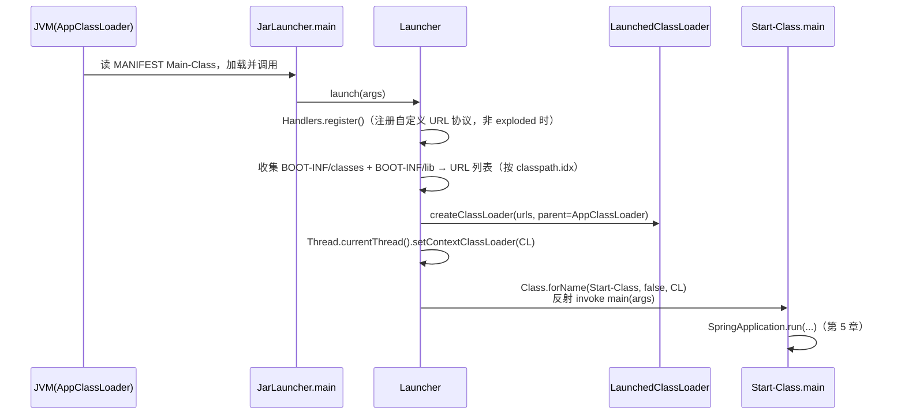
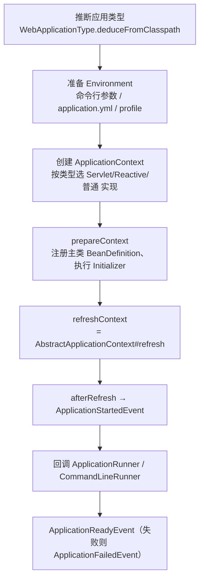
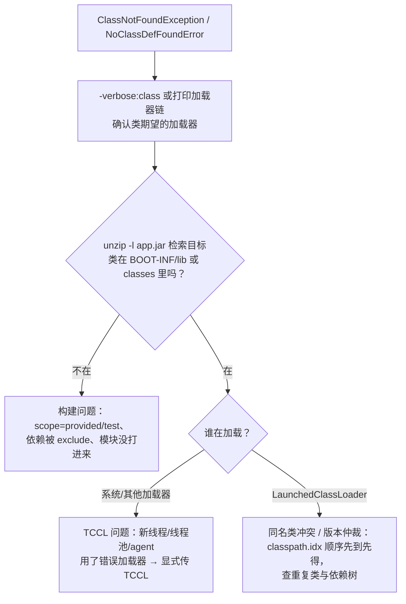

# Spring Boot 的 JAR 为什么可以直接运行？

> 一句话概括：标准 JVM 只认「扁平 classpath」，读不了 jar 里嵌套的 jar；Boot 用**特殊的 jar 布局（BOOT-INF）+ 放在 jar 根部的启动器（JarLauncher）+ 支持嵌套 jar 的自定义类加载器**，把 `java -jar` 变成「先启动启动器、再由启动器启动应用」的两段式引导。

预计阅读时间：大约 65 分钟

所属主题：[Spring 常见面试题总结](summary.md)

本文以 **Spring Boot 3.x** 为基线（源码锚点核对自 3.2.0 / 3.3.0 与 2.7.18 的 `spring-boot-loader` 源码），重点讲透类加载与启动器机制。**Boot 3.2 是分水岭**：启动器包名从 `org.springframework.boot.loader` 重组为 `org.springframework.boot.loader.launch`，嵌套 jar 的 URL 协议与底层实现整体重写，文中均标注版本差异。启动骨架部分与总结 7.5 节衔接，但展开到源码锚点与工程边界。

---

## 0. 阅读路线

| 读者 | 建议章节 | 关注点 |
| --- | --- | --- |
| 初级（1 年内） | 1、2、8 | `java -jar` 读什么、fat jar 里有什么、Main-Class 与 Start-Class 区别 |
| 中级（1~3 年） | 3、4、5、7 | launch 流程、嵌套 jar 加载、启动骨架、ClassNotFoundException 排查 |
| 高级（3 年+） | 3.3、4.2~4.4、5.2、6.3 | 双委派取舍、3.2 前后实现差异、内嵌容器启动时机、CDS/native 取舍 |
| 选型/架构 | 2.4、6、7 | 部署形态、镜像分层缓存、启动加速路线、兼容性代价 |

目录：

1. 问题起点：`java -jar` 到底做了什么
2. fat jar 解剖：布局与 MANIFEST
3. 启动器家族与 launch 流程
4. 嵌套 jar 加载：jar 中的 jar 怎么读
5. 从 Start-Class 到 SpringApplication.run
6. 工程实践：分层 jar、部署形态、启动加速
7. 边界与代价：兼容性与排障
8. 高频追问集
9. 参考资料

---

## 1. 问题起点：`java -jar` 到底做了什么

### 1.1 JVM 的两种启动语义

**结论**：`java -jar` 不是"把 jar 加进 classpath 再找主类"，而是**读 MANIFEST 决定主类、且无视命令行 `-cp`** 的特殊启动模式。

| 启动方式 | 主类从哪来 | classpath 是什么 |
| --- | --- | --- |
| `java -cp a.jar:b.jar com.x.Main` | 命令行显式指定 | `-cp` 列表：目录或 jar，**扁平** |
| `java -jar app.jar` | `META-INF/MANIFEST.MF` 的 `Main-Class` 属性 | **jar 自身** + MANIFEST 的 `Class-Path` 条目；`-cp`/`-classpath` 被忽略 |

所以"可执行 jar"的全部秘密都在 MANIFEST 里：JVM 只负责找到 `Main-Class`、用标准类加载器加载它、调用 `main`。**它没有任何义务理解 jar 内部还有什么别的结构**——这正是 Boot 可以利用的缝隙。

### 1.2 普通 jar 为什么不能把依赖"吞"进自身运行

**机制**：假设把所有依赖 jar 原样塞进 `app.jar` 的 `lib/` 目录，标准 JVM 依然跑不起来，原因有三层：

1. **类加载器按 entry 找类**：`AppClassLoader`（本质是 `URLClassLoader`）把 classpath 的每个条目当作"目录"或"单个 jar"，在其中按 `com/x/Foo.class` 这样的路径找 entry。嵌套在内部的 `lib/dep.jar` 对它只是一个**普通字节 entry**，不是类来源——它不会打开这个 entry 再往里找类。
2. **`jar:` URL 协议只支持一层 `!/`**：JDK 的 jar 协议处理器只解析第一个 `!/` 分隔符，后面全部视为 entry 路径。`jar:file:/app.jar!/lib/dep.jar!/com/x/Foo.class` 这种"两层嵌套"URL 是非法的，标准处理器无法把内层 jar 当作独立 jar 打开。
3. **classpath 的扁平假设**：整个 JDK 类加载体系（包括 `Class-Path` MANIFEST 属性、`ServiceLoader` 的资源查找）都建立在"classpath 是目录/jar 的线性列表"之上，没有"jar 中 jar"的标准表示法。

### 1.3 两条路：合并类（shade）还是嵌套 jar（Boot）

| 方案 | 做法 | 问题 |
| --- | --- | --- |
| shade / uber jar（Maven Shade、Gradle Shadow） | 把所有依赖**解包**，class 合并进一个大 jar | 同名资源互相覆盖（`META-INF/services/*`、Spring 的 `spring.factories` / `AutoConfiguration.imports`、签名文件）；类来源不可追溯；重定位（relocation）配置繁琐 |
| **Boot fat jar** | 依赖**保持完整 jar 原样嵌套**，另写一套能读嵌套 jar 的启动器/类加载器 | 需要自定义 URL 协议与 ClassLoader；部分工具不兼容（见第 7 章） |

**结论**：Boot 做了两件事——**① 特殊的 jar 布局**（业务类、依赖、启动器各归其位，见第 2 章）；**② 自定义启动器与类加载器**（绕过标准类加载器的扁平假设，见第 3、4 章）。官方文档明确解释了不选 shade 的原因：合并后"难以看出应用里到底有哪些库"，且"多个 jar 存在同名但内容不同的文件时会出问题"。

**追问：为什么依赖要保持完整 jar 而不解包？** 保留每个依赖的 MANIFEST（版本信息）、签名、资源命名空间，避免合并冲突；也让 `BOOT-INF/lib` 一眼可审计（`unzip -l` 即依赖清单）。

---

## 2. fat jar 解剖：布局与 MANIFEST

### 2.1 目录树（Boot 3.2+ 真实结构）

```text
my-app-1.0.0.jar
├── META-INF/
│   └── MANIFEST.MF                     # Main-Class / Start-Class / Spring-Boot-* 属性
├── org/
│   └── springframework/
│       └── boot/
│           └── loader/                 # ← 启动器类，位于 jar 根部（BOOT-INF 之外！）
│               ├── launch/             # 3.2+：JarLauncher、Launcher、LaunchedClassLoader…
│               ├── jar/                # NestedJarFile 等嵌套 jar 支持
│               ├── net/                # nested: / jar: URL 协议处理器
│               └── …                   # zip 解析、jarmode、Cleaner 等
└── BOOT-INF/
    ├── classes/                        # 业务类与资源（src/main/java + src/main/resources）
    │   ├── application.yml
    │   └── com/example/myapp/MyApplication.class
    ├── lib/                            # 依赖 jar，原样嵌套（以 STORED 不压缩方式存放）
    │   ├── spring-core-6.1.x.jar
    │   ├── spring-boot-3.2.x.jar
    │   ├── tomcat-embed-core-10.1.x.jar
    │   └── …
    ├── classpath.idx                   # classpath 顺序索引（Boot 2.3+）
    └── layers.idx                      # 分层索引（Boot 2.3+，供镜像分层用）
```

三个区域的设计意图：

| 区域 | 内容 | 为什么放这里 |
| --- | --- | --- |
| `org/springframework/boot/loader/**`（jar 根） | 启动器自身 | **先有鸡还是先有蛋**：JVM 的标准 `AppClassLoader` 必须能加载 `Main-Class`，而它只认 jar 根部的常规 entry——启动器必须放在标准类加载器"看得见"的地方 |
| `BOOT-INF/classes/` | 业务类与资源 | 对标准类加载器**不可见**，只有启动器创建的自定义 ClassLoader 才能读；业务代码与启动器隔离 |
| `BOOT-INF/lib/` | 依赖 jar 原样嵌套 | 同上；保持完整 jar 避免 shade 的合并冲突 |

**结论**：`BOOT-INF` 不是打包规范，而是 Boot 自定义的"私有目录约定"——标准工具看不懂它，Boot 启动器专门读它。这个"标准加载器看不见的区域 + 看得见的引导代码"的组合，就是可执行 jar 的核心设计。

### 2.2 MANIFEST.MF：两个"主类"

Boot 3.2+ 的 MANIFEST 示例：

```text
Manifest-Version: 1.0
Main-Class: org.springframework.boot.loader.launch.JarLauncher
Start-Class: com.example.myapp.MyApplication
Spring-Boot-Version: 3.2.0
Spring-Boot-Classes: BOOT-INF/classes/
Spring-Boot-Lib: BOOT-INF/lib/
Spring-Boot-Classpath-Index: BOOT-INF/classpath.idx
Spring-Boot-Layers-Index: BOOT-INF/layers.idx
```

| 属性 | 谁来读 | 值 | 作用 |
| --- | --- | --- | --- |
| `Main-Class` | **JVM** | 启动器（`JarLauncher`） | `java -jar` 的入口，必须是标准类加载器能加载的类 |
| `Start-Class` | **启动器** | 业务主类（`@SpringBootApplication` 所在类） | 启动器建好 ClassLoader 后反射调用它的 `main` |
| `Spring-Boot-Classes` / `Spring-Boot-Lib` | 启动器 | `BOOT-INF/classes/`、`BOOT-INF/lib/` | 声明私有布局位置 |
| `Spring-Boot-Classpath-Index` / `Spring-Boot-Layers-Index` | 启动器 / jarmode 工具 | 索引文件路径 | classpath 顺序、镜像分层 |

**版本差异（必记）**：

| 版本 | `Main-Class`（jar） | `Main-Class`（war） |
| --- | --- | --- |
| Boot ≤ 3.1 | `org.springframework.boot.loader.JarLauncher` | `org.springframework.boot.loader.WarLauncher` |
| Boot 3.2+ | `org.springframework.boot.loader.launch.JarLauncher` | `org.springframework.boot.loader.launch.WarLauncher` |

构建插件（`spring-boot-maven-plugin` 的 `repackage` / Gradle 的 `bootJar`）会自动把原 MANIFEST 的 `Main-Class` **挪到** `Start-Class`，再写入启动器作为新 `Main-Class`。官方文档还说明：**无需写 `Class-Path`，classpath 从嵌套 jar 推导**。

### 2.3 classpath.idx 与 layers.idx

`classpath.idx`（Boot 2.3+）固定 classpath 顺序，与构建工具的依赖解析顺序一致，格式是"类 YAML"（每行 `- "路径"`，并非真正按 YAML 解析）：

```text
- "BOOT-INF/lib/spring-core-6.1.1.jar"
- "BOOT-INF/lib/spring-boot-3.2.0.jar"
- "BOOT-INF/lib/tomcat-embed-core-10.1.16.jar"
```

**为什么顺序重要**：多个 jar 含同名类/资源时，类加载与 `getResources` 都是"先命中先得"。没有索引时顺序取决于 zip entry 的物理顺序，不可控；有了索引，fat jar 的行为与 IDE 里按 Maven/Gradle classpath 运行一致。`layers.idx` 则描述镜像分层（见 6.1）。

### 2.4 与 war 的对比

```text
my-app-1.0.0.war
├── META-INF/MANIFEST.MF                # Main-Class: …launch.WarLauncher
├── org/springframework/boot/loader/…   # 启动器（同样在根部）
└── WEB-INF/
    ├── classes/                        # 业务类
    ├── lib/                            # 运行时依赖
    └── lib-provided/                   # 内嵌运行需要、外置容器不需要的依赖
        └── tomcat-embed-core-10.1.x.jar 等（provided scope）
```

| 维度 | 可执行 jar | 可执行 war | 外置容器 war |
| --- | --- | --- | --- |
| 启动方式 | `java -jar`，`JarLauncher` 引导 | `java -jar`，`WarLauncher` 引导 | 丢进 Tomcat，容器加载 `WEB-INF` |
| 内嵌容器 | `BOOT-INF/lib` 里的 tomcat-embed | `WEB-INF/lib-provided` 里的 tomcat-embed | **不用内嵌**，由容器提供 Servlet 实现 |
| 入口类 | `Start-Class` 的 `main` | 同左 | 继承 `SpringBootServletInitializer`，由 `SpringServletContainerInitializer` 回调 `onStartup` |
| 类加载器 | Boot 自定义 LaunchedClassLoader | 同左 | **容器的 webapp 类加载器**，Boot 启动器完全不参与 |

**边界**：外置容器部署时 fat jar 那套机制整体失效——没有 `JarLauncher`、没有嵌套 jar 问题，类加载隔离由容器负责。这也是"为什么 war 部署要把 `spring-boot-starter-tomcat` 标成 provided"的原因。

### 2.5 边界与代价

- **不能作为库依赖**：业务类在 `BOOT-INF/classes` 下，普通 classloader 看不见。Maven `repackage` 会保留原始 jar 为 `*.jar.original` 供模块间依赖；别把可执行 jar 当二方库引用。
- **嵌套 jar 必须 STORED（不压缩）存放**：官方限制。启动器靠"外层 jar 的物理偏移"直接 seek 读内层 entry（见 4.2），压缩会让随机访问失效。内层 jar 自身的 entry 仍可压缩。
- **签名失效**：repackage 重排了 entry，原依赖的 jar 签名校验语境被改变；对签名敏感的场景要评估。

---

## 3. 启动器家族与 launch 流程

### 3.1 三个启动器的分工

| 启动器（3.2+ 全类名） | classpath 来源 | 适用 |
| --- | --- | --- |
| `o.s.boot.loader.launch.JarLauncher` | 固定 `BOOT-INF/classes` + `BOOT-INF/lib` | 默认 fat jar |
| `o.s.boot.loader.launch.WarLauncher` | `WEB-INF/classes` + `WEB-INF/lib` + `WEB-INF/lib-provided` | 可执行 war |
| `o.s.boot.loader.launch.PropertiesLauncher` | 默认同 JarLauncher，可用 `loader.path` 追加**外部**目录/jar | 需要外置依赖、灵活 classpath 的部署 |

（Boot ≤ 3.1 三者均在 `org.springframework.boot.loader` 包下，无 `launch` 子包。）

三者都继承 `Launcher`，差异只在"从哪些 entry 收集 classpath"。`PropertiesLauncher` 的配置项：

| 属性 | MANIFEST 等价 | 环境变量等价 | 作用 |
| --- | --- | --- | --- |
| `loader.path` | `Loader-Path` | `LOADER_PATH` | 逗号分隔的目录/jar/归档内目录，**靠前优先**；为空时默认 `BOOT-INF/lib` |
| `loader.main` | `Start-Class` | `LOADER_MAIN` | 业务主类 |
| `loader.home` | `Loader-Home` | `LOADER_HOME` | 相对路径基准目录，默认 `${user.dir}` |
| `loader.args` | `Loader-Args` | `LOADER_ARGS` | 传给 main 的默认参数 |
| `loader.config.location` | `Loader-Config-Location` | `LOADER_CONFIG_LOCATION` | `loader.properties` 位置 |

### 3.2 launch 流程走读

**结论**：启动器做的事 = **注册 URL 协议 → 收集嵌套归档生成 URL → 创建 LaunchedClassLoader → 切换线程上下文类加载器 → 反射调用 Start-Class 的 main**。



Boot 3.2 `Launcher#launch` 的核心（精简自源码）：

```java
protected void launch(String[] args) throws Exception {
    if (!isExploded()) {
        Handlers.register();                       // 注册 jar/nested 协议处理器
    }
    ClassLoader classLoader = createClassLoader(getClassPathUrls());
    String jarMode = System.getProperty("jarmode"); // -Djarmode=tools/layertools 时跑工具而非业务
    String mainClassName = hasLength(jarMode) ? JAR_MODE_RUNNER_CLASS_NAME : getMainClass();
    launch(classLoader, mainClassName, args);
}

protected void launch(ClassLoader classLoader, String mainClassName, String[] args) throws Exception {
    Thread.currentThread().setContextClassLoader(classLoader);
    Class<?> mainClass = Class.forName(mainClassName, false, classLoader);
    Method mainMethod = mainClass.getDeclaredMethod("main", String[].class);
    mainMethod.setAccessible(true);
    mainMethod.invoke(null, new Object[] { args });
}
```

源码锚点与版本差异：

| 步骤 | Boot 3.2+ 锚点 | Boot ≤ 3.1 锚点 |
| --- | --- | --- |
| 注册 URL 协议 | `Handlers#register` | `JarFile#registerUrlProtocolHandler`（`o.s.boot.loader.jar.JarFile`） |
| 收集 classpath | `ExecutableArchiveLauncher#getClassPathUrls`、`JarLauncher#isIncludedOnClassPath` | `ExecutableArchiveLauncher#getClassPathArchivesIterator`、`JarLauncher#isNestedArchive` |
| 创建类加载器 | `Launcher#createClassLoader` → `LaunchedClassLoader` | `Launcher#createClassLoader` → `LaunchedURLClassLoader` |
| 反射调 main | `Launcher#launch(ClassLoader, String, String[])` 内联反射 | `MainMethodRunner#run`（3.2 已移除该类） |
| 定位自身归档 | `Launcher#createArchive`：CodeSource 是目录 → `ExplodedArchive`，否则 `JarFileArchive` | 同左 |

两个值得注意的细节：

- **`-Djarmode` 分支**：构建插件会额外打入一个 jarmode 工具 jar（`spring-boot-jarmode-layertools` / 3.3+ 的 `spring-boot-jarmode-tools`）。设置 `jarmode` 系统属性后，启动器转去执行 `JarModeRunner`（≤3.1 为 `JarModeLauncher`）——`list`/`extract` 等工具命令就是这样"借壳"运行的（见 6.1）。
- **exploded 优化**：启动器通过 `getClass().getProtectionDomain().getCodeSource()` 定位自身所在归档；如果是解压后的目录，走 `ExplodedArchive`，此时 classpath 全是普通目录/jar，可跳过自定义协议注册——**解压运行不需要嵌套 jar 支持**。

### 3.3 类加载器层次与双委派的取舍

**结论**：Boot **没有破坏双委派**，而是利用"父加载器看不见 BOOT-INF"这一事实，让标准委派模型自然地把业务类全部留给子加载器。

```text
Bootstrap ClassLoader          （JDK 核心类）
    ↑
Platform ClassLoader           （JDK 扩展）
    ↑
AppClassLoader                 ← classpath 只有 fat jar 本身：只能看见 jar 根部的 loader 类
    ↑  parent（标准双委派，parent-first）
LaunchedClassLoader            ← URLs = BOOT-INF/classes + BOOT-INF/lib/*.jar（嵌套 URL）
                                 业务类、Spring、内嵌 Tomcat 全部由它加载
```

源码事实（3.2 `Launcher#createClassLoader`）：`parent = getClass().getClassLoader()`，即加载启动器的 `AppClassLoader`。`LaunchedClassLoader` 继承链为 `LaunchedClassLoader → JarUrlClassLoader → URLClassLoader`，`loadClass` 主体仍是 `super.loadClass`（标准 parent-first）。

**为什么这样设计而不是 child-first 或 parent=null**：

- JDK 类照常向上委派，语义不变；启动器类对子加载器可见（父加载器加载的），工具分支（jarmode）需要这种可见性。
- 父加载器的 classpath 只有 fat jar 根部，**找不到任何业务类**，委派上去必然落空，最终都由子加载器从嵌套 URL 加载——效果上等价于"业务类隔离"，却没有违反委派模型的代码。
- **TCCL 必须切换**：`ServiceLoader`、Servlet 容器初始化扫描、Spring 的资源加载默认走线程上下文类加载器。不切换的话它们会用 `AppClassLoader` 找业务类，直接失败。

**边界/代价**：

- **类身份二元性**：同一个类被 `AppClassLoader` 和 `LaunchedClassLoader` 各加载一份时互不兼容（`ClassCastException`）。官方文档明确警告：**用 `ClassLoader.getSystemClassLoader()` 加载嵌套 jar 中的类会失败**；`java.util.logging` 固定用系统类加载器，因此官方建议换日志实现（Boot 默认 Logback/Log4j2 不受影响）。
- 3.2 的 `LaunchedClassLoader#loadClass` 对 `org.springframework.boot.loader.jarmode.*` 有一个**受控的 child-first 特例**：从父加载器读字节码、在子加载器里 `defineClass`，让 jarmode 工具类同时看见两侧——这是全链路里唯一刻意绕开标准委派的地方。

**追问：双委派在这里怎么被处理？** 期望答案见 8-Q4。

### 3.4 实践与追问

- 验证层次：启动时加 `-verbose:class`，或在业务代码里打印 `MyApplication.class.getClassLoader()` 及其 parent 链，对照上图。
- 追问方向：为什么 `Main-Class` 不能直接写业务主类？（业务类在 `BOOT-INF/classes`，`AppClassLoader` 加载不到，`ClassNotFoundException` 在 JVM 引导阶段就抛出。）

---

## 4. 嵌套 jar 加载：jar 中的 jar 怎么读

### 4.1 为什么标准 URLClassLoader 不行

**结论**：`URLClassLoader` 本身不解析 jar，它把每个 URL 交给 `URLConnection` 打开；`jar:` URL 由 JDK 内置处理器处理，而它**只认一层 `!/`**。嵌套 jar 的 URL 在标准处理器眼里是非法的，内层 jar 永远不会被当作独立归档打开。

```text
标准合法：  jar:file:/path/app.jar!/com/x/Foo.class
Boot 需要： jar:file:/path/app.jar!/BOOT-INF/lib/dep.jar!/com/x/Foo.class   ← 两层 !/，JDK 不认
```

所以 Boot 必须自己提供两样东西：**能表示嵌套位置的 URL 协议** + **能按偏移读内层 entry 的 JarFile 实现**。

### 4.2 Boot ≤ 3.1：扩展 JarFile + 接管 jar 协议

**机制**（锚点：`o.s.boot.loader.jar.JarFile`、`o.s.boot.loader.jar.Handler`）：

1. `org.springframework.boot.loader.jar.JarFile` **继承 `java.util.jar.JarFile`**，官方称"drop-in replacement"。首次打开时把每个 `JarEntry` 映射到**外层 jar 的物理文件偏移**，之后按偏移 seek 直读，不解包、不整块读入内存：

```text
myapp.jar
+-------------------+-------------------------+
| /BOOT-INF/classes | /BOOT-INF/lib/mylib.jar |
|+-----------------+||+-----------+----------+|
||     A.class     |||  B.class  |  C.class  ||
|+-----------------+||+-----------+----------+|
+-------------------+-------------------------+
 ^                    ^           ^
 0063                 3452        3980        ← 物理偏移，直接 seek 读取
```

2. `JarFile#registerUrlProtocolHandler` 通过 `java.protocol.handler.pkgs` 系统属性注册自定义 `Handler`（JDK 约定：处理器必须 public、类名 `Handler`、包名以 `.jar` 结尾），**接管 `jar:` 协议**，支持多个 `!/` 分隔符；解析失败时回退到 JDK 的 `sun.net.www.protocol.jar.Handler`，甚至专门兼容 Tomcat 的 `war:file:` URL。
3. `LaunchedURLClassLoader extends URLClassLoader`，URL 形如 `jar:file:/path/app.jar!/BOOT-INF/lib/dep.jar!/`，其余交给标准 `URLClassLoader` 机制。

**边界/代价**：全局接管 `jar:` 协议是侵入性的——其他组件（Tomcat、各类 agent）若也注册处理器或对 jar URL 有假设，可能冲突；源码里大量 fallback 逻辑正是为此。这也是 3.2 重写的动机之一。

### 4.3 Boot 3.2+：nested: 协议与重写的 loader

**结论**：3.2 不再需要支持 Java 8，官方把嵌套 jar 支持**整体重写**：引入独立的 `nested:` 协议表示"外层 jar + 内层 entry"，URL 格式更符合 JDK 预期（3.2 Release Notes 原话）。

```text
嵌套 jar 本身： nested:/path/myapp.jar/!BOOT-INF/lib/mylib.jar!/
嵌套目录：      nested:/path/myapp.jar/!BOOT-INF/classes/
内层 entry：    jar:nested:/path/myapp.jar/!BOOT-INF/lib/mylib.jar!/com/x/Foo.class
```

（锚点：`NestedLocation` 的 javadoc 给出了上述语法；`!/` 前多一个 `/` 是外层路径与 entry 的分界。）

| 维度 | Boot ≤ 3.1 | Boot 3.2+ |
| --- | --- | --- |
| 启动器包名 | `org.springframework.boot.loader` | `org.springframework.boot.loader.launch` |
| 嵌套 jar 核心类 | `o.s.boot.loader.jar.JarFile` | `o.s.boot.loader.jar.NestedJarFile`（仍继承 `java.util.jar.JarFile`） |
| URL 形式 | `jar:file:/app.jar!/BOOT-INF/lib/dep.jar!/` | `nested:/app.jar/!BOOT-INF/lib/dep.jar!/` |
| 协议注册 | 接管 `jar:`（`JarFile#registerUrlProtocolHandler`） | `Handlers#register` 注册 `jar`/`nested` 处理器（`net.protocol` 包） |
| 应用类加载器 | `LaunchedURLClassLoader` | `LaunchedClassLoader`（→ `JarUrlClassLoader` → `URLClassLoader`） |
| 资源管理 | 手动 close + 缓存 | `java.lang.ref.Cleaner`（JDK 9+） |
| 回退开关 | — | 构建插件 `loaderImplementation=CLASSIC` 可打回旧实现 |

`Handlers#register` 仍走 `java.protocol.handler.pkgs`，但新 `jar:` 处理器只需处理 `jar:nested:` 这种规整形式，不再解析多层 `!/` 的 `jar:file:` URL——对 JDK 和其他库的干扰面更小。

**实践**：升级 3.2 后若有代码直接引用启动器类名（如自定义 Dockerfile 的 `ENTRYPOINT ["java", "org.springframework.boot.loader.JarLauncher"]`），必须改成 `…loader.launch.JarLauncher`，否则 `ClassNotFoundException`；解析 `CodeSource` URL 的工具也要适配 `nested:` 新格式。遇到新实现兼容问题，可用 `CLASSIC` 回退（Maven `<loaderImplementation>CLASSIC</loaderImplementation>` / Gradle `bootJar.loaderImplementation`）。

### 4.4 类加载顺序与资源查找

**机制**：

- **类加载**：parent-first（3.3 节）。加载前 `definePackageIfNecessary` 会先找到类所在嵌套 jar 的 MANIFEST 并 `definePackage`，保证 `Package.getImplementationVersion()` 等版本信息可用（锚点：2.7 `LaunchedURLClassLoader#loadClass`、3.2 `JarUrlClassLoader#loadClass`）。
- **资源查找**：`getResources` 沿用 `URLClassLoader` 语义——**先父加载器、再自身 URLs 按序**（即 classpath.idx 顺序）。Spring 的自动配置清单（`AutoConfiguration.imports`）、`ServiceLoader` 的 `META-INF/services/*` 都依赖"跨多个 jar 聚合同名资源"，这套顺序决定了条件装配与 SPI 的候选集，详见 [Boot 自动配置专题](boot-autoconfiguration.md)。
- **没有 per-jar 隔离**：所有依赖共享同一个 `LaunchedClassLoader`，不像 OSGi 或 Tomcat webapp 那样每个模块一个加载器。同名类以 classpath 顺序先到先得——依赖冲突（`NoSuchMethodError`、`LinkageError`）的根源往往在此。

**边界/代价**：自定义 URL 协议意味着 `getClass().getProtectionDomain().getCodeSource().getLocation()` 拿到的不是普通 `file:` URL；旧版 IDE、字节码扫描器、APM agent 若假设 URL 形态，可能解析失败（见 7.2）。

**实践**：排查"类从哪个 jar 来"用 `-verbose:class`（输出含 source）；排查资源覆盖用 `classLoader.getResources("META-INF/spring/...AutoConfiguration.imports")` 逐个打印 URL。

---

## 5. 从 Start-Class 到 SpringApplication.run

### 5.1 启动骨架

**结论**：启动器反射调用业务 `main` 后，控制权交给 `SpringApplication#run`——Boot 没有改变容器核心机制，只是把"创建并 refresh 一个 ApplicationContext"的流程自动化（与总结 1.2、7.5 一致）。



应用类型推断（锚点：`WebApplicationType#deduceFromClasspath`、`SpringApplication#createApplicationContext`）：

| 类型 | classpath 条件 | ApplicationContext 实现 |
| --- | --- | --- |
| SERVLET | 存在 `jakarta.servlet.Servlet` 与 `ConfigurableWebApplicationContext` | `AnnotationConfigServletWebServerApplicationContext` |
| REACTIVE | 存在 `DispatcherHandler` 且无 Servlet | `AnnotationConfigReactiveWebServerApplicationContext` |
| NONE | 两者皆无 | `AnnotationConfigApplicationContext` |

注意 Boot 3.x 判断的是 **jakarta** 命名空间（Boot 2.x 为 javax）——引错依赖会导致类型误判。

### 5.2 内嵌容器：onRefresh 创建、finishRefresh 启动端口

**机制**：内嵌 Tomcat 不是"安装"出来的，而是**普通依赖**：`spring-boot-starter-web` → `spring-boot-starter-tomcat` → `tomcat-embed-core` 等 jar，原样躺在 `BOOT-INF/lib` 里，随 fat jar 分发。自动配置（`ServletWebServerFactoryAutoConfiguration`，见 [自动配置专题](boot-autoconfiguration.md)）装配出 `TomcatServletWebServerFactory`，容器创建与启动分属 refresh 的两个阶段：

| 阶段 | 锚点 | 做什么 |
| --- | --- | --- |
| `onRefresh` | `ServletWebServerApplicationContext#onRefresh` → `createWebServer` → `TomcatServletWebServerFactory#getWebServer` | **创建** Tomcat 实例、初始化 ServletContext，**尚未绑定端口** |
| `finishBeanFactoryInitialization` | `preInstantiateSingletons` | 实例化所有非懒加载单例（Controller、Service、数据源…） |
| `finishRefresh` | `WebServerStartStopLifecycle#start` → `TomcatWebServer#start` | **真正启动端口**，开始接收请求；发布 `ContextRefreshedEvent` |

refresh 的完整走读（BFPP 解析配置类、三级缓存、生命周期回调）见 [Bean 生命周期与循环依赖专题](bean-lifecycle-and-circular-dependency.md)；请求进来之后如何被 `DispatcherServlet` 调度，见 [MVC 请求流程专题](mvc-request-flow.md)。

**为什么创建和启动要分两步**：端口一旦打开就可能进流量，必须等所有单例就绪（`finishBeanFactoryInitialization`）后再启动连接器，否则早期请求会打到未初始化完成的 Bean 上。

### 5.3 事件、回调与边界

- 事件顺序：`ApplicationStartedEvent`（refresh 完成）→ Runner 回调 → `ApplicationReadyEvent`（可服务）。`CommandLineRunner` 拿原始 `String[]`，`ApplicationRunner` 拿解析后的 `ApplicationArguments`，多个 Runner 按 `@Order` 排序。
- **边界**：NONE 类型（CLI/批处理）没有内嵌容器，`main` 跑完 Runner 进程即退出；外置容器 war 部署完全不经过 `JarLauncher` 与 `SpringApplication.run` 的常规路径（`SpringBootServletInitializer#onStartup` 构建应用）。
- **追问**：`ApplicationReadyEvent` 和 `ContextRefreshedEvent` 的区别？前者是 Boot 级"Runner 也执行完了"的就绪信号（适合做预热完成上报），后者是 Framework 级 refresh 完成事件（此时端口刚启动、Runner 未执行）。

---

## 6. 工程实践

### 6.1 分层 jar 与 Docker 镜像缓存

**结论**：fat jar 整体 COPY 进镜像时，改一行代码就让整个几十 MB 的层失效；**分层 jar（Boot 2.3+）按变更频率把 jar 拆成四层**，让 Docker 层缓存命中"几乎不变"的依赖层。

`BOOT-INF/layers.idx` 的默认四层（顺序即加入镜像的顺序，**从最稳定到最常变**）：

| 层名 | 内容 | 变更频率 |
| --- | --- | --- |
| `dependencies` | 正式发布的依赖 jar | 极低 |
| `spring-boot-loader` | `org/springframework/boot/loader` 全部类 | 仅升级 Boot 时 |
| `snapshot-dependencies` | SNAPSHOT 依赖 | 中 |
| `application` | 业务类、资源、META-INF | **每次构建** |

工具命令的版本演进：

| 版本 | 命令 | 说明 |
| --- | --- | --- |
| 2.3 ~ 3.2 | `java -Djarmode=layertools -jar app.jar list` / `extract` | 列出/解压四层到当前目录 |
| 3.3+ | `java -Djarmode=tools -jar app.jar list-layers` / `extract --layers` | 新 `tools` jarmode；`layertools` 的 `list`/`extract` 在 3.3 被标记废弃 |

分层 Dockerfile（官方 3.2 文档示例）：

```dockerfile
FROM eclipse-temurin:17-jre as builder
WORKDIR application
ARG JAR_FILE=target/*.jar
COPY ${JAR_FILE} application.jar
RUN java -Djarmode=layertools -jar application.jar extract

FROM eclipse-temurin:17-jre
WORKDIR application
COPY --from=builder application/dependencies/ ./
COPY --from=builder application/spring-boot-loader/ ./
COPY --from=builder application/snapshot-dependencies/ ./
COPY --from=builder application/application/ ./
ENTRYPOINT ["java", "org.springframework.boot.loader.launch.JarLauncher"]
```

注意 ENTRYPOINT 直接跑 `JarLauncher` 类而非 `java -jar`：四层解压合并后是 **exploded 目录**（`BOOT-INF`、`org/…` 都在 WORKDIR 根部），启动器从 CodeSource 识别出目录归档，classpath 退化为普通目录/jar，不再需要嵌套 jar 支持。收益：日常发版只有 `application` 层变化，构建缓存与镜像推拉都只动最上面一小层。

### 6.2 部署形态对比：java -jar / 解压 / 外置 lib

| 形态 | 命令示例 | classpath 语义 | 适用 |
| --- | --- | --- | --- |
| fat jar 原样 | `java -jar app.jar` | 嵌套 jar + 自定义加载器 | 默认，分发最简单 |
| 解压运行（保留 Boot 布局） | `tools extract --layers --launcher` 后 `java org.springframework.boot.loader.launch.JarLauncher` | exploded 目录，标准加载器可读 | 分层镜像、避免嵌套开销 |
| **解压运行（标准布局）** | `java -Djarmode=tools -jar app.jar extract` 后 `java -jar app/app.jar` | **回归标准 JVM 语义** | CDS/AOT 友好布局 |
| PropertiesLauncher 外置 lib | `java -Dloader.path=lib,/opt/ext -jar app.jar` | 嵌套 + 外部目录/jar | 不重打包替换依赖 |

第三种形态值得展开：`tools extract`（不带 `--launcher`）把依赖解到 `app/lib/*.jar`，并**重造一个只含业务类的瘦 jar**——源码（`ExtractCommand#createApplication` → `IndexedJarStructure#createLauncherManifest`）显示新 MANIFEST 的 `Main-Class` 直接写回原 `Start-Class`（业务主类），`Class-Path` 按 classpath.idx 顺序指向 `lib/…`。**此时不再需要任何 Boot 启动器**，JVM 用标准 `AppClassLoader` 就能跑。extract 还会保留 entry 的时间戳——这是刻意为之，CDS 要求 jar 时间戳不变（见 6.3）。

PropertiesLauncher 外置 lib 的边界：依赖版本管理责任转移给你自己（jar 里一份、外面一份时以 `loader.path` 顺序为准），适合"交付后现场替换个别依赖"的私有化场景，不适合常规 CI/CD。

### 6.3 启动加速：CDS、AOT、native image

**CDS（Class Data Sharing）**：JVM 把解析/验证过的类元数据缓存进 `.jsa` 归档，下次启动直接映射，省掉类加载大头。两个版本节点：

- **Spring Framework 6.1（Boot 3.2）**提供 `-Dspring.context.exit=onRefresh`：refresh 完成非懒加载单例实例化后**立即退出进程**——Lifecycle 未启动（端口不绑定）、`ContextRefreshedEvent` 未发布，专为"训练跑"设计。
- **Boot 3.3** 提供官方集成的 CDS 支持：`tools extract` 产出 CDS 友好布局 + 文档化流程。

三步流程（官方 3.3 文档）：

```bash
# 1. 解压成标准布局（瘦 jar + 外置 lib）
java -Djarmode=tools -jar my-app.jar extract --destination application
cd application
# 2. 训练跑：加载类后立即退出，退出时 dump 归档
java -XX:ArchiveClassesAtExit=application.jsa -Dspring.context.exit=onRefresh -jar my-app.jar
# 3. 正式运行：挂上归档
java -XX:SharedArchiveFile=application.jsa -jar my-app.jar
```

**为什么 fat jar 原样跑不利于 CDS**：CDS 生效条件苛刻——同一 JVM、classpath 必须是**常规非嵌套 jar 的列表**（避免目录与 `*` 通配）、顺序一致、jar 时间戳不变。嵌套 jar 布局天然不满足，所以要先 extract 成标准布局；归档也只能配合解压形态使用。训练跑若涉及早期远程连接（如启动期连数据库），需要按官方 how-to 调整配置避开。

**路线取舍**：

| 路线 | 启动/内存收益 | 代价 | 版本 |
| --- | --- | --- | --- |
| fat jar 原样 | 基线 | 无 | 所有 |
| fat jar + CDS（extract 布局） | 启动明显下降、内存共享 | 训练跑流程、归档与 classpath/JVM 强绑定 | Framework 6.1 / Boot 3.3 集成 |
| AOT 处理（`spring.aot.enabled`）+ CDS | 进一步减少反射/条件评估 | AOT 生成代码需与运行配置一致 | Boot 3.0+ |
| GraalVM native image | 毫秒级启动、低内存 | 封闭世界假设：反射/动态代理/序列化需 hints，构建慢，部分库不兼容；**产物是原生二进制，不再有 fat jar/启动器** | Boot 3.0+ |
| CRaC（checkpoint/restore） | 接近 native 的恢复速度 | 需要 CRaC JDK、处理 checkpoint 时的资源状态 | Boot 3.2 初步支持 |

演进备注：Java 24 的 JEP 483 推出 **AOT cache**（CDS 的演进，缓存更完整的类加载/链接结果），Spring Framework 7 / Boot 4 已支持，Java 25+ 官方推荐优先用它替代 CDS——面试提到这一句说明你跟进了 Project Leyden 方向。

---

## 7. 边界与代价：兼容性与排障

### 7.1 体积与分发

fat jar 携带全部依赖，典型 Web 服务几十 MB 起步；每个微服务都背一份几乎相同的 Spring/Tomcat。缓解：分层镜像共享依赖层（6.1）、buildpacks 自动分层；但**单文件分发**这个优点正是用体积换的，Serverless 冷启动场景要连同启动时间一起算账（6.3）。

### 7.2 工具兼容性清单

| 工具/场景 | 问题 | 对策 |
| --- | --- | --- |
| 旧版 IDE / 调试器 | 假设扁平 classpath，源码定位/热替换异常 | 升级 IDE；或解压运行 |
| 字节码扫描器 / 覆盖率 agent | 不认嵌套 URL（`jar:file:…!/…!/` 或 `nested:`） | 升级工具；扫描时用解压布局 |
| 解析 `CodeSource.getLocation()` 的代码 | 拿到自定义协议 URL，`new File(url.toURI())` 直接抛异常 | 用 `getResource` + 流读取，别假设 file 协议 |
| `java.util.logging` | 固定用系统类加载器，读不到嵌套 jar 里的配置/类 | 换 Logback/Log4j2（Boot 默认） |
| jar 签名校验 | repackage 改变 entry 布局 | 签名敏感场景评估 CLASSIC/外置部署 |
| 3.2 升级 | 启动器全类名变化、URL 格式变化 | 改 ENTRYPOINT/脚本；必要时 `loaderImplementation=CLASSIC` |

### 7.3 ClassNotFoundException 排查思路

**结论**：先问"**这个类该由哪个加载器加载、它的 URL 在不在 classpath 里**"，再问"为什么不在"。



常用命令：

| 命令 | 用途 |
| --- | --- |
| `unzip -l app.jar \| grep xxx` | 确认类/jar 是否真的打进去了 |
| `java -verbose:class -jar app.jar` | 每个类的加载来源（含 source） |
| `jcmd <pid> VM.classloader_stats` | 各加载器加载的类数量，定位层次异常 |
| `mvn dependency:tree` / `gradle dependencies` | 版本仲裁与重复依赖 |
| 代码打印 `X.class.getClassLoader()` 及 parent 链 | 区分类身份（3.3 节的二元性问题） |

**实践**：`NoClassDefFoundError` 与 `ClassNotFoundException` 要区分——前者常是"编译期在、运行期缺"或**静态初始化失败后的二次访问**，先看首次异常；跨加载器的 `ClassCastException`（"X cannot be cast to X"）几乎必然是两个加载器各加载了一份，按 3.3 节思路查 TCCL。

---

## 8. 高频追问集

**Q1：Main-Class 和 Start-Class 的区别？**
`Main-Class` 给 JVM 读，是启动器（`JarLauncher`），必须在 jar 根部、标准加载器可加载；`Start-Class` 给启动器读，是业务主类，位于 `BOOT-INF/classes`，由启动器建好自定义 ClassLoader 后反射调用其 `main`。构建插件自动完成"原 Main-Class → Start-Class"的搬移。

**Q2：为什么要自定义 ClassLoader？**
标准类加载器把 classpath 条目当目录或单层 jar，`jar:` 协议只支持一层 `!/`，无法把"jar 中的 jar"当独立归档打开。Boot 必须自定义 URL 协议（≤3.1 接管 `jar:`，3.2+ 新增 `nested:`）+ JarFile 实现（按外层物理偏移 seek 读内层 entry）+ 对应的 ClassLoader。

**Q3：BOOT-INF 设计的意义？为什么不把业务类放 jar 根部？**
放根部会被 `AppClassLoader` 直接加载，绕过启动器构建的 classpath（依赖顺序、嵌套 jar 支持全部失效），且业务类与启动器混杂。`BOOT-INF` 制造了一个"标准加载器看不见、只有启动器看得见"的私有区域，保证所有业务类与依赖都经过自定义加载器、按 classpath.idx 顺序加载。

**Q4：双委派在这里怎么被处理？**
没有破坏。`LaunchedClassLoader` 的 parent 是加载启动器的 `AppClassLoader`，`loadClass` 仍 parent-first；但 parent 的 classpath 只有 fat jar 根部（仅 loader 类），业务类委派上去必然落空，自然全部由子加载器加载。JDK 类照常向上委派。唯一特例是 jarmode 工具类的受控 child-first。另必须把 TCCL 切到子加载器，否则 SPI/容器扫描找不到业务类。

**Q5：启动器为什么放在 jar 根部而不是 BOOT-INF？**
鸡生蛋问题：JVM 用标准 `AppClassLoader` 加载 `Main-Class`，它读不了 `BOOT-INF`。引导代码必须放在标准机制可达的位置，才能接力构建自定义加载环境。

**Q6：fat jar 和 shade 的区别？**
shade 解包合并所有 class，同名资源覆盖、来源不可追溯；fat jar 保留依赖为完整嵌套 jar，靠自定义加载器读取，可审计、无合并冲突，代价是工具兼容性与自定义协议。

**Q7：内嵌 Tomcat 是怎么"打进 jar 又随 main 启动"的？**
tomcat-embed 是普通依赖，躺在 `BOOT-INF/lib`；自动配置装配 `TomcatServletWebServerFactory`；refresh 的 `onRefresh` 创建服务器（不绑端口），`finishBeanFactoryInitialization` 就绪所有单例后，`finishRefresh` 经 `WebServerStartStopLifecycle` 启动端口。

**Q8：Boot 3.2 对可执行 jar 改了什么？**
启动器包名重组到 `…loader.launch`；嵌套 jar 支持重写：`nested:` 协议取代多层 `!/` 的 `jar:file:` URL，`NestedJarFile` 取代旧 `JarFile`，`LaunchedClassLoader` 取代 `LaunchedURLClassLoader`，用 `Cleaner` 管理资源；提供 `loaderImplementation=CLASSIC` 回退。直接引用启动器类名的脚本必须同步修改。

**Q9：解压后为什么还能运行？**
启动器从 CodeSource 识别目录归档（`ExplodedArchive`），classpath 变成普通目录/jar，跳过自定义协议；`tools extract` 的默认形态更进一步——瘦 jar 的 `Main-Class` 写回业务主类、`Class-Path` 指向外置 lib，连启动器都不需要，回归标准 JVM 语义（也是 CDS 友好布局）。

**Q10：如何不重新打包就替换/追加依赖？**
`PropertiesLauncher` + `loader.path`（或 `LOADER_PATH` 环境变量）挂外部目录/jar，靠前优先；配置外置则用 jar 外的 `application.yml`（优先级见总结 7.4）。代价是版本一致性责任自负。

---

## 9. 参考资料

- Spring Boot 官方文档（3.2）：*The Executable Jar Format* —— 布局、MANIFEST、嵌套 jar 偏移图、STORED 限制、PropertiesLauncher 属性表：<https://docs.spring.io/spring-boot/docs/3.2.0/reference/html/executable-jar.html>
- Spring Boot 官方文档（3.2）：*Layering Docker Images* —— 四层名称与 layertools Dockerfile：<https://docs.spring.io/spring-boot/docs/3.2.0/reference/html/container-images.html>
- Spring Boot 3.2 Release Notes：*Nested Jar Support* —— 包名重组对照表、URL 格式变化、CLASSIC 回退：<https://github.com/spring-projects/spring-boot/wiki/Spring-Boot-3.2-Release-Notes>
- Spring Boot 3.3 Release Notes：*CDS Support* 与 layertools 废弃清单：<https://github.com/spring-projects/spring-boot/wiki/Spring-Boot-3.3-Release-Notes>
- Spring Boot 官方文档（3.3）：*Class Data Sharing*、*Dockerfiles（CDS 示例）*：<https://docs.spring.io/spring-boot/3.3/reference/packaging/class-data-sharing.html>
- Spring Framework 6.1 CDS 文档与博客（`spring.context.exit=onRefresh` 语义、CDS 生效条件）：<https://docs.spring.io/spring/reference/6.1/integration/cds.html>、<https://spring.io/blog/2023/12/04/cds-with-spring-framework-6-1>
- 源码锚点（核对自 Maven Central 的 sources jar）：
  - Boot 3.2.0 `spring-boot-loader`：`Launcher#launch`、`Launcher#createClassLoader`、`JarLauncher#isIncludedOnClassPath`、`LaunchedClassLoader`、`JarUrlClassLoader`、`Handlers#register`、`NestedLocation`、`NestedJarFile`
  - Boot 2.7.18 `spring-boot-loader`：`Launcher#launch`、`Launcher#createArchive`、`MainMethodRunner#run`、`LaunchedURLClassLoader#loadClass`、`jar.JarFile`、`jar.Handler`
  - Boot 3.3.0 `spring-boot-jarmode-tools`：`ExtractCommand`（`--launcher`/`--layers`）、`IndexedJarStructure#createLauncherManifest`
  - Boot 核心：`SpringApplication#run`、`WebApplicationType#deduceFromClasspath`、`ServletWebServerApplicationContext#onRefresh`、`WebServerStartStopLifecycle#start`；Framework：`AbstractApplicationContext#refresh`

---

## 附：一页速记

1. `java -jar` = 读 MANIFEST 的 `Main-Class`，无视 `-cp`；标准类加载器只认扁平 classpath、`jar:` URL 只认一层 `!/`。
2. fat jar 三区域：根部 `org/…/loader`（标准加载器可见，解鸡生蛋）、`BOOT-INF/classes`（业务）、`BOOT-INF/lib`（依赖原样嵌套，STORED 存放）。
3. `Main-Class`=启动器给 JVM 读；`Start-Class`=业务主类给启动器读。3.2 起启动器在 `…loader.launch` 包。
4. launch 五步：注册 URL 协议 → 收集嵌套归档 → 建 `LaunchedClassLoader`（parent=AppClassLoader）→ 切 TCCL → 反射调业务 main。
5. 双委派没被破坏：parent 看不见 BOOT-INF，业务类自然全归子加载器；唯一特例是 jarmode 的受控 child-first。
6. ≤3.1 接管 `jar:` 协议 + 旧 `JarFile`；3.2+ 用 `nested:` 协议 + `NestedJarFile` + `LaunchedClassLoader`，可 CLASSIC 回退。
7. 内嵌 Tomcat 是普通依赖：`onRefresh` 创建、`finishRefresh` 绑端口；先就绪单例再收流量。
8. 分层 jar 四层：dependencies → spring-boot-loader → snapshot-dependencies → application；2.3 引入，3.3 起用 `tools` jarmode。
9. `tools extract` 默认形态回归标准 JVM 语义（Main-Class=业务主类 + Class-Path 外置 lib），是 CDS 友好布局；CDS 训练跑用 Framework 6.1 的 `spring.context.exit=onRefresh`，Boot 3.3 集成。
10. 排障先问"哪个加载器、URL 在不在 classpath"：`unzip -l`、`-verbose:class`、TCCL、依赖仲裁四板斧。

**一句话**
> 可执行 jar 的本质是一场精心设计的"接力"：**JVM 用标准机制加载启动器，启动器用自定义机制加载应用**——所有魔法都发生在两段机制的交界处，而边界之外（工具兼容、类身份、CDS 条件）就是代价所在。