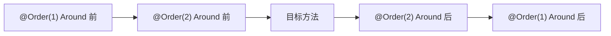

# Spring 中的设计模式详解

> 一句话概括：Spring 里的设计模式不是「展览馆陈列」，而是解决「对象由谁创建、唯一性由谁保证、行为如何扩展、异构组件如何协作」这些具体问题的自然结果；面试答模式题，要答**解决了什么问题、角色是谁、代价是什么**，而不是背模式名。

预计阅读时间：大约 50 分钟

所属主题：[Spring 常见面试题总结](summary.md)

本文以 Spring Framework 6.x / Boot 3.x 为基线，源码锚点统一用 `类名#方法名` 标注（关键片段已对照 6.1.2 源码核实）。每个模式按「结论 → 角色映射 → 源码/示例 → 边界与代价 → 面试追问」组织；AOP、事务、MVC 的完整机制在兄弟专题中展开，本文只讲「模式视角」，不重复。

---

## 0. 阅读路线与目录

| 读者 | 建议阅读 | 关注点 |
| --- | --- | --- |
| 初级（1 年内） | 1、2、3、4、11.1 总表 | 能说出「Spring 用了哪些模式、各自解决什么问题」 |
| 中级（1~3 年） | 全部，重点 2.3、5、6、9 | FactoryBean 语义、模板回调、事件同步边界、四条链的顺序 |
| 高级（3 年+） | 2.4、3.3、8.2、9.3、10、11.2 | 工厂归类分寸、注册表单例动机、CGLIB 实例化误区、链的递归实现 |
| 选型/架构 | 1、各节「边界与代价」、11.2 | 模式带来的扩展点在哪、代价由谁承担、何时不该套模式 |

目录：

1. 开篇立场：模式是结果，不是目的
2. 工厂模式：BeanFactory 与 FactoryBean
3. 单例模式：注册表式单例
4. 代理模式：AOP 的地基
5. 模板方法模式：XxxTemplate 与回调
6. 观察者模式：事件机制
7. 适配器模式：HandlerAdapter
8. 策略模式：可替换的算法族
9. 责任链模式：四条链
10. 其他常见提及：装饰器 / 建造者 / 组合
11. 总表与高频追问集
12. 参考资料

---

## 1. 开篇立场：模式是结果，不是目的

Spring 源码里几乎没有「为了用模式而用模式」的代码。每个模式都能还原成一个具体问题：

- 对象创建逻辑千差万别（有的要读配置、有的要生成代理）→ 把创建交出去 → **工厂**；
- 一个 Bean 全局只该有一份，但类本身不该知道这件事 → 用注册表保证唯一 → **单例**；
- 想在不动业务代码的前提下加事务/日志 → 包一层同接口的对象 → **代理**；
- JDBC 的取连接、关连接永远一样，只有中间执行的 SQL 在变 → 固定骨架 + 回调 → **模板方法**；
- DispatcherServlet 不想认识每一种 Handler → 统一调用接口 → **适配器**。

**面试答题三问**：① 它解决了什么问题？② GoF 角色分别对应 Spring 里的谁？③ 这么做付出了什么代价（或有什么边界）？三问答全，比罗列十个模式名更有说服力。

反面清单——几种常见的「硬套」说法：

| 流行说法 | 问题 | 更准确的表达 |
| --- | --- | --- |
| 「ApplicationContext 是抽象工厂」 | 它没有「产品族接口 + 具体工厂家族」的结构，对应很弱 | 容器是工厂 + 注册表 + 事件主体的组合，不必归入抽象工厂 |
| 「BeanWrapper 是装饰器」 | `BeanWrapperImpl` 不实现被包装对象的接口，不符合装饰器定义 | 它是提供属性访问能力的包装器，更接近适配 |
| 「Spring MVC 用了 MVC 模式，所以是 GoF 模式」 | MVC 是架构模式，不在 GoF 23 种之内 | 前端控制器（DispatcherServlet）是 J2EE 模式，与 GoF 分开说 |
| 「所有 Bean 都用 CGLIB 实例化」 | 默认策略类名带 Cglib，但无方法覆写时走反射 | 见 8.2，这是高频误区 |

**分类是理解工具，不是目的**。同一个组件从不同角度看可以是不同模式（HandlerAdapter 兼有适配器与策略色彩），面试时说出「它主要解决 X 问题，结构上像 Y」即可，不必争唯一归类。

---

## 2. 工厂模式：BeanFactory 与 FactoryBean

**结论**：`BeanFactory` 是**容器的顶层工厂接口**（管理所有 Bean 的获取），`FactoryBean` 是**一种特殊的 Bean**（本身被容器管理，但它 `getObject()` 产出的对象才是别人真正要用的东西）——两者名字像，层次完全不同。

### 2.1 角色映射

| GoF 角色 | Spring 对应 | 说明 |
| --- | --- | --- |
| 抽象工厂 | `BeanFactory` | 定义 `getBean` 等获取对象的契约 |
| 具体工厂 | `DefaultListableBeanFactory` | 真正实现创建、装配、缓存 |
| 产品 | 容器中的 Bean | 业务对象 |
| 工厂方法 | `FactoryBean#getObject`、`@Bean` 方法 | 把「怎么造」延迟到具体实现 |

### 2.2 FactoryBean：生产 Bean 的 Bean

```java
public interface FactoryBean<T> {
    T getObject() throws Exception;      // 真正要暴露的产品
    Class<?> getObjectType();            // 产品类型，供 byType 注入匹配
    default boolean isSingleton() { return true; }  // 产品是否单例缓存
}
```

`getBean` 拿到 Bean 实例后，会经过 `AbstractBeanFactory#getObjectForBeanInstance` 分流（简化）：

```java
// AbstractBeanFactory#getObjectForBeanInstance（简化）
if (BeanFactoryUtils.isFactoryDereference(name)) {   // name 以 "&" 开头
    if (!(beanInstance instanceof FactoryBean)) {
        throw new BeanIsNotAFactoryException(beanName, beanInstance.getClass());
    }
    return beanInstance;                              // 返回工厂本身
}
if (!(beanInstance instanceof FactoryBean<?> factoryBean)) {
    return beanInstance;                              // 普通 Bean 直接返回
}
// 是 FactoryBean 且没加 &：取产品（单例产品走缓存）
object = getObjectFromFactoryBean(factoryBean, beanName, !synthetic);
```

**`&` 前缀语义**（`BeanFactory.FACTORY_BEAN_PREFIX = "&"`）：

| 调用 | 返回 |
| --- | --- |
| `getBean("userMapper")` | `getObject()` 的产物（Mapper 代理） |
| `getBean("&userMapper")` | `MapperFactoryBean` 工厂本身 |

`&` 在 `AbstractBeanFactory#transformedBeanName` 里被剥掉后再查缓存，所以工厂本身仍以原名注册；`isFactoryDereference` 只凭原始 name 判断「要不要解引用」。

**为什么需要 FactoryBean**：有些对象的创建逻辑复杂到无法用「构造器 + 属性注入」描述。典型是 MyBatis 的 Mapper——接口没有实现类，实例是运行时生成的 JDK 代理：

```java
// org.mybatis.spring.mapper.MapperFactoryBean（mybatis-spring，结构简化）
public class MapperFactoryBean<T> extends SqlSessionDaoSupport implements FactoryBean<T> {
    private Class<T> mapperInterface;
    @Override
    public T getObject() throws Exception {
        return getSqlSession().getMapper(this.mapperInterface);  // 动态代理在这里生成
    }
    @Override
    public Class<T> getObjectType() { return this.mapperInterface; }
}
```

`MapperScannerConfigurer` 扫描到 `@Mapper` 接口后，注册的 BeanDefinition 的 beanClass 是 `MapperFactoryBean` 而不是接口本身。业务代码 `@Autowired UserMapper` 能注入成功，靠的是容器向 `getObjectType()` 询问产品类型做 byType 匹配——**注入的从来不是工厂，而是产品**。

### 2.3 产品的缓存与生命周期

- `isSingleton() == true` 时，产品缓存在 `FactoryBeanRegistrySupport#factoryBeanObjectCache`（`ConcurrentHashMap`），`getObject()` 只调一次；返回 false 则每次 `getBean` 都重新生产。
- **产品不走完整 Bean 生命周期**：没有实例化、属性注入、`@PostConstruct` 等初始化回调；但会经过 `AbstractAutowireCapableBeanFactory#postProcessObjectFromFactoryBean` → `applyBeanPostProcessorsAfterInitialization`，即 BPP 的初始化后处理仍生效（产品因此仍可被 AOP 代理）。

### 2.4 简单工厂 / 工厂方法 / 抽象工厂的对应程度

| 变体 | Spring 对应 | 对应程度 |
| --- | --- | --- |
| 简单工厂 | `BeanFactory#getBean(name)`：统一入口按名字返回不同产品 | 中。形似，但创建逻辑分散在各 BeanDefinition / 工厂方法里，不是「一个工厂类 + switch」 |
| 工厂方法 | `FactoryBean#getObject`、`@Bean` 方法、XML `factory-method` | 高。容器只调用契约，具体造什么由实现决定，是教科书式延迟 |
| 抽象工厂 | 无强对应 | 弱。不建议在面试里硬答 |

### 2.5 边界与代价

- `getObjectType()` 返回 null 时 byType 注入匹配不到（工厂未初始化时容器会尝试提前推断，但不可依赖）；
- 产品生命周期「半托管」：销毁回调不作用于产品，资源释放要工厂自己负责（`MapperFactoryBean` 不管 SqlSession 关闭，交给 SqlSessionTemplate）；
- `&` 前缀是冷知识但容易忘：排查「注入的怎么是工厂」时先想到它。

### 2.6 面试追问

- **BeanFactory 和 FactoryBean 区别？** 见 11.2 完整答法。
- **FactoryBean 的 getObject 什么时候被调？** 单例产品在容器预实例化阶段（`preInstantiateSingletons`）就会被生产并缓存，不是等第一次注入。
- **FactoryBean 和 @Bean 方法怎么选？** 简单创建用 `@Bean`；创建逻辑复杂、需要被扫描器批量注册（如 Mapper）、或要产出代理时，FactoryBean 更合适。

---

## 3. 单例模式：注册表式单例

**结论**：Spring 的单例是「**每个容器、每个 beanName 一个实例**」，唯一性由 `DefaultSingletonBeanRegistry` 的注册表保证，而不是 GoF 的私有构造器 + 静态实例写法。

### 3.1 源码

```java
// DefaultSingletonBeanRegistry
private final Map<String, Object> singletonObjects = new ConcurrentHashMap<>(256);

public Object getSingleton(String beanName, ObjectFactory<?> singletonFactory) {
    synchronized (this.singletonObjects) {
        Object singletonObject = this.singletonObjects.get(beanName);
        if (singletonObject == null) {
            // ...beforeSingletonCreation：标记正在创建
            singletonObject = singletonFactory.getObject();   // 真正创建 Bean
            addSingleton(beanName, singletonObject);          // 放入注册表
        }
        return singletonObject;
    }
}
```

GoF 单例把唯一性写死在类内部；Spring 把唯一性放进**外部注册表**，类本身仍是普通 POJO。这就是「注册表式单例」（Registry Singleton）。

### 3.2 与 GoF 饿汉/懒汉对比

| 维度 | GoF 饿汉/懒汉 | Spring 注册表单例 |
| --- | --- | --- |
| 唯一性保证 | 类内部静态字段 | 容器注册表（beanName → 实例） |
| 构造器 | private，禁止外部 new | public，容器与测试都能 new |
| 生命周期 | 类自己管 | 容器管：注入、Aware、初始化、AOP、销毁 |
| 实例粒度 | 每 JVM（每 ClassLoader）一个 | 每容器一个，两个容器两份 |
| 懒加载 | 饿汉立即 / 懒汉首次访问 | BeanFactory 懒加载；ApplicationContext 预实例化 |
| 可测试性 | 难 mock、难重置 | 脱离容器直接 new，或换容器配置 |

### 3.3 为什么不用私有构造器写法

1. **容器要能实例化任意类**，包括第三方库的类——不可能要求它们都提供私有构造器 + `getInstance()`；
2. **依赖注入与 AOP 要求容器掌握创建全过程**：先造裸对象、再注入、再生成代理，私有构造器把这条路堵死；
3. **作用域要可切换**：同一个类今天 singleton 明天 prototype，唯一性写在类里就做不到；
4. **可测试性**：POJO 可以直接 new 出来单测，不必启动容器。

一句话：GoF 单例是「类自治」，Spring 单例是「容器托管」——IoC 的思想决定了必然选后者。

### 3.4 边界与代价

- **每容器一个 ≠ JVM 单例**：父子容器、两个 `AnnotationConfigApplicationContext` 各有一份；
- **单例 ≠ 线程安全**：注册表只保证「一份」，有状态 Bean 照样并发出事（见 summary 2.5）；
- `ConcurrentHashMap` 保证读写的线程安全，但「检查 → 创建 → 注册」是复合操作，仍需 `synchronized (this.singletonObjects)` 互斥——**并发容器不能替代业务原子性**；
- 三级缓存（`singletonObjects` / `earlySingletonObjects` / `singletonFactories`）解决循环依赖的机制见 [Bean 生命周期与循环依赖](bean-lifecycle-and-circular-dependency.md)。

### 3.5 面试追问

- **为什么 ConcurrentHashMap 还要加锁？** 见上：map 的单个操作原子，创建流程不原子。
- **双重检查锁的 Spring 版在哪？** `getSingleton(beanName, true)` 先无锁查一级/二级缓存，未命中再进同步块查三级工厂——与 DCL 思路同源。

---

## 4. 代理模式：AOP 的地基

**结论**：Spring AOP 的本质是**运行时动态代理**——代理对象与目标对象接口一致，调用方无感知，增强逻辑在代理层织入。

### 4.1 静态代理 → 动态代理的演进动机

| 阶段 | 做法 | 问题 |
| --- | --- | --- |
| 静态代理 | 每个目标类手写一个代理类 | 类爆炸；事务/日志逻辑在每个代理类里重复 |
| JDK 动态代理 | 运行时按接口生成 `$Proxy`，一个 `InvocationHandler` 处理所有方法 | 目标必须有接口 |
| CGLIB | ASM 字节码生成目标子类，`MethodInterceptor` 拦截 | final 类/方法不可代理 |

演进动机一句话：**把「为每个类写代理」变成「为所有类生成代理」**，横切逻辑只写一份。

### 4.2 角色映射与源码

| GoF 角色 | Spring 对应 |
| --- | --- |
| Subject | 业务接口（JDK）/ 目标类（CGLIB） |
| RealSubject | 目标对象（target） |
| Proxy | `JdkDynamicAopProxy` 生成的 `$Proxy` / CGLIB 子类 |
| 增强逻辑 | Advice 链（见 9.3） |

代理类型的选择在 `DefaultAopProxyFactory#createAopProxy`（简化）：

```java
if (config.isOptimize() || config.isProxyTargetClass() || hasNoUserSuppliedProxyInterfaces(config)) {
    // 目标本身是接口/JDK代理/lambda 时仍回退 JDK 代理
    return new ObjenesisCglibAopProxy(config);   // CGLIB 子类代理
}
else {
    return new JdkDynamicAopProxy(config);       // JDK 接口代理
}
```

Boot 2.x 起 `spring.aop.proxy-target-class` 默认 true，即统一 CGLIB，规避「JDK 代理只能按接口注入」的类型不匹配坑。

### 4.3 边界与代价

代理的固有边界：类内自调用绕过代理、final/private/static 方法不可增强、自己 new 的对象没有代理。完整清单与失效排查见 [IoC 与 AOP](ioc-and-aop.md) 及 summary 4.6，此处不重复。

### 4.4 面试追问

- **代理和适配器区别？** 代理**保持接口不变**，控制访问/附加行为；适配器**转换接口**，让原本不兼容的类协作。这是 11.2 的高频对比。
- **为什么 Boot 默认 CGLIB？** 注入实现类类型也能匹配，减少一类启动期报错；代价是 final 限制与 Objenesis 绕过构造器的语义。

---

## 5. 模板方法模式：XxxTemplate 与回调

**结论**：`JdbcTemplate` / `RestTemplate` / `TransactionTemplate` 把「永远不变的流程骨架」固化在模板里，把「每次不同的业务步骤」留给回调对象——**骨架不变，变化点外置**。

### 5.1 角色映射

| 模板 | 固定骨架 | 变化点（回调） |
| --- | --- | --- |
| `JdbcTemplate` | 取连接 → 建 Statement → 设参数 → 异常翻译 → 释放资源 | `StatementCallback#doInStatement`（及 RowMapper 等便捷回调） |
| `RestTemplate` | 建请求 → 执行 → 错误处理 → 关闭响应 | `RequestCallback#doWithRequest`、`ResponseExtractor#extractData` |
| `TransactionTemplate` | `getTransaction` → 异常回滚 / 正常提交 | `TransactionCallback#doInTransaction` |

### 5.2 源码：JdbcTemplate 的骨架

```java
// JdbcTemplate#execute(StatementCallback, boolean)（简化，6.1.2）
Connection con = DataSourceUtils.getConnection(obtainDataSource());
Statement stmt = null;
try {
    stmt = con.createStatement();
    applyStatementSettings(stmt);
    T result = action.doInStatement(stmt);     // ← 唯一的变化点
    handleWarnings(stmt);
    return result;
}
catch (SQLException ex) {
    // 提前释放资源，避免异常翻译器未初始化时连接池死锁
    throw translateException("StatementCallback", sql, ex);  // SQLException → DataAccessException
}
finally {
    JdbcUtils.closeStatement(stmt);
    DataSourceUtils.releaseConnection(con, getDataSource());
}
```

业务代码只写变化点：

```java
List<User> users = jdbcTemplate.query("select id, name from users where age > ?",
        (rs, i) -> new User(rs.getLong("id"), rs.getString("name")), 18);  // 内部仍是 execute + 回调
```

注意 `DataSourceUtils.getConnection`：有事务时取的是绑定在当前线程的连接——模板与事务机制在这里衔接（见 [事务专题](transaction.md)）。

### 5.3 与 GoF 的差异：回调代替继承

GoF 模板方法用**继承**：抽象类定骨架，子类覆写钩子。Spring 用**组合 + 回调**：骨架固定，变化点以参数传入（lambda 即可）。好处是不产生继承耦合、一个模板服务所有业务；代价是回调嵌套深时可读性下降。`AbstractApplicationContext#refresh` 则是真正的继承式模板方法——`onRefresh` 等钩子留给子类（Boot 在此创建内嵌 Web 服务器）。

### 5.4 模板方法 vs 策略

| 维度 | 模板方法 | 策略 |
| --- | --- | --- |
| 变的是什么 | 骨架中的**个别步骤** | **整个算法** |
| 流程控制权 | 模板（好莱坞原则：别找我，我找你） | 调用方选择并驱动策略 |
| 结构 | 继承或回调 | 组合 + 委托 |
| 例子 | JdbcTemplate 的资源管理不可换 | InstantiationStrategy 整个实例化方式可换 |

### 5.5 边界与代价

- 异常翻译把 `SQLException` 包成 `DataAccessException`，排查时要看 cause 链；
- 模板隐藏了资源管理细节，出问题时栈里全是框架帧；
- 一次性逻辑不要硬抽模板——抽象的收益来自重复，没有重复就没有收益。

### 5.6 面试追问

- **TransactionTemplate 为什么不受自调用失效影响？** 它是编程式事务，不经过代理，`execute` 直接调事务管理器（见 [事务专题](transaction.md)）。
- **回调和策略长得像，怎么区分？** 看谁掌握流程：回调只填模板留出的空，策略替换整个算法。

---

## 6. 观察者模式：事件机制

**结论**：Spring 事件是**进程内观察者模式**——`ApplicationEventMulticaster` 充当主题，持有监听器引用并逐一广播；默认**同步、同线程、同事务**。

### 6.1 角色映射

| GoF 角色 | Spring 对应 |
| --- | --- |
| Subject | `ApplicationEventMulticaster`（默认 `SimpleApplicationEventMulticaster`） |
| Observer | `ApplicationListener` 实现 / `@EventListener` 方法 |
| 事件 | `ApplicationEvent` 子类，或任意对象（包装为 `PayloadApplicationEvent`） |
| 发布入口 | `ApplicationEventPublisher`（ApplicationContext 本身实现了它） |

### 6.2 源码与示例

```java
// SimpleApplicationEventMulticaster#multicastEvent（简化）
Executor executor = getTaskExecutor();          // 默认 null！
for (ApplicationListener<?> listener : getApplicationListeners(event, type)) {
    if (executor != null) {
        executor.execute(() -> invokeListener(listener, event));  // 异步
    }
    else {
        invokeListener(listener, event);        // 同步：发布者线程直接执行
    }
}
```

```java
public record OrderCreatedEvent(Long orderId) {}
@Component
public class NotifyListener {
    @EventListener
    public void onOrderCreated(OrderCreatedEvent e) { /* 发通知 */ }
}
// 业务侧
applicationEventPublisher.publishEvent(new OrderCreatedEvent(orderId));
```

`@EventListener` 的注册机制：`EventListenerMethodProcessor` 在单例预实例化完成后扫描注解方法，每个方法包装成一个 `ApplicationListenerMethodAdapter` 注册进 multicaster——**注解只是语法糖，底层仍是 ApplicationListener**。

### 6.3 边界与代价

| 边界 | 说明 | 对策 |
| --- | --- | --- |
| 默认同步同线程 | 监听器耗时直接拖慢发布者；监听器抛异常会传播给发布者，可能连累其事务回滚 | 明确这是「方法调用的解耦」，不是异步 |
| 异步要显式开启 | `@Async` + `@EventListener`（经 Bean 代理生效）；ThreadLocal（事务、MDC）不跨线程 | 自定义有界线程池，见 [异步注解原理](async-annotation-principle.md) |
| 事务阶段 | 默认监听器与发布者同事务；「提交后才执行」需 `@TransactionalEventListener(phase = AFTER_COMMIT)` | AFTER_COMMIT 阶段再写库要 `REQUIRES_NEW`，见 [事务专题](transaction.md) |
| 容器级而非全局 | 事件只在当前 ApplicationContext 广播（会向父容器传播），无持久化、不跨进程 | 跨进程用 MQ |

### 6.4 面试追问

- **观察者和发布-订阅的区别？** Spring multicaster 直接持有监听器引用，是观察者；MQ 中间隔了 broker，发布订阅互不认识，是发布-订阅。
- **怎么保证「订单提交成功后才发 MQ」？** `@TransactionalEventListener(AFTER_COMMIT)`，或 `TransactionSynchronization#afterCommit`；注意提交后写库的事务坑。

---

## 7. 适配器模式：HandlerAdapter

**结论**：`HandlerAdapter` 把形态各异的 Handler（注解方法、Controller 接口、函数式路由）适配成统一的调用接口，`DispatcherServlet` 只面向适配器编程——**新增 Handler 类型不需要改调度逻辑**（开闭原则）。

### 7.1 角色映射

| GoF 角色 | Spring 对应 |
| --- | --- |
| Target（统一接口） | `HandlerAdapter`：`supports` / `handle` / `getLastModified` |
| Adaptee（被适配者） | 各种 Handler 对象 |
| Client | `DispatcherServlet` |

| Handler 类型 | 适配器 |
| --- | --- |
| `HandlerMethod`（@RequestMapping 方法） | `RequestMappingHandlerAdapter` |
| `HttpRequestHandler` | `HttpRequestHandlerAdapter` |
| `Controller` 接口 | `SimpleControllerHandlerAdapter` |
| `HandlerFunction`（函数式路由） | `HandlerFunctionAdapter` |

### 7.2 源码

```java
// DispatcherServlet#getHandlerAdapter
for (HandlerAdapter adapter : this.handlerAdapters) {
    if (adapter.supports(handler)) {
        return adapter;
    }
}
throw new ServletException("No adapter for handler [" + handler + "]...");
```

`doDispatch` 拿到适配器后只调 `ha.handle(request, response, handler)`，不关心 Handler 具体是什么。完整请求流程见 [MVC 请求流程](mvc-request-flow.md)。

### 7.3 边界与代价

- GoF 适配器通常**一对一包装**、持有 adaptee 引用；Spring 的适配器是**无状态的类型适配器**，靠 `supports()` 匹配——所以它同时带策略色彩（按类型选算法）。面试答「适配器为主、兼有策略选择」最稳。
- 适配层多一次间接调用，性能影响可忽略；真正的代价是排查时要先确认「哪个适配器在处理」，栈帧多一层。

### 7.4 面试追问

- **为什么不让 DispatcherServlet 用 instanceof 分支？** 每新增一种 Handler 都要改 DispatcherServlet，违反开闭原则；适配器把变化隔离在新增类里。
- **适配器和代理区别？** 适配器改接口（异构 → 统一），代理保接口（附加行为）。HandlerAdapter 是前者：它不增强 Handler，只是让 DispatcherServlet 能统一调用。

---

## 8. 策略模式：可替换的算法族

**结论**：策略模式把一族可互换的算法封装在统一接口后，运行时选择其一；Spring 里最典型的是 `InstantiationStrategy`（实例化策略）与 `ViewResolver`（视图解析策略）。

### 8.1 角色映射

| GoF 角色 | Spring 对应（以实例化为例） |
| --- | --- |
| Strategy 接口 | `InstantiationStrategy#instantiate` |
| 具体策略 | `SimpleInstantiationStrategy`（反射）、`CglibSubclassingInstantiationStrategy`（方法注入时生成 CGLIB 子类） |
| Context | `AbstractAutowireCapableBeanFactory`（持有策略并调用） |

### 8.2 源码与高频误区

```java
// SimpleInstantiationStrategy#instantiate（简化）
if (!bd.hasMethodOverrides()) {
    // 无 lookup-method / replaced-method：直接反射调构造器
    return BeanUtils.instantiateClass(constructorToUse);
}
else {
    return instantiateWithMethodInjection(bd, beanName, owner);  // 交给子类
}
```

`CglibSubclassingInstantiationStrategy extends SimpleInstantiationStrategy`，仅在 `hasMethodOverrides()` 为 true（配置了 `@Lookup` 或 replaced-method）时用 CGLIB 生成子类，织入 `LookupOverrideMethodInterceptor` / `ReplaceOverrideMethodInterceptor`；否则回落父类反射。

**两个必须澄清的点**：

1. `AbstractAutowireCapableBeanFactory` 构造器里默认策略确实是 `new CglibSubclassingInstantiationStrategy()`，但**绝大多数 Bean 没有方法覆写，实际走反射**——「Spring 用 CGLIB 实例化所有 Bean」是错的；
2. **CGLIB 实例化 ≠ CGLIB AOP 代理**：前者解决 `@Lookup` 方法注入，后者解决横切增强，发生在生命周期的不同阶段，别混为一谈。

### 8.3 其他策略族

| 策略接口 | 可替换实现 | 选择方式 |
| --- | --- | --- |
| `ViewResolver#resolveViewName` | InternalResourceViewResolver、ThymeleafViewResolver | DispatcherServlet 遍历，第一个返回非 null View 的胜出 |
| `PlatformTransactionManager` | DataSourceTransactionManager、JpaTransactionManager | 按持久化技术配置其一，见 [事务专题](transaction.md) |
| `InstantiationStrategy` | 见 8.2 | 容器默认 + 可 setter 替换 |

诚实归类：`Resource` 加载（`DefaultResourceLoader#getResource` 按 `classpath:` / URL / 路径前缀分派）更像**简单工厂**，`getResourceByPath` 是留给子类的工厂方法钩子——不要因为它「可替换」就硬说成策略。

### 8.4 边界与代价

- 策略族膨胀后，「选哪个」的分派逻辑本身成为维护点；
- ViewResolver 的「遍历到第一个命中」其实是责任链式选择——模式之间有重叠，不必争唯一标签；
- 策略替换的是整个算法，若只是想改流程中的一步，用模板回调更合适（见 5.4）。

### 8.5 面试追问

- **CglibSubclassingInstantiationStrategy 什么时候真用 CGLIB？** 仅方法覆写场景；答出这一点直接区分背没背源码。
- **策略和模板区别？** 见 5.4 表格。

---

## 9. 责任链模式：四条链

**结论**：责任链把请求的发送者与多个处理者解耦，处理者沿链传递请求。Spring 里有两种形态：**全过型**（每个节点都处理，可短路）与**首个命中型**（只有一个节点处理）。

| 形态 | 成员 | 行为 |
| --- | --- | --- |
| 全过型 | Filter 链、Interceptor 链、AOP Advice 链 | 逐节点执行，任一节点可终止传递 |
| 首个命中型 | HandlerMethodArgumentResolver、HandlerExceptionResolver、ViewResolver | 遍历到第一个支持者即停 |

### 9.1 Filter 链（Servlet 容器层）

注意归属：Filter 链是 **Servlet 容器**（如 Tomcat 的 `ApplicationFilterChain#internalDoFilter`，9.0.x / 10.1.x 分支可见该私有方法；main 分支已把它内联进 `doFilter`）实现的，Spring 只负责注册 Filter。递归传递：

```java
// ApplicationFilterChain#internalDoFilter（Tomcat，简化）
if (pos < n) {
    filterConfigs[pos++].getFilter().doFilter(request, response, this);  // Filter 内再调 chain.doFilter 传下去
}
else {
    servlet.service(request, response);         // 链走完才到 Servlet
}
```

顺序控制：Boot 中 `FilterRegistrationBean#setOrder` 或 Filter Bean 上的 `@Order`，值小先执行。Filter 能包装 request/response（装饰器，见 10.1），这是 Interceptor 做不到的。

### 9.2 HandlerInterceptor 链（MVC 层）

```java
// HandlerExecutionChain#applyPreHandle
for (int i = 0; i < this.interceptorList.size(); i++) {
    HandlerInterceptor interceptor = this.interceptorList.get(i);
    if (!interceptor.preHandle(request, response, this.handler)) {
        triggerAfterCompletion(request, response, null);   // 只回调已执行过的
        return false;                                       // 短路，不再进 Handler
    }
    this.interceptorIndex = i;
}
```

要点：`preHandle` 正序、`postHandle` 逆序、`afterCompletion` 逆序且**只回调 preHandle 成功过的拦截器**——短路时的补偿语义。顺序由 `WebMvcConfigurer#addInterceptors` 的注册顺序与 `InterceptorRegistration#order` 控制。

### 9.3 AOP Advice 链（方法层）

Advice 链不是显式的 `next` 指针，而是**递归**：

```java
// ReflectiveMethodInvocation#proceed（简化）
if (this.currentInterceptorIndex == this.interceptorsAndDynamicMethodMatchers.size() - 1) {
    return invokeJoinpoint();                    // 链走完，调目标方法
}
Object next = this.interceptorsAndDynamicMethodMatchers.get(++this.currentInterceptorIndex);
return ((MethodInterceptor) next).invoke(this);  // 每个 Advice 内部再调 mi.proceed()
```

每个 `MethodInterceptor`（Advice 的适配形态）在 `invoke` 里自行决定何时调 `mi.proceed()`，于是形成洋葱模型：



`@Order` 值小在外层，先进后出。`@Around` 可以不调 `proceed()`（短路）、调多次（重试）——这是责任链里「节点掌握传递控制权」的极致体现。代理与通知的完整机制见 [IoC 与 AOP](ioc-and-aop.md)。

### 9.4 ArgumentResolver 链（首个命中型）

```java
// HandlerMethodArgumentResolverComposite#getArgumentResolver（简化）
for (HandlerMethodArgumentResolver resolver : this.argumentResolvers) {
    if (resolver.supportsParameter(parameter)) {
        this.argumentResolverCache.put(parameter, resolver);   // 命中即缓存
        break;
    }
}
```

`@RequestParam`、`@PathVariable`、`@RequestBody`、POJO 绑定各有解析器；自定义参数注解（如 `@LoginUser`）就是往这条链上加一个 resolver。返回值处理（`HandlerMethodReturnValueHandler`）同构。详见 [MVC 请求流程](mvc-request-flow.md)。

### 9.5 顺序控制与排查

| 链 | 顺序机制 | 短路行为 | 排查入口 |
| --- | --- | --- | --- |
| Filter | `FilterRegistrationBean#setOrder` / `@Order` | 不调 `chain.doFilter` 即终止 | 容器 Filter 注册列表、响应头 |
| Interceptor | 注册顺序 / `InterceptorRegistration#order` | `preHandle` 返回 false | 确认 afterCompletion 是否成对 |
| Advice | `@Order` / `Ordered`，值小在外 | `@Around` 不调 proceed | 打印 `AdvisedSupport` 的 advisor 列表 |
| ArgumentResolver | 注册顺序（自定义 resolver 注意插队位置） | 首个 supports 命中 | 断点 `getArgumentResolver` |

### 9.6 边界与代价

- 顺序错误是链式结构最常见的事故，且症状隐蔽（如字符编码 Filter 排在请求体读取之后）；
- 长链有栈深度与逐层调用开销，Advice 链尤甚（每层递归一帧）；
- 排查时先确认「链上有哪些节点、什么顺序」，再怀疑单个节点逻辑。

### 9.7 面试追问

- **Advice 链怎么实现「外层先进后出」？** 递归 + proceed 调用时机：外层 Advice 在 proceed 之前的代码先执行，proceed 返回后的代码后执行。
- **preHandle 返回 false 会怎样？** 后续拦截器与 Handler 都不执行，但已执行过的拦截器会逆序收到 afterCompletion。
- **Filter vs Interceptor vs AOP？** 层级与作用范围对比见 summary 6.3 与 [MVC 请求流程](mvc-request-flow.md)。

---

## 10. 其他常见提及：装饰器 / 建造者 / 组合

这三个模式在 Spring 里确实存在，但面试权重低于前八个，掌握「角色 + 一个锚点 + 一句边界」即可。

### 10.1 装饰器：同接口包装增强

**结论**：装饰器与被包装对象**实现同一接口**，通过委托 + 覆写附加行为，且可层层叠加。

- `HttpServletRequestWrapper` 实现 `HttpServletRequest` 并持有原请求，覆写 `getInputStream` 等方法即可增强；
- Spring 自己的 `ContentCachingRequestWrapper` 就是典型应用：缓存请求体，解决「Servlet 输入流只能读一次」导致日志/验签与业务读体冲突的问题。

```java
// Filter 中包装请求，后续链路读到的是可重复读的包装对象
ContentCachingRequestWrapper wrapped = new ContentCachingRequestWrapper(request);
chain.doFilter(wrapped, response);
byte[] body = wrapped.getContentAsByteArray();   // 业务读完后才有缓存
```

**诚实归类**：很多资料把 `BeanWrapper` 列为装饰器，但 `BeanWrapperImpl` 并不实现被包装对象的接口，而是提供一套新的属性访问接口（`PropertyAccessor`）——严格说更接近包装器/适配，面试不必硬套装饰器。

### 10.2 建造者：分步构造复杂对象

**结论**：建造者把「构造过程」与「最终表示」分离，链式调用逐步装配，最后 `build()` 产出（通常不可变的）对象。

```java
UriComponents uri = UriComponentsBuilder.fromUriString("https://api.example.com")
        .path("/users/{id}").queryParam("verbose", "true")
        .buildAndExpand(userId).encode();

BeanDefinition bd = BeanDefinitionBuilder.genericBeanDefinition(UserService.class)
        .addPropertyValue("timeout", 3000)
        .setScope("singleton")
        .getBeanDefinition();
```

锚点：`UriComponentsBuilder#build`、`BeanDefinitionBuilder#getBeanDefinition`。边界：建造者解决的是「构造参数多、组合多」的可读性问题，不是性能问题；简单对象直接构造器即可。

### 10.3 组合：整体与部分一致对待

**结论**：组合模式让客户端对「单个对象」和「对象集合」使用同一接口。

- `CompositeCacheManager` 实现 `CacheManager`，内部持有 `List<CacheManager>`，`getCache` 依次向子管理器询问——调用方不关心背后是一个还是多个缓存管理器；
- `CompositePropertySource` 同理：实现 `PropertySource`，聚合多个属性源按序取值。

与装饰器的区别一句话：**装饰器强调行为增强（一个包一个），组合强调部分-整体结构（一个包多个）**。

---

## 11. 总表与高频追问集

### 11.1 模式 → 问题 → 角色 → 锚点总表

| 模式 | 解决的问题 | Spring 角色 | 源码锚点 |
| --- | --- | --- | --- |
| 工厂 | 创建逻辑与使用解耦 | BeanFactory / FactoryBean | `AbstractBeanFactory#getObjectForBeanInstance` |
| 单例 | 每容器每名字一份实例 | 单例注册表 | `DefaultSingletonBeanRegistry#getSingleton` |
| 代理 | 不动业务代码附加行为 | JDK / CGLIB 代理 | `DefaultAopProxyFactory#createAopProxy` |
| 模板方法 | 固定骨架 + 变化步骤 | JdbcTemplate 等 | `JdbcTemplate#execute(StatementCallback)` |
| 观察者 | 发布与处理解耦 | 事件 multicaster / listener | `SimpleApplicationEventMulticaster#multicastEvent` |
| 适配器 | 异构 Handler 统一调用 | HandlerAdapter 族 | `DispatcherServlet#getHandlerAdapter` |
| 策略 | 算法族可替换 | InstantiationStrategy / ViewResolver | `SimpleInstantiationStrategy#instantiate` |
| 责任链 | 多处理者解耦传递 | Filter / Interceptor / Advice / Resolver 链 | `ReflectiveMethodInvocation#proceed` |
| 装饰器 | 同接口动态增强 | HttpServletRequestWrapper | `ContentCachingRequestWrapper`（类） |
| 建造者 | 复杂对象分步构造 | UriComponentsBuilder 等 | `BeanDefinitionBuilder#getBeanDefinition` |
| 组合 | 整体与部分一致对待 | CompositeCacheManager | `CompositeCacheManager#getCache` |

### 11.2 高频追问（完整答法）

**Q1：BeanFactory 和 FactoryBean 的区别？**

> BeanFactory 是容器的顶层工厂接口，负责所有 Bean 的获取与管理；FactoryBean 是一种特殊 Bean，本身被容器管理，但 `getObject()` 的产物才是注入给别人的对象，典型如 MyBatis 的 MapperFactoryBean。`getBean("x")` 取产品，`getBean("&x")` 取工厂本身。产品单例时缓存在 factoryBeanObjectCache，不走完整生命周期但会经过 BPP 初始化后处理。

**Q2：Spring 单例和 GoF 单例的区别？为什么不用私有构造器？**

> GoF 把唯一性写死在类里（私有构造器 + 静态实例），Spring 用注册表（singletonObjects）保证「每容器每 beanName 一份」，类仍是 POJO。因为容器要能实例化任意第三方类、要掌控注入/AOP/销毁全流程、要支持作用域切换，私有构造器会堵死这些能力。代价是单例不等于 JVM 唯一，也不等于线程安全。

**Q3：模板方法和策略的区别？**

> 模板方法固定流程骨架、只把个别步骤留给回调（JdbcTemplate 的资源管理不可换，SQL 执行可换），控制权在模板；策略替换整个算法（InstantiationStrategy 换掉整个实例化方式），控制权在调用方。Spring 的模板用回调而非继承，避免了继承耦合。

**Q4：适配器和代理的区别？**

> 代理保持接口不变，目的是控制访问或附加行为（AOP）；适配器转换接口，目的是让不兼容的类协作（HandlerAdapter 把异构 Handler 变成统一的 handle 调用）。判断口诀：**接口变没变——变了是适配，没变是代理**。

---

## 12. 参考资料

- Spring Framework 官方文档：<https://docs.spring.io/spring-framework/reference/>（Core / AOP / Data Access / Web Servlet 各章）
- 本文源码锚点已对照 Spring 6.1.2 源码核实，重点文件：`AbstractBeanFactory`、`FactoryBeanRegistrySupport`、`DefaultSingletonBeanRegistry`、`SimpleInstantiationStrategy`、`CglibSubclassingInstantiationStrategy`、`JdbcTemplate`、`TransactionTemplate`、`SimpleApplicationEventMulticaster`、`DispatcherServlet`、`HandlerExecutionChain`、`ReflectiveMethodInvocation`
- GoF《设计模式：可复用面向对象软件的基础》——角色定义的原始出处
- 《Spring 揭秘》王福强——IoC/AOP 与容器结构讲得最透的中文书
- 兄弟专题：[IoC 与 AOP](ioc-and-aop.md)、[Bean 生命周期与循环依赖](bean-lifecycle-and-circular-dependency.md)、[事务](transaction.md)、[MVC 请求流程](mvc-request-flow.md)、[异步注解原理](async-annotation-principle.md)

---

## 附：速记

1. **答模式三问**：解决什么问题、角色是谁、代价是什么；反对硬套归类。
2. **工厂**：BeanFactory 是容器，FactoryBean 是「生产 Bean 的 Bean」；`&` 取工厂本身，产品缓存于 factoryBeanObjectCache。
3. **单例**：注册表式，每容器一份 ≠ JVM 一份；ConcurrentHashMap + synchronized 保证「检查-创建-注册」原子。
4. **代理**：保接口、加行为；JDK 靠接口、CGLIB 靠子类，Boot 默认 CGLIB；自调用失效。
5. **模板**：骨架固定 + 回调变化点；与策略的分界是「换一步还是换整个算法」。
6. **观察者**：默认同步同线程同事务；异步靠 @Async，提交后执行靠 @TransactionalEventListener。
7. **适配器**：HandlerAdapter 统一异构 Handler，DispatcherServlet 只认接口；接口变了是适配，没变是代理。
8. **策略**：默认实例化策略类名带 Cglib，但无方法覆写时走反射；CGLIB 实例化 ≠ CGLIB 代理。
9. **责任链**：Filter/Interceptor/Advice 全过型可短路，Resolver 首个命中型；Advice 链靠 proceed 递归成洋葱。
10. **其他**：装饰器同接口叠加（ContentCachingRequestWrapper）、建造者分步构造（UriComponentsBuilder）、组合整体部分一致（CompositeCacheManager）。