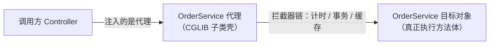
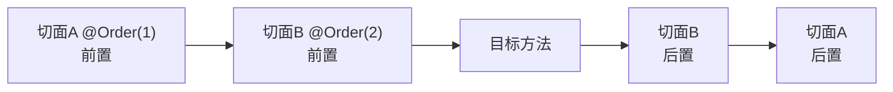
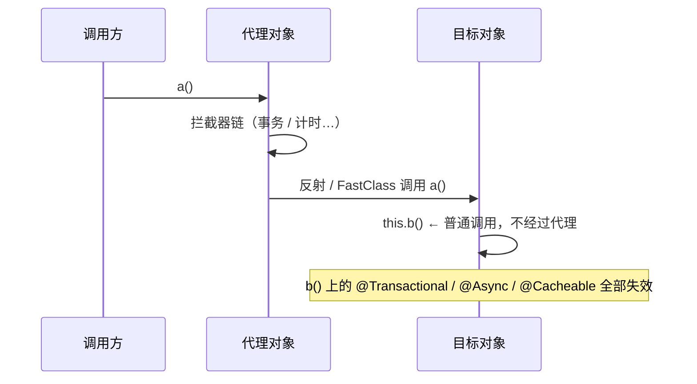

# IoC & AOP 详解（快速搞懂）

> 一句话概括：IoC 把「谁来创建和组装对象」的控制权交给容器，AOP 把「谁来织入横切逻辑」的控制权交给代理——
> Spring 的全部能力与全部的坑，都来自「运行时反射 + 动态代理」这一次交换；本文讲清这次交换的机制、边界与代价。

所属主题：[Spring 常见面试题总结](summary.md)

本文以 Spring Framework 6.x / Spring Boot 3.x 为基线，源码锚点用 `类名#方法名` 标注，版本差异单独说明。总结文档给结论，本文给机制与证据：每个机制按「结论 → 机制 → 边界/代价 → 实践/追问」展开。

---

## 0. 阅读路线

| 读者 | 建议阅读 | 关注点 |
| --- | --- | --- |
| 初级（1 年内） | 1、2.1、3.1~3.2、4、7.1~7.2 | IoC/DI 是什么、注入怎么写、AOP 长什么样、自调用为什么失效 |
| 中级（1~3 年） | 全部，重点 3.3~3.4、5、6 | 消歧规则、两种代理、通知顺序、失效清单 |
| 高级（3 年+） | 2.2、5.1~5.3、6.4、7.4、8 | refresh 骨架、代理源码、拦截器链递归、AspectJ、成本账 |
| 选型/架构 | 1.2、5.4、8、9 | 侵入性差异、默认代理策略的版本归属、什么场景不该用 Spring |

目录：

1. 从一个没有 Spring 的例子讲起
2. 容器双接口：BeanFactory vs ApplicationContext
3. 依赖注入：方式、匹配规则与两个高频坑
4. AOP 快速搞懂：一个完整切面
5. 两种代理的源码级对比
6. 通知类型与执行顺序
7. 自调用失效与代理边界
8. 边界与代价：什么时候不该用 Spring
9. 高频面试追问集
10. 参考资料

---

## 1. 从一个没有 Spring 的例子讲起

### 1.1 自己 new 依赖的代价

```java
// 没有 Spring：依赖在类内部自己 new
public class OrderService {
    private final OrderRepository repo = new MysqlOrderRepository(); // 实现写死
    public Order find(long id) { return repo.findById(id); }
}
```

这三行代码埋了三个问题：

| 问题 | 具体表现 |
| --- | --- |
| 实现耦合 | 想换 Redis 缓存版仓储，必须改 `OrderService` 源码；`MysqlOrderRepository` 内部还会继续 new `DataSource`，依赖树在代码里层层焊死 |
| 测试困难 | 单测 `find()` 必须连真数据库——你测的是「订单逻辑 + MySQL」的混合体，而不是订单逻辑本身 |
| 组装散落 | 每个类都自己负责创建依赖，「谁依赖谁」这张图散落在几百个构造器里，没有统一视图 |

把依赖改成「从外面传进来」，问题立刻消失：

```java
public class OrderService {
    private final OrderRepository repo;
    public OrderService(OrderRepository repo) { this.repo = repo; } // 只声明"我需要什么"
    public Order find(long id) { return repo.findById(id); }
}

// 单元测试：不启动任何容器、不连任何数据库
OrderService svc = new OrderService(new InMemoryOrderRepository());
```

**结论**：IoC（Inversion of Control，控制反转）反转的就是「创建与组装依赖」这件事的控制权——从业务代码手里交给外部。Spring 容器就是这个「外部」：它读取配置（注解/JavaConfig），统一创建对象、按依赖关系组装、管理生命周期。业务类退化为纯 POJO，只声明需求，不负责找依赖。

### 1.2 IoC vs DI vs 依赖查找（DL）

| 概念 | 定位 | 依赖怎么到位 | 侵入性 |
| --- | --- | --- | --- |
| IoC | **思想**：控制权反转 | 不限定手段 | — |
| DI（依赖注入） | IoC 的实现手段 | 容器**主动推**：构造器/setter/字段注入，业务类被动接收 | **非侵入**：构造器注入连注解都可以不要（见 3.1），业务类可完全脱离 Spring 编译与测试 |
| DL（依赖查找） | IoC 的实现手段 | 业务**主动拉**：`context.getBean(OrderRepository.class)` | **侵入**：业务代码直接依赖容器 API，离开容器无法实例化 |

**边界与代价**：DI 的「非侵入」是有层次的——字段注入的 `@Autowired` 仍是 Spring 类型，只是不污染业务逻辑；构造器注入才能做到真正的纯 POJO。DL 并非一无是处：需要「每次用时现取」的场景（prototype、延迟解析）本质上就是查找，Spring 用 `ObjectProvider` 把查找收敛成一个类型安全的窄接口（见 3.4），算是两者的折中。

**追问：没有 DI 能不能 IoC？** 能。DL（服务定位器模式）同样把创建权交给了容器，只是业务代码要感知容器。面试答出「DI 和 DL 都是 IoC 的实现手段，区别在侵入性」即可体现理解深度。

---

## 2. 容器双接口：BeanFactory vs ApplicationContext

### 2.1 基础容器与企业级容器

**结论**：`BeanFactory` 是 IoC 容器的顶层接口，只提供「按定义生产对象」的最小能力；`ApplicationContext` 是它的子接口体系，叠加事件、国际化、资源、Environment 等企业级能力，并**把懒加载改成预实例化**。

| 维度 | BeanFactory | ApplicationContext |
| --- | --- | --- |
| 定位 | 最小 IoC 内核 | 企业级容器（`ListableBeanFactory` 等子接口 + 组合 `DefaultListableBeanFactory`） |
| 实例化时机 | **懒加载**：`getBean` 时才创建 | **预实例化**：`refresh()` 末尾创建所有非懒加载单例 |
| 事件机制 | 无 | `ApplicationEventPublisher` |
| 国际化 | 无 | `MessageSource` |
| 资源访问 | 无 | `ResourcePatternResolver` |
| 环境抽象 | 无 | `Environment`（profile、属性源） |
| BFPP/BPP | 需手动 `addBeanPostProcessor` 注册 | 自动发现并注册（`@Autowired`、AOP 都靠 BPP） |

**机制**：`ApplicationContext` 不是靠继承实现容器逻辑，而是**组合**一个 `DefaultListableBeanFactory`（`AbstractApplicationContext#obtainFreshBeanFactory`），`getBean` 全部委托给它。所以「双接口」本质是同一个内核的两层包装。

**边界与代价**：预实例化把缺 Bean、循环依赖、配置错误**提前暴露在启动期**，代价是启动时间与启动内存。Boot 2.2+ 提供 `spring.main.lazy-initialization=true` 全局懒加载——启动更快，但错误推迟到第一个请求才炸，生产环境慎用。

**追问：什么时候直接用 BeanFactory？** 资源极受限、或需要完全掌控初始化时机的场景（如某些嵌入式/测试工具）。日常业务没有理由绕过 ApplicationContext。

### 2.2 refresh() 骨架概览

`AbstractApplicationContext#refresh()` 是容器启动的模板方法，与本文相关的骨架：

| 步骤 | 做什么 | 与 IoC/AOP 的关系 |
| --- | --- | --- |
| `obtainFreshBeanFactory` | 创建内部 BeanFactory，加载 BeanDefinition | 「图纸」就位 |
| `invokeBeanFactoryPostProcessors` | 执行 BFPP，解析 `@Configuration`/`@ComponentScan`/`@Bean` | 占位符 `${}` 在这里被替换（见 3.3） |
| `registerBeanPostProcessors` | **注册**（不是执行）所有 BPP | `AutowiredAnnotationBeanPostProcessor`、AOP 的自动代理创建器在此就位 |
| `finishBeanFactoryInitialization` | `DefaultListableBeanFactory#preInstantiateSingletons` 实例化所有非懒加载单例 | 依赖注入、AOP 代理生成都在这里发生 |
| `finishRefresh` | 发布 `ContextRefreshedEvent` | 容器就绪 |

生命周期回调、三级缓存与循环依赖的完整细节见 [Bean 生命周期与循环依赖](bean-lifecycle-and-circular-dependency.md)，本文只强调一点：**AOP 代理是 BPP 在初始化后「包装」出来的，容器单例池里放的是代理，不是原始对象**（见 4.3）。

---

## 3. 依赖注入：方式、匹配规则与两个高频坑

### 3.1 三种注入方式与官方推荐

| 方式 | 写法 | 优点 | 缺点 |
| --- | --- | --- | --- |
| 构造器注入 | 构造函数参数 | 依赖可 `final` 不可变；必需依赖显式化；脱离容器直接 new 出来测试；循环依赖启动即报错 | 依赖多时参数列表长（这是「类职责过多」的信号，不是注入方式的错） |
| Setter 注入 | `@Autowired` 标在 setter | 可选依赖、可重新注入 | 依赖可变，无法保证注入完成前不被使用 |
| 字段注入 | `@Autowired` 标在字段 | 写起来最省事 | 隐藏依赖、无法 `final`、脱离容器无法实例化测试、容易无节制堆依赖 |

**结论**：必需依赖用构造器注入，可选依赖用 setter，字段注入不推荐——Spring 官方文档明确推荐构造器注入。

**机制**：Spring 4.3 起，**只有一个构造器时无需标 `@Autowired`**，容器自动用它注入（`AutowiredAnnotationBeanPostProcessor#determineCandidateConstructors`）。这让业务类可以是零注解的纯 POJO，也是「构造器注入非侵入」的源码依据。多个构造器时仍需注解指明，或提供无参构造器兜底。

**追问：构造器注入为什么能让循环依赖更早暴露？** 实例化阶段就要拿到依赖，对象还不存在、无法提前暴露早期引用，三级缓存救不了（详见 [Bean 生命周期与循环依赖](bean-lifecycle-and-circular-dependency.md)）。启动即失败，好过运行期拿到半成品。

### 3.2 @Autowired / @Resource / @Inject 匹配规则

| 维度 | @Autowired | @Resource | @Inject |
| --- | --- | --- | --- |
| 来源 | Spring | JSR-250（Spring 6 起 `jakarta.annotation`，5.x 为 `javax.annotation`） | JSR-330（`jakarta.inject`，需额外依赖） |
| 处理器 | `AutowiredAnnotationBeanPostProcessor` | `CommonAnnotationBeanPostProcessor` | 同 @Autowired（存在该注解时自动注册） |
| 匹配规则 | **先 byType**，多候选再消歧 | **先 byName**（默认字段名/setter 推导名），默认名找不到才回退 byType；显式指定 name 则严格 byName | byType，配 `@Named` 指定名称 |
| 必需性 | `required = false` 可允许缺失 | 无此属性 | 无此属性（可注入 `jakarta.inject.Provider<T>` 延迟获取） |
| 作用位置 | 构造器/方法/字段 | 字段/setter（**不支持构造器**） | 构造器/方法/字段 |

**多实现消歧的完整顺序**（`DefaultListableBeanFactory#doResolveDependency` → `#determineAutowireCandidate`）：

1. 按类型找出所有候选，`@Qualifier` 先行过滤（`QualifierAnnotationAutowireCandidateResolver`）；
2. 仍多候选 → 取 `@Primary`；
3. 再比 `@Priority`（`jakarta.annotation.Priority`，值小优先）；
4. 最后拿**字段名/参数名**匹配 bean name；
5. 都分不出 → `NoUniqueBeanDefinitionException`。

```java
public interface PayChannel {}
@Component("alipay") class AlipayChannel implements PayChannel {}
@Component("wechat") @Primary class WechatChannel implements PayChannel {}

@Service
public class PayService {
    private final PayChannel channel;
    // @Qualifier 优先级高于 @Primary：这里注入 alipay 而非 wechat
    public PayService(@Qualifier("alipay") PayChannel channel) { this.channel = channel; }
}
```

**边界与代价**：第 4 步的参数名匹配依赖编译期保留参数名——**Spring 6.1 移除了 `LocalVariableTableParameterNameDiscoverer`**，不再从字节码调试信息推断参数名，必须加 `-parameters` 编译选项（Boot 3.2+ 的构建插件默认开启）。另外 `@Order` **不参与**单注入消歧（它只影响集合注入的排序和切面顺序），消歧请用 `@Priority`——这是高频混淆点。

### 3.3 ${} 与 #{}

| 写法 | 含义 | 解析者与时机 | 例子 |
| --- | --- | --- | --- |
| `${...}` | **属性占位符**，从 Environment 取字符串 | `PropertySourcesPlaceholderConfigurer`（BFPP，改 BeanDefinition）+ 注入时的 embedded value resolver | `@Value("${app.timeout:3000}")`，冒号后是默认值 |
| `#{...}` | **SpEL 表达式**，运行时求值 | `StandardBeanExpressionResolver#evaluate`，注入时执行 | `#{T(java.lang.Math).random()}`、`#{systemProperties['user.region']}` |

两者可嵌套：`@Value("#{${app.rates}}")` 先做占位符替换，再对结果求 SpEL。**边界**：SpEL 能调任意方法，**绝不要把用户输入当 SpEL 求值**（表达式注入漏洞）；成组配置用 `@ConfigurationProperties`（松散绑定 + 类型安全 + 校验），别用几十个 `@Value` 堆。

### 3.4 作用域与两个高频坑

作用域速查：singleton（默认，**每容器**一个，不是 JVM 级）、prototype（每次获取新建，**容器不管销毁**）、request/session/application/websocket（仅 Web 环境）。

**坑一：单例 ≠ 线程安全。** 容器只保证「只有一个实例」，不保证并发安全。

```java
@Service
public class BadCounterService {
    private int count;                 // 单例 + 可变成员 = 并发事故
    public int next() { return ++count; }
}
```

无状态 Service（只有方法、无可变成员）天然安全；有状态用 `AtomicInteger`、局部变量或 `ThreadLocal`（用完必须 remove），而不是指望容器。

**坑二：单例注入 prototype，prototype 失效。** 注入只发生一次，之后永远用同一个实例。三种解法：

```java
// 方案 A：ObjectProvider（推荐）——每次 getObject() 现取一个新实例
@Service
public class TaskService {
    private final ObjectProvider<TaskContext> provider;
    public TaskService(ObjectProvider<TaskContext> provider) { this.provider = provider; }
    public void run() { TaskContext ctx = provider.getObject(); /* 每次全新 */ }
}

// 方案 B：@Lookup 方法注入——CGLIB 覆写该方法，每次调用都 getBean
@Component
public abstract class TaskRunner {
    @Lookup protected abstract TaskContext newContext();
    public void run() { TaskContext ctx = newContext(); }
}

// 方案 C：作用域代理——注入的是代理，每次"方法调用"才解析目标
@Component
@Scope(value = "prototype", proxyMode = ScopedProxyMode.TARGET_CLASS)
public class TaskContext {}
```

| 方案 | 机制（源码锚点） | 边界 |
| --- | --- | --- |
| `ObjectProvider<T>` | 继承 `ObjectFactory`，`getObject()` 委托 `getBean`；另有 `getIfAvailable`/`getIfUnique` | 代码里出现 Spring 类型，但接口窄、可测试性好 |
| `@Lookup` | `CglibSubclassingInstantiationStrategy` 生成子类覆写方法 | 类不能 final、方法不能 final/private；方法体写了也会被覆盖 |
| 作用域代理 | `ScopedProxyUtils#createScopedProxy` 包一层代理，`SimpleBeanTargetSource` 每次调用取目标 | **每次方法调用都取新目标**：连续两次调用不是同一个对象；需要「一次任务一个实例」语义时选 ObjectProvider |

**追问：request 作用域注入单例 Controller 为什么必须配 proxyMode？** 不配代理，注入发生在启动期，那时根本没有请求，直接报错；配了代理，注入的是壳，每次方法调用才去当前请求里取真实例。

---

## 4. AOP 快速搞懂：一个完整切面

### 4.1 术语速查

| 术语 | 含义 | 对应物 |
| --- | --- | --- |
| Aspect（切面） | 横切逻辑的模块化 | `@Aspect` 类 |
| Joinpoint（连接点） | 可以被增强的点 | Spring AOP 只支持 **Spring Bean 的方法执行** |
| Pointcut（切点） | 匹配连接点的表达式 | `execution(* com.x.service..*(..))`、`@annotation(...)` |
| Advice（通知） | 增强逻辑本身 | Before / After / Around 等（见第 6 章） |
| Weaving（织入） | 把切面应用到目标的过程 | Spring AOP 是**运行时代理织入** |
| Target / Proxy | 目标对象 / 代理对象 | 注入到别处的其实是代理 |

### 4.2 完整示例：耗时统计切面

引入 `spring-boot-starter-aop`（带来 `aspectjweaver`），Boot 的 `AopAutoConfiguration` 自动开启代理，**无需手写 `@EnableAspectJAutoProxy`**：

```java
@Aspect
@Component
public class TimingAspect {
    private static final Logger log = LoggerFactory.getLogger(TimingAspect.class);

    @Around("execution(* com.example.service..*(..))")
    public Object time(ProceedingJoinPoint pjp) throws Throwable {
        long start = System.nanoTime();
        try {
            return pjp.proceed();          // 控制权在这里：不调 = 短路目标方法
        } finally {
            log.info("{} cost {} ms", pjp.getSignature().toShortString(),
                     (System.nanoTime() - start) / 1_000_000);
        }
    }
}

@Service
public class OrderService {
    public Order find(long id) { /* 业务逻辑，对计时毫无感知 */ return new Order(id); }
}
```

调用方拿到的 `orderService` 已经不是原始对象：`orderService.getClass()` 输出 `class com.example.service.OrderService$$SpringCGLIB$$0`（Spring 6.x 的 CGLIB 命名；5.x 为 `$$EnhancerBySpringCGLIB$$`）。业务代码零改动，计时逻辑「织入」了所有 service 方法——这就是 AOP。

### 4.3 本质：代理对象替换原始对象

**结论**：Spring AOP 不改字节码、不改源码，而是**生成一个代理对象放进单例池，让所有注入点拿到的都是代理**。代理持有目标对象的引用，方法调用先过拦截器链，再委托目标。



**机制**（源码路径）：`AnnotationAwareAspectJAutoProxyCreator`（继承 `AbstractAutoProxyCreator`）是一个 BPP，在 `#postProcessAfterInitialization` → `#wrapIfNecessary` 中把 `@Aspect` 里的通知适配成 Advisor，切点匹配命中就 `#createProxy` → `ProxyFactory#getProxy` 生成代理，**返回代理替换原始 Bean**。发生循环依赖时代理会提前到 `#getEarlyBeanReference` 生成，细节见 [Bean 生命周期与循环依赖](bean-lifecycle-and-circular-dependency.md)。

**边界与代价**：既然增强全靠「调用经过代理」，那么**一切绕过代理的调用都不被增强**——这是第 7 章自调用失效的根源。请求级增强（编码、CORS、登录校验）该用 Filter/Interceptor 还是 AOP，分层对比见 [MVC 请求流程](mvc-request-flow.md)。

---

## 5. 两种代理的源码级对比

### 5.1 JDK 动态代理：接口 + InvocationHandler

先手写一个最小可运行示例——它就是 Spring AOP 的骨架：

```java
import java.lang.reflect.Proxy;

interface Greeter { String greet(String name); }
class SimpleGreeter implements Greeter {
    public String greet(String name) { return "hello " + name; }
}

public class JdkProxyDemo {
    public static void main(String[] args) {
        Greeter target = new SimpleGreeter();
        Greeter proxy = (Greeter) Proxy.newProxyInstance(
            Greeter.class.getClassLoader(),
            new Class<?>[]{Greeter.class},          // 只能基于接口
            (p, method, a) -> {                     // InvocationHandler
                long t = System.nanoTime();
                Object ret = method.invoke(target, a);   // 反射委托目标
                System.out.println(method.getName() + " cost " + (System.nanoTime() - t) + "ns");
                return ret;
            });
        System.out.println(proxy.greet("spring"));       // hello spring
        System.out.println(proxy.getClass().getName());  // jdk.proxy2.$Proxy0（JDK 17+）
    }
}
```

Spring 的 `JdkDynamicAopProxy` 本身就是那个 `InvocationHandler`，`#invoke` 核心（简化）：

```java
// JdkDynamicAopProxy#invoke（Spring 6.x，简化）
target = targetSource.getTarget();
List<Object> chain = this.advised.getInterceptorsAndDynamicInterceptionAdvice(method, targetClass);
if (chain.isEmpty()) {
    retVal = AopUtils.invokeJoinpointUsingReflection(target, method, args); // 无增强：直接反射
} else {
    MethodInvocation invocation =
        new ReflectiveMethodInvocation(proxy, target, method, args, targetClass, chain);
    retVal = invocation.proceed();   // 有增强：走拦截器链（见 6.4）
}
```

要点：拦截器链**按方法缓存**（`AdvisedSupport` 的 methodCache），首次调用计算、之后复用；`equals`/`hashCode` 被特殊处理，代理还实现 `Advised` 接口，可强转查看切面配置（排障技巧）。

### 5.2 CGLIB：ASM 生成子类 + Objenesis

**机制**：CGLIB（Spring 3.2 起重打包进 spring-core，`org.springframework.cglib`）用 ASM 在运行期生成**目标类的子类**，覆写可代理方法，把调用路由到 `MethodInterceptor`。Spring 的入口是 `ObjenesisCglibAopProxy`（继承 `CglibAopProxy`）：

```java
// ObjenesisCglibAopProxy#createProxyClassAndInstance（简化）
Class<?> proxyClass = enhancer.createClass();              // ASM 生成子类字节码
Object proxyInstance = objenesis.newInstance(proxyClass);  // 不调任何构造器！
((Factory) proxyInstance).setCallbacks(callbacks);         // 装入拦截器回调
```

```java
// CglibAopProxy.DynamicAdvisedInterceptor#intercept（简化）
target = targetSource.getTarget();
List<Object> chain = this.advised.getInterceptorsAndDynamicInterceptionAdvice(method, targetClass);
if (chain.isEmpty() && CglibMethodInvocation.isMethodProxyCompatible(method)) {
    retVal = invokeMethod(target, method, args, methodProxy);   // FastClass 索引直调
} else {
    retVal = new CglibMethodInvocation(proxy, target, method, args, targetClass, chain, methodProxy).proceed();
}
```

两个关键设计：

- **FastClass**：CGLIB 为目标类和代理类各生成一个 FastClass，给每个方法分配 int 索引，调用时 `switch(index)` 直调，省去 `Method.invoke` 的反射开销。现代 JDK 反射已大幅优化（JDK 18+ 底层改为 MethodHandle 实现，JEP 416），两者差距明显缩小。
- **Objenesis 不调构造器**（Spring 4.0 起引入）：代理只是「持有 target 引用的壳」，状态都在目标对象里，代理自身构造器执行没有意义。早期版本 CGLIB 代理会触发目标构造器，导致构造副作用执行两次——这是 Objenesis 解决的经典坑。**推论：代理对象自身的字段是未初始化的**，绕过方法直接读代理字段拿不到目标状态。

### 5.3 对比总表与选择逻辑

| 维度 | JDK 动态代理 | CGLIB |
| --- | --- | --- |
| 生成物 | `$Proxy0`：实现接口、继承 `java.lang.reflect.Proxy` | 目标类的子类（`$$SpringCGLIB$$0`） |
| 前提 | 目标必须实现接口 | 目标不能是 final 类 |
| 拦截入口 | `InvocationHandler#invoke` | `MethodInterceptor#intercept` |
| 目标调用 | `Method.invoke` 反射 | FastClass 索引直调（链为空时） |
| 实例创建 | 构造器正常执行 | Objenesis，**不调构造器** |
| 方法边界 | 只有接口方法被增强 | final/private/static 方法不被增强 |
| native image | 运行期可用 | 运行期不能生成类，需 AOT 提前生成（Boot 3） |

选择逻辑在 `DefaultAopProxyFactory#createAopProxy`：`optimize || proxyTargetClass || 目标没有用户接口` → CGLIB（目标本身是接口/JDK 代理/lambda 时仍回退 JDK）；否则 JDK。native image 环境下（`NativeDetector.inNativeImage()`）跳过运行期 CGLIB 分支。

### 5.4 Boot 为什么默认 CGLIB（版本归属是高频考点）

| 层 | 默认值 | 依据 |
| --- | --- | --- |
| Framework `@EnableAspectJAutoProxy` | `proxyTargetClass = false`：有接口走 JDK | 注解属性默认值，**至今未变** |
| Boot 1.x | `spring.aop.proxy-target-class` 默认 false（JDK） | `AopAutoConfiguration` 旧版条件 |
| **Boot 2.0 起（含 3.x）** | **默认 true，统一 CGLIB** | `AopAutoConfiguration` 中 `@ConditionalOnProperty(... havingValue = "true", matchIfMissing = true)` |

```java
// Boot 3.x AopAutoConfiguration 内部配置类（简化）
@EnableAspectJAutoProxy(proxyTargetClass = true)
@ConditionalOnProperty(prefix = "spring.aop", name = "proxy-target-class",
                       havingValue = "true", matchIfMissing = true)   // 不配也生效
static class CglibAutoProxyConfiguration {}
```

**原因**：JDK 代理只实现接口，`@Autowired private OrderServiceImpl svc;`（按实现类注入）会抛 `BeanNotOfRequiredTypeException`——这是当年最经典的坑；统一 CGLIB 后按接口/按实现类注入都行，行为可预期。条件装配本身的机制见 [Boot 自动配置](boot-autoconfiguration.md)。

**边界与代价**：CGLIB 换来了类型自由，也背上了子类代理的全部限制（final 类/方法、Objenesis 依赖、启动期字节码生成）。**final 类实现接口时 JDK 代理反而可用**——「final 一律不能代理」是错误的一刀切。

| 修饰 | JDK 代理 | CGLIB 代理 |
| --- | --- | --- |
| final 类 | 可实现接口即可代理 | 无法生成子类，启动报错 |
| final 方法 | 接口方法不受影响（接口方法不能 final） | 无法覆写，**静默不增强**（Spring 打 warning） |
| private / static 方法 | 不拦截 | 不拦截 |
| 非接口的 public 方法 | **不增强**（代理只实现接口） | 增强 |

**追问：final 方法被切点匹配到会怎样？** 不报错、不增强，只在启动日志里有一条 warning——「静默失效」比报错更危险，代码评审要把「被代理类的方法不加 final」列为检查项。

---

## 6. 通知类型与执行顺序

### 6.1 五种通知

| 通知 | 时机 | 对应拦截器（源码锚点） |
| --- | --- | --- |
| `@Before` | 目标方法前 | `AspectJMethodBeforeAdvice`（适配为 `MethodBeforeAdviceInterceptor`） |
| `@AfterReturning` | 正常返回后，可拿到返回值 | `AfterReturningAdviceInterceptor#invoke` |
| `@AfterThrowing` | 抛异常后，可拿到异常 | `AspectJAfterThrowingAdvice#invoke` |
| `@After` | finally 语义，正常/异常都执行 | `AspectJAfterAdvice#invoke`（try/finally） |
| `@Around` | 包裹目标方法，掌握 `proceed()` | `AspectJAroundAdvice#invoke` |

### 6.2 同切面顺序：Spring 5.2.7 是分水岭

**结论**：5.2.7 起，同一切面内按通知类型显式排序，优先级从高到低：**@Around → @Before → @After → @AfterReturning → @AfterThrowing**（`ReflectiveAspectJAdvisorFactory#getAdvisors` 的 METHOD_COMPARATOR）。优先级高 = 拦截器链外层 = 先进后出，于是：

```text
正常：@Around 前 → @Before → 目标方法 → @AfterReturning → @After → @Around 后
异常：@Around 前 → @Before → 目标方法抛异常 → @AfterThrowing → @After（异常继续向外抛）
```

`@After` 的 finally 语义由源码直接保证：

```java
// AspectJAfterAdvice#invoke
try {
    return mi.proceed();
} finally {
    invokeAdviceMethod(getJoinPointMatch(), null, null);   // 正常/异常都执行
}
```

**版本差异**：5.2.7 之前同切面内顺序**没有显式保证**（依赖反射拿到的方法声明顺序，不同 JVM 可能不同），常见表现是 `@After` 先于 `@AfterReturning` 执行；5.2.7 对齐了 AspectJ 的「after finally」语义。**同切面同类型**的两个通知（如两个 `@Before`）顺序依然未定义——官方建议每种类型每切面只写一个，需要多段逻辑就合并。

### 6.3 多切面：@Order 洋葱模型

`@Order` 值小优先级高，外层先进后出：



典型应用：事务切面在内、日志/耗时切面在外，才能统计到「含事务提交」的完整耗时。**`@Around` 与 `@Before` 的本质区别**：`@Around` 掌握 `proceed()` 控制权——可以不调（短路，如缓存命中直接返回）、调多次（重试，注意目标方法幂等性）、`proceed(newArgs)` 改参数、改返回值、catch 吞异常；`@Before` 只能旁观。

### 6.4 拦截器链：ReflectiveMethodInvocation 的递归推进

**机制**：所有通知被适配成统一的 `MethodInterceptor`，排成 List；`ReflectiveMethodInvocation#proceed` 用「索引 + 递归」推进：

```java
// ReflectiveMethodInvocation#proceed（简化）
if (this.currentInterceptorIndex == this.interceptorsAndDynamicMethodMatchers.size() - 1) {
    return invokeJoinpoint();                       // 链走完了：反射/FastClass 调目标
}
Object interceptor = this.interceptorsAndDynamicMethodMatchers.get(++this.currentInterceptorIndex);
return ((MethodInterceptor) interceptor).invoke(this);   // 把自己传给拦截器
```

每个拦截器内部再调 `mi.proceed()` 推进到下一个，返回值沿调用栈逐层回传——**洋葱模型不是比喻，就是这段递归的字面行为**（责任链模式的变体，见 [Spring 中的设计模式](design-patterns.md)）。链首固定是 `ExposeInvocationInterceptor`，把当前 invocation 放进 ThreadLocal，供 `AopContext.currentProxy()` 等使用（见 7.2）。

---

## 7. 自调用失效与代理边界

### 7.1 this 绕过代理：AOP 第一坑

**结论**：`this.methodB()` 是普通 Java 调用，走的是**原始对象**而非代理，B 方法上的事务、缓存、异步、自定义切面全部失效——而且**不报任何错**。



```java
@Service
public class OrderService {
    @Transactional
    public void a() {
        this.b();   // ❌ b 的 REQUIRES_NEW 不生效，仍在 a 的事务里
    }
    @Transactional(propagation = Propagation.REQUIRES_NEW)
    public void b() { /* ... */ }
}
```

### 7.2 三种解法对比

| 方案 | 写法 | 评价 |
| --- | --- | --- |
| 拆 Bean | 把 b 挪到另一个 Service，注入后调用 | **最推荐**：调用天然经过代理，职责也更清晰 |
| 自注入 | `@Autowired @Lazy private OrderService self;` 用 `self.b()` | 简单；**Boot 2.6+ 默认禁循环依赖，自注入务必配 `@Lazy`**（注入延迟解析代理）；类内出现「自己注入自己」的怪味 |
| 暴露代理 | `@EnableAspectJAutoProxy(exposeProxy = true)` + `((OrderService) AopContext.currentProxy()).b()` | 代码侵入容器 API；依赖 ThreadLocal，只在「经过代理的调用」内部有效，异步线程里拿不到 |

**实践**：团队规范直接约定「事务/异步/缓存方法必须跨 Bean 调用」，评审把同类内调用列为检查项，比事后排查便宜得多。事务侧的完整失效清单见 [事务专题](transaction.md)，`@Async` 的代理与线程池细节见 [@Async 注解原理](async-annotation-principle.md)。

### 7.3 失效场景清单

| 场景 | 原因 | 备注 |
| --- | --- | --- |
| 类内自调用 | `this` 不是代理 | 见 7.1 |
| private / static / final 方法 | 代理无法覆写或拦截 | final 方法静默失效，见 5.4 |
| 对象不是 Spring Bean（自己 new 的） | 根本没被代理 | 1.1 的例子里 new 出来的对象没有任何增强 |
| final 类（CGLIB 路径） | 无法生成子类 | 实现接口时 JDK 代理仍可用 |
| JDK 代理下按实现类注入 | 代理只实现接口 | Boot 2.0+ 默认 CGLIB 已规避 |
| 注解只标在接口上 | CGLIB 基于实现类，不读接口上的 `@Transactional` | 注解标实现类（或实现类方法） |
| `@Async` Bean 参与循环依赖 | 其代理不走早期引用，早期裸对象与最终代理不一致 | 启动报错，见 [Bean 生命周期与循环依赖](bean-lifecycle-and-circular-dependency.md) |

### 7.4 Spring AOP vs AspectJ：注解是 AspectJ 的，实现是 Spring 的

| 维度 | Spring AOP | AspectJ |
| --- | --- | --- |
| 织入时机 | **运行时**（动态代理） | 编译期（ajc）/ 编译后 / 类加载期（LTW，`-javaagent`） |
| 连接点 | 仅 Spring Bean 的方法执行 | 方法、构造器、字段读写、异常处理等 |
| 自调用 / final / private | 失效或不可代理 | **都能增强**（直接改字节码，无代理边界） |
| 性能 | 每次调用多一层代理 + 拦截器链 | 织入后无额外调用开销 |
| 成本 | 零额外工具链 | 需要 ajc 编译器或 javaagent |

Spring 依赖 `aspectjweaver` **解析 `@Aspect` 注解与切点表达式**（`AspectJExpressionPointcut`），但织入仍是自己的代理机制——这就是「注解是 AspectJ 的，实现是 Spring 的」。需要根治自调用时，可把 `@EnableTransactionManagement`/`@EnableCaching`/`@EnableAsync` 的 `mode` 设为 `AdviceMode.ASPECTJ`，配合 `spring-aspects` 与 LTW，让事务/缓存/异步走真正的 AspectJ 织入——代价是引入 agent 工具链，多数团队不值得。

---

## 8. 边界与代价：什么时候不该用 Spring

### 8.1 成本账

| 阶段 | 开销 | 说明 |
| --- | --- | --- |
| 启动期 | classpath 扫描（ASM 读元数据）、BeanDefinition 解析、反射实例化、CGLIB 字节码生成、预实例化 | 每个被代理类生成一个子类 + FastClass；Bean 越多越慢 |
| 调用期 | 代理分派 + 拦截器链遍历 + 反射/FastClass 调用 | 单次 ns~µs 量级，JIT 内联后差距缩小；但切点表达式过宽会让热点方法白白多穿几层 |
| 排障期 | 栈里多出代理/拦截器帧；「静默失效」类问题（自调用、final 方法）不报错 | 调试技巧：`AopProxyUtils.ultimateTargetClass()` 看真实类型，强转 `Advised` 看切面 |

### 8.2 错误暴露时机

| 时机 | 典型错误 |
| --- | --- |
| 编译期 | **几乎没有**——缺 Bean、注入类型不匹配，编译器一概不管 |
| 启动期 | `NoSuchBeanDefinitionException`、`NoUniqueBeanDefinitionException`、循环依赖、final 类代理失败 |
| 运行期 | SpEL 求值错误、prototype 状态问题、**自调用/final 方法的静默失效**（最危险：不炸，只是不生效） |

这是 Spring 与 Micronaut/Quarkus 这类**编译期 DI** 框架的本质差异：后者把依赖图校验前移到编译期，启动快、错误早，代价是生态与灵活性。Boot 3 的 AOT / GraalVM native image 是在「保留 Spring 编程模型」前提下把扫描、条件装配、代理生成提前到构建期的折中。

### 8.3 什么场景不该用 Spring

- **极小工具 / CLI**：几百行脚本没必要背容器启动与反射开销；
- **极致冷启动与内存**（Serverless）：要么 Boot 3 AOT + native image，要么换编译期 DI 框架；
- **需要编译期确定性**：依赖图错误必须编译期暴露的系统；
- **极致性能热点**：每调用一次穿一层代理的路径，考虑手写装饰器或静态织入。

能主动说出「不该用」的理由，比背十个特性更能体现判断力。

---

## 9. 高频面试追问集

**Q1：为什么官方推荐构造器注入？**
期望答案：依赖可 `final` 不可变、必需依赖显式化、脱离容器可直接 new 出来测试、循环依赖启动即报错；Spring 4.3 起单构造器免注解，业务类可以是纯 POJO。参数列表过长是类职责过多的信号，应拆类而不是换字段注入。

**Q2：一个接口两个实现，@Autowired 注入哪个？**
期望答案：先 byType 找候选，`@Qualifier` 过滤 → `@Primary` → `@Priority`（值小优先）→ 字段名/参数名匹配 bean name，都分不出抛 `NoUniqueBeanDefinitionException`。注意 `@Order` 不参与消歧；参数名匹配在 Spring 6.1 后需要 `-parameters`。

**Q3：BeanFactory 和 ApplicationContext 的本质区别？**
期望答案：同一内核（`DefaultListableBeanFactory`）的两层包装；ApplicationContext 组合而非继承实现，叠加事件/国际化/资源/Environment，自动注册 BFPP/BPP，并把懒加载改为预实例化，把配置错误提前到启动期。

**Q4：单例注入 prototype 失效怎么办？**
期望答案：注入只发生一次。`ObjectProvider.getObject()` 每次现取（推荐）；`@Lookup` 靠 CGLIB 覆写方法；作用域代理每次**方法调用**取新目标——连续两次调用不是同一对象，语义要分清。

**Q5：Boot 为什么默认 CGLIB？这是 Framework 的行为吗？**
期望答案：不是。Framework 的 `proxyTargetClass` 默认 false；**Boot 2.0 起** `AopAutoConfiguration` 以 `matchIfMissing=true` 默认开启 CGLIB，为的是避免「JDK 代理只实现接口、按实现类注入报类型不匹配」的经典坑。版本归属答错是高频扣分点。

**Q6：CGLIB 代理为什么不调目标构造器？**
期望答案：Spring 4.0 起用 Objenesis 创建代理实例；代理只是持有 target 引用的壳，状态在目标对象里，调构造器反而让副作用执行两次。推论：代理自身字段未初始化，绕过方法读代理字段拿不到状态。

**Q7：同一切面多个通知的执行顺序？**
期望答案：Spring 5.2.7+ 按类型排序 Around → Before → After → AfterReturning → AfterThrowing（优先级高=外层），`@After` 是 finally 语义、在 AfterReturning/AfterThrowing 之后执行；5.2.7 之前顺序无显式保证。多切面按 `@Order` 洋葱模型，值小在外。

**Q8：@Around 和 @Before 的本质区别？**
期望答案：`@Around` 掌握 `proceed()` 控制权——可短路、可重试（注意幂等）、可改参数/返回值/吞异常；`@Before` 只能旁观。底层都适配成 `MethodInterceptor`，区别在有没有拿到「继续执行」的开关。

**Q9：自调用失效的三种解法怎么选？**
期望答案：拆 Bean 最干净（调用天然过代理）；自注入配 `@Lazy`（Boot 2.6+ 禁循环依赖）；`AopContext.currentProxy()` 需 `exposeProxy=true`、侵入 API 且依赖 ThreadLocal。根治靠 AspectJ 织入，但工具链成本多数团队不值得。

**Q10：Spring AOP 和 AspectJ 什么关系？**
期望答案：Spring 借用 AspectJ 的注解与切点表达式解析（aspectjweaver），织入仍是自己的运行时代理——「注解是 AspectJ 的，实现是 Spring 的」。AspectJ 编译/加载期改字节码，无代理边界、无调用开销，但需要 ajc 或 agent。

---

## 10. 参考资料

- Spring Framework 官方文档 · IoC 容器：<https://docs.spring.io/spring-framework/reference/core/beans.html>
- Spring Framework 官方文档 · AOP：<https://docs.spring.io/spring-framework/reference/core/aop.html>（@AspectJ 支持见 `core/aop/ataspectj.html`，代理机制见 `core/aop/proxying.html`）
- Spring Boot 官方文档：<https://docs.spring.io/spring-boot/index.html>
- AspectJ 官方：<https://eclipse.dev/aspectj/>
- 本文源码锚点：`AbstractApplicationContext#refresh`、`DefaultListableBeanFactory#doResolveDependency` / `#determineAutowireCandidate`、`AutowiredAnnotationBeanPostProcessor#determineCandidateConstructors`、`AbstractAutoProxyCreator#postProcessAfterInitialization` / `#wrapIfNecessary`、`DefaultAopProxyFactory#createAopProxy`、`JdkDynamicAopProxy#invoke`、`ObjenesisCglibAopProxy#createProxyClassAndInstance`、`CglibAopProxy.DynamicAdvisedInterceptor#intercept`、`ReflectiveMethodInvocation#proceed`、`ReflectiveAspectJAdvisorFactory#getAdvisors`、`AspectJAfterAdvice#invoke`、Boot `AopAutoConfiguration`
- 兄弟专题：[Bean 生命周期与循环依赖](bean-lifecycle-and-circular-dependency.md)、[事务](transaction.md)、[Spring 中的设计模式](design-patterns.md)、[Boot 自动配置](boot-autoconfiguration.md)、[@Async 注解原理](async-annotation-principle.md)、[MVC 请求流程](mvc-request-flow.md)

---

## 附：一页速记

**容器与注入**
1. IoC 是思想，DI/DL 是手段；DI 容器推（非侵入），DL 业务拉（侵入容器 API）。
2. ApplicationContext 组合 DefaultListableBeanFactory：懒加载 → 预实例化 + 事件/国际化/资源/Environment。
3. 构造器注入最推荐：不可变、显式、好测试；4.3 起单构造器免注解。
4. 消歧顺序：@Qualifier 过滤 → @Primary → @Priority → 名称匹配；@Order 不参与消歧。
5. ${} 是占位符（BFPP 替换），#{} 是 SpEL（注入时求值）；单例 ≠ 线程安全；单例注入 prototype 用 ObjectProvider。

**AOP 与代理**
6. AOP 本质 = 代理替换原始对象进单例池；一切绕过代理的调用都不被增强。
7. JDK 靠接口 + InvocationHandler；CGLIB 靠 ASM 子类 + FastClass + Objenesis（4.0 起不调构造器）。
8. **Boot 2.0 起默认 CGLIB**（AopAutoConfiguration matchIfMissing=true）；Framework 默认仍是 false。
9. final 类 CGLIB 不行（JDK 有接口仍可）；final/private/static 方法静默不增强。
10. 5.2.7+ 同切面顺序：Around → Before → After → AfterReturning → AfterThrowing；@After 是 finally；多切面 @Order 洋葱。
11. 拦截器链 = ReflectiveMethodInvocation#proceed 的索引递归，洋葱模型是字面行为。

**边界**
12. 自调用三解法：拆 Bean（首选）/ 自注入 @Lazy / AopContext（exposeProxy + ThreadLocal）。
13. 「注解是 AspectJ 的，实现是 Spring 的」；AspectJ 改字节码无代理边界，代价是工具链。
14. Spring 的错误暴露在启动期/运行期而非编译期；静默失效最危险；极小工具与极致冷启动场景考虑不用 Spring。

**一句话**
> 你注入的从来不是那个对象本身，而是容器组装、代理包装后的「成品」——知道成品和原件的区别，就知道 Spring 在哪里失效。