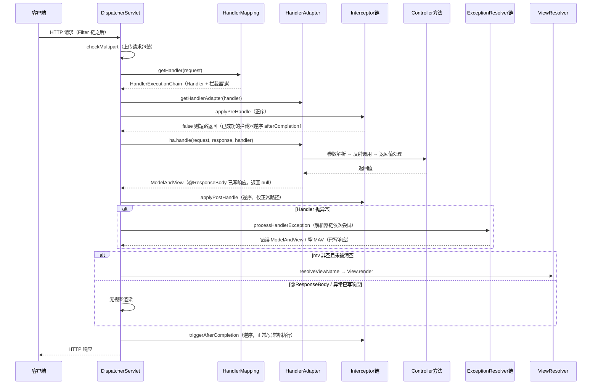
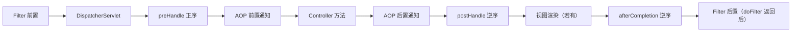

# Spring MVC 请求处理流程详解

> 一句话概括：Spring MVC 的全部请求处理都收敛在 `DispatcherServlet#doDispatch` 这一个方法里——它只负责**调度**（找 Handler、找适配器、跑拦截器、解析异常、渲染视图），真正的"处理"被拆成一组可替换的策略组件与两条 SPI 责任链；读懂这条主干和它的异常/异步分支，就读懂了参数注解、`@ResponseBody`、统一异常处理这些"魔法"的全部落点。

所属主题：[Spring 常见面试题总结](summary.md)

本文以 **Spring Framework 6.x（源码走读基于 6.1.x）/ Spring Boot 3.x** 为基线，关键差异处注明 5.x 与 7.0 的行为变化。所有源码锚点采用 `类名#方法名` 格式，建议对照 IDE 中的 `spring-webmvc` 源码阅读。总结文档第 6 章给出了流程骨架，本文做源码级展开，不复述结论。

---

## 0. 阅读路线

| 读者 | 建议阅读 | 关注点 |
| --- | --- | --- |
| 初级（1 年内） | 1.1~1.2、2.1~2.2、4.1、5.1、8 | 请求从进入到返回经历了什么，能完整讲出主干流程 |
| 中级（1~3 年） | 全部，重点 2.3~2.4、3、6 | 异常/异步路径的精确行为，参数解析与异常处理的扩展点 |
| 高级（3 年+） | 2.2~2.4、3.4、6.5、7 | 双层 try-catch 的设计意图、SPI 排序边界、异常处理的覆盖盲区 |
| 选型/架构 | 1.3、5.4、7.2~7.3 | 组件装配方式、三层增强的分工、同步/异步/虚拟线程的取舍 |

目录：

1. 前端控制器：DispatcherServlet 只调度不处理
2. doDispatch 源码走读
3. 参数解析与返回值处理：两条 SPI 责任链
4. @ResponseBody 与内容协商
5. Filter vs Interceptor vs AOP
6. 统一异常处理
7. 线程模型与异步边界
8. 高频追问集
9. 参考资料

---

## 1. 前端控制器：DispatcherServlet 只调度不处理

### 1.1 结论：一个 Servlet 接管所有请求

**结论**：Spring MVC 是**前端控制器（Front Controller）模式**——整个应用只注册一个 `DispatcherServlet`（Boot 默认映射 `/`），所有请求先进它，由它统一调度组件完成处理。它自己**不写任何业务逻辑**，甚至不直接解析参数、不直接序列化 JSON。

对比没有前端控制器的世界：每个 URL 对应一个 Servlet（或 Struts 时代的 Action），编码、鉴权、异常处理在每个入口重复一遍。前端控制器把这些横切关注点收敛到**一条可插拔的流水线**上：

- 统一入口 → 横切逻辑（拦截器、异常解析）只写一次；
- 处理步骤全部策略化 → 每一步都能替换实现而不改主干；
- `doDispatch` 是**模板方法**，`HandlerAdapter` 是**适配器**，Filter/Interceptor/异常解析器是**责任链**——一个流程里叠了三种模式（详见 [Spring 设计模式专题](design-patterns.md)）。

请求进入 Servlet 容器后的调用链：`FrameworkServlet#service → doGet/doPost → processRequest → doService → doDispatch`。`doService` 负责把 `WebApplicationContext`、`LocaleResolver`、`FlashMap` 等塞进 request attribute，真正的调度在 `doDispatch`。

### 1.2 九大组件速查表

`DispatcherServlet#initStrategies` 初始化九个策略组件（6.1.x 源码顺序）：

| # | 组件 | 职责 | 主流实现 | 备注 |
| --- | --- | --- | --- | --- |
| 1 | `MultipartResolver` | 识别并包装文件上传请求 | `StandardServletMultipartResolver` | 6.x 的 `DispatcherServlet.properties` **无默认值**，Boot 由 `MultipartAutoConfiguration` 注册 |
| 2 | `LocaleResolver` | 解析请求语言环境 | `AcceptHeaderLocaleResolver` | 国际化基础 |
| 3 | `ThemeResolver` | 解析主题 | `FixedThemeResolver` | **6.0 起整体 `@Deprecated`（no direct replacement），7.0 已移除**，initStrategies 只剩 8 项 |
| 4 | `HandlerMapping` | URL → Handler（含拦截器链） | `RequestMappingHandlerMapping`、`RouterFunctionMapping` | 可多个，按 order 依次尝试 |
| 5 | `HandlerAdapter` | 适配并执行 Handler | `RequestMappingHandlerAdapter`、`HandlerFunctionAdapter` | `supports(handler)` 决定谁接单 |
| 6 | `HandlerExceptionResolver` | 异常 → 响应/错误视图 | `ExceptionHandlerExceptionResolver` 等三个 | 见第 6 章 |
| 7 | `RequestToViewNameTranslator` | 没写视图名时按 URL 推导 | `DefaultRequestToViewNameTranslator` | 常被忽略的第九人 |
| 8 | `ViewResolver` | 视图名 → `View` 对象 | `InternalResourceViewResolver`、`ThymeleafViewResolver` | 前后端分离项目基本用不到 |
| 9 | `FlashMapManager` | 重定向间传参（flash 属性） | `SessionFlashMapManager` | `RedirectAttributes` 的底层 |

**一个常见误传要纠正**：`HttpMessageConverter` **不在九大组件之列**。它不是 `DispatcherServlet` 的策略，而是装配在 `RequestMappingHandlerAdapter` 与 `ExceptionHandlerExceptionResolver` 内部的" body ⇄ 对象"转换器（见第 4 章）。面试把两者混为一谈会暴露没读过 `initStrategies`。

### 1.3 组件如何被装配

**机制**：`DispatcherServlet` 本质是一个普通 Servlet，容器回调 `init()` 时触发 `initServletBean → initWebApplicationContext → onRefresh → initStrategies`。每个 `init*` 的查找逻辑一致（以 `initHandlerMappings` 为例）：

1. `detectAllHandlerMappings=true`（默认）→ 按类型取出容器中**所有** `HandlerMapping` Bean，按 order 排序；
2. 否则按约定名 `handlerMapping` 取单个 Bean；
3. 都没有 → 读 `DispatcherServlet.properties` 里的默认实现列表兜底。

**Boot 的装配链**（详见 [Boot 自动配置专题](boot-autoconfiguration.md)）：

```text
DispatcherServletAutoConfiguration
  └─ 注册 DispatcherServlet + DispatcherServletRegistrationBean（映射 "/"）
WebMvcAutoConfiguration（@ConditionalOnMissingBean(WebMvcConfigurationSupport.class)）
  └─ EnableWebMvcConfiguration extends DelegatingWebMvcConfiguration
       └─ 收集所有 WebMvcConfigurer，汇入 WebMvcConfigurationSupport
            ├─ requestMappingHandlerMapping()：扫描 @RequestMapping 建映射表
            ├─ requestMappingHandlerAdapter()：装配默认解析器/处理器/转换器 + 自定义项
            └─ handlerExceptionResolver()：组装三个默认异常解析器
```

**边界/代价**：

- 在 Boot 项目里加 `@EnableWebMvc` 会导入 `DelegatingWebMvcConfiguration`（它是 `WebMvcConfigurationSupport` 子类），直接让 `WebMvcAutoConfiguration` 的 `@ConditionalOnMissingBean` 条件失效——**Boot 的 MVC 自动配置整体退场**，静态资源映射、默认转换器配置等全部消失。想定制 MVC 请实现 `WebMvcConfigurer`，而不是加 `@EnableWebMvc`。
- `WebMvcConfigurer#configureHandlerExceptionResolvers` 一旦添加任何解析器，**三个默认解析器全部不再注册**（源码：列表非空就跳过 `addDefaultHandlerExceptionResolvers`）；想追加请用 `extendHandlerExceptionResolvers`。

**追问：为什么 HandlerMapping 和 HandlerAdapter 都是列表而不是单个？** 为了同时支持多种 Handler 形态：注解 Controller（`HandlerMethod`）、函数式路由（`RouterFunction`）、静态资源（`ResourceHttpRequestHandler`）、老式 `Controller` 接口。Mapping 负责"找到谁"，Adapter 负责"怎么调"，两者解耦后新增 Handler 类型只需加一对实现，主干零改动——这正是适配器模式的价值。

---

## 2. doDispatch 源码走读

### 2.1 主干时序图



### 2.2 逐步走读（6.1.x 源码）

`DispatcherServlet#doDispatch` 去掉日志后的骨架（注释为本文标注）：

```java
protected void doDispatch(HttpServletRequest request, HttpServletResponse response) throws Exception {
    HttpServletRequest processedRequest = request;
    HandlerExecutionChain mappedHandler = null;
    boolean multipartRequestParsed = false;
    WebAsyncManager asyncManager = WebAsyncUtils.getAsyncManager(request);
    try {
        ModelAndView mv = null;
        Exception dispatchException = null;
        try {
            processedRequest = checkMultipart(request);                    // ① 上传包装
            multipartRequestParsed = (processedRequest != request);
            mappedHandler = getHandler(processedRequest);                  // ② 找 Handler
            if (mappedHandler == null) {
                noHandlerFound(processedRequest, response);                // 6.1 默认抛 NoHandlerFoundException
                return;
            }
            HandlerAdapter ha = getHandlerAdapter(mappedHandler.getHandler()); // ③ 找适配器
            // ④ GET/HEAD 的 Last-Modified 协商，命中 304 直接返回（略）
            if (!mappedHandler.applyPreHandle(processedRequest, response)) {   // ⑤ 拦截器前置
                return;                                                    // false：短路
            }
            mv = ha.handle(processedRequest, response, mappedHandler.getHandler()); // ⑥ 真正执行
            if (asyncManager.isConcurrentHandlingStarted()) {
                return;                                                    // ⑦ 异步已启动：跳过 postHandle
            }
            applyDefaultViewName(processedRequest, mv);
            mappedHandler.applyPostHandle(processedRequest, response, mv); // ⑧ 拦截器后置（逆序）
        }
        catch (Exception ex) {
            dispatchException = ex;                                        // 内层 catch：只收集，不处理
        }
        catch (Throwable err) {
            // 4.3 起 Error 也包装成 ServletException，交给 @ExceptionHandler
            dispatchException = new ServletException("Handler dispatch failed: " + err, err);
        }
        processDispatchResult(processedRequest, response, mappedHandler, mv, dispatchException); // ⑨
    }
    catch (Exception ex) {
        triggerAfterCompletion(processedRequest, response, mappedHandler, ex); // 外层 catch：兜底
    }
    catch (Throwable err) {
        triggerAfterCompletion(processedRequest, response, mappedHandler,
                new ServletException("Handler processing failed: " + err, err));
    }
    finally {
        if (asyncManager.isConcurrentHandlingStarted()) {
            if (mappedHandler != null) {
                mappedHandler.applyAfterConcurrentHandlingStarted(processedRequest, response);
            }
            asyncManager.setMultipartRequestParsed(multipartRequestParsed);
        }
        else if (multipartRequestParsed || asyncManager.isMultipartRequestParsed()) {
            cleanupMultipart(processedRequest);                            // 清理上传临时文件
        }
    }
}
```

逐步拆解：

| 步骤 | 源码锚点 | 关键细节 |
| --- | --- | --- |
| ① 上传检查 | `DispatcherServlet#checkMultipart` | `MultipartResolver#isMultipart` 命中则包装成 `MultipartHttpServletRequest`——这是 DispatcherServlet 内部**唯一**包装 request 的地方 |
| ② 找 Handler | `DispatcherServlet#getHandler` → `RequestMappingHandlerMapping#getHandler` | 遍历 `handlerMappings`，第一个返回非 null 者胜出；产物是 `HandlerExecutionChain` = **Handler + 拦截器链**（`MappedInterceptor` 按路径匹配后并入，CORS 配置也会追加拦截器） |
| ③ 找适配器 | `DispatcherServlet#getHandlerAdapter` | 遍历 `handlerAdapters`，`supports(handler)` 为 true 者接单；`RequestMappingHandlerAdapter` 支持 `HandlerMethod` |
| ④ 缓存协商 | `HandlerAdapter#getLastModified` | 仅 GET/HEAD；`checkNotModified` 命中直接返回 304，**拦截器都不会执行** |
| ⑤ 前置拦截 | `HandlerExecutionChain#applyPreHandle` | 正序执行；每成功一个记录 `interceptorIndex = i`；返回 false 立即 `triggerAfterCompletion` 并短路 |
| ⑥ 执行 Handler | `RequestMappingHandlerAdapter#handleInternal → invokeHandlerMethod` | 参数解析 → 反射调用 → 返回值处理，见第 3 章 |
| ⑦ 异步判断 | `WebAsyncManager#isConcurrentHandlingStarted` | 返回 `Callable`/`DeferredResult` 时此处直接 return，postHandle 不执行 |
| ⑧ 后置拦截 | `HandlerExecutionChain#applyPostHandle` | **逆序**执行，可修改 ModelAndView；此时视图**尚未渲染** |
| ⑨ 结果处理 | `DispatcherServlet#processDispatchResult` | 异常解析 → 视图渲染 → `triggerAfterCompletion`，见 2.4 |

**双层 try-catch 是这段代码最值得讲的设计**：

- **内层 catch** 包住"业务执行段"（⑤~⑧）：异常被收集进 `dispatchException`，随后交给 `processDispatchResult` 走**异常解析器链**——这是 `@ExceptionHandler` 能接住 Controller 异常的原因；
- **外层 catch** 包住"结果处理段"：如果异常解析本身、视图渲染又炸了，不再尝试解析（避免无限递归），只做 `triggerAfterCompletion` 然后把异常**重新抛给容器**；
- `catch (Throwable err)` 分支（4.3 起）把 `Error` 也包成 `ServletException`，意味着 `StackOverflowError` 之类理论上也能被 `@ExceptionHandler` 捕获——面试说出这个细节很加分。

**追问：`getHandler` 返回 null 会怎样？** 6.1 起 `throwExceptionIfNoHandlerFound` 默认 `true`（setter 已 `@Deprecated(since="6.1")`，7.0 直接删除该字段），`noHandlerFound` 抛 `NoHandlerFoundException`，被内层 catch 收集后走解析器链（此时 handler 为 null，Controller 内的 `@ExceptionHandler` 不适用，只能靠 advice 或 `DefaultHandlerExceptionResolver` 转 404）。5.x 默认则是 `response.sendError(404)` 后直接 return，不经过解析器。

### 2.3 各路径下拦截器的精确行为（高频深挖）

`HandlerExecutionChain` 用一个 `interceptorIndex`（初始 -1，仅在 `preHandle` 返回 true 后更新为当前下标）精确控制回调范围。各路径的行为矩阵：

| 路径 | preHandle | postHandle | afterCompletion |
| --- | --- | --- | --- |
| 正常返回 | 全部正序执行 | **逆序**执行 | **逆序**执行，ex 参数为 null |
| Handler 抛异常（被解析器处理） | 已全部执行 | **不执行** | **仍执行**，逆序，ex 为 null（异常已被处理） |
| 第 k 个拦截器 preHandle 返回 false | 执行到第 k 个为止 | 不执行 | 只对 **0 ~ k-1**（已成功者）逆序执行 |
| 第 k 个拦截器 preHandle 抛异常 | 执行到第 k 个为止 | 不执行 | 只对 0 ~ k-1 逆序执行，ex 为该异常；**第 k 个自己的 afterCompletion 不执行** |
| 异步启动（首次 dispatch） | 已执行 | 不执行 | 不执行；改调 `AsyncHandlerInterceptor#afterConcurrentHandlingStarted` |

源码依据（`HandlerExecutionChain#triggerAfterCompletion`）：

```java
for (int i = this.interceptorIndex; i >= 0; i--) {
    HandlerInterceptor interceptor = this.interceptorList.get(i);
    try {
        interceptor.afterCompletion(request, response, this.handler, ex);
    }
    catch (Throwable ex2) {
        logger.error("HandlerInterceptor.afterCompletion threw exception", ex2);  // 只记日志，不外抛
    }
}
```

三个必须讲清的细节：

1. **异常路径下 afterCompletion 仍执行、postHandle 不执行**。原因在 doDispatch 结构：异常被内层 catch 收集后直接进 `processDispatchResult`，跳过了 `applyPostHandle`；而 `processDispatchResult` 末尾无条件 `triggerAfterCompletion`。所以**资源清理逻辑放 afterCompletion，不要放 postHandle**——postHandle 语义是"正常返回后、渲染前修改模型"，不是 finally。
2. **preHandle 返回 false 的短路语义**：doDispatch 直接 return，Controller 不执行、异常解析器不介入（这不是异常路径）。Javadoc 明确假设"该拦截器已自行处理响应"——**返回 false 前必须自己写响应**（如 401 JSON），否则客户端拿到空响应。
3. **afterCompletion 里抛异常只会被记日志吞掉**，不影响其他拦截器的回调，也不会改变响应——它是"尽力而为"的清理点。

### 2.4 processDispatchResult 与异常出口

`DispatcherServlet#processDispatchResult` 的逻辑：

```text
exception != null ?
  ├─ ModelAndViewDefiningException → 直接取它携带的 ModelAndView
  └─ 其他 → processHandlerException(request, response, handler, exception)
mv != null 且 !mv.wasCleared() ?
  ├─ 是 → render(mv, ...)：ViewResolver 解析视图名 → View.render 写响应
  └─ 否 → 无渲染（@ResponseBody 已写 body / 异常处理器已写 body）
异步已启动（forward 中启动并发的场景）→ 直接 return
mappedHandler != null → triggerAfterCompletion(request, response, null)
```

`DispatcherServlet#processHandlerException` 的三个关键行为（6.1.x）：

- 先 `request.removeAttribute(PRODUCIBLE_MEDIA_TYPES_ATTRIBUTE)` 并 **`response.resetBuffer()`**（响应未提交时）——成功路径与错误路径的内容类型可以不同，且避免异常前已写出的半截 body 混入错误响应；
- 按注册顺序遍历解析器，**第一个返回非 null `ModelAndView` 者胜出**；返回**空 MAV**（`isEmpty()`）表示"已处理、无需视图"（`@ExceptionHandler` + `@ResponseBody` 就是这种），把异常存入 `EXCEPTION_ATTRIBUTE` 后返回 null；
- **所有解析器都返回 null → `throw ex` 原样重抛** → 外层 catch → `triggerAfterCompletion`（带异常）→ 抛给容器 → Boot 的容器错误页机制 forward 到 `/error`（`BasicErrorController`）。

**边界**：`render` 阶段、`postHandle` 里抛出的异常落在**外层 catch**，不走 `@ExceptionHandler`（见 6.5）。`@ResponseBody` 场景下 `ha.handle` 返回 null 的前提是 `mavContainer.isRequestHandled()` 为 true（`RequestMappingHandlerAdapter#getModelAndView` 开头判断），所以"响应已写出"与"无视图渲染"是同一件事的两面。

---

## 3. 参数解析与返回值处理：两条 SPI 责任链

### 3.1 结论：ha.handle 内部的三段式

**结论**：`RequestMappingHandlerAdapter#invokeHandlerMethod` 把一次 Handler 调用拆成三段，每段都是**责任链 + 策略**：

```text
ServletInvocableHandlerMethod#invokeAndHandle
  ├─ getMethodArgumentValues：HandlerMethodArgumentResolverComposite 逐参数找解析器
  ├─ doInvoke：getBridgedMethod().invoke(getBean(), args) —— 就是普通反射
  └─ HandlerMethodReturnValueHandlerComposite#handleReturnValue：按返回值类型/注解找处理器
```

两个 Composite 的匹配规则相同：**遍历列表，第一个 `supportsParameter` / `supportsReturnType` 为 true 的解析器/处理器独占处理**，参数解析结果还会按 `MethodParameter` 缓存（`argumentResolverCache`），同一方法第二次请求不再重复匹配。所谓"注解魔法"，全部落在这两条链的 `supportsXxx` 判断里。

### 3.2 内置解析器梯队与常见注解映射

`RequestMappingHandlerAdapter#getDefaultArgumentResolvers` 的添加顺序分四个梯队（6.1.x 实测）：

| 梯队 | 成员（节选） | 匹配依据 |
| --- | --- | --- |
| ① 注解驱动 | `RequestParamMethodArgumentResolver(false)`、`PathVariableMethodArgumentResolver`、`ServletModelAttributeMethodProcessor(false)`、`RequestResponseBodyMethodProcessor`、`RequestPartMethodArgumentResolver`、`RequestHeaderMethodArgumentResolver`、`ServletCookieValueMethodArgumentResolver`、`SessionAttributeMethodArgumentResolver` 等 | 参数上有对应注解 |
| ② 类型驱动 | `ServletRequestMethodArgumentResolver`（HttpServletRequest 等）、`ServletResponseMethodArgumentResolver`、`HttpEntityMethodProcessor`、`ModelMethodProcessor`、`UriComponentsBuilderMethodArgumentResolver` 等 | 参数类型本身 |
| ③ 自定义 | `WebMvcConfigurer#addArgumentResolvers` 注册的解析器 | 自定义 `supportsParameter` |
| ④ 兜底 catch-all | `PrincipalMethodArgumentResolver`、`RequestParamMethodArgumentResolver(true)`、`ServletModelAttributeMethodProcessor(true)` | 无注解的简单类型按请求参数、无注解的 POJO 按表单绑定 |

常见注解 → 解析器对照：

| 写法 | 解析器 | 数据来源 |
| --- | --- | --- |
| `@RequestParam("id")` | `RequestParamMethodArgumentResolver` | query string / form 参数，经 `WebDataBinder` 类型转换 |
| `@PathVariable("id")` | `PathVariableMethodArgumentResolver` | URI 模板变量（`HandlerMapping.URI_TEMPLATE_VARIABLES_ATTRIBUTE`） |
| `@RequestBody` | `RequestResponseBodyMethodProcessor` | 请求体，经 `HttpMessageConverter` 反序列化；`@Valid` 校验失败抛 `MethodArgumentNotValidException` |
| `@ModelAttribute` / 无注解 POJO | `ServletModelAttributeMethodProcessor` | 请求参数逐字段绑定到对象 |
| `@RequestHeader` / `@CookieValue` | 对应注解解析器 | 请求头 / Cookie |
| `HttpServletRequest`、`Principal` 等 | 类型驱动 / catch-all | Servlet API 原生对象 |

**一个漂亮的对称设计**：`RequestResponseBodyMethodProcessor` 同时实现 `HandlerMethodArgumentResolver` 和 `HandlerMethodReturnValueHandler` 两个接口——`@RequestBody` 的读和 `@ResponseBody` 的写是**同一个类**，共用同一组 `HttpMessageConverter`。

### 3.3 完整示例：自定义 @LoginUser 参数注解

目标：Controller 方法直接声明 `@LoginUser LoginUser user`，由框架注入当前登录用户，业务代码不再手动解析 token。完整链路 = **拦截器验票存 request attribute → 解析器取 attribute 注参**：

```java
// 1. 注解本身
@Target(ElementType.PARAMETER)
@Retention(RetentionPolicy.RUNTIME)
public @interface LoginUser {
    String ATTRIBUTE_KEY = "LOGIN_USER";   // 拦截器与解析器共享的 request attribute 键
    boolean required() default true;
}

// 2. 用户载体（Java 17 record）
public record LoginUser(Long id, String name) {}

// 3. 拦截器：验票并把用户放进 request attribute（请求级隔离，天然线程安全）
public class AuthInterceptor implements HandlerInterceptor {
    @Override
    public boolean preHandle(HttpServletRequest request, HttpServletResponse response, Object handler)
            throws Exception {
        String token = request.getHeader("Authorization");
        LoginUser user = parseToken(token);              // 业务实现：JWT 解析 / 查会话，失败返回 null
        if (user != null) {
            request.setAttribute(LoginUser.ATTRIBUTE_KEY, user);
        }
        return true;                                     // 是否放行由 required 语义在解析器里决定
    }
    private LoginUser parseToken(String token) { /* ... */ return null; }
}

// 4. 参数解析器：两个方法就是 SPI 的全部
public class LoginUserArgumentResolver implements HandlerMethodArgumentResolver {
    @Override
    public boolean supportsParameter(MethodParameter parameter) {
        return parameter.hasParameterAnnotation(LoginUser.class)
                && LoginUser.class.isAssignableFrom(parameter.getParameterType());
    }
    @Override
    public Object resolveArgument(MethodParameter parameter, ModelAndViewContainer mavContainer,
            NativeWebRequest webRequest, WebDataBinderFactory binderFactory) {
        LoginUser user = (LoginUser) webRequest.getAttribute(LoginUser.ATTRIBUTE_KEY, RequestAttributes.SCOPE_REQUEST);
        LoginUser anno = parameter.getParameterAnnotation(LoginUser.class);
        if (user == null && anno.required()) {
            throw new ResponseStatusException(HttpStatus.UNAUTHORIZED, "未登录");
        }
        return user;
    }
}

// 5. 注册：拦截器与解析器都走 WebMvcConfigurer
@Configuration
public class WebConfig implements WebMvcConfigurer {
    @Override
    public void addInterceptors(InterceptorRegistry registry) {
        registry.addInterceptor(new AuthInterceptor()).addPathPatterns("/api/**");
    }
    @Override
    public void addArgumentResolvers(List<HandlerMethodArgumentResolver> resolvers) {
        resolvers.add(new LoginUserArgumentResolver());
    }
}

// 6. 使用
@RestController
@RequestMapping("/api/orders")
public class OrderController {
    @GetMapping("/mine")
    public List<Order> mine(@LoginUser LoginUser user) {   // 未登录时由解析器抛 401
        return orderService.listByUser(user.id());
    }
}
```

这套 SPI 的扩展意义：**把"从请求的某个位置提取某种上下文"的模式固化成可复用组件**。登录用户、租户 ID、灰度标记、分页参数都可以照此办理；`WebMvcConfigurationSupport` 还会把同一批自定义解析器传给 `ExceptionHandlerExceptionResolver`，所以 `@ExceptionHandler` 方法里也能用 `@LoginUser`。

### 3.4 边界与代价

- **自定义解析器排在全部内置解析器之后、catch-all 之前**。所以 `@LoginUser` 标在自定义 POJO 上能抢在兜底的 `ServletModelAttributeMethodProcessor(true)` 之前生效；但**无法覆盖内置注解的行为**——参数同时标了 `@RequestParam`，内置解析器先匹配，自定义解析器永远轮不到。真要改内置行为，只能取出 `RequestMappingHandlerAdapter` 直接重排其 resolver 列表（侵入性大，慎用）。返回值处理器同理：自定义 handler 无法覆盖 `@ResponseBody` 的内置处理。
- `supportsParameter` 必须**精准且便宜**：它对每个未缓存的参数都会被调用，写成正则扫描注解之类的重逻辑会拖慢所有请求。
- 解析器抛出的异常（如上面的 401）发生在 `ha.handle` 内部，**走正常异常解析链**，可被 `@ExceptionHandler` 统一接管——这是"解析器 + 全局异常处理"组合拳的基础。

**追问：为什么用责任链而不是一个大 switch？** 新增参数来源只需加一个实现类并注册，符合开闭原则；链的顺序本身就是优先级协议，框架、第三方库、业务代码可以在同一条链上共存而互不修改。

---

## 4. @ResponseBody 与内容协商

### 4.1 结论：谁决定返回值走视图还是走 body

**结论**：`@ResponseBody`（或类级 `@RestController` = `@Controller` + `@ResponseBody` 组合注解）使返回值由 `RequestResponseBodyMethodProcessor` 处理——经 `HttpMessageConverter` 序列化后**直接写响应体**，并置 `mavContainer.setRequestHandled(true)`；适配器因此返回 null `ModelAndView`，视图解析与渲染**整段跳过**。

判定发生在返回值处理器链上：`RequestResponseBodyMethodProcessor`（注解驱动段）排在 `ViewNameMethodReturnValueHandler`（多用途段）**之前**，`supportsReturnType` 检查方法或声明类上有 `@ResponseBody` 即命中。

### 4.2 内容协商机制

`AbstractMessageConverterMethodProcessor#writeWithMessageConverters` 的决策流程：

```text
Accept 头 → ContentNegotiationManager 解析出客户端可接受的 MediaType 列表
         → 与"可生产类型"（converter 能写的类型 ∩ @RequestMapping(produces) 声明）求交
         → 按质量值 q 与具体性排序，选定目标 MediaType
         → 遍历 messageConverters，第一个 canWrite(valueType, mediaType) 者执行 write
```

`consumes` / `produces` 的作用时机不同，容易混淆：

| 属性 | 作用阶段 | 不匹配的后果 |
| --- | --- | --- |
| `consumes` | **映射匹配阶段**按请求 `Content-Type` 过滤 | 415 Unsupported Media Type（方法根本不会执行） |
| `produces` | 映射阶段按 `Accept` 过滤 + 收窄可生产类型 | 406 Not Acceptable |

常见转换器（`WebMvcConfigurationSupport#addDefaultHttpMessageConverters` 的顺序）：

| 转换器 | 处理类型 | 说明 |
| --- | --- | --- |
| `ByteArrayHttpMessageConverter` | `byte[]` | 二进制下载 |
| `StringHttpMessageConverter` | `String` | 支持 `text/plain` 与 `*/*` |
| `ResourceHttpMessageConverter` / `ResourceRegionHttpMessageConverter` | `Resource` | 文件与断点续传 |
| `AllEncompassingFormHttpMessageConverter` | 表单 MultiValueMap | form 提交 |
| `MappingJackson2HttpMessageConverter` | POJO ⇄ JSON | classpath 有 Jackson 2 时注册（Boot 3 默认） |

### 4.3 返回 String：视图名还是 body？

| 场景 | 处理器 | 结果 |
| --- | --- | --- |
| `@Controller` 方法返回 `"order/list"`，无 `@ResponseBody` | `ViewNameMethodReturnValueHandler` | 字符串是**视图名**，交给 ViewResolver |
| `@RestController`（或 `@ResponseBody`）返回 String | `RequestResponseBodyMethodProcessor` → `StringHttpMessageConverter` | 字符串是 **body 原文** |
| `@RestController` 返回 String，客户端 `Accept: application/json` | 仍是 `StringHttpMessageConverter` | **原样输出、不带 JSON 引号**——它排在 Jackson 之前且支持 `*/*`，`canWrite(String, application/json)` 为 true |

第三行是真实踩坑点：想让 String 返回值成为合法 JSON 字符串，要么改返回包装对象，要么显式 `produces = "text/plain"` 表明语义。

**边界/版本差异**：

- Framework 中 `StringHttpMessageConverter` 默认字符集是 **ISO-8859-1**（直接 new 出来写中文会乱码）；Boot 的 `HttpMessageConvertersAutoConfiguration` 用 `server.servlet.encoding.charset`（默认 UTF-8）重新构造它，所以 Boot 项目通常无感。
- URL 后缀协商（`/user.json` 推断格式）5.3 起废弃、6.0 移除，Boot 默认只按 `Accept` 头协商。
- Spring 6 / Boot 3 的 JSON 转换器基于 Jackson 2（`MappingJackson2HttpMessageConverter`）；Spring 7 / Boot 4 默认迁移到 Jackson 3，升级时自定义 `ObjectMapper` 的装配方式要跟着改。

---

## 5. Filter vs Interceptor vs AOP

### 5.1 三层对比表

**结论**：三者是**不同规范层级**的增强机制，不是同一件事的三种写法——Filter 属于 Servlet 规范、Interceptor 属于 Spring MVC、AOP 属于 Spring 容器的代理机制（代理边界详见 [IoC 与 AOP 专题](ioc-and-aop.md)）。

| 维度 | Filter | Interceptor | AOP |
| --- | --- | --- | --- |
| 规范层级 | Servlet 规范（`jakarta.servlet.Filter`） | Spring MVC（`HandlerInterceptor`） | Spring AOP（动态代理） |
| 执行位置 | DispatcherServlet **之外**，容器级 | DispatcherServlet **之内**，Handler 前后 | 任意 Spring Bean 方法调用处 |
| 粒度 | URL pattern（可覆盖静态资源、其他 Servlet） | 映射路径 + **知道 Handler 是谁**（可拿 `HandlerMethod` 读注解） | 切点表达式匹配的方法 |
| 能否包装 request/response | **能**（`HttpServletRequestWrapper`，如缓存 body 供重复读） | 不能替换请求/响应对象 | 不涉及 Servlet API，但能改方法参数 |
| 能否短路 | `chain.doFilter` 不调用即短路 | `preHandle` 返回 false 即短路 | `@Around` 不调 `proceed()` 即短路 |
| 异常能否被 `@ExceptionHandler` 接住 | **不能**（在 MVC 之外） | 能（preHandle 抛异常走解析器链） | 能（Controller 方法上的异常正常上抛） |
| 典型用途 | 编码、CORS、全链路 traceId、请求体缓存、限流 | 登录校验、接口权限、耗时统计 | 事务、缓存、方法级审计日志 |

### 5.2 执行顺序链



注意两个容易记错的点：**视图渲染发生在 postHandle 之后、afterCompletion 之前**；postHandle 与 afterCompletion 都是**逆序**（洋葱模型，先进后出），只有 preHandle 正序。

### 5.3 边界：两个流传甚广的错误说法

- **"拦截器不拦截静态资源"——不完全对**。Boot 默认把 `classpath:/static/` 等映射为 `ResourceHttpRequestHandler`，它同样经 DispatcherServlet 分发，**拦截器照样生效**（所以登录拦截器要 `excludePathPatterns` 放行静态资源）。只有当资源由容器默认 Servlet 处理、根本不进 DispatcherServlet 时，拦截器才天然缺席；Filter 则按 url-pattern 始终有机会介入。
- **"preHandle 返回 false 会走全局异常处理"——错**。false 是正常短路而非异常，doDispatch 直接 return，`@ExceptionHandler` 不介入，响应必须由拦截器自己写（见 2.3）。

另一个工程细节：`OncePerRequestFilter` 默认 `shouldNotFilterAsyncDispatch() = true`，即**ASYNC dispatch 不再重复执行** Filter；而 MVC 拦截器的 preHandle 在 ASYNC dispatch 会再执行一遍（见 7.2）——两层机制对异步的态度不一致，做全链路日志时要留意。

### 5.4 选型速查

| 需求 | 放哪层 | 理由 |
| --- | --- | --- |
| 请求体重复读（验签、审计） | Filter + `ContentCachingRequestWrapper` | 只有 Filter 能包装 request |
| traceId / MDC 注入 | Filter（最外层） | 覆盖包括静态资源与错误 dispatch 的全部路径 |
| 登录态、接口级权限 | Interceptor | 能拿到 `HandlerMethod` 上的注解决定放行策略 |
| 接口耗时（含视图渲染） | Interceptor（preHandle 计时、afterCompletion 结算） | afterCompletion 异常路径也执行，统计不漏 |
| 事务、方法缓存、参数级审计 | AOP | 方法粒度，与 Web 层解耦，Service 也能复用 |

---

## 6. 统一异常处理

### 6.1 解析器链的顺序与来源

**结论**：异常解析顺序为 **`ExceptionHandlerExceptionResolver`（`@ExceptionHandler`）→ `ResponseStatusExceptionResolver`（`@ResponseStatus` / `ResponseStatusException`）→ `DefaultHandlerExceptionResolver`（框架异常 → 标准状态码）**。

这个顺序不是靠 `@Order` 值排出来的：`WebMvcConfigurationSupport#addDefaultHandlerExceptionResolvers` 按上述顺序把三者加入列表，且**都没有调用 setOrder**（order 只设在包装它们的 `HandlerExceptionResolverComposite` 上，值为 0），`DispatcherServlet` 按列表顺序遍历、第一个返回非 null 者胜出——**顺序即注册顺序**。

`ExceptionHandlerExceptionResolver` 内部还有两级查找（`#getExceptionHandlerMethod`）：

1. **当前 Controller 内**的 `@ExceptionHandler` 方法优先（按 `handlerMethod.getBeanType()` 查缓存）；
2. 找不到再按 `@Order` 排序遍历 **`@ControllerAdvice`** Bean，每个 advice 内用 `ExceptionDepthComparator` 选**继承深度最浅（最具体）**的匹配方法——`@ExceptionHandler({BizException.class, Exception.class})` 同时存在时，`BizException` 命中前者；
3. 多个 advice 都能处理时，**排序靠前的 advice 整体胜出**，不会跨 advice 挑"更具体"的方法。

### 6.2 完整示例：@RestControllerAdvice

```java
// 业务异常：携带错误码
public class BizException extends RuntimeException {
    private final int code;
    public BizException(int code, String message) { super(message); this.code = code; }
    public int getCode() { return code; }
}

@RestControllerAdvice
public class GlobalExceptionHandler {

    // 业务异常 → 200 + 业务错误码（按团队 API 规范定）
    @ExceptionHandler(BizException.class)
    public Result<Void> biz(BizException e) {
        return Result.fail(e.getCode(), e.getMessage());
    }

    // @Valid 校验失败 → 400，聚合字段错误
    @ExceptionHandler(MethodArgumentNotValidException.class)
    public ResponseEntity<Result<Void>> invalid(MethodArgumentNotValidException e) {
        String msg = e.getBindingResult().getFieldErrors().stream()
                .map(f -> f.getField() + ": " + f.getDefaultMessage())
                .collect(Collectors.joining("; "));
        return ResponseEntity.badRequest().body(Result.fail(400, msg));
    }

    // 兜底：日志 + 对外脱敏，绝不把堆栈抛给客户端
    @ExceptionHandler(Exception.class)
    public ResponseEntity<Result<Void>> unknown(Exception e) {
        log.error("unexpected error", e);
        return ResponseEntity.status(500).body(Result.fail(500, "系统繁忙，请稍后重试"));
    }
}
```

`@RestControllerAdvice` = `@ControllerAdvice` + `@ResponseBody`，所以这些方法的返回值同样走第 4 章的转换器链。`@ExceptionHandler` 方法的入参也走第 3 章的参数解析 SPI（异常对象、`HttpServletRequest`、自定义 `@LoginUser` 都可以声明）。

### 6.3 另外两个解析器

`ResponseStatusExceptionResolver`：处理 `ResponseStatusException`（6.0 起）与标注了 `@ResponseStatus` 的异常类，设置状态码后返回空 MAV。`DefaultHandlerExceptionResolver` 把框架异常翻译成标准 HTTP 语义（`#doResolveException` 的映射表，节选）：

| 异常 | 状态码 | 触发场景 |
| --- | --- | --- |
| `HttpRequestMethodNotSupportedException` | 405 | POST 打到只支持 GET 的映射 |
| `HttpMediaTypeNotSupportedException` | 415 | `consumes` 不匹配 |
| `HttpMediaTypeNotAcceptableException` | 406 | `produces` 与 Accept 无交集 |
| `MissingServletRequestParameterException` | 400 | 必填 `@RequestParam` 缺失 |
| `HttpMessageNotReadableException` | 400 | `@RequestBody` JSON 解析失败 |
| `MethodArgumentNotValidException` | 400 | `@Valid` 校验失败（未被 advice 接管时） |
| `NoHandlerFoundException` | 404 | 无映射（6.1 起默认走此路径） |
| `AsyncRequestTimeoutException` | 503 | 异步请求超时 |

**实践**：自定义异常想直接表达 HTTP 语义，抛 `ResponseStatusException` 或给异常类标 `@ResponseStatus` 即可，不必都挤进 advice；advice 留给需要统一响应体的场景。

### 6.4 Boot 3 的 ProblemDetail（RFC 7807）

Boot 3 开启 `spring.mvc.problemdetails.enabled=true` 后，`WebMvcAutoConfiguration.ProblemDetailsErrorHandlingConfiguration` 注册 `ProblemDetailsExceptionHandler`（`@Order(0)`，继承 `ResponseEntityExceptionHandler`），把上表所有框架异常统一输出为 `application/problem+json`：

```json
{
  "type": "about:blank",
  "title": "Bad Request",
  "status": 400,
  "detail": "Failed to read request",
  "instance": "/api/orders"
}
```

`ResponseEntityExceptionHandler` 是 Framework 6 提供的基类，预置了全部标准 MVC 异常的处理方法；自定义异常可继承它覆写 `handleExceptionInternal`，或直接抛 `ErrorResponseException`。**取舍**：ProblemDetail 适合对外开放、遵循标准的 API；内部前后端约定了 `{code, message, data}` 响应体的系统，用 6.2 的 advice 更顺——两者别混用，否则错误格式分裂。（RFC 7807 已被 RFC 9457 取代，Spring 文档仍沿用 7807 的说法，格式兼容。）

### 6.5 边界：@ExceptionHandler 的四个盲区

| 盲区 | 原因 | 兜底方案 |
| --- | --- | --- |
| Filter 中抛出的异常 | 在 DispatcherServlet 之外，解析器链根本没启动 | Filter 内 try-catch 自写响应，或交给容器 `/error` |
| 视图渲染、postHandle 中的异常 | 落在 doDispatch **外层 catch**，直接 triggerAfterCompletion 后重抛 | 容器错误页；渲染逻辑保持薄 |
| `@ExceptionHandler` 方法自身抛异常 | 框架只记日志，把**原异常**继续上抛，不递归解析 | 兜底 handler 必须足够简单、不再抛错 |
| 所有解析器都返回 null | `processHandlerException` 末尾 `throw ex` | Boot forward `/error`（`BasicErrorController`，API 请求返回 JSON 错误体） |

另注意 6.1 的 `processHandlerException` 会先 `response.resetBuffer()`（未提交时）：如果响应**已提交**（如流式输出写了一半），异常处理器无力回天，只能记日志——这是"响应提交后异常处理失效"的根因。

---

## 7. 线程模型与异步边界

### 7.1 Controller 单例与线程安全

**结论**：Controller 默认**单例**（容器只保证"一个实例"，不保证线程安全），所有请求并发调用同一对象。**可变成员变量存请求状态 = 并发事故**：

```java
@RestController
public class BadController {
    private Long currentUserId;                 // ❌ 共享可变状态
    @GetMapping("/profile")
    public Profile profile(@RequestParam Long userId) {
        this.currentUserId = userId;            // 请求 A 写入后可能被请求 B 覆盖
        return service.load(this.currentUserId); // 串号：拿到别人的数据
    }
}
```

请求状态的正确存放位置：

| 位置 | 线程安全性 | 说明 |
| --- | --- | --- |
| 方法参数 / 局部变量 | 天然安全 | 每请求独立栈帧，**首选** |
| request attribute | 请求级隔离 | 拦截器与解析器间传值的正道（3.3 示例） |
| `ThreadLocal` | 线程隔离，但**必须 remove** | Tomcat 线程池复用线程，不清理 → 下个请求读到上个请求的数据 |
| 单例的可变成员字段 | **危险** | 除非是不可变对象或并发安全容器且语义确属共享 |
| `@RequestScope` Bean | 请求级隔离 | 需要作用域代理，注入单例时注意代理开销 |

`ThreadLocal` 的清理点放 `finally` 或拦截器 `afterCompletion`（异常路径也执行，见 2.3）。Boot 3.2+ 开虚拟线程后线程近乎无限创建，ThreadLocal 滥用还会放大内存占用——"用完即清"从纪律变成硬约束。

### 7.2 异步请求处理：二次 dispatch

**结论**：`Callable` / `DeferredResult` / `WebAsyncTask` 的本质是**把"占用容器线程等待"改成"释放容器线程 + 结果就绪后二次 dispatch"**，请求本身仍是挂起的，与 `@Async` 的方法级异步是两套机制（后者见 [Async 注解原理专题](async-annotation-principle.md)）。

| 返回类型 | 谁执行 | 特点 |
| --- | --- | --- |
| `Callable<T>` | MVC 的 `AsyncTaskExecutor`（Boot 默认 `applicationTaskExecutor`） | 最简方式，超时与执行器走全局配置 |
| `DeferredResult<T>` | **任意线程**（MQ 回调、其他请求、定时任务）`setResult` | 跨线程/跨请求传递结果，自带 `onTimeout`/`onCompletion` 回调 |
| `WebAsyncTask<T>` | 包装 Callable | 可单独指定超时与执行器 |

二次 dispatch 的完整时序：

```text
首次 dispatch（REQUEST）
  doDispatch → ha.handle 发现返回 Callable/DeferredResult
  → WebAsyncManager 调 request.startAsync()，提交任务
  → isConcurrentHandlingStarted()=true，doDispatch 提前 return
  → finally：applyAfterConcurrentHandlingStarted（替代 postHandle/afterCompletion）
  → 容器线程释放，响应保持打开
工作线程产出结果（或 DeferredResult.setResult）
  → asyncContext.dispatch()：同 URL 的 ASYNC dispatch 重新进入容器
二次 dispatch（ASYNC）
  doDispatch 完整重跑：getHandler 重新映射、preHandle 再次执行
  → ha.handle 内 wrapConcurrentResult：不再调用 Controller 方法，直接以异步结果走返回值处理
  → postHandle → 渲染/写 body → afterCompletion
```

两个必须校验过的精确行为：

- **preHandle 会执行两次**（首次 + ASYNC dispatch 各一次）：`doDispatch` 对 `applyPreHandle` 的调用没有任何 DispatcherType 判断（6.1.x 与 7.x 源码均如此）。拦截器里的耗时统计、计数逻辑要考虑这一点；`AsyncHandlerInterceptor#afterConcurrentHandlingStarted` 则只在首次 dispatch 调用，**替代**该次的 postHandle/afterCompletion。
- **Controller 方法不会执行第二次**：`RequestMappingHandlerAdapter#invokeHandlerMethod` 检测 `asyncManager.hasConcurrentResult()` 后用 `wrapConcurrentResult` 把结果包成"返回值"，跳过真实调用。

**边界/代价**：

- 超时抛 `AsyncRequestTimeoutException`，默认由 `DefaultHandlerExceptionResolver` 转 **503**，可用 `@ExceptionHandler` 定制；默认超时时长取决于容器，生产必须显式配置（`spring.mvc.async.request-timeout` 或 `WebAsyncTask`）。
- **ThreadLocal 不跨线程**：首次 dispatch 线程上的 MDC、登录上下文不会自动出现在工作线程与二次 dispatch 线程上，需要 `TaskDecorator` 或 Context Propagation 显式传递。
- 异步不是免费的吞吐：它只是把等待挪出容器线程，下游阻塞容量、超时治理、结果回传的复杂度都是新增成本。

### 7.3 与虚拟线程、WebFlux 的关系（一句带过）

Boot 3.2+（Java 21）开 `spring.threads.virtual.enabled=true` 后，"一请求一线程"的阻塞写法也能扛高并发，多数场景不再需要为吞吐上 WebFlux；WebFlux 的取舍（依赖链必须全非阻塞、ThreadLocal 失效）见 [总结 8.2](summary.md#82-webflux-vs-spring-mvc)。

---

## 8. 高频追问集

**Q1：讲一遍 doDispatch 的完整流程（"九步"）。**
期望答案：① `checkMultipart` 包装上传请求 → ② `getHandler` 遍历 HandlerMapping 得到 `HandlerExecutionChain`（Handler + 拦截器链）→ ③ `getHandlerAdapter` 按 `supports` 选适配器 → ④ GET/HEAD 做 Last-Modified 协商（可能 304 直接返回）→ ⑤ `applyPreHandle` 正序，false 短路 → ⑥ `ha.handle`：参数解析 → 反射调用 → 返回值处理 → ⑦ 异步已启动则提前 return → ⑧ `applyPostHandle` 逆序 → ⑨ `processDispatchResult`：异常走解析器链、有视图则渲染，最后 `triggerAfterCompletion`。加分点：双层 try-catch 的分工（内层收集异常给解析器，外层兜底重抛给容器）。

**Q2：Filter 和 Interceptor 的区别？**
期望答案：规范层级（Servlet vs Spring MVC）、位置（DispatcherServlet 外 vs 内）、粒度（URL vs Handler，后者能拿 `HandlerMethod` 读注解）、能力（Filter 可包装 request/response，拦截器不能）、异常归属（Filter 异常不进 `@ExceptionHandler`）。执行顺序 Filter → preHandle → Controller → postHandle → 渲染 → afterCompletion → Filter 返回。

**Q3：preHandle 返回 false 会发生什么？**
期望答案：Controller 不执行、postHandle 不执行、异常解析器不介入；只对**已成功执行 preHandle 的拦截器**逆序调 afterCompletion（`interceptorIndex` 控制）；响应必须由该拦截器自己写，否则客户端收到空响应。

**Q4：如何扩展参数解析，让 Controller 支持自定义注解？**
期望答案：实现 `HandlerMethodArgumentResolver` 的 `supportsParameter` + `resolveArgument`，经 `WebMvcConfigurer#addArgumentResolvers` 注册。关键边界：自定义解析器排在内置之后、catch-all 之前，能赢兜底但**覆盖不了内置注解**；返回值侧对称地有 `HandlerMethodReturnValueHandler`。

**Q5：@ResponseBody 的响应是什么时候写出的？**
期望答案：在 `ha.handle` **内部**的返回值处理阶段（`RequestResponseBodyMethodProcessor` → `HttpMessageConverter`），早于 postHandle；写完置 `requestHandled=true`，适配器返回 null MAV，视图解析整段跳过。所以 postHandle 里再改响应体通常已无效（响应可能已提交）。

**Q6：返回 String 为什么有时是视图名有时是 body？**
期望答案：无 `@ResponseBody` 时 `ViewNameMethodReturnValueHandler` 把它当视图名；有时 `RequestResponseBodyMethodProcessor` 命中，`StringHttpMessageConverter` 原样输出。追问 Accept: application/json 时也不加引号——String 转换器排在 Jackson 前且支持 `*/*`。

**Q7：异常处理的完整顺序？**
期望答案：Controller 内 `@ExceptionHandler` → 按 `@Order` 排序的 `@ControllerAdvice`（advice 内按异常继承深度就近匹配）→ `ResponseStatusExceptionResolver` → `DefaultHandlerExceptionResolver`；都没接住则重抛给容器（Boot 走 `/error`）。顺序来自注册顺序而非 order 值。盲区：Filter 异常、渲染/postHandle 异常、handler 自身抛错。

**Q8：Controller 是线程安全的吗？**
期望答案：单例不保证线程安全；无状态设计（参数 + 局部变量）天然安全，可变成员字段存请求状态会串号；ThreadLocal 必须 remove（线程池复用）；请求级共享用 request attribute 或 `@RequestScope`。

**Q9：返回 Callable 后请求经历几次 dispatch？拦截器执行几次？**
期望答案：两次（REQUEST + ASYNC）。preHandle 两次（doDispatch 无条件调用）；postHandle/afterCompletion 只在第二次；第一次以 `afterConcurrentHandlingStarted` 替代后两者；Controller 方法只执行一次（二次 dispatch 用 `wrapConcurrentResult` 直接取结果）。超时 → `AsyncRequestTimeoutException` → 503。

**Q10：为什么 afterCompletion 异常时也执行，postHandle 却不执行？**
期望答案：doDispatch 内层 catch 收集异常后直接进 `processDispatchResult`，跳过了 `applyPostHandle`；而 `processDispatchResult` 末尾无条件 `triggerAfterCompletion`。设计语义：postHandle 是"正常返回后修改模型"，afterCompletion 是"无论成败的资源清理"（finally 语义）。

---

## 9. 参考资料

- Spring Framework 官方文档 Web MVC 章：<https://docs.spring.io/spring-framework/reference/web/webmvc.html>（DispatcherServlet、Interceptors、Asynchronous Requests、Content Negotiation、Error Responses 各节）
- RFC 7807 / RFC 9457：Problem Details for HTTP APIs
- 源码锚点（Spring 6.1.x，本文全部结论的出处）：
  - `DispatcherServlet#doDispatch / processDispatchResult / processHandlerException / initStrategies / noHandlerFound`
  - `HandlerExecutionChain#applyPreHandle / applyPostHandle / triggerAfterCompletion / applyAfterConcurrentHandlingStarted`
  - `RequestMappingHandlerAdapter#invokeHandlerMethod / getDefaultArgumentResolvers / getDefaultReturnValueHandlers / getModelAndView`
  - `ServletInvocableHandlerMethod#invokeAndHandle`、`HandlerMethodArgumentResolverComposite#getArgumentResolver`
  - `AbstractMessageConverterMethodProcessor#writeWithMessageConverters`
  - `WebMvcConfigurationSupport#addDefaultHandlerExceptionResolvers / addDefaultHttpMessageConverters`
  - `ExceptionHandlerExceptionResolver#getExceptionHandlerMethod`、`ExceptionHandlerMethodResolver#getMappedMethod`
  - Boot 3.2.x：`WebMvcAutoConfiguration`（含 `ProblemDetailsErrorHandlingConfiguration`）、`HttpMessageConvertersAutoConfiguration`、`DispatcherServletAutoConfiguration`
- 同主题延伸阅读：[Spring 常见面试题总结](summary.md) 第 6 章（流程骨架）、第 8.2 节（WebFlux 取舍）；兄弟专题：[设计模式](design-patterns.md)、[Boot 自动配置](boot-autoconfiguration.md)、[IoC 与 AOP](ioc-and-aop.md)、[@Async 注解原理](async-annotation-principle.md)

---

## 附：一页速记

1. **前端控制器**：DispatcherServlet 只调度不处理；九大组件 = Multipart / Locale / Theme（6.0 废弃、7.0 移除）/ HandlerMapping / HandlerAdapter / ExceptionResolver / ViewNameTranslator / ViewResolver / FlashMapManager；`HttpMessageConverter` 不在其列，它住在 Adapter 里。
2. **doDispatch 主干**：checkMultipart → getHandler（Chain = Handler + 拦截器）→ getHandlerAdapter → preHandle 正序 → ha.handle（参数解析 → 反射 → 返回值处理）→ postHandle 逆序 → 渲染或已写 body → afterCompletion 逆序。
3. **异常路径**：内层 catch 收集 → 解析器链（ExceptionHandler → ResponseStatus → Default）→ 都没接住就重抛给容器；**afterCompletion 仍执行，postHandle 不执行**；渲染/postHandle/Filter 的异常是盲区。
4. **preHandle=false**：正常短路非异常，已成功者逆序 afterCompletion，响应要自己写。
5. **两条 SPI 链**：第一个 supports 者独占；自定义解析器在内置之后、catch-all 之前——赢兜底、赢不了内置注解。
6. **String 返回值**：无 @ResponseBody 是视图名，有则是 body 原文；Accept: application/json 也不加引号（String 转换器在 Jackson 前）。
7. **三层增强**：Filter（Servlet 规范、可包装 request）→ Interceptor（MVC、认识 Handler）→ AOP（方法级代理）；postHandle/afterCompletion 逆序，渲染夹在两者之间。
8. **线程模型**：单例 Controller 靠无状态设计；ThreadLocal 用完 remove；Callable/DeferredResult = 释放容器线程 + ASYNC 二次 dispatch（preHandle 执行两次、Controller 只执行一次）；超时 503。

**一句话**
> Spring MVC 的面试题，本质都在问同一件事：**你能不能沿着 doDispatch 这条主干，指出每个"魔法"落在哪个扩展点上，以及它在异常、异步、并发路径下的精确行为。**