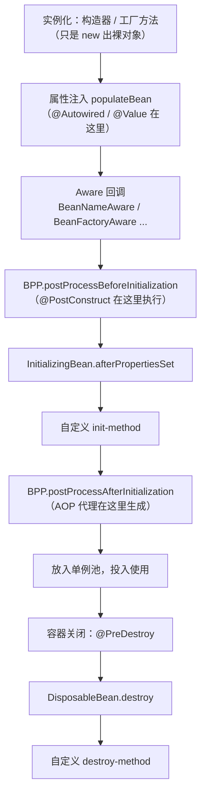
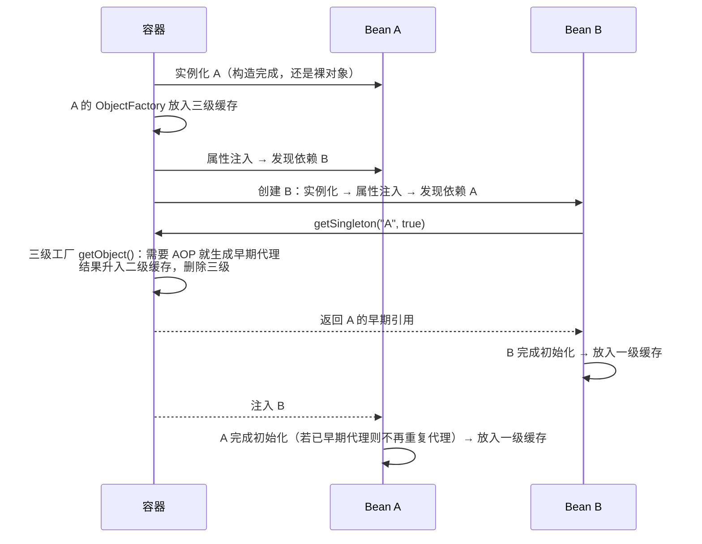
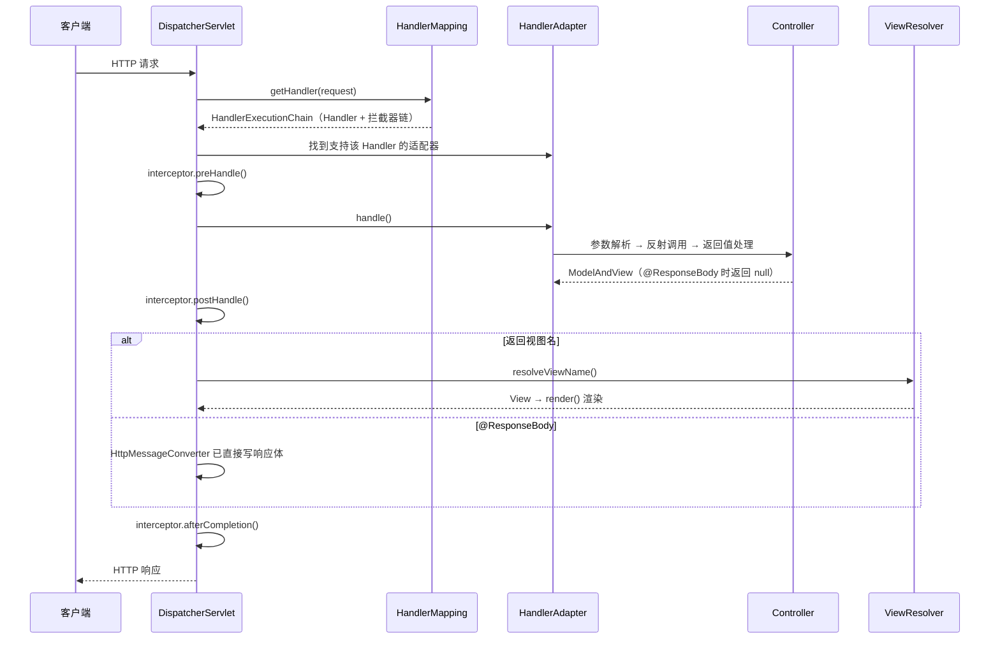
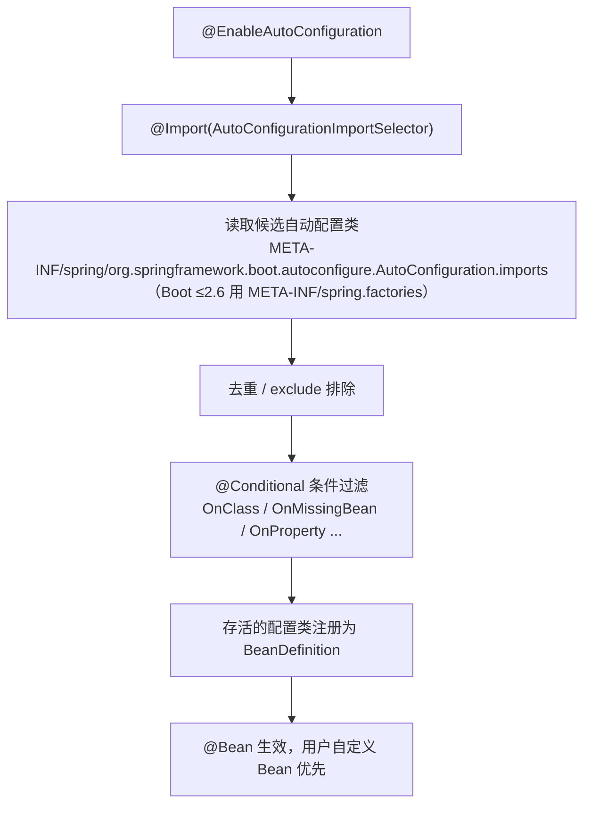

# Spring 常见面试题总结

> 一句话概括：Spring 面试考的从来不是"背注解"，而是"你能不能为 **IoC 容器 + AOP 代理**这两套机制说清楚它们**如何支撑起整个生态、在哪里会失效、代价是什么**"。

预计阅读时间：大约 70 分钟

本文按面试真实提问顺序组织：基础认知 → IoC 与依赖注入 → Bean 生命周期与循环依赖 → AOP → 事务 → Spring MVC → Spring Boot → 生态与响应式 → 工程踩坑与场景设计 → 版本演进 → 快问快答。每题都给出**一句话结论 + 展开要点 + 追问方向**，方便临场组织语言。

---

## 0. 怎么用这篇文档

### 0.1 答题四段式

面试官问"@Transactional 为什么会失效"，答"因为自调用"只能拿到 30 分。用四段式：

| 层次 | 内容 | 作用 |
| --- | --- | --- |
| ① 结论 | 一句话给出判断 | 让面试官知道你有整体认知 |
| ② 机制 | 关键实现原理，2~4 个点 | 证明不是背的 |
| ③ 边界 | 什么时候不成立 / 代价是什么 | **区分中级和高级的分水岭** |
| ④ 实践 | 你在项目里怎么用、踩过什么坑 | 把知识变成经验 |

例：

> `@Transactional` 的本质是 AOP：容器给 Bean 生成代理，由 `TransactionInterceptor` 在方法前后开启/提交事务。**所以一切绕过代理的调用都会让事务失效**——最典型的是类内部 `this.method()` 自调用，其次是异常被 catch 吞掉、抛了受检异常但没配 `rollbackFor`。我们线上踩过自调用的坑，后来约定：事务方法必须跨 Bean 调用，代码评审把"同类内调用 @Transactional 方法"列为检查项。

### 0.2 面试官的四个考察层次

| 层次 | 典型问法 | 期望 |
| --- | --- | --- |
| 会不会用 | `@Autowired` 和 `@Resource` 区别 | 知道常用注解和注入方式 |
| 懂不懂原理 | 三级缓存为什么是三级 | 能讲清 Bean 生命周期、代理生成时机 |
| 能不能扛事 | 事务失效怎么排查、大事务怎么治理 | 有排查思路和工程预案 |
| 有没有判断力 | 这个场景该不该用 WebFlux | 能说"不该用"的理由 |

### 0.3 阅读路线

| 读者 | 建议章节 |
| --- | --- |
| 初级（1 年内） | 1、2、6.1~6.2、7.1~7.2、11 快问快答 |
| 中级（1~3 年） | 3、4、5 全部，9 工程踩坑 |
| 高级（3 年+） | 3.2 refresh 源码、5.6~5.7 事务治理、8 生态选型、10 版本演进 |
| 选型/架构 | 1.5、7.3、8、9.6，重点看每节的"边界"段落 |

### 0.4 本主题文档与目录

本主题按「一份总结 + 若干专题」组织，深入细节见下表（新增专题后请同步补充，并在专题文档开头加回本文的链接）：

| 文档 | 内容 |
| --- | --- |
| [IoC & AOP 详解（快速搞懂）](ioc-and-aop.md) | IoC/DI 思想与注入方式、容器双接口、JDK/CGLIB 代理源码对比、通知顺序、自调用失效与 AOP 边界 |
| [Bean 生命周期与循环依赖（三级缓存）源码详解](bean-lifecycle-and-circular-dependency.md) | doCreateBean/refresh() 走读、Full/Lite 配置类、三级缓存与早期代理一致性、无解循环依赖与 @Lazy 原理 |
| [Spring 事务详解](transaction.md) | TransactionInterceptor 与 ThreadLocal 连接绑定、传播行为源码、失效场景全清单、回滚规则与大事务治理 |
| [Spring 中的设计模式详解](design-patterns.md) | 工厂/单例/代理/模板方法/观察者/适配器/策略/责任链等模式的角色映射、源码锚点与面试答法 |
| [Spring Boot 自动装配原理详解](boot-autoconfiguration.md) | AutoConfigurationImportSelector 主链路、条件注解与用户 Bean 优先时机、自定义 Starter 完整示例、Boot 4 模块化 |
| [Spring Boot 的 JAR 为什么可以直接运行？](boot-executable-jar.md) | fat jar 布局与 MANIFEST、启动器家族与嵌套 jar 类加载、分层 jar 与启动加速取舍 |
| [@Async 注解原理分析](async-annotation-principle.md) | 代理注册链与执行器选择顺序、默认线程池坑、异常与上下文边界、异步事件组合语义 |
| [Spring MVC 请求处理流程详解](mvc-request-flow.md) | doDispatch 源码走读、参数/返回值 SPI 与自定义注解示例、三层增强对比、统一异常处理与异步请求 |

本文目录：

1. 基础认知
2. IoC 容器与依赖注入
3. Bean 生命周期与循环依赖
4. AOP
5. 事务
6. Spring MVC
7. Spring Boot
8. 生态与响应式（加分项）
9. 工程踩坑与场景设计
10. 版本演进（加分项）
11. 快问快答 40 题
12. 面试答题模板与反问
13. 参考资料

---

## 1. 基础认知

### 1.1 Spring 是什么

**结论**：Spring 是一个以 **IoC 容器**和 **AOP** 为核心、以"简化企业级 Java 开发"为目标的**分层生态系统**，Framework 是地基，Boot 是脚手架，Cloud 是微服务工具箱。

两个核心机制决定了它的一切能力与代价：

- **IoC（控制反转）** → 对象的创建和依赖关系交给容器管理，业务代码只声明"我需要什么"，换来解耦和可测试性；代价是反射实例化、启动期扫描、一层容器抽象；
- **AOP（面向切面）** → 把事务、日志、权限等横切逻辑从业务代码中剥离，用**运行时代理**织入；代价是代理的固有边界（自调用失效、final 方法不可代理）。

Spring 的"非侵入"指业务类不需要继承框架基类、不实现框架接口（POJO + 注解），但**依赖注入和代理本身仍是侵入运行时的**——这是它和"零开销抽象"的区别。

### 1.2 Spring Framework / Boot / Cloud 的关系

| 项目 | 定位 | 一句话 |
| --- | --- | --- |
| Spring Framework | 核心框架 | IoC + AOP + MVC + 事务 + JDBC 等地基能力 |
| Spring Boot | 快速开发脚手架 | 自动配置 + Starter + 内嵌容器，"约定优于配置"，让 Framework 开箱即用 |
| Spring Cloud | 微服务工具集 | 基于 Boot，提供注册发现、配置中心、网关、熔断等分布式组件的抽象与集成 |
| Spring Cloud Alibaba | 社区生态 | Nacos / Sentinel / Seata 等阿里组件与 Spring Cloud 标准的对接 |

**追问：Boot 和 Framework 是什么关系？**
Boot 不是新框架，是 Framework 的"自动化配置层"。`SpringApplication.run()` 底层仍然是创建 `ApplicationContext` 并调用 `refresh()`——Boot 没有改变容器的任何核心机制，只是替你写好了配置。

### 1.3 核心模块全景

| 模块层 | 组成 | 职责 |
| --- | --- | --- |
| Core Container | Beans / Core / Context / SpEL | IoC 容器、Bean 管理、表达式语言 |
| AOP | AOP / Aspects | 面向切面编程，与 AspectJ 注解集成 |
| Data Access | JDBC / ORM / Transactions / OXM | 模板类简化数据访问、声明式事务、Hibernate/JPA 集成 |
| Web | Web / WebMVC / WebFlux / WebSocket | Servlet 栈 MVC 与响应式栈 |
| Test | Test | MockMvc、TestContext 框架、切片测试 |
| Messaging | Messaging | STOMP、RSocket、消息抽象 |

### 1.4 Spring 中的设计模式（高频）

| 模式 | 体现 | 说明 |
| --- | --- | --- |
| 工厂模式 | `BeanFactory` / `FactoryBean` | 容器统一创建对象；`FactoryBean` 让用户定制复杂对象的创建（如 MyBatis 的 `MapperFactoryBean`） |
| 单例模式 | 单例注册表 | 用 `ConcurrentHashMap`（`singletonObjects`）实现，不是 GoF 的饿汉/懒汉写法 |
| 代理模式 | AOP | JDK 动态代理 / CGLIB |
| 模板方法 | `JdbcTemplate` / `RestTemplate` / `TransactionTemplate` | 固定流程骨架，把变化点留给回调 |
| 观察者模式 | 事件机制 | `ApplicationEvent` + `ApplicationListener` / `@EventListener` |
| 适配器模式 | `HandlerAdapter` | 适配不同类型的 Handler（注解方法、函数式路由、Controller 接口） |
| 策略模式 | `InstantiationStrategy` / `ViewResolver` | 实例化策略、视图解析策略可替换 |
| 责任链模式 | Filter / Interceptor / Advice 链 | 请求与增强沿链传递 |

**追问：`BeanFactory` 和 `FactoryBean` 区别？**
前者是容器顶层接口，管理所有 Bean；后者是一种**特殊 Bean**，本身被容器管理，但 `getObject()` 返回的才是真正要用的对象。取 `FactoryBean` 本身要加 `&` 前缀：`getBean("&myFactory")`。

### 1.5 什么场景不该用 Spring

面试里能主动说出"不该用"，比背十个特性更加分：

- **极小工具 / CLI**：一个几百行的脚本没必要背容器启动和反射开销；
- **极致启动速度与内存**：反射 + 类扫描 + 代理的启动成本在 Serverless 冷启动场景很痛——要么上 GraalVM native image（Boot 3+ AOT），要么考虑 Quarkus / Micronaut 这类编译期 DI 框架；
- **纯阻塞依赖下追求"响应式高性能"**：JDBC/MyBatis 是阻塞的，硬套 WebFlux 只会更复杂更慢（见 8.2）；
- **需要编译期确定性的场景**：Spring 大量错误（注入失败、条件装配）暴露在**启动期甚至运行期**，而不是编译期。

---

## 2. IoC 容器与依赖注入

### 2.1 IoC 与 DI 的关系

**结论**：IoC 是**思想**（把对象创建与依赖管理的控制权从业务代码反转给容器），DI 是**实现手段**（容器通过构造器/setter/字段把依赖"注入"进来）。两者是目标与路径的关系，不是并列概念。

没有 DI 也能 IoC（如依赖查找 DL：`context.getBean()`），但 DI 让业务代码完全不感知容器，是 Spring 的主流方式。**依赖查找是侵入式的，依赖注入是非侵入式的**——这句能直接体现理解深度。

### 2.2 BeanFactory vs ApplicationContext

| 维度 | BeanFactory | ApplicationContext |
| --- | --- | --- |
| 定位 | 容器顶层接口，最基础的 IoC | BeanFactory 的子接口体系，"企业级"容器 |
| 实例化时机 | **懒加载**：`getBean` 时才创建 | **预实例化**：`refresh()` 的 `finishBeanFactoryInitialization` 阶段创建所有非懒加载单例 |
| 事件机制 | 无 | `ApplicationEventPublisher` |
| 国际化 | 无 | `MessageSource` |
| 资源访问 | 无 | `ResourcePatternResolver` |
| 环境抽象 | 无 | `Environment`（profile、配置属性） |
| AOP 集成 | 需手动注册 BPP | 自动注册与集成 |

**追问：预实例化有什么好处？**
把依赖错误（缺 Bean、循环依赖、配置错误）**提前暴露在启动期**，而不是等第一个请求进来才炸。代价是启动时间和启动内存。

### 2.3 三种注入方式与推荐

| 方式 | 写法 | 优点 | 缺点 |
| --- | --- | --- | --- |
| 构造器注入 | 构造函数参数（可配合 Lombok `@RequiredArgsConstructor`） | 依赖可声明 `final` 不可变；必需依赖显式化；脱离容器可直接 new 出来测试；循环依赖启动即报错 | 依赖多时参数列表长（这其实是"类职责过多"的信号） |
| Setter 注入 | `@Autowired` 标在 setter | 可选依赖、可重新注入 | 依赖可变，无法保证注入完成前不被使用 |
| 字段注入 | `@Autowired` 标在字段 | 写起来最省事 | 隐藏依赖、无法注入 `final`、脱离容器无法实例化测试、容易无节制堆依赖 |

**结论：必需依赖用构造器注入，可选依赖用 setter，字段注入不推荐**（Spring 官方文档明确推荐构造器注入）。IDEA 对字段注入报 "Field injection is not recommended" 就是这个原因。

### 2.4 @Autowired vs @Resource vs @Inject

| 维度 | @Autowired | @Resource | @Inject |
| --- | --- | --- | --- |
| 来源 | Spring | JSR-250（`jakarta.annotation`） | JSR-330（`jakarta.inject`，需额外依赖） |
| 匹配规则 | **先 byType**，多个候选再按字段名/`@Qualifier`/`@Primary` 消歧 | **先 byName**（默认字段名），找不到再 byType | byType，配合 `@Named` 指定名称 |
| 必需性 | `required = false` 可允许缺失 | 无此属性 | 无此属性 |
| 作用位置 | 构造器/方法/字段 | 字段/setter（**不支持构造器**） | 构造器/方法/字段 |

**追问：一个接口两个实现，@Autowired 注入哪个？**
默认按类型找到两个候选 → 再拿字段名当 bean name 匹配；匹配不上抛 `NoUniqueBeanDefinitionException`。解法：`@Primary` 标首选实现、`@Qualifier("xxx")` 显式指定、或字段名直接写成目标 bean 名。

### 2.5 Bean 作用域

| 作用域 | 含义 | 备注 |
| --- | --- | --- |
| singleton（默认） | **每个容器**一个实例 | 不是 JVM 级单例，两个容器就有两个 |
| prototype | 每次 `getBean` / 注入都新建 | 容器**不管销毁**，销毁回调不会执行 |
| request | 每个 HTTP 请求一个 | 仅 Web 环境 |
| session | 每个 HTTP Session 一个 | 仅 Web 环境 |
| application | 每个 ServletContext 一个 | 仅 Web 环境 |
| websocket | 每个 WebSocket 会话一个 | 仅 Web 环境 |

**两个高频坑**

1. **单例 Bean 线程安全吗？** 容器只保证"只有一个实例"，**不保证线程安全**。无状态 Service（只有方法没有可变成员）天然安全；有状态请用 `ThreadLocal`（记得清理）、局部变量或改作用域。
2. **单例里注入 prototype，prototype 会失效**：注入只发生一次，之后一直用同一个实例。解法：注入 `ObjectProvider<T>` 每次 `getObject()`、`@Lookup` 方法注入、或 `@Scope(proxyMode = TARGET_CLASS)` 作用域代理。

### 2.6 配置注入：${} 与 #{}

| 写法 | 含义 | 例子 |
| --- | --- | --- |
| `${...}` | **属性占位符**，从 Environment 取值 | `@Value("${app.timeout:3000}")`（冒号后是默认值） |
| `#{...}` | **SpEL 表达式**，运行时求值 | `@Value("#{systemProperties['user.region']}")`、`#{T(java.lang.Math).random()}` |

`@Value` 适合单个值；成组配置用 `@ConfigurationProperties`：支持**松散绑定**（`userName` / `user-name` / `USER_NAME` 等价）、类型安全、JSR-303 校验（`@Validated`）、批量前缀映射。

---

## 3. Bean 生命周期与循环依赖

### 3.1 生命周期全景

**结论**：一个单例 Bean 经历 **实例化 → 属性注入 → Aware 回调 → 初始化前处理 → 初始化 → 初始化后处理（AOP 代理）→ 使用 → 销毁** 八个阶段。



**初始化三件套的顺序**（面试必背）：

| 阶段 | 顺序 |
| --- | --- |
| 初始化 | `@PostConstruct` → `afterPropertiesSet()` → `init-method` |
| 销毁 | `@PreDestroy` → `destroy()` → `destroy-method` |

**追问：实例化和初始化有什么区别？**
实例化是"分配内存、调构造器，得到一个裸对象"（`createBeanInstance`）；初始化是"注入依赖、执行回调，把它变成可用 Bean"（`populateBean` + `initializeBean`）。**循环依赖之所以能解，就是因为这两个阶段被拆开了**——裸对象可以先暴露出去。

**追问：AOP 代理一定在初始化后生成吗？**
常规情况是（`AbstractAutoProxyCreator#postProcessAfterInitialization`）；但发生循环依赖时会**提前**到"早期引用被获取"那一刻（`getEarlyBeanReference`），见 3.5。

### 3.2 refresh()：容器启动的骨架（源码追问）

`AbstractApplicationContext#refresh()` 是容器启动的模板方法，关键步骤：

| 步骤 | 做什么 |
| --- | --- |
| `obtainFreshBeanFactory` | 创建/刷新内部 BeanFactory，加载 BeanDefinition |
| `invokeBeanFactoryPostProcessors` | **`ConfigurationClassPostProcessor` 解析 `@Configuration`/`@ComponentScan`/`@Import`/`@Bean`**，把配置类变成 BeanDefinition |
| `registerBeanPostProcessors` | 注册（不是执行）所有 BPP |
| `onRefresh` | 子类扩展点：**Boot 在这里创建内嵌 Web 服务器**（此时还没启动端口） |
| `finishBeanFactoryInitialization` | **`preInstantiateSingletons`：实例化所有非懒加载单例**，依赖注入、三级缓存、生命周期回调都发生在这里 |
| `finishRefresh` | 发布 `ContextRefreshedEvent`；Boot 通过 `WebServerStartStopLifecycle` 在这里真正启动端口 |

能说出"配置类解析在 BFPP 阶段、Bean 实例化在 `finishBeanFactoryInitialization`、Web 服务器创建和启动分属两个阶段"，源码题基本就稳了。

### 3.3 BeanFactoryPostProcessor vs BeanPostProcessor

| 维度 | BeanFactoryPostProcessor | BeanPostProcessor |
| --- | --- | --- |
| 作用对象 | **BeanDefinition**（元数据） | **Bean 实例** |
| 执行时机 | 所有 BeanDefinition 加载后、实例化前 | 每个 Bean 初始化前后 |
| 典型实现 | `PropertySourcesPlaceholderConfigurer`（占位符替换）、`ConfigurationClassPostProcessor` | `AutowiredAnnotationBeanPostProcessor`（@Autowired）、`AbstractAutoProxyCreator`（AOP） |
| 能做什么 | 改类名、改 scope、改属性值、注册新定义 | 注入、包装代理、执行回调 |

一句话：**BFPP 改"图纸"，BPP 改"成品"**。

### 3.4 @Configuration：Full 模式与 Lite 模式

```java
@Configuration  // Full 模式：proxyBeanMethods 默认 true
public class AppConfig {
    @Bean public A a() { return new A(b()); }   // 调 b() 被 CGLIB 拦截 → 从容器拿单例
    @Bean public B b() { return new B(); }
}
```

| 模式 | 条件 | @Bean 方法互调 |
| --- | --- | --- |
| Full | `@Configuration(proxyBeanMethods = true)`（默认） | 配置类被 CGLIB 增强，互调走容器，**保证单例** |
| Lite | `@Component` 等类里的 `@Bean` 方法，或 `proxyBeanMethods = false` | 普通 Java 调用，**每次 new 一个新对象** |

Boot 的自动配置类全部用 `proxyBeanMethods = false`（Lite），省去配置类代理，加快启动。**追问：Full 模式有什么限制？** 配置类不能是 final，`@Bean` 方法不能是 private/final——因为要被子类代理覆写。

### 3.5 循环依赖与三级缓存

**结论**：Spring 用**三级缓存 + 提前暴露早期引用**解决**单例、setter/字段注入**的循环依赖；构造器循环依赖、prototype 循环依赖无解。

| 缓存 | 字段名 | 存什么 |
| --- | --- | --- |
| 一级 | `singletonObjects` | 完整的成品 Bean |
| 二级 | `earlySingletonObjects` | 早期引用（裸对象或**早期代理**），已被人取过 |
| 三级 | `singletonFactories` | `ObjectFactory` lambda，调用时才决定返回裸对象还是早期代理 |

**A ⇄ B 的解决流程**：



**追问：为什么是三级而不是二级？（最高频追问）**
关键在 **AOP**。三级缓存存的不是对象而是工厂，把"要不要提前生成代理"的决策**推迟到真正发生循环依赖、有人来取早期引用时**：

- 没有循环依赖 → 没人取早期引用 → 代理照旧在初始化后生成，生命周期设计不被破坏；
- 有循环依赖 → 工厂调用 `getEarlyBeanReference` 提前生成代理，并缓存进二级，**保证 B 注入的早期代理和 A 最终暴露的是同一个对象**。

若只有二级缓存（实例化后直接存早期对象），就必须在实例化阶段为**每个** Bean 决定是否代理，等于把 AOP 的织入时机整体前移，违背"代理在初始化后生成"的设计。

**追问：二级缓存单独能解决循环依赖吗？**
能解决"注入"本身，但解决不了"AOP 早期代理的单例一致性"——二级的价值是缓存已生成的早期引用，避免多个依赖方重复调工厂拿到不同代理。

### 3.6 四种解决不了的循环依赖

| 场景 | 原因 | 解法 |
| --- | --- | --- |
| 构造器注入循环 | 实例化都没完成，对象不存在，无法放入三级缓存 | 构造器参数加 `@Lazy`（注入代理占位）；改 setter/字段注入；重构消除环 |
| prototype 循环 | 原型 Bean 不进缓存 | 重构，或一方改单例 |
| `@Async` 标注的 Bean 参与循环 | `@Async` 的代理由普通 BPP 在初始化后生成，**不走早期引用**；对方拿到裸对象、最终却是代理 → 不一致直接报错 | `@Lazy`、调整依赖方向 |
| Boot 2.6+ 默认 | `spring.main.allow-circular-references` 默认 `false`，**启动直接失败** | 官方态度：循环依赖是设计坏味道，优先重构；开关只是逃生门 |

---

## 4. AOP

### 4.1 术语速查

| 术语 | 含义 | 对应物 |
| --- | --- | --- |
| Aspect（切面） | 横切逻辑的模块化 | `@Aspect` 类 |
| Join point（连接点） | 可以被增强的点 | Spring AOP 只支持**方法执行** |
| Pointcut（切点） | 匹配连接点的表达式 | `execution(* com.x.service.*.*(..))`、`@annotation(...)` |
| Advice（通知） | 增强逻辑本身 | Before / After / Around 等 |
| Weaving（织入） | 把切面应用到目标的过程 | Spring AOP 是**运行时代理织入** |
| Target / Proxy | 目标对象 / 代理对象 | 注入到别处的其实是代理 |

### 4.2 JDK 动态代理 vs CGLIB

| 维度 | JDK 动态代理 | CGLIB |
| --- | --- | --- |
| 原理 | `Proxy.newProxyInstance` + `InvocationHandler`，基于**接口** | ASM 字节码生成**目标子类**，`MethodInterceptor` 拦截 |
| 前提 | 目标必须实现接口 | 目标不能是 final 类 |
| 限制 | 只能代理接口方法 | **final / private / static 方法无法代理** |
| 调用效率 | 反射调用 | FastClass 索引直调，早期版本更快（现代 JDK 反射已大幅优化） |
| 实例创建 | 构造器正常执行 | Spring 用 Objenesis 创建实例，**不调目标构造器** |

**默认策略**：目标有接口 → JDK 代理；无接口 → CGLIB；`proxyTargetClass=true` 强制 CGLIB。**Spring Boot 2.x 起默认 `spring.aop.proxy-target-class=true`**，即统一 CGLIB——避免"注入实现类类型时报类型不匹配"的经典坑。

### 4.3 五种通知与执行顺序

| 通知 | 时机 |
| --- | --- |
| `@Before` | 目标方法前 |
| `@AfterReturning` | 正常返回后 |
| `@AfterThrowing` | 抛异常后 |
| `@After` | finally 语义，正常/异常都执行 |
| `@Around` | 包裹目标方法，`proceed()` 前后都能插手，可改参数/返回值/吞异常 |

同一切面内（Spring 5.2.7+ 的顺序）：

```text
正常：@Around 前 → @Before → 目标方法 → @AfterReturning → @After → @Around 后
异常：@Around 前 → @Before → 目标方法抛异常 → @AfterThrowing → @After（异常继续向外抛）
```

多个切面按 `@Order` 排序，值小优先级高，形成"外层先进后出"的洋葱模型。**追问：@Around 和 @Before 的本质区别？** `@Around` 掌握 `proceed()` 的控制权——可以不调（短路）、可以调多次（重试）、可以改返回值；`@Before` 只能旁观。

### 4.4 自调用失效：AOP 第一坑

**结论**：`this.methodB()` 走的是**原始对象**而非代理，切面（事务、缓存、异步）全部失效。

```java
@Service
public class OrderService {
    @Transactional
    public void a() {
        this.b();   // ❌ 绕过代理，b 的 @Transactional(REQUIRES_NEW) 不生效
    }
    @Transactional(propagation = Propagation.REQUIRES_NEW)
    public void b() { ... }
}
```

三种解法：

| 方案 | 写法 | 评价 |
| --- | --- | --- |
| 拆 Bean | 把 b 挪到另一个 Service 注入调用 | **最推荐**，职责也更清晰 |
| 自注入 | `@Autowired @Lazy private OrderService self;` 用 `self.b()` | 简单，但类内出现"自己注入自己"的怪味 |
| 暴露代理 | `@EnableAspectJAutoProxy(exposeProxy = true)` + `((OrderService) AopContext.currentProxy()).b()` | 代码侵入容器 API，且依赖 ThreadLocal |

### 4.5 Spring AOP vs AspectJ

| 维度 | Spring AOP | AspectJ |
| --- | --- | --- |
| 织入时机 | **运行时**（动态代理） | 编译期 / 编译后 / 类加载期织入 |
| 连接点 | 仅方法执行 | 方法、构造器、字段读写、异常处理等 |
| 性能 | 每次调用多一层代理 | 织入后无额外开销 |
| 能力边界 | 自调用失效、final 不可代理 | 无代理边界，自调用也能增强 |
| 成本 | 零额外工具链 | 需要 ajc 编译器或 `-javaagent` |

Spring 借用了 AspectJ 的**注解和切点表达式**（`@Aspect` 风格），但织入仍是自己的代理机制——"注解是 AspectJ 的，实现是 Spring 的"。

### 4.6 AOP 失效场景清单

| 场景 | 原因 |
| --- | --- |
| 类内自调用 | `this` 不是代理 |
| private / static / final 方法 | 代理无法覆写或拦截 |
| 对象不是 Spring Bean（自己 new 的） | 根本没被代理 |
| final 类 | CGLIB 无法生成子类 |
| JDK 代理下注入实现类类型 | 代理只实现接口，类型不匹配（Boot 默认 CGLIB 已规避） |

---

## 5. 事务

### 5.1 声明式事务的原理

**结论**：`@Transactional` = **AOP + `TransactionInterceptor` + `PlatformTransactionManager`**。

```text
代理方法被调用
 → TransactionInterceptor.invoke()
 → 读取 @Transactional 属性（传播行为 / 隔离级别 / 超时 / 只读 / 回滚规则）
 → transactionManager.getTransaction()   按传播行为开启或加入事务
 → 执行目标方法
 → 正常返回：commit()
 → 抛异常：rollbackOn(ex) 判断 → 命中则 rollback()，否则照常 commit()
```

要点：

- 事务管理器是策略接口：JDBC/MyBatis 用 `DataSourceTransactionManager`，JPA 用 `JpaTransactionManager`；
- **连接绑定在 `TransactionSynchronizationManager` 的 ThreadLocal 上**——同一线程内多个 DAO 拿到同一个连接，这是"同一事务"的物理基础；
- Boot 由 `TransactionAutoConfiguration` 自动装配，无需手写 `@EnableTransactionManagement`。

### 5.2 七种传播行为

| 传播行为 | 当前有事务 | 当前无事务 |
| --- | --- | --- |
| **REQUIRED**（默认） | 加入 | 新建 |
| SUPPORTS | 加入 | 非事务执行 |
| MANDATORY | 加入 | 抛异常 |
| REQUIRES_NEW | **挂起当前，新建独立事务** | 新建 |
| NOT_SUPPORTED | 挂起当前，非事务执行 | 非事务执行 |
| NEVER | 抛异常 | 非事务执行 |
| NESTED | **嵌套子事务（savepoint）** | 等同 REQUIRED 新建 |

**REQUIRES_NEW vs NESTED（高频对比）**

| 维度 | REQUIRES_NEW | NESTED |
| --- | --- | --- |
| 物理事务 | 两个独立事务，**占两个连接** | 一个物理事务 + savepoint |
| 内层回滚 | 不影响外层 | 只回滚到保存点，外层可继续 |
| 外层回滚 | 内层已提交，**不受影响** | 内层一起回滚 |
| 内层提交的可见性 | 立即对外可见 | 要等外层提交才可见 |
| 支持范围 | 所有事务管理器 | 仅 JDBC（`DataSourceTransactionManager`），JPA 不支持 |

典型用法：主流程 `REQUIRED`，操作日志/通知用 `REQUIRES_NEW`（主业务回滚也要留痕）；批量处理中单条失败不影响整批用 `NESTED`。

### 5.3 隔离级别

| 级别 | 脏读 | 不可重复读 | 幻读 |
| --- | --- | --- | --- |
| READ_UNCOMMITTED | 可能 | 可能 | 可能 |
| READ_COMMITTED | 否 | 可能 | 可能 |
| REPEATABLE_READ | 否 | 否 | 可能（InnoDB 用 MVCC + 间隙锁基本解决） |
| SERIALIZABLE | 否 | 否 | 否 |

`@Transactional(isolation = Isolation.DEFAULT)` 表示**用数据库默认**：MySQL InnoDB 是 RR，Oracle / PostgreSQL 是 RC。Spring 只是把级别透传给连接，**隔离的实现者是数据库**。

### 5.4 事务失效八大场景（必背）

| # | 场景 | 原因 | 修复 |
| --- | --- | --- | --- |
| 1 | 类内自调用 | 绕过代理 | 拆 Bean / 自注入 / `AopContext` |
| 2 | 方法非 public | 默认只拦截 public（6.0 起类代理支持 protected/包可见，接口代理仍要求 public） | 改 public |
| 3 | 异常被 catch 吞掉 | 拦截器感知不到异常 | 抛出或手动 `setRollbackOnly` |
| 4 | 抛受检异常 | **默认只回滚 RuntimeException / Error** | `rollbackFor = Exception.class` |
| 5 | 传播行为配错 | 如 NOT_SUPPORTED 根本不开事务 | 核对传播语义 |
| 6 | 类不是 Bean / final 类或方法 | 没被代理 | 交给容器、去掉 final |
| 7 | 多线程调用 | 事务连接在 ThreadLocal，新线程拿不到 | 事务不跨线程；跨线程用编程式事务各自管理 |
| 8 | 数据库不支持事务 | 如 MyISAM 引擎 | 换 InnoDB |

另一个隐蔽坑：**注解只标在接口上**——旧资料常说"CGLIB 读不到接口注解"，但 5.0 起属性查找改用 find 语义（会搜索接口与父类），接口注解对类代理同样生效，真正不认的是 AspectJ 织入模式。官方仍推荐标在实现类（或实现类方法）上，机制详见 [Spring 事务详解](transaction.md)。

### 5.5 回滚规则

```java
@Transactional(rollbackFor = Exception.class)        // 受检异常也回滚
@Transactional(noRollbackFor = BizWarnException.class) // 指定异常不回滚
```

规则匹配按**异常类型继承树就近匹配**：先找最具体的 `rollbackFor`/`noRollbackFor` 规则，都没命中才走默认（RuntimeException/Error 回滚）。

**追问：`readOnly = true` 有什么用？**
它是**提示而非硬约束**：Hibernate 会把 FlushMode 设为 MANUAL 跳过脏检查，MySQL 可对只读事务做优化。在只读事务里写数据的行为取决于底层实现（可能报错、可能被忽略），不要依赖它做写保护。

### 5.6 大事务治理与编程式事务

**大事务的四宗罪**：长时间占用连接（连接池耗尽）、长时间持锁（阻塞与死锁）、回滚代价大（undo 量大）、主从延迟放大。

治理手段：

| 手段 | 做法 |
| --- | --- |
| 缩小边界 | 把 RPC、MQ 发送、文件 IO、复杂计算移出事务，只包住真正的 DB 写 |
| 编程式事务 | `TransactionTemplate.execute(status -> {...})`，精确控制起止，不依赖代理 |
| 提交后动作 | `TransactionSynchronization.afterCommit` 或 `@TransactionalEventListener(AFTER_COMMIT)` 发 MQ/清缓存 |
| 拆分批次 | 大批量写拆成小事务分批提交 |

```java
// 编程式事务：不经过代理，自调用也不失效
transactionTemplate.execute(status -> {
    orderMapper.insert(order);
    stockMapper.deduct(sku, count);
    return null;
});
```

### 5.7 分布式事务（简述）

本地 `@Transactional` 只管一个数据源。跨服务/跨库的方案：

| 方案 | 一致性 | 代价 | 适用 |
| --- | --- | --- | --- |
| XA / 2PC | 强一致 | 同步阻塞、性能差 | 传统金融、多库单应用 |
| Seata AT | 最终一致（全局锁） | 侵入低，自动 undo log | 常规微服务 |
| TCC | 最终一致 | Try/Confirm/Cancel 三接口，侵入高 | 资金类高并发 |
| 本地消息表 / 事务消息 | 最终一致 | 需要对账补偿 | 互联网主流 |
| Saga | 最终一致 | 长流程正向+补偿 | 跨多服务的长事务 |

一句话立场：**多数互联网业务选"本地事务 + 消息最终一致 + 对账兜底"，而不是追求强一致**。

---

## 6. Spring MVC

### 6.1 请求处理全流程

**结论**：一切围绕 `DispatcherServlet`（前端控制器）——它不做具体处理，只负责**调度**九大组件。



**核心组件速查**

| 组件 | 职责 | 主流实现 |
| --- | --- | --- |
| HandlerMapping | URL → Handler | `RequestMappingHandlerMapping`（注解）、`RouterFunctionMapping`（函数式路由） |
| HandlerAdapter | 适配并执行 Handler | `RequestMappingHandlerAdapter` |
| HandlerExceptionResolver | 异常 → 响应 | `ExceptionHandlerExceptionResolver`（@ExceptionHandler） |
| ViewResolver | 视图名 → View | `InternalResourceViewResolver`、ThymeleafViewResolver |
| HttpMessageConverter |  body ⇄ 对象 | `MappingJackson2HttpMessageConverter` |
| MultipartResolver | 文件上传 | `StandardServletMultipartResolver` |
| LocaleResolver / FlashMapManager | 国际化 / 重定向传参 | — |

**追问：参数是怎么变成方法入参的？**
`HandlerMethodArgumentResolver` 责任链：`@RequestParam`、`@PathVariable`、`@RequestBody`（走 HttpMessageConverter 反序列化）、POJO 表单绑定各有解析器；返回值同理走 `HandlerMethodReturnValueHandler`。**这套 SPI 就是自定义参数注解（如 @LoginUser）的扩展点**。

### 6.2 @ResponseBody 与 @RestController

- `@ResponseBody`：返回值**不走视图解析**，由 `HttpMessageConverter` 按内容协商（Accept 头）序列化后直接写响应体；
- `@RestController` = `@Controller` + `@ResponseBody`（组合注解，类级生效）；
- `@RequestBody`：请求体反序列化为对象，同样走 Converter。

**追问：返回 String 时为什么有时是视图名有时是 JSON？**
没有 `@ResponseBody` → String 被当视图名；有 → 走 `StringHttpMessageConverter` 直接输出。 produces/consumes 与 Converter 的匹配决定最终格式。

### 6.3 Filter vs Interceptor vs AOP

| 维度 | Filter | Interceptor | AOP |
| --- | --- | --- | --- |
| 规范层级 | Servlet 规范 | Spring MVC | Spring 容器 |
| 作用范围 | 所有请求（含静态资源），在 DispatcherServlet **之外** | 进入 Handler 前后，**知道 Handler 是谁** | 任意 Spring Bean 的方法 |
| 能否包装 request/response | 能（`HttpServletRequestWrapper`） | 不能 | 能改方法参数 |
| 典型用途 | 编码、CORS、全链路日志、请求体缓存 | 登录校验、权限、接口耗时 | 事务、缓存、方法级日志 |

执行顺序：**Filter → Interceptor.preHandle → AOP → Controller 方法 → AOP 返回 → Interceptor.postHandle → Filter 返回**。

### 6.4 统一异常处理

```java
@RestControllerAdvice
public class GlobalExceptionHandler {
    @ExceptionHandler(BizException.class)
    public Result<?> biz(BizException e) { return Result.fail(e.getCode(), e.getMessage()); }

    @ExceptionHandler(Exception.class)
    public Result<?> unknown(Exception e) { log.error("unexpected", e); return Result.fail(500, "系统繁忙"); }
}
```

解析顺序：Controller 内 `@ExceptionHandler` → `@ControllerAdvice` 全局 → `ResponseStatusExceptionResolver` → `DefaultHandlerExceptionResolver`（把框架异常转成标准 HTTP 状态码）。Boot 3 起可用 `ProblemDetail`（RFC 7807）输出标准化错误体。

### 6.5 Controller 线程安全

Controller 默认**单例**，所有请求共享实例。**成员变量存请求状态 = 并发事故**；状态放方法局部变量、方法参数或 `ThreadLocal`（用完必须 remove）。需要字段状态时用 `@Scope("request")`，但要注意作用域代理。

---

## 7. Spring Boot

### 7.1 Boot 解决了什么

**结论**：Boot 用四件套把 Spring 从"配置地狱"变成开箱即用：**自动配置 + Starter 依赖聚合 + 内嵌容器 + Actuator 运维端点**，哲学是"约定优于配置"。

| 能力 | 说明 |
| --- | --- |
| 自动配置 | 按 classpath 和已有 Bean 推断你要什么，自动注册配置 |
| Starter | 一个依赖带来一组经过版本对齐的依赖（BOM 统一管理） |
| 内嵌容器 | Tomcat/Jetty/Undertow 打进 jar，`java -jar` 即运行 |
| Actuator | health / metrics / env 等生产级端点 |

### 7.2 自动配置原理（必考）

`@SpringBootApplication` = `@SpringBootConfiguration` + `@EnableAutoConfiguration` + `@ComponentScan`。



**常用条件注解**

| 注解 | 生效条件 |
| --- | --- |
| `@ConditionalOnClass` | classpath 存在指定类（引了依赖才装配） |
| `@ConditionalOnMissingBean` | 容器中没有该 Bean（**用户配置优先**的关键） |
| `@ConditionalOnProperty` | 配置项满足指定值 |
| `@ConditionalOnWebApplication` | 是 Web 应用 |
| `@ConditionalOnMissingClass` | classpath 不存在指定类 |

**两个关键追问**

- **为什么用户自定义的 Bean 能覆盖自动配置？** 自动配置通过 `DeferredImportSelector` **延迟到用户配置解析完之后**处理，`@ConditionalOnMissingBean` 检查时用户的 Bean 已注册，自动配置就让位。
- **文件位置演进**：2.7 引入 `AutoConfiguration.imports` 新文件，3.0 移除 `spring.factories` 中自动配置的注册方式——答出这个细节说明你跟进了版本。

### 7.3 Starter 机制与自定义 Starter（场景题）

Starter 本质 = **依赖聚合（pom）+ 自动配置（代码）**。官方命名 `spring-boot-starter-xxx`，第三方约定 `xxx-spring-boot-starter`。

自定义四步：

1. 写 `@AutoConfiguration` 配置类 + `@ConfigurationProperties` 属性类，`@Bean` 上加 `@ConditionalOnMissingBean`；
2. 在 `META-INF/spring/org.springframework.boot.autoconfigure.AutoConfiguration.imports` 登记配置类全名；
3. （可选）生成 `spring-configuration-metadata.json` 提供 IDE 配置提示；
4. 拆两个模块：`xxx-spring-boot-autoconfigure`（逻辑）+ `xxx-spring-boot-starter`（聚合依赖，含 autoconfigure 模块）。

```java
@AutoConfiguration
@ConditionalOnClass(SmsClient.class)
@EnableConfigurationProperties(SmsProperties.class)
public class SmsAutoConfiguration {
    @Bean
    @ConditionalOnMissingBean
    public SmsClient smsClient(SmsProperties props) {
        return new SmsClient(props.getEndpoint(), props.getAppKey());
    }
}
```

### 7.4 配置加载与优先级

简化顺序（高 → 低，完整清单见官方文档）：

| 优先级 | 来源 |
| --- | --- |
| 1 | 命令行参数（`--server.port=8081`） |
| 2 | Java 系统属性（`-Dkey=value`） |
| 3 | 操作系统环境变量 |
| 4 | jar 外 `application-{profile}.yml` |
| 5 | jar 内 `application-{profile}.yml` |
| 6 | jar 外/内 `application.yml` |
| 7 | `@PropertySource` / 默认值 |

profile 激活：`spring.profiles.active=prod`；多环境文件 `application-dev.yml` / `application-prod.yml`。松散绑定让 `app.user-name`、`app.userName`、`APP_USERNAME` 都能映射到同一属性。

### 7.5 启动流程与 fat jar

**启动骨架**：`SpringApplication.run()` → 推断应用类型（SERVLET/REACTIVE/NONE）→ 准备 Environment → 创建 ApplicationContext → `refreshContext()`（即 3.2 的 refresh）→ 回调 `ApplicationRunner` / `CommandLineRunner` → 发布 `ApplicationReadyEvent`。

**fat jar 结构**：`BOOT-INF/classes`（业务类）+ `BOOT-INF/lib`（依赖 jar）+ `org/springframework/boot/loader`（启动器）。`JarLauncher` 用自定义 `LaunchedURLClassLoader` 加载**嵌套 jar**——标准 ClassLoader 不支持 jar 中读 jar，这是 Boot 自己造加载器的原因。

### 7.6 Actuator 与优雅停机

| 项 | 说明 |
| --- | --- |
| 常用端点 | `/actuator/health`（存活/就绪探针）、`/metrics`、`/prometheus`、`/info` |
| 暴露控制 | `management.endpoints.web.exposure.include`，默认只开 health |
| 安全边界 | `env` / `heapdump` / `shutdown` 绝不能裸暴露公网 |
| 优雅停机 | Boot 2.3+：`server.shutdown=graceful` + `spring.lifecycle.timeout-per-shutdown-phase=30s`，先拒新请求、处理完存量再关 |

---

## 8. 生态与响应式（加分项）

### 8.1 Spring Cloud 组件演进

| 能力 | 第一代（多已停维） | 现在主流 |
| --- | --- | --- |
| 注册发现 | Eureka / Consul | Nacos / Consul |
| 配置中心 | Spring Cloud Config | Nacos Config / Apollo |
| 网关 | Zuul 1（阻塞） | Spring Cloud Gateway（WebFlux 响应式） |
| 负载均衡 | Ribbon | Spring Cloud LoadBalancer |
| 熔断限流 | Hystrix | Sentinel / Resilience4j |
| 声明式调用 | Feign | OpenFeign + LoadBalancer |
| 分布式事务 | — | Seata |

**追问：Gateway 为什么用 WebFlux？**
网关是典型 IO 密集、无阻塞业务逻辑的场景，少量事件循环线程扛高并发连接正合适——这也是"响应式适合什么"的正面例子。

### 8.2 WebFlux vs Spring MVC

| 维度 | Spring MVC | WebFlux |
| --- | --- | --- |
| 编程模型 | 命令式，同步阻塞 | 响应式，`Mono` / `Flux`（Reactor） |
| 线程模型 | 一请求一线程（线程池） | 少量事件循环线程 |
| 默认容器 | Tomcat | Netty |
| 背压 | 无 | 有（Reactive Streams） |
| 适合 | 传统业务、JDBC/MyBatis、团队熟悉同步 | 网关、流式推送、高并发 IO 密集且全链路非阻塞 |

**边界（面试分水岭）**：

- **依赖是阻塞的（JDBC、MyBatis、大部分 SDK），WebFlux 不会更快**——阻塞调用会占死事件循环线程，必须包 `subscribeOn(boundedElastic())`，等于绕回线程池；
- ThreadLocal 失效（事务、MDC 日志上下文要换 Reactor Context / Context Propagation）；
- 调试栈难读、团队学习成本高。**"为了高性能上 WebFlux"之前先问依赖链是否全非阻塞**。

### 8.3 虚拟线程改变格局

Boot 3.2+（Java 21）开 `spring.threads.virtual.enabled=true`，Tomcat 用虚拟线程处理请求：**同步代码写法获得接近响应式的并发吞吐**，阻塞不再昂贵。

注意：连接池、下游容量仍是瓶颈；JDK 21 中 `synchronized` 内阻塞会 pin 住载体线程（JDK 24 起改善）。结论：**新项目高并发先考虑虚拟线程，WebFlux 留给流式/背压刚需场景**。

---

## 9. 工程踩坑与场景设计

### 9.1 @Async 的线程池坑

| 环境 | 默认执行器 | 问题 |
| --- | --- | --- |
| 纯 Framework | `SimpleAsyncTaskExecutor` | **每个任务新建线程，不复用、无上限**，高并发直接打爆 |
| Boot 自动配置 | `applicationTaskExecutor`（ThreadPoolTaskExecutor） | core=8，**队列与 max 都是 Integer.MAX_VALUE**，任务堆积 → OOM |

正确姿势：自定义线程池（核心数按 IO/CPU 密集评估）、**有界队列 + 明确拒绝策略**、命名线程工厂便于排障、监控队列深度。

其他坑：`@Async` 同样有自调用失效问题；返回 void 时异常默认被吞（配 `AsyncUncaughtExceptionHandler`），要拿异常用 `CompletableFuture` 返回值。

### 9.2 @Scheduled 的坑

- 默认调度器**只有 1 个线程**：一个任务卡住，所有定时任务陪葬。调 `spring.task.scheduling.pool.size` 或实现 `SchedulingConfigurer`；
- 多实例部署会**重复执行**：加分布式锁（Redisson / ShedLock）或改用 XXL-Job 等调度平台；
- `fixedRate` 不管上次是否完成（可能并发重叠），`fixedDelay` 等上次结束再计时。

### 9.3 事件机制与 @TransactionalEventListener

- `publishEvent` 默认**同步、同线程、同事务**——监听器抛异常会连累发布者回滚；
- `@Async` + `@EventListener` 才是异步；
- `@TransactionalEventListener(phase = AFTER_COMMIT)`：事务提交后才执行，适合"下单成功后发通知"。**坑：AFTER_COMMIT 阶段再写库，默认不会开启新事务（原事务已提交），需要 `@Transactional(REQUIRES_NEW)`**。

### 9.4 Bean 注入不进来：排查清单

| 检查项 | 说明 |
| --- | --- |
| 扫描路径 | 类不在 `@ComponentScan` 范围（Boot 默认扫主类所在包及子包） |
| 注册方式 | 忘了 `@Component`/`@Bean`/`@Import`；第三方类要用 `@Bean` 手动注册 |
| 多实现冲突 | `NoUniqueBeanDefinitionException` → `@Primary` / `@Qualifier` |
| 条件装配 | `@ConditionalOnProperty` 等条件不满足，Bean 根本没注册 |
| profile | Bean 标了 `@Profile("prod")` 但当前是 dev |
| 同名覆盖 | Boot 2.1+ 默认禁止 BeanDefinition 覆盖，同名直接启动失败 |
| 代理类型 | JDK 代理只能按接口注入，注入实现类类型报错 |
| 时机 | 在构造器里用字段注入的依赖（还没注入）→ 用 `@PostConstruct` 或构造器注入 |

### 9.5 场景设计对照表

| 需求 | Spring 系方案 | 注意点 |
| --- | --- | --- |
| 异步解耦 | `@Async` / 事件 / MQ | 线程池要有界；跨进程用 MQ |
| 失败重试 | Spring Retry / Framework 7 `@Retryable` | 幂等前提；指数退避 + 上限 |
| 限流熔断 | Sentinel / Resilience4j / Gateway | 降级预案先于限流阈值设计 |
| 分布式锁 | Redisson / Spring Integration | 见 Redis 主题第 7 章 |
| 多数据源/读写分离 | `AbstractRoutingDataSource` + dynamic-datasource | 事务内切换数据源不生效（连接已绑定） |
| 定时任务 | `@Scheduled` + 分布式锁 / XXL-Job | 见 9.2 |
| 配置热更新 | Nacos + `@RefreshScope` | 刷新瞬间 Bean 重建，注意状态 |
| 接口文档 | springdoc-openapi | 注解与代码同步维护 |
| 对象映射 | MapStruct | 编译期生成，性能优于反射式 BeanUtils |

---

## 10. 版本演进（加分项）

| 版本 | 关键特性 | 面试价值 |
| --- | --- | --- |
| Spring 3.x | JavaConfig / `@Configuration` / SpEL 成熟 | 注解驱动取代 XML 的起点 |
| Spring 4.x / Boot 1.0（2014） | `@Conditional`、Boot 诞生 | 自动配置的思想源头 |
| Spring 5.0（2017） | WebFlux / Reactor、Kotlin、JUnit 5 | 响应式栈 |
| Boot 2.3 | 优雅停机、分层 jar | 云原生适配 |
| Boot 2.6 | **默认禁止循环依赖** | 官方对设计坏味道的态度 |
| Boot 2.7 / 3.0 | 自动配置迁移到 `AutoConfiguration.imports`，3.0 移除旧方式 | 自动装配细节题 |
| Spring 6.0 / Boot 3.0（2022-11） | **Java 17 基线、javax → jakarta**、AOT / GraalVM native image、HTTP Interface、ProblemDetail、Micrometer 可观测性 | 升级迁移必考 |
| Spring 6.1 / Boot 3.2（2023-11） | RestClient、**虚拟线程**（Java 21）、CRaC | 并发模型新格局 |
| Spring 7.0 / Boot 4.0（2025-11） | **代码库模块化**（autoconfigure 拆分为 webmvc 等模块）、JSpecify 空安全、Jackson 3、Jakarta EE 11（Servlet 6.1）、Java 17 基线 + Java 25 支持、**API 版本控制**、**内置韧性**（`@Retryable`/`@ConcurrencyLimit` 从 Spring Retry 并入框架）、编程式 Bean 注册 | 新一代基线 |
| Spring Cloud 2025.1（Oakwood） | 基于 Framework 7 / Boot 4，各项目升级 5.0 | 微服务选型跟进 |

**能说清"Boot 3 为什么必须 Java 17 + jakarta 迁移"和"Boot 2.6 为什么默认禁循环依赖"，就已经超过大多数候选人。**

---

## 11. 快问快答 40 题

| # | 问题 | 一句话答案 |
| --- | --- | --- |
| 1 | Spring 核心是什么 | IoC 容器 + AOP |
| 2 | IoC 是什么 | 对象创建与依赖管理的控制权交给容器 |
| 3 | DI 和 IoC 关系 | DI 是 IoC 的实现手段 |
| 4 | BeanFactory vs ApplicationContext | 懒加载 vs 预实例化 + 事件/国际化/资源 |
| 5 | 推荐哪种注入 | 必需依赖构造器注入，可选 setter |
| 6 | @Autowired vs @Resource | Spring byType vs JSR-250 先 byName |
| 7 | Bean 默认作用域 | singleton（每容器一个） |
| 8 | 单例 Bean 线程安全吗 | 不保证，靠无状态设计 |
| 9 | Bean 生命周期 | 实例化→注入→Aware→BPP前→初始化→BPP后→使用→销毁 |
| 10 | 初始化三件套顺序 | @PostConstruct → afterPropertiesSet → init-method |
| 11 | AOP 代理何时生成 | BPP 初始化后；循环依赖时提前到早期引用 |
| 12 | 三级缓存分别存什么 | 成品 Bean / 早期引用 / ObjectFactory |
| 13 | 为什么三级不是二级 | 推迟代理决策 + 保证早期代理单例一致 |
| 14 | 构造器循环依赖能解吗 | 不能，@Lazy 或重构 |
| 15 | Boot 2.6 循环依赖 | 默认禁止，allow-circular-references=false |
| 16 | BFPP vs BPP | 改 BeanDefinition vs 处理 Bean 实例 |
| 17 | @Configuration Full vs Lite | CGLIB 增强保证 @Bean 单例 vs 普通调用 |
| 18 | JDK vs CGLIB | 接口代理 vs 子类代理；Boot 2.x 默认 CGLIB |
| 19 | AOP 自调用为什么失效 | this 是原始对象，绕过代理 |
| 20 | Spring AOP vs AspectJ | 运行时代理仅方法级 vs 编译/加载期织入全连接点 |
| 21 | @Transactional 原理 | AOP + TransactionInterceptor + 事务管理器 |
| 22 | 默认传播行为 | REQUIRED：有则加入无则新建 |
| 23 | REQUIRES_NEW vs NESTED | 独立事务两个连接 vs savepoint 一个事务 |
| 24 | 默认回滚哪些异常 | RuntimeException 和 Error |
| 25 | 受检异常怎么回滚 | rollbackFor = Exception.class |
| 26 | 事务和线程的关系 | 连接绑 ThreadLocal，新线程事务失效 |
| 27 | MVC 前端控制器 | DispatcherServlet |
| 28 | @RestController 等于什么 | @Controller + @ResponseBody |
| 29 | JSON 序列化靠什么 | HttpMessageConverter（Jackson） |
| 30 | Filter vs Interceptor | Servlet 规范 vs Spring MVC，前者在 DS 之外 |
| 31 | 自动配置原理 | @EnableAutoConfiguration + imports 文件 + @Conditional |
| 32 | Boot 3 自动配置文件 | META-INF/spring/...AutoConfiguration.imports |
| 33 | 用户 Bean 为何优先 | 自动配置延迟处理 + @ConditionalOnMissingBean |
| 34 | 第三方 starter 命名 | xxx-spring-boot-starter |
| 35 | Boot 3 基线 | Java 17 + jakarta 命名空间 |
| 36 | 虚拟线程怎么开 | Boot 3.2+ Java 21，spring.threads.virtual.enabled=true |
| 37 | @Async 默认线程池 | Framework 每任务新建线程；Boot core=8 无界队列 |
| 38 | @Scheduled 默认几个线程 | 1 个，任务互相阻塞 |
| 39 | ${} vs #{} | 属性占位符 vs SpEL |
| 40 | 事件默认同步还是异步 | 同步同线程；@Async 才异步 |

---

## 12. 面试答题模板与反问

### 12.1 万能结构：背景 → 方案 → 权衡 → 结果

问"你排查过什么 Spring 相关的线上问题"：

> **背景**：订单服务偶发"扣了库存但订单回滚"，对账发现数据不一致。
> **排查**：先确认事务边界——发现下单方法内 `this.saveLog()` 自调用，且主方法 catch 了异常只打日志；两个问题叠加导致部分提交。
> **方案**：日志拆到独立 Bean 用 `REQUIRES_NEW`；异常统一抛给全局处理器；评审清单加入"自调用 + 吞异常"检查项；核心链路补对账任务兜底。
> **权衡**：没有引入分布式事务——单库场景本地事务足够，复杂度要花在刀刃上。
> **结果**：不一致归零；沉淀了事务使用规范，新人入职必读。

### 12.2 不会答时怎么办

不要编。可以说：

- "这块我没在生产实践过，我的理解是……（讲机制），如果是我会先写个最小 demo 验证。"
- 把问题拉回熟悉的相邻领域："这个和我们排查事务失效的思路类似，本质都是代理边界问题……"

面试官更怕"张口就来"，不怕"知道边界"。

### 12.3 可以反问的问题

- 你们的 Spring Boot 版本升到 3.x 了吗？jakarta 迁移和 Java 17 升级是怎么推进的？
- 事务边界和异步任务有没有团队规范？踩过自调用或大事务的坑吗？
- 高并发场景用的是线程池调优、虚拟线程还是 WebFlux？怎么选的？

这些问题能让面试官感觉你真的维护过 Spring 工程，而不是只写过 CRUD。

---

## 13. 参考资料

- Spring Framework 官方文档：<https://docs.spring.io/spring-framework/reference/>（IoC、AOP、事务、Web 各章）
- Spring Boot 官方文档：<https://docs.spring.io/spring-boot/index.html>（自动配置、配置优先级、Actuator）
- Spring 源码：`AbstractApplicationContext#refresh`（容器启动）、`DefaultSingletonBeanRegistry#getSingleton`（三级缓存）、`AbstractAutowireCapableBeanFactory#doCreateBean`（生命周期）、`AbstractAutoProxyCreator`（AOP 代理）、`AutoConfigurationImportSelector`（自动装配）、`TransactionInterceptor#invoke`（事务）、`DispatcherServlet#doDispatch`（MVC）
- 《Spring 源码深度解析》郝佳 —— 容器与事务源码入门
- 《Spring 揭秘》王福强 —— IoC/AOP 机制讲得最透的中文书
- Spring 官方博客：*Spring Framework 7.0 General Availability*、*Spring Boot 4.0.0 available now*（2025-11）
- InfoQ：*Spring Framework 7 and Spring Boot 4 Deliver API Versioning, Resilience, and Null-Safe Annotations*

---

## 附：一页速记

**容器层**
1. IoC 是思想，DI 是手段；BeanFactory 懒加载，ApplicationContext 预实例化 + 事件/国际化。
2. 构造器注入最推荐：不可变、显式、好测试；@Autowired byType，@Resource 先 byName。
3. 单例 ≠ 线程安全；单例注入 prototype 会失效，用 ObjectProvider。

**生命周期层**
4. 实例化 → 注入 → Aware → BPP 前（@PostConstruct）→ 初始化 → BPP 后（AOP 代理）→ 销毁。
5. 三级缓存：成品 / 早期引用 / 工厂；第三级把"是否提前代理"推迟到真发生循环依赖时。
6. 构造器循环、prototype 循环、@Async 循环无解；Boot 2.6 起默认禁止循环依赖。

**AOP 层**
7. JDK 代理靠接口，CGLIB 靠子类；Boot 2.x 默认 CGLIB；final/private/static 不可代理。
8. 自调用绕过代理 → 事务/缓存/异步全失效；拆 Bean 是最干净的解法。

**事务层**
9. @Transactional = AOP + TransactionInterceptor；连接绑 ThreadLocal，不跨线程。
10. 默认 REQUIRED、默认只回滚 RuntimeException/Error；受检异常要 rollbackFor。
11. REQUIRES_NEW 是两个独立事务，NESTED 是一个事务加 savepoint。
12. 大事务治理：缩边界、编程式事务、提交后动作（AFTER_COMMIT）。

**Web 与 Boot 层**
13. MVC 一切围绕 DispatcherServlet；@ResponseBody 走 HttpMessageConverter 不走视图。
14. Filter（Servlet）→ Interceptor（MVC）→ AOP（方法）三层增强。
15. 自动配置 = imports 文件 + @Conditional；OnMissingBean + 延迟处理保证用户优先。
16. Boot 3 = Java 17 + jakarta + AOT；Boot 3.2 虚拟线程；Boot 4 模块化 + 内置韧性。

**一句话**
> Spring 的所有面试题，最终都指向同一个判断：**你知不知道自己正在用"运行时反射 + 代理"换取开发效率与解耦，并且清楚这个交换在哪里失效、代价由谁承担。**
