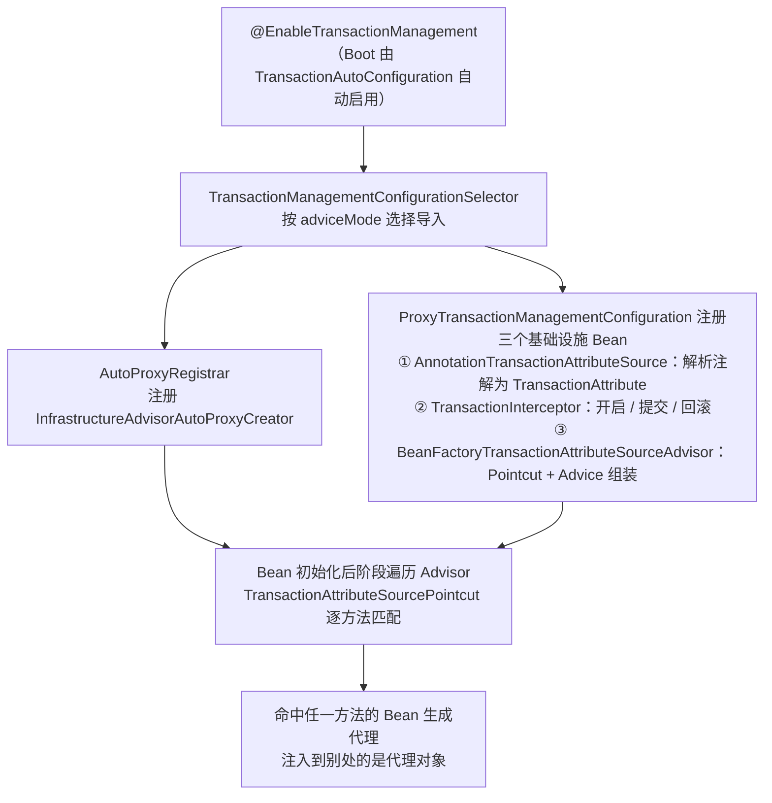
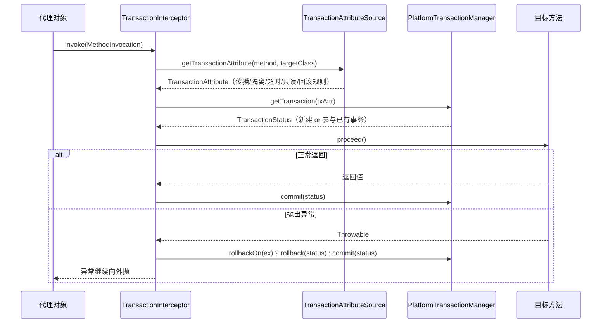

# Spring 事务详解

> 一句话概括：Spring 事务 = **AOP 代理决定"何时开事务" + ThreadLocal 绑定连接决定"谁和谁算同一个事务" + 事务管理器策略决定"怎么开/提交/回滚"**；
> 绝大多数"事务失效"与"大事务事故"，都能从这三句话推导出来。

预计阅读时间：大约 65 分钟

所属主题：[Spring 常见面试题总结](summary.md)

本文以 **Spring Framework 6.1.x / Spring Boot 3.x** 源码为基线（`spring-tx`、`spring-jdbc`、`spring-orm` 模块），关键源码锚点均已对照 6.0.x / 6.1.x 分支核实，涉及版本差异处单独注明。总结篇第 5 章给出的是结论速记，本文负责把每个结论的**机制、边界与代价**讲透。

---

## 0. 阅读路线

| 读者 | 建议阅读 | 关注点 |
| --- | --- | --- |
| 初级（1 年内） | 1.1~1.2、3.1、5、文末速记 | 事务是怎么生效的、失效场景怎么背怎么修 |
| 中级（1~3 年） | 全部，重点 2、3、6、7 | ThreadLocal 绑定、传播行为源码、回滚规则、大事务治理 |
| 高级（3 年+） | 1.3、3.3~3.5、4.3、7.3、9 | 挂起/恢复机制、NESTED 边界、隔离透传、提交后动作的坑 |
| 选型/架构 | 3.5、7、8 | REQUIRES_NEW 的连接代价、分布式事务立场、多数据源边界 |

目录：

1. 声明式事务：从注解到提交的源码走读
2. 「同一事务」的物理基础：ThreadLocal 与 Connection 绑定
3. 传播行为：语义、源码与 REQUIRES_NEW vs NESTED
4. 隔离级别：Spring 只透传，数据库才是实现者
5. 事务失效场景全清单
6. 回滚规则与 readOnly 的真相
7. 大事务治理与提交后动作
8. 分布式事务选型与多数据源边界
9. 高频追问集
10. 参考资料

---

## 1. 声明式事务：从注解到提交的源码走读

### 1.1 结论与全景

**结论**：`@Transactional` 本身不产生任何事务，它只是一份**元数据**。真正干活的是三个基础设施 Bean：`AnnotationTransactionAttributeSource`（读元数据）、`TransactionInterceptor`（增强逻辑）、`BeanFactoryTransactionAttributeSourceAdvisor`（切点 + 通知的组装），由 AOP 自动代理机制织入目标 Bean。

注册链路（`@EnableTransactionManagement` 的 `mode` 默认 `AdviceMode.PROXY`）：



三个值得记住的细节：

- `InfrastructureAdvisorAutoProxyCreator` 只认 `ROLE_INFRASTRUCTURE` 的 Advisor，事务 Advisor 正是以这个身份注册的——它和用户自定义切面走的是同一套自动代理机制，代理生成时机、JDK/CGLIB 选择等细节见 [IoC 与 AOP 专题](ioc-and-aop.md)。
- 切点匹配逻辑在 `TransactionAttributeSourcePointcut#matches`：对每个方法调 `TransactionAttributeSource#getTransactionAttribute(method, targetClass)`，**返回非 null 就匹配**。所以"方法上有没有事务属性"在容器启动期就决定了，运行期改注解毫无意义。
- `mode = AdviceMode.ASPECTJ` 时导入的是 `AspectJTransactionManagementConfiguration`，用 `AnnotationTransactionAspect` 做编译期/加载期织入，**没有代理边界，自调用也生效**，代价是需要 ajc 或 `-javaagent`。

Boot 侧：`TransactionAutoConfiguration` 在容器中存在 `TransactionManager` 且用户没有自己写 `@EnableTransactionManagement` 时自动启用；JDBC 场景由 `DataSourceTransactionManagerAutoConfiguration` 提供事务管理器（**Boot 2.5 起自动装配的是 `JdbcTransactionManager`**，它是 Spring 5.3 新增的 `DataSourceTransactionManager` 子类，把 commit/rollback 阶段的 `SQLException` 也翻译成 Spring 的 `DataAccessException`），JPA 场景由 `JpaBaseConfiguration` 提供 `JpaTransactionManager`。自动装配的条件与顺序见 [Boot 自动配置专题](boot-autoconfiguration.md)。

### 1.2 运行期：TransactionInterceptor#invoke 流程

`TransactionInterceptor#invoke` 只有一行有效逻辑：委托给父类 `TransactionAspectSupport#invokeWithinTransaction`。骨架如下：



对照源码的关键锚点（`TransactionAspectSupport#invokeWithinTransaction`）：

| 步骤 | 方法 | 说明 |
| --- | --- | --- |
| 读属性 | `getTransactionAttributeSource().getTransactionAttribute(...)` | 无属性（非事务方法被其他切面带进来）则直接 `proceed()` |
| 选管理器 | `determineTransactionManager(txAttr)` | 有 `transactionManager` 限定名按名找，否则按类型找唯一 `TransactionManager` |
| 开事务 | `createTransactionIfNecessary` → `tm.getTransaction(txAttr)` | 返回的 `TransactionStatus` 标记是否新事务；随后 `prepareTransactionInfo` 把 `TransactionInfo` 绑到 ThreadLocal（供 `currentTransactionStatus()` 使用） |
| 执行目标 | `invocation.proceedWithInvocation()` | 反射调用目标方法 |
| 异常处理 | `completeTransactionAfterThrowing(txInfo, ex)` | `rollbackOn(ex)` 为 true 走 `tm.rollback`，**否则照样 `tm.commit`** |
| 正常提交 | `commitTransactionAfterReturning(txInfo)` | `tm.commit(status)` |
| 清理 | finally 中 `cleanupTransactionInfo(txInfo)` | 恢复上一层 `TransactionInfo`（支持嵌套调用栈） |

一个冷门分支：若事务管理器实现了 `CallbackPreferringPlatformTransactionManager`（如 WebLogic 的 JTA 集成），拦截器改走 `tm.execute(...)` 回调式 API，提交/回滚由管理器内部完成。常规 `DataSourceTransactionManager`/`JpaTransactionManager` 不走这条路。

### 1.3 事务属性从哪里读：四级 fallback

`AbstractFallbackTransactionAttributeSource#computeTransactionAttribute` 的查找顺序（6.1.x 源码核实）：

1. **目标类上最具体的方法**（`AopUtils.getMostSpecificMethod`，即实现类方法）；
2. **目标类**上的类级注解；
3. 原始方法（接口方法，仅当与具体方法不同时）；
4. 原始方法的声明类/接口。

两条推论：

- **方法级注解完全覆盖类级注解，不做属性合并**。类上标 `@Transactional(readOnly = true)`、方法上标 `@Transactional`，方法就是读写事务——`readOnly` 不会"继承"下来。源码 javadoc 原话："Any transaction attribute associated with the target method completely overrides a class transaction attribute."
- 注解解析器不止认 Spring 的 `@Transactional`：`AnnotationTransactionAttributeSource` 按 classpath 依次注册 `SpringTransactionAnnotationParser`、`JtaTransactionAnnotationParser`（`jakarta.transaction.Transactional`）、`Ejb3TransactionAnnotationParser`（`jakarta.ejb.TransactionAttribute`）。**6.x 是 jakarta 命名空间，5.x 是 javax**——Boot 3 迁移时引错包，注解会被静默忽略。

**实践**：团队约定注解只标在实现类的 public 方法上，类级注解仅用于"整个 Service 默认只读"这类粗粒度场景，写方法显式覆盖。

---

## 2. 「同一事务」的物理基础：ThreadLocal 与 Connection 绑定

### 2.1 结论

**结论**：数据库事务的物理载体是**一条 Connection**（`autoCommit=false` 的 JDBC 连接）。Spring 用 `TransactionSynchronizationManager` 把 `ConnectionHolder` 绑到**当前线程的 ThreadLocal** 上，同一线程内所有经 `DataSourceUtils#getConnection` 取连接的 DAO 拿到的都是同一条连接——这就是"同一事务"的全部物理基础。

`TransactionSynchronizationManager` 的核心 ThreadLocal（都是 `NamedThreadLocal`）：

| 字段 | 存什么 |
| --- | --- |
| `resources` | `Map<Object, Object>`：key 是 DataSource（或 EntityManagerFactory），value 是 `ConnectionHolder`（或 `EntityManagerHolder`） |
| `synchronizations` | `Set<TransactionSynchronization>`：事务同步回调（见 7.3） |
| `actualTransactionActive` | 当前线程是否有真实事务 |
| `currentTransactionIsolationLevel` / `currentTransactionReadOnly` / `currentTransactionName` | 当前事务的元信息 |

### 2.2 机制：绑定与获取的两端

**绑定端** `DataSourceTransactionManager#doBegin`（6.1.x 源码节选）：

```java
// 从连接池取连接，包成 ConnectionHolder
Connection newCon = obtainDataSource().getConnection();
txObject.setConnectionHolder(new ConnectionHolder(newCon), true);
// 设置隔离级别 / readOnly（透传，见第 4 章）
Integer previousIsolationLevel = DataSourceUtils.prepareConnectionForTransaction(con, definition);
// 关闭自动提交——事务真正开始的标志
if (con.getAutoCommit()) {
    txObject.setMustRestoreAutoCommit(true);
    con.setAutoCommit(false);
}
txObject.getConnectionHolder().setTransactionActive(true);
// 绑定到当前线程
TransactionSynchronizationManager.bindResource(obtainDataSource(), txObject.getConnectionHolder());
```

**获取端** `DataSourceUtils#doGetConnection`（6.1.x 源码节选）：

```java
ConnectionHolder conHolder =
        (ConnectionHolder) TransactionSynchronizationManager.getResource(dataSource);
if (conHolder != null && (conHolder.hasConnection() || conHolder.isSynchronizedWithTransaction())) {
    conHolder.requested();          // 引用计数 +1
    return conHolder.getConnection();   // 命中绑定 → 返回同一条连接
}
// 未命中：取新连接；若有同步活动则注册 ConnectionSynchronization 并绑定
Connection con = fetchConnection(dataSource);
```

`JdbcTemplate`、MyBatis 的 `SpringManagedTransaction`、JPA 的 JDBC 旁路，取连接全部走 `DataSourceUtils`，所以它们天然共享事务。**自己 `dataSource.getConnection()` 绕开了这套机制，就绕开了事务**——这是排查"部分 SQL 没回滚"时的第一检查项。

`JpaTransactionManager` 同理：`doBegin` 把 `EntityManagerHolder` 绑到 `EntityManagerFactory` 这个 key 上；若配置了 `dataSource` 属性且 `JpaDialect` 能暴露底层 JDBC 连接，还会把 `ConnectionHolder` 绑到 DataSource 上，让 JPA 与原生 JDBC 代码共享同一个物理事务。

### 2.3 边界：由此推导出的三条铁律

1. **事务不跨线程**。新线程的 ThreadLocal 里没有 `ConnectionHolder`，`DataSourceUtils` 会给它一条全新的 `autoCommit=true` 连接——子线程的写操作立即提交，主线程回滚与它无关。`new Thread`、线程池、`@Async`、`CompletableFuture.supplyAsync` 全部适用（`@Async` 的线程模型见 [异步注解原理专题](async-annotation-principle.md)）。
2. **事务内切换数据源不生效**。`AbstractRoutingDataSource` 的路由发生在 `getConnection()` 那一刻；事务已把连接绑到 ThreadLocal，后续取连接直接命中缓存，根本不再路由（详见 8.2）。
3. **响应式栈里这套机制整体失效**。WebFlux 的线程模型下 ThreadLocal 不可靠，Spring 6.x 的响应式事务走 `ReactiveTransactionManager` + Reactor Context，是另一套 API，本文不展开。

### 2.4 编程式事务：同一套基础设施的另一个入口

`TransactionTemplate` 不经过代理，直接调 `PlatformTransactionManager#getTransaction/commit/rollback`，绑定的仍是同一个 ThreadLocal——所以**编程式与声明式可以在同一调用栈里互相加入对方的事务**（传播行为照常生效）。

```java
@Service
@RequiredArgsConstructor
public class TransferService {
    private final TransactionTemplate txTemplate;   // Boot 自动装配了该 Bean，与声明式共用基础设施
    private final AccountMapper accountMapper;
    private final RiskClient riskClient;

    public void transfer(long from, long to, BigDecimal amount) {
        riskClient.check(from, to);                 // RPC 在事务外，不占连接
        txTemplate.executeWithoutResult(status -> { // 只包住两条真正的 DB 写
            accountMapper.debit(from, amount);
            accountMapper.credit(to, amount);
        });
    }
}
```

两个细节：`TransactionTemplate#execute` 对回调抛出的 `RuntimeException`/`Error` 回滚，其他 `Throwable` 回滚后包成 `UndeclaredThrowableException`；`TransactionCallback#doInTransaction` 签名不允许抛受检异常，业务受检异常要在回调内自行处理。**自调用场景、需要精确控制事务边界的场景，优先编程式**——它没有代理边界。

---

## 3. 传播行为：语义、源码与 REQUIRES_NEW vs NESTED

### 3.1 七种传播行为语义表

| 传播行为 | 当前有事务 | 当前无事务 | 源码分支 |
| --- | --- | --- | --- |
| **REQUIRED**（默认） | 加入（不新建物理连接） | 新建 | `handleExistingTransaction` 默认分支 / `getTransaction` 新建分支 |
| SUPPORTS | 加入 | 非事务执行（空 status） | 同上 / 空事务分支 |
| MANDATORY | 加入 | 抛 `IllegalTransactionStateException` | 同上 / `getTransaction` 显式抛错 |
| REQUIRES_NEW | **挂起当前，新建独立事务** | 新建 | `suspend` + `startTransaction` |
| NOT_SUPPORTED | 挂起当前，非事务执行 | 非事务执行 | `suspend` + 空 status |
| NEVER | 抛 `IllegalTransactionStateException` | 非事务执行 | 显式抛错 / 空事务分支 |
| NESTED | **savepoint 嵌套子事务** | 等同 REQUIRED 新建 | `createAndHoldSavepoint` |

注意"加入"的准确含义：`prepareTransactionStatus(definition, transaction, false, ...)` 中 `newTransaction=false`——内层拦截器拿到的 status 只是外层事务的一个**逻辑视图**，内层的 commit 是空操作，真正的提交只发生在外层。

### 3.2 源码：getTransaction 与 handleExistingTransaction

`AbstractPlatformTransactionManager#getTransaction` 先调子类 `doGetTransaction` 检查 ThreadLocal 里有无已绑定资源：无事务时 MANDATORY 抛异常，REQUIRED/REQUIRES_NEW/NESTED 走 `doBegin` 新建，其余返回空 status；有事务时进入 `handleExistingTransaction`，关键分支（6.1.x 节选）：

```java
// NEVER：抛 IllegalTransactionStateException
// NOT_SUPPORTED：suspend(transaction) 后返回空 status，非事务执行
if (definition.getPropagationBehavior() == PROPAGATION_REQUIRES_NEW) {
    SuspendedResourcesHolder suspendedResources = suspend(transaction);
    return startTransaction(definition, transaction, false, debugEnabled, suspendedResources);
}
if (definition.getPropagationBehavior() == PROPAGATION_NESTED) {
    if (!isNestedTransactionAllowed()) {
        throw new NestedTransactionNotSupportedException(...);
    }
    if (useSavepointForNestedTransaction()) {
        DefaultTransactionStatus status = newTransactionStatus(...);
        status.createAndHoldSavepoint();                   // JDBC Savepoint
        return status;
    }
    return startTransaction(definition, transaction, true, ...);  // 仅 JTA 等少数场景
}
// REQUIRED / SUPPORTS / MANDATORY：参与已有事务
if (isValidateExistingTransaction()) { /* 校验隔离级别与 readOnly 是否冲突 */ }
return prepareTransactionStatus(definition, transaction, false, ...);
```

**挂起/恢复的机制**：`suspend` → 子类 `doSuspend`（`DataSourceTransactionManager` 就是 `unbindResource`，把 `ConnectionHolder` 从 ThreadLocal 摘下来存进 `SuspendedResourcesHolder`）+ 挂起同步回调；内层事务完成后 `resume` 重新 `bindResource`。外层连接在整个挂起期间**一直被占着不归还**——这是 REQUIRES_NEW 连接代价的根源（3.4）。

另一个默认关闭的开关：`validateExistingTransaction=true` 时，参与已有事务的内层若声明了不同的隔离级别、或外层只读而内层要写，会直接抛异常。**默认情况下内层的 isolation/readOnly 声明被静默忽略**——"我在内层方法上配了 READ_COMMITTED 怎么没生效"的答案就在这里：隔离级别属于物理连接，只在 `doBegin` 时设置一次。

### 3.3 REQUIRES_NEW vs NESTED 深度对比

| 维度 | REQUIRES_NEW | NESTED |
| --- | --- | --- |
| 物理事务 | 两个独立事务，**两条连接** | 一个物理事务 + savepoint，一条连接 |
| 内层"提交" | 真提交，立即对其他事务可见 | 仅释放 savepoint，**数据要等外层提交才可见** |
| 内层回滚 | 只回滚内层 | 只回滚到 savepoint，外层可继续 |
| 外层回滚 | 内层已提交，不受影响 | 内层写入一起回滚 |
| 支持范围 | 所有事务管理器 | JDBC 系（`DataSourceTransactionManager` 构造器 `setNestedTransactionAllowed(true)`）；JPA 见下文 |
| 典型用途 | 留痕日志、独立通知 | 批量导入单条失败不影响整批 |

**内外层回滚互影响矩阵**（内层方法抛异常时，注意区分异常是否被外层捕获）：

| 场景 | REQUIRES_NEW | NESTED |
| --- | --- | --- |
| 内层抛异常，外层 catch 后继续 | 内层已独立回滚；外层正常提交 | 回滚到 savepoint；外层继续并提交 |
| 内层抛异常，向外传播 | 内层回滚；外层拦截器因异常也回滚 | 内层先回滚到 savepoint，随后外层整体回滚 |
| 内层正常返回，外层抛异常 | 内层已提交，**保留** | 内层随外层一起回滚 |
| 内外都正常 | 各自提交 | 外层提交时一并生效 |

**JPA 对 NESTED 的支持边界（比"JPA 不支持 NESTED"更精确的说法）**：`JpaTransactionManager` 构造器同样 `setNestedTransactionAllowed(true)`，但其 javadoc 明确：嵌套**只作用于底层 JDBC Connection，不作用于 EntityManager 及其持久化上下文**，"JPA itself does not support nested transactions"。savepoint 能力由 `JpaDialect` 提供的事务数据决定（须实现 `SavepointManager`），而 `HibernateJpaDialect` 返回的 `SessionTransactionData` 并不实现它——所以 **JPA + Hibernate 下用 NESTED 会抛 `NestedTransactionNotSupportedException`（"JpaDialect does not support savepoints"）**。即便换用支持 savepoint 的方言，回滚 savepoint 也撤不掉持久化上下文里已缓存的实体状态，语义上是残缺的。结论：**NESTED 只在纯 JDBC/MyBatis 技术栈里用**。

### 3.4 边界与代价

- **REQUIRES_NEW 的连接放大**：外层挂起期间占着连接 A，内层再从池里取连接 B。若连接池大小为 N，N 个并发请求同时走到 REQUIRES_NEW，每个都持有 1 条、等待第 2 条——**连接池死锁**。池容量必须按"峰值并发 × 单请求最大同时持有连接数"评估。
- **REQUIRES_NEW 的可见性陷阱**：内层提交后，外层在 MySQL RR 下的快照读（ReadView 已建立）**依然看不到内层新写入的行**——"我明明插了日志，外层怎么查不到"不是 bug，是 MVCC。
- **REQUIRED 参与的 rollback-only 陷阱（高频事故）**：内层 REQUIRED 抛异常时，即使外层 catch 住，内层拦截器已把整个事务标记为 rollback-only（`globalRollbackOnParticipationFailure` 默认 true，`doSetRollbackOnly` 落到 `ConnectionHolder` 上）。外层提交时发现标记 → 实际执行回滚并抛 `UnexpectedRollbackException`：

```java
@Transactional
public void placeOrder(Order order) {
    orderMapper.insert(order);
    try {
        stockService.deduct(order.getSku(), order.getCount()); // REQUIRED，加入同一事务
    } catch (RuntimeException e) {
        log.warn("扣库存失败，忽略", e);   // ❌ 吞得住异常，吞不掉 rollback-only 标记
    }
    // 提交时抛 UnexpectedRollbackException，订单也一起回滚
}
```

修复三选一：内层改 `REQUIRES_NEW`（真正独立）；内层改 `NESTED`（JDBC 栈，回滚到 savepoint）；或者接受"一损俱损"，不要 catch。

### 3.5 实践：两个典型业务写法

**留痕日志用 REQUIRES_NEW**（主业务回滚也要留痕；注意必须跨 Bean 调用才走代理）：

```java
@Service
@RequiredArgsConstructor
public class AuditLogService {
    private final AuditLogMapper auditLogMapper;

    @Transactional(propagation = Propagation.REQUIRES_NEW)
    public void record(String action, String detail) {
        auditLogMapper.insert(new AuditLog(action, detail));
    }
}
@Service
@RequiredArgsConstructor
public class OrderService {
    private final OrderMapper orderMapper;
    private final AuditLogService auditLogService;

    @Transactional
    public void cancel(Order order) {
        orderMapper.markCancelled(order.getId());
        auditLogService.record("CANCEL", order.getId());  // 独立事务，立即提交
        if (order.isPaid()) {
            throw new IllegalStateException("已支付订单需走退款流程"); // 主事务回滚，日志保留
        }
    }
}
```

**批量导入单条失败用 NESTED**（一个物理事务，成功行随外层提交，失败行回滚到 savepoint）：

```java
@Transactional
public ImportResult importRows(List<Row> rows) {
    ImportResult result = new ImportResult();
    for (Row row : rows) {
        try {
            rowImportService.importOne(row);        // 跨 Bean 调用
            result.success();
        } catch (RuntimeException e) {
            result.fail(row, e.getMessage());       // 只回滚这一条，整批继续
        }
    }
    return result;
}
// RowImportService 中：
@Transactional(propagation = Propagation.NESTED)
public void importOne(Row row) { /* 校验 + 写入，失败抛 RuntimeException */ }
```

**追问方向**：为什么留痕不用 NESTED？——因为外层回滚时 NESTED 的日志会一起消失，违背"留痕"初衷；为什么批量不用 REQUIRES_NEW？——每条一个独立事务意味着 N 次提交开销与连接占用，且失败行与成功行之间没有一致性快照。

---

## 4. 隔离级别：Spring 只透传，数据库才是实现者

### 4.1 结论与级别表

**结论**：Spring 不实现任何隔离语义，只在 `doBegin` 时把级别透传给 `Connection#setTransactionIsolation`，事务结束后恢复原值（`DataSourceUtils#resetConnectionAfterTransaction`，对连接池复用至关重要）。**脏读/不可重复读/幻读的防线全部在数据库**。

| 级别 | 脏读 | 不可重复读 | 幻读 | 常见默认 |
| --- | --- | --- | --- | --- |
| READ_UNCOMMITTED | 可能 | 可能 | 可能 | — |
| READ_COMMITTED | 否 | 可能 | 可能 | Oracle / PostgreSQL / SQL Server |
| REPEATABLE_READ | 否 | 否 | 标准定义下可能；InnoDB 基本解决 | MySQL InnoDB |
| SERIALIZABLE | 否 | 否 | 否 | — |

`Isolation.DEFAULT`（值 -1）表示不动连接、用数据库默认。透传代码在 `DataSourceUtils#prepareConnectionForTransaction`（6.1.x 核实）：

```java
if (definition != null && definition.getIsolationLevel() != TransactionDefinition.ISOLATION_DEFAULT) {
    int currentIsolation = con.getTransactionIsolation();
    if (currentIsolation != definition.getIsolationLevel()) {
        previousIsolationLevel = currentIsolation;
        con.setTransactionIsolation(definition.getIsolationLevel());
    }
}
```

### 4.2 MySQL RR 如何"基本解决"幻读

InnoDB 在 RR 下用两套机制分别处理两类读：

- **快照读**（普通 SELECT）：MVCC。事务内第一条 SELECT 建立 ReadView，之后一直读这个快照——别的事务插入并提交的新行根本不可见，自然无幻读。
- **当前读**（`SELECT ... FOR UPDATE` / `LOCK IN SHARE MODE` / UPDATE / DELETE）：next-key lock = 记录锁 + 间隙锁，锁住扫描范围及其间隙，**阻止其他事务往区间里插入**，从而防幻读。

"基本"二字的边界：快照读与当前读混用时仍可能出现反常——例如事务 A 快照读看不到 B 新插入的行，但 A 执行 `UPDATE ... WHERE` 命中了该行（当前读）后，该行对 A 的后续快照读变得可见。面试里能说出这个例子，比背"RR 解决幻读"高一个档次。另外间隙锁是死锁的常见来源，高并发插入场景要留意。

### 4.3 边界与实践

- 隔离级别属于**物理连接**：REQUIRED 参与已有事务时，内层声明的隔离级别被忽略（除非开 `validateExistingTransaction`，见 3.2）。
- 不要全局调高隔离级别换"安全感"：SERIALIZABLE 在 InnoDB 下会把所有普通 SELECT 隐式加共享锁，并发吞吐断崖式下降。
- **实践**：绝大多数业务用数据库默认（MySQL RR / PG RC）即可；需要"读己之写 + 高并发"的报表类查询显式降为 RC 并配合 `readOnly = true`；资金扣减用当前读（`FOR UPDATE`）或乐观锁版本号，而不是靠调隔离级别。

---

## 5. 事务失效场景全清单

每个场景按「原因 → 最小示例 → 修复」组织。前四类是代理边界问题（通用机制见 [IoC 与 AOP 专题](ioc-and-aop.md)），后几类是配置与运行时问题。

### 5.1 类内自调用

**原因**：`this.b()` 走原始对象，不经过代理，拦截器根本没执行。

```java
@Transactional
public void a() {
    this.b();   // ❌ b 的 REQUIRES_NEW 不生效，仍在 a 的事务里
}
@Transactional(propagation = Propagation.REQUIRES_NEW)
public void b() { ... }
```

**修复**：拆到另一个 Bean（最推荐）；自注入 `@Autowired @Lazy private OrderService self;` 后 `self.b()`（Boot 2.6+ 默认禁循环依赖，自注入务必配 `@Lazy`）；`@EnableAspectJAutoProxy(exposeProxy = true)` + `AopContext.currentProxy()`；或干脆改 `TransactionTemplate`。

### 5.2 方法非 public（注意 6.0 版本差异）

**原因与版本**：5.x 及以前，`AbstractFallbackTransactionAttributeSource` 对非 public 方法直接返回 null。**6.0 起类代理（CGLIB）默认支持 protected / 包可见方法**——开关在 `ProxyTransactionManagementConfiguration#transactionAttributeSource()`，它注册的是 `new AnnotationTransactionAttributeSource(false)`（`publicMethodsOnly=false`，源码注释："Accept protected @Transactional methods on CGLIB proxies, as of 6.0"）。接口代理（JDK）仍要求方法 public 且声明在接口上；**private / static / final 方法任何版本都不行**（代理无法覆写）。

```java
@Transactional
private void save() { ... }   // ❌ 任何版本都失效：CGLIB 无法拦截 private
```

**修复**：统一用 public。想恢复 5.x 的一致行为，自定义 `TransactionAttributeSource` Bean 并传 `publicMethodsOnly=true`（官方文档给出的写法）。

### 5.3 异常被 catch 吞掉

**原因**：拦截器只能感知**抛出到代理层**的异常；catch 住只打日志，拦截器认为方法正常返回，照常 commit。

```java
@Transactional
public void pay() {
    orderMapper.insert(order);
    try {
        accountMapper.debit(uid, amount);
    } catch (Exception e) {
        log.error("扣款失败", e);   // ❌ 订单照常提交
    }
}
```

**修复**：把异常抛出去；或确需吞掉时手动标记回滚：`TransactionAspectSupport.currentTransactionStatus().setRollbackOnly();`。注意 REQUIRED 参与场景下吞异常也救不了（3.4 的 `UnexpectedRollbackException`）。

### 5.4 抛受检异常，默认不回滚

**原因**：默认规则只回滚 `RuntimeException` 和 `Error`（`DefaultTransactionAttribute#rollbackOn`），受检异常被视为"可恢复的业务结果"，照常提交。

```java
@Transactional
public void settle() throws BizException {   // BizException extends Exception
    billMapper.insert(bill);
    throw new BizException("对账不平");       // ❌ 默认提交，账单留下脏数据
}
```

**修复**：`@Transactional(rollbackFor = Exception.class)`；或团队规范统一用 unchecked 业务异常。规则细节见第 6 章。

### 5.5 传播行为配错

**原因**：`NOT_SUPPORTED` 挂起事务非事务执行、`SUPPORTS` 在无事务环境下不开事务、`NEVER` 有事务直接抛错——注解在，事务不在。

```java
@Transactional(propagation = Propagation.NOT_SUPPORTED)
public void write() { mapper.insert(...); }   // ❌ 以 autoCommit=true 执行
```

**修复**：写操作默认 REQUIRED；只有明确知道语义时才用其他传播行为，并在代码评审中作为检查项。

### 5.6 对象不是 Bean / final 类或方法

**原因**：自己 `new` 的对象没被容器代理；final 类 CGLIB 无法生成子类，final 方法无法被覆写拦截。

```java
OrderService svc = new OrderService();   // ❌ 裸对象
svc.placeOrder(order);
@Service
public final class ReportService { ... } // ❌ CGLIB 代理创建失败（启动期报错）
```

**修复**：交给容器管理；去掉 final。Kotlin 项目注意类和方法默认 final，需要 `kotlin-spring`/`all-open` 插件。

### 5.7 多线程调用

**原因**：连接绑在 ThreadLocal（第 2 章），子线程拿到的是全新 autoCommit 连接，主事务管不到它。

```java
@Transactional
public void batch() {
    orderMapper.insert(main);
    executor.submit(() -> detailMapper.insert(detail)); // ❌ 子线程独立提交
}   // 主事务回滚时，detail 已落库
```

**修复**：事务不跨线程——把写操作收回主线程；确需并行，各线程用各自的编程式事务 + 业务补偿/对账，或改为"并行计算、串行落库"。

### 5.8 存储引擎不支持事务

**原因**：MyISAM 等非事务引擎没有事务概念，`setAutoCommit(false)` 形同虚设。

建表语句 `CREATE TABLE t_log (...) ENGINE = MyISAM` 就是最小反例——回滚对它无效。**修复**：`ALTER TABLE t_log ENGINE = InnoDB;`，排查时用 `SHOW TABLE STATUS` 确认引擎。

### 5.9 注解标在接口上（澄清一个以讹传讹的说法）

**常见说法**："接口上的 `@Transactional` CGLIB 读不到"。**精确事实（5.0 起）**：`SpringTransactionAnnotationParser` 用 `AnnotatedElementUtils.findMergedAnnotationAttributes`（find 语义会搜索接口与父类），官方文档明确接口注解对**接口代理和类代理都生效**（"even if the latter does work for interface-based and target-class proxies as of 5.0"）。真正失效的场景是 **AspectJ 织入模式**——织入基础设施不认接口注解，事务被静默忽略。

**修复/实践**：尽管 5.0+ 代理模式能读到，官方仍推荐**标在实现类上**：避免将来切换织入方式时静默失效，也避免"代码看起来有事务、测回滚才发现没有"。`@Transactional` 不是 `@Inherited`，父类注解的继承同样依赖 find 语义而非 Java 原生机制。

### 5.10 在代理就绪前调用：@PostConstruct / 构造器

**原因**：官方文档明确"the proxy must be fully initialized ... you should not rely on this feature in your initialization code — for example, in a `@PostConstruct` method"。`@PostConstruct` 执行时 AOP 代理尚未生成（代理在初始化后阶段才创建，见 [Bean 生命周期专题](bean-lifecycle-and-circular-dependency.md)），此时调用事务方法走的是裸对象。

```java
@PostConstruct
public void init() {
    this.loadCache();   // ❌ loadCache 上的 @Transactional 不生效
}
```

**修复**：把初始化逻辑挪到 `ApplicationReadyEvent` 监听器或首次业务调用时懒执行。

**排查套路（面试可直接背）**：① 开 DEBUG 日志 `org.springframework.jdbc.datasource.DataSourceTransactionManager`，看有没有 "Creating new transaction" / "Participating in existing transaction"；② 确认注入的是代理（`AopUtils.isAopProxy(bean)`）；③ 确认异常真的抛到了代理层且类型命中回滚规则；④ 确认 DAO 走 `DataSourceUtils` 而非自取连接；⑤ 确认引擎与数据源和事务管理器匹配。

---

## 6. 回滚规则与 readOnly 的真相

### 6.1 rollbackOn：继承树就近匹配

**结论**：回滚判定在 `RuleBasedTransactionAttribute#rollbackOn`——把所有 `rollbackFor`/`noRollbackFor` 规则按**异常继承树距离就近匹配**，最具体的规则获胜；没有任何规则命中才走默认（`RuntimeException`/`Error` 回滚）。

6.1.x 源码（核实）：

```java
public boolean rollbackOn(Throwable ex) {
    RollbackRuleAttribute winner = null;
    int deepest = Integer.MAX_VALUE;
    if (this.rollbackRules != null) {
        for (RollbackRuleAttribute rule : this.rollbackRules) {
            int depth = rule.getDepth(ex);          // 沿 superclass 链向上找匹配
            if (depth >= 0 && depth < deepest) {    // 严格 <：同深度先声明者胜
                deepest = depth;
                winner = rule;
            }
        }
    }
    if (winner == null) {
        return super.rollbackOn(ex);   // 默认：ex instanceof RuntimeException || Error
    }
    return !(winner instanceof NoRollbackRuleAttribute);
}
```

三个深挖点：

- `RollbackRuleAttribute#getDepth` 从异常自身类沿 `getSuperclass()` 走到 `Throwable`，返回继承距离；用类名构造规则时是**类名子串匹配**（`getName().contains(...)`），写错类名不会报错只会不命中。
- **只匹配抛出的异常本身，不解包 cause**。把 `SQLException` 包进 `RuntimeException` 抛出，按 wrapper 的类型判定。
- 同深度冲突时按规则列表顺序取第一个——`rollbackFor` 与 `noRollbackFor` 声明顺序在极端配置下会影响结果，避免写出同深度对立的规则。

```java
// BizWarnException extends BizException extends Exception
@Transactional(rollbackFor = Exception.class, noRollbackFor = BizWarnException.class)
public void settle() throws BizException {
    // 抛 BizException：Exception 规则 depth=1 命中 → 回滚
    // 抛 BizWarnException：noRollbackFor depth=0 更近 → 提交（警告不阻断业务）
}
```

### 6.2 readOnly=true：提示，不是硬约束

**结论**：`readOnly` 是给事务管理器与底层资源的**优化提示**，各层实现不同，不能拿它当写保护：

| 层 | 行为 |
| --- | --- |
| JDBC | `DataSourceUtils#prepareConnectionForTransaction` 调 `Connection#setReadOnly(true)`；驱动不支持时抛的 SQLException **被显式忽略**（源码注释："it's just a hint anyway"） |
| MySQL Connector/J | `setReadOnly(true)` 可能下发 `SET SESSION TRANSACTION READ ONLY`，此时写会报错——但这是驱动行为，不是 Spring 保证 |
| Hibernate/JPA | FlushMode 设为 MANUAL，跳过脏检查：**托管实体的修改被静默丢弃**，不报错——只读事务里"改了没生效"的头号原因 |
| 显式强制 | `DataSourceTransactionManager#setEnforceReadOnly(true)` 时执行 `SET TRANSACTION READ ONLY`（Oracle/MySQL/PG 认识），写操作才真正报错 |

**实践**：只读查询标 `readOnly = true` 的收益是 Hibernate 跳过脏检查、数据库可做只读优化、配合 `LazyConnectionDataSourceProxy` 还能把只读事务路由到从库；但**不要依赖它拦截误写**，写保护靠代码评审与权限。另一个坑：类级 `readOnly = true` + 方法级 `@Transactional` 覆盖后是读写事务（1.3 的"完全覆盖不合并"）。

---

## 7. 大事务治理与提交后动作

### 7.1 大事务的四宗罪

| 罪状 | 机制 | 后果 |
| --- | --- | --- |
| 占连接 | 事务期间连接不归还池 | 连接池耗尽，无关请求一起超时 |
| 持锁 | 行锁/间隙锁到提交才释放 | 阻塞、锁等待超时、死锁概率上升 |
| 回滚代价 | undo log 量大 | 回滚耗时可能数倍于执行耗时 |
| 主从延迟 | binlog 在提交时才写/传输 | 大事务 = 从库一个大回放单元，延迟尖刺 |

### 7.2 治理手段

**缩边界**：事务只包真正的 DB 写。RPC、MQ 发送、文件 IO、复杂计算、循环里的远程调用，全部移出事务（2.4 的 `TransferService` 示例就是标准写法）。经验阈值：单事务持有连接时间控制在百毫秒级，超过 1s 的事务应当被监控告警。

**分批提交**：大批量写用 `TransactionTemplate` 逐批开事务，避免一个事务锁住全表：

```java
public void archive(List<Record> records) {
    for (List<Record> batch : Lists.partition(records, 500)) {
        txTemplate.executeWithoutResult(status ->
            recordMapper.insertBatch(batch));   // 每批独立提交：锁持有时间短，失败只影响当前批
    }
}
```

代价要说清楚：分批后**整批不再原子**，需要幂等键 + 断点续跑/对账兜底。这是"一致性换可用性"的显式取舍，不是免费优化。

**超时兜底**：`@Transactional(timeout = 5)` 的机制是把 deadline 记在 `ConnectionHolder` 上，由后续经 Spring 模板执行的 SQL 通过 `DataSourceUtils#applyTransactionTimeout` 换算成 `Statement#setQueryTimeout`。**边界**：它不是定时器，不会主动 kill——两条 SQL 之间的长计算、绕开模板的原生 JDBC 都不触发；超时判定发生在"下一次 SQL 执行时"。

### 7.3 提交后动作：afterCommit 与 @TransactionalEventListener

**结论**：发 MQ、清缓存、发通知这类"必须在事务成功后做"的动作，用事务同步回调或事务事件监听器，而不是在事务方法里直接做（事务还没提交，消费者可能读到旧数据；事务回滚了消息却发出去了）。

`TransactionSynchronization` 的回调时序（6.1.x javadoc 核实）：

| 回调 | 时机 | 异常处理 |
| --- | --- | --- |
| `beforeCommit(readOnly)` | 物理提交前 | 异常传播给调用方 → 触发回滚 |
| `beforeCompletion` | 提交/回滚前（资源还活着） | 仅记日志 |
| `afterCommit` | **物理提交成功后** | 异常传播给调用方（但事务已提交，不会回滚） |
| `afterCompletion(status)` | 完成后（STATUS_COMMITTED / ROLLED_BACK / UNKNOWN） | 仅记日志 |

```java
// 事务方法内注册：提交成功后才发 MQ
TransactionSynchronizationManager.registerSynchronization(new TransactionSynchronization() {
    @Override
    public void afterCommit() {
        mqProducer.send(new OrderCreatedMessage(order.getId()));
    }
});
```

**最大的坑（官方 javadoc 原话）**：afterCommit 阶段"transactional resources might still be active and accessible"——连接还绑在 ThreadLocal 上，此时写库会"参与"那个**已经提交、不会再有 commit** 的事务，写入静默丢失。官方结论："**Use PROPAGATION_REQUIRES_NEW for any transactional operation that is called from here.**"

事件方式同理。`@TransactionalEventListener` 的 phase 语义：

| phase | 执行时机 | 备注 |
| --- | --- | --- |
| BEFORE_COMMIT | 提交前 | 抛异常可连累主事务回滚 |
| **AFTER_COMMIT**（默认） | 提交成功后 | 再写库必须 REQUIRES_NEW |
| AFTER_ROLLBACK | 回滚后 | 适合补偿记录 |
| AFTER_COMPLETION | 无论成败 | 适合清理 |

```java
@Component
public class PointsListener {
    @TransactionalEventListener(phase = TransactionPhase.AFTER_COMMIT)
    @Transactional(propagation = Propagation.REQUIRES_NEW)   // 必须显式开新事务
    public void onOrderCreated(OrderCreatedEvent event) {
        pointsMapper.addPoints(event.getUserId(), 10);
    }
}
```

两个附加边界：`fallbackExecution` 默认 false——**发布事件时没有事务，监听器直接被丢弃**（不是立即执行）；AFTER_COMMIT 里发 MQ 仍有"提交成功但进程崩溃、消息没发出"的窗口，强可靠场景用本地消息表（8.1）。

---

## 8. 分布式事务选型与多数据源边界

### 8.1 跨库/跨服务选型表

本地 `@Transactional` 的边界是**一个事务管理器管的一个资源**。超出这个边界：

| 方案 | 一致性 | 机制一句话 | 代价 | 适用 |
| --- | --- | --- | --- | --- |
| XA / 2PC（JtaTransactionManager） | 强一致 | 协调者两阶段提交 | 同步阻塞、协调者单点、性能差 | 传统金融、单应用多库 |
| Seata AT | 最终一致 | 代理数据源，前后镜像生成 undo log，全局锁防脏写 | 引入 TC 组件；全局锁限制热点行并发 | 常规微服务、低侵入改造 |
| TCC | 最终一致 | Try 预留 / Confirm 扣减 / Cancel 释放 | 三接口 + 空回滚/悬挂/幂等三大难题，侵入高 | 资金类高并发 |
| 本地消息表 / 事务消息 | 最终一致 | 业务与消息同库同事务，投递 + 对账补偿 | 需要消息表/对账任务 | 互联网主流 |
| Saga | 最终一致 | 长流程正向操作 + 逐步补偿 | 补偿逻辑复杂，中间态可见 | 跨多服务长流程 |

**一句话立场**：多数互联网业务选"本地事务 + 消息最终一致 + 对账兜底"，把复杂度花在刀刃上；追求强一致之前先问业务是否真的接受不了秒级不一致。另注意 `ChainedTransactionManager`（spring-data 曾提供的"尽力而为 1PC"）已废弃——它只是顺序提交多个本地事务，最后一个失败时前面的无法回滚，不要拿它当分布式事务用。

### 8.2 多数据源：事务内切换数据源为什么不生效

**结论**：`AbstractRoutingDataSource#determineTargetDataSource` 只在 `getConnection()` 时执行一次；事务开启后 `ConnectionHolder` 已绑到 ThreadLocal（key 是路由 DataSource 本身），后续 `DataSourceUtils#getConnection` 直接命中绑定，**不再路由**。

```java
@Transactional                       // doBegin 时已绑定 master 连接
public void sync() {
    masterMapper.update(...);
    DynamicDataSourceContextHolder.push("slave");
    slaveMapper.query(...);          // ❌ 仍走 master 连接，切换无效
    DynamicDataSourceContextHolder.poll();
}
```

**修复**：需要跨库的操作拆成两个事务（各自绑定各自的数据源，注意这已不是原子操作，按 8.1 选型）；读写分离场景用 `LazyConnectionDataSourceProxy` 把取连接推迟到第一条 SQL，让 `readOnly = true` 的事务有机会路由到从库；多事务管理器时用 `@Transactional("orderTxManager")` 显式指定，**并确认 DAO 用的数据源与该管理器一致**——管理器与数据源错配是"事务开了但没管住 SQL"的隐蔽原因。

---

## 9. 高频追问集

**Q1：为什么默认只回滚 RuntimeException/Error，受检异常不回滚？**
沿袭 EJB 约定：unchecked 代表程序错误/不可恢复，受检异常代表"调用方预期内、可恢复的业务结果"（如余额不足），默认提交并把异常交给调用方处理。这是约定不是真理，所以团队规范通常直接 `rollbackFor = Exception.class` 或统一 unchecked 业务异常。

**Q2：内层 REQUIRED 抛异常、外层 catch 住，最终提交还是回滚？**
回滚，且外层抛 `UnexpectedRollbackException`。内层拦截器 rollback 时发现不是新事务，走 `doSetRollbackOnly` 打标记；外层 commit 时检查标记，执行回滚并抛异常。想独立就 REQUIRES_NEW/NESTED（3.4）。

**Q3：REQUIRES_NEW 内层提交了，外层为什么查不到？**
外层在 MySQL RR 下的 ReadView 已建立，快照读看不到内层后提交的行；当前读（FOR UPDATE）才能看到。这不是 Spring 的问题，是 MVCC 语义（3.4）。

**Q4：NESTED 和 savepoint 是什么关系？JPA 能用吗？**
`DataSourceTransactionManager` 的 NESTED 就是 JDBC savepoint：内层回滚 = `rollbackToSavepoint`，内层提交 = 释放 savepoint（无物理提交）。JPA 语义上没有嵌套事务，Hibernate 方言不提供 SavepointManager，实际会抛 `NestedTransactionNotSupportedException`（3.3）。

**Q5：事务超时一定会生效吗？**
不一定。timeout 只是记在 ConnectionHolder 上的 deadline，由后续经 Spring 模板执行的 SQL 换算成 queryTimeout；不执行 SQL 就不检查，也不会主动 kill（7.2）。

**Q6：事务里发 MQ 有什么问题？怎么修？**
事务未提交消费者可能读到旧数据；事务回滚消息却收不回。用 afterCommit/AFTER_COMMIT 发送；要绝对可靠用本地消息表 + 定时投递 + 对账（7.3、8.1）。

**Q7：AFTER_COMMIT 里写库为什么要 REQUIRES_NEW？**
此时原事务已物理提交但资源仍绑定，写操作会参与一个"不会再 commit"的事务而静默丢失；REQUIRES_NEW 挂起残留上下文、开新连接新事务（7.3）。

**Q8：怎么线上排查"事务没生效"？**
五步：DEBUG 日志看 Creating/Participating → 确认注入的是代理 → 确认异常类型与传播路径 → 确认 DAO 走 DataSourceUtils → 确认引擎/数据源/管理器匹配（5.10 末尾）。

**Q9：声明式和编程式怎么选？**
默认声明式（无侵入、边界清晰）；自调用、循环内分批、需要按条件决定事务边界的场景用 TransactionTemplate。两者共用 PlatformTransactionManager 与 ThreadLocal 基础设施，可混用且传播行为照常生效（2.4）。

---

## 10. 参考资料

- Spring Framework 官方文档 Data Access → Transaction Management：<https://docs.spring.io/spring-framework/reference/data-access/transaction.html>（声明式事务、注解驱动、方法可见性与 6.0 差异、传播行为图示）
- 源码（6.0.x / 6.1.x 分支，本文锚点均已对照核实）：
  - `spring-tx`：`TransactionInterceptor#invoke`、`TransactionAspectSupport#invokeWithinTransaction`、`AbstractFallbackTransactionAttributeSource#computeTransactionAttribute`、`ProxyTransactionManagementConfiguration#transactionAttributeSource`、`RuleBasedTransactionAttribute#rollbackOn`、`AbstractPlatformTransactionManager#getTransaction/handleExistingTransaction`、`TransactionSynchronizationManager`、`TransactionSynchronization#afterCommit`
  - `spring-jdbc`：`DataSourceTransactionManager#doBegin/doSuspend/doResume`、`DataSourceUtils#doGetConnection/prepareConnectionForTransaction`、`JdbcTransactionManager`（5.3+）
  - `spring-orm`：`JpaTransactionManager#doBegin`（EntityManagerHolder 绑定与 NESTED 边界）、`HibernateJpaDialect`（不提供 SavepointManager）
- Spring Boot 官方文档：<https://docs.spring.io/spring-boot/index.html>（`TransactionAutoConfiguration`；2.5 起 JDBC 场景自动装配 `JdbcTransactionManager`）
- MySQL Reference Manual：InnoDB Transaction Isolation Levels、Next-Key Locking（RR 下幻读的处理）
- 兄弟专题：[IoC 与 AOP](ioc-and-aop.md)（代理边界）、[Bean 生命周期与循环依赖](bean-lifecycle-and-circular-dependency.md)（代理生成时机）、[Boot 自动配置](boot-autoconfiguration.md)（事务管理器装配）、[异步注解原理](async-annotation-principle.md)（@Async 线程模型）

---

## 附：一页速记

1. **三件套**：AttributeSource 读元数据，TransactionInterceptor 管提交回滚，Advisor 负责匹配织入；Boot 自动启用，无需手写 `@EnableTransactionManagement`。
2. **物理基础**：事务 = 一条 `autoCommit=false` 的连接绑在 ThreadLocal；同线程同 DataSource 才同事务，**不跨线程、事务内切数据源无效**。
3. **属性查找**：实现类方法 → 实现类 → 接口方法 → 接口；方法级**完全覆盖**类级，不合并。
4. **传播**：默认 REQUIRED（加入时内层 commit 是空操作）；REQUIRES_NEW 挂起外层、两条连接、独立提交；NESTED 一条连接 + savepoint，外层回滚连坐，JPA/Hibernate 实际不可用。
5. **rollback-only 陷阱**：内层 REQUIRED 抛异常 + 外层 catch = `UnexpectedRollbackException`，全部回滚。
6. **回滚规则**：继承树就近匹配，默认只回滚 RuntimeException/Error；受检异常要 `rollbackFor`；只匹配异常本身不解包 cause。
7. **隔离与只读**：Spring 只透传，实现者是数据库；RR 靠 MVCC（快照读）+ 间隙锁（当前读）防幻读；readOnly 是提示，Hibernate 下误写会被静默丢弃。
8. **失效清单**：自调用、非 public（6.0 起类代理放宽到 protected/包可见）、吞异常、受检异常、传播配错、非 Bean/final、多线程、MyISAM、AspectJ 下接口注解、@PostConstruct 时机。
9. **大事务四宗罪**：占连接、持锁、回滚贵、主从延迟；治理 = 缩边界 + TransactionTemplate 分批 + timeout 兜底（timeout 不是定时器）。
10. **提交后动作**：afterCommit / AFTER_COMMIT 发 MQ；此阶段再写库必须 REQUIRES_NEW，否则静默丢失；无事务时事件默认被丢弃（fallbackExecution=false）。
11. **分布式立场**：本地事务 + 消息最终一致 + 对账兜底是主流；XA 强一致但阻塞，Seata AT 低侵入，TCC 高侵入高并发，Saga 管长流程。
12. **排查五步**：DEBUG 日志 → 是否代理 → 异常是否抛出且命中规则 → DAO 是否走 DataSourceUtils → 引擎/数据源/管理器是否匹配。