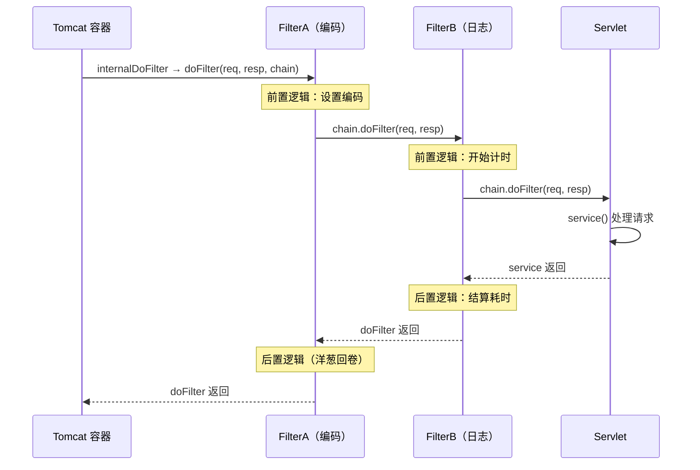
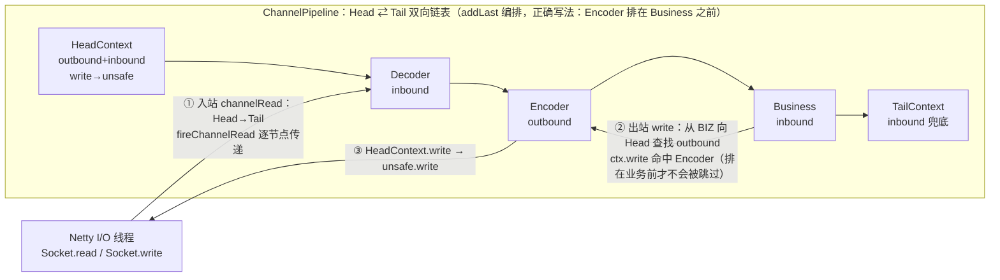

# 责任链与管线架构：从 GoF 到 Netty Pipeline

> 一句话概括：责任链把「请求该发给谁处理」从调用方手里拿走——发送方只管把请求丢进链，多个处理者按编排顺序各自决定「处理、传递还是终止」；GoF 给的是手写 `next` 指针的原型，工程里的管线（Filter、Netty Pipeline、Gateway、Sentinel slot 链）用双向链表、递归、代理等不同介质实现了同一个思想，本文沿这条演进路线讲透机制、边界与事故。

预计阅读时间：大约 70 分钟

所属主题：[设计模式常见面试题总结](summary.md)

本文以 JDK 21、Netty 4.1（关键结论对照 4.1.122.Final 源码与 javadoc 核验）、Tomcat 9.0.x（Tomcat 主分支已把 `internalDoFilter` 并入 `doFilter`，文中单独注明）、Sentinel 1.8.8、Spring Cloud Gateway 4.1.x 为基线，源码锚点统一用 `类名#方法名`，版本差异单独说明。Spring 侧的四条链（Filter / Interceptor / Advice / Resolver）在 [Spring 中的设计模式](../backend/java/spring/design-patterns.md)第 9 章已有「Spring 视角」的完整展开，MVC 请求主干见 [Spring MVC 请求处理流程](../backend/java/spring/mvc-request-flow.md)，本文只补通用模型与更广生态，交叉引用、不重复。每个机制按「结论 → 机制 → 边界/代价 → 实践/追问」组织。

---

## 0. 阅读路线与目录

| 读者 | 建议阅读 | 关注点 |
| --- | --- | --- |
| 初级（1 年内） | 1、2、3.2~3.4、4.1~4.2、9 | GoF 结构怎么写、Filter 链顺序、Netty 两个方向的口诀、高频追问 |
| 中级（1~3 年） | 全部，重点 3.2、4.3~4.5、6 | 递归传链源码、skip 掩码、`ctx.write` 与 `channel.write`、Gateway/Sentinel 落点 |
| 高级（3 年+） | 4.4~4.6、5、7、8 | 事件投递细节、Tail 兜底、短路不对称、异步断裂、模式辨析 |
| 选型/架构 | 2.3、6.4、7.5、8 | 两种变体的取舍、编排成本、什么场景不该用责任链 |

目录：

1. 责任链解决什么问题：GoF 原型
2. 两种工程变体：全过型管线与首个命中型
3. Servlet Filter 链：递归传链的原型实现
4. Netty Pipeline：双向链表上的双向传播
5. Spring MVC 的链：一段话视角
6. 更多工程落点：Gateway、Sentinel、MyBatis
7. 工程坑位（高级层）
8. 与其他模式辨析
9. 高频面试追问集
10. 参考资料

---

## 1. 责任链解决什么问题：GoF 原型

### 1.1 三个前提

责任链（Chain of Responsibility）要解决的问题可以浓缩成三个前提，缺一个就不必用它：

| 前提 | 具体含义 | 反例 |
| --- | --- | --- |
| **多个处理者** | 同一个请求可能有多个候选处理者，且候选集合会变化 | 只有固定两三个分支，`if-else` 更直白 |
| **顺序敏感** | 处理者按某种优先级/阶段次序被询问，顺序本身就是业务协议 | 处理者互相独立、先后无所谓（那是观察者） |
| **发送方不关心谁处理** | 调用方只负责把请求交给链首，不写 `instanceof` 分派 | 调用方明确知道要谁处理（那是直接注入，或配合策略模式选人，见 [策略/模板/状态/命令](strategy-template-state-command.md)） |

三者同时成立时，责任链换来的是**发送方与处理者的解耦 + 处理者集合的开闭扩展**（新增处理者不改调用方）；代价是**控制流变得不直观**——「请求最后被谁处理了」不再由一处代码回答，排查时要沿链走一遍（见第 7 章坑位）。GoF 角色只有两个：`Handler`（抽象处理者，定义处理接口并持有后继引用）与 `ConcreteHandler`（具体处理者，决定处理或传递）。模式的 UML 结构与六大原则的关系见 [设计原则与 UML](principles-and-uml.md)。

### 1.2 纯 GoF 结构

**结论**：GoF 原型是一个**持有 `next` 指针的抽象处理者**，请求从链首进入，每个节点自行决定「处理并终止」或「传给后继」。

```text
Client → ConcreteHandlerA.next → ConcreteHandlerB.next → ... → null
            ↑ 处理 or 传递            ↑ 处理 or 传递
```

两个纯 GoF 的要点常被工程变体改掉，先认清原型：

- **处理接口里自带决策**：`handlerRequest(request)` 的返回值（或是否调用 `next`）就是短路开关，链没有统一的「推进器」；
- **链条在组装时写死**：谁链接谁、谁是链首，是客户端代码的职责，运行期不编排。

### 1.3 最小可运行示例：审批链

经典的审批链：金额按阈值逐级上报，谁够权限谁批，不够就传给上级——完整可运行：

```java
public class ApprovalChainDemo {

    /** 处理者抽象：持有 next，请求沿链流动 */
    abstract static class Approver {
        protected final String name;
        protected final int limit;       // 能批的最大金额
        protected Approver next;         // GoF 原型：后继指针

        Approver(String name, int limit) {
            this.name = name;
            this.limit = limit;
        }

        /** 组装链：返回 next 以便链式调用 */
        Approver linkTo(Approver next) {
            this.next = next;
            return next;
        }

        public void approve(int amount) {
            if (amount <= limit) {
                System.out.println(name + " 批准 " + amount + " 元");
            } else if (next != null) {
                next.approve(amount);            // 处理不了：传给下一个
            } else {
                System.out.println("无人能批 " + amount + " 元");
            }
        }
    }

    public static void main(String[] args) {
        Approver leader   = new Approver("组长", 1_000);
        Approver manager  = new Approver("经理", 10_000);
        Approver director = new Approver("总监", 100_000);
        leader.linkTo(manager).linkTo(director);    // 组装顺序 = 询问顺序

        leader.approve(500);       // 组长 批准 500 元
        leader.approve(8_000);     // 经理 批准 8000 元
        leader.approve(66_000);    // 总监 批准 66000 元
        leader.approve(500_000);   // 无人能批 500000 元
    }
}
```

三个观察点，对应后面所有工程变体：

1. **发送方只认识链首**（`leader.approve(...)`），不认识经理和总监——解耦目标达成；
2. **短路 = 处理后不再调用 `next`**，节点的处理逻辑里天然包含「传不传」的决策；
3. **顺序是组装代码**——想调整优先级要改代码，这正是工程变体第一个要解决的问题。

### 1.4 GoF 原型的边界

| 边界 | 说明 |
| --- | --- |
| 顺序写死在组装代码里 | 框架场景要支持用户/第三方插拔节点，于是引入 order 排序（见 9 章 Q6 汇总表） |
| 请求只有一条进入路径 | I/O 场景请求和响应走相反方向，单向 `next` 不够用（Netty 为此用了双向链表） |
| 「处理或传递」二选一太粗 | 管线场景每个节点都要处理（日志、编码），只是有的节点可以选择性终止 |
| 链尾无兜底 | 没人处理就静默丢失；框架会提供 Tail 类兜底（告警、释放资源） |

下一节的两种变体，本质就是针对这些边界的两种工程化答案。

---

## 2. 两种工程变体：全过型管线与首个命中型

### 2.1 全过型（管线 / 洋葱模型）

**结论**：全过型的默认语义是**每个节点都处理请求**，短路是节点主动选择的例外行为；典型代表是 Servlet Filter、Interceptor、AOP Advice 链。

```text
请求 → A(前置) → B(前置) → C(前置) → 目标 → C(后置) → B(后置) → A(后置) → 响应
          ↑ 任一节点不传递，后面的前置全部不执行，已执行的节点保留各自的"后置时机"
```

这就是「洋葱模型」：前置逻辑按正序执行，后置逻辑按逆序执行（先进后出）。它由两种实现机制产生，面试要能分开说：

- **递归传链**（Servlet Filter、AOP 拦截器链）：节点调用「推进器」时把自己压栈，后置逻辑写在推进调用之后，靠调用栈自然回卷；
- **显式索引回放**（Spring Interceptor）：框架自己记住「哪些节点已执行」，后置阶段逆序回调。

### 2.2 首个命中型

**结论**：首个命中型是**遍历候选处理者、第一个声明支持的就处理并停止**的变体——它弱化了「传递」，强化了「分派」。

```java
// HandlerMethodArgumentResolverComposite#getArgumentResolver（Spring，首个命中型结构，简化）
for (HandlerMethodArgumentResolver resolver : this.argumentResolvers) {
    if (resolver.supportsParameter(parameter)) {   // 问一圈：谁支持？
        this.argumentResolverCache.put(parameter, resolver);   // 命中即缓存
        break;                                     // 首个命中即停
    }
}
```

典型代表：`HandlerMethodArgumentResolver`、`HandlerExceptionResolver`、`ViewResolver`（见 [Spring 中的设计模式](../backend/java/spring/design-patterns.md)第 9.4 节）。它常与策略模式看起来重叠——区别在于策略是「调用方选定一个」，首个命中型是「框架按注册顺序询问，处理者用 `supports` 自荐」。JDK 里类加载的双亲委派也是这个形态的近亲（先问父加载器，命中即停），更多 JDK 中的模式实例见 [JDK 与常用库中的模式](patterns-in-jdk.md)。

### 2.3 变体对比表

| 维度 | 全过型（管线/洋葱） | 首个命中型 |
| --- | --- | --- |
| 默认语义 | 每个节点都处理 | 只有一个节点处理 |
| 短路条件 | 节点主动不传递（不调 next / 不 fire / 返回 false） | `supports` 命中即停（框架层短路） |
| 后置逻辑 | 有：逆序回放（洋葱） | 无：命中即结束 |
| 节点接口风格 | `chain.doFilter` / `mi.proceed()` / `fireChannelRead` | `supports(x)` + `resolve(x)` |
| 典型代表 | Servlet Filter、Interceptor、AOP Advice、Netty Pipeline、Gateway、Sentinel slot | ArgumentResolver、ExceptionResolver、ViewResolver、双亲委派 |
| 适合的问题 | 流程编排（请求要穿过多个阶段） | 能力分派（一个请求找一种能力） |

### 2.4 判别口诀

> **看"后置"**：有逆序后置/收尾回调的是全过型管线；`supports` 一问、命中即走的是首个命中型。看**终止条件**：短路是节点主动行为的是管线；短路由框架遍历逻辑给出的是首个命中型。

一个常见误判：把 `HandlerAdapter` 的 `supports` 遍历也称为责任链——结构上确实同构，但 Spring 官方与社区更常把它归入适配器 + 策略的选择逻辑；模式归类不必争唯一标签，答「首个命中型的分派结构」即可（诚实地说明结构与意图，比强行贴标签更得分，见 [Spring 中的设计模式](../backend/java/spring/design-patterns.md)第 1 章的立场）。

---

## 3. Servlet Filter 链：递归传链的原型实现

### 3.1 结论

**结论**：Filter 链是**Servlet 容器实现**的全过型责任链（Spring 只负责注册 Filter），用**递归传链**实现洋葱模型——链对象把「下一个 Filter 或 Servlet」编码在 `pos` 游标里，Filter 调不调 `chain.doFilter(request, response)` 就是短路开关。

### 3.2 机制：ApplicationFilterChain#internalDoFilter 的递归结构

以 Tomcat 9.0.x 为例（源码已核验；Tomcat main 分支（11.x）已把该私有方法内联进 `doFilter`，10.1.x 分支仍保留，见 3.5 版本注）：

```java
// org.apache.catalina.core.ApplicationFilterChain#internalDoFilter（Tomcat 9.0.x，简化）
private void internalDoFilter(ServletRequest request, ServletResponse response)
        throws IOException, ServletException {

    // Call the next filter if there is one
    if (pos < n) {                                   // 还有下一个 Filter
        ApplicationFilterConfig filterConfig = filters[pos++];
        Filter filter = filterConfig.getFilter();
        filter.doFilter(request, response, this);    // 把链本身传给 Filter
        return;
    }
    // We fell off the end of the chain -- call the servlet instance
    servlet.service(request, response);              // 链走完才到 Servlet
}
```

要点：

- **推进器是 `chain.doFilter`**：容器把链对象自己传给 Filter，Filter 处理完前置逻辑后调 `chain.doFilter(request, response)` 继续推进——每推进一次，`pos` 前进一格，调用栈深一层；
- **短路是隐式的**：Filter 不调 `chain.doFilter`，`internalDoFilter` 的这层调用直接返回，`servlet.service` 永远不会执行，且**没有任何报错**——这是第 7 章顺序事故的温床；
- **后置逻辑写在 `chain.doFilter` 调用之后**：靠方法调用栈自然回卷形成洋葱，无需框架回放；
- **链对象按请求复用**：请求结束经 `release()` 归零 `pos`、`reuse()` 复用数组，避免每请求新建——递归结构对对象分配友好，但**栈帧与 Filter 数量线性相关**。

### 3.3 时序图



### 3.4 顺序控制

| 途径 | 说明 |
| --- | --- |
| `FilterRegistrationBean#setOrder` / Filter Bean 上的 `@Order` | Boot 的注册顺序机制，值小先执行 |
| `web.xml` 的 `filter-mapping` 声明顺序 | Servlet 规范行为：同一请求匹配多个 filter 时按 mapping 声明顺序调用 |
| Boot 自动配置的 `CharacterEncodingFilter` | 挂在最高优先级（`Ordered.HIGHEST_PRECEDENCE`），正是为了防止业务 Filter 抢在编码设置之前读请求体 |

### 3.5 边界/代价与实践

**边界与代价**：

- **短路无声**：不调 `chain.doFilter` 不报错，请求直接「消失」在链上——漏写一行导致的 404/空响应极难排查（先看链上有没有节点没传）；
- **Filter 能包装 request/response**：`HttpServletRequestWrapper`/`ContentCachingRequestWrapper` 装饰原始对象后传给后续链路，这是 Filter 相对 Interceptor 的独有能力，实现手法就是装饰器模式（结构对比见 [结构型模式](structural-patterns.md)，典型应用「请求体重复读」见 [Spring 中的设计模式](../backend/java/spring/design-patterns.md)第 10.1 节）；
- **顺序事故的高发区**：编码 Filter 排在请求体读取之后的经典事故见 7.1。

**版本注**：Tomcat **main 分支（11.x）**已把 `internalDoFilter` 的逻辑内联进 `doFilter`（`pos < n` 判断、`filters[pos++]`、链尾 `servlet.service` 原样保留）；**10.1.x 分支（Boot 3.x 内嵌版本）仍保留私有方法 `internalDoFilter`**。本文按 9.0.x 的 `internalDoFilter` 结构描述，9.0.x 与 10.1.x 的锚点都能定位到该方法。

**实践/追问**：自定义 Filter 用 `OncePerRequestFilter` 保证一次请求只执行一次（含 ASYNC dispatch 的细节见 [Spring MVC 请求处理流程](../backend/java/spring/mvc-request-flow.md)第 5 章）；面试问「Filter 链怎么实现先进后出」，答「递归 + 调用栈：`chain.doFilter` 之前的代码是前置，之后的代码是后置」。

---

## 4. Netty Pipeline：双向链表上的双向传播

Netty Pipeline 是责任链工程化最彻底的实现，也是本篇的深度担当：它把「链」做成了**双向链表 + 事件类型掩码**，让入站与出站事件在同一条链上反向传播。

### 4.1 数据结构：Head 与 Tail 两个边界节点

**结论**：`DefaultChannelPipeline` 是 `ChannelHandlerContext` 的双向链表，两端固定挂 `HeadContext` 和 `TailContext` 两个内部边界节点——Head 面向 I/O（网络），Tail 面向业务（兜底），用户 handler 插在中间。

**机制**（已对照 4.1.122.Final 源码）：

```java
// io.netty.channel.DefaultChannelPipeline（4.1.122.Final，声明节选）
final class HeadContext extends AbstractChannelHandlerContext
        implements ChannelOutboundHandler, ChannelInboundHandler {
    private final Unsafe unsafe;
    @Override
    public void write(ChannelHandlerContext ctx, Object msg, ChannelPromise promise) {
        unsafe.write(msg, promise);       // 出站事件走到 Head：真正写 socket
    }
    @Override
    public void exceptionCaught(ChannelHandlerContext ctx, Throwable cause) {
        ctx.fireExceptionCaught(cause);   // I/O 异常从 Head 重新进入管线传播
    }
}

final class TailContext extends AbstractChannelHandlerContext implements ChannelInboundHandler {
    // 只实现入站接口：兜底"没人处理的入站事件与异常"
}
```

| 边界节点 | 实现接口 | 职责 |
| --- | --- | --- |
| HeadContext | outbound + inbound 双实现 | 出站事件的终点：`write`/`flush` 委托 `unsafe` 做真实 I/O；I/O 侧异常的入口（重新 fire 进管线） |
| TailContext | 仅 inbound | 入站事件的终点：未处理的异常打 WARN 告警；未处理的消息释放并打 DEBUG |

节点名固定生成（`"DefaultChannelPipeline$HeadContext#0"` / `$TailContext#0`），所以 `pipeline.addFirst/addLast` 的编排语义是：`addFirst` 紧贴 Head（最先处理入站、最后处理出站），`addLast` 紧贴 Tail。

### 4.2 事件传播方向

**结论**：**入站事件从 Head 向 Tail 传播，出站事件从 Tail 向 Head 传播**——方向相反是因为入站是「I/O 到业务」、出站是「业务到 I/O」，双向链表让两条路径互不干扰地复用同一组节点。

**机制**：4.1 javadoc（已核验）的表述是「An inbound event is handled by the inbound handlers in the **bottom-up** direction」「An outbound event is handled by the outbound handler in the **top-down** direction」——示意图底部是 I/O 线程，映射到链表实现即：入站 head→tail，出站 tail→head。出站事件穿过所有 outbound handler 到达 Head 后，由 HeadContext 委托 `unsafe` 执行真正的 `SocketChannel.write`（javadoc：「If an outbound event goes beyond the bottom outbound handler, it is handled by an I/O thread associated with the Channel」）。



入站事件不会自动往下走：每个 handler 必须显式调 `ctx.fireChannelRead(msg)` 传递，**忘了 fire 就是短路**——与 Filter 不调 `chain.doFilter` 同构（Tail 的兜底行为见 4.6）。

### 4.3 混排 pipeline 的实际执行顺序：skip 掩码

**结论**：pipeline 允许 inbound、outbound、双实现（`ChannelDuplexHandler`）handler 任意混排，事件传播时**按事件类型跳过不相关的节点**——入站只落在实现了对应入站方法的节点上，出站只落在 outbound 节点上。

**机制**（javadoc 示例 + `AbstractChannelHandlerContext` 源码已核验）：每个 ctx 构造时按 handler 实际覆写的事件方法计算好 `executionMask`；传播时 `AbstractChannelHandlerContext#findContextInbound` 从当前节点的 `next` 开始沿链表前进，`#skipContext` 用掩码跳过不处理该事件的节点；出站方向 `#findContextOutbound` 镜像地沿 `prev` 回走。javadoc 给的标准例子：

| 编排（addLast 顺序） | 节点类型 | 入站实际执行 | 出站实际执行 |
| --- | --- | --- | --- |
| 1、2、3、4、5 | 1(入) 2(入) 3(出) 4(出) 5(双) | 1 → 2 → 5 | 5 → 4 → 3 |

javadoc 原文：「If 5 implements both `ChannelInboundHandler` and `ChannelOutboundHandler`, the evaluation order of an inbound and a outbound event could be 125 and 543 respectively.」——3、4 不实现入站接口所以入站跳过，1、2 不实现出站接口所以出站跳过。

**边界与代价**：混排灵活，但「声明顺序 ≠ 执行顺序」，排查时必须先还原两个方向各自的执行序列（第 7.1 节的经典事故就出在这里）。另有一个并发细节：`skipContext` 在两个 ctx 绑定**不同 EventExecutor** 时不做跳过、强制 offload——为保证跨线程的事件顺序（netty issue #10067，源码注释已核验）。

### 4.4 fireChannelRead 与事件投递细节

**结论**：入站事件的推进器是 `ctx.fireChannelRead(msg)`，由 `AbstractChannelHandlerContext#invokeChannelRead` 完成「找下一个节点 →（必要时）切线程 → 调用 handler → 异常就地转 exceptionCaught」四步。

**机制**（4.1.122.Final 源码已核验）：

```java
// AbstractChannelHandlerContext（简化）
public ChannelHandlerContext fireChannelRead(final Object msg) {
    invokeChannelRead(findContextInbound(MASK_CHANNEL_READ), msg);  // 找下一个处理节点
    return this;
}

static void invokeChannelRead(final AbstractChannelHandlerContext next, Object msg) {
    EventExecutor executor = next.executor();
    if (executor.inEventLoop()) {
        next.invokeChannelRead(m);            // 同一线程：直接调用
    } else {
        executor.execute(() -> next.invokeChannelRead(m));   // 跨线程：任务化，保序
    }
}
```

三个工程含义：

1. **线程模型内建在链里**：目标节点绑在别的 EventExecutor 上时事件被包装成任务投递过去，顺序由 Netty 保证；javadoc 同时说明即使用 `DefaultEventLoopGroup` 把 handler 从 EventLoop 上 offload，也「still process tasks in a serial fashion per `ChannelHandlerContext` and so guarantee ordering」——但**业务自己在 handler 里另开线程池再 fire**，顺序就不再天然保证（见 7.4）；
2. **异常就地转换**：handler 的 `channelRead` 抛出异常时，`invokeChannelRead` 的 catch 会让**当前 handler 自己的 `exceptionCaught`** 先处理（而不是直接跳到下一个节点），适配器默认实现继续 fire，于是异常沿入站方向传播（见 4.6）；
3. **`invokeHandler()` 为 false**（handlerAdded 尚未执行）时事件直接转发、不调用 handler——解决 handler 尚未就绪时的竞态。

### 4.5 ctx.write vs channel.write：起点决定路径

**结论**：`channel.write()` / `pipeline.write()` 从 **Tail** 开始向 Head 找 outbound 节点；`ctx.write()` 从**当前节点**开始向 Head 找——**同一个 handler，两种写法的传播起点不同，路径可能完全不同**。

| 调用 | 起点 | 路径中的 outbound 节点 | 典型用途 |
| --- | --- | --- | --- |
| `ctx.write(msg, promise)` | 当前节点向 Head 方向 | 只经过「当前节点之前」声明的 outbound handler | 业务 handler 写响应，必须走自己前面的编码器 |
| `channel.write()` / `pipeline.write()` | Tail 向 Head 方向 | 经过**所有** outbound handler | 从链外（如定时任务）主动推消息 |

**机制**：出站查找复用 4.3 的掩码逻辑，只是方向镜像——`findContextOutbound` 沿 `prev` 回走。这是 Netty 面试最高频的细节题：业务 handler 里误用 `channel.write`，等价于「假装自己在 Tail」，路径会绕开中间本应处理的出站节点（事故案例见 7.1）。

### 4.6 异常传播与 Tail 兜底

**结论**：`exceptionCaught` 是入站方向的事件——异常沿入站方向（head→tail）传播，沿途无人处理就到达 `TailContext`，由它打 WARN 告警并释放资源；**不会静默，但也只是告警**。

**机制**（4.1.122.Final 源码已核验）：

- 传播入口：`AbstractChannelHandlerContext#fireExceptionCaught` → `findContextInbound(MASK_EXCEPTION_CAUGHT)`——与普通入站事件同一套掩码查找，所以**方向是 head→tail**；I/O 侧（读写失败、连接异常）产生的异常由 HeadContext 重新 fire 进管线，同样沿此方向传播；
- Tail 兜底（`DefaultChannelPipeline#onUnhandledInboundException`）：

```java
// DefaultChannelPipeline.TailContext（4.1.122.Final，原文）
logger.warn("An exceptionCaught() event was fired, and it reached at the tail of the pipeline. " +
        "It usually means the last handler in the pipeline did not handle the exception.", cause);
```

- 未处理的入站消息同样有兜底（`#onUnhandledInboundMessage`）：DEBUG 日志「Discarded inbound message ... that reached at the tail of the pipeline. Please check your pipeline configuration.」并在 finally 中 `ReferenceCountUtil.release(msg)` 释放。

**边界与代价**：Tail 的兜底保证异常可见、引用计数不漏，但业务异常被「安全地」告警掉后连接与请求的语义已经坏了——生产规范应当在最后一个业务节点（或专门的 exception handler）**主动处理** `exceptionCaught`：关闭连接、回写错误响应，而不是依赖 Tail 告警。

### 4.7 最小可运行示例：EmbeddedChannel

用 Netty 自带的 `EmbeddedChannel`（无需网络、专为单测设计）直接验证两个方向与 skip 语义：

```java
import io.netty.channel.ChannelHandlerContext;
import io.netty.channel.ChannelInboundHandlerAdapter;
import io.netty.channel.ChannelOutboundHandlerAdapter;
import io.netty.channel.ChannelPromise;
import io.netty.channel.embedded.EmbeddedChannel;

public class NettyPipelineDemo {
    public static void main(String[] args) {
        EmbeddedChannel channel = new EmbeddedChannel(
            new ChannelInboundHandlerAdapter() {
                @Override
                public void channelRead(ChannelHandlerContext ctx, Object msg) {
                    System.out.println("inbound A: " + msg);
                    ctx.fireChannelRead(msg);        // 传递：不调则链在此终止
                }
            },
            new ChannelOutboundHandlerAdapter() {     // outbound 节点：入站事件会跳过它
                @Override
                public void write(ChannelHandlerContext ctx, Object msg, ChannelPromise promise) {
                    System.out.println("outbound B: " + msg);
                    ctx.write(msg, promise);          // 从当前节点继续向 Head 传播
                }
            },
            new ChannelInboundHandlerAdapter() {
                @Override
                public void channelRead(ChannelHandlerContext ctx, Object msg) {
                    System.out.println("inbound C: " + msg);   // 不再 fire：Tail 收不到
                }
            });

        channel.writeInbound("hello");     // 打印 inbound A → inbound C（B 被 skip）
        channel.writeOutbound("world");    // 打印 outbound B（A、C 被 skip）
        channel.finishAndReleaseAll();
    }
}
```

对应 4.3 的掩码语义：入站执行序列 A→C（B 不是 inbound 处理者），出站只有 B。想让 Tail 的 DEBUG「Discarded inbound message」在单测里复现，需要消息**一路 fire 到达 Tail 且无人消费**——比如把 C 的 `channelRead` 改成打日志后仍调 `ctx.fireChannelRead(msg)`；反过来，若某个节点忘了 fire，消息停在半路，Tail 什么都收不到，那条日志不会出现。

### 4.8 边界/代价与实践

**边界与代价**：

- **引用计数纪律**：ByteBuf 是引用计数对象，入站消息「要么 fire 下去、要么 release」，两条都不做就是内存泄漏（Netty 的 leak detector 会以 DEBUG/ERROR 级别提示）；Tail 兜底只救「传到 Tail 的」，救不了「卡在中间的」；
- **阻塞 eventLoop**：在 handler 里做同步 IO/长计算会卡住整个 EventLoop 线程上的所有 Channel，需要 offload 时用 `DefaultEventLoopGroup` 绑定 ctx（保序）或自行异步化（失序风险，见 7.4）；
- **顺序即架构**：`addLast` 的编排顺序就是入站的执行顺序（出站相反），pipeline 编排要当成「架构决策」评审，而不是随手堆代码。

**实践/追问**：典型业务 pipeline 的编排骨架是「协议解码(入) → 业务(入) → 空闲检测(双) → 协议编码(出)」；面试答「为什么入站和出站方向相反」见 9 章 Q1 的完整版。

---

## 5. Spring MVC 的链：一段话视角

Spring 侧的链在 Spring 视角的文档里已完整展开，本文只给一段定位，避免重复：

- **Interceptor 链**（全过型，显式索引回放）：`preHandle` 正序、`postHandle` 逆序、`afterCompletion` 逆序且**只回调 preHandle 成功过的节点**——短路时的补偿语义由 `HandlerExecutionChain#applyPreHandle / #applyPostHandle / #triggerAfterCompletion` 的 `interceptorIndex` 保证（源码与逐行解读见 [Spring 中的设计模式](../backend/java/spring/design-patterns.md)第 9.2 节、请求主干见 [Spring MVC 请求处理流程](../backend/java/spring/mvc-request-flow.md)第 2 章）；
- **AOP Advice 链**（全过型，递归洋葱）：所有通知适配为 `MethodInterceptor` 排成 List，`ReflectiveMethodInvocation#proceed` 用「索引 + 递归」推进，每个拦截器自行决定何时调 `mi.proceed()`——洋葱模型就是这段递归的字面行为（源码见 [Spring 中的设计模式](../backend/java/spring/design-patterns.md)第 9.3 节）；
- **ArgumentResolver / ExceptionResolver 链**（首个命中型）：见 [Spring 中的设计模式](../backend/java/spring/design-patterns.md)第 9.4 节与 [Spring MVC 请求处理流程](../backend/java/spring/mvc-request-flow.md)第 3 章。

这三条链与本文第 3、4 章的机制完全同构：Interceptor 链对应「显式回放」变体，Advice 链对应「递归传链」变体，顺序控制全部依赖 `@Order` / 注册顺序（汇总见 9 章 Q6）。

---

## 6. 更多工程落点：Gateway、Sentinel、MyBatis

### 6.1 Spring Cloud Gateway：GlobalFilter / GatewayFilter 有序链

**结论**：Gateway 的响应式网关链是**全过型**：请求命中路由后，`GlobalFilter` 与路由级 `GatewayFilter` 合并成一条链，**按 `Ordered` 排序**执行；每个 filter 拆「pre」（`chain.filter(exchange)` 之前）与「post」（`.then(...)` 之后）两个阶段，天然形成洋葱。

**机制**（官方文档 + 4.1.x 源码已核验）：官方文档表述为「This combined filter chain is sorted by the `org.springframework.core.Ordered` interface, which you can set by implementing the `getOrder()` method」；源码落点是 `FilteringWebHandler#handle`——把容器里的 `GlobalFilter`（构造时已包装为 `GatewayFilterAdapter`，实现了 `Ordered` 的再包 `OrderedGatewayFilter`）与 `route.getFilters()` 合并成一个 List，然后 `AnnotationAwareOrderComparator#sort(combined)` 排序，交给 `DefaultGatewayFilterChain` 执行。

```java
// FilteringWebHandler#handle（spring-cloud-gateway 4.1.x，简化）
List<GatewayFilter> combined = new ArrayList<>(this.globalFilters);
combined.addAll(gatewayFilters);            // 全局 + 路由级
AnnotationAwareOrderComparator.sort(combined);   // 按 order 归一化排序
return new DefaultGatewayFilterChain(combined).filter(exchange);
```

pre/post 的优先级语义（官方文档原文）：「the filter with the highest precedence is the first in the "pre"-phase and the last in the "post"-phase」——order 值小者最先执行前置、最后执行后置，与第 2.1 节的洋葱模型一致。内置 filter 就是靠 order 协作的典型：`NettyWriteResponseFilter` 被官方文档描述为「runs after all other filters have completed and writes the proxy response back to the gateway client response」——它在前置阶段几乎不做事，在 post 阶段负责把下游响应写回客户端，因此 order 必须排在最后档。

**边界与代价**：短路语义是响应式的——filter 不调 `chain.filter(exchange)` 而直接返回 `Mono.empty()`，**后续 filter 的 pre 与 post 全部不执行**；post 逻辑写在 `.then(...)` 里，与 pre 隔着一次下游请求，阅读时要意识到两段代码可能隔了整个上游耗时。

### 6.2 Sentinel：ProcessorSlotChain

**结论**：Sentinel 对每个资源的限流/熔断检查是一条**全过型的 slot 责任链**：统计槽与各规则槽按固定次序编排，规则不通过时抛 `BlockException` 短路——短路发生在 `fireEntry` 调用栈里，向上回卷。

**机制**（Sentinel 官方 wiki 与 1.8.8 源码已核验）：每次资源调用创建 `Entry` 时构建 slot chain（官方 wiki：「Entry 创建的时候，同时也会创建一系列功能插槽（slot chain）」）。内置 slot 的编排顺序以 `sentinel-core` 的 SPI 配置文件 `META-INF/services/com.alibaba.csp.sentinel.slotchain.ProcessorSlot`（1.8.8）为准：

| # | slot | 职责（官方 wiki 表述摘要） |
| --- | --- | --- |
| 1 | `NodeSelectorSlot` | 收集资源的调用路径，以树状结构存储，用于按调用路径限流降级 |
| 2 | `ClusterBuilderSlot` | 构建资源的 `ClusterNode` 与调用者信息（RT、QPS、线程数等统计依据） |
| 3 | `LogSlot` | 记录阻断类异常日志（服务端可观测） |
| 4 | `StatisticSlot` | 统计实时调用数据（滑动窗口），是规则检查的数据源 |
| 5 | `AuthoritySlot` | 按黑白名单与调用来源做鉴权控制 |
| 6 | `SystemSlot` | 按 load1 等系统状态控制总入口流量 |
| 7 | `FlowSlot` | 按预设限流规则与前面的统计状态做流量控制 |
| 8 | `DegradeSlot` | 按统计信息与预设规则做熔断降级 |
| 9 | `DefaultCircuitBreakerSlot` | 1.8.x 新版熔断器的规则检查 |

链的推进介质是 `AbstractLinkedProcessorSlot#fireEntry`（调用 `next#entry`），与 Filter 的 `chain.doFilter` 同构；每个 slot 还可经 `fireExit` 参与 `entry.exit()` 的收尾阶段。两个值得深挖的设计：

- **「统计槽排在规则槽之前」看似矛盾，实际是先校验后统计**：`StatisticSlot#entry` 的第一件事是 `fireEntry(...)` 让下游规则槽先校验（1.8.8 源码已核验），抛 `BlockException` 则记 blockQps 并向上重抛；全部通过后才 `node.addPassRequest(count)` 记通过数。所以 `FlowSlot` 读取的是**此前请求累积**的滑动窗口数据，本请求的统计在放行后才生效；
- **链按资源缓存、slot 可能有状态**：`CtSph#lookProcessChain` 按 `ResourceWrapper` 查缓存构建链（官方发布说明：「the slot might be stateful, so Sentinel will still build different new slot chains for each resource」）。扩展机制上，1.7.x 起 `ProcessorSlot` 本身成为 SPI（官方 wiki 表述为「1.7.2 版本以前 `SlotChainBuilder` 作为 SPI」，即 **1.7.2 起 `SlotChainBuilder` SPI 被废弃**），可以「自行加入自定义的 slot 并编排 slot 间的顺序」。

**实践/追问**：注解方式（`@SentinelResource`）与框架适配最终都落到 `SphU#entry` 进入这条链；面试答「Sentinel 怎么实现限流扩展」时，说「slot 是 SPI、责任链编排、新 slot 插进链即生效」即可体现源码级理解。

### 6.3 MyBatis 插件链：层层代理实现的链

**结论**：MyBatis 插件是**用 JDK 动态代理嵌套包装**出来的责任链——`InterceptorChain#pluginAll` 让每个插件把目标对象再包一层代理，调用时穿过全部代理层形成链（全过型，单插件内用签名匹配决定是否拦截）。

它与其他实现的关键差异是**介质**：不是链表、不是递归索引，而是「代理套代理」——每个代理层都是完整的 Proxy 对象，链的顺序由插件注册顺序决定（先注册的包在最外层）。包装顺序、`Plugin#wrap` 源码与执行顺序的完整走读已在 MyBatis 专题核验，见 [MyBatis 插件机制与分页原理](../backend/java/mybatis/plugin-and-pagination.md)；为什么它是 JDK 代理而非 CGLIB、代理与责任链的通用机制，见 [代理模式专题](proxy.md)。

### 6.4 落点汇总表

| 链 | 变体 | 顺序来源 | 短路方式 | 传播介质 |
| --- | --- | --- | --- | --- |
| Servlet Filter | 全过 | 容器注册顺序（`@Order` / filter-mapping） | 不调 `chain.doFilter` | `ApplicationFilterChain` 递归 |
| Netty Pipeline | 全过（双向） | `addLast` 编排 | 不 `fire` / 不 `write` | ctx 双向链表 + executionMask |
| Spring Interceptor | 全过 | 注册顺序 / `InterceptorRegistration#order` | `preHandle` 返回 false | `HandlerExecutionChain` 索引回放 |
| AOP Advice | 全过（洋葱） | `@Order` / `Ordered` | 不调 `proceed()` | 递归 + 索引（见 [IoC 与 AOP 同源的拦截器机制](../backend/java/spring/design-patterns.md)） |
| Gateway 过滤器 | 全过（pre/post） | `Ordered#getOrder` | 不调 `chain.filter(exchange)` | `DefaultGatewayFilterChain` |
| Sentinel slot | 全过 | SPI `@Spi` order | 抛 `BlockException` | `AbstractLinkedProcessorSlot#fireEntry` |
| MyBatis 插件 | 全过 | 插件注册顺序 | 插件签名不匹配（逐层分流） | JDK 代理层层嵌套 |
| ArgumentResolver 等 | 首个命中 | 注册顺序 | `supports` 命中即停 | Composite 遍历 |
| GoF 手写 | 两者皆可 | 组装代码 | 不调 `next` / 返回值 | `Handler.next` 指针 |

---

## 7. 工程坑位（高级层）

### 7.1 顺序错误：最常见且症状隐蔽

**结论**：链式结构的第一事故源是顺序，且症状往往不是报错而是「静默错误」——数据对了一半、日志缺一块、响应格式不对。

三个真实感最强的案例：

| 案例 | 机制 | 症状 |
| --- | --- | --- |
| 编码 Filter 排在请求体读取之后 | Servlet 规范：`request.setCharacterEncoding` 只在请求体被读取之前调用才有效；链上有 Filter 提前读了 body（日志、验签）后，后面的编码设置全部无效 | 仅带 body 的 POST 中文乱码，GET 全部正常 |
| Netty 编码器 addLast 在业务 handler 之后 | 出站从业务节点向 Head 方向传播（4.5），排在业务**之后**（更靠 Tail）的编码器被 `ctx.write` 跳过 | 业务对象直接到 Head，`unsafe.write` 报 unsupported message type，且只在真正写响应时才炸 |
| 解码器放在业务 handler 之后 | 入站 head→tail，业务先收到原始 `ByteBuf` | 业务拿到的"消息"是字节而不是解析结果，偶发 ClassCastException |

**排查方法**：先还原「链上有哪些节点、两个方向各是什么顺序」，再怀疑单个节点逻辑——Filter 看注册列表，Netty 打印 `pipeline.names()`（Tail 兜底的 DEBUG 日志也会输出整个 pipeline 名单），Spring 打印 `AdvisedSupport` 的 advisor 列表。

### 7.2 链过长：栈深与逐层开销

**结论**：递归传链的调用栈深度与节点数线性相关，逐层又各有前置/后置逻辑——长链的代价是**栈帧膨胀 + 每层的重复开销**，还有难读的异常栈。

- Filter 链、AOP 拦截器链是纯递归：每个节点一层栈帧；节点上百（极端配置）时叠加业务调用可能逼近 `-Xss` 限制，且异常栈里全是框架帧，定位成本高；
- 每层的前置/后置若都做日志、耗时统计，同一请求会被重复计费（IO、锁、序列化）——链上节点要按「必要且不重复」的原则精简；
- 工程红线：链节点数没有硬上限，但**单节点耗时**比节点数更要紧——全过型链的总耗时是各节点之和，一个慢节点拖垮整条链（这与线程池「慢任务占满」是同构问题）。

### 7.3 短路语义不对称：短了前半段，后半段谁补？

**结论**：全过型链的「前置/后置」不对称是隐藏最深的坑——**短路只跳过后续前置，不会自动执行任何节点的后置**；是否补偿、补偿到哪一层，各框架约定不同，必须逐一对齐。

| 框架 | 短路后 | 补偿语义 |
| --- | --- | --- |
| Spring Interceptor | 后续 `preHandle` 与 Handler 不执行 | **已执行的拦截器**逆序收到 `afterCompletion`（`HandlerExecutionChain#triggerAfterCompletion`，Spring 侧结论引用见 [Spring MVC 请求处理流程](../backend/java/spring/mvc-request-flow.md)）——补偿是框架给的 |
| Servlet Filter | 后续 Filter 前置与 Servlet 不执行 | **无补偿**：`chain.doFilter` 之后的代码只在「正常穿透」时执行；短路节点的后置自己负责收尾 |
| AOP Advice | 目标方法不执行 | 无补偿：`@Around` 不调 `proceed`，后面的拦截器全跳过 |
| Netty Pipeline | 不 `fire` 即终止 | 无补偿：Tail 只兜「异常与丢弃告警」，不回放任何后置 |
| Gateway | 不调 `chain.filter(exchange)` | 无补偿：该 filter 的 post（`.then(...)`）与后续 filter 的 pre/post 全部不执行 |

**实践**：跨节点共享的收尾逻辑（连接释放、MDC 清理、耗时结算）不要依赖「后置一定会执行」，要么放在有框架补偿的层（Interceptor 的 `afterCompletion`），要么用 try/finally 包住自己的前置+推进段。

### 7.4 异步链路中断：线程换了，顺序与上下文就没了

**结论**：链的顺序保证建立在「同一执行流」之上；一旦节点把请求切到别的线程再推进，**执行顺序与 ThreadLocal 上下文双双失守**——这是异步化改造最容易引入的回归。

- **Netty**：框架内的跨线程传播（事件在 ctx 绑定的不同 EventExecutor 间投递）仍按序执行（4.4，issue #10067 的 offload 语义）；但**业务在 handler 里自己 `new Thread` / 提交自定义线程池后再 `fireChannelRead`**，推进时点不再与事件流同步，与其他入站事件的先后关系失去保证，还可能把引用计数的释放时机带乱；
- **Servlet/MVC**：Servlet 3 异步（`startAsync`）后请求会在 ASYNC dispatch 阶段**再次穿过 Filter 链与 Interceptor**（`OncePerRequestFilter` 默认不重复执行 Filter，而 MVC 拦截器的 `preHandle` 会再执行一次，行为差异见 [Spring MVC 请求处理流程](../backend/java/spring/mvc-request-flow.md)第 7 章）；拦截器要实现 `AsyncHandlerInterceptor#afterConcurrentHandlingStarted` 参与异步收尾；
- **上下文**：链上经 ThreadLocal 传递的 traceId、事务、MDC 在线程切换后全部丢失，需显式拷贝或改用上下文传递机制（专题见 [ThreadLocal 与上下文传递](../backend/java/concurrency/threadlocal.md)）。

### 7.5 什么时候不该用责任链

**结论**：责任链的价值来自「多个处理者 + 顺序敏感 + 发送方无感」三个前提（1.1）；前提不成立时，它是**负资产**——多一层间接、多一处顺序约定、多一种静默短路路径。

不该用的典型场景：

| 场景 | 更好的替代 | 理由 |
| --- | --- | --- |
| 处理者少于 3 个且集合稳定 | 直接方法调用 / `if-else` | 解耦收益低于间接成本，控制流反而难读 |
| 发送方明确知道该谁处理 | 注入具体实现（或策略模式选择器，见 [策略/模板/状态/命令](strategy-template-state-command.md)） | 「无感分派」不是诉求时，链是多余的抽象 |
| 每个请求确定走一条固定路径、无短路 | 函数组合（`List<Function>` 依次调用） | 需要的是「步骤流水线」而不是「决策链」，显式顺序比框架链好测试 |
| 强类型与编译期检查优先 | 显式调用 + 泛型接口 | 责任链的组装错误（顺序、漏 fire）大多暴露在运行期 |

常见滥用还有「把每个新需求都做成一个 Filter」——先问它是不是真的要拦截请求流，还是只是一个普通的业务步骤。更多反模式与重构手法见 [现代 Java 与反模式](modern-java-and-anti-patterns.md)。

---

## 8. 与其他模式辨析

### 8.1 责任链 vs 装饰器

**结论**：两者结构高度相似（同接口包装、层层委托），**差别在意图**——装饰器是「给同一个对象叠加能力」，包装层数与顺序是能力组合；责任链是「让请求流过一组决策者」，节点顺序是流程编排。

| 维度 | 责任链 | 装饰器 |
| --- | --- | --- |
| 关注点 | 请求**沿链流动**，节点决定处理/传递/终止 | 对象**被逐层包裹**，调用最终必然穿透到核心对象 |
| 终止 | 可短路（不传递即停） | 不可截断（每层都必须委托） |
| 典型 | Filter、Netty Pipeline、Interceptor | `HttpServletRequestWrapper`、Java IO 流 |
| 变化频率 | 节点集合运行时可插拔 | 装饰组合通常在构造时确定 |

结构上，**Pipeline 常以装饰器手法实现**：Servlet Filter 包装 request/response（3.5）、MyBatis 插件层层代理（6.3）都是「同接口 + 持有被包装者 + 委托」的装饰器结构，只是用途是编排而非增强。面试口诀：**看调用是否必然到达"最终处理者"——必然到达是装饰器，可能中途停止是责任链**。更多结构型模式的对比见 [结构型模式](structural-patterns.md)与[代理模式](proxy.md)。

### 8.2 责任链 vs 观察者

**结论**：两者都是「一对多解耦」，差别在**传播语义**——责任链顺序传递、通常一个（或一段）处理、可短路；观察者广播、全员收到、不可短路。

| 维度 | 责任链 | 观察者 |
| --- | --- | --- |
| 请求去向 | 沿链传递，链上节点「接力」 | 广播给所有订阅者，各自独立消费 |
| 处理者之间 | 前驱知道后继（或共享同一条编排） | 互不感知 |
| 短路 | 有：不传递即终止 | 无：除非取消订阅 |
| 顺序 | 核心语义（顺序即协议） | 非核心（多数实现不保证/不承诺） |
| 典型 | Filter / Pipeline | `ApplicationEvent` + `@EventListener` |

Spring 事件机制默认同步、同线程、可按 `@Order` 排序，但语义仍是广播——与责任链的分界在「事件是否被某一个监听器消费掉」。事件机制的完整展开见 [观察者与事件驱动](observer-and-event-driven.md)。

### 8.3 责任链 vs 命令

**结论**：命令模式把「请求」本身封装成对象（可排队、撤销、日志），关注**请求的生命周期**；责任链关注**请求的路由**——两者正交，常见组合是命令对象沿链传递。

| 维度 | 责任链 | 命令 |
| --- | --- | --- |
| 请求形态 | 原始请求参数（或轻量上下文） | 封装了全部所需信息的命令对象 |
| 流动方式 | 沿处理者序列流动 | 由调用方/队列/调度器分派给执行者 |
| 撤销/排队 | 不涉及 | 核心能力（宏命令、撤销栈） |
| 典型 | Filter 链里的 `request/response` | `Runnable` 提交线程池、消息队列里的一条消息 |

Netty 的入站消息（ByteBuf 解码后的对象）逐节点传递时，携带完整业务语义，兼具「命令对象」色彩；但驱动它的是链的编排语义——归类仍按主要意图判断。

---

## 9. 高频面试追问集

**Q1：Netty 的入站和出站事件方向为什么相反？**

期望答案：`ChannelPipeline` 本质是 `ChannelHandlerContext` 双向链表，两端是 HeadContext 与 TailContext；入站事件（channelRead 等）由 I/O 线程从 Head 进入、沿 next 向 Tail 传播，出站事件（write 等）从 Tail 向 Head 传播，最终由 HeadContext 委托 `unsafe` 执行真实 socket 写。方向相反是因为入站是「I/O → 业务」、出站是「业务 → I/O」，双向链表让两条路径复用同一组节点。传播时按 `executionMask` 跳过不处理该事件类型的节点（`AbstractChannelHandlerContext#findContextInbound / #findContextOutbound`），所以混排 pipeline 的入站与出站执行序列要分别推演（javadoc 的 125/543 例子）。手动传递靠 `ctx.fireChannelRead` 与 `ctx.write`。

**Q2：责任链的「短路」有哪些实现形态？**

期望答案：①GoF 手写：节点处理后不调 `next`；②递归管线：不调推进器（`chain.doFilter` / `mi.proceed()` / `chain.filter(exchange)`）；③回放型：框架标记（Interceptor `preHandle` 返回 false 后 `triggerAfterCompletion`）；④事件型：不调 `fireChannelRead`；⑤异常型：抛出阻断异常沿调用栈回卷（Sentinel 的 `BlockException`）；⑥首个命中型：`supports` 命中即 `break`。答出「短路语义在前后置补偿上的差异」（7.3）是加分项。

**Q3：Filter 和 Interceptor 的区别与执行顺序？**

期望答案：规范层级（Servlet vs Spring MVC）、位置（DispatcherServlet 外 vs 内）、粒度（URL vs Handler，拦截器能拿 `HandlerMethod` 读注解）、能力（Filter 能包装 request/response）、异常归属（Filter 异常不进 `@ExceptionHandler`）。顺序：Filter 前置 → `preHandle` → Controller → `postHandle` → 渲染 → `afterCompletion` → Filter 后置。完整对比见 [Spring MVC 请求处理流程](../backend/java/spring/mvc-request-flow.md)第 5 章。

**Q4：ctx.write 和 channel.write 的区别？**

期望答案：`ctx.write` 从**当前节点**向 Head 方向查找 outbound handler，只经过当前节点之前声明的出站节点；`channel.write` / `pipeline.write` 从 **Tail** 开始，经过全部 outbound handler。业务 handler 内写响应必须用 `ctx.write`，否则会绕开中间的编码器。根源是 `findContextOutbound` 沿 `prev` 回走、`DefaultChannelPipeline#write` 从 tail 起步。

**Q5：责任链和装饰器怎么区分？**

期望答案：结构同构（同接口包装 + 委托），意图不同：装饰器保证调用穿透到核心对象、目的是叠加能力；责任链允许节点终止传递、目的是流程编排与分派。Pipeline 常用装饰器手法实现（Filter 包装 request），但语义仍是编排。口诀：调用是否必然到达最终处理者。

**Q6：链上节点的顺序是怎么保证的？**

期望答案（汇总表）：

| 链 | 顺序机制 |
| --- | --- |
| Servlet Filter | `FilterRegistrationBean#setOrder` / `@Order`；裸容器按 filter-mapping 声明顺序 |
| Spring Interceptor | `WebMvcConfigurer` 注册顺序 / `InterceptorRegistration#order` |
| AOP Advice | `@Order` / `Ordered`，值小在外层 |
| ArgumentResolver | 注册顺序，首个 supports 命中 |
| Netty Pipeline | `addFirst/addLast` 的物理编排（顺序即架构） |
| Gateway | `Ordered#getOrder`，`AnnotationAwareOrderComparator#sort` 统一排序 |
| Sentinel | `@Spi` order + SPI 配置文件 |
| MyBatis 插件 | 插件注册顺序（先注册包外层） |
| GoF 手写 | 组装代码显式编排 |

**Q7：preHandle 返回 false 之后会发生什么？**

期望答案：后续拦截器的 `preHandle` 与 Handler 都不执行；**已执行过 `preHandle` 的拦截器**（`interceptorIndex` 之前的）逆序收到 `afterCompletion`——`postHandle` 不执行。响应通常由拦截器自己在返回 false 前写好；Filter 层的后置逻辑照常执行（它感知不到 MVC 层的短路）。这是「短路语义不对称」的教科书案例。

**Q8：什么场景不该用责任链？**

期望答案：处理者少于 3 个且集合稳定（if-else 更直白）；发送方明确知道谁处理（直接注入/策略）；固定路径无短路的纯步骤流水线（显式函数组合更好测试）；强类型与编译期检查优先的场景。判据回到三个前提：多处理者、顺序敏感、发送方无感——前提缺一就是负资产。

**Q9：Netty 的 exceptionCaught 一路没人处理会怎样？**

期望答案：异常沿入站方向传播，到达 TailContext 后打 WARN：「An exceptionCaught() event was fired, and it reached at the tail of the pipeline. It usually means the last handler in the pipeline did not handle the exception.」并释放 cause 引用。不静默、但也只是告警——生产上应在业务链末端主动处理（关闭连接/回写错误响应）。未处理的入站消息同样由 Tail 兜底：DEBUG 丢弃日志 + `ReferenceCountUtil.release`。

**Q10：Sentinel 的 StatisticSlot 排在 FlowSlot 前面，为什么还说「先校验后统计」？**

期望答案：`StatisticSlot#entry` 先 `fireEntry` 让下游规则槽（Authority/System/Flow/Degrade）完成校验，抛 `BlockException` 则只记 blockQps 并向上重抛；全部通过后才 `addPassRequest` 记通过数、`entry.exit()` 时记 RT。所以 FlowSlot 读取的是此前请求累积的滑动窗口数据，本请求的通过统计在放行之后才生效——链上位置与逻辑时序是两回事。

---

## 10. 参考资料

- GoF《设计模式：可复用面向对象软件的基础》——责任链的角色定义与意图原始出处
- Netty 4.1 javadoc · ChannelPipeline：<https://netty.io/4.1/api/io/netty/channel/ChannelPipeline.html>（事件方向、skip 语义、DefaultEventLoopGroup 保序说明）
- Netty 源码（4.1.122.Final，本文已核验）：`io.netty.channel.DefaultChannelPipeline`（Head/TailContext、onUnhandledInboundException/Message）、`io.netty.channel.AbstractChannelHandlerContext`（findContextInbound/Outbound、skipContext、fireExceptionCaught）
- Tomcat 源码：`org.apache.catalina.core.ApplicationFilterChain`（9.0.x / 10.1.x 含 `internalDoFilter`；main 分支 11.x 已内联进 `doFilter`）
- Sentinel：官方 wiki「Sentinel工作主流程」（slot 职责、SPI 说明）、sentinel-core 1.8.8 `META-INF/services/com.alibaba.csp.sentinel.slotchain.ProcessorSlot`（slot 顺序）与 `slots/statistic/StatisticSlot`（先校验后统计）、Release Notes（1.7.0 起 ProcessorSlot 作为 SPI、按资源构建 slot chain 的说明）
- Spring Cloud Gateway：官方文档 Global Filters 章（`Ordered` 排序、pre/post 语义）与 `FilteringWebHandler` 源码（4.1.x，`AnnotationAwareOrderComparator#sort`）
- 兄弟专题：[Spring 中的设计模式](../backend/java/spring/design-patterns.md)（Spring 四条链视角）、[Spring MVC 请求处理流程](../backend/java/spring/mvc-request-flow.md)、[MyBatis 插件机制与分页原理](../backend/java/mybatis/plugin-and-pagination.md)、[结构型模式](structural-patterns.md)、[代理模式](proxy.md)、[观察者与事件驱动](observer-and-event-driven.md)
- 本主题其他专题：[原则与 UML](principles-and-uml.md)、[策略/模板/状态/命令](strategy-template-state-command.md)、[JDK 与常用库中的模式](patterns-in-jdk.md)、[现代 Java 与反模式](modern-java-and-anti-patterns.md)

---

## 附：一页速记

**模型与变体**
1. 责任链三前提：多处理者、顺序敏感、发送方不关心谁处理；GoF 原型 = Handler 持有 next，节点自决处理或传递。
2. 全过型（管线/洋葱）：每节点都处理、可短路、有逆序后置；首个命中型：supports 命中即停、无后置。判别看「有没有后置回放」。

**Servlet Filter**
3. `ApplicationFilterChain#internalDoFilter`：`filters[pos++]` 前进 + 递归传链；不调 `chain.doFilter` 就是短路，无声无息；后置逻辑写在调用之后。
4. 顺序：`FilterRegistrationBean#setOrder` / `@Order`；Boot 的编码 Filter 挂 `HIGHEST_PRECEDENCE` 防乱码事故；Filter 独有能力是包装 request/response（装饰器）。

**Netty Pipeline**
5. 双向链表 + Head/Tail 边界节点；Head 落地 I/O（`unsafe.write`），Tail 兜底（异常 WARN、消息 DEBUG 丢弃并 release）。
6. 入站 head→tail、出站 tail→head；executionMask 按事件类型跳节点；`ctx.write` 从当前节点向 Head，`channel.write` 从 Tail 起步。
7. 异常是入站事件：`fireExceptionCaught` 沿 head→tail 传播，Tail WARN 原文要能背；业务末端要主动处理异常而不是依赖 Tail。
8. 跨 EventExecutor 传播保序（issue #10067）；业务自己切线程再 fire 则失序；ByteBuf 要么 fire 要么 release。

**落点与坑位**
9. Gateway 按 `Ordered` 排序（`AnnotationAwareOrderComparator#sort`），pre/post 洋葱；Sentinel slot 链按 SPI order 编排、StatisticSlot 先校验后统计、链按资源缓存；MyBatis 插件是代理套代理。
10. 坑位四件套：顺序错误（静默）、长链栈深、短路不对称（preHandle false → afterCompletion 补偿，Filter/Netty 无补偿）、异步断裂（换线程丢顺序与上下文）。

**一句话**
> 责任链的全部工程价值与全部事故，都来自同一个事实：**它把「谁处理请求」从一处显式调用变成一条隐式编排——顺序、短路、后置补偿、线程边界这四个约定，框架只替你兑现一部分，剩下的要靠架构纪律。**
