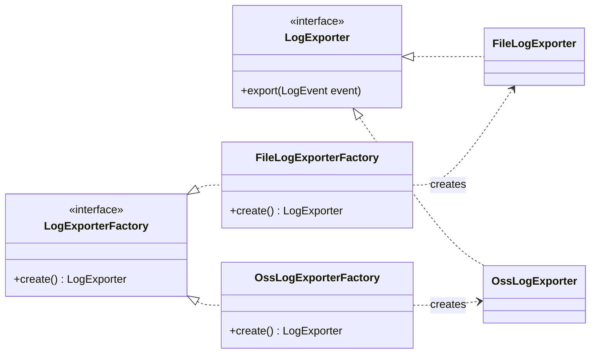
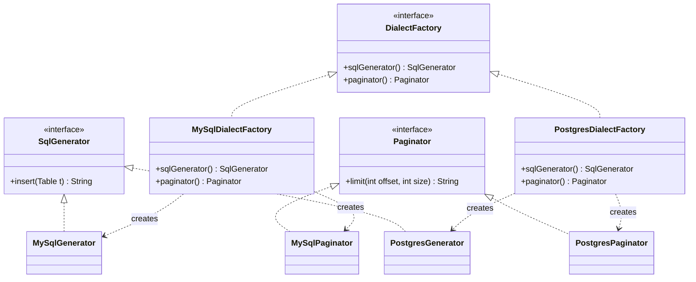

# 工厂家族与建造者、原型：创建型模式实战

> 一句话概括：创建型模式回答的都是同一个问题——把「用哪个具体类、怎么构造、何时构造」从使用方代码里剥离；本文讲清简单工厂 / 工厂方法 / 抽象工厂的分层与选型、静态工厂方法对构造器的优势与代价、建造者与原型的适用边界，关键结论全部配 JDK 21 可运行示例。

预计阅读时间：大约 60 分钟

所属主题：[设计模式常见面试题总结](summary.md)

本文以 JDK 21 为基线，源码锚点用 `类名#方法名` 标注，涉及的 JDK 类与签名均对照 JDK 21 官方文档核实，版本差异单独说明。工厂家族在 Spring 容器里的形态（`BeanFactory` / `FactoryBean`）在 [Spring 中的设计模式](../backend/java/spring/design-patterns.md) 第 2 章专述，本文只讲通用创建型模式，交叉处引用不重复。每个机制按「结论 → 机制 → 边界/代价 → 实践/追问」展开。

---

## 0. 阅读路线

| 读者 | 建议阅读 | 关注点 |
| --- | --- | --- |
| 初级（1 年内） | 1、2、3.1~3.2、6.1~6.2、7.1~7.2 | 三种工厂长什么样、怎么写、静态工厂和构造器差在哪 |
| 中级（1~3 年） | 全部，重点 3.3、4、5、7.4 | 工厂方法与模板方法配合、产品族概念、Lombok @Builder 的坑 |
| 高级（3 年+） | 6.3、7.3、8.2~8.4、9 | 静态工厂的子类化代价、校验时机、Cloneable 的设计批评、深拷贝方案 |
| 选型/架构 | 5、7.6~7.7、8.5、9 | 什么时候用哪种、什么时候不用、原型为何在业务开发中罕见 |

目录：

1. 创建型模式的统一动机
2. 简单工厂（静态工厂方法）
3. 工厂方法
4. 抽象工厂
5. 三者选型与「GoF 23 种」澄清
6. 静态工厂方法 vs 构造器
7. 建造者
8. 原型
9. 高频面试追问集
10. 参考资料

---

## 1. 创建型模式的统一动机

### 1.1 直接 new 拆出三类问题

```java
ReportExporter exporter = new OssReportExporter();   // 使用方自己 new
```

一行 `new` 把三件事全写死在了使用方代码里：

| 问题 | 具体表现 |
| --- | --- |
| 选型耦合 | 「用哪个具体类」写死在使用方：换成 `KafkaReportExporter` 要改源码；一行 `new` 出现十次，就要改十次 |
| 构造复杂 | 构造器参数一大串，调用方要理解每个参数的含义与顺序；对象内部还要先装配依赖才能用 |
| 创建过程失控 | 每次 new 都新建实例，无法缓存、计数、复用；构造前校验、构造后注册等过程逻辑没有安放点 |

创建型模式把这三种控制权分别拿走：**简单工厂/工厂方法拿走「选型」，建造者拿走「怎么构造」，原型拿走「何时构造」（复制现成的），单例拿走「造几份」**（单例的完整机制见 [单例模式专题](singleton.md)，本文不重复）。

### 1.2 一句判断：什么时候需要创建型模式

**构造复杂、选择多、需要控制创建过程——三个条件满足其一才考虑创建型模式**；三者都不满足时，构造器就是最好的方案。反过来说，给只有一个实现、两个参数的类套三层工厂，是模式滥用的典型反面教材（原则层面的展开见 [设计原则与 UML](principles-and-uml.md)）。

GoF 创建型模式一共五种，本文覆盖其中四种 plus 一个「不算 GoF 模式但面试必问」的手法：

| 模式 | 核心动作 | 判断句 |
| --- | --- | --- |
| 简单工厂 | 一个类 + 静态方法分派 | 不属于 GoF 23 种，见 5.2 |
| 工厂方法 | 创建逻辑延迟到子类 | 一个产品一个继承体系 |
| 抽象工厂 | 一个工厂造一族相关产品 | 多个产品等级组成产品族 |
| 静态工厂方法 | 替代构造器的命名静态方法 | Effective Java Item 1 的 API 设计手法，不是 GoF 模式 |
| 建造者 | 分步构造复杂对象 | 第 7 章 |
| 原型 | 克隆已有实例 | 第 8 章 |

---

## 2. 简单工厂（静态工厂方法）

### 2.1 结构与分派实现

**结论**：简单工厂用一个独立的工厂类（通常静态方法）封装「按输入决定 new 哪个类」的分派逻辑，消费方只认识产品接口——它解决的是 1.1 的「选型耦合」，不解决「扩展时不改代码」。

```java
interface PayChannel { void pay(Order order); }
class AlipayChannel implements PayChannel {}
class WechatChannel implements PayChannel {}

enum ChannelType { ALIPAY, WECHAT }

final class PayChannelFactory {
    private PayChannelFactory() {}               // 工具类：私有构造器防实例化

    static PayChannel create(ChannelType type) {
        return switch (type) {                   // JDK 14+ switch 表达式，穷尽枚举
            case ALIPAY  -> new AlipayChannel();
            case WECHAT  -> new WechatChannel();
        };
    }
}

// 消费方：不认识任何具体渠道
PayChannel channel = PayChannelFactory.create(ChannelType.ALIPAY);
```

分派也可以用 `if-else`（条件非枚举、非互斥时更自然），但 switch 表达式对枚举有编译期穷尽检查——漏分支直接编译报错，这是它优于 if-else 的地方。

### 2.2 「违反 OCP」争议的公允说法

**结论**：新增产品要改工厂的 switch——严格说违反开闭原则（OCP）；但 OCP 的受益对象是**消费方**，而简单工厂恰恰实现了消费方的开闭。所以正确的说法不是「简单工厂违反 OCP」，而是「简单工厂把 OCP 做到了消费方，工厂内部没做到」。

| 视角 | 判断 | 理由 |
| --- | --- | --- |
| 消费方 | ✅ 满足 OCP | 新增渠道不动任何调用方代码 |
| 工厂内部 | ❌ 不满足 | 每加一种渠道都要改 `create` 的分派并重新编译发布 |
| 整体 | 中性 | 改动收敛到一个类的一个方法，比散落各处好得多；是否要消除这个改动点，取决于新增频率 |

消除工厂内部改动点的经典手法是**注册表**（把「新增 = 改 switch」变成「新增 = 注册一行」，代价是多一个初始化入口）：

```java
final class PayChannelFactory {
    private static final Map<ChannelType, Supplier<PayChannel>> REGISTRY = new EnumMap<>(ChannelType.class);
    static void register(ChannelType type, Supplier<PayChannel> supplier) { REGISTRY.put(type, supplier); }
    static PayChannel create(ChannelType type) {
        Supplier<PayChannel> s = REGISTRY.get(type);
        if (s == null) throw new IllegalArgumentException("unsupported channel: " + type);
        return s.get();
    }
}
```

再往上走就是工厂方法模式（第 3 章）：连注册都不需要，每种产品自带一个工厂类。**注册表变体值得先掌握**——它是 Spring 里「按类型查找 Bean」的思想雏形，机制见 [Spring 中的设计模式](../backend/java/spring/design-patterns.md) 第 2 章。

### 2.3 JDK 实例

| 静态工厂 | 分派依据 | 源码锚点 |
| --- | --- | --- |
| `Integer#valueOf(int)` | 数值大小：**-128~127 恒走缓存**（`-XX:AutoBoxCacheMax` 可调上限），区间外新建；`Integer(int)` 构造器自 JDK 9 起废弃 | `Integer#valueOf`、内部类 `IntegerCache` |
| `Calendar#getInstance()` | Locale/TimeZone：返回 `GregorianCalendar`、`BuddhistCalendar` 或 `JapaneseImperialCalendar` 之一 | `Calendar#getInstance` → `Calendar#createCalendar` |
| `Charset#forName(String)` | 名称/别名查注册表：合法但不支持抛 `UnsupportedCharsetException`，名称非法抛 `IllegalCharsetNameException`（JDK 18 起另有 `forName(String, Charset fallback)` 缺省回退版） | `Charset#forName` |

```java
Integer a = Integer.valueOf(127), b = Integer.valueOf(127);
System.out.println(a == b);                       // true：缓存同一实例

Charset utf8  = Charset.forName("UTF-8");         // 规范名
Charset alias = Charset.forName("utf8");          // 别名也能解析
Charset.forName("UTF-9");                         // 合法名称但不支持 → UnsupportedCharsetException
Charset.forName("UTF 8");                         // 名称非法 → IllegalCharsetNameException
```

### 2.4 边界与代价

- **静态方法无法通过继承扩展**：工厂类里的分派逻辑写死，想换分派规则只能改源码——这正是工厂方法模式要解决的问题；
- **单测替换实现需要钩子**：注册表变体或 SPI（`ServiceLoader`）才能在不改工厂源码的前提下替换产品；
- **职责漂移信号**：switch 分支数超过一屏、或分派条件开始依赖运行期状态时，说明该升级到工厂方法/注册表了。

**追问：`Calendar#getInstance` 是简单工厂还是抽象工厂？** 形态上是简单工厂（一个静态方法按参数分派），但返回值落在同一个继承体系里，也可以看作工厂方法退化形态——面试答「简单工厂，带策略色彩」即可，不必争唯一标签（归类立场与 [Spring 中的设计模式](../backend/java/spring/design-patterns.md) 第 1 章「模式是结果不是目的」一致）。

---

## 3. 工厂方法

### 3.1 角色与类图

**结论**：工厂方法把「创建哪个产品」的决策延迟到子类——抽象工厂只声明 `create()`，每种产品配一个具体工厂，新增产品 = 新增一对类，任何既有类都不用改。

| GoF 角色 | 对应 | 说明 |
| --- | --- | --- |
| 抽象产品 | `LogExporter` | 消费方依赖的接口 |
| 具体产品 | `FileLogExporter` / `OssLogExporter` | 真正的实现 |
| 抽象工厂 | `LogExporterFactory` | 只声明创建契约 |
| 具体工厂 | `FileLogExporterFactory` / `OssLogExporterFactory` | 决策点在这里 |



### 3.2 最小可运行示例

```java
import java.time.LocalDateTime;

public class FactoryMethodDemo {
    record LogEvent(String msg, LocalDateTime time) {}
    interface LogExporter { void export(LogEvent e); }
    interface LogExporterFactory { LogExporter create(); }

    record FileLogExporter(String path) implements LogExporter {
        @Override public void export(LogEvent e) { System.out.println("file<" + path + ">: " + e.msg()); }
    }
    record OssLogExporter(String bucket) implements LogExporter {
        @Override public void export(LogEvent e) { System.out.println("oss<" + bucket + ">: " + e.msg()); }
    }

    public static void main(String[] args) {
        LogExporterFactory factory = System.getProperty("os.name").contains("Windows")
                ? new FileLogExporterFactory("D:/logs")          // 运行期决策：选哪个具体工厂
                : new OssLogExporterFactory("app-logs");
        LogExporter exporter = factory.create();                 // 消费方只依赖抽象
        exporter.export(new LogEvent("order paid", LocalDateTime.now()));
    }
}
```

关键在 `main` 里那行三元表达式：**「选哪个工厂」这一处运行期决策是免不了的**，工厂方法模式消灭的不是决策，而是决策之外的所有耦合——`exporter` 之后的全部代码都不再认识具体实现。

### 3.3 与模板方法配合：框架骨架的标配

**结论**：工厂方法在框架里几乎从不单独出现，最常见的搭配是模板方法——骨架固定，其中「创建哪个组件」这一步作为抽象工厂方法留给子类。

```java
public abstract class AbstractReportExporter {
    // 模板方法：骨架固定，final 防止子类改流程
    public final Report export(ReportData data) {
        ReportWriter writer = createWriter();            // 变化点：工厂方法
        writer.writeHeader(data.title());
        data.rows().forEach(writer::writeRow);
        writer.writeFooter(data.summary());
        return writer.finish();
    }
    /** 工厂方法：子类决定用 ExcelWriter、PdfWriter 还是 CsvWriter */
    protected abstract ReportWriter createWriter();
}

public final class ExcelReportExporter extends AbstractReportExporter {
    @Override protected ReportWriter createWriter() { return new ExcelWriter(); }
}
```

Spring 的 `AbstractApplicationContext#refresh` 里 `#onRefresh` 等钩子就是「骨架 + 子类决策」的同一思想（Boot 在 `onRefresh` 创建内嵌 Web 服务器），模板方法一侧的完整机制见 [策略、模板、状态与命令专题](strategy-template-state-command.md)。

### 3.4 边界与代价

- **类数量翻倍**：N 种产品 × 2（产品 + 工厂），只有一个产品维度、且新增不频繁时，简单工厂 + 注册表更划算；
- **与策略模式的辨析**：工厂方法创建对象，策略选择算法；两者常一起出现（工厂方法创建策略对象）。判断口诀：这个子类多出来的方法，返回的是**新对象**（工厂）还是**行为**（策略）；
- **泛化陷阱**：抽象工厂接口里的 `create()` 签名固定后，不同产品的构造参数差异要靠工厂自己消化（参数从哪来？配置注入还是 create 传参），接口设计先行、参数设计随后，否则会演化出 `create(Map<String,Object> params)` 这种类型不安全的兜底签名。

---

## 4. 抽象工厂

### 4.1 产品族 vs 产品等级结构

**结论**：工厂方法处理**一个产品等级结构**（一种产品的继承体系）；抽象工厂处理**产品族**——多个等级的产品组成一组「必须配套使用」的产品，由一个工厂统一生产。

以多数据库方言为例：`SQL 生成器`是一个等级，`分页器`是另一个等级；MySQL 方言需要「MySQL 的生成器 + MySQL 的分页器」**配套成族**，混搭（MySQL 生成器 + PostgreSQL 分页器）是错误——抽象工厂的全部价值就来自这个「配套」约束。



```java
public interface DialectFactory {
    SqlGenerator sqlGenerator();
    Paginator    paginator();
}

public final class MySqlDialectFactory implements DialectFactory {
    @Override public SqlGenerator sqlGenerator() { return new MySqlGenerator(); }
    @Override public Paginator    paginator()    { return new MySqlPaginator(); }   // 族内配套
}

// 消费方拿到一个 DialectFactory，整个数据访问层就不会出现混搭方言
DialectFactory dialect = pickByConfig();          // 配置驱动，整族切换
String sql = dialect.paginator().limit(0, 100);
```

### 4.2 什么时候真的需要产品族

| 场景 | 族 | 判断 |
| --- | --- | --- |
| 多主题 UI | 亮色/暗色主题 × {按钮、输入框、弹窗} | ✅ 强配套：亮色按钮配暗色弹窗是真 bug |
| 多数据库方言 | MySQL/PostgreSQL × {生成器、分页器、类型映射} | ✅ 强配套 |
| 多消息中间件适配 | Kafka/RocketMQ × {生产者、消费者、序列化器} | ✅ 强配套 |
| 只有一个产品维度 | 支付渠道×1 | ❌ 退化为工厂方法，抽象工厂是过度设计 |

**辨析表（面试高频）**：

| 维度 | 工厂方法 | 抽象工厂 |
| --- | --- | --- |
| 工厂数量 | 每个产品一个工厂 | 每个族一个工厂 |
| 工厂接口的 create 数量 | 1 个 | **N 个**（N = 产品等级数） |
| 强调 | 单个产品的创建延迟到子类 | **族内产品的配套一致性** |
| 一句话 | 一个产品一个继承体系 | 一个产品族一个工厂 |

### 4.3 等级结构倾斜：加族容易，加等级难

**结论**：抽象工厂对「新增产品族」封闭性极好（加一个具体工厂即可），对「新增产品等级」极差（要改接口 + 改所有实现），结构会随等级增加而「倾斜」。

| 操作 | 要动什么 | 代价 |
| --- | --- | --- |
| 新增一族（接入 Oracle） | 新增 `OracleDialectFactory` + 三个具体产品 | ✅ 只增不改，OCP 完好 |
| 新增一个等级（加 `TypeMapper`） | 改 `DialectFactory` 接口 + 改**全部**具体工厂 + 新增每族一个产品 | ❌ 接口变更波及所有实现，破坏 OCP |

**边界与代价**：等级结构在抽象工厂设计阶段就要想清楚——先把「哪些产品必须配套、未来会不会新增等级」问明白再定接口；等级可能增长的场景，改用「每等级一个工厂方法」的松散组合（配合配置校验族完整性）往往比一个巨型工厂接口更可维护。

**追问：Spring 里有抽象工厂吗？** 没有强对应——`ApplicationContext` 的创建逻辑分散在各 BeanDefinition 与工厂方法里，不存在「产品族接口 + 具体工厂家族」的结构（详见 [Spring 中的设计模式](../backend/java/spring/design-patterns.md) 2.4 节的归类立场），面试不必硬答。

---

## 5. 三者选型与「GoF 23 种」澄清

### 5.1 选型总表

| 维度 | 简单工厂 | 工厂方法 | 抽象工厂 |
| --- | --- | --- | --- |
| 产品等级数 | 1 | 1 | ≥2（产品族） |
| 变化方向 | 产品实现变化 | 新增产品 | 新增产品族（顺滑）/ 新增等级（代价大） |
| 新增产品要改什么 | 改工厂 switch | 只增类 | 只增类（加族）/ 改接口（加等级） |
| 复杂度 | 低 | 中（类翻倍） | 高（接口 + 双维度） |
| 何时用 | 分派逻辑少、消费方需解耦 | 新增频繁、需要框架级扩展点 | 产品必须配套使用 |
| 典型例子 | `Integer#valueOf`、业务分派工厂 | `FactoryBean#getObject`、SPI | 多主题 UI、多数据库方言 |

演进路线通常是从上往下：先简单工厂，分派膨胀后升级工厂方法，出现「必须配套」的第二维度再上抽象工厂——**每一步都有明确的触发信号，跳级往往是过度设计**。

### 5.2 「简单工厂不算 GoF 23 种」的澄清

**结论**：这是事实而非教条。GoF《设计模式》创建型共五种：工厂方法、抽象工厂、单例、建造者、原型；简单工厂不在其中——它没有「延迟到子类」的继承结构，可以看作工厂方法的退化形态（工厂只有一个、且不需要多态）。Effective Java 的「静态工厂方法」（第 6 章）则是 API 设计层面的命名手法，同样不是 GoF 模式。

面试价值在于：能分清「**GoF 模式**（有角色、有结构）」「**惯用法**（简单工厂）」「**API 设计手法**（静态工厂方法）」三个层次，说明不是背名词；三者共享「把创建从使用方剥离」的动机，区别在结构与适用边界。

---

## 6. 静态工厂方法 vs 构造器

### 6.1 五项优势

**结论**：Effective Java Item 1 的核心主张——对外提供对象时，静态工厂方法比公有构造器更值得作为第一选择：它有名字、不必每次新建、可以返回任何子类型、返回的类可以随调用变化、配合 `var` 泛型推导更简洁。

```java
// ① 有名字：构造器 PrimeBigInteger(bitLength, certainty, rnd) 谁也看不懂
BigInteger prime = BigInteger.probablePrime(128, ThreadLocalRandom.current());

// ② 不必每次新建：valueOf 走缓存（-128~127 恒缓存），构造器 JDK 9 起已废弃
Integer boxed = Integer.valueOf(42);

// ③ 可返回子类型：List.of 返回 JDK 内部的不可变实现（包私有类），调用方只见 List 接口
List<String> frozen = List.of("a", "b");          // add/remove/set 一律 UnsupportedOperationException

// ④ 返回的类可以随参数变化：EnumSet.noneOf 按元素个数返回 RegularEnumSet（≤64）或 JumboEnumSet
EnumSet<TimeUnit> units = EnumSet.noneOf(TimeUnit.class);

// ⑤ var + 静态工厂：类型只写一次，由工厂推导
var map = Map.of("order", List.of(1, 2));         // Map<String, List<Integer>>
```

| 优势 | 机制 | JDK 证据 |
| --- | --- | --- |
| 有名字 | 构造器只能叫类名，重载只能靠参数列表区分 | `BigInteger#probablePrime` |
| 不必每次新建 | 内部缓存/享元复用实例 | `Integer#valueOf`（-128~127 恒缓存）；`Boolean#valueOf` 返回仅有的两个实例；享元一侧见 [结构型模式专题](structural-patterns.md) |
| 可返回子类型 | 返回类型是声明类型的实现，具体实现类不公开 | `List#of` 返回包私有的不可变实现类；`Collections#unmodifiableList` 同理 |
| 返回类可随调用变化 | 按参数在多个实现间切换，对调用方不可见 | `EnumSet#noneOf` 按枚举元素个数切换实现 |
| 泛型推导省一次声明 | `var` 从工厂返回类型推导 | `List#of` / `Map#of` |

「实现类不公开」是特性不是缺陷：调用方**不能也无需**依赖具体实现——`List.of` 的实现类是 JDK 内部类（`ImmutableCollections` 下的包私有类），官方文档明确返回值是 value-based、不承诺实例身份，换 JDK 版本内部实现可以自由演进。这也是「面向接口编程」最彻底的一次落地。

### 6.2 JDK 实例清单

| 静态工厂 | 行为（JDK 21 文档核实） |
| --- | --- |
| `List#of(...)` / `Set#of(...)` / `Map#of(...)` | JDK 9+；**拒绝 null 元素**（`NullPointerException`）；返回不可变集合（任何变更操作抛 `UnsupportedOperationException`）；`Map#of` 重复 key 抛 `IllegalArgumentException` |
| `Optional#of` / `#empty` / `#ofNullable` | `of(null)` 抛 NPE；`ofNullable(null)` 返回空实例——「要不要为 null 报错」这个语义被名字表达了出来 |
| `Executors` 家族 | `newFixedThreadPool(4)` 等命名工厂；JDK 21 新增 `newVirtualThreadPerTaskExecutor()`（每任务一个虚拟线程）；注意《阿里巴巴 Java 开发手册》要求生产代码用 `ThreadPoolExecutor` 显式构造线程池、不直接调 Executors——命名便利与参数显式化的权衡 |
| `Integer#valueOf` / `Boolean#valueOf` | 缓存复用，见 6.1 |

### 6.3 边界与代价

- **子类化受限**：不提供 public/protected 构造器的类**无法被继承**。这常被误当缺点，实际是 Effective Java 明示的推论——它逼着调用方走「组合优于继承」；确实要设计继承体系时，必须给出可见构造器，静态工厂降级为补充手段；
- **可变对象慎用缓存**：「不必每次新建」只对不可变对象安全——缓存可变实例等于全局共享状态；
- **命名不显眼**：静态工厂和普通静态方法在调用侧长得一样，遵循 Effective Java 的命名约定降低误读：`from`/`of`（类型转换/聚合）、`valueOf`、`getInstance`、`newInstance`、`getType`/`newType`；
- **与工厂方法模式的辨析（高频混淆点）**：静态工厂方法是**命名手法**（`Integer.valueOf` 不是任何 GoF 模式），工厂方法模式是**结构**（创建延迟到子类）。`FactoryBean#getObject` 接近后者，`List.of` 属于前者——名字相近，层次不同。

### 6.4 实践建议

不可变集合一律 `List.of`/`Set.of`/`Map.of`（同时获得 null 拒绝与不可变保障）；工具类、值对象优先静态工厂 + 私有构造器；需要在测试中替换实现时，把静态工厂做成「注册表入口」或退到第 3 章的工厂方法——静态工厂适合**实现固定**的场景，可插拔需求出现再升级。

---

## 7. 建造者

### 7.1 重叠构造器（Telescoping Constructor）问题

**结论**：多个可选参数的类用「构造器层层转发」能工作，但代码量按可选参数组合爆炸，且调用方极易传错位——这是建造者要解决的核心痛点。

```java
// 反面教材：5 个参数 1 个必需 → 要为每个「前缀组合」写一个构造器，越叠越长
public final class Pizza {
    private final int size;          // 必需
    private final boolean cheese, pepperoni, mushroom, onion, bacon;   // 可选
    public Pizza(int size) { this(size, false, false, false, false, false); }
    public Pizza(int size, boolean cheese) { this(size, cheese, false, false, false, false); }
    public Pizza(int size, boolean cheese, boolean pepperoni) { /* 又一层转发… */ }
    // ……1 个必需 + 5 个可选：telescoping 要叠 6 个构造器，仍覆盖不了 2^5=32 种参数组合；
    // 调用方面对 new Pizza(12, true, false, true) 只能数逗号
}
```

### 7.2 Builder 解法

```java
public final class NutritionFacts {
    private final int servingSize;   // 必需
    private final int servings;      // 必需
    private final int calories;      // 可选
    private final int sodium;        // 可选

    private NutritionFacts(Builder b) {          // 构造器私有：只能经 Builder 产出
        this.servingSize = b.servingSize;
        this.servings    = b.servings;
        this.calories    = b.calories;
        this.sodium      = b.sodium;
    }

    public static final class Builder {
        private final int servingSize;           // 必需参数进 Builder 构造器
        private final int servings;
        private int calories = 0;                // 可选参数带默认值
        private int sodium = 0;

        public Builder(int servingSize, int servings) {
            this.servingSize = servingSize;
            this.servings = servings;
        }
        public Builder calories(int v) { this.calories = v; return this; }   // 返回 this 支持链式
        public Builder sodium(int v)   { this.sodium = v; return this; }

        public NutritionFacts build() {
            if (servingSize <= 0 || servings <= 0)
                throw new IllegalArgumentException("servingSize/servings must be positive");
            return new NutritionFacts(this);     // 校验通过才产出
        }
    }
}

// 调用方：可读、参数名自解释、漏传必需参数编译期就报错
NutritionFacts cola = new NutritionFacts.Builder(240, 8)
        .calories(100)
        .sodium(35)
        .build();
```

### 7.3 机制要点

**为什么校验放在 `build()` 而不是 setter**：setter 阶段处于**中间态**——参数还没收齐，任何单点校验都可能误杀合法的构造过程；把不变式校验统一收口到 `build()`，既保证「产出的对象一定合法」（构造完成即有效），又保持 setter 无异常、链式调用连贯。需要报「缺哪几个参数」时，在 `build()` 里收集全部违规项再抛聚合异常。

**边界与代价**：

- **Builder 本身不是线程安全**：它是可变中间对象，多线程共享同一个 builder 需要外部同步；但 `build()` 产出的对象字段全 final、不可变，天然线程安全——「可变构造、不可变使用」正是建造者与不可变对象配合的价值；
- **代码量是构造器的数倍**：每个字段要在 Builder 和产品类各写一遍（Lombok 正是为消除这份样板而存在）；
- **`build()` 之后 Builder 的状态**：以 `Stream.Builder` 为例，`build()` 后 builder 进入已构建状态，再 `add()`/再 `build()` 会抛 `IllegalStateException`——「一次性中间态」是多数建造者的隐含契约。

### 7.4 Lombok @Builder：便利与坑

```java
@Builder
public class UserQuery {
    @Builder.Default
    private final int pageSize = 20;     // 不标 @Builder.Default 时，这个初始化器在 build() 里不生效
    private final String keyword;
}
UserQuery q = UserQuery.builder().keyword("spring").build();   // pageSize = 20
```

| # | 坑 | 说明 |
| --- | --- | --- |
| 1 | **默认值丢失（最高频事故）** | 字段初始化器不标 `@Builder.Default` 就只是摆设，build() 得到 `0/null/false`；标了之后初始化器被 Lombok 挪进 static 方法，**不能引用 `this` 或实例成员** |
| 2 | 构造器语义变化 | 类上标 `@Builder` 等价于生成一个 package-private 全参构造器（仅当类里没有显式构造器时）；已有显式构造器则要把 `@Builder` 挪到构造器上；与 `@NoArgsConstructor` 等混用时，**显式构造器不再享受默认值** |
| 3 | 继承失效 | `@Builder` 只覆盖本类字段，父类字段要换 `@SuperBuilder` |
| 4 | `toBuilder` 是浅拷贝 | `@Builder(toBuilder = true)` 生成的 `toBuilder().build()` 只复制字段引用，引用字段两边共享——当深拷贝用会出事（深拷贝方案见第 8 章） |
| 5 | 与反射框架的配合 | JPA/MyBatis/Jackson 等要求无参构造器或 `@JsonCreator` 的场景，需要额外标注解组合，`@Builder` 单独上类会挤掉默认构造器 |

### 7.5 JDK 实例

| 建造者 | 产出 | 版本 | 备注 |
| --- | --- | --- | --- |
| `StringBuilder` | `String` | 1.5 | 可变版建造者：`append` 链式、`toString` 收口；严格说不是 GoF「分离构造与表示」结构，但同思想，常被面试引用 |
| `Stream.builder()` | `Stream<T>` | 1.8 | `static <T> Stream.Builder<T> builder()`；`add` 链式追加、`build()` 产出流 |
| `Locale.Builder` | `Locale` | 1.7 | 教科书式：`setLanguage`/`setRegion` 链式（非法参数抛 `IllformedLocaleException`）+ `build()` |
| `Calendar.Builder` | `Calendar` | 1.8 | 按日期字段组装 Calendar，替代 set 字段的易错写法 |
| `HttpRequest.newBuilder()` | `HttpRequest` | 11 | `uri(...)`、`GET()`/`POST(...)`、`header(...)` 链式，`build()` 产出**不可变**请求对象——「可变构造 + 不可变产品」的标准实现 |

```java
// JDK 11+ HttpClient：建造者产不可变请求
HttpRequest request = HttpRequest.newBuilder()
        .uri(URI.create("https://api.example.com/orders"))
        .header("Accept", "application/json")
        .timeout(Duration.ofSeconds(5))
        .GET()
        .build();
```

### 7.6 建造者 vs 工厂方法分工

| 维度 | 工厂方法 | 建造者 |
| --- | --- | --- |
| 回答的问题 | **创建哪个实现**（选型） | **怎么把一堆参数装成复杂对象**（组装） |
| 创建过程 | 一步到位 | 分多步，最后 `build()` 收口 |
| 产品 | 同一接口的多种实现 | 同一表示的完整对象 |
| 参数 | 少、一次给全 | 多、可选参数逐个给 |

**参数个数判据**（Effective Java 的经验值）：参数 ≤3 个直接构造器/静态工厂；**4 个以上且有多个可选参数**才考虑建造者——「看到构造器想写 Builder」之前先数参数，多数类的答案是数完就不写了。

### 7.7 什么时候不该用

参数少且全必需（构造器最短最直白）；对象可变、就是一堆 setter（Builder 徒增一层）；一次性使用的简单配置对象（直接 new + setter 足够）。建造者解决的是「参数多 + 可选组合多」的**可读性**问题，不解决性能问题，也不解决选型问题——后两者分别归工厂和策略。

---

## 8. 原型

### 8.1 结构与最小示例

**结论**：原型模式用 `clone()` 复制已有实例来创建新对象——「构造」被「复制」替代，适合构造成本高（要查库、要装配依赖）或「新对象与旧对象只差一点点」的场景。

```java
public class ConfigTemplate implements Cloneable {
    private Map<String, String> tags;            // 可变引用字段

    public ConfigTemplate(Map<String, String> tags) { this.tags = new HashMap<>(tags); }
    public Map<String, String> tags() { return tags; }
    public void putTag(String k, String v) { tags.put(k, v); }

    @Override
    public ConfigTemplate clone() {              // JDK 5 起协变返回类型，不必强转
        try {
            ConfigTemplate c = (ConfigTemplate) super.clone();
            c.tags = new HashMap<>(this.tags);   // 缺这行 → 浅拷贝，两个实例共享同一 map
            return c;
        } catch (CloneNotSupportedException e) {
            throw new AssertionError(e);         // 已实现 Cloneable，理论不可达
        }
    }
}
```

「原型注册表」（Prototype Registry）是它的常见变体：维护 `Map<key, 原型>`，取用前先 `clone`——每份拷贝各自演化、互不影响。这个结构在 ORM 框架的模板对象、游戏引擎的 prefab（预制体）中真实存在。

### 8.2 Cloneable 的怪异设计与浅拷贝语义

**机制**（`Object#clone` javadoc，JDK 21 核实）：

- 签名 `protected Object clone() throws CloneNotSupportedException`；
- **浅拷贝语义**：官方文档原文——"this method creates a new instance of the class of this object and initializes all its fields with exactly the contents of the corresponding fields of this object, as if by assignment; **the contents of the fields are not themselves cloned**. Thus, this method performs a 'shallow copy'"——逐字段按引用赋值，可变引用字段两边共享；
- **Cloneable 是开关不是契约**：类不实现 `Cloneable`，`Object#clone` 就抛 `CloneNotSupportedException`；实现与否改变的是父类 protected 方法的运行时行为。

**怪异在哪**：`Cloneable` 一个方法都没有——接口本该规定「实现者必须提供的方法」，它却规定「实现者的外部行为会改变」。Effective Java 对此的批评直指设计 inversion：把「可克隆」这个能力放错了抽象层。后果是 `clone()` 的语义全靠子类自觉维护（浅/深？哪些字段要复制？），编译器帮不上忙。

**浅拷贝事故最小复现**：

```java
ConfigTemplate a = new ConfigTemplate(Map.of("env", "prod"));
ConfigTemplate b = a.clone();        // 若 clone 里没有重新复制 tags：
b.putTag("env", "test");
System.out.println(a.tags());        // {env=test} —— a 被改了
```

### 8.3 深拷贝三手段对比

| 手段 | 做法 | 优点 | 缺点/边界 |
| --- | --- | --- | --- |
| 重写 clone 递归复制 | `super.clone()` 后对每个可变字段逐个复制 | 零依赖 | 与 final 字段冲突（clone 无法给 final 重新赋值）；对象图加深一层就要多复制一层，字段越多维护越贵 |
| 序列化 | `ObjectOutputStream` → `byte[]` → `ObjectInputStream` 回读 | 整个对象图一次性复制，写起来最省事 | 反射 + 全图遍历，性能差；`transient` 字段丢失；要求全图 `Serializable`；存在反序列化安全面 |
| **拷贝构造器 / copy 工厂** | `new ConfigTemplate(other)` 或 `ConfigTemplate.copyOf(other)` | 类型安全、不依赖 Cloneable、字段可 final、拷贝语义写在签名旁可文档化 | 每个类要手写一份（可配合 `@Builder(toBuilder=true)` 做浅拷贝） |

**结论（Effective Java Item 13 的立场）**：优先提供**拷贝构造器或拷贝工厂**，而不是重写 `clone`——唯一合理使用 `clone` 的地方是数组（见 8.4）。Effective Java 同时建议：新类干脆不提供对象复制能力，需要共享不可变状态时用不可变设计，需要副本时再补拷贝构造器。

```java
public final class ConfigTemplate {
    private final Map<String, String> tags;      // final + 深拷贝进构造器
    public ConfigTemplate(Map<String, String> tags) { this.tags = new HashMap<>(tags); }
    /** 拷贝构造器：语义明确，final 友好 */
    public ConfigTemplate(ConfigTemplate other) { this.tags = new HashMap<>(other.tags); }
    /** copy 工厂：与静态工厂命名约定一致 */
    public static ConfigTemplate copyOf(ConfigTemplate other) { return new ConfigTemplate(other); }
}
```

### 8.4 数组 clone 与 Arrays.copyOf

数组是 `clone` 的安全区：JDK 文档明确「所有数组都视为实现了 `Cloneable`」，数组 `clone()` 返回同类型数组（协变返回 `T[]`），元素是浅拷贝——对基本类型数组等价于深拷贝，对引用类型数组只复制引用槽位：

```java
int[] src = {1, 2, 3};
int[] copy = src.clone();                        // 基本类型：内容独立

String[] names = {"a", "b"};
String[] alias = names.clone();
alias[0] = "x";                                  // 只影响 alias：数组槽位独立
// alias[0].concat("!") 之类的可变元素修改则两边共享——引用元素是浅拷贝

int[] grown = Arrays.copyOf(src, 10);            // 截断/补 0，底层 System.arraycopy，同为浅拷贝
```

`ArrayList` 扩容（`ArrayList#grow`）用的就是 `Arrays.copyOf` 复制底层数组——数组克隆在 JDK 内部是高频基础设施，风险低、语义清晰，这正是它被 Effective Java 例外放行的原因。

### 8.5 原型为什么在业务开发中少见

| 原因 | 展开 |
| --- | --- |
| 业务对象可变且引用图复杂 | Service/Entity 持有 Repository、List、嵌套对象，浅拷贝必错、深拷贝逐层手写不现实 |
| 语义不可见 | 浅还是深全靠读实现，调用方无法从签名判断，出错难排查 |
| 有更简单的替代 | 拷贝构造器/工厂、重新查询装配、不可变设计，都比 `Cloneable` 链路更直观 |
| 外部资源不可克隆 | 持有连接、流、线程的对象根本没有「复制」语义 |

**实际落点**（值得说清的两处）：① 配置对象复制——「模板 + 一两个可覆盖项」场景，用拷贝构造器实现（8.3），不需要 Cloneable；② 原型注册表——对象初始化成本高且需要大量相似个体时（游戏 prefab、规则引擎的规则模板），注册表 + clone 才有结构性收益。注意区分：**Spring 的 prototype 作用域是「每次获取重新创建」，不是「克隆已有实例」**——名字相近，机制完全不同（Spring 作用域速查见 [Spring 常见面试题总结](../backend/java/spring/summary.md) 2.5）。

### 8.6 record：不可变性替代拷贝

**结论**：JDK 16+ 的 record（JEP 395）从源头消解「拷贝」问题——字段全部隐式 final、不可变，**共享即安全**，不需要 clone；要「改一个字段的副本」时，用旧值显式构造新实例即可：

```java
record Point(int x, int y) {}

Point p = new Point(1, 2);
Point moved = new Point(3, p.y());               // 不复制 p，构造新的——不可变对象没有「拷贝」概念
```

record 的「拷贝」只剩一种情况需要思考：**组件本身可变**（如 `record Bag(List<String> items)`）时，`Bag` 实例之间共享同一个 List——record 的不可变是**引用不可变**，不是深不可变。这类边界与不可变设计的完整讨论见 [现代 Java 与反模式专题](modern-java-and-anti-patterns.md)。

### 8.7 什么时候不该用

业务代码里出现 `implements Cloneable` 时先停一步：绝大多数场景拷贝构造器/工厂更安全、更可读；对象初始化贵就加缓存或改不可变共享；只有「注册表 + 大量相似个体 + 初始化昂贵」三者齐备，原型才值得引入。

---

## 9. 高频面试追问集

**Q1：抽象工厂和工厂方法的区别？（完整答法）**

期望答案：工厂方法处理**一个产品等级结构**——抽象工厂声明一个 `create()`，每个具体工厂决定造哪个实现，强调「创建延迟到子类」；抽象工厂处理**产品族**——工厂接口声明 N 个 `create()`（N = 等级数），每个具体工厂造出**一族配套**产品，强调「族内一致性」，混搭即 bug。扩展方向相反：工厂方法加产品只增类；抽象工厂加**族**只增类、加**等级**要改接口和所有实现（等级结构倾斜）。一句话收尾：工厂方法一个产品一个继承体系，抽象工厂一个产品族一个工厂。

**Q2：简单工厂违反 OCP 吗？**

期望答案：分视角说。工厂内部——新增产品要改 switch，违反 OCP；消费方——完全不动，恰好实现了 OCP 的目的。改动被收敛到一个类的一个方法，多数场景这是可接受的折中；要消除就上注册表（新增 = 注册一行）或升级工厂方法（新增 = 加一对类）。直接答「违反」或「不违反」都丢分。

**Q3：静态工厂方法和工厂方法模式是一回事吗？**

期望答案：不是。静态工厂方法是 Effective Java Item 1 的**API 设计手法**——类提供替代构造器的命名静态方法（`List.of`、`Integer.valueOf`），没有继承结构，不属于任何 GoF 模式；工厂方法模式是 GoF **结构模式**——父类声明创建契约、子类决定实例化谁，强调延迟决策。`FactoryBean#getObject` 接近后者；`List.of` 属于前者。名字都带「工厂」，层次完全不同。

**Q4：为什么 List.of 返回不可变列表，且实现类不公开？**

期望答案：三个理由。① 不可变集合免防御性拷贝、天然线程安全、可作为常量安全共享；② 实现类不公开让调用方只能面向 `List` 接口编程，JDK 可以自由演进内部实现而不破坏兼容——官方文档明确返回值是 value-based，不承诺实例身份；③ 语义更严：`List.of` 同时拒绝 null 元素（NPE），`Map.of` 拒绝重复 key——构造期就把非法输入挡住。副作用：不可变集合无法被子类化定制，需要可变或自定义行为时退回 `new ArrayList<>(List.of(...))`。

**Q5：Builder 什么时候值得写？**

期望答案：三个条件满足其一——参数 4 个以上且有多个可选参数（重叠构造器可读性崩溃）；目标对象要求不可变（没有 setter，只能经 Builder 装配）；构造过程需要多步且校验只能最后做（校验收口在 build()）。反条件：参数 ≤3、全部必需、对象可变——构造器或静态工厂更短更直白。Lombok @Builder 消除样板代码，但要警惕默认值丢失（初始化器必须配 @Builder.Default）和 toBuilder 浅拷贝这两个坑。

**Q6：clone 为什么被 Effective Java 劝退？**

期望答案：四点。① `Cloneable` 是没有任何方法的标记接口，却决定 `Object#clone` 是否抛异常——「实现一个空接口改变父类方法行为」是非常规设计，语义靠约定而非编译器；② `Object#clone` 固定浅拷贝，可变引用字段两边共享，必须逐字段重写，与 final 字段冲突；③ 拷贝语义无法从签名判断，调用方误用难排查；④ 拷贝构造器/copy 工厂在类型安全、final 兼容、可文档化上全面占优。例外：数组 clone 语义清晰、被官方明确支持，是唯一合理用法。

**Q7：深拷贝用什么实现最好？**

期望答案：按序推荐拷贝构造器/copy 工厂（类型安全、final 友好、语义可文档化）→ 递归重写 clone（零依赖但维护成本随对象图增长、final 不兼容）→ 序列化（整图复制最省事，但反射性能差、transient 丢失、要求全图 Serializable、有反序列化安全面）。对象图浅且稳定选一三均可；图深或含不可控第三方类型时，优先重新构造而非复制。record 类型的不可变设计从源头免去拷贝需求。

**Q8：Spring 的 FactoryBean 属于哪种工厂？**

期望答案：最接近**工厂方法模式**——容器只调用 `FactoryBean#getObject` 契约，具体造什么由实现决定（MyBatis 的 `MapperFactoryBean` 产出 Mapper 代理），是「创建延迟到实现类」的教科书式延迟；容器本身的 `BeanFactory` 则是工厂 + 注册表的组合体。细节与 `&` 前缀语义见 [Spring 中的设计模式](../backend/java/spring/design-patterns.md) 第 2 章，本文不重复。

**Q9：Integer.valueOf(127) == Integer.valueOf(127) 为 true，128 呢？**

期望答案：127 相等（`Integer#valueOf` 恒缓存 -128~127，文档明确「may cache other values outside of this range」，上限可用 `-XX:AutoBoxCacheMax` 调整）；128 在默认配置下是两个实例，`==` 为 false、`equals` 为 true。考点是两层：缓存区间是 JVM 实现细节可调，**包装类型比较一律用 equals** 是唯一可靠写法；顺带说明这正是静态工厂「不必每次新建」与享元思想的配合。

**Q10：抽象工厂要加一种产品等级怎么办？**

期望答案：必须改抽象工厂接口（加一个 create 方法）并同步修改全部具体工厂——这是抽象工厂的「等级结构倾斜」，破坏 OCP，代价最大。工程上的处理：设计期先确认等级是否可能增长，可能增长就用「每等级一个独立工厂 + 族完整性靠配置校验」的松散结构替代单一工厂接口；已定型且等级稳定才用经典抽象工厂。

---

## 10. 参考资料

- GoF《设计模式：可复用面向对象软件的基础》——创建型模式的原始出处（简单工厂不在 23 种之内）
- 《Effective Java（第 3 版）》Joshua Bloch——Item 1（静态工厂方法）、Item 2（建造者）、Item 13（谨慎覆写 clone）
- JDK 21 官方文档：<https://docs.oracle.com/en/java/javase/21/docs/api/>（本文核对的类：`List#of`、`Optional#of`、`HttpRequest#newBuilder`、`Calendar#getInstance`、`Integer#valueOf`、`Charset#forName`、`Stream#builder`、`Locale.Builder`、`Object#clone`）
- Lombok 官方文档 · Builder：<https://projectlombok.org/features/Builder>
- 《阿里巴巴 Java 开发手册》——线程池创建（不直接使用 Executors）等规约
- 兄弟专题：[单例模式](singleton.md)、[结构型模式与享元](structural-patterns.md)、[策略、模板、状态与命令](strategy-template-state-command.md)、[JDK 中的设计模式](patterns-in-jdk.md)、[现代 Java 与反模式](modern-java-and-anti-patterns.md)
- 跨主题：[Spring 中的设计模式](../backend/java/spring/design-patterns.md)（BeanFactory/FactoryBean、建造者在 Spring 的落点）、[设计原则与 UML](principles-and-uml.md)（OCP 原则本身）

---

## 附：一页速记

**统一动机**
1. 创建型模式剥离三件事：用哪个类（工厂）、怎么构造（建造者）、何时构造（原型）；单例管造几份。
2. 判断句：构造复杂、选择多、需要控制创建过程——满足其一才用，否则构造器最好。

**工厂家族**
3. 简单工厂：静态方法 + switch 分派；消费方达成 OCP，工厂内部没有；消除内部改动用注册表。
4. 工厂方法：创建延迟到子类，一个产品一个工厂；常与模板方法配合（骨架固定 + 工厂方法钩子）。
5. 抽象工厂：一个工厂造一族配套产品；加族容易、加等级要改接口（倾斜）；Spring 无强对应。
6. 简单工厂不是 GoF 23 种；Effective Java 的静态工厂方法是 API 手法，也不是 GoF 模式。

**静态工厂 vs 构造器**
7. 五优势：有名字、不必每次新建（Integer#valueOf 缓存 -128~127）、可返回子类型、返回类可随调用变、var 推导。
8. `List.of` 不可变 + 拒 null + 实现类不公开 = 面向接口最彻底落地；代价：类不能子类化（逼组合）。
9. 静态工厂（手法）≠ 工厂方法（模式）；FactoryBean#getObject 接近后者。

**建造者**
10. 参数 4+ 且多可选才写 Builder；校验收口 build()（中间态合法 + 构造完成即有效）；Builder 可变非线程安全，产品不可变线程安全。
11. Lombok @Builder：初始化器必须配 @Builder.Default；类上标 = 隐式全参构造器；父类字段用 @SuperBuilder；toBuilder 是浅拷贝。
12. JDK 建造者：StringBuilder（可变版）、Stream.builder、Locale.Builder、Calendar.Builder、HttpRequest.newBuilder（不可变产品）。

**原型**
13. Object#clone 是浅拷贝（字段按引用赋值）；Cloneable 是无方法标记接口、改变的是父类方法行为——怪异设计。
14. 深拷贝三手段：拷贝构造器/工厂（首选）> 递归 clone（final 不兼容）> 序列化（全图、慢、transient 丢）。
15. 数组是 clone 安全区（天然 Cloneable、协变返回）；Arrays.copyOf 同为浅拷贝（ArrayList#grow 在用）。
16. 业务开发少用 clone：拷贝语义不可见、引用图复杂、有替代；落点是配置复制（拷贝构造器）与原型注册表。
17. record（JDK 16+）不可变共享免去拷贝；组件可变时共享的是引用，不是深不可变。

**一句话**
> 创建型模式的全部价值，是把「创建」从使用方代码里剥离出去；判断用不用、用哪个，永远先问：构造有多复杂、选择有多少、创建过程需不需要被控制——剥离的收益由使用方享受，复杂度由工厂承担，两头都要算账。
