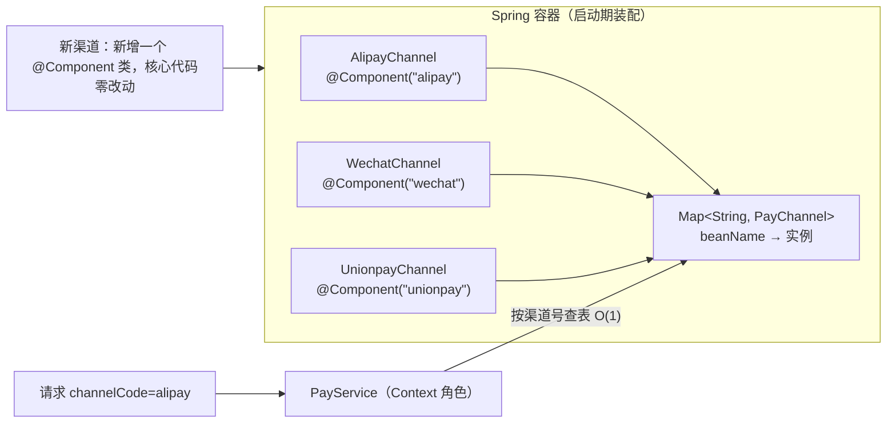
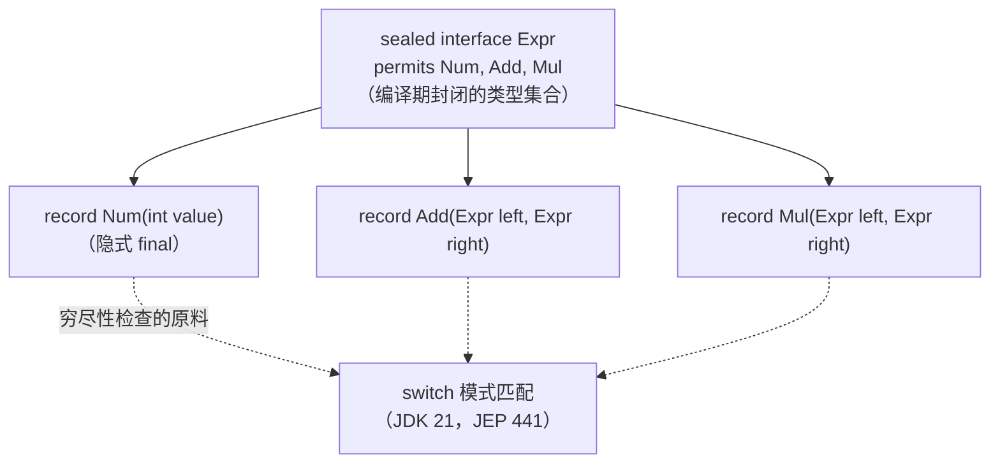

# 模式的现代演进与过度设计防线

> 一句话概括：GoF 写下 23 种模式的 1994 年，Java 还没有 lambda、record 和模式匹配；三十年间语言特性吃掉了一批模式的「样板」，却没有吃掉它们的「意图」——本文讲清哪些模式被 JDK 8/16/17/21 的新特性改写、改写到什么程度、剩下哪些必须写类，以及如何识别那些打着模式旗号的过度设计。

预计阅读时间：大约 55 分钟

所属主题：[设计模式常见面试题总结](summary.md)

本文以 JDK 21 为基线，语言特性的版本归属逐条标注并已对照 OpenJDK 官方 JEP 页面核实（Lambda 属 JDK 8/JEP 126，record 属 JDK 16/JEP 395，sealed 属 JDK 17/JEP 409，switch 模式匹配属 JDK 21/JEP 441，record 模式属 JDK 21/JEP 440）；示例代码在 JDK 23 下编译运行验证（21/23 对这些特性语义一致），涉及编译期行为处标注了实测结果。每个机制按「结论 → 机制 → 边界/代价 → 实践/追问」组织；Spring 侧的模式落地只在交叉处引用，不重复 [Spring 中的设计模式详解](../backend/java/spring/design-patterns.md) 的内容。

---

## 0. 阅读路线与目录

| 读者 | 建议阅读 | 关注点 |
| --- | --- | --- |
| 初级（1 年内） | 1、2.1~2.2、3.1~3.2、5.1 | 哪些模式被语言特性改写了、lambda/record 怎么用、过度设计信号长什么样 |
| 中级（1~3 年） | 全部，重点 2.3~2.4、3.3~3.4 | 行为参数化思想、替代的边界、ADT 建模、visitor 对照论证 |
| 高级（3 年+） | 2.4、3.4~3.5、5、7 | 四种仍要写类、visitor 仍占优的场景、版本现实、抽象层泄漏 |
| 选型/架构 | 1、4、5、6、7.7 | 什么时候值得抽象、评审推广口径、面试表达与团队标准 |

目录：

1. 开篇：1994 年之后，语言吃掉了哪些模式
2. Lambda 与行为参数化（JDK 8+）
3. record / sealed / 模式匹配对模式的重塑（JDK 16/17/21）
4. DDD 视角：模式落回业务建模
5. 过度设计防线（资深层重点）
6. 面试表达：把演进讲成判断力
7. 高频面试追问集
8. 参考资料

---

## 1. 开篇：1994 年之后，语言吃掉了哪些模式

### 1.1 先承认一个事实：模式是语言缺口的补偿

**结论**：GoF《设计模式》成书于 1994 年，主流语境是 C++ 与 Smalltalk。书里相当一部分模式的样板，存在理由是「语言表达不了这个东西」——语言一旦补上，样板消失，意图被直接表达。

一条被反复验证的证据链：

1. **动态语言视角（1996）**：Peter Norvig 在 Object World 演讲《Design Patterns in Dynamic Programming》（norvig.com/design-patterns）里把 23 种模式逐一对照 Lisp/Dylan，结论是 **16 种「不可见或更简单」**，明细：一阶函数吃掉 4 种（Command、Strategy、Template Method、Visitor）、一阶类型吃掉 6 种（Abstract Factory、Flyweight、Factory Method、State、Proxy、Chain of Responsibility）、宏吃掉 2 种（Interpreter、Iterator）、方法组合吃掉 2 种（Mediator、Observer）、多分派吃掉 1 种（Builder）、模块吃掉 1 种（Facade）。
2. **Java 是这条曲线的慢速重放**：Norvig 说的 first-class functions，Java 直到 JDK 8（JEP 126）才有；多分派至今没有。Java 的每一次语言升级，都在吃掉当年为绕开语言限制而积累的样板。
3. **反面同样成立**：Composite、Decorator、Singleton 等在 Norvig 的清单里属于「基本不变」的一档——它们的结构不是语言缺口的补偿，今天依然要手写（或交给框架）。

这解释了一个面试常见误判：把「模式被语言吃掉了」理解成「模式过时了」。吃掉的是**实现样板**，留下的是**设计意图与词汇**——`Comparator` 依然在表达策略，只是不再需要为它写类。

### 1.2 Java 视角的两次消解与一次助攻

| 波次 | 时间与 JEP | 语言特性 | 被改写的模式 | 剩下什么 |
| --- | --- | --- | --- | --- |
| 助攻 | JVM 时代起 | GC、反射、动态代理 | 单例的私有构造器执念被容器化单例取代（见 [singleton.md](singleton.md)）、手写代理被 AOP 基础设施取代 | 代理/单例的语义仍在，实现归框架 |
| 第一波 | JDK 8（2014，JEP 126） | lambda + 方法引用 + Stream | 策略/命令/模板回调/观察者的「单方法接口样板」 | 有状态、多方法、要注册发现或织入的行为仍是类（见 2.4） |
| 第二波 | JDK 16/17/21（2021-2023，JEP 395/409/441/440） | record、sealed、switch 模式匹配、record 模式 | 不可变值对象的 getter/equals 样板、建造者样板（部分）、visitor 双重分派样板 | 开放层次、跨模块扩展、操作携带状态时 visitor 仍在（见 3.4） |

### 1.3 本篇回答的两个问题

- **哪些模式被语言特性吃掉了，吃到什么程度、边界在哪**——第 2、3 章逐个给替代表与「替代不彻底」清单；
- **哪些挂着模式名号的代码其实是过度设计**——第 5 章给信号清单、抽象判断表与评审话术。

立场与 [Spring 中的设计模式详解](../backend/java/spring/design-patterns.md) 的开篇一致：**模式是结果，不是目的**。Spring 源码里的每个模式都能还原成一个具体问题；本篇向前一步：当语言已经把问题吃掉一半时，硬搬全套结构就成了新的问题。

兄弟专题分工：各模式的经典结构与 JDK 原生示例见 [patterns-in-jdk.md](patterns-in-jdk.md)；策略/模板/状态/命令见 [strategy-template-state-command.md](strategy-template-state-command.md)；观察者见 [observer-and-event-driven.md](observer-and-event-driven.md)；单例的工程问题见 [singleton.md](singleton.md)；本文不重复。

---

## 2. Lambda 与行为参数化（JDK 8+）

### 2.1 单方法接口被 lambda 直取

**结论**：GoF 里一批行为型模式的全部结构就是「一个单方法接口 + 若干实现类 + 上下文调用」；lambda（JDK 8，JEP 126）把「为一段行为发明一个类」的仪式整个消掉，行为本身成了可以传递的值。

| 模式 | 单方法接口 | 传统写法（JDK 8 前） | lambda / 方法引用写法 |
| --- | --- | --- | --- |
| 策略 | `Comparator#compare` | `new Comparator<String>() { public int compare(...) {...} }` | `Comparator.comparing(String::length)` |
| 命令 | `Runnable#run` / `Callable#call` | 命令类实现接口 + Invoker 持有 | `executor.submit(() -> send())` |
| 模板回调 | `StatementCallback#doInStatement` 等 | 回调类 | `jdbcTemplate.query(sql, (rs, i) -> map(rs))` |
| 观察者 | `ApplicationListener#onApplicationEvent`、`ActionListener#actionPerformed` | 监听器类注册 | `@EventListener` 方法 / `button.addActionListener(this::onClick)` |

**机制**：lambda 不是匿名类的语法糖——编译期 lambda 体被写成所在类的私有方法，不生成匿名类文件；运行时经 `invokedynamic` 由 `LambdaMetafactory#metafactory`（`java.lang.invoke`，JDK 8 起）在首次调用时生成函数对象。两个随之而来的语义差异：lambda 体内没有自己的 `this`（指向外层实例），也不能像匿名类那样覆写 `toString` 或持有自身字段。

观察者一行有个容易忽略的分界：**方法引用/lambda 只替代「注册一个行为」，不替代「监听器的生命周期管理」**。Spring 的 `@EventListener` 底层仍把方法包装成 `ApplicationListenerMethodAdapter` 注册进 multicaster（`EventListenerMethodProcessor` 扫描，见 [Spring 中的设计模式详解](../backend/java/spring/design-patterns.md) 第 6 节）——lambda 让注册不再需要先造类，但事件分派、异步、事务语义的管理职责一点没少。

**实践/追问**：为什么 JDK 集合 API 全面函数化了（`sort`/`forEach`/`removeIf`）？因为库作者把「变化的行为」识别成参数，用 `java.util.function` 的标准接口接收——这是行为参数化思想在库设计里的落地，也是 Effective Java Item 44（优先使用标准函数式接口）的出处场景。

### 2.2 GoF 模式 → Lambda/新语言特性替代对照表

| GoF 模式 | 传统结构（JDK 8 前） | Lambda/新特性形态 | 替代不彻底的场景 |
| --- | --- | --- | --- |
| 策略 | 策略接口 + 实现类 + Context 持有 | `Comparator.comparing(User::age)`、函数式接口参数 | 有状态策略；需注册发现（Spring Bean 策略族）；需 AOP 织入（见 2.4） |
| 命令 | Command 接口 + 具体命令类 + Invoker | `Runnable`/`Callable` lambda、方法引用 | 需要撤销/宏/元数据的富命令对象 |
| 模板方法（回调变体） | 抽象类继承 + 覆写钩子 | 骨架方法接收 lambda 回调（`JdbcTemplate`） | 多个互相咬合的钩子、复杂流程仍适合类形态 |
| 观察者 | Listener 接口 + 注册类 | `@EventListener` 方法、方法引用注册 | 监听器需要生命周期/异步/事务语义时仍是 Bean |
| 简单工厂 | 工厂类 + switch 创建 | `Map<K, Supplier<T>>` 注册表 | 创建需要依赖注入与生命周期管理 → 交给容器 |
| 建造者 | Builder 类链式 `build()` | record + 紧凑构造器（JDK 16，JEP 395） | 多阶段构建、可选参数爆炸、需可变中间态（见 3.2） |
| 访问者 | accept/visit 双重分派 | sealed + switch 模式匹配（JDK 21，JEP 441） | 层次不密封、跨模块扩展、操作携带状态（见 3.4） |

读表方法：第三列是「样板没了」，第四列是「动机还在」。样板没了不等于模式没了——Norvig 1996 年就把 Strategy 归入「一阶函数使其不可见」的一档，而 `Comparator` 至今仍在表达策略模式的问题域，只是形态从类变成了表达式。

### 2.3 行为参数化：lambda 消解的不是模式，是仪式

**结论**：lambda 真正提供的是「行为作为一等值」的表达力。Effective Java 第 3 版 Item 42（Prefer lambdas to anonymous classes，条目号已核实）的原文判断是：匿名类对需要函数对象的典型面向对象设计模式来说已经足够，**尤其是策略模式**（书中明确以 `Comparator` 为例：接口是抽象策略，匿名类是具体策略），但冗长让函数式编程失去吸引力——Java 8 之后，函数对象的首选形态就是 lambda。

| Effective Java 条目（第 3 版） | 一句话 | 对模式的意义 |
| --- | --- | --- |
| Item 42：lambda 优先于匿名类 | 函数对象首选 lambda；三行以内为佳 | 策略/命令的「实现类」多数场景降级为一个表达式 |
| Item 43：方法引用优先于 lambda | 能引用现有方法就不要重写行为 | 观察者回调写 `this::onXxx`，行为有了名字 |
| Item 44：优先使用标准函数式接口 | 新造回调接口前先看 `java.util.function` | 「新造接口」等于新造模式角色，先确认必要 |

**边界与代价**（Item 42 自己给出的）：lambda 没有名字与文档，长 lambda 比命名类更难懂；受检异常与标准函数式接口签名不兼容时要自己包一层；调试栈里 lambda 帧可读性差。反过来，匿名类仍有不可替代的场景：需要覆写 `Object` 方法、需要实现多方法接口、需要持有自身字段状态——「lambda 是匿名类的替代品」只在 SAM（Single Abstract Method）场景成立。

### 2.4 替代的边界：四种情况仍然要写类

**结论**：lambda 替代的是「无状态、单方法、当场定义」的行为；以下四种情况，模式的类形态仍是正确选择——这也是「有了 lambda 还要策略模式吗」的完整答案骨架（分层表达见 6.3）。

**情况一：有状态策略。** 策略要携带配置与跨调用的运行状态时，它是对象而不是函数。

```java
// 无状态：lambda 即策略（JDK 8+）
Comparator<Order> byAmount = Comparator.comparing(Order::amount);

// 有状态：必须写类——配置字段 + 跨调用计数，lambda 装不下
public final class ExponentialBackoffRetryPolicy implements RetryPolicy {
    private final Duration initialDelay;                     // 配置状态
    private final int maxAttempts;
    private final AtomicInteger fired = new AtomicInteger(); // 运行状态（跨调用累积）

    public ExponentialBackoffRetryPolicy(Duration initialDelay, int maxAttempts) {
        this.initialDelay = initialDelay;
        this.maxAttempts = maxAttempts;
    }

    @Override
    public Duration nextDelay(int attempt) {
        fired.incrementAndGet();
        return initialDelay.multipliedBy(1L << Math.max(0, attempt - 1)); // 0.1s, 0.2s, 0.4s...
    }

    @Override
    public boolean allowRetry(int attempt) { return attempt < maxAttempts; }
}
```

硬把状态塞进 lambda 的替代形态是「闭包捕获外部可变引用」：行为与状态的关系从「字段内聚」退化成「对外部变量的隐式共享」，并发问题更难看出来。

**情况二：多方法接口。** 策略接口有多个互相配合的方法（`warmUp`/`pay`/`coolDown`、`supports`/`handle`）时，SAM 前提不成立，lambda 塞不下；拆成多个 lambda 反而把一组语义拆散。

**情况三：需要运行时注册与发现。** Spring 环境下策略族的经典形态是「接口 + N 个 `@Component` 实现 + `Map<String, 接口>` 注入」：注册靠容器扫描，发现靠按名注入，装配条件靠 `@Conditional`，新增渠道 = 新增一个类，核心代码零改动。

```java
public interface PayChannel { PayResult pay(PayRequest request); }

@Component("alipay")
public class AlipayChannel implements PayChannel { /* ... */ }

@Component("wechat")
public class WechatChannel implements PayChannel { /* ... */ }

@Service
public class PayService {
    private final Map<String, PayChannel> channels;   // Spring 按 beanName 注入全部实现

    public PayService(Map<String, PayChannel> channels) { this.channels = channels; }

    public PayResult pay(String channelCode, PayRequest request) {
        PayChannel channel = channels.get(channelCode);
        if (channel == null) throw new IllegalArgumentException("unknown channel: " + channelCode);
        return channel.pay(request);
    }
}
```



这套注册表 lambda 拿不到：`Map<String, T>` 注入由 `DefaultListableBeanFactory#doResolveDependency` 完成——容器收集该类型的所有 Bean 并以 beanName 为键。lambda 不是 Bean，不参与扫描，进不了这张表。

**情况四：需要 AOP 织入。** 事务、重试、熔断、渠道日志这些横切能力全部依赖「调用经过代理」：`AbstractAutoProxyCreator#postProcessAfterInitialization` 只处理容器管理的 Bean（代理机制详见 [Spring 中的设计模式详解](../backend/java/spring/design-patterns.md) 第 4 节）。lambda 对象不在单例池里、没有代理壳，`@Transactional`/`@Retryable`/自定义切面全部失效。**策略一旦需要被增强，就必须是 Bean；是 Bean 就别用 lambda。**

**边界与代价**：四种情况的判断顺序就是评审顺序——先问状态（有没有跨调用状态）、再问接口形状（几个方法）、再问注册（谁发现它）、最后问增强（有没有切面）。四问全「否」才轮到 lambda；任何一问「是」，类形态就是对的，此时写接口和实现类不是过度设计。

**追问：`Map<String, PayChannel>` 注入的键是什么？** beanName。想自定义键名得放弃注入、自己 `getBeansOfType` 后组 Map，一般不值得；想按配置动态选渠道，就在 `channels.get()` 外再套一层配置读取，注册表机制不变。

---

## 3. record / sealed / 模式匹配对模式的重塑（JDK 16/17/21）

### 3.1 版本口径：特性集齐在 JDK 21

| 特性 | 正式版本 | JEP | 预览轨迹（已对照 OpenJDK 核实） |
| --- | --- | --- | --- |
| Lambda / 方法引用 | JDK 8 | 126 | 无预览（JSR 335） |
| record | JDK 16 | 395 | JDK 14 首预览（JEP 359）、15 二预览（JEP 384） |
| sealed | JDK 17 | 409 | JDK 15 预览（JEP 360）、16 二预览（JEP 397） |
| switch 模式匹配 | JDK 21 | 441 | JDK 17~20 四轮预览（JEP 406/420/427/433） |
| record 模式 | JDK 21 | 440 | JDK 19/20 预览（JEP 405/432） |

读法：record 与 sealed 在 17 就可用，但**穷尽性 switch 模式匹配要 21 才正式**——sealed 的价值兑现依赖 21。Spring Boot 3.x 基线是 Java 17（record/sealed 可用、switch 模式匹配不行），Boot 4.x 基线仍是 17（最高支持 25，见 [Spring 常见面试题总结](../backend/java/spring/summary.md) 第 10 节）——「生产代码里 switch 模式匹配还很少见」不是技术落后，是运行时现实。

### 3.2 record：吃掉「不可变值对象」的样板

**结论**：纯数据载体场景，「final 字段 + 全参构造 + getter + equals/hashCode/toString + 构造期校验」这套样板被 record（JDK 16，JEP 395）一行替代；校验与归一化用紧凑构造器（compact constructor）表达；但多阶段构建、可选参数爆炸的建造者场景不被替代。

```java
// JDK 16（JEP 395）：过去约 60 行的不可变值对象，现在是 6 行
public record Money(long amount, String currency) {
    public Money {                        // 紧凑构造器：不写参数列表，参数名即组件名
        if (amount < 0) throw new IllegalArgumentException("negative amount: " + amount);
        if (currency == null || currency.isBlank()) currency = "CNY";  // 归一化：改参数值即改字段值
    }
}
```

**机制**（JLS SE 21 §8.10.4/§8.10.4.2 与 JEP 395 双重核实）：

- 紧凑构造器体内不能 `return`、不能给组件字段赋值；体内参数名指代**隐式形参**而非字段；
- 构造器体结束后，编译器按组件声明顺序把字段初始化为**形参的最终值**——上面 `currency = "CNY"` 的归一化因此生效；
- record 隐式 `final`，组件字段 `private final`，访问器与组件同名（`amount()` 而非 `getAmount()`），`equals`/`hashCode`/`toString` 自动生成。

**一个少有人提的编译期坑（实测验证）**：显式声明的规范构造器访问性必须 ≥ record 类（JLS §8.10.4：public record 的规范构造器必须 public）。`public record` 配一个**不带修饰符**的紧凑构造器直接编译失败——无修饰符默认包私有，弱于 public，必须写 `public Money { ... }`。网上大量教程示例用的是包私有 record，照抄到 public record 上就翻车。

**边界与代价——什么时候仍然用建造者**（builder 的经典结构见 [factory-and-builder.md](factory-and-builder.md)）：

| 场景 | record + 紧凑构造器 | builder |
| --- | --- | --- |
| 组件少、全必填、无构建过程 | ✔ 首选 | 过度 |
| 可选参数多、组合爆炸 | ✘ | ✔（Item 2：参数多且多可选时） |
| 构建有阶段/顺序依赖 | ✘ | ✔ |
| 框架要求 JavaBean（无参构造 + setter） | ✘（record 无无参构造与 setter，如 JPA 实体要求无参构造） | 或普通类 |
| JSON 序列化 | ✔（Jackson 2.12+ 原生支持 record，record 本身 JDK 16 GA） | ✔ |

两条补充边界：record 是**浅**不可变——组件类型可变（`List`、`Map`）时只保证引用不变，防御性拷贝要自己写在紧凑构造器与访问器里；record 不能 `extends`（隐式 final），共享行为靠接口 default 方法或组合——这也让它天然满足 sealed 子类约束（见 3.3）。

**实践/追问**：record 是 DDD 值对象的天然材料（不可变 + 按值相等 + 构造期校验），JDK 16 后值对象的样板成本约等于零，详见 4.1。

### 3.3 sealed + record：把「类型集合」变成编译期契约

**结论**：sealed（JDK 17，JEP 409）让接口/类声明「合法子类型集合」，record 隐式 final 适合当叶子——两者组合就是 Java 版的**代数数据类型（ADT）**：和类型（sealed：`Expr = Num | Add | Mul`）+ 积类型（record：字段组合）。它重塑的不是某一个模式，而是 visitor 这类依赖「封闭类型层次」的模式的前提（见 3.4）。

```java
// JDK 17 sealed（JEP 409）+ JDK 16 record（JEP 395）
public sealed interface Expr permits Num, Add, Mul {}
public record Num(int value) implements Expr {}
public record Add(Expr left, Expr right) implements Expr {}
public record Mul(Expr left, Expr right) implements Expr {}
```

**机制**（JEP 409 规则，已核实）：

- `permits` 列出的子类必须与密封父类**同模块**（具名模块下）或**同包**（未命名模块下）；
- 每个允许的子类必须且只能选一个修饰符：`final` / `sealed` / `non-sealed`——record 隐式 final，天然合规；
- 子类与密封类声明在同一文件时，`permits` 子句可省略（编译器从文件内声明推断）；
- 匿名类与局部类不能作为允许的子类型。



**边界与代价**：密封是**双向契约**——编译器替你做穷尽检查的同时，模块外部永远不能加新子类型。开放生态的类型层次（SPI 扩展点、插件体系）用 sealed 是自断扩展路径；`non-sealed` 是逃生门，让某个子树重新开放。

### 3.4 switch 模式匹配 + record 模式：替代 visitor 的论证

**结论**：visitor（GoF）的动机是「给稳定的类型层次加新操作而不改层次」；在**密封层次**上，switch 模式匹配（JDK 21，JEP 441）+ record 模式（JDK 21，JEP 440）用一次普通分派实现了同样能力——没有 accept/visit 双重分派样板，还白得编译期穷尽检查。visitor 在层次开放、跨模块扩展、操作携带状态三类场景仍占优。

```java
// JDK 21（JEP 441 + 440）：一次分派 + 解构 + 穷尽检查
static int eval(Expr e) {
    return switch (e) {
        case Num n               -> n.value();
        case Add(var l, var r)   -> eval(l) + eval(r);
        case Mul(Expr l, Expr r) -> eval(l) * eval(r);
    };   // sealed + 无 default：漏写任何子类 → 编译错误
         // 实测错误信息：「switch 表达式不包含所有可能的输入值」
}

// record 模式嵌套解构（JEP 440）：结构镜像构造
static String describe(Expr e) {
    return switch (e) {
        case Num n             -> "常量 " + n.value();
        case Mul(Num a, Num b) -> "可折叠为 " + a.value() * b.value();  // 嵌套解构一步到位
        case Add(var l, var r) -> "和表达式";
        case Mul(var l, var r) -> "积表达式";
    };
}
```

同一份 Expr 用传统 visitor 写，结构对比（示意）：

```java
// 传统 visitor（GoF）：三件套——Visitor 接口、Element.accept、每个具体类型实现 accept
interface ExprVisitor<R> { R visitNum(Num n); R visitAdd(Add a); R visitMul(Mul m); }
interface Expr { <R> R accept(ExprVisitor<R> v); }                        // 双重分派第一跳
record Num(int value) implements Expr {
    public <R> R accept(ExprVisitor<R> v) { return v.visitNum(this); }    // 第二跳
}
// Add/Mul 各再写一遍 accept；加新操作 = new ExprVisitor<R>() { ... 全量实现 ... }
```

**机制——为什么这是替代而不是另一种写法**：

- visitor 的「加操作不改类型」来自双重分派：`accept(v)` 先按元素类型分派、`v.visitXxx(this)` 再按操作类型分派——这是 Java 当年没有「对封闭集合做开放操作」表达力时，用两次虚调用硬凑出来的结构；
- switch 模式匹配把「按元素类型分派」变成编译期穷尽的模式测试：密封层次让编译器知道类型全集，`case` 覆盖全集即合法；运行时由 `SwitchBootstraps#typeSwitch`（`java.lang.runtime`，JDK 21）做类型测试分派；
- record 模式把「访问器取值 + 命名局部变量」折叠进模式本身，嵌套结构镜像构造结构（JEP 440 原话："deconstruct such a rectangle with code that echoes the structure of the nested constructors"）。

**对照表**：

| 维度 | visitor（GoF） | sealed + switch 模式匹配（JDK 21） |
| --- | --- | --- |
| 加新操作 | 新写一个 Visitor 实现类，层次不动 ✔ | 新写一个 switch 方法，层次不动 ✔ |
| 加新类型 | 每个 Visitor 都要补 visit 重载，**漏改无编译警告** | 每个 switch 都要补 case；无 default 时**漏改直接编译错误** ✔ |
| 编译期穷尽检查 | 无 | 有（密封 + 穷尽性，实测验证） |
| 分派样板 | accept/visit 双跳 + 每类型一个 accept | 一次分派，零样板 |
| 操作携带状态/缓存 | ✔ visitor 是一等对象：字段、依赖注入、生命周期都行 | ✘ 方法局部；跨调用状态要另设对象 |
| 跨模块/跨版本扩展 | ✔ Visitor 接口是公开契约，第三方可实现，可用接口 default 方法演进 | 密封封闭：模块外不能加类型（设计意图，也是边界） |
| 层次开放性 | ✔ 层次可开放（visitor 不要求密封） | 层次必须密封才能穷尽 |
| 版本要求 | 无 | JDK 21 全部正式 |

**visitor 仍占优的四个场景**：

1. **层次不密封**：类型集合开放扩展（SPI、插件），穷尽性无从谈起，accept 的运行时分派仍是正确工具；
2. **操作需要携带状态/缓存/依赖**：visitor 对象可以持有字段、被注入、被组合（如带 memoization 的求值器）；switch 方法是纯分发点，跨调用状态得另想办法；
3. **跨模块稳定 API**：visitor 是接口契约，新操作可给接口 default 方法提供默认实现、老实现平滑共存；switch 是方法体，演进只能重写方法；
4. **需要把「操作」当值传递/组合**（visitor 链、装饰 visitor、按操作做策略选择）——一等对象才有的自由。

**边界与代价**：模式匹配的代价是**编译器版本锁定**（21+）与「操作逻辑散在 N 个 switch 方法里」——操作一多，语义上同属一个操作族的行为散落各处，这正是 visitor 把操作聚合在一个类里的理由。折中判断：**操作少且稳定 → switch；操作多且持续演进 → visitor**。

**追问：switch 模式匹配对 null 的处理？**（JEP 441 原文规则，已核实）选择器为 null 时：有 `case null` 标签则命中它；没有则抛 `NullPointerException`（与老 switch 一致）；`default` **不匹配** null（向后兼容）；`case null, default -> ...` 可合并（与单独 `default` 并存是编译错误）。对 `Expr` 这类密封层次，null 通常在入口处挡掉，case 里不必处理。

### 3.5 版本现实与面试口径

**结论**：五个特性到齐是 JDK 21；生产系统大量停留在 8/11/17 的迁移途中——面试的正确姿势是「我知道新玩法，也知道版本现实」：

> 「sealed + record 的 ADT 建模在 17 就能写，但穷尽性 switch 模式匹配要 21 才正式；我们 Boot 3.x 跑在 17 上，所以表达式求值这类封闭层次我用了 record + sealed 建模，分派还是手写；等升到 21 我会把 visitor 样板收敛成 switch。策略族因为要注册发现和切面增强，lambda 化做了但保留类形态。」

这段话同时回答三个问题：特性边界清楚（版本归属没答错）、做过取舍（不是背特性清单）、落地有路线（不是为新而新）。

**版本归属速查**（高频易错点）：Lambda 是 **JDK 8**（JEP 126）不是 JDK 7（7 只是引入了它依赖的 invokedynamic）；record 是 **JDK 16**（JEP 395）不是 15（那是二预览）；sealed 是 **JDK 17**（JEP 409）不是 16（预览）；switch 模式匹配是 **JDK 21**（JEP 441）不是 17~20（都是预览）；record 模式是 **JDK 21**（JEP 440）不是 19（预览）。

---

## 4. DDD 视角：模式落回业务建模

本章只讲「模式在业务建模中的落点」，DDD 全貌不在范围。

### 4.1 贫血 vs 充血：业务逻辑住在哪里

| 维度 | 贫血模型 | 充血模型 |
| --- | --- | --- |
| 业务逻辑位置 | Service/Manager 层 | 实体/值对象/聚合根自身 |
| 领域对象形态 | getter/setter 数据袋 | 有行为、自己维护不变量 |
| 不变量守护者 | Service 里约定俗成（易漏） | 对象构造器与方法内强制 |
| 与 ORM 的摩擦 | 小（对象 ≈ 数据行） | 大一些（需要映射配置） |
| 典型病 | Service 千行、逻辑复制散落 | 对象图复杂、对建模能力要求高 |

**结论**：充血不是「把所有模式塞进实体」，判断口诀是「**这条规则离开这个对象还成立吗**」——金额非负、订单行数上限、状态机合法迁移，是对象自己的不变量，放对象里（构造器/方法守护）；跨聚合的编排（下单扣库存跨两个聚合）放领域服务或应用服务。贫血的真正问题不是「丑」，是**不变量没有守护者**：任何一段新代码都能 new 出一个非法对象。

**record 的落点**：值对象（Money、Address、Quantity）天然应该是 record——不可变、按值相等、紧凑构造器做构造期校验，JDK 16 后样板成本约等于零，直接降低了充血模型的采用门槛。实体（有标识、可变）仍是普通类。

### 4.2 领域事件：观察者模式的业务形态

**结论**：领域事件把「业务上发生了什么」建模为一等对象（`OrderCreated`、`PaymentReceived`），发布方只陈述事实，关心者自行订阅——这就是观察者/发布-订阅模式在业务建模中的角色（模式语义见 [observer-and-event-driven.md](observer-and-event-driven.md)）。

一段话讲清进程内与跨进程的边界：**进程内**用 Spring 事件（`ApplicationEventPublisher#publishEvent` + `@EventListener`），默认同步、同线程、同事务，「提交后才执行」用 `@TransactionalEventListener(AFTER_COMMIT)`，锚点 `SimpleApplicationEventMulticaster#multicastEvent`；**跨进程**用 MQ（事务消息/本地消息表），解决的是跨服务通知与削峰。共同红线：**事件负责「通知」，不负责「保证」**——跨服务一致性靠 outbox + 对账补偿设计，把「发个事件」当成一致性方案是最常见误用。

### 4.3 工厂与仓储：两句话定位

- **工厂**：聚合根创建复杂（多对象组装 + 不变量校验）时，把「组装出合法聚合」的过程封装进工厂——它解决构造复杂度，与 [factory-and-builder.md](factory-and-builder.md) 的经典结构同源；
- **仓储**：以集合语义（`save`/`findById`）屏蔽持久化细节，让领域层不依赖 ORM——Spring Data 的 `CrudRepository` 是它的标准实现。

一句话：工厂管「生」，仓储管「存」的抽象，两者都为了「领域层只说业务语言」。

---

## 5. 过度设计防线（资深层重点）

### 5.1 过度设计信号清单

| # | 信号 | 典型表现 | 修正方向 |
| --- | --- | --- | --- |
| 1 | 为假想的未来需求提前抽象 | 「以后可能有多种实现」→ 先建接口，N 从未出现 | YAGNI：出现第 2 个实现再抽（判断信号见 5.2） |
| 2 | 只有一个实现还硬加接口层 | `XxxService`/`XxxServiceImpl` 成对出现且无第二实现计划 | 直接用类；接口留给真实变化点或跨模块边界 |
| 3 | 模式堆砌 | 三层抽象最终只调一个 getter；策略接口只有一个实现还配了工厂 | 拍平；每个抽象必须答出「隔离了什么」 |
| 4 | 单例当全局变量用 | `getInstance()` 满天飞，可变单例状态被到处改 | 状态交容器/依赖注入；私有构造器单例的工程代价见 [singleton.md](singleton.md) |
| 5 | 用继承扩展而不是组合 | 四层以上的 `AbstractXxx` 继承树，改一处要通读全链 | 组合 + 行为参数化（lambda/回调） |
| 6 | 注释在解释抽象而不是业务 | 「这层是给以后扩展用的」 | 抽象的收益要现在兑现：隔离/替换/测试至少占一样 |
| 7 | lambda 硬套模式结构 | 为一个 `Runnable` 写 Command 接口和 Invoker 类 | 对照 2.2 表，能 lambda 直取的不要写类 |
| 8 | 抽象层泄漏 | 方法签名暴露底层类型、上层被迫理解底层时序（见 5.4） | 收窄接口、转译异常 |

**结论**：第 1、2、3 条占日常过度设计的绝大多数，共同病因是**用预测代替证据**——抽象的正当性只来自「现在已经存在的重复、变化或边界」，不来自「以后可能会有」。

### 5.2 什么时候值得抽象：五条信号

| 信号 | 说明 | 反面（不构成理由） |
| --- | --- | --- |
| 已出现第 2/3 个相似分支 | 重复是抽象收益的物理证据（Rule of Three：第三次重复时才抽象，Don Roberts 的经验法则，Fowler《重构》引用） | 「代码看起来会重复」的预感 |
| 变化方向被业务确认 | 需求侧确实在朝这个方向走（多渠道、多供应商在 roadmap 上） | 架构师想象中的「可能」 |
| 跨模块边界需要隔离 | 上层不允许依赖底层实现（防腐层、端口与适配器） | 「解耦总是好的」 |
| 测试需要替换依赖 | 不抽象就无法替换，测试成本压过抽象成本 | 为 mock 而 mock 的空接口 |
| 消除一个已知的坏味道 | switch 连续膨胀、方法过长等具体坏味道 | 没有坏味道的「预防性重构」 |

**结论**：五条信号的共同点是**收益现在可见**。评审时对每个新抽象问一句话：「这个抽象**今天**隔离了什么？」答得出（隔离实现细节/支持替换/支撑测试，三选一）→ 留下；答案以「以后」开头 → 砍掉。

### 5.3 Refactoring to Patterns：模式是重构的目标，不是起点

Joshua Kerievsky《Refactoring to Patterns》（2004）的核心立场：**模式是重构的目的地，不是出发点**——先写最直白的代码，坏味道出现后，用重构手法一步步朝模式移动；反过来「以模式为起点」就是过度设计（书中称 overdesign，并给了具体的坏味道清单）。

这个立场与 [Spring 中的设计模式详解](../backend/java/spring/design-patterns.md) 开篇互为印证：Spring 的模式都是长出来的——容器要统一创建对象所以有工厂，AOP 要增强所以有代理，事件要解耦所以有观察者；没有一个是为了凑模式清单。

实操三步：

1. **直白期**：if-else 或单类，能跑、能测、能交付；
2. **坏味道期**：重复出现、分支膨胀、测试难写——用「提炼方法 / 提炼类 / 以多态取代条件表达式」等重构手法移动；
3. **模式期**：移动的终点恰好是一个模式，顺路得到它的名字——模式名是描述，不是设计输入。

### 5.4 抽象层泄漏：底层概念穿透上层接口

**结论**：抽象层泄漏是「抽象存在但没起作用」的高级形态——接口划了，底层概念却穿透了它，上层被迫理解底层。三个排查入口：

| 泄漏形态 | 例子 | 修正 |
| --- | --- | --- |
| 类型泄漏 | 领域接口方法签名出现 `HttpServletRequest`、`JSONObject` 等底层/框架类型 | 接口只暴露领域类型，适配层做转换 |
| 时序泄漏 | javadoc 写「必须先调 init 再调 query」——契约靠调用方自觉 | 把时序收进对象内（构造/工厂保证就绪） |
| 异常泄漏 | `SQLException` 等底层异常直接冒出领域接口 | 异常转译（`JdbcTemplate#execute` 把 `SQLException` 翻译成 `DataAccessException` 层次，是标准范本） |

**快速自查**：看上层类的 import 列表——出现了它概念上不该认识的东西，就是泄漏。这一条和 5.1 的第 8 条信号是一枚硬币的两面：信号清单防「建多了」，泄漏排查防「建了没用」。

---

## 6. 面试表达：把演进讲成判断力

### 6.1 答题框架

被问「你用过什么设计模式」，四段式（与 [Spring 常见面试题总结](../backend/java/spring/summary.md) 的答题四段式同构）：

| 段 | 内容 | 面试官在听什么 |
| --- | --- | --- |
| ① 场景 | 真实业务问题，不是「项目里用了策略模式」 | 有没有真实经验 |
| ② 选型理由 | 为什么这个模式/这个形态（类 vs lambda）、为什么不用 if-else | 有没有决策过程 |
| ③ 边界/代价 | 这么做牺牲了什么、什么情况下会失效 | 高级与中级的分水岭 |
| ④ 如果重来 | 今天重做会不会换方案（版本/规模变化） | 有没有演进意识 |

### 6.2 完整示范：支付渠道策略族

> **① 场景**：收银台要接入多个支付渠道（支付宝、微信、银联），每家签名规则、参数拼装、回调验签完全不同，渠道数还在增加。
> **② 选型理由**：策略族 + 注册表——接口 `PayChannel` 定义统一契约，每个渠道一个 `@Component`，`PayService` 注入 `Map<String, PayChannel>` 按 beanName 分派。不用 if-else 的原因：新增渠道要改核心方法、回归全量；注册表形态下新增渠道 = 新增一个类，核心代码零改动，分派 O(1)。不写 lambda 策略的原因：渠道实现要日志/熔断切面（必须是 Bean 才有代理），还要按渠道号运行时发现（注册表依赖容器）——正是 2.4 节「仍要写类」的情况。
> **③ 边界/代价**：注册表丢了静态可见性——「有哪些渠道」要看运行时 Bean 列表而不是一眼 switch；渠道间公共逻辑（幂等、对账钩子）要另外抽骨架，否则复制粘贴；策略族膨胀后「选哪个渠道」的分派本身成了维护点。渠道少于 3 个时我会直接 if-else，不值得建表。
> **④ 如果重来**：结构不变，两处会改——渠道配置（费率、开关）挪到配置中心做动态路由；JDK 升到 21 后，渠道参数校验这类封闭逻辑可以用 record + switch 模式匹配收敛，但注册表机制保留，因为 AOP 与按名发现的需求没变。
> **量化**：新渠道接入从「改核心类 + 全量回归（约 2 人日）」降到「新增一个类 + 配置（约 0.5 人日）」。

（数字按自己项目口径替换——面试官要的是「你量过」，不是「数字大」。）

### 6.3 「有了 Lambda 还要策略模式吗」的分层答法

> **第一层（是什么）**：单方法、无状态、当场定义的策略，lambda 就是策略实例——`Comparator.comparing(User::age)` 没有类，但策略模式的动机（同一契约下可互换行为）完整在。JDK 8 消化掉的是策略的样板，不是策略。
> **第二层（边界）**：四种情况仍要写类——有状态、多方法、要注册发现、要 AOP 织入；Spring 环境下第 3、4 条几乎总是成立，所以业务代码里的策略族照旧是接口 + Bean。
> **第三层（版本）**：JDK 21 后还可以再进一步——封闭类型层次上的行为分派连「策略接口」都可以省（sealed + switch 模式匹配），但那是穷尽性与开放性之间的另一个取舍，不是 lambda 的延伸。

---

## 7. 高频面试追问集

**Q1：有了 Lambda，还需要策略模式吗？**

> 需要，但形态变了。lambda 替代的是策略的「单方法样板」：无状态 SAM 行为直接传 lambda/方法引用（`Comparator`、`Runnable`）。四种情况仍写类：①有状态（配置 + 跨调用计数）；②多方法接口；③需要运行时注册发现（Spring Bean 策略族靠 `Map<String, T>` 注入，lambda 不是 Bean 进不了表）；④需要 AOP 织入（lambda 没有代理，切面全失效）。一句话：**lambda 消解了策略的样板，没消解策略的动机**。

**Q2：JDK 21 之后，visitor 模式还有必要吗？**

> 密封层次上多数没必要：sealed + switch 模式匹配同样「加操作不改类型」，且穷尽检查在编译期——visitor 的真实短板是加新类型时漏改的 visitor 没有编译警告，switch 没有这个洞。visitor 仍占优四场景：层次不密封（开放扩展）、操作要携带状态/缓存/依赖（visitor 是一等对象）、跨模块稳定 API（接口 default 方法可演进）、操作本身要当值组合。判断句式：**类型集合封闭且操作会增长 → switch 模式匹配；类型集合开放或操作有状态 → visitor**。

**Q3：record 能替代建造者吗？什么时候不能？**

> 纯数据载体（组件少、全必填）能，一行顶 60 行，校验归一化用紧凑构造器。不能的三种：可选参数多且组合爆炸（Item 2 的 builder 场景）；构建有阶段/顺序依赖；框架要求 JavaBean 规范（无参构造 + setter，JPA 实体即此类）。两个加分细节：record 是浅不可变，可变组件要防御拷贝；public record 的紧凑构造器必须显式 public（JLS 要求规范构造器访问性 ≥ record 类）。序列化不用过虑：Jackson 2.12+ 原生支持 record（record 本身 JDK 16 GA）。

**Q4：过度设计最常见的信号是什么？**

> 三个最高频：只有一个实现还硬加接口层、为假想的未来需求提前抽象、模式堆砌（三层抽象调一个 getter）。共同病因是用预测代替证据。判断标准收敛成一句话：**这个抽象今天隔离了什么？**答不出现在时的收益（隔离实现细节/支持替换/支撑测试三选一）就砍。Refactoring to Patterns 的立场可作为收尾：模式是重构的目标不是起点——先写直白代码，坏味道出现再动。

**Q5：充血模型会不会让领域对象变成上帝类？**

> 会——如果聚合边界没划对。防线是聚合设计：聚合根只守护本聚合的不变量与状态机，跨聚合协作放领域服务/应用服务；「一条规则离开这个对象就不成立」才进对象。充血的实体不该知道存储（仓储管持久化）、不该知道编排（Service 管）、不该知道通知（领域事件管）。上帝类是边界问题不是充血的问题——贫血模型同样会长出千行 Service 上帝类，只是把上帝搬了个位置。

**Q6：领域事件和 MQ 的边界在哪？**

> 领域事件是建模概念（陈述业务事实），MQ 是跨进程传输设施，不是对立选项。进程内解耦用 Spring 事件（同步同线程同事务，`@TransactionalEventListener(AFTER_COMMIT)` 处理提交后通知）；跨服务才上 MQ。共同红线：事件只负责「通知」不负责「保证」——要可靠投递，事件之上要有 outbox/本地消息表 + 对账。把「发个事件」当成一致性方案是最常见误用。

**Q7：怎么向团队推广「少一点模式味」的评审标准？**

> 把标准做成可执行的检查句而非品味之争：①新接口的第二实现在哪（答不出就合回类）；②这个抽象今天隔离了什么；③lambda 能不能直取（对照替代表）；④上层 import 里有没有底层类型（抽象层泄漏）；⑤单例有没有可变全局状态。配套一条放行规则：第 2/3 次重复才允许抽象（Rule of Three），第一次直白写。推广靠评审话术，不靠布道。

**Q8：GoF 23 种模式现在过时了多少？**

> 辩证答：**结构可被语言特性吸收，意图永不过时**。Norvig 1996 年就指出动态语言里 16/23「不可见或更简单」；Java 用 20 年重放了这条路：JDK 8 lambda 吃掉单方法行为模式的样板，JDK 21 模式匹配吃掉 visitor 的双重分派样板。但策略的「可互换行为」、观察者的「事实通知」、代理的「访问控制」这些意图在任何语言里都要表达——被吃掉的是类图，留下的是设计词汇。答成「过时了不用学」或「一个都不能少」都错。

**Q9：switch 模式匹配里 null 怎么处理？**

> 按 JEP 441：选择器为 null 时，有 `case null` 标签则命中；没有则抛 NPE（与老 switch 一致）；`default` 不匹配 null；`case null, default -> ...` 可合并（与单独 `default` 并存是编译错误）。密封层次分派通常在入口挡 null，case 里不用管。

---

## 8. 参考资料

- OpenJDK JEP（版本归属均已对照官方页面核实）：
  - JEP 126 Lambda Expressions & Virtual Extension Methods（JDK 8）：<https://openjdk.org/jeps/126>
  - JEP 395 Records（JDK 16）：<https://openjdk.org/jeps/395>
  - JEP 409 Sealed Classes（JDK 17）：<https://openjdk.org/jeps/409>
  - JEP 440 Record Patterns（JDK 21）：<https://openjdk.org/jeps/440>
  - JEP 441 Pattern Matching for switch（JDK 21）：<https://openjdk.org/jeps/441>
- JLS SE 21 §8.10.4 / §8.10.4.2（规范构造器访问性要求与紧凑构造器语义）：<https://docs.oracle.com/javase/specs/jls/se21/html/jls-8.html>
- Peter Norvig, *Design Patterns in Dynamic Programming*（Object World 1996）：<https://norvig.com/design-patterns/>（16/23 分类明细出处）
- Joshua Bloch, *Effective Java*（3rd ed.）：Item 2（builder）、Item 42（lambda 优先于匿名类）、Item 43（方法引用）、Item 44（标准函数式接口）
- Joshua Kerievsky, *Refactoring to Patterns*（2004）：模式是重构目标不是起点；overdesign 形态清单
- Erich Gamma 等， *Design Patterns: Elements of Reusable Object-Oriented Software*（1994）：visitor 双重分派与各模式意图的原始出处
- 本文 JDK 侧源码锚点：`LambdaMetafactory#metafactory`（`java.lang.invoke`，JDK 8）、`SwitchBootstraps#typeSwitch`（`java.lang.runtime`，JDK 21）、`java.lang.Record`（JDK 16）；Spring 侧锚点：`DefaultListableBeanFactory#doResolveDependency`、`AbstractAutoProxyCreator#postProcessAfterInitialization`、`SimpleApplicationEventMulticaster#multicastEvent`、`JdbcTemplate#execute`
- 交叉专题：[Spring 中的设计模式详解](../backend/java/spring/design-patterns.md)（模式是结果不是目的的开篇立场）；兄弟专题：[summary.md](summary.md)、[principles-and-uml.md](principles-and-uml.md)、[singleton.md](singleton.md)、[factory-and-builder.md](factory-and-builder.md)、[proxy.md](proxy.md)、[structural-patterns.md](structural-patterns.md)、[strategy-template-state-command.md](strategy-template-state-command.md)、[observer-and-event-driven.md](observer-and-event-driven.md)、[chain-of-responsibility.md](chain-of-responsibility.md)、[patterns-in-jdk.md](patterns-in-jdk.md)
- 未验证项说明：「生产系统大量停留在 8/11/17」为行业普遍观察的定性表述，未引用具体统计数字；「Rule of Three」出处按 Fowler《重构》的引述口径书写，未逐字核对 Don Roberts 原始表述。

---

## 附：一页速记

**语言演进层**

1. Norvig 1996：动态语言里 16/23「不可见或更简单」；Java 20 年重放——JDK 8 lambda 吃掉行为模式样板，JDK 16/17/21 record/sealed/模式匹配吃掉值对象与 visitor 样板。
2. 版本归属：Lambda 8（JEP 126）、record 16（JEP 395）、sealed 17（JEP 409）、switch 模式匹配 21（JEP 441）、record 模式 21（JEP 440）；特性集齐在 21，Boot 3.x/4.x 基线 17。

**Lambda 与策略层**

3. 单方法、无状态、当场定义的行为 → lambda 直取（策略/命令/模板回调/观察者注册）。
4. 四种仍要写类：有状态、多方法、注册发现（Spring Bean 族）、AOP 织入；评审顺序四问：状态？方法数？谁发现？有没有切面？全否才 lambda。
5. Item 42/43/44：lambda 优先于匿名类、方法引用优先于 lambda、优先标准函数式接口。

**record / sealed 层**

6. record：紧凑构造器做校验归一化，体结束后隐式赋值；public record 的紧凑构造器必须显式 public；浅不可变，可变组件要防御拷贝。
7. sealed + record = ADT：permits 同模块/同包、子类 final/sealed/non-sealed 三选一（record 天然合规）、同文件可省 permits；密封是双向契约，模块外不能加子类型。
8. sealed + switch：穷尽性编译期检查（漏 case 直接编译错误）；null 需 `case null` 否则 NPE，`default` 不匹配 null。

**visitor 层**

9. 类型封闭 + 操作增长 → switch 模式匹配；类型开放 / 操作带状态 / 跨模块 API / 操作当值组合 → visitor。

**DDD 层**

10. 充血判断口诀：「这条规则离开这个对象还成立吗」；record 是值对象材料；领域事件 = 观察者业务化，进程内 Spring 事件、跨进程 MQ；事件管通知不管保证。

**过度设计层**

11. 信号八条；抽象正当性 = 「今天隔离了什么」；Rule of Three（第 3 次重复才抽象）；模式是重构目标不是起点；抽象泄漏查上层 import。

**一句话**

> 语言吃掉的是模式的样板，吃不掉模式的意图；工程上真正的敌人从来不是「不用模式」，而是「在没有重复、没有变化、没有边界的地方使用模式」。
