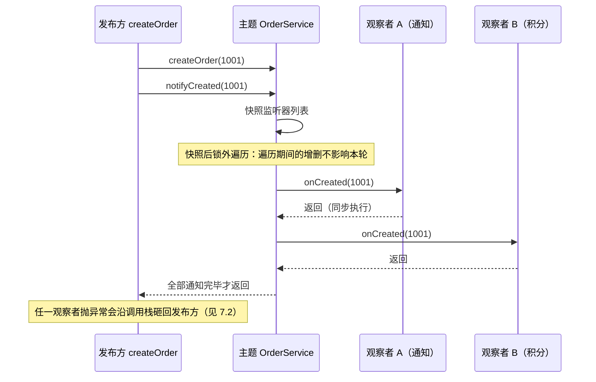
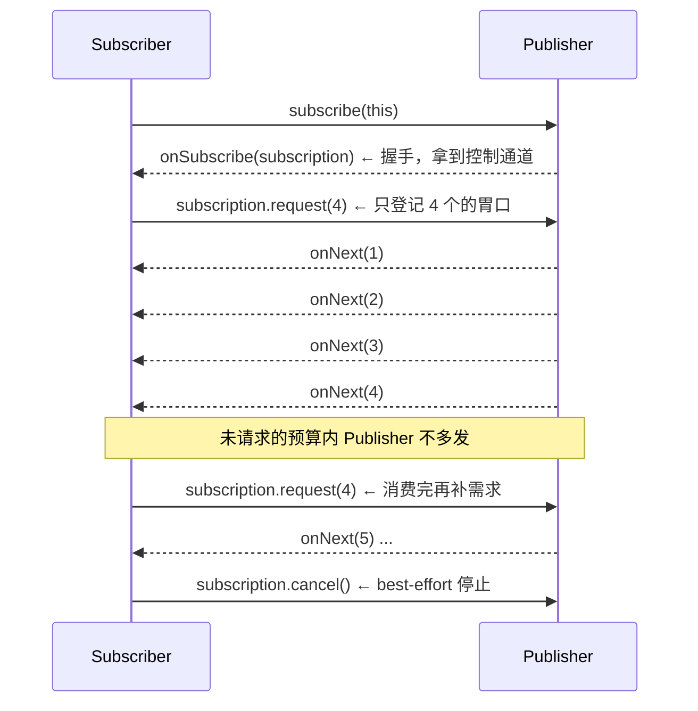

# 观察者与事件驱动：从 Observable 到响应式流

> 一句话概括：观察者模式解决「一个对象的状态变化要通知多个对象」的解耦问题——发布方只认识抽象观察者接口，不认识任何具体订阅者；本文沿「手写观察者 → JDK 内建 → Guava EventBus → Reactive Streams」的主线讲清推拉模型、观察者与发布-订阅的分界、背压的实现，以及监听器泄漏、异常传播、事务边界与上下文丢失这些工程坑。

预计阅读时间：大约 70 分钟

所属主题：[设计模式常见面试题总结](summary.md)

本文以 JDK 21 为基线，JDK 类的 deprecated 标注、javadoc 原文与实现细节均已对照 OpenJDK 源码逐条核实，版本差异单独标注；源码锚点统一用 `类名#方法名`。Spring 事件机制的源码走读（`SimpleApplicationEventMulticaster#multicastEvent`、`@EventListener` 注册、`@TransactionalEventListener`）在 [Spring 中的设计模式](../backend/java/spring/design-patterns.md) 第 6 章已完整展开，本文不重复，只在「光谱定位」与「工程坑位」处交叉引用补充。GoF 类图与原则层的基础概念见 [原则与 UML](principles-and-uml.md)。

---

## 0. 阅读路线

| 读者 | 建议阅读 | 关注点 |
| --- | --- | --- |
| 初级（1 年内） | 1、2.1~2.2、3.2、4.1、6.3 | 观察者是什么、怎么手写、推拉模型、Flux 怎么写 |
| 中级（1~3 年） | 全部，重点 3.1、5、6.2 | Observable 为什么废弃、观察者 vs 发布-订阅、背压机制 |
| 高级（3 年+） | 2.3、3.1、6.1~6.2、7、8 | CopyOnWriteArrayList 的取舍、Flow 源码语义、泄漏排查、异常与事务边界 |
| 选型/架构 | 4.3、5.3、6.4、7、8（Q8/Q10） | 事件总线选型光谱、什么时候不该用事件驱动 |

目录：

1. 观察者解决什么问题：一对多通知与推拉模型
2. 经典实现：手写最小观察者
3. JDK 内建观察者的兴衰
4. Guava EventBus：进程内事件总线
5. 观察者 vs 发布-订阅：本篇最核心的辨析
6. 响应式流：带流量控制的异步观察者
7. 工程坑位：泄漏、异常、事务与上下文
8. 高频面试追问集
9. 参考资料

---

## 1. 观察者解决什么问题：一对多通知与推拉模型

### 1.1 从硬编码调用的代价说起

一个订单创建后要通知库存、积分、营销、风控。最常见的坏写法是把通知直接焊进主流程：

```java
public void createOrder(Order order) {
    orderRepository.save(order);
    inventoryService.deduct(order);      // ① 直接调用每个下游
    pointService.award(order);           // ② 每加一个下游改一次代码
    marketingService.track(order);       // ③ 主流程被迫了解每个下游的细节
    riskService.check(order);
}
```

三个问题：

| 问题 | 具体表现 |
| --- | --- |
| 编译期耦合 | `createOrder` 直接依赖四个下游类，任何下游接口变更都要改主流程 |
| 开闭原则被破坏 | 新增「物流通知」要修改 `createOrder`——主流程对扩展不封闭 |
| 职责混淆 | 订单创建的代码里混着积分、营销、风控的调用编排，读主流程的人被迫理解全部下游 |

**结论**：观察者模式把「状态变化后要做什么」从主流程中剥离——发布方（Subject，主题）只维护一个抽象观察者（Observer）的列表，状态变化时遍历通知；订阅方（ConcreteObserver）自行注册。新增下游 = 新增一个观察者实现并注册，主流程零改动。这是一对多状态通知的标准解，也是 GUI 事件、MQ 消息、Spring 事件、响应式流共同的祖先。

**边界与代价**：解耦不是免费的——发布方失去了「谁在听、听多久、什么时候听完」的控制权，通知的顺序、异常、耗时都变成黑盒（第 7 章逐个拆解）；调用关系从代码里消失，全靠运行时注册表维持，排查时要先找到「谁注册了它」。

### 1.2 推模型 vs 拉模型

观察者通知时数据怎么传，有两种相反的设计：

| 维度 | 推模型（push） | 拉模型（pull） |
| --- | --- | --- |
| 事件携带什么 | 全量数据：`update(OrderCreatedEvent e)` | 最小线索：`update(Observable o, Object arg)`，订阅方回查 `o.getXxx()` |
| 谁决定给多少 | 发布方决定（事件类即契约） | 订阅方决定（想要什么自己取） |
| 订阅方耦合 | 只耦合事件类型 | 还耦合主题的读取接口（`o` 的类型） |
| 典型问题 | 事件对象越做越大，订阅方用不到的字段也被迫接收 | 多一次回查调用；主题状态可能已变（通知到处理之间有时间差） |
| 典型实现 | Spring 事件、Guava EventBus、MQ 消息体 | `java.util.Observable`（`Observer#update` 第一参数就是主题本身，可回查） |

**实践口径**：现代框架几乎都是推模型为主——事件对象本身就是稳定契约，既避免回查耦合，也让订阅方之间互不干扰；同时允许事件对象携带「引用」供需要更多上下文的订阅方回查（Spring 的事件对象持有 `source`，就是留了拉的门）。纯粹的拉模型如今主要存在于 `java.util.Observable` 这种「主题即数据」的教学场景。

**追问：推模型事件太大怎么办？** 拆事件类型（每个下游只关心一个事件）优于往一个事件里塞所有字段——事件对象越小，契约越稳，订阅方的依赖面越小。这与 [策略/模板/状态/命令](strategy-template-state-command.md) 中「命令对象封装请求」的粒度判断是同一类问题：契约的粒度由消费方的真实需求决定，不由生产方的数据结构决定。

---

## 2. 经典实现：手写最小观察者

### 2.1 最小可运行实现（GoF 四角色）

```java
import java.util.List;
import java.util.concurrent.CopyOnWriteArrayList;

public class MinimalObserverDemo {

    // ① 抽象观察者：JDK 8 后通常用函数式接口代替传统 Observer 接口
    @FunctionalInterface
    interface OrderListener { void onCreated(long orderId); }

    // ② 主题（Subject）：持有观察者列表 + 注册/注销/通知
    static class OrderService {
        private final List<OrderListener> listeners = new CopyOnWriteArrayList<>();

        void register(OrderListener l)   { listeners.add(l); }     // attach
        void unregister(OrderListener l) { listeners.remove(l); }  // detach
        void createOrder(long id) {
            // ... 订单落库等业务 ...
            notifyCreated(id);
        }
        private void notifyCreated(long id) {                       // notify
            for (OrderListener l : listeners) {
                l.onCreated(id);                                    // 观察者的 update
            }
        }
    }

    public static void main(String[] args) {
        OrderService svc = new OrderService();
        svc.register(id -> System.out.println("通知模块: 订单 " + id + " 已创建"));
        svc.register(id -> System.out.println("积分模块: 订单 " + id + " 待加积分"));
        svc.createOrder(1001);   // 新增下游 = 再 register 一个 lambda，主流程不改
    }
}
```

GoF 角色映射：

| GoF 角色 | 本例对应 | 说明 |
| --- | --- | --- |
| Subject | `OrderService` | 维护观察者列表，提供注册/注销/通知 |
| Observer | `OrderListener` | 抽象通知契约（函数式接口） |
| ConcreteObserver | main 里的两个 lambda | 具体订阅方，自行注册 |
| 事件数据 | `long orderId` | 推模型：通知即携带数据 |

观察者与命令、策略、状态、责任链同属行为型模式，但分工不同——观察者解决「一对多扇出通知」，命令解决「请求参数化与排队」，策略解决「算法族替换」，责任链解决「请求沿链逐个传递」（见 [责任链专题](chain-of-responsibility.md)）；模式间对比见 [策略/模板/状态/命令专题](strategy-template-state-command.md)。

### 2.2 通知遍历的快照模式

**结论**：成熟实现的通知都是「先快照、再锁外回调」——快照保证遍历期间监听器列表增删不影响本轮，锁外回调保证观察者代码不会在持有主题监视器的情况下执行任意逻辑（死锁风险）。



这个模式不是发明出来的，是 JDK 自己踩坑后的标准答案——`java.util.Observable#notifyObservers` 的源码注释原文：「*We don't want the Observer doing callbacks into arbitrary code while holding its own Monitor.*」（不想让观察者在持有主题监视器时回调任意代码），所以它先把 `Vector` 转成数组快照，再在 `synchronized` 块外逐个回调。

### 2.3 监听器列表为什么用 CopyOnWriteArrayList

**结论**：监听器列表是典型的「写极少、读极多」结构——注册/注销只在启动和销毁时发生几次，而通知（读 + 遍历）随业务高频发生，CopyOnWriteArrayList（COW）的「写复制、读免锁」正中这个分布。

**机制**：

- **读/遍历不加锁**：`get(i)`、迭代器直接读当前数组引用，无锁无阻塞；
- **写复制**：`add`/`remove` 复制整个数组、改完再原子替换引用，代价 O(n)；
- **遍历天然是快照**：迭代器持有创建时的数组副本，遍历期间列表被并发修改也**不抛 `ConcurrentModificationException`**（弱一致性）——2.2 的快照模式 COW 直接送给你；
- **可见性**：数组引用替换是 volatile 写，下一次遍历一定能看到最新列表。

**边界与代价**：

| 场景 | COW 表现 | 更优选择 |
| --- | --- | --- |
| 监听器生命周期 ≈ 应用生命周期（注册几次、百万次遍历） | ✅ 最优 | — |
| 监听器高频增删（每次请求注册一个） | ❌ 每次写都 O(n) 复制，且泄漏隐患（见 7.1） | 先修代码模式，再谈数据结构 |
| 列表超大（上万监听器） | ❌ 复制成本与内存翻倍 | 分组/按类型索引（EventBus、Spring 都按事件类型分桶） |

**实践**：判断标准一句话——**改的频率乘以列表长度，是否大于读的频率**。监听器列表永远满足「改 << 读」，所以 COW 是它的默认答案；把 COW 用到「高频写」的计数器、队列上是经典反模式，更多取舍见 [模式的现代演进与过度设计防线](modern-java-and-anti-patterns.md)。对照：`java.util.Observable` 内部用的是 `Vector`（每个方法 `synchronized`），注册与通知逐方法线程安全——但 `notifyObservers` 的快照 + 门闩语义（先 `setChanged` 再通知）要调用方自己配合对，用错顺序就漏发，这也是它「好用程度有限」的一个注脚。

---

## 3. JDK 内建观察者的兴衰

### 3.1 java.util.Observable：deprecated 但仍是高频考点

**结论**：`Observable`/`Observer` 自 **JDK 9 起 deprecated**（`@Deprecated(since="9")`，已对照 javadoc 核实）。面试重点是**为什么废弃**——能答出 javadoc 给出的三条理由和官方三条出路，比会 `setChanged()`/`notifyObservers()` 的用法更能体现对事件模型的理解。

**javadoc 废弃理由原文要点**（对照 OpenJDK 源码核实）：

1. **事件模型相当有限**（"The event model supported by `Observer` and `Observable` is quite limited"）——事件是裸 `Object arg`，无类型系统、无契约，订阅方只能 instanceof 或硬转；
2. **通知顺序未定义**（"the order of notifications delivered by `Observable` is unspecified"）——javadoc 提到默认实现「按注册顺序」通知、且允许子类改变、乱序、跨线程，调用方拿不到任何保证（注意：这句 javadoc 与源码的倒序实现相互矛盾，见下文冷知识）；
3. **状态变化与通知不是一一对应**（"state changes are not in one-for-one correspondence with notifications"）——`changed` 标志是门闩：不调 `setChanged()`，`notifyObservers()` 什么都不发；调了两次 `setChanged()` 只发一轮。状态与通知之间隔着这个隐式开关，漏发、重发都查不出来。

> 校准：网上流传的废弃理由还有「事件不可序列化」「线程安全语义受限」等，**javadoc 原文并没有这几条**——序列化、线程问题是从实现（`Vector`、逐方法同步）推导的合理补充，答面试时以 javadoc 三条为准，补充内容要说明出处。

**官方给出的三条出路**（同样是 javadoc 原文）：

| 场景 | 官方推荐 |
| --- | --- |
| 更丰富的事件模型 | `java.beans` 包（见 3.2） |
| 线程间可靠有序的消息 | `java.util.concurrent` 的并发数据结构（队列） |
| 响应式流风格编程 | `java.util.concurrent.Flow` API（见第 6 章） |

**机制**（源码要点，均已核实）：

```java
// java.util.Observable#notifyObservers（JDK 21 行为同 JDK 9，简化）
public void notifyObservers(Object arg) {
    Object[] arrLocal;
    synchronized (this) {
        if (!changed) return;              // ③ 门闩：没 setChanged 直接返回
        arrLocal = obs.toArray();          // ② 先快照
        clearChanged();
    }
    for (int i = arrLocal.length - 1; i >= 0; i--)   // ① 注意：倒序遍历！
        ((Observer) arrLocal[i]).update(this, arg);   // 锁外回调（拉模型签名）
}
```

- 内部 `Vector<Observer>`，`addObserver`/`deleteObserver` 逐方法 `synchronized`（单个增删本身是原子的）——真正的并发风险在 `setChanged`/`notifyObservers` 跨调用序列的时序，并发容器保证不了这类业务原子性，与 Spring 单例注册表的教训同源；
- **冷知识考点：`notifyObservers` 倒序遍历**——后注册的观察者先收到通知，与 javadoc「默认按注册顺序」的表述相互矛盾（JDK 文档与实现不一致的著名案例），答面试时以源码为准；
- 回调在锁外执行，但 `update` 本身不 catch——一个观察者抛异常，`notifyObservers` 直接向上传播，**后面的观察者收不到本轮通知**（见 7.2）；
- 只能靠继承使用（`setChanged` 是 `protected`）——Java 单继承的代价压在一个工具类上。

**最小用法与门闩坑**：

```java
var subject = new Observable() {
    void publish(String event) { setChanged(); notifyObservers(event); } // 忘了 setChanged 就永远静默
};
subject.addObserver((o, arg) -> System.out.println("收到: " + arg));
subject.publish("order-created");
```

（`var` 不是装饰：匿名类的自有方法只能通过其推断类型调用，声明为 `Observable` 会编译失败。）

**实践/追问**：新代码没有任何理由用 `Observable`，但面试仍爱问——因为它检验的是「你能不能讲清一个 API 为什么会被废弃」。答法模板：三条 javadoc 理由 + 门闩机制 + 官方出路 + 「deprecated 不是删除，存量代码还能跑，但编译告警」。JDK 内建模式的全景盘点（含本节）见 [JDK 中的设计模式](patterns-in-jdk.md)。

### 3.2 java.beans.PropertyChangeSupport：仍活跃的观察者基建

**结论**：`PropertyChangeSupport` 没有 deprecated，至今仍是 GUI 数据绑定、配置变更监听的标准基建——它比 `Observable` 丰富得多：事件有类型（`PropertyChangeEvent`）、携带新旧值、可按属性名订阅，且 javadoc 明确承诺线程安全（"A `PropertyChangeSupport` instance is thread-safe"，已核实）。

**机制**（官方 javadoc 示例的模板写法）：

```java
public class AppConfig {
    private final PropertyChangeSupport pcs = new PropertyChangeSupport(this);

    public void addPropertyChangeListener(PropertyChangeListener l) { pcs.addPropertyChangeListener(l); }
    public void removePropertyChangeListener(PropertyChangeListener l) { pcs.removePropertyChangeListener(l); }

    private String env;
    public String getEnv() { return env; }
    public void setEnv(String newValue) {
        String oldValue = this.env;
        this.env = newValue;
        pcs.firePropertyChange("env", oldValue, newValue);   // 推模型：事件带新旧值
    }
}

AppConfig config = new AppConfig();
config.addPropertyChangeListener(e ->
        System.out.println(e.getPropertyName() + ": " + e.getOldValue() + " -> " + e.getNewValue()));
config.setEnv("prod");
```

已核实的三个语义细节（都是面试可讲的边角）：

| 细节 | 语义 | 源码依据 |
| --- | --- | --- |
| 相等不触发 | `firePropertyChange(name, old, new)` 当 `old.equals(new)` 且两者都非 null 时**不发事件** | `PropertyChangeSupport#firePropertyChange` 的守卫条件 `oldValue == null \|\| newValue == null \|\| !oldValue.equals(newValue)` |
| 重复注册生效 | 同一监听器可多次添加，触发几次注册就回调几次（`Observable` 则按 `equals` 去重，行为相反） | javadoc："The same listener object may be added more than once, and will be called as many times as it is added." |
| 按属性名订阅 | `addPropertyChangeListener("env", l)` 只收 `env` 的事件，内部经 `PropertyChangeListenerProxy` 分桶 | `PropertyChangeSupport#addPropertyChangeListener(String, PropertyChangeListener)` |
| 可序列化 | 实例可序列化；监听器本身可序列化的会被保存，不可序列化的**静默跳过** | javadoc 原文 |

**边界与代价**：监听器在事件源的调用线程上同步执行（GUI 场景即事件分发线程 EDT，业务场景即 setter 的调用线程）——回调里做重活会直接拖住 setter；监听器抛异常同样传播给 `firePropertyChange` 的调用者。它解决「属性变更通知」，不解决异步与背压——这是 3.1 javadoc 里把它推荐为「更丰富的事件模型」而非「响应式替代品」的原因。

### 3.3 EventListener 标记接口与 addXxxListener 约定

**结论**：`java.util.EventListener` 是个**空标记接口**，AWT/Swing 的整个事件体系（`ActionListener`、`KeyListener`、`MouseListener`……）都挂在它下面；它真正留下来的遗产不是接口本身，而是 JavaBeans 规范定下的**事件三件套命名约定**——今天所有 Java 事件框架（Spring 事件、Swing、各类 SDK 的 listener）都遵循这套语法。

| 约定件 | 规则 | 例子 |
| --- | --- | --- |
| 事件类 | `XxxEvent extends EventObject`（携带 source、时间戳） | `ActionEvent`、Spring 的 `ApplicationEvent` 同样继承 `EventObject` |
| 监听器接口 | `XxxListener extends EventListener`，定义回调方法 | `ActionListener#actionPerformed` |
| 事件源 | 提供 `addXxxListener` / `removeXxxListener` 成对方法，内部维护监听器列表并在状态变化时 fire | `JButton#addActionListener` |

```java
// 自己扩展一个事件三件套：结构与 Swing 完全同构
public class CacheInvalidatedEvent extends EventObject {
    public final String key;
    public CacheInvalidatedEvent(Object source, String key) {
        super(source);
        this.key = key;
    }
}

interface CacheInvalidationListener extends java.util.EventListener {
    void onInvalidated(CacheInvalidatedEvent e);
}

class CacheManager {                                    // 事件源
    private final List<CacheInvalidationListener> listeners = new CopyOnWriteArrayList<>();
    void addCacheInvalidationListener(CacheInvalidationListener l) { listeners.add(l); }
    void evict(String key) {
        // ... 逐出缓存 ...
        var event = new CacheInvalidatedEvent(this, key);
        for (CacheInvalidationListener l : listeners) l.onInvalidated(event);
    }
}
```

**追问：为什么监听器接口要继承一个空的 EventListener？** 标记接口的价值是让工具与 API 能「按类型筛出事件监听器」（反射扫描、IDE 补全、文档工具都靠它识别），同时把「事件监听器」从普通回调接口中区分出来——语义声明，不是功能声明。这与 GoF 观察者相比没有结构差异，只是把「事件携带类型 + 命名约定」标准化了。

---

## 4. Guava EventBus：进程内事件总线

### 4.1 用法与派发行为

**结论**：`EventBus` 用 `@Subscribe` 注解 + `register(Object)` 替代手写监听器管理，**默认同步派发**——`post()` 在调用线程上按序把事件投给所有订阅者，`post` 返回时投递完成。它是「进程内、按事件类型路由」的轻量总线，不是 MQ 的进程内平替。

```java
import com.google.common.eventbus.EventBus;
import com.google.common.eventbus.Subscribe;

public class EventBusDemo {
    record OrderCreated(long orderId) {}

    static class InventorySubscriber {
        @Subscribe                                  // ① 注解代替实现监听器接口
        public void on(OrderCreated e) {            // ② 必须恰好一个参数
            System.out.println("扣库存: " + e.orderId());
        }
    }

    public static void main(String[] args) {
        EventBus bus = new EventBus();
        bus.register(new InventorySubscriber());    // ③ 注册整个对象，扫描 @Subscribe 方法
        bus.post(new OrderCreated(1001));           // ④ 同步投递，返回即投完
    }
}
```

已核实的派发行为（对照 Guava 官方 wiki 与 javadoc）：

| 行为 | 说明 | 依据 |
| --- | --- | --- |
| `@Subscribe` 方法**必须单参数** | 违反在 `register` 时抛 `IllegalArgumentException` | wiki："any methods marked with `@Subscribe` must take only a single argument" |
| 按事件类型路由 + 超类型派发 | 订阅 `Object` 能收到一切事件（父类订阅者收子类事件） | wiki："events are automatically dispatched to listeners of any supertype" |
| 同步按序投递 | "When `post` is called, all registered subscribers for an event are run in sequence, so subscribers should be reasonably quick." | javadoc |
| 异常 catch & log | "Subscribers should not, in general, throw. If they do, the EventBus will catch and log the exception."；`post` 无论订阅者抛什么都正常返回 | javadoc |
| 线程安全 | "This class is safe for concurrent use."；默认同一订阅方法不会被多线程并发调用（除非标 `@AllowConcurrentEvents`） | javadoc |
| DeadEvent 调试 | 没有订阅者的事件被包装成 `DeadEvent` 投递，方便发现「发了没人收」 | wiki |

### 4.2 异步派发：AsyncEventBus

**结论**：`AsyncEventBus` 是 `EventBus` 的异步变体——构造器要求传入一个 `Executor`，派发动作经该 executor 执行，`post` 不再等待订阅者完成。javadoc 对同步 `EventBus` 的建议正是它的入口："If an event may trigger an extended process (such as a database load), spawn a thread or queue it for later. For a convenient way to do this, use an `AsyncEventBus`."

**边界与代价**：事件排队行为完全取决于你传入的 executor——配了无界队列线程池，消费慢时事件无限堆积（OOM 风险）；配了有界队列 + 拒绝策略，拒绝时异常怎么处理又是一层决策。**EventBus 系没有背压**：订阅者消费不动时，生产侧的 `post` 不会因此变慢——这是它与响应式流的本质差距（官方 wiki 明确列为劣势："It doesn't support backpressure and other features needed for resilience"）。异步监听的上下文丢失问题与 Spring `@Async` 同源，见 7.4 与 [@Async 注解原理](../backend/java/spring/async-annotation-principle.md)。

### 4.3 定位与官方态度：现在官方建议不要用了

**结论**：两句话定位——① 它是**进程内**的（官方原文："It is designed exclusively to replace traditional Java in-process event distribution... It is *not* a general-purpose publish-subscribe system, nor is it intended for interprocess communication."）；② **Guava 官方 wiki 现在明确建议新代码不要使用 EventBus**："**We recommend against using `EventBus`.** It was designed many years ago, and newer libraries offer better ways to decouple components and react to events."（对照 2026 年最新版 wiki 核实）。

官方给出的替代方向：解耦交给 DI 框架（服务端 Spring/Guice），事件响应交给响应式框架（RxJava / Project Reactor）。wiki 列出的核心劣势，多数在第 7 章能找到对应解法：

| wiki 列出的劣势 | 一句话解读 |
| --- | --- |
| 生产者-订阅者的交叉引用难以定位，调试困难、可能意外重入 | 注解 + 反射把调用关系藏起来了（对照 Spring：IDE 能跳到 `@EventListener` 方法，且 Bean 生命周期托管注册） |
| 反射在 R8/Proguard 下会被破坏 | Android/混淆场景致命 |
| 不支持参数化类型 | 订阅 `List<String>` 事件不可行 |
| 不支持背压等韧性特性 | 见 4.2 |
| 线程控制、监控能力弱 | 对比 Spring 可配 executor / errorHandler |
| 异常不传播，应用无法响应 | catch & log 是「帮助开发期找问题」，不是错误处理方案 |
| 订阅者生命周期有要求：一个订阅者移除到下一个添加之间发生的事件会丢 | 事件不落盘、不重放 |

**实践**：遗留代码里的 EventBus 不必急着拆（它简单、稳定），但**新项目的事件总线应默认选 Spring 事件**（容器托管生命周期 + 事务集成 + 可观测），需要背压/流式时选 Reactor；跨进程才上 MQ。这个选型光谱在第 5.3 节展开。

---

## 5. 观察者 vs 发布-订阅：本篇最核心的辨析

### 5.1 结构差异：有没有中介

**结论**：两者常被混用，结构上的分水岭只有一条——**发布方和订阅方之间有没有一个双方都只认识的中介**。

```text
观察者：           发布方 ──直接持有引用──> 观察者列表 ──> 观察者
                    （双方通过抽象 Observer 接口认识彼此，进程内）

发布-订阅：        发布方 ──> broker / 事件通道 ──> 订阅方
                    （双方互不认识，只认识 broker 与事件契约，可跨进程）
```

- **观察者**：主题直接持有观察者引用。即使把 Subject 做成全局单例、事件满天飞，只要物理结构是「主题 → 引用列表 → 观察者」，它就是观察者；
- **发布-订阅**：中间有 broker/事件通道做路由，发布方与订阅方解耦到互不知道对方存在（甚至不同时在线），可跨进程、可持久化、可重放。

### 5.2 对照表与口诀

| 维度 | 观察者（Observer） | 发布-订阅（Pub/Sub） |
| --- | --- | --- |
| 结构 | 主题持有观察者引用 | 双方只认识 broker/通道 |
| 耦合面 | 抽象观察者接口 | 事件契约（topic/事件类型） |
| 进程边界 | 进程内 | 可跨进程 |
| 典型同步性 | 同步常见（方法调用语义） | 异步常见（消息语义） |
| 时序假设 | 双方通常同时在线 | 订阅方可离线，消息可积压 |
| 故障传播 | 观察者异常可砸回发布方（见 7.2） | broker 隔离，消费失败不影响生产方 |
| 背压 | 原生无 | 通常有（Kafka offset、RabbitMQ prefetch） |
| 典型实现 | 手写 Subject、`java.util.Observable`、Spring 事件 | Kafka、RabbitMQ、Redis Pub/Sub |

**一句话口诀**：

> **观察者是「发布方手里有你的引用」；发布-订阅是「双方手里都只有邮局的地址」。**

### 5.3 一条光谱：从进程内观察者到跨进程 MQ

更准确的认知是：这不是二分法，而是一条**中介程度与异步程度递增的光谱**——

| 实现 | 中介者 | 进程边界 | 默认同步性 | 背压 | 光谱定位 |
| --- | --- | --- | --- | --- | --- |
| 手写 Subject/Observer | 无 | 进程内 | 同步 | 无 | 纯观察者 |
| `java.util.Observable` | 无 | 进程内 | 同步 | 无 | 纯观察者（deprecated） |
| **Spring 事件** | `ApplicationEventMulticaster`（直接持有 listener 引用） | 进程内 | 同步同线程 | 无 | **观察者的物理结构 + 发布-订阅的 API 形状** |
| Guava EventBus | EventBus（按类型路由） | 进程内 | 同步 | 无 | 进程内发布-订阅 |
| Reactive Streams / Reactor | `Subscription` 通道 | 进程内 | 异步 | **有** | 带背压的异步观察者 |
| Kafka / RabbitMQ | broker | **跨进程** | 异步 | 有（offset/prefetch） | 跨进程发布-订阅 |

三个高频定位题：

- **Spring 事件是观察者还是发布-订阅？** —— 观察者。`SimpleApplicationEventMulticaster` 直接持有 listener 引用并逐一调用（源码走读见 [Spring 中的设计模式](../backend/java/spring/design-patterns.md) 第 6 章），本文不重复；高级答法是上面那句「物理结构是观察者，API 形状像发布-订阅（`publishEvent`）」——**有 `publish` 不等于发布-订阅，看结构**。
- **Kafka/RabbitMQ 是什么？** —— 跨进程发布-订阅。发布方与消费方只认识 broker 与 topic，可独立扩缩容、独立故障、独立演进；消息可积压与重放，是观察者永远做不到的。
- **Guava EventBus 呢？** —— 结构上有中介（按类型路由、双方不互相引用），物理上同进程同步——典型的「进程内发布-订阅」。这也解释了 4.3 的官方态度：进程内场景 Spring 的容器托管 + 事务集成全面占优，EventBus 的生态位被两头挤压。

---

## 6. 响应式流：带流量控制的异步观察者

### 6.1 Flow 四接口：JDK 9 吸收 Reactive Streams 规范

**结论**：响应式流（Reactive Streams，reactive-streams.org 规范）在 **JDK 9 起以 `java.util.concurrent.Flow` 落地 JDK**（由 Doug Lea 撰写，`@since 9`，已核实）。它保留了观察者「发布方只认识抽象订阅者」的灵魂，补上了 GoF 观察者缺的三样东西：**反向的需求协商（背压）、异步默认、生命周期终止信号**。

| 接口 | 方法 | 角色 | 与 GoF 观察者的对应 |
| --- | --- | --- | --- |
| `Flow.Publisher<T>` | `subscribe(Subscriber)` | 生产者 | Subject 的注册入口（方向反转：订阅者主动登记） |
| `Flow.Subscriber<T>` | `onSubscribe` / `onNext` / `onError` / `onComplete` | 消费者 | Observer 的扩展版：多了订阅握手与终止信号 |
| `Flow.Subscription` | `request(long n)` / `cancel()` | 订阅的控制通道 | **GoF 里没有对应物——背压的全部秘密** |
| `Flow.Processor<T,R>` | 同时实现 Subscriber + Publisher | 中间处理阶段 | 观察者链（既收上游、又发下游） |

已核实的语义要点（对照 `Flow.java` javadoc）：

- **严格有序 + happens-before**：Publisher 保证对每个 Subscription，Subscriber 的方法调用严格按序发生，且满足 happens-before——订阅者无需自己加锁或 volatile；
- **`request(n)` 语义**：把 n 累加到该订阅的「未满足需求」；`n <= 0` 时订阅者会收到 `onError(IllegalArgumentException)`；`Long.MAX_VALUE` 视为事实上的无界需求；
- **`cancel()` 是尽力而为**（best-effort）：取消后仍可能收到少量消息，且不需要收到 `onComplete`/`onError`；
- **终止语义**：`onError` 之后同一订阅不再有任何消息（与观察者的「异常即中断整轮」不同，它是**显式的、可被订阅者捕获处理的终止信号**）；
- `Flow#defaultBufferSize()` 返回 256——规范给的缓冲起点。

**JDK 自带实现**：`SubmissionPublisher` 是开箱即用的 `Publisher`（缓冲容量默认 256；缓冲满时 `submit` **不可中断地阻塞**等待空间——已核实 javadoc "blocking uninterruptibly while resources for any subscriber are unavailable"；返回值是各订阅者积压量的估计值，正好可用作背压监控指标）。

```java
// JDK 21 原生响应式：无需任何第三方库
import java.util.concurrent.*;

public class FlowDemo {
    public static void main(String[] args) throws Exception {
        var publisher = new SubmissionPublisher<String>();
        var done = new CountDownLatch(1);
        publisher.subscribe(new Flow.Subscriber<>() {
            private Flow.Subscription subscription;
            @Override public void onSubscribe(Flow.Subscription s) {
                this.subscription = s;
                s.request(2);                    // ① 只要 2 个
            }
            @Override public void onNext(String item) {
                System.out.println("消费: " + item);
                subscription.request(1);          // ② 消费完再要 1 个
            }
            @Override public void onError(Throwable t) { t.printStackTrace(); }
            @Override public void onComplete() { System.out.println("完成"); done.countDown(); }
        });
        publisher.submit("a");                    // 受 request 预算约束逐个投递
        publisher.submit("b");
        publisher.submit("c");
        publisher.close();                        // 发出 onComplete（javadoc：返回时不保证投递已完成）
        done.await(5, TimeUnit.SECONDS);          // ③ 投递是异步的：主线程等完成信号
    }
}
```

输出：`消费: a`、`消费: b`、`消费: c`、`完成`。注意两点：投递经 executor 异步执行，`close()` 只负责发信号、不等投递（javadoc 原文："Upon return, this method does *NOT* guarantee that all subscribers have yet completed."），示例用 latch 等完成信号；`estimateMaximumLag()` 可随时取各订阅者的积压量估计，正好当背压监控指标。

### 6.2 背压：request(n) 的拉模型与丢弃策略

**结论**：背压（backpressure）= 消费方通过 `request(n)` **反向传递自己的消费能力**，生产方按预算发货——把「推」的即时性换成「拉」的可控性，这就是「**响应式是带流量控制的异步观察者**」这句话的机制来源。



生产速度压过消费速度时的策略谱系（Reactor 命名）：

| 策略 | 行为 | 适用 | 代价 |
| --- | --- | --- | --- |
| buffer（`onBackpressureBuffer`） | 超速事件进缓冲，消费跟上再发 | 可接受的短暂洪峰 | 内存占用，缓冲上限要设 |
| latest（`onBackpressureLatest`） | 只保留最新一个，旧的被覆盖 | 只关心最新状态（如行情价） | 中间事件丢失 |
| drop（`onBackpressureDrop`） | 装不下的直接丢弃 | 采样、埋点类可容忍丢失 | 需业务能容忍不完整 |
| error（`onBackpressureError`） | 超速直接 `onError` 失败 | 绝不允许静默丢数据的场景 | 快速失败，需上游兜底 |
| 无背压（`request(Long.MAX_VALUE)`） | 等价于纯推模型 | 消费无穷快或事件极少 | 退化成普通异步观察者 |

**追问：背压为什么必须「请求制」而不是「限速制」？** 限速（发布方自己降速）需要发布方知道每个订阅者的速度，耦合回来了；请求制把控制权交给消费方，发布方只看「预算余额」——这正是拉模型在 1.2 节「订阅方决定拿多少」思想在流式场景的落地。

### 6.3 Reactor Flux/Mono 最小示例

**结论**：Reactor 是 Reactive Streams 规范的主流实现（Spring WebFlux 的底层）：`Mono` 是 0..1 个元素的流，`Flux` 是 0..N 个元素的流；**声明链是惰性的——不 `subscribe` 什么都不发生**。

```java
import reactor.core.publisher.Flux;
import reactor.core.publisher.Mono;
import reactor.core.scheduler.Schedulers;

// 1) 最小链路：just → map → filter → subscribe
Flux.just(1, 2, 3, 4)
    .map(i -> i * 10)
    .filter(i -> i > 20)
    .subscribe(
        v -> System.out.println("onNext: " + v),   // 30, 40
        e -> System.err.println("onError: " + e),
        () -> System.out.println("onComplete")
    );

// 2) 背压：消费慢时丢弃装不下的
Flux.interval(java.time.Duration.ofMillis(1))      // 高频生产
    .onBackpressureDrop(v -> System.out.println("丢弃: " + v))
    .subscribe(v -> { /* 慢消费 */ });

// 3) Mono：0..1，异步单值的函数式表达
Mono.fromCallable(() -> queryUser(id))             // 惰性：声明时不动，订阅时才执行
    .subscribeOn(Schedulers.boundedElastic())      // 阻塞调用挪到弹性线程池
    .map(u -> u.name())
    .subscribe(System.out::println);
```

**机制**：操作符（`map`/`filter`/`subscribeOn`）不执行计算，只把「订阅时该做什么」组装成一条 Processor 链——`subscribe()` 一刻才从下游向上游逐级建立 Subscription、逐级传播 `request`。这与 [Spring 中的设计模式](../backend/java/spring/design-patterns.md) 第 6 章 Spring 事件的「注册即执行」形成对比：**观察者是注册即挂回调、状态变化立刻扇出；响应式是订阅才启动、数据按预算流动**。

### 6.4 边界：响应式不提速阻塞链路

**结论**：呼应 [Spring 常见面试题总结](../backend/java/spring/summary.md) 第 8 章的结论——**链路里只要有一个阻塞依赖（JDBC、MyBatis、阻塞式 SDK），响应式就不会更快**：阻塞调用会占死少量的事件循环线程，等于把线程池瓶颈换了个马甲；要救只能 `subscribeOn(boundedElastic())` 把阻塞挪进线程池——绕回了线程池模型，复杂度白付。

给「要不要上响应式」的三档判断：

| 链路形态 | 建议 |
| --- | --- |
| 全链路非阻塞（Netty/R2DBC/响应式 HTTP client），高并发 IO 密集 | 响应式正当场景：少量线程扛高并发 |
| 流式/无限流/需要背压（推送、传感器、日志流） | 唯一硬刚需场景——普通观察者与线程池做不了流控 |
| JDBC/MyBatis 为主的常规业务 | 别上。JDK 21 虚拟线程（`spring.threads.virtual.enabled=true`）让同步写法获得接近响应式的吞吐，阻塞不再昂贵——见 [虚拟线程与结构化并发](../backend/java/concurrency/virtual-threads.md) |

**边界与代价**：响应式栈的额外成本——ThreadLocal 失效（事务、MDC 要换 Reactor Context），调试栈难读，团队学习曲线陡。「响应式高性能」的直觉在 80% 的 CRUD 场景里是个错误判断。

---

## 7. 工程坑位：泄漏、异常、事务与上下文

### 7.1 Lapsed Listener：监听器内存泄漏

**结论**：监听器注册后忘注销，主题（通常是长寿单例）永久持有强引用——监听器对象、以及它引用的上下文/大对象，整条引用链都无法回收。观察者模式最著名的坑，名字就叫 lapsed listener。

**机制**：引用链 `单例主题 → 监听器列表 → 监听器 → 它捕获的上下文对象`。只要主题活着，GC 永远可达。最危险的模式是**每次请求注册一个监听器却从不注销**：

```java
@Service
public class DashboardService {
    private final OrderService orderService;      // 单例主题

    public DashboardData snapshot(long orderId) {
        var data = new DashboardData(/* 数十 MB 的聚合数据 */);
        // ❌ 每次请求注册一个 lambda，引用了 data，永不注销
        orderService.register(id -> data.markStale(id));
        return data;
    }
}
```

堆里随时间累积的是「请求 → DashboardData → 匿名监听器 → OrderService 的列表」，老年代缓慢上涨、Full GC 频率爬升。

**排查手段**：

1. `jmap -dump` / `jcmd GC.heap_dump` 取两份间隔较长的堆快照，对比同类实例数——监听器相关类实例数持续增长即中招；
2. MAT（Memory Analyzer）的 dominator tree：找 Retained Heap 占比大的 `OrderService`/列表，沿引用链看 `listeners` 里积了什么；
3. 直接在代码层搜 `addXxxListener` / `register(`，逐个核对是否有对称的 `remove`/`unregister`。

**防御**：

| 手段 | 做法 | 代价 |
| --- | --- | --- |
| 生命周期对称 | `try-with-resources`/`finally` 保证注销；Spring Bean 用 `@PreDestroy` 注销 | 纪律成本，评审检查项 |
| 弱引用监听器 | `WeakReference` 包装或 `WeakHashMap` 存监听器 | GC 时机不可控——监听器可能被**提前**回收，引入更隐蔽的问题 |
| 收敛注册点 | 禁止「每请求注册」，注册点收敛到单例初始化 | 事件粒度变粗（监听器内部自己判断） |

**实践/追问**：事件驱动架构下「谁注册、谁注销」必须与「谁创建、谁销毁」一一对应——这是比并发安全更高频的线上事故源。

### 7.2 同步通知的连锁反应：异常与慢观察者

**结论**：原生观察者实现的通知遍历**没有隔离**——一个观察者抛异常，异常沿调用栈砸回发布方，**排在后面的观察者收不到本轮通知**；一个观察者慢，发布方被同步拖慢。解耦的代价在这里全额现形。

各实现的行为对照（源码均已核实）：

| 实现 | 观察者抛异常时 | 后续观察者 | 可配置隔离 |
| --- | --- | --- | --- |
| 手写 for 循环 | 异常直接传播给发布方 | ❌ 收不到 | 自己包 try-catch |
| `java.util.Observable` | 同上（`notifyObservers` 无 catch） | ❌ 收不到 | 无 |
| Guava EventBus | catch & log，`post` 正常返回 | ✅ 继续投递 | 可注入自定义 `SubscriberExceptionHandler`，但语义仍是吞 |
| **Spring multicaster（默认）** | **异常停止本轮 multicast 并传播给发布者**（可能连累发布方事务回滚） | ❌ 收不到 | `SimpleApplicationEventMulticaster#setErrorHandler`：设置后 `invokeListener` 会 catch `Throwable` 交给 `ErrorHandler#handleError`（吞掉），**循环继续下一个监听器** |
| Spring `@Async` 监听 | 异常在异步线程，与发布方隔离 | ✅ | `AsyncUncaughtExceptionHandler`（见 [@Async 注解原理](../backend/java/spring/async-annotation-principle.md)） |

防御清单（按成本递增）：

```java
// ① 逐个隔离：每个观察者独立 try-catch，异常不中断整轮
private void notifyCreated(long id) {
    for (OrderListener l : listeners) {
        try {
            l.onCreated(id);
        } catch (Exception e) {
            log.warn("listener {} failed", l, e);   // 记录后继续下一个
        }
    }
}
// ② 超时：把「慢观察者」也隔离掉——监听器调用挪进带超时的工作
// ③ 异步化：观察者列表整体交给线程池执行，发布方不等（代价：顺序、上下文，见 7.4）
```

**追问：为什么 Spring 默认不隔离？** 默认语义是「**方法调用的解耦**」——发布方要为监听器的结果负责（同事务、异常传播让发布方决定回滚），这是特性不是缺陷；只有当你把事件当「通知」用（订阅方失败不该影响主流程）时才配 errorHandler 或异步。先想清楚事件的语义是「协同」还是「通知」，再选隔离策略。

### 7.3 事件顺序性与事务边界

**顺序性**：

| 实现 | 顺序保证 | 出处 |
| --- | --- | --- |
| `java.util.Observable` | **未指定**（javadoc 原文：默认注册序，子类可乱序、可跨线程） | 3.1 |
| Reactive Streams | 单个 Subscription 内严格有序（happens-before） | `Flow` javadoc |
| Guava EventBus | "run in sequence"，但**未承诺**按注册序 | javadoc |
| Spring | 监听器可标 `@Order`/`Ordered` 排序 | [Spring 中的设计模式](../backend/java/spring/design-patterns.md) 第 6 章 |

**事务边界**（Spring 场景的核心坑）：`publishEvent` 默认**同步、同线程、同事务**——监听器与发布方在同一事务里，发布方随后回滚，监听器已做的副作用（写库、发 MQ）也一起回滚/悬空；反过来，监听器抛异常会连累发布方回滚。需要「事务**成功后**才执行」用 `@TransactionalEventListener(phase = AFTER_COMMIT)`；**AFTER_COMMIT 阶段再写库默认没有事务**（原事务已提交），要显式 `@Transactional(propagation = REQUIRES_NEW)`——完整机制与坑位见 [Spring 中的设计模式](../backend/java/spring/design-patterns.md) 第 6 章与 [Spring 常见面试题总结](../backend/java/spring/summary.md) 9.3，此处不重复。

### 7.4 异步监听的上下文丢失

**结论**：同步监听共享发布方的线程，ThreadLocal 一切照旧；一旦异步化（`@Async`/`AsyncEventBus`/独立线程池），**ThreadLocal 全部断链**——MDC 的 traceId 没了、`SecurityContext` 没了、事务上下文没了。这是「把监听器挪到异步」时最常漏算的成本。

| 上下文 | 同步监听 | 异步监听 | 解法 |
| --- | --- | --- | --- |
| MDC（traceId） | 正常继承 | ❌ 日志串不起来 | 线程池装饰器手动拷贝 MDC（Spring `TaskDecorator`） |
| `SecurityContextHolder` | 默认策略为 ThreadLocal，正常 | ❌ | 显式传参（推荐）或 `MODE_INHERITABLETHREADLOCAL`（线程池复用下有脏数据风险） |
| Spring 事务 | 同事务 | ❌ 本来就不该有（见 7.3） | 事务边界靠 `@TransactionalEventListener` 表达 |

根因与完整机制见 [@Async 注解原理](../backend/java/spring/async-annotation-principle.md)（代理与上下文边界）与 [ThreadLocal 与上下文传递](../backend/java/concurrency/threadlocal.md)；响应式栈里同类问题由 Reactor Context 接管（6.4）。

---

## 8. 高频面试追问集

**Q1：观察者和发布-订阅的区别？（完整答法）**

> 期望答案：结构分水岭一条——发布方与订阅方之间有没有双方都只认识的中介。观察者：主题直接持有观察者引用（进程内、强类型、常同步，方法调用语义）；发布-订阅：中间有 broker/事件通道，双方只认识契约（可跨进程、常异步，消息语义，可积压重放）。口诀「发布方手里有你的引用是观察者，双方手里都只有邮局的地址是发布-订阅」。加分点：指出这不是二分而是光谱——Spring 事件物理上是观察者（multicaster 持引用）却长着 `publishEvent` 的 API 形状；Guava EventBus 是进程内发布-订阅；Kafka/RabbitMQ 是跨进程发布-订阅；响应式流是带背压的异步观察者。

**Q2：Observable 为什么被废弃？还能用吗？**

> 期望答案：JDK 9 起 `@Deprecated`。javadoc 给三条理由：①事件模型相当有限（裸 `Object`，无类型契约）；②通知顺序未指定；③状态变化与通知不一一对应（`changed` 门闩，忘调 `setChanged` 就静默丢通知）。官方出路三条：`java.beans`（更丰富事件模型）、并发队列（线程间有序消息）、`Flow`（响应式）。补充实现层缺陷：只能继承使用（吃掉单继承）、`update` 无异常隔离、`notifyObservers` 倒序遍历。deprecated 不是删除——存量可跑但有告警，新代码没有理由用。

**Q3：Spring 事件是异步的吗？（完整答法）**

> 期望答案：默认**同步、同线程、同事务**——`SimpleApplicationEventMulticaster#multicastEvent` 里 `getTaskExecutor()` 默认 null，走 `invokeListener` 直接在发布者线程调监听器，所以它本质是「方法调用的解耦」，监听器耗时直接拖慢发布方、抛异常会传播给发布方（可配 `setErrorHandler` 隔离）。异步要显式做：`@Async` + `@EventListener`（配自定义有界线程池），代价是 ThreadLocal/事务上下文断链；「事务提交后才执行」用 `@TransactionalEventListener(AFTER_COMMIT)`，注意该阶段写库要 `REQUIRES_NEW`。源码细节见 [Spring 中的设计模式](../backend/java/spring/design-patterns.md) 第 6 章。

**Q4：响应式（Reactor/Flow）和观察者什么关系？**

> 期望答案：响应式流 = 带流量控制的异步观察者。保留了观察者的解耦内核（双方只认识抽象接口），补了三样东西：①反向需求协商——`Subscription#request(n)` 让消费方登记胃口；②异步默认——Publisher 经 executor 投递；③生命周期终止信号——`onComplete`/`onError` 显式终止且可被消费方处理。四接口：Publisher/Subscriber/Subscription/Processor（`java.util.concurrent.Flow`，JDK 9 起）。与普通观察者的分界案例：普通观察者消费不动只能堆积或阻塞发布方，响应式可以 `cancel()`、可以按预算流动。

**Q5：背压是怎么实现的？**

> 期望答案：请求制拉模型。订阅方在 `onSubscribe` 与消费过程中调 `subscription.request(n)`，n 累加进「未满足需求」，Publisher 只发预算内的 `onNext`；`n <= 0` 收到 `onError(IllegalArgumentException)`，`Long.MAX_VALUE` 等价无界。消费跟不上的策略谱系：buffer（缓冲）/latest（只留最新）/drop（丢弃）/error（快速失败）。关键在**控制权在消费方**——不是发布方限速，而是发布方只看预算余额；`cancel()` 是 best-effort 退出。JDK 内置 `SubmissionPublisher` 缓冲满时 `submit` 不可中断阻塞，返回的 lag 估计值可做监控。

**Q6：监听器内存泄漏怎么排查？**

> 期望答案：这是 lapsed listener——注册后不注销，长寿单例主题永久持有强引用链（主题 → 监听器列表 → 监听器 → 上下文大对象）。排查：`jmap`/`jcmd GC.heap_dump` 取间隔快照对比实例数增长；MAT dominator tree 看 Retained Heap 大头，沿引用链定位 `listeners`；代码层搜 `addXxxListener`/`register` 核对注销对称性。防御：生命周期对称（`@PreDestroy`/try-with-resources）、注册点收敛到单例初始化、禁「每请求注册」；弱引用监听器慎用（GC 时机不可控，可能提前回收）。

**Q7：一个观察者抛异常会怎样？**

> 期望答案：分实现。手写 for 循环与 `java.util.Observable`：异常直接传播给发布方，**后面的观察者收不到本轮通知**（遍历无隔离）。Guava EventBus：catch & log、`post` 正常返回，后续订阅者继续收到（官方明说这是帮开发期找问题，不是错误处理方案）。Spring：默认与原生相同——异常停止本轮 multicast 并传播给发布者；配 `SimpleApplicationEventMulticaster#setErrorHandler` 后 `invokeListener` 会 catch `Throwable` 交给 `ErrorHandler` 吞掉、循环继续。`@Async` 监听则彻底隔离，异常走 `AsyncUncaughtExceptionHandler`。答完机制要补判断：Spring 默认不隔离是特性（同事务协同语义），是否隔离取决于事件是「协同」还是「通知」。

**Q8：什么场景不该用事件驱动？**

> 期望答案：四类。①**强一致流程**：扣库存-建订单这种原子性步骤用同步调用/事务表达，拆成事件就变成最终一致，要补对账补偿；②**需要同步返回结果**：调用方必须拿到处理结果（如校验、计价）的链路，事件「发了就走」给不了返回值，硬做就是回调地狱；③**严格顺序依赖的多步编排**：每步依赖上步结果的流水线，用显式编排（代码/状态机/工作流）比散在多个监听器里可读得多；④**链路可读性是硬约束**：事件驱动的调用关系藏在注册表里，调试靠堆栈还原很痛苦（Guava wiki 自己也把「交叉引用难以定位」列为劣势）。事件驱动的甜区是：一对多、无返回值、可容忍最终一致的通知与扇出。

**Q9：推模型和拉模型怎么选？**

> 期望答案：默认推模型——事件对象即契约，订阅方零回查耦合，主题不必暴露读接口；事件粒度按订阅方需求拆分，别做一个大而全事件。拉模型（观察者持主题引用回查）的两个代价：订阅方多一层主题耦合；通知与处理之间有时间差，主题状态可能已变。折中是推模型事件里带引用（Spring 事件对象持 `source`）——契约管数据，引用管例外。

**Q10：新项目还能用 Guava EventBus 吗？**

> 期望答案：不建议。官方 wiki 原文 "We recommend against using EventBus"——它生得早，如今解耦交给 DI 框架、事件响应交给响应式框架更优。具体劣势：反射注册在 R8/Proguard 下会破坏、不支持参数化类型、无背压、线程控制与监控弱、异常吞掉不可响应、订阅者生命周期切换间的事件会丢。定位永远是进程内（官方明说 not for interprocess communication）。选型：有 Spring 容器用 Spring 事件（生命周期托管 + 事务集成），要背压/流式用 Reactor，跨进程用 MQ；存量 EventBus 代码不必急拆，新增订阅点避免继续扩散。

---

## 9. 参考资料

- JDK javadoc / 源码（本文 JDK 事实均已对照 OpenJDK 源码核实，基线 JDK 21）：
  - [`java.util.Observable`](https://docs.oracle.com/en/java/javase/21/docs/api/java.base/java/util/Observable.html)（`@Deprecated(since="9")` 及废弃理由、官方出路原文）、[`java.util.Observer`](https://docs.oracle.com/en/java/javase/21/docs/api/java.base/java/util/Observer.html)
  - [`java.util.concurrent.Flow`](https://docs.oracle.com/en/java/javase/21/docs/api/java.base/java/util/concurrent/Flow.html)（四接口、`request(n)` 语义、`defaultBufferSize`）、[`SubmissionPublisher`](https://docs.oracle.com/en/java/javase/21/docs/api/java.base/java/util/concurrent/SubmissionPublisher.html)（缓冲满时 `submit` 阻塞语义）
  - [`java.beans.PropertyChangeSupport`](https://docs.oracle.com/en/java/javase/21/docs/api/java.desktop/java/beans/PropertyChangeSupport.html)（线程安全声明、相等不触发、可序列化语义）
- Reactive Streams 规范：<https://www.reactive-streams.org/>
- Guava：[EventBusExplained（官方 wiki，含 "We recommend against using EventBus"）](https://github.com/google/guava/wiki/EventBusExplained)、[`EventBus` javadoc](https://guava.dev/releases/snapshot-jre/api/docs/com/google/common/eventbus/EventBus.html)
- Project Reactor 官方文档：<https://projectreactor.io/docs/core/release/reference/>
- Spring Framework 官方文档 · Core（事件章节）：<https://docs.spring.io/spring-framework/reference/core/beans/context-introduction.html#context-functionality-events>
- GoF《设计模式：可复用面向对象软件的基础》——观察者模式角色定义的原始出处
- 本文源码锚点：`java.util.Observable#notifyObservers`、`java.beans.PropertyChangeSupport#firePropertyChange`、`java.util.concurrent.Flow#request`（接口契约）、`SubmissionPublisher#submit`、Guava `EventBus#post`、Spring `SimpleApplicationEventMulticaster#multicastEvent` / `#invokeListener`
- 兄弟专题：[总结](summary.md)、[原则与 UML](principles-and-uml.md)、[策略/模板/状态/命令](strategy-template-state-command.md)、[责任链](chain-of-responsibility.md)、[JDK 中的设计模式](patterns-in-jdk.md)、[Java 中的模式与现代写法/反模式](modern-java-and-anti-patterns.md)
- 跨主题：[Spring 中的设计模式](../backend/java/spring/design-patterns.md)、[@Async 注解原理](../backend/java/spring/async-annotation-principle.md)、[虚拟线程与结构化并发](../backend/java/concurrency/virtual-threads.md)、[Spring 常见面试题总结](../backend/java/spring/summary.md)

---

## 附：一页速记

**模式本体**
1. 观察者解决一对多状态通知：发布方只认识抽象观察者接口；新增订阅方 = 新增实现并注册，主流程不改。
2. 推模型：事件即契约，发布方决定给多少（现代框架主流）；拉模型：订阅方持主题引用回查（`Observable` 的 `update(o, arg)`）。
3. 通知的标准姿势：**先快照、再锁外回调**——遍历免受并发增删影响，观察者代码不持主题监视器。

**JDK 与库**
4. 监听器列表用 CopyOnWriteArrayList：写少读多 + 遍历免锁 + 天然快照；高频写场景是反模式。
5. `Observable` JDK 9 起 deprecated，javadoc 三理由：事件模型有限、顺序未指定、状态与通知不一一对应（`setChanged` 门闩）；三出路：`java.beans`、并发队列、`Flow`。冷知识：`notifyObservers` 倒序通知。
6. `PropertyChangeSupport` 未废弃、声明线程安全；oldValue 等于 newValue 不触发；监听器可重复注册重复回调。
7. `EventListener` 空标记接口 + JavaBeans 事件三件套约定（Event extends EventObject / Listener / add-remove-fire）是所有 Java 事件框架的公共语法。
8. Guava EventBus：`@Subscribe` 单参数、默认同步按序派发、异常 catch & log、无背压；官方 wiki 现已明确建议新代码不用——新项目选 Spring 事件。

**辨析与响应式**
9. 观察者 vs 发布-订阅：**有中介才叫发布-订阅**；口诀「发布方手里有你的引用是观察者，双方只有邮局地址是发布-订阅」。
10. Spring 事件 = 观察者的物理结构（multicaster 持引用）+ 发布-订阅的 API 形状（`publishEvent`）；默认同步同线程同事务。
11. 响应式流 = 带流量控制的异步观察者：`Flow` 四接口（Publisher/Subscriber/Subscription/Processor，JDK 9 起）；`request(n)` 请求制背压，n<=0 报错，`Long.MAX_VALUE` 无界；buffer/latest/drop/error 四策略。
12. Reactor：Mono 0..1、Flux 0..N，声明链惰性，subscribe 才执行；阻塞依赖链路上响应式不提速，JDK 21 虚拟线程抢走了它 80% 的理由。

**工程坑位**
13. Lapsed listener：注册不注销 = 泄漏；快照对比实例数 + MAT dominator tree 排查；生命周期对称 + 注册点收敛防御。
14. 异常无隔离是原生实现的常态：Spring 默认异常传播给发布者（`setErrorHandler` 可改），Guava 吞掉继续投，手写要逐个 try-catch。
15. 事务边界：`publishEvent` 同事务；「提交后执行」用 `AFTER_COMMIT`，该阶段写库要 `REQUIRES_NEW`。
16. 异步监听断 ThreadLocal：MDC/SecurityContext/事务上下文全断；`TaskDecorator` 手动拷贝，响应式换 Reactor Context。

**一句话**
> 从手写 Subject 到 Reactive Streams，观察者模式演进的方向只有一个：**发布方交出的控制权，一步步换回消费方的可控性**——先交「谁在听」（注册表），再交「什么时候听完」（异步化），最后连「发多快」也交给订阅方（背压）；看懂这条让渡曲线，就看懂了整条演进史。
