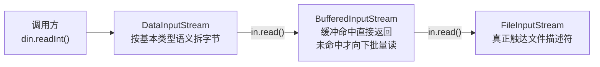
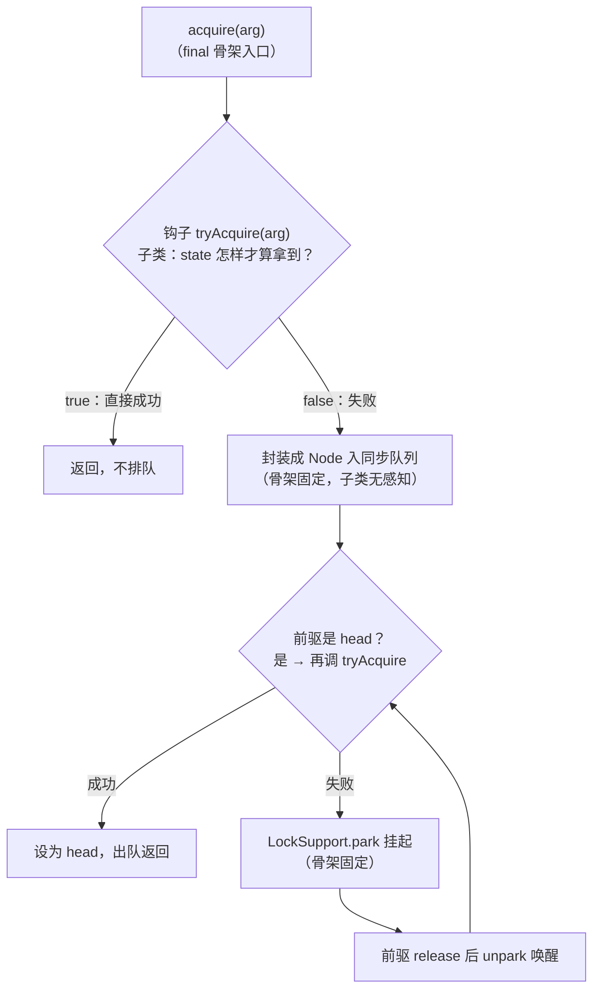

# JDK 标准库中的设计模式巡礼

> 一句话概括：面试问「JDK 里有哪些设计模式」时，比背名字更重要的是**模式名 + JDK 实例 + 机制一句话 + 边界**这条链——JDK 标准库就是模式的活教材，本文按模式巡礼它的关键实例，深挖模板方法、迭代器、享元三个高频深挖点，与 Spring 视角的模式巡礼互补。

预计阅读时间：大约 85 分钟

所属主题：[设计模式常见面试题总结](summary.md)

本文以 JDK 21 为基线，所有源码锚点用 `类名#方法名` 标注，已对照本地 OpenJDK 21（Corretto 21.0.6）`src.zip` 与 JDK 21 javadoc 核实；涉及行为差异的版本点单独标注。Spring 侧的模式（BeanFactory、HandlerAdapter、事件机制等）见 [Spring 中的设计模式详解](../backend/java/spring/design-patterns.md)，GoF 原理与 UML 见 [设计模式与原则](principles-and-uml.md)，本文只讲 JDK 标准库视角。

---

## 0. 阅读路线

| 读者 | 建议阅读 | 关注点 |
| --- | --- | --- |
| 初级（1 年内） | 1、2、3、4、5.1、14 | 能对着总表说出「模式 → JDK 实例 → 一句话机制」，避开 `==` 与 `Arrays.asList` 两类坑 |
| 中级（1~3 年） | 全部，重点 5、6、8、10.1~10.2 | 装饰器委托链、fail-fast 的 modCount 源码、模板方法的骨架-钩子结构 |
| 高级（3 年+） | 3.3、8.3~8.4、10.3、11、13 | AQS 钩子协议与公平/非公平差异、fail-safe 选型、桥接/组合背后的 API 设计取向 |
| 选型/架构 | 1.2、各节「边界/代价」、12~13 | JDK API 的演化方向（不可变 + Builder 化）、什么时候不该套模式 |

目录：

1. 开篇：为什么 JDK 是最好的模式教材（含全景总表）
2. 单例：Runtime、Toolkit 与 Desktop
3. 工厂与静态工厂
4. 享元：包装类缓存与 String 常量池
5. 装饰器：java.io 流族与 Collections 包装器
6. 适配器：Arrays.asList、InputStreamReader 与旧 API 桥
7. 代理：java.lang.reflect.Proxy
8. 迭代器：协议、fail-fast 与 fail-safe
9. 观察者：Observable 的教训与事件监听体系
10. 模板方法：AbstractList、InputStream 与 AQS（重点）
11. 策略与命令
12. 建造者
13. 桥接与组合
14. 高频面试追问集
15. 参考资料

---

## 1. 开篇：为什么 JDK 是最好的模式教材

### 1.1 三个理由

**结论**：JDK 是学模式成本最低、可信度最高的教材，理由有三：

1. **作者就是模式的实践者**。GoF 一书的三位作者与 JDK 集合框架的主设计师（Joshua Bloch）同属一个学术谱系，集合框架本身就是模式论文——《Effective Java》的第一条就是「考虑用静态工厂方法代替构造器」，这条建议直接解释了 JDK 里成片的 `valueOf`/`of`/`getInstance`；
2. **代码就在你的 JDK 里**。不需要反编译框架，`Integer.java`、`ArrayList.java`、`AbstractQueuedSynchronizer.java` 随 `src.zip` 发布，模式是「正在服役」的，不是书里的玩具；
3. **面试高频**。「JDK/JDK 标准库里有哪些设计模式」几乎是 Java 面试的必问题，答法的分寸感见 1.2。

### 1.2 答题套路：模式名 + 实例 + 机制一句话 + 边界

只报菜名（「Integer.valueOf 是享元」）值 30 分，完整答法是四段链：

| 层次 | 示例（以享元为例） |
| --- | --- |
| ① 模式名 | 享元（Flyweight） |
| ② JDK 实例 | `IntegerCache` 缓存 -128~127 的包装对象，`Integer#valueOf` 命中即复用 |
| ③ 机制一句话 | 值域有限 + 对象不可变 → 预建对象池，避免重复创建 |
| ④ 边界 | 只对 `valueOf`/自动装箱生效；`new Integer(127)`（已废弃）每次都是新对象；`==` 比较陷阱 |

「接口变了是适配器、接口没变是装饰器/代理」这类对比口诀见 [结构型模式辨析](structural-patterns.md)；同一批模式在 Spring 里长什么样，见 [Spring 中的设计模式详解](../backend/java/spring/design-patterns.md)——两篇对照读，模式就从名词变成了视角。

### 1.3 全景总表

下表覆盖本文涉及的全部 JDK 实例，面试前扫一遍即可完成「报菜名」；每个实例的机制、边界与源码证据在后续章节展开。

| 模式 | JDK 实例 | 源码锚点 | 一句话机制 |
| --- | --- | --- | --- |
| 单例 | `Runtime` | `Runtime#getRuntime` | 饿汉静态字段 + 私有构造器，类加载期保证唯一 |
| 单例 | `Toolkit` | `Toolkit#getDefaultToolkit` | 懒汉 + synchronized，headless 环境包装成 `HeadlessToolkit` 而不报错 |
| 单例 | `Desktop` | `Desktop#getDesktop` | synchronized + 每 AppContext 缓存一份，headless 直接抛 `HeadlessException` |
| 静态工厂 | `Integer#valueOf` | `Integer#valueOf(int)` | 缓存命中复用实例，代替构造器 |
| 静态工厂 | `String#valueOf` | `String#valueOf(...)` | 重载族统一「转字符串」入口 |
| 静态工厂 | `List#of` / `Map#of` / `Set#of` | `List#of`（JDK 9+） | 实现类 `List12`/`ListN` 包私有，返回不可变集合 |
| 静态工厂 | `Calendar#getInstance` | `Calendar#getInstance` | 按 locale/时区分派到具体日历子类 |
| 静态工厂 | `Charset#forName` | `Charset#forName` | 按别名查提供者注册表（SPI） |
| 静态工厂 | `Executors` 家族 | `Executors#newFixedThreadPool` | 静态工厂封装 `ThreadPoolExecutor` 组装细节 |
| 享元 | `IntegerCache` | `Integer$IntegerCache` | 预建 [-128, high] 对象复用 |
| 享元 | `Boolean#valueOf` | `Boolean#valueOf(boolean)` | 直接返回 `TRUE`/`FALSE` 常量 |
| 享元 | String 常量池 | `String#intern` | 字面量去重共享 |
| 装饰器 | java.io 流族 | `FilterInputStream` | 同接口持有被装饰者 `in`，逐层委托 |
| 装饰器 | `Collections#unmodifiableList` | `Collections#unmodifiableList` | 只读视图，写操作抛 `UnsupportedOperationException` |
| 装饰器 | `Collections#synchronizedList` | `Collections#synchronizedList` | 每个方法加 mutex 互斥 |
| 适配器 | `Arrays#asList` | `Arrays#asList` | 返回数组视图适配 `List` 接口（固定大小） |
| 适配器 | `InputStreamReader` | `InputStreamReader#read` | 字节流适配为字符流（StreamDecoder 做解码） |
| 适配器 | `Collections#list` | `Collections#list(Enumeration)` | `Enumeration` 适配进集合世界 |
| 代理 | `java.lang.reflect.Proxy` | `Proxy#newProxyInstance` | 运行时生成实现接口的 `$Proxy` 类，转发 `InvocationHandler` |
| 迭代器 | `Iterator`/`Iterable` | `ArrayList$Itr#next` | 统一遍历协议；fail-fast 靠 modCount |
| 迭代器 | `COWIterator` | `CopyOnWriteArrayList$COWIterator` | 数组快照，弱一致不抛 CME |
| 观察者 | `Observable`/`Observer` | `Observable#notifyObservers` | JDK 9 起 deprecated 的观察者实现 |
| 观察者 | `PropertyChangeListener` | `PropertyChangeSupport#firePropertyChange` | 属性变更事件广播（JavaBeans 事件模型） |
| 模板方法 | `AbstractList` | `AbstractList#get(int)`（抽象）+ `#iterator()` | iterator/subList 骨架基于抽象 `get` 实现 |
| 模板方法 | `InputStream` | `InputStream#read()`（抽象）+ `#read(byte[],int,int)` | 批量读骨架循环调单字节读 |
| 模板方法 | AQS | `AbstractQueuedSynchronizer#acquire` + `#tryAcquire` | 排队-挂起-重试骨架固定，钩子决定「能否拿到状态」 |
| 策略 | `Comparator` | `Comparator#compare` | 比较算法注入 `List#sort` |
| 策略 | `RejectedExecutionHandler` | `ThreadPoolExecutor$AbortPolicy` 等 | 线程池拒绝策略可替换 |
| 策略 | `ThreadFactory` | `Executors#defaultThreadFactory` | 线程创建方式可替换 |
| 命令 | `Runnable`/`Callable`/`TimerTask` | `Runnable#run` / `Callable#call` | 把「一段要执行的事」封装成对象 |
| 建造者 | `StringBuilder` | `StringBuilder#append` | 可变字符序列累积（非典型 GoF Builder） |
| 建造者 | `Locale.Builder` / `Calendar.Builder` | `Calendar.Builder#build` | 分步构造复杂配置对象（`Locale.Builder` JDK 7+，`Calendar.Builder` JDK 8+） |
| 建造者 | `HttpRequest.Builder` | `HttpRequest.Builder#build` | 链式装配不可变请求（JDK 11+） |
| 桥接 | JDBC | `DriverManager#getConnection` / `Driver#connect` | `java.sql` API 抽象与厂商驱动实现两维度解耦 |
| 组合 | AWT 组件树 | `Container#add` / `java.awt.Component` | 容器持有子组件，树形统一处理 |

> 面试里偶尔被问「JDK 里有责任链吗」：标准库内没有教科书式责任链，最常被引的是**类加载的双亲委派**（`ClassLoader#loadClass` 沿父加载器链委派，找不到才自己加载）——它是责任链思想的变体，完整展开见 [责任链模式](chain-of-responsibility.md)。

---

## 2. 单例：Runtime、Toolkit 与 Desktop

**结论**：JDK 标准库提供了单例的两种经典写法——**饿汉静态字段**（`Runtime`）与**懒汉 + synchronized**（`Toolkit`/`Desktop`），而且各自在「headless 无图形环境」这个边界上给出了不同的容错态度：`Toolkit` 包一层继续用，`Desktop` 直接抛异常。

### 2.1 Runtime：教科书级饿汉

```java
// Runtime（JDK 21，节选）
private static final Runtime currentRuntime = new Runtime();

public static Runtime getRuntime() {
    return currentRuntime;
}

/** Don't let anyone else instantiate this class */
private Runtime() {}
```

**机制**：`static final` 字段在类初始化时赋值，由 JVM 类加载机制保证**线程安全且只执行一次**——不需要 double-checked locking，也不需要枚举。私有构造器 + `final` 字段堵死了替换与多实例的可能。

**边界与代价**：饿汉的代价是「不管用不用，类一加载就创建」。对 `Runtime` 无所谓（每个 JVM 必然要用）；对创建成本高、且可能永远不被使用的对象，就该像 `Toolkit` 那样懒加载。

### 2.2 Toolkit 与 Desktop：懒汉的两种容错态度

```java
// Toolkit#getDefaultToolkit（JDK 21，简化）
public static synchronized Toolkit getDefaultToolkit() {
    if (toolkit == null) {
        toolkit = PlatformGraphicsInfo.createToolkit();
        if (GraphicsEnvironment.isHeadless() && !(toolkit instanceof HeadlessToolkit)) {
            toolkit = new HeadlessToolkit(toolkit);   // headless：包一层降级，不炸
        }
        if (!GraphicsEnvironment.isHeadless()) {
            loadAssistiveTechnologies();
        }
    }
    return toolkit;
}
```

```java
// Desktop#getDesktop（JDK 21，简化）
public static synchronized Desktop getDesktop() {
    if (GraphicsEnvironment.isHeadless()) throw new HeadlessException();  // headless：直接抛
    if (!Desktop.isDesktopSupported()) {
        throw new UnsupportedOperationException("Desktop API is not supported on the current platform");
    }
    // 实例按 AppContext 缓存，同一上下文内返回同一份
    Desktop desktop = (Desktop) context.get(Desktop.class);
    if (desktop == null) { desktop = new Desktop(); context.put(Desktop.class, desktop); }
    return desktop;
}
```

| 维度 | `Runtime` | `Toolkit` | `Desktop` |
| --- | --- | --- | --- |
| 惰性 | 饿汉（类加载即建） | 懒汉（首次调用建） | 懒汉（首次调用建） |
| 线程安全手段 | 类加载机制 | `static synchronized` | `synchronized` + AppContext 缓存 |
| headless 环境 | 无关（不依赖图形） | 包装 `HeadlessToolkit` 降级可用 | 抛 `HeadlessException` |
| 附加异常边界 | — | — | 平台不支持再抛 `UnsupportedOperationException`（先 `isDesktopSupported()` 判断） |

**边界与代价**：三个实现都不是「全局唯一」意义上的 JVM 单例——`Desktop` 是**每 AppContext 一份**（Applet 时代的多上下文残留，今天一般上下文只有一个），`Toolkit` 同理。另外 `static synchronized` 锁的是类对象，方法内不做 DCL，因为 `synchronized` 本身已经足够（这里的创建成本没有低到值得省一次锁）。headless 边界是服务端开发的真实坑：CI/容器里常没有显示器，随手调 `Desktop.getDesktop().open(file)` 预览文件会在 headless 环境直接抛 `HeadlessException`——先判 `GraphicsEnvironment.isHeadless()` 或捕获异常。

**实践/追问**：为什么 JDK 不用枚举单例或 DCL？`Runtime` 早于《Effective Java》第 3 条的枚举建议出现（JDK 1.0），而 `synchronized` 方法在低频获取场景足够简单。面试可答「单例写法的选择取决于创建成本、是否依赖环境状态（headless）与历史包袱，不是背一个『最优解』」。单例的完整演化（DCL、静态内部类、枚举）见 [单例模式](singleton.md)。

---

## 3. 工厂与静态工厂

**结论**：JDK 用静态工厂（而非构造器）暴露创建入口，核心收益是**有名字、可缓存复用、可返回不公开的实现类**——最后一条是理解 `List#of`、`Calendar#getInstance` 这类「拿到的类型和 API 面不一样」的钥匙。

### 3.1 Integer#valueOf 与 String#valueOf：最小静态工厂

`Integer#valueOf(int)` 的意义见第 4 章（它是享元的入口）；`String#valueOf` 则展示静态工厂的第一条收益——**有名字**：`String.valueOf(x)` 比 `x + ""` 或 `x.toString()`（有 NPE 风险）更清楚地表达「把任意东西转成字符串，null 也会被安全转成 "null"」。

### 3.2 List#of / Map#of / Set#of：实现类不公开的原因

**机制**（JDK 9+）：`List#of` 返回的不是 `ArrayList`，而是 `java.util` 包内**包私有**的 `ImmutableCollections.List12`（1~2 元素）或 `ListN`（更多元素），对外只承诺 `List` 接口 + 不可变语义。

实现类不公开有三层收益：

| 收益 | 说明 |
| --- | --- |
| API 只承诺契约 | 调用方拿到的类型是 `List`，无法按实现类编程（调 `ArrayList` 独有方法会编译失败） |
| 实现自由度 | JDK 可以按元素个数选不同实现（如 `List12` 字段直接存元素，无数组开销），日后换实现不动任何调用方 |
| 防御性设计 | 不可变类型「不提供修改方法」即可强约束；若是公开的 `ArrayList` 子类，就得到处防御 `add` 被谁调了 |

**边界与代价**：

| 维度 | `List.of` | `Arrays.asList` | `Collections.unmodifiableList` |
| --- | --- | --- | --- |
| 可变性 | 完全不可变（读写皆否） | 固定大小（`set` 可写穿） | 只读视图（底层可变则内容可变） |
| null 元素 | 不允许（NPE） | 允许 | 随底层 |
| 实现类 | 包私有 | `Arrays$ArrayList`（私有内部类） | `Collections$UnmodifiableList` |
| 版本 | JDK 9+ | JDK 1.2+ | JDK 1.2+ |

`Arrays.asList` 返回的也是私有内部类——这正是「静态工厂 + 私有实现类」组合的第一次应用（JDK 1.2），`List.of` 只是把「实现类不公开」从副作用变成了设计目标。不可变集合的完整行为差异与选择建议见 [现代 Java 与模式滥用](modern-java-and-anti-patterns.md)。

### 3.3 Calendar#getInstance 与 Charset#forName：按上下文分派

**结论**：`Calendar#getInstance` 是「工厂方法返回隐蔽子类」的教科书案例——你调用的是抽象类 `Calendar` 的静态方法，拿到的却总是 `GregorianCalendar`（或按 locale 得到的日本历等实现），**具体类型由 locale 与时区在运行期决定**。

```java
Calendar cal = Calendar.getInstance();              // 可能是 GregorianCalendar / JapaneseImperialCalendar
Charset utf8 = Charset.forName("UTF-8");            // 按别名查注册表，命中标准或第三方字符集
```

**机制**：`Calendar#getInstance` 内部根据 `Locale` 与 `TimeZone` 选择具体日历实现；`Charset#forName` 沿 SPI 注册表（`META-INF/services/java.nio.charset.spi.CharsetProvider`）查找标准字符集与第三方提供者——这是「工厂 + SPI」的联动，`ServiceLoader` 加载提供者、工厂按名字分派。

**边界与代价**：`Calendar` API 的可变设计与月从 0 计数的怪癖使其成为被 `java.time` 取代的对象，但它的「按上下文分派返回不同实现」仍然是讲工厂方法的最佳实例。`Charset#forName` 对非法名字抛 `IllegalCharsetNameException`、对未注册名字抛 `UnsupportedCharsetException`——两种异常类型不同，捕获时要分开。

### 3.4 Executors：封装组装细节，也封装了坑

```java
// Executors#newFixedThreadPool（JDK 21）
public static ExecutorService newFixedThreadPool(int nThreads) {
    return new ThreadPoolExecutor(nThreads, nThreads,
                                  0L, TimeUnit.MILLISECONDS,
                                  new LinkedBlockingQueue<Runnable>());   // 无参构造 = 无界队列
}
```

**结论**：`Executors` 是线程池的静态工厂门面，好处是把 `ThreadPoolExecutor` 七个构造参数的组装细节封装掉；坏处是**默认值里有雷**——`newFixedThreadPool` 与 `newSingleThreadExecutor` 用的是**无参 `LinkedBlockingQueue`，容量默认 `Integer.MAX_VALUE`**，任务堆积会撑爆内存；`newCachedThreadPool` 上限同样是 `Integer.MAX_VALUE` 个线程。阿里巴巴《Java 开发手册》因此明确规定「不允许使用 Executors 创建线程池，须手动 new ThreadPoolExecutor」。原理、参数与规范出处见 [线程池原理与工程实践](../backend/java/concurrency/thread-pool.md)，拒绝策略本身是策略模式，见 11.1。

---

## 4. 享元：包装类缓存与 String 常量池

**结论**：享元（Flyweight）在 JDK 的适用条件非常清晰——**值域有限 + 对象不可变 + 创建频繁**，三者缺一不可；JDK 的落点是包装类缓存与 String 常量池，而它们的最大代价是 `==` 陷阱。

### 4.1 IntegerCache：预建对象池

```java
// Integer$IntegerCache（JDK 21，节选）
private static final class IntegerCache {
    static final int low = -128;      // 下界写死
    static final int high;            // 上界可调

    static {
        int h = 127;
        String integerCacheHighPropValue =
            VM.getSavedProperty("java.lang.Integer.IntegerCache.high");   // -XX:AutoBoxCacheMax 映射到这里
        if (integerCacheHighPropValue != null) {
            h = Math.max(parseInt(integerCacheHighPropValue), 127);       // 只升不降
            h = Math.min(h, Integer.MAX_VALUE - (-low) - 1);
        }
        high = h;
        // 预建 low..high 的 Integer[]；CDS 场景下从共享归档加载
        ...
    }
}

public static Integer valueOf(int i) {
    if (i >= IntegerCache.low && i <= IntegerCache.high)
        return IntegerCache.cache[i + (-IntegerCache.low)];
    return new Integer(i);
}
```

**机制**：类初始化时预建 `[-128, high]` 的 `Integer` 数组，`Integer#valueOf` 命中区间直接返回池内对象；自动装箱（`Integer a = 127;`）在字节码层就是 `Integer.valueOf(127)`，所以「缓存生效于装箱与 valueOf，不生效于 `new Integer(...)`」。范围 `-128~127` 是 JLS 5.1.7 强制要求的下限（源码注释与断言 `assert IntegerCache.high >= 127` 都写明了）。JDK 21 中该缓存还随 CDS 归档加载（源码注释 `WARNING: The cache is archived with CDS...`）。

**边界与代价**：

- **`-XX:AutoBoxCacheMax=<n>` 只调上界**：映射为系统属性 `java.lang.Integer.IntegerCache.high`，源码里 `Math.max(h, 127)` 保证不会低于 127，而 `low` 是 `static final int low = -128`——**下界永远固定 -128**。答「上下界都可调」是错的；
- `Long`/`Short`（-128~127）、`Character`（0~127）缓存**固定不可调**，没有对应的 VM 参数；
- `Boolean#valueOf(boolean)` 更直接：源码就是 `return (b ? TRUE : FALSE);`——只有两个对象，连数组都不需要。

### 4.2 == 陷阱：可运行示例

```java
public class BoxedCacheDemo {
    public static void main(String[] args) {
        Integer a = 127, b = 127;        // 编译为 Integer.valueOf(127)：命中缓存
        System.out.println(a == b);      // true —— 同一个缓存对象

        Integer c = 128, d = 128;        // 超出默认缓存上界
        System.out.println(c == d);      // false —— 各自 new，不同对象
        System.out.println(c.equals(d)); // true —— 包装类比较一律用 equals

        int e = 128;
        System.out.println(c == e);      // true —— c 自动拆箱为 int，退化为值比较
    }
}
```

**实践规范**：包装类之间的比较一律用 `equals`（或 `Objects.equals`，顺手处理 null）；一边是基本类型时 `==` 会触发拆箱值比较（此时反而安全）；`Map<Integer, ...>`、集合去重等场景同理。这个坑在「-128~127 之内的测试用例恰好通过、上生产跑到 128 就出错」时最难查。

### 4.3 String 常量池：编译期享元 + 运行期 intern

**机制**：编译期，相同字面量 `"abc"` 在 class 常量池中只存一份；运行期，JDK 7 起字符串常量池位于堆中（JDK 6 在永久代），`String#intern` 把非常量字符串的引用登记进池并返回池内那个。`new String("abc")` 会在堆上创建新对象、不走常量池，而字面量赋值直接复用池内对象——于是 `new String("a") == "a"` 为 false，`intern()` 后为 true。

**边界与代价**：享元要求不可变，`String` 正是为不可变而生的类；反过来说，**可变对象绝不能用 `==` 语义共享**。享元与「对象池/连接池」的区别：享元共享**不可变的值**（无需归还），池复用**有状态的资源**（必须归还）——面试常混，记住「享元无生命周期，池有」。

---

## 5. 装饰器：java.io 流族与 Collections 包装器

### 5.1 java.io 流族：装饰器的原生栖息地

**结论**：`java.io` 的输入流族是装饰器的原生范例——`FilterInputStream` 与被装饰者实现同一接口 `InputStream`，持有引用并逐层委托；缓冲、类型读取、解压等能力全部通过「套一层」叠加，而不是靠继承组合出 `BufferedDataGZIPFileInputStream` 这种类爆炸。

```java
// FilterInputStream（JDK 21，节选）——装饰器的全部骨架就这几行
protected volatile InputStream in;

public int read() throws IOException {
    return in.read();        // 默认纯委托：增强与否交给子类
}
```

**机制**：所有增强子类都只干一件事——覆写方法，在委托前后插入行为：`BufferedInputStream#read` 先查缓冲区，未命中才批量向下读；`DataInputStream#readInt` 连续读 4 个字节按大端拼 int；`GZIPInputStream` 按压缩格式解压后再吐字节。`FilterInputStream#in` 标了 `volatile`，这是历史遗留的并发容错写法，不代表流本身线程安全。

叠加是运行时行为：

```java
try (var fin = new FileInputStream("data.bin");
     var bin = new BufferedInputStream(fin);      // 套第一层：缓冲
     var din = new DataInputStream(bin)) {        // 套第二层：按基本类型读
    int magic = din.readInt();                    // 关闭只需关最外层，close 逐层向下传播
    ...
}
```

调用 `din.readInt()` 时数据的流动路径（**运行时委托链**，UML 类图见 [结构型模式](structural-patterns.md)）：



**边界与代价**：装饰器叠加的代价是**每个字节都要穿完整条链**——如果用 `BufferedInputStream` 包了一个**没覆写** `read(byte[],int,int)` 的流，批量读会退化为逐字节循环（见 10.2 的骨架），缓冲形同虚设；`readAllBytes`/`readNBytes` 等 JDK 9+ 的批量方法最终都会落到三参 `read` 上，选流时要知道每一层覆写了什么。

### 5.2 Collections 包装器：只读与同步两种装饰

**结论**：`Collections#unmodifiableList` 是**只读视图装饰器**（接口没变、行为变窄），`Collections#synchronizedList` 是**同步装饰器**（每个方法包一层 mutex）——两者都是「包装 + 委托」，但解决的方向相反：一个收窄能力，一个补足能力。

| 维度 | `unmodifiableList` | `synchronizedList` |
| --- | --- | --- |
| 读 | 委托底层（read-through，底层变了看得见） | 委托底层（加锁） |
| 写 | 抛 `UnsupportedOperationException`（javadoc：direct or via its iterator） | 成功（加锁） |
| 迭代 | 不安全（底层并发改时同底层） | **javadoc 明确要求手动同步**（见下） |
| 已包装复入 | `@implNote`：参数已是 unmodifiable 时直接返回自身 | 返回新的包装层 |

`synchronizedList` 的 javadoc 原文（Collections.java，逐字）：

> It is imperative that the user manually synchronize on the returned list when traversing it via Iterator, Spliterator or Stream:
>
> ```java
> List list = Collections.synchronizedList(new ArrayList());
> ...
> synchronized (list) {
>     Iterator i = list.iterator(); // Must be in synchronized block
>     while (i.hasNext())
>         foo(i.next());
> }
> ```
>
> Failure to follow this advice may result in non-deterministic behavior.

**边界与代价**：单方法同步 ≠ 复合操作同步——`if (!list.contains(x)) list.add(x)` 的 check-then-act 仍需外部持锁；迭代必须手动 `synchronized (list)`，且锁对象必须是**返回的包装对象**（不是底层 list）。这两点是它输给 `CopyOnWriteArrayList`/并发容器的主因，选型对比见 8.4 与 Q3。

---

## 6. 适配器：Arrays.asList、InputStreamReader 与旧 API 桥

**结论**：适配器转换接口让不兼容的类协作——**接口变了是适配，接口没变是代理/装饰**（口诀出处见 [Spring 中的设计模式](../backend/java/spring/design-patterns.md)）。JDK 里最经典的三个适配器都在「新旧世界之间架桥」。

| 适配器 | Adaptee（被适配） | Target（目标接口） | 语义 |
| --- | --- | --- | --- |
| `Arrays#asList` | `T[]` 数组 | `List<T>` | 数组视图适配为 List，javadoc 自述 "acts as bridge between array-based and collection-based APIs" |
| `InputStreamReader` | `InputStream` 字节流 | `Reader` 字符流 | 字节→字符，内部 StreamDecoder 按字符集解码 |
| `Collections#list` | `Enumeration` | 返回 `ArrayList<T>` | 旧枚举接口搬进集合世界（`while (e.hasMoreElements()) l.add(e.nextElement())`） |

### 6.1 Arrays#asList 的三个坑

**机制**（JDK 21 源码）：

```java
public static <T> List<T> asList(T... a) {
    return new ArrayList<>(a);              // 注意：是 Arrays 的私有内部类，不是 java.util.ArrayList
}

private static class ArrayList<E> extends AbstractList<E> implements RandomAccess, java.io.Serializable {
    private final E[] a;                    // 直接持有原数组引用 —— 视图
    ...
}
```

javadoc 三句关键话：**"The returned list implements the optional Collection methods, except those that would change the size of the returned list"**（变长的方法抛 `UnsupportedOperationException`）；**"a list view of the specified array"**（视图，写穿回数组）；**"The list returned by this method is modifiable"**（`set` 是可以的——固定大小 ≠ 不可变）。

三个坑对应的可运行示例：

```java
String[] arr = {"a", "b", "c"};
List<String> list = Arrays.asList(arr);

list.add("d");          // 坑 1：UnsupportedOperationException —— 固定大小
list.set(0, "A");       // OK：写穿回数组，arr[0] 变成 "A"
System.out.println(arr[0]);   // 坑 2：原数组跟着变 —— 同一块内存

int[] nums = {1, 2, 3};
List<int[]> wrong = Arrays.asList(nums);   // 坑 3：基本类型数组被当成单个元素
// List<Integer> right = Arrays.stream(nums).boxed().toList();
```

**边界与代价**：返回类型签名是 `List<T>`，但真实类型是 `Arrays$ArrayList`——不要写 `ArrayList<String> l = (ArrayList<String>) Arrays.asList(...)`，那是另一个类的名字；要把数组变成可增删的 List，用 `new ArrayList<>(Arrays.asList(arr))` 或 JDK 10+ 的 `List.copyOf`。**追问：为什么不直接返回 `java.util.ArrayList`？** 那样要么拷贝数组（破坏视图语义），要么让 `ArrayList` 依赖数组布局——私有适配类两个问题都没有，这正是适配器模式的价值。

### 6.2 其他两座桥

`InputStreamReader` 的适配发生在**解码层**：它把「每次给一个 byte」的 `InputStream` 适配成「每次给一个 char」的 `Reader`，真正的状态机在 `StreamDecoder` 里。`Collections#list(Enumeration)` 则是迁移时代的桥——老 API（`Vector#elements`、servlet 上下文）吐 `Enumeration`，新代码要 `List`，一行 `Collections.list(enum)` 搬运完事。历史上 Swing 组件把外观绘制委托给独立的 "UI delegate" 对象，早期文档把它称作 adapter，这个旧名偶尔在面试里出现——按「组件持有委托对象、按观感替换」理解即可。

---

## 7. 代理：java.lang.reflect.Proxy

**结论**：`java.lang.reflect.Proxy` 是 JDK 内建的**运行时动态代理**——在运行期生成一个实现指定接口的类（`$Proxy`），把所有方法调用转发给 `InvocationHandler`。它是 Spring AOP 的 JDK 代理、MyBatis Mapper 接口的共同地基。

```java
interface Greeter { String greet(String name); }

public class ProxyDemo {
    public static void main(String[] args) {
        Greeter proxy = (Greeter) Proxy.newProxyInstance(
            Greeter.class.getClassLoader(),
            new Class<?>[]{Greeter.class},
            (p, method, a) -> {                     // InvocationHandler：所有方法调用的唯一入口
                System.out.println("before " + method.getName());
                return "hi, " + a[0];
            });
        System.out.println(proxy.greet("jdk"));     // before greet → hi, jdk
        System.out.println(proxy.getClass().getName());  // jdk.proxy2.$Proxy0（JDK 17+ 命名风格）
    }
}
```

**机制**：`Proxy#newProxyInstance` 用 `WeakCache` 缓存生成的代理类（同一接口组合只生成一次），代理类继承 `java.lang.reflect.Proxy` 并实现全部传入接口；每个方法调用被路由到 `InvocationHandler#invoke`，方法对象与参数以反射形式传入。**限制**：只能代理接口（目标不是接口时补位方案是 CGLIB 子类代理）；`Object` 的 `toString`/`equals`/`hashCode` 也会进 handler。

**边界与代价**：反射调用比直接调用慢（现代 JDK 已大幅优化，差距缩小）；handler 抛出的受检异常必须与接口方法签名声明兼容，否则 `UndeclaredThrowableException` 包裹后重抛。机制的完整展开（与 CGLIB 对比、Spring 的 `JdkDynamicAopProxy`）见 [代理模式](proxy.md)；「接口没有实现类，实例是运行时代理」的典型应用见 MyBatis 的 [Mapper 接口动态代理](../backend/java/mybatis/mapper-proxy-and-binding.md)。**历史一笔带过**：RMI 在 JDK 1.3 之前靠编译期生成的 stub 骨架类做远程代理，`Proxy`（JDK 1.3 引入）出现后，新一代 API（RMI-IIOP、后续框架）都改走运行时动态代理——动态代理本身就是被 JDK 自己先吃狗粮的机制。

---

## 8. 迭代器：协议、fail-fast 与 fail-safe

### 8.1 Iterable/Iterator 协议与 for-each

**结论**：`Iterable`（可被遍历）/`Iterator`（怎么遍历）分离，让「遍历」与「集合实现」解耦——增强 for 循环是语法糖，编译器把它脱糖为迭代器循环（数组则退化为下标循环）。

```java
for (String s : list) { ... }
// 编译后 ≈
for (Iterator<String> it = list.iterator(); it.hasNext(); ) {
    String s = it.next();
    ...
}
```

**机制**：`Collection` 继承 `Iterable`，`iterator()` 每次返回**新的**迭代器实例——每个迭代器有自己的游标状态，这也是「迭代器把状态从集合里拆出来」的含义。

### 8.2 fail-fast：modCount 机制（源码证据）

**结论**：fail-fast 不是「检测并发修改的安全机制」，而是 **best-effort 的 bug 探测器**——`ArrayList` 自己的 javadoc 就写明 fail-fast 行为只应用于发现程序 bug，不能依赖它保证正确性。

**机制**（JDK 21 源码）：

```java
// AbstractList（JDK 21）
protected transient int modCount = 0;        // 结构性修改计数：add/remove 时自增

// ArrayList$Itr（JDK 21）—— "An optimized version of AbstractList.Itr"
private class Itr implements Iterator<E> {
    int expectedModCount = modCount;         // 迭代器创建时快照

    public E next() {
        checkForComodification();            // ← 每次取元素前校验（ArrayList.java:1049）
        ...
    }

    public void remove() {
        ...
        ArrayList.this.remove(lastRet);
        expectedModCount = modCount;         // ← 自己改完主动同步快照，所以迭代器删除是合法的
    }

    final void checkForComodification() {
        if (modCount != expectedModCount)
            throw new ConcurrentModificationException();   // （ArrayList.java:1093）
    }
}
```

链路：**迭代期间集合被结构性修改 → `modCount` 自增 → 下次 `next()` 里快照比对失败 → 抛 `ConcurrentModificationException`**。

**边界与代价——一个经典反例**：

```java
List<String> list = new ArrayList<>(List.of("a", "b"));
for (String s : list) {
    if (s.equals("a")) list.remove(s);   // 删的是倒数第二个元素：不抛 CME！
}
```

原因：`hasNext()` 的实现是 `cursor != size`，删除后 size 减 1。删除**倒数第二个**元素时恰好 `cursor == 新 size`（next 返回 "a" 后 cursor=1，删除后 size=1），循环直接退出，**根本没走到 `next()` 的校验**。反过来，删最后一个元素（"b"）会让下一轮 `next()` 里的 `checkForComodification` 命中，**照抛 CME**。所以「这段代码没炸」不等于「迭代中删除没问题」，只等于「这次没被逮到」。

### 8.3 迭代时删除的正确姿势

| 场景 | 写法 |
| --- | --- |
| 单个条件删除 | `it.remove()`（迭代器内部会同步 `expectedModCount`，见 8.2 源码） |
| 批量条件删除 | `list.removeIf(x -> ...)`（内部自己管理迭代与 modCount） |
| 明确的索引删除 | 倒序 for 下标循环（避免删元素后索引位移） |
| 并发场景 | 换 `CopyOnWriteArrayList` 或加锁（见 8.4） |

### 8.4 fail-safe 对照：CopyOnWriteArrayList 的快照迭代器

**结论**：`CopyOnWriteArrayList` 的迭代器持有**数组快照**，遍历的是创建迭代器那一刻的数据，完全感知不到后续修改——**弱一致、不抛 CME、不支持删除**。

```java
// CopyOnWriteArrayList（JDK 21）
public Iterator<E> iterator() {
    return new COWIterator<E>(getArray(), 0);      // 拿当前数组引用当快照
}

static final class COWIterator<E> implements ListIterator<E> {
    private final Object[] snapshot;               // 快照字段
    public void remove() {
        throw new UnsupportedOperationException(); // 快照上不能删（CopyOnWriteArrayList.java:1207）
    }
}
```

**边界与代价**：写操作复制整个数组（`Arrays.copyOf`），内存翻倍、写代价 O(n)；快照数据**不是最新的**——「遍历时别的线程刚写的元素看不见」在监控告警这类场景无害，在「边遍历边校验最新状态」的场景是 bug。选型对照：

| 维度 | `ArrayList` + 手动锁 | `Collections.synchronizedList` | `CopyOnWriteArrayList` |
| --- | --- | --- | --- |
| 读性能 | 不安全 | 加锁 | 无锁、最快 |
| 写性能 | 最高 | 加锁 | 复制数组，最差 |
| 迭代 | 不安全 | 需手动 `synchronized (list)` | 快照，天然安全 |
| 适用 | 单线程 | 写多读少的并发 | **读极多写极少**（监听器列表、白名单） |

完整并发容器对比见 [并发容器与阻塞队列](../backend/java/concurrency/concurrent-collections.md)。

---

## 9. 观察者：Observable 的教训与事件监听体系

**结论**：`java.util.Observable` 自 JDK 9 起 deprecated——**不是观察者模式错了，是这套实现错了**；JDK 里真正活到今天的观察者形态是 `EventListener` 监听器体系与 `PropertyChangeSupport`。

### 9.1 Observable 为什么被废弃

javadoc 给出的三条官方原因（Observable.java，逐字大意）：

1. **事件模型相当有限**（The event model supported by Observer and Observable is quite limited）；
2. **通知顺序未指定**（the order of notifications delivered by Observable is unspecified）；
3. **状态变更与通知不是一一对应**（state changes are not in one-for-one correspondence with notifications）——`setChanged()` 后连续多次 `notifyObservers()` 只会通知一次。

javadoc 同时指路：更丰富的事件模型用 `java.beans` 包；线程间可靠有序通信用 `java.util.concurrent` 的并发数据结构；响应式流用 `Flow` API。结构缺陷与替代方案的完整辨析见 [观察者与事件驱动](observer-and-event-driven.md)。

### 9.2 EventListener 体系：活下来的观察者

**机制**：JDK/AWT/Swing 的事件体系按**约定**而非基类工作——事件类型实现 `EventListener` 标记接口（如 `ActionListener`），持有者提供 `addXxxListener`/`removeXxxListener` 对，事件发生时同步逐个回调。`PropertyChangeSupport` 是这套约定里最常复用的实现：bean 里 new 一个 support 对象，`addPropertyChangeListener` 注册、`firePropertyChange` 广播，监听器拿到属性名、旧值、新值。

```java
public class Temperature {
    private final PropertyChangeSupport pcs = new PropertyChangeSupport(this);
    private double celsius;

    public void setCelsius(double value) {
        double old = this.celsius;
        this.celsius = value;
        pcs.firePropertyChange("celsius", old, value);   // 值真变了才通知
    }
    public void addListener(PropertyChangeListener l) { pcs.addPropertyChangeListener(l); }
}
```

**边界与代价**：监听器**强引用**挂在被观察者上，忘记 `removeXxxListener` 就是内存泄漏（监听器的生命周期 ≥ 被观察者时尤其危险）；回调在发布线程**同步**执行，监听器耗时或抛异常直接影响发布者。这两点和 Spring 事件机制的行为一致（同步、同线程），处置思路见 [Spring 中的设计模式](../backend/java/spring/design-patterns.md) 6.3。

---

## 10. 模板方法：AbstractList、InputStream 与 AQS（重点）

**结论**：模板方法 = **骨架固化在抽象类，变化点留给子类**。JDK 里有三档教科书案例：集合骨架（`AbstractList` 用 `get` 一个抽象方法撑起 iterator/subList）、IO 骨架（`InputStream` 用单字节 `read()` 撑起整个流族）、并发骨架（AQS 用「排队-挂起-重试」固定流程 + try 系列钩子支撑了整个 `java.util.concurrent` 锁族）。这一节是并发面试的交叉考点。

### 10.1 AbstractList：一个抽象方法撑起的骨架

**机制**：`AbstractList#get(int)` 是自身唯一的抽象方法（`size()` 抽象自父类 `AbstractCollection`），子类需实现这两个；`iterator()`、`subList()`、`equals`/`hashCode` 等骨架全部基于它们实现。`AbstractList#iterator` 的 javadoc `@implSpec` 原文：

> This implementation returns a straightforward implementation of the iterator interface, **relying on the backing list's `size()`, `get(int)`, and `remove(int)` methods**.

子类只需要实现「按下标取第 i 个元素」这一件事（外加实现可变性的 `set`/`add`/`remove`），遍历、subList、随机访问 spliterator 全部白得。`ArrayList` 覆写 `get` 为数组直取 O(1)，并进一步把迭代器覆写为**直接操作内部数组**的 `Itr`（源码注释自称 "An optimized version of AbstractList.Itr"）。

**边界与代价**：骨架的默认实现按 `get(i)` 逐个取——对数组是 O(1)，对链表是 O(n)，整趟遍历就是 O(n²)。这就是 `LinkedList` 必须覆写自己的 `ListItr`（节点指针推进）的原因：**继承式模板方法的默认骨架是按「最省事的抽象」写的，子类性能敏感时仍要自己接管**。它与 Spring 的对比：`AbstractApplicationContext#refresh` 同样是继承式骨架（`onRefresh` 钩子留给 Boot 创建内嵌服务器），而 `JdbcTemplate` 用回调替代继承避免了耦合——两派取舍见 [Spring 中的设计模式](../backend/java/spring/design-patterns.md) 5.3。

### 10.2 InputStream：抽象 read() 是装饰器的地基（高频追问）

**机制**：`InputStream` 只有一个抽象方法——单字节 `read()`；所有批量读取都建立在它之上：

```java
// InputStream#read(byte[], int, int)（JDK 21 默认实现，InputStream.java:281）
public int read(byte[] b, int off, int len) throws IOException {
    Objects.checkFromIndexSize(off, len, b.length);
    if (len == 0) return 0;
    int c = read();                       // ← 唯一的抽象方法
    if (c == -1) return -1;
    b[off] = (byte)c;
    int i = 1;
    try {
        for (; i < len; i++) {
            c = read();                   // 骨架：循环调单字节读
            if (c == -1) break;
            b[off + i] = (byte)c;
        }
    } catch (IOException ee) {
        // 中途 IO 异常被吞：返回已读到的字节数（部分读语义）
    }
    return i;
}
```

JDK 9+ 的批量方法在这层骨架之上继续搭楼：`readNBytes(byte[], int, int)` 循环调三参 `read` 补齐（InputStream.java:504），`readAllBytes()` 就是 `readNBytes(Integer.MAX_VALUE)`（InputStream.java:348）。于是形成一条完整的委托链：**子类只实现 `read()` → 三参 `read` 白得 → `readNBytes`/`readAllBytes`/`transferTo` 白得 → 装饰器族（5.1）再在其上叠加**。模板方法与装饰器在这里咬合：装饰器不关心底层是谁，只依赖「`read()` 语义正确」这个契约。

**边界与代价**：逐字节循环的性能不可接受，所以 JDK 自带的流全都**覆写三参 `read`**（如 `BufferedInputStream` 一次填满缓冲区）；自己写自定义流时也必须覆写三参版本，否则每字节一次虚调用。部分读语义是另一个坑：三参 `read` **不保证读满**（可能中途 EOF/异常提前返回），要读满用 `readNBytes`——`readAllBytes` 之所以循环补齐，就是为了把这个语义抹平。

### 10.3 AQS：并发世界的模板方法（面试交叉考点）

**结论**：AQS 把「获取失败 → 排队 → 挂起 → 被唤醒后重试」这套**流程骨架**定为 final，把「state 怎样才算获取成功」这个**判断**留给子类钩子——公平/非公平锁的全部差异就是钩子里的一个条件。

```java
// AbstractQueuedSynchronizer#acquire（JDK 21）
public final void acquire(int arg) {
    if (!tryAcquire(arg))                                  // 钩子：子类决定能否直接拿到
        acquire(null, arg, false, false, false, 0L);       // 私有重载：入队 → 挂起 → 唤醒后重试（final 骨架）
}
```

```java
// 钩子默认实现：直接抛 UnsupportedOperationException，逼子类实现
protected boolean tryAcquire(int arg) {
    throw new UnsupportedOperationException();
}
```

流程骨架（简化，AQS 本体的 CLH 队列与状态管理深挖见 [AQS 与 Lock 家族](../backend/java/concurrency/aqs-and-locks.md)，本文只讲模板方法视角）：



**钩子清单**（均 `protected`、默认抛 `UnsupportedOperationException` 或返回 false，AQS javadoc 明确要求子类至少重写其一）：

| 钩子 | 语义 | 谁在用 |
| --- | --- | --- |
| `tryAcquire(int)` | 独占模式能否获取 | `ReentrantLock`、`ThreadPoolExecutor$Worker` |
| `tryRelease(int)` | 独占模式能否释放 | 同上 |
| `tryAcquireShared(int)` | 共享模式能否获取（≥0 表示成功） | `Semaphore`、`CountDownLatch`、读锁 |
| `tryReleaseShared(int)` | 共享模式能否释放 | 同上 |
| `isHeldExclusively()` | 当前线程是否独占 | `ReentrantLock#isLocked`、条件队列 |

**公平/非公平锁的实现差异**——模板方法「同一骨架、钩子不同」的完美注脚（JDK 21 `ReentrantLock` 源码）：

```java
// ReentrantLock.Sync#tryAcquire（非公平默认实现）
protected final boolean tryAcquire(int acquires) {
    if (getState() == 0 && compareAndSetState(0, acquires)) {
        setExclusiveOwnerThread(Thread.currentThread());
        return true;
    }
    return false;
}

// ReentrantLock.FairSync#tryAcquire —— 只多一个条件
protected final boolean tryAcquire(int acquires) {
    if (getState() == 0 && !hasQueuedPredecessors() &&      // ← 公平的全部差异：先看有没有人排队
        compareAndSetState(0, acquires)) {
        setExclusiveOwnerThread(Thread.currentThread());
        return true;
    }
    return false;
}
```

**边界与代价**：

- **版本差异**：JDK 8 时代的资料把骨架描述为 `addWaiter`/`acquireQueued` 两个私有方法；JDK 17 起内部重构，这套逻辑并入私有 `acquire(...)` 重载——**对外 final 骨架与钩子协议从未变过**，这正是模板方法「骨架稳定」价值的最好证明；
- 钩子协议极其严格：`tryAcquire` 内必须自己完成 CAS 更新 state 并保证可见性，返回 true 却没改 state 的实现会导致整把锁挂死——钩子的自由度大，出错面也大；
- 继承耦合：AQS 的骨架不可定制（final），想要不同排队策略只能整个重写同步器（如 `StampedLock` 就没用 AQS 队列）。

**实践/追问**：面试答「AQS 是模板方法」时，加分点是答出**钩子的最小集合**（try 系列五个）与「公平锁差异在 `hasQueuedPredecessors()` 一个条件」；减分点是背成「责任链」或「状态机」——排队只是骨架的一部分，模式的本质是骨架与变化点的分离。

---

## 11. 策略与命令

### 11.1 策略：Comparator、RejectedExecutionHandler、ThreadFactory

**结论**：策略 = 一族可互换的算法封装在统一接口后，由调用方注入选择。JDK 的三大策略接口各有典型「Context」：

| 策略接口 | 方法 | Context（谁在调） | JDK 内建实现 |
| --- | --- | --- | --- |
| `Comparator<T>` | `compare(T, T)` | `List#sort` / `Arrays#sort` | `Comparator.naturalOrder()`、`reverseOrder()`、`comparing(...)` 组合器 |
| `RejectedExecutionHandler` | `rejectedExecution(Runnable, ThreadPoolExecutor)` | `ThreadPoolExecutor#reject` | `AbortPolicy`（默认，抛异常）/ `CallerRunsPolicy` / `DiscardPolicy` / `DiscardOldestPolicy` |
| `ThreadFactory` | `newThread(Runnable)` | `ThreadPoolExecutor` 建线程时 | `Executors#defaultThreadFactory`（命名 pool-N-thread-M） |

**机制与示例**（Comparator 是最常写的）：

```java
List<Order> orders = ...;
orders.sort(Comparator.comparing(Order::amount)        // 主策略：金额
                       .thenComparing(Order::createdAt) // 组合：再按时间
                       .reversed());                    // 修饰器：反转
```

**边界与代价**：`Comparable#compareTo` 是**内建比较**（类自己知道自己怎么排），`Comparator` 是**外部策略**（同一类型多种排序诉求并存）——面试常问两者区别，答「策略的归属：写死在类里还是注入进来」。`ThreadFactory` 的工程价值在命名与守护线程标记：给线程池配自定义工厂让线程名可排查（jstack 里 `pool-1-thread-3` vs `order-consumer-3` 的差距），实践见 [线程池原理与工程实践](../backend/java/concurrency/thread-pool.md)。

### 11.2 命令：Runnable、Callable、TimerTask

**结论**：命令模式把「一段要执行的事」封装成对象，于是可以被排队（`BlockingQueue<Runnable>`）、延迟（`ScheduledExecutorService`）、组合（`Runnable#andThen`）。JDK 三件套的差异只在返回值与异常：

| 接口 | 方法 | 返回值 | 异常 | 典型去处 |
| --- | --- | --- | --- | --- |
| `Runnable` | `run()` | 无 | 不允许受检异常 | `Thread`/线程池/`ScheduledExecutorService` |
| `Callable<V>` | `call()` | 有 | 允许抛受检异常 | `ExecutorService#submit` → `Future` |
| `TimerTask` | `run()` + `cancel()` | 无 | — | （遗留）`Timer` 定时任务，可取消 |

**边界与代价**：`Runnable` 吞异常的代价在 lambda 时代最明显——`list.forEach(x -> mayThrow())` 的受检异常无法直接抛，要么包成 `RuntimeException`，要么换 `Callable` + 线程池收集结果。命令与策略的区分口诀：**命令封装「做什么」，策略封装「怎么做」**——同一个 `Runnable` 从头到尾干同一件事（命令），排序时换不同 `Comparator` 决定同一件事的规则（策略）。

---

## 12. 建造者

**结论**：建造者把「多参数、多可选配置的构造过程」拆成链式分步调用，最后 `build()` 产出；JDK 新 API 全面转向 Builder，且产物普遍**不可变**——这是 Builder 与旧式 setter 风格的本质区别。

| Builder | 版本 | 产物 | 特点 |
| --- | --- | --- | --- |
| `StringBuilder` | 1.5 | 自身（可变） | 非典型：累积器而非分步装配；`StringBuffer` 是它的同步版 |
| `Calendar.Builder` | 8 | `Calendar`（可变） | 按字段/瞬时值两种方式装配，避免 `set` 顺序歧义 |
| `Locale.Builder` | 7 | `Locale`（不可变） | 语言/国家/变体逐步设置并校验 |
| `HttpRequest.Builder` | 11 | `HttpRequest`（不可变） | HTTP 请求的标准装配方式；`HttpClient` 同款 |
| `Stream.Builder` | 8 | `Stream` | `add`/`build` 两阶段 |

```java
// HttpRequest.Builder：JDK 11+ 线程池时代的标准写法
HttpRequest req = HttpRequest.newBuilder()
        .uri(URI.create("https://api.example.com/orders"))
        .header("Content-Type", "application/json")
        .timeout(Duration.ofSeconds(5))
        .POST(HttpRequest.BodyPublishers.ofString(payload))
        .build();                        // 产物不可变，可安全复用/并发提交
```

**边界与代价**：`StringBuilder` 名字里有 Builder，但它是**可变累积器**（攒完 `toString` 拷一份），没有「约束逐步生效、中间状态非法」的 Builder 语义——面试按「半成品累积，非 GoF 典型」归类最稳。GoF 式 Builder 的收益是**构造过程可校验**（`Locale.Builder` 会在 setLanguage 阶段就拒绝非法值）与**产物不可变**（`HttpRequest`）；代价是多一层对象与样板代码——参数不超过三个的类直接构造器即可，见 [工厂与建造者](factory-and-builder.md)。`record` + 工厂方法正在覆盖小对象场景，Builder 保留了复杂配置的阵地，趋势讨论见 [现代 Java 与模式滥用](modern-java-and-anti-patterns.md)。

---

## 13. 桥接与组合

### 13.1 桥接：JDBC 是最著名的工程案例

**结论**：桥接把「抽象」与「实现」两个独立变化的维度解耦。JDBC 里，应用面向 `java.sql` API（`Connection`/`Statement`/`ResultSet`）编程，厂商各自实现 `java.sql.Driver`——**业务代码与驱动实现互不认识，`DriverManager` 是两者之间的桥**。

```java
// 应用侧只认识 java.sql 抽象
try (Connection conn = DriverManager.getConnection(url, user, password);
     Statement stmt = conn.createStatement()) {
    try (ResultSet rs = stmt.executeQuery("select id, name from users")) { ... }
}
// 换 MySQL 为 PostgreSQL：换驱动 jar + 换 url，业务代码零改动
```

**机制**：JDBC 4.0 起，驱动 jar 在 `META-INF/services/java.sql.Driver` 里登记实现类，`DriverManager` 初始化时用 `ServiceLoader` 自动发现注册；`getConnection` 遍历已注册驱动，第一个 `acceptsURL` 命中的 `Driver#connect` 胜出。抽象维度（`java.sql` API）与实现维度（各厂商 Driver/Connection 实现）从此独立演化——JDBC 4.2（Java 8）给 `Statement` 扩展了 `executeLargeBatch` 等大数值方法，厂商跟进实现，业务代码无感知。

**边界与代价**：桥接的代价是**抽象层吞掉了实现层的能力**——MySQL 特有的批量写入优化、PostgreSQL 特有的 JSONB 类型，标准接口都表达不了，只能向下转型或走扩展包。这也是所有桥接设计的共同取舍：兼容性换表达力。

### 13.2 组合：AWT 组件树

**结论**：组合让「单个对象」与「对象集合」被一致对待。`java.awt.Container` 继承 `java.awt.Component`，又能持有任意多个 `Component`——按钮和面板在 `add`/`paint`/`invalidate` 的眼里是同一个类型，面板嵌套面板自然成树。

| 维度 | 组合（Container/Component） | 装饰器（java.io） | 桥接（JDBC） |
| --- | --- | --- | --- |
| 结构 | 一个包**多个**子节点 | 一个包**一个**被装饰者 | 抽象聚合实现 |
| 目的 | 部分-整体统一处理 | 行为增强叠加 | 抽象与实现解耦 |
| 典型调用 | `container.add(child)` 递归遍历 | `new BufferedInputStream(in)` | `DriverManager.getConnection` |

**边界与代价**：组件树里所有子节点都被收敛成 `Component`，需要具体能力时只能 `instanceof` 向下转型——多态换类型信息，是组合模式的固有代价。面试区分口诀：**装饰器是行为叠加（链状、同类型），组合是结构聚合（树状、部分-整体）**，更多结构型辨析见 [结构型模式](structural-patterns.md)。

---

## 14. 高频面试追问集

**Q1：Integer 缓存的范围是多少？`-XX:AutoBoxCacheMax` 能调下界吗？**
期望答案：默认 **-128 ~ 127**（JLS 5.1.7 强制的下限）。`-XX:AutoBoxCacheMax=<n>` 映射为属性 `java.lang.Integer.IntegerCache.high`，源码里 `h = Math.max(h, 127)` 后赋给上界——**只能调高上界，下界永远是 -128**（`Integer$IntegerCache` 里 `low` 是 `static final int = -128`）。`Long`/`Short`/`Character` 缓存范围固定不可调，没有对应参数。追问「`Integer.valueOf` 一定走缓存吗」：javadoc 说 "always cache values in the range -128 to 127, inclusive, and may cache other values outside of this range"——区间内必缓存，区间外可能有额外缓存，但行为以 `-128~127` 为准来写代码。`==` 陷阱的完整答法见 4.2：包装类比较一律 `equals`。

**Q2：为什么 `List.of` 不返回 `ArrayList`？**
期望答案：三层收益——① API 只承诺 `List` 接口 + 不可变语义，防止调用方按 `ArrayList` 编程；② 实现类（包私有的 `ImmutableCollections.List12`/`ListN`）可以按元素个数自由选择甚至日后更换，不影响任何调用方；③ 不可变类型靠「不提供修改方法」实现强约束，公开 `ArrayList` 就得处处防御。对比 `Arrays.asList` 返回 `Arrays$ArrayList`（JDK 1.2 就有的私有适配类）——私有实现类是 JDK 一贯做法，`List.of` 把它升级成了设计目标。

**Q3：`synchronizedList` 和 `CopyOnWriteArrayList` 怎么选？**
期望答案：看读写比。读极多写极少（监听器列表、配置白名单）选 `CopyOnWriteArrayList`：读无锁，迭代是数组快照，不抛 CME，但写要复制整个数组、快照非最新。写多或读写均衡选 `synchronizedList`：单方法同步，但**迭代必须手动 `synchronized (list)`**（javadoc 原文 imperative），且复合操作（check-then-act）仍要外部持锁——所以高并发写其实更该考虑 `ConcurrentLinkedQueue`/`ReentrantLock` 包装的 `ArrayList`。两句话收尾：COW 用写的代价换读的自由；synchronizedList 只保证单方法原子。

**Q4：`Arrays.asList` 有哪些坑？**
期望答案：三个。① **固定大小**：`add`/`remove` 抛 `UnsupportedOperationException`（javadoc：除了会改变 size 的方法都抛 UOE），因为返回的是私有内部类 `Arrays$ArrayList`（持有 `final E[] a`）；② **视图语义**：`set` 写穿回原数组，原数组改了视图也看得见——同一块内存；③ **基本类型陷阱**：`int[]` 传入得到 `List<int[]>`（长度 1），要用 `Arrays.stream(nums).boxed().toList()`。补充：要可增删用 `new ArrayList<>(Arrays.asList(...))`；只要只读用 `List.of`（但不允许 null）。

**Q5：fail-fast 是怎么触发的？迭代中安全删除元素的方式有哪些？**
期望答案：机制是 `AbstractList#modCount` 计数 + 迭代器快照 `expectedModCount`，`ArrayList$Itr#next` 每次先 `checkForComodification()` 比对，不等就抛 `ConcurrentModificationException`。安全删除：① `Iterator#remove`（内部把 `expectedModCount` 同步为最新 `modCount`）；② `removeIf`（内部自管）；③ 并发场景换 `CopyOnWriteArrayList`。必须答的边界：fail-fast 是 best-effort——`hasNext()` 只比较 `cursor != size`，**删倒数第二个元素不会触发 CME**（删除后 cursor == 新 size，`hasNext()` 为 false，循环自然退出、没机会校验；删最后一个元素反而会在下一轮 `next()` 抛出），javadoc 也明确它只应用于发现 bug，不是线程安全保证。

**Q6：`InputStream.read(byte[])` 的默认实现说明了什么？**
期望答案：两层。机制层：三参 `read` 的默认实现就是**循环调用抽象的单字节 `read()`**（JDK 21 `InputStream.java:281`），JDK 9+ 的 `readNBytes`/`readAllBytes` 又建立在三参 `read` 之上——模板方法让子类用最小实现（一个字节）撬动整族批量 API，装饰器族又依赖这个契约叠加增强，所以它是「模板方法 + 装饰器」的组合地基。工程层：逐字节循环性能不可接受，所以 `BufferedInputStream` 等都覆写三参 `read` 批量填缓冲，**自定义流也必须覆写三参版本**；另外默认实现是「部分读」语义（中途 EOF/异常返回已读数），要读满用 `readNBytes`。

**Q7：AQS 里模板方法的钩子有哪些？公平锁和非公平锁差在哪？**
期望答案：骨架是 final 的 `acquire(int)`：先调钩子 `tryAcquire`，失败则入队-挂起-唤醒重试（JDK 8 的 `addWaiter`/`acquireQueued` 私有方法在 JDK 17+ 已并入私有 `acquire(...)` 重载，对外骨架与钩子协议没变）。钩子五个：`tryAcquire`/`tryRelease`（独占）、`tryAcquireShared`/`tryReleaseShared`（共享）、`isHeldExclusively`，默认抛 `UnsupportedOperationException`。公平/非公平的全部差异在 `ReentrantLock` 的钩子里：公平版多一个 `!hasQueuedPredecessors()` 条件（先看队列里有没有人），非公平版直接 CAS 抢 state。加分：钩子协议很严（自己 CAS 改 state、返回值语义），AQS 深挖见 [AQS 与 Lock 家族](../backend/java/concurrency/aqs-and-locks.md)。

**Q8：为什么阿里巴巴规范不让用 `Executors.newFixedThreadPool`？**
期望答案：它的源码就是 `new ThreadPoolExecutor(nThreads, nThreads, 0L, MILLISECONDS, new LinkedBlockingQueue<>())`——**无参 `LinkedBlockingQueue` 容量是 `Integer.MAX_VALUE`**，队列无界：任务生产快于消费时队列无限堆积直到 OOM，且 maxThreads = coreThreads 意味着队列满了（几乎不可能满）之前线程数不会增长，拒绝策略永远不触发。`newCachedThreadPool`（上限 `Integer.MAX_VALUE` 个线程）与 `newSingleThreadExecutor`（同样无界队列）一并被禁。《Java 开发手册》要求手动 `new ThreadPoolExecutor` 显式给出有界队列 + 拒绝策略，本质是**把「过载时怎么办」变成必须显式回答的问题**。参数细节与拒绝策略选型见 [线程池原理与工程实践](../backend/java/concurrency/thread-pool.md)。

**Q9：`Toolkit.getDefaultToolkit()` 和 `Desktop.getDesktop()` 在 headless 环境下行为一样吗？**
期望答案：不一样，这是单例「边界」的好例子。`Toolkit` 发现 headless 时把创建出的 toolkit **包装成 `HeadlessToolkit` 继续返回**（降级可用，只有依赖图形的方法会抛异常）；`Desktop#getDesktop` 在方法第一行就 `if (GraphicsEnvironment.isHeadless()) throw new HeadlessException()`——直接拒绝。另外 `Desktop` 还会因平台不支持抛 `UnsupportedOperationException`，正确姿势是先 `Desktop.isDesktopSupported()` 判断。所以服务端代码（容器/CI 常无显示器）要先判 `GraphicsEnvironment.isHeadless()` 再碰 AWT 桌面 API。

**Q10：享元、对象池、缓存三者怎么区分？**
期望答案：享元共享**不可变的值**——无状态、无生命周期管理、共享即安全（`IntegerCache`、String 常量池）；对象池复用**有状态的重资源**——用完必须归还，通常配借出/归还协议（数据库连接池、线程池里的线程）；缓存加速**重算的数据**——按 key 失效淘汰（`LinkedHashMap` 的 LRU、`WeakHashMap`）。JDK 的享元全部满足「值域有限 + 不可变 + 创建频繁」三条件，三者缺一享元反而变成错误共享（可变对象被两个引用改来改去）。

---

## 15. 参考资料

- JDK 21 官方 javadoc：<https://docs.oracle.com/en/java/javase/21/docs/api/>（`java.lang.Integer`/`Runtime`、`java.util`（Collections/List/Observable）、`java.io.InputStream`、`java.util.concurrent.locks.AbstractQueuedSynchronizer`、`java.awt.Desktop`、`java.net.http.HttpRequest` 各篇）
- 本文源码锚点已对照本地 OpenJDK 21（Corretto 21.0.6）`src.zip` 逐条核实，重点文件：`java/lang/Integer.java`（IntegerCache）、`java/lang/Runtime.java`、`java/util/Arrays.java`（asList / Arrays$ArrayList）、`java/util/Collections.java`（synchronizedList javadoc / unmodifiableList / list）、`java/util/ArrayList.java`（Itr、checkForComodification）、`java/util/AbstractList.java`（modCount、iterator @implSpec）、`java/io/InputStream.java`（read 骨架）、`java/util/concurrent/locks/AbstractQueuedSynchronizer.java`（acquire、钩子）、`java/util/concurrent/locks/ReentrantLock.java`（公平/非公平 tryAcquire）、`java/util/concurrent/Executors.java`（newFixedThreadPool）、`java/util/concurrent/CopyOnWriteArrayList.java`（COWIterator）、`java/awt/Toolkit.java`、`java/awt/Desktop.java`、`java/util/Observable.java`
- GoF《设计模式：可复用面向对象软件的基础》——模式定义与角色
- Joshua Bloch《Effective Java》（第 3 版）——Item 1 静态工厂、Item 80 线程池等条目对应本文多处论点
- 阿里巴巴《Java 开发手册》——「不允许使用 Executors 创建线程池」条款（ThreadPool 章节）
- 本主题兄弟专题：[总结](summary.md)、[设计模式与原则](principles-and-uml.md)、[单例模式](singleton.md)、[工厂与建造者](factory-and-builder.md)、[代理模式](proxy.md)、[结构型模式](structural-patterns.md)、[策略/模板/状态/命令](strategy-template-state-command.md)、[观察者与事件驱动](observer-and-event-driven.md)、[责任链模式](chain-of-responsibility.md)、[现代 Java 与模式滥用](modern-java-and-anti-patterns.md)
- 跨主题引用：[AQS 与 Lock 家族](../backend/java/concurrency/aqs-and-locks.md)、[线程池原理与工程实践](../backend/java/concurrency/thread-pool.md)、[并发容器与阻塞队列](../backend/java/concurrency/concurrent-collections.md)、[Mapper 接口动态代理](../backend/java/mybatis/mapper-proxy-and-binding.md)、[Spring 中的设计模式详解](../backend/java/spring/design-patterns.md)

---

## 附：一页速记

**答题骨架**
1. 面试答「JDK 里的模式」走四段链：模式名 → JDK 实例 → 机制一句话 → 边界；只报菜名值 30 分。
2. 口诀：接口变了是适配（Arrays.asList），没变是装饰（FilterInputStream）/代理（Proxy）。

**创建型**
3. 单例三例：`Runtime` 饿汉静态字段、`Toolkit` 懒汉 synchronized（headless 包装降级）、`Desktop` 每 AppContext 一份（headless 直接抛 `HeadlessException`）。
4. 静态工厂收益：有名字、可缓存、可返回私有实现类；`List#of` 的 `List12`/`ListN` 包私有是设计目标不是副作用。
5. `Executors` 是工厂也是雷：`newFixedThreadPool` 无界队列 OOM，规范要求手写 `ThreadPoolExecutor`。
6. 享元三条件：值域有限 + 不可变 + 创建频繁；`-XX:AutoBoxCacheMax` 只调上界，下界永远 -128；包装类比较一律 `equals`。

**结构型**
7. 装饰器 = 同接口持有 `in` 逐层委托；`unmodifiableList` 只读视图、`synchronizedList` 迭代要手动 synchronized（javadoc 原文 imperative）。
8. 适配器三桥：`Arrays.asList`（固定大小视图，三坑：不能 add、写穿数组、`int[]` 变 `List<int[]>`）、`InputStreamReader`（字节→字符）、`Collections#list`（Enumeration→ArrayList）。
9. JDK 动态代理 = `$Proxy` 类 + `InvocationHandler`，Spring AOP 与 MyBatis Mapper 共同地基；RMI stub 是历史前传。
10. 桥接看 JDBC（`java.sql` API ↔ 厂商 Driver），组合看 AWT（Container 持有 Component 树）；桥接代价是抽象层吞掉实现能力。

**行为型**
11. 迭代器 fail-fast = modCount + expectedModCount，`ArrayList$Itr#next` 前置校验；**删倒数第二个元素不触发**（cursor == 新 size，循环退出没机会校验）；安全删除用 `it.remove()`/`removeIf`。
12. fail-safe 对照：`CopyOnWriteArrayList` 快照迭代器（COWIterator 持数组快照、remove 抛 UOE），读多写少才用。
13. `Observable` deprecated since 9（模型有限、顺序未指定、状态与通知不一一对应）；活下来的是 `EventListener` + `PropertyChangeSupport` 约定，监听器要 remove 防泄漏。
14. 模板方法三档：`AbstractList#get`（iterator 白得）、`InputStream#read()`（批量读白得，自定义流必须覆写三参）、AQS（骨架排队挂起、钩子 try 系列五个，公平锁只多 `!hasQueuedPredecessors()`）。
15. 策略三接口：`Comparator`（sort 注入）、`RejectedExecutionHandler`（拒绝策略）、`ThreadFactory`（线程命名）；命令三件套 `Runnable`/`Callable`/`TimerTask`——命令封装做什么，策略封装怎么做。
16. Builder 新潮：`HttpRequest.Builder`（JDK 11）产物不可变；`StringBuilder` 是累积器不是 GoF Builder。

**一句话**
> JDK 的模式都不是「设计出来的展品」，而是「约束逼出来的解」：接口稳定逼出了适配与装饰，创建成本逼出了缓存与工厂，状态竞争逼出了骨架与钩子——面试时讲清「约束 → 解 → 代价」这条因果链，就赢过了背名字的人。
