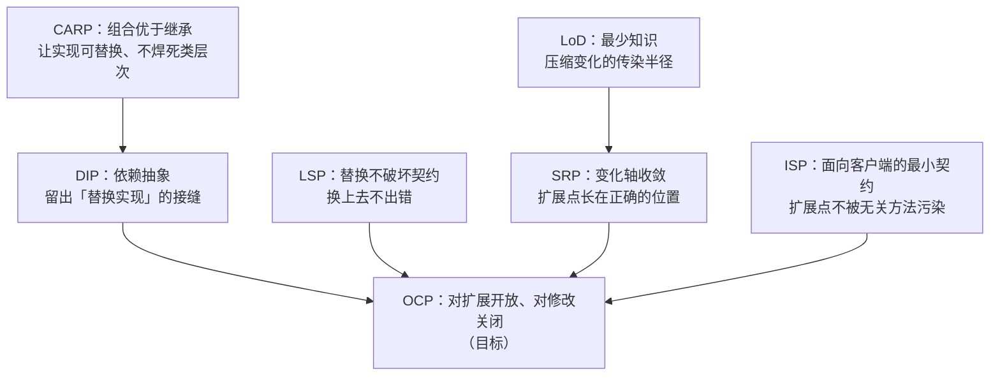
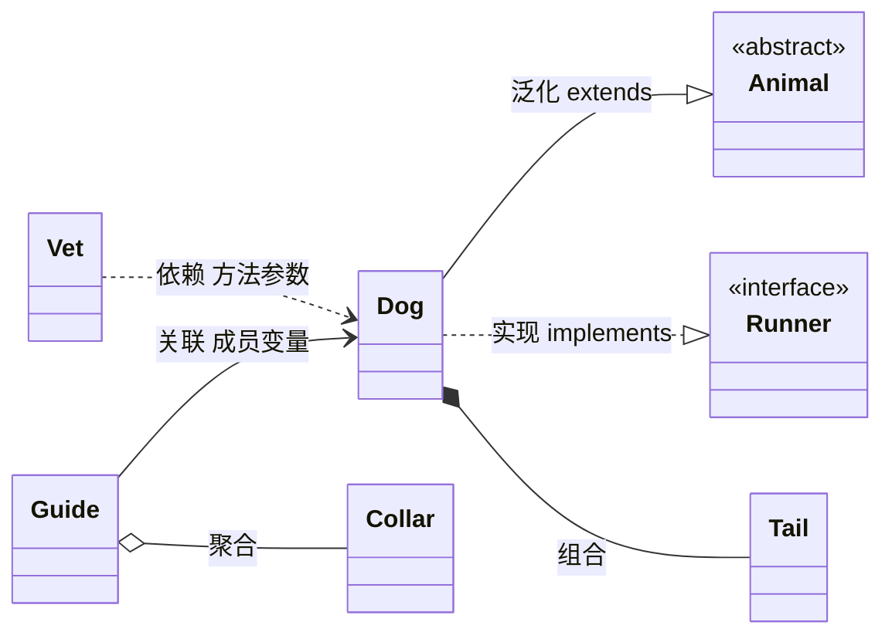
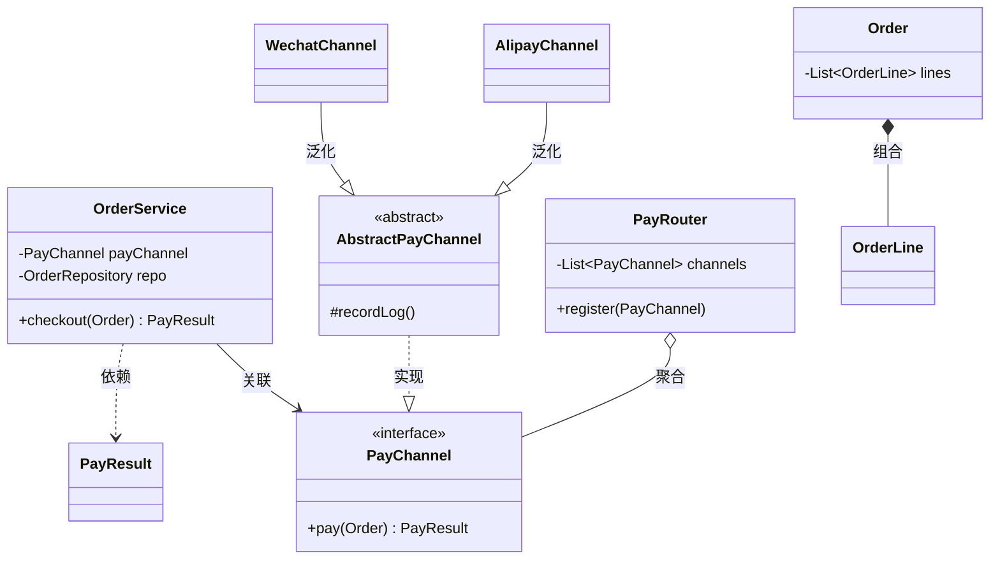

# 设计原则与 UML 类图：设计模式的两个地基

> 一句话概括：设计原则回答「代码为什么该这么组织」（内功），设计模式回答「这类问题历史上怎么解得好」（招式），UML 类图回答「怎么把结构决策讲清楚」（表达）；地基不牢，招式就退化成硬套类图。

预计阅读时间：大约 60 分钟

所属主题：[设计模式常见面试题总结](summary.md)

本文以 JDK 21 为基线，涉及 JDK 类的事实已对照 JDK 21 官方 Javadoc 核实，版本差异单独注明；源码锚点用 `类名#方法名` 标注。模式的具体角色映射与实战用法见各兄弟专题（[单例](singleton.md)、[工厂与建造者](factory-and-builder.md)、[代理](proxy.md)、[结构型模式](structural-patterns.md)、[策略/模板/状态/命令](strategy-template-state-command.md)、[观察者与事件驱动](observer-and-event-driven.md)、[责任链](chain-of-responsibility.md)、[JDK 中的设计模式](patterns-in-jdk.md)、[现代 Java 与反模式](modern-java-and-anti-patterns.md)），Spring 框架层的模式落地见 [Spring 中的设计模式](../backend/java/spring/design-patterns.md)，本文只讲「地基」，不重复。

---

## 0. 阅读路线

| 读者 | 建议阅读 | 关注点 |
| --- | --- | --- |
| 初级（1 年内） | 1、2.1~2.2、5.1~5.2、文末速记 | 五个原则的一句话定义与正反例；六种关系箭头认得出来、代码形态对得上号 |
| 中级（1~3 年） | 全部，重点 2.3~2.5、3、5.3~5.4 | LSP 契约三条件与 JDK 历史教训；DIP 与 IoC 的分界；聚合 vs 组合的辨析 |
| 高级（3 年+） | 2.6、4、6、7 | 原则之间的张力与权衡；Code Review 检查清单；什么时候允许违反原则 |
| 选型/架构 | 1.2、4、6.2、7 | OCP vs YAGNI 的决策口径；sealed「封闭扩展点」的现代表达；模式选型的判断力 |

目录：

1. 开篇：模式与原则的关系
2. SOLID：五个原则逐个拆
3. 迪米特法则与合成复用原则
4. 原则之间的关系与冲突
5. UML 类图：六种关系
6. 工程实践：检查清单与实用主义边界
7. 高频面试追问集
8. 参考资料

---

## 1. 开篇：模式与原则的关系

### 1.1 内功与招式

**结论**：设计原则是「判断标准」——告诉你什么样的代码结构是好的；设计模式是「复用方案」——把满足这些判断标准的结构，针对一类高频问题固化成可复用的套路。**模式是原则在具体场景下的具象化，先懂原则再学模式，模式才不会学成背类图。**

举一个贯穿全文的例子：

- OCP 说「新增功能靠新增代码，不改老代码」（原则，只有一句判断，没告诉你怎么做）；
- 策略模式说「把可变的算法族封进统一接口，运行时替换」（模式，给出了角色与结构）；
- 策略模式之所以能做到 OCP，是因为它同时满足了 DIP（高层依赖抽象接口）与 LSP（所有实现契约一致，可互换）。

面试里「你理解的设计模式是什么」这类开放题，答出「模式是招式、原则是内功，招式是内功的具象化」这一层关系，比报菜名式罗列模式名高一档。反过来，只会背模式、说不清它服务于哪条原则，就很容易在代码评审里被人一句「为什么要在这里上策略接口」问住。

### 1.2 GoF 23 种：三分类一句话定位

GoF（Gang of Four，《设计模式：可复用面向对象软件的基础》，1994）收录 23 种模式，按**目的**分三类：

| 分类 | 回答的问题 | 成员（23 种） | 一句话定位 |
| --- | --- | --- | --- |
| 创建型（5） | 对象**怎么造**：把创建逻辑收敛起来，与使用方解耦 | 单例、工厂方法、抽象工厂、建造者、原型 | 「new 写死在调用处」是万恶之源，创建过程交给专门的机制 |
| 结构型（7） | 类与对象**怎么拼**成更大的结构：接口适配、功能叠加、整体-部分 | 适配器、桥接、组合、装饰器、外观、享元、代理 | 用组合与包装拼装结构，而不是靠继承堆子类 |
| 行为型（11） | 对象之间**怎么分工协作**：职责分配、算法替换、消息传递 | 策略、模板方法、观察者、命令、状态、责任链、迭代器、中介者、备忘录、访问者、解释器 | 把「变的行为」从不变的骨架里剥出来，独立演进 |

三个分类各自落地的代表专题：创建型见 [工厂与建造者](factory-and-builder.md)、[单例](singleton.md)；结构型见 [结构型模式](structural-patterns.md)、[代理](proxy.md)；行为型见 [策略/模板/状态/命令](strategy-template-state-command.md)、[观察者与事件驱动](observer-and-event-driven.md)、[责任链](chain-of-responsibility.md)。

**注意一个常见口径问题**：MVC、MVP、三层架构属于**架构模式**，不在 GoF 23 种之内；前端控制器（Front Controller）属于 J2EE 核心模式。面试被问「Spring MVC 用了哪些设计模式」时，把架构模式和 GoF 模式分开说，是基本的严谨性（详见 [Spring 中的设计模式](../backend/java/spring/design-patterns.md) 第 1 节的反面清单）。

### 1.3 本文的展开方式

原则部分（第 2、3 章）每个原则按「一句话定义 → 违反的反面 → 遵循的正例 → 边界与滥用代价 → 实践/追问」展开；UML 部分（第 5 章）以「箭头画法 → 语义与代码映射 → 易混辨析 → 完整示例」展开；最后落到工程实践（第 6 章）与追问集（第 7 章）。

---

## 2. SOLID：五个原则逐个拆

SOLID 是五个面向对象设计原则的缩写，由 Robert C. Martin 提出（SRP/ISP/DIP/LSP 经其普及，LSP 源自 Barbara Liskov 1987 年的报告与 1994 年与 Wing 合著的论文《A Behavioral Notion of Subtyping》，OCP 概念最早出自 Bertrand Meyer《Object-Oriented Software Construction》1988）。**五个原则不是五条并列的规则，而是一组围绕「控制变化」的互补判断**——关系见第 4 章。

### 2.1 SRP：单一职责原则

**一句话定义**：一个类应该只有一个**引起它变化的原因**。

**反面代码**——一个类背了四条变化轴：

```java
// ❌ OrderService 有四个「修改它的理由」
public class OrderService {
    private final OrderDao orderDao;
    private final SmsClient smsClient;

    public void place(Order order) {
        validate(order);                            // 变化轴 1：业务规则（运营天天改）
        orderDao.insert(order);                     // 变化轴 2：表结构 / 存储选型
        smsClient.send(order.getPhone(), "下单成功"); // 变化轴 3：通知渠道与文案
        log.info("order placed: {}", order);        // 变化轴 4：日志格式与埋点口径
    }
}
```

问题不在「代码长」，而在**耦合方向**：改通知文案的人、改表结构的人、改促销规则的人，都要动同一个类——合并冲突、回归风险、评审流程全挤在一条变更线上。任何一条轴上的错误都会连累另外三条轴的代码。

**正例**——按变化轴拆开：

```java
public class OrderService {                 // 只剩「编排」这一条变化轴
    private final OrderValidator validator; // 轴 1：业务规则
    private final OrderRepository repo;     // 轴 2：存储
    private final OrderNotifier notifier;   // 轴 3：通知

    public void place(Order order) {
        validator.validate(order);
        repo.insert(order);
        notifier.notifyPlaced(order);
    }
}
```

**机制：怎么判定「职责」？** 判定口径是**变化原因（变化轴），不是代码行数或方法数**。实操问两个问题：

1. 这个类的修改请求通常由谁提出、因为什么提出？提法越多，职责越多；
2. 用一句话描述这个类的职责时，是否需要「和/并且/以及」来连接？需要就至少是两个职责。

**边界与代价——「类太小」的过拆问题**：SRP 的粒度是变化轴，不是方法数。「一个类一个方法」不是 SRP，是强迫症。过拆的真实代价：

| 过拆症状 | 代价 |
| --- | --- |
| 每个类只有一个调用方 | 伪抽象：类数量翻倍，没有任何复用收益 |
| 调用链一层层跳转 | 理解一段逻辑要打开五六个文件，上下文丢失 |
| 拆出的「组件」其实共享同一份数据结构 | 改字段时依然要连改多个类——变化轴根本没分开 |

判据始终回到变化轴：**同一条变化轴上的代码放在一起（高内聚），不同轴之间立接口**。拆的收益来自「修改的局部性」，一次需求只该动一个文件；如果每次需求都同时改拆出的好几个类，说明拆错了轴。

**实践/追问**：评审时可问「这个类上一次修改是因为什么、下一次会因为什么」，两个答案不一致就是拆分信号。追问「SRP 和单一文件/单一函数是什么关系」——没有任何关系，SRP 约束的是模块的**变化原因数**，函数级还有更细的单一抽象层次等标准，两者粒度不同。

### 2.2 OCP：开闭原则

**一句话定义**：对扩展开放，对修改关闭——新增一个需求，应当通过**新增代码**实现，而不是修改已经验证过的老代码。

**先澄清高频误读：「所有修改都违反 OCP」是错的。** OCP 关闭的是「既定扩展点所覆盖的那类变化」，不是把代码冻起来：

| 修改行为 | 是否违反 OCP | 理由 |
| --- | --- | --- |
| 新增一种支付渠道，不改 `PayService` | 违反者：无——这正是 OCP 要的效果 | 扩展点覆盖了「渠道数量增长」这类变化 |
| 修 bug、改算法内部实现（对外契约不变） | 不违反 | 内部实现细节本来就不在「关闭」范围内 |
| 变化方向**没有**预设扩展点，硬改了 if-else | 严格说违反，但要务实看 | 如果这类变化只发生一两次，见 4.2 的 YAGNI 讨论 |
| 把 if-else 分支改抽象 | 不是违反，是重构 | 重构不改变外部行为，正是 OCP 的实现手段之一 |

**反面代码**——每来一种新渠道就改一处：

```java
// ❌ 每新增一个渠道，这个类都要改 + 重新回归测试
public PayResult pay(Order order, String channel) {
    switch (channel) {
        case "ALIPAY":  return alipayClient.pay(order);
        case "WECHAT":  return wechatClient.pay(order);
        case "UNIONPAY": return unionpayClient.pay(order);  // 第 3 次
        // 第 4、5、6 次……switch 越来越长，老分支迟早被误伤
        default: throw new IllegalArgumentException(channel);
    }
}
```

**正例**——扩展点三件套，殊途同归地实现 OCP：

```java
// ① 策略：新增渠道 = 新增一个实现类，老代码零改动
public interface PayChannel {
    PayResult pay(Order order);
}
public class UnionpayChannel implements PayChannel { /* 新渠道独立成类 */ }

// ② DIP 接缝：上层只依赖抽象
public class PayService {
    private final Map<String, PayChannel> channels;
    public PayService(List<PayChannel> all) {          // Spring 注入所有实现
        this.channels = all.stream()
                .collect(Collectors.toMap(PayChannel::name, Function.identity()));
    }
    public PayResult pay(Order order, String channel) {
        return channels.get(channel).pay(order);       // 分支消失了
    }
}
```

扩展点不止策略一种：**模板方法/回调**把「变化的步骤」留成钩子（JdbcTemplate 固定资源管理骨架、SQL 回调可换，见 [策略/模板/状态/命令](strategy-template-state-command.md)）；**组合/注册表**让组件装配时可注入任意实现（Spring 的 `HandlerAdapter` 就是靠统一接口让 DispatcherServlet 不必认识每一种 Handler，新增 Handler 类型不改调度逻辑，见 [Spring 中的设计模式](../backend/java/spring/design-patterns.md) 第 7 节）。共同点：**把「会变的部分」收进一个稳定的抽象后面**。

**边界与代价**：OCP 的成本是**抽象成本 + 变化预测成本**。为每一种「想象中可能」的变化都预留扩展点，等于提前支付抽象税：多一层接口、多一套装配、多一份阅读成本；而预测错了方向，抽象本身反而成为修改的阻碍——错误的抽象比没有抽象更难改。OCP 真正适用的信号是：**这类变化已经反复发生，或由外部持续输入**（新渠道、新事件类型、新文件格式）。只发生一次的变化，老老实实改代码也是 OCP（见 4.2）。

**实践/追问**：评审问「这个扩展点是给谁开的」，答不上来就先不加。追问「OCP 和 YAGNI 冲突怎么办」→ 见第 7 章 Q2。

### 2.3 LSP：里氏替换原则

**一句话定义**：所有使用父类型的地方，换成子类型后程序行为必须仍然正确——子类型必须能**透明地**替换父类型。这是「继承是否成立」的唯一判定标准。

**机制：契约视角（比「is-a」好用的判定工具）**。LSP 的原始表述是行为契约约束（Liskov & Wing）：

| 契约要素 | 子类的义务 | 违反的典型表现 |
| --- | --- | --- |
| 前置条件 | **不能加强**（父类接受的输入，子类必须也接受） | 子类方法对参数额外抛异常 |
| 后置条件 | **不能削弱**（父类承诺的输出，子类必须同样承诺） | 子类返回值范围更窄、改变了副作用约定 |
| 不变式 | 必须保持（父类维护的状态约束，子类不能破坏） | 子类操作后对象进入父类不可能的状态 |

记住方向口诀：**「进得来（前置不加强）、出得去（后置不削弱）、状态不越界（不变式保持）」**。

**经典反例：Square extends Rectangle 违反点在哪？**

```java
public class Rectangle {
    protected int width;
    protected int height;
    public void setWidth(int w)  { this.width = w; }
    public void setHeight(int h) { this.height = h; }
    public int area() { return width * height; }
}

public class Square extends Rectangle {
    @Override public void setWidth(int w)  { width = height = w; } // 为维持「宽=高」不变式
    @Override public void setHeight(int h) { width = height = h; }
}
```

违反点**不在概念推理**（「正方形是特殊的矩形」数学上没错），而在**后置条件被削弱**：`Rectangle` 的契约承诺「`setHeight(h)` 之后 `getHeight() == h` 且 `width` 不变」，`Square` 把这条承诺改成了「height 变、width 跟着变」。任何依赖父类契约的代码都会翻车：

```java
static void stretch(Rectangle r) {   // 只依赖 Rectangle 契约的调用方
    r.setWidth(4);
    r.setHeight(5);
    assert r.area() == 20;           // 传 Square 进来：面积是 25，断言失败
}
```

修复方向：**放弃继承**——`Square` 独立成类型，或提供 `Rectangle.of(w, h)` 工厂按需生成正方形；「看起来像」用组合表达，不用继承表达。

**JDK 的历史教训（JDK 21 Javadoc 已核实）**：

- **`java.util.Stack` extends `java.util.Vector`**：Stack「行为上是一种 Vector」吗？不是。任何拿到 `Stack` 引用的代码都能调用继承来的 `Vector#insertElementAt`、`Vector#remove(int)` 在任意位置插入删除——LIFO 不变式被合法 API 直接绕过：

  ```java
  Stack<String> stack = new Stack<>();
  stack.push("a");
  stack.push("b");
  stack.insertElementAt("x", 0);  // 继承自 Vector：栈底插入，LIFO 语义已破坏，编译器毫无反应
  stack.remove(1);                // 任意位置删除，同上
  ```

  JDK 21 Javadoc 明确建议改用 `Deque` 接口及其实现（如 `ArrayDeque`）：「A more complete and consistent set of LIFO stack operations is provided by the Deque interface and its implementations」。这是「为复用代码而继承」的教科书反面教材（Effective Java 同样引用），也呼应 3.2 的合成复用原则。更多 JDK 模式与陷阱见 [JDK 中的设计模式](patterns-in-jdk.md)。
- **`java.sql.Timestamp` extends `java.util.Date`**：`Timestamp` 带纳秒字段，导致 `Timestamp#equals(Object)` 与 `Date#equals(Object)` **不对称**——`date.equals(timestamp)`（按毫秒比较，相等）与 `timestamp.equals(date)`（非 Timestamp 类型一律 false）结果相反。JDK 21 Javadoc 原文明确警告：「the `Timestamp.equals(Object)` method is not symmetric with respect to the `java.util.Date.equals(Object)` method」，并要求代码不要把 Timestamp 当作一般 Date 使用。把两者混放进同一个 `HashSet`，equals 与 hashCode 契约同时崩坏。**子类不能透明替换父类，连标准库都做过示范。**
- **`java.util.Properties` extends `java.util.Hashtable`**：继承来的 `put`/`putAll` 允许塞入非 String 的键值，JDK 21 Javadoc 原文写明「Their use is strongly discouraged」，且对这种「被污染」的对象调用 `store`/`propertyNames`/`list` 会失败——继承暴露了比子类契约更宽的 API 面，只能靠文档求开发者手下留情。

另一个相关口径：`Arrays.asList` 返回固定长度 List，`add` 抛 `UnsupportedOperationException`——这**不算** LSP 违反（`List.add` 在接口规范里是「可选操作」，抛异常合规），但它暴露了另一层现实：**契约不全在类型签名里，还有一半写在 Javadoc 里**，LSP 的审查离不开读文档。

**边界与代价**：LSP 的审查成本在「行为」而不在「签名」——编译器抓不住它，只有调用方的断言和测试能抓住。两个实用信号：① 调用方出现 `instanceof` 判断或对子类做特殊处理，说明继承关系已经名存实亡；② 子类覆写方法时不敢调 `super`、或要 copy 父类实现再改一点，说明契约在子类手里已经断裂。

**实践/追问**：最快的自检是**换实现测试**——把子类对象换成另一个兄弟实现（或 mock），调用方代码需要改吗？需要，就违反了 LSP。追问「正方形为什么不能继承长方形」→ 完整答法见第 7 章 Q1。

### 2.4 ISP：接口隔离原则

**一句话定义**：不应该强迫客户端依赖它不需要的方法。接口是「给某类客户端用的契约」，不是「实现类的能力清单」。

**反面代码**——接口污染：

```java
// ❌ 一个接口服务所有实现与所有客户端
public interface Worker {
    void work();
    void eat();
    void sleep();
}

public class Robot implements Worker {
    @Override public void work()  { /* OK */ }
    @Override public void eat()   { throw new UnsupportedOperationException(); } // 被迫空实现
    @Override public void sleep() { throw new UnsupportedOperationException(); } // 被迫空实现
}
```

`Robot` 被迫实现语义上不可能的方法——客户端从接口看到的能力承诺，一部分是空头支票。这就是「接口污染」：接口越写越宽，每个新实现都在赌「这些方法我都用得上」。

**正例**——按客户端视角拆：

```java
public interface Workable  { void work(); }
public interface Chargeable { void charge(); }   // Robot 只实现它真正支持的契约

public class Human implements Workable, Chargeable { /* ... */ }
public class Robot  implements Workable             { /* ... */ }
```

**机制：与 SRP 的粒度差异（高频混淆点）**：

| 维度 | SRP | ISP |
| --- | --- | --- |
| 观察视角 | **实现侧**：一个类只该有一个变化原因 | **使用侧**：客户端只依赖它需要的最小方法集 |
| 拆分对象 | 类 / 模块 | 接口 / 契约 |
| 判据 | 修改理由的数量 | 客户端用到的方法比例 |

两者可能同时成立也可能不重合：一个职责单一的类，面对多类差异很大的客户端时，接口仍然该按客户端拆（例如存储引擎内部职责单一，但给「写入路径」和「巡检路径」暴露的契约面不同）。反过来说，把 SRP 当成「按方法数拆接口」是两边都理解错了。

**JDK 的正面示范——骨架实现类（skeletal implementation）**：JDK 为核心集合接口配套 `AbstractList`、`AbstractMap`、`AbstractCollection` 等骨架类（`List#indexOf` 这类通用逻辑收敛在骨架里，子类只实现 `get`/`size` 少数原语），让「窄接口 + 骨架复用」两头兼得——接口保持最小契约，骨架类消除实现样板。Effective Java（Item 20）将其总结为：优先接口，但接口 + 骨架实现优于单一抽象类。Comparator 单方法接口则是 ISP 的另一个极端示范：契约面小到一个 lambda 就能实现（见 [JDK 中的设计模式](patterns-in-jdk.md)）。

**边界与代价——接口不是越碎越好**：每个接口都是一份要长期维护的契约。拆过头的问题是「接口爆炸」：实现类 `implements` 一长串、构造器注入参数成倍增长、找「一个类到底支持什么」要在七八个接口间跳跃。实操判据：

1. 出现被迫的空实现/抛 `UnsupportedOperationException` → 必拆；
2. 某客户端只使用接口的一半方法，且两者变化节奏不同 → 该拆；
3. 只是「方法分组好看」→ 不拆，等真实的第二类客户端出现再拆。

**实践/追问**：评审时看「新增一个实现类要实现几个与它无关的方法」。追问「ISP 和 REST API 粒度有关系吗」——思想同源（服务端不该强迫客户端接收整棵对象树，所以有字段裁剪/按需接口），但 ISP 本身约束的是程序内契约，不要混为一谈。

### 2.5 DIP：依赖倒置原则

**一句话定义**：高层模块不依赖低层模块，两者都依赖抽象；抽象不依赖细节，细节依赖抽象。

**反面代码**：

```java
// ❌ 高层直接焊死低层：依赖方向自上而下贯穿到底
public class OrderService {
    private final MysqlOrderRepository repo = new MysqlOrderRepository(); // 具体类，自己 new
}
```

依赖方向是 `OrderService → MysqlOrderRepository → JdbcUtils → MySQL Driver`，一条直线穿到底。想换 Redis 缓存版仓储、想脱离数据库单测，都要动高层源码——**高层（业务规则，最有价值的部分）被低层（技术细节，最常换的部分）绑架**。

**正例**：

```java
// 抽象由高层（使用方）定义——这是 DIP 最容易被忽略的一半
public interface OrderRepository {
    Order findById(long id);
    void insert(Order order);
}

// 低层反过来实现高层定义的抽象：依赖方向「倒置」了
public class MysqlOrderRepository implements OrderRepository { /* ... */ }

// 高层只面向抽象
public class OrderService {
    private final OrderRepository repo;
    public OrderService(OrderRepository repo) { this.repo = repo; }
}
```

**机制：倒置倒的是什么？** 传统自顶向下的分层依赖（业务 → 工具 → 驱动）被倒置成**双方共同依赖中间的抽象层**：高层定义接口，低层实现接口。两个常见误区：

1. 「抽个接口就是 DIP」——错。接口的**归属**决定是否倒置：接口由低层顺手抽出来给高层用（接口跟着实现走），依赖方向没变；接口由高层按自己的需要定义、低层来实现（接口跟着使用方走），才是倒置。
2. 「DIP 依赖容器」——错。`new OrderService(new InMemoryOrderRepository())` 没有 IoC 容器，同样是 DIP 的完整实现（这正是 [IoC & AOP](../backend/java/spring/ioc-and-aop.md) 第 1 节的例子）。

**与 IoC/DI 的关系（高频对比，完整展开见 [IoC & AOP 详解](../backend/java/spring/ioc-and-aop.md)）**：

| 维度 | DIP | IoC / DI |
| --- | --- | --- |
| 层次 | **设计原则**：静态结构上「依赖指向抽象」 | **机制/思想**：依赖的查找与装配控制权反转给容器；DI 是实现手段 |
| 解决的问题 | 依赖方向错误（高层绑死低层） | 依赖的获取方式错误（类自己 new 依赖） |
| 是否互相依赖 | 不依赖容器也能实现（构造器手工传参） | 容器注入的对象最好本来就是抽象（否则只是把耦合挪进配置） |
| 一句话 | 管「依赖指向哪里」 | 管「谁把依赖递给你」 |

Spring 容器是 DIP 的**规模化基础设施**：构造器注入 + 接口抽象让「定义抽象在高层、实现装配在容器」成为日常默认，而不是每个类手工传参。

**边界与代价——抽象层不是越多越好**：每层抽象都有理解成本与间接调用成本。给「只有一个实现、也看不出会有第二个实现」的工具类强抽接口，收益为零、噪音翻倍——DIP 不是教条，是给「会换的地方」留接缝。抽接口的判据：存在真实的第二实现（多租户/多渠道/多存储）、需要测试替身（不连库的单测）、或构成模块边界（防止内部细节跨层泄漏）。三者都不占，直接用具体类。

**实践/追问**：评审时问「这个接口的第二个实现是什么、什么时候出现」。追问「为什么接口要定义在使用方」→ 见第 7 章 Q5 的引申。

### 2.6 SOLID 总表

| 原则 | 一句话 | 约束的对象 | 最典型的破坏信号 | 滥用的代价 |
| --- | --- | --- | --- | --- |
| SRP 单一职责 | 一个类只有一个变化原因 | 类/模块的**职责划分** | 描述职责要用「和」；一个需求改 N 个不相干文件 | 过拆：伪抽象、跳转链过长、内聚性反而下降 |
| OCP 开闭 | 新增靠新代码，不改验证过的老代码 | **扩展点**设计 | 新需求必改 if-else 主干 | 预测落空：抽象税白交，错误抽象阻碍修改 |
| LSP 里氏替换 | 子类可透明替换父类 | **继承关系**的合法性 | 调用方 instanceof；子类覆写不敢调 super | 契约崩坏：行为不一致、测试互相拖累 |
| ISP 接口隔离 | 客户端不依赖不需要的方法 | **契约面**大小 | 实现类被迫空实现；客户端只用一半方法 | 接口爆炸：implements 一串、注入参数膨胀 |
| DIP 依赖倒置 | 高低层共同依赖抽象 | **依赖方向** | 高层 new 具体类；单测必须连真库 | 过度抽象：单实现空接口、层次无谓加深 |

---

## 3. 迪米特法则与合成复用原则

SOLID 之外，两条原则在面试与日常评审中出现率同样高：LoD 管「对象间知道多少」，CARP 管「复用走哪条路」。

### 3.1 LoD：迪米特法则（最少知识原则）

**一句话定义**：一个对象应该对其他对象保持最少的了解——只和「直接朋友」通信（自己、方法参数、自己创建的对象、直接持有的成员），不和「陌生人」说话。

**反面代码**——火车残骸（train wreck）：

```java
// ❌ 每一环都在向一个新「陌生人」索要内部结构
String city = order.getCustomer().getAddress().getCity();
```

这行代码的调用方必须知道三件事：`Order` 内部有 `Customer`、`Customer` 内部有 `Address`、`Address` 暴露 `city`。任何一环改字段、换结构、做安全脱敏，全系统所有穿透点一起改——变化的传染半径被拉到最大。

**正例**——让对象自己回答：

```java
// ✅ Order 自己去找 Customer、Address；内部结构改了，调用方无感
String city = order.shippingCity();
```

**机制：fluent API / 链式调用违反 LoD 吗？（高频辨析）** 不违反，但要把两类链式分开：

```java
// ① 不违反：链上每一环都是稳定抽象的统一契约
List<String> names = users.stream()
        .filter(User::isActive)
        .map(User::name)
        .toList();                       // Stream#toList，JDK 16+
// 调用方全程不需要知道 User 的内部结构；filter/map 的返回类型 Stream 是标准化契约，
// 且每一环返回的对象是「本次调用的产物」——符合「和自己创建/获得的对象通信」

// ② 违反：链上每一环都是易变领域对象的内部结构
String city = order.getCustomer().getAddress().getCity().trim().toUpperCase();
```

判定口径一句话：**链式穿透「易变领域对象的内部结构」违反 LoD；在「稳定抽象的统一契约」上连续调用是 fluent 风格，与 LoD 无冲突**。`StringBuilder.append()`、Stream、`UriComponentsBuilder` 都属于前者。

**边界与代价**：LoD 的代价是**委托方法的数量**——把「跟陌生人要东西」收进对象，意味着对象要多写一批一行的转发方法。值不值，取决于中间结构的稳定性：领域对象内部结构易变 → 委托划算；对外的稳定 DTO/值对象只做读取 → 链式穿透可以接受，强上委托全是噪音。**LoD 是「控制变化传染半径」的手段，不是「禁止点号」的戒律。**

**实践/追问**：评审红旗是「领域对象之间的链式 getter 穿透出现在服务层之外」。追问见第 7 章 Q3（迪米特和封装矛盾吗）。

### 3.2 CARP：合成复用原则（组合优于继承）

**一句话定义**：优先使用组合/聚合达成复用，其次才考虑继承。

**机制：继承复用比组合复用差在哪？**

| 维度 | 继承（白盒复用） | 组合（黑盒复用） |
| --- | --- | --- |
| 封装 | 子类看得见、依赖得起父类实现细节（覆写不敢调 `super` 就是症状） | 只依赖对方公开契约 |
| 实现可替换 | 编译期焊死，运行时不可换 | 持有接口引用，运行时可换（DIP 的接缝） |
| 静态约束 | Java 单继承，名额只有一个、用掉就没了 | 组合数量不限 |
| 继承链传播 | 父类改动沿整条继承链传播（ fragile base class） | 改动止步于被组合的对象 |
| 适用信号 | 真正的 is-a、契约一致、要参与多态 | 复用行为、扩展能力、可替换 |

**Java 实例：装饰器模式的动机（java.io 包装流）**——「给读文件加缓冲、再加解压、再加计数」这种**能力的自由叠加**，继承模型下是子类组合爆炸，组合模型下是任意嵌套：

```java
// 继承路线：每种能力组合都要一个子类
// BufferedFileReader → GzipBufferedFileReader → CountingGzipBufferedFileReader → ...

// 组合路线（java.io 的真实用法，JDK 21）：三个类互不认识，按需嵌套
try (InputStream in = new BufferedInputStream(          // 缓冲（装饰器）
        new GZIPInputStream(                            // 解压（装饰器）
            new FileInputStream(path)))) {              // 源头
    in.readAllBytes();
}
```

`BufferedInputStream`、`GZIPInputStream` 都持有 `InputStream` 引用并实现其接口——组合让「增强能力」成为可插拔件。这正是装饰器模式存在的动机，完整展开见 [结构型模式](structural-patterns.md)；java.io 的更多模式身影见 [JDK 中的设计模式](patterns-in-jdk.md)。

和 2.3 的 `Stack extends Vector` 放在一起看，CARP 的动机是同一个：**继承暴露的 API 面 = 父类全部能力，组合暴露的 API 面 = 你愿意暴露的部分**。

**边界与代价——继承并没有被废除**：真正的 is-a（语义稳定、所有子类契约一致、需要多态分派）继承仍是首选——JDK 集合骨架（`AbstractList` 模板方法骨架，见 2.4）就是继承的正确用法；模板方法模式本身也依赖继承（或回调，见 [策略/模板/状态/命令](strategy-template-state-command.md)）。「组合优于继承」的完整读法是：**默认组合，为「骨架复用」保留抽象类，为「复用几行代码」而继承是明确的错误**。判断继承是否合法的最终标准仍是 LSP（2.3）。

**实践/追问**：评审红旗是「子类只为了调父类两行代码而 extends」。追问「继承什么场景下是对的」→ 契约稳定的 is-a + 需要多态 + 骨架复用三者兼备。

---

## 4. 原则之间的关系与冲突

### 4.1 关系：OCP 是目标，其余是手段



拆开说：

- **SRP 是前提**：变化轴不收敛，你根本不知道扩展点该开在哪；
- **DIP 是接缝**：依赖抽象，「新增实现类不动高层」才物理上可能（OCP 的 2.2 正例同时用了 DIP）；
- **LSP 是保障**：策略接口能安全替换的前提，是所有实现遵守同一份契约（见 [策略/模板/状态/命令](strategy-template-state-command.md) 中「策略族契约一致性」）；
- **ISP 是卫生**：扩展点接口保持面向客户端的最小面，不被无关方法污染；
- **CARP 与 LoD 是日常守则**：组合让替换成为可能（服务 DIP），最少知识让变化不蔓延（服务 SRP）。

面试一句话版本：**「OCP 是目的，DIP 告诉你扩展点开在哪、LSP 保证换上去不出错，SRP/ISP 保证扩展点开在对的位置、不长歪。」**

### 4.2 张力一：OCP vs YAGNI

OCP 要求「为变化预留扩展点」，YAGNI（You Aren't Gonna Need It）要求「只做当前需要的」——两者都指向未来，方向相反。裁决口径是**变化的概率 × 变化发生时的改动半径**：

| 情形 | 判决 | 理由 |
| --- | --- | --- |
| 这类变化已经发生过两次以上 | 上扩展点 | 概率已被历史证明（规则三法：第三次重复再抽象） |
| 外部持续输入的变化源（新渠道/新租户/新格式） | 上扩展点 | 变化是确定发生的，只是不知道下一个长什么样 |
| 「将来也许会有的」单一猜测 | YAGNI 胜 | 抽象税现在就付，收益可能永远不来 |
| 只有 2~3 个分支且分支集合封闭 | switch 足矣 | 修改局部化也是 OCP 的合法形态——改一处、不波及他人，同样满足「变化不扩散」的精神 |

关键认知：**OCP 的精神是「变化的扩散半径可控」，不是「必须上策略接口」**。把 switch 收敛在一处（低层、单一文件）与上策略接口，在扩散半径上可能等价——选哪个看分支数量与每个分支的体量。

### 4.3 张力二：SRP 过拆 vs 内聚

SRP 鼓励拆，内聚要求「相关的放一起」。裁决口径还是变化轴：**一起变的代码要在一起，分开变的代码要立接口**。每次需求都同时改动拆出的多个类，说明拆错了轴、或拆得过早——拆分应该由「重复的修改」驱动，而不是由「类的体积」驱动。

### 4.4 张力三：原则内部也会打架

- **LSP vs 表达力**：有时「继承 + 覆写」能少写很多代码，但契约不兼容（`Timestamp` 就是标准库为复用代码付出的代价）——选组合，代码多一点，正确性便宜；
- **ISP vs DIP**：按客户端拆得太碎，高层要注入的接口数暴涨——高层视角的「聚合接口」（高层定义一个门面接口，内部再拆实现）可以调和；
- **DIP vs 简单性**：为单实现工具类强抽接口是教条主义；抽象要为「真实会变的点」服务。

**一句话总结：原则是权衡的标尺，不是必须全绿的检查项。** 它们描述的是「改动会痛在哪里」，用它们做**有意识的取舍**，而不是机械执行——下一章的「允许违反」就是这句话的展开。

---

## 5. UML 类图：六种关系

### 5.1 六种关系的箭头总览



读图要点：**三角指向「被继承/被实现」的一方，箭头指向「被使用/被持有」的一方，菱形挂在「整体」一侧**——空心菱形是聚合，实心菱形是组合，实线是「长期关系」，虚线是「临时关系」。

### 5.2 语义与代码映射表

| 关系 | UML 画法 | mermaid 写法 | 语义 | Java 代码形态 | 耦合强度 |
| --- | --- | --- | --- | --- | --- |
| 依赖 Dependency | 虚线箭头，指向被用者 | `A ..> B` | 使用即依赖，用完即弃 | 方法参数、局部变量、静态方法调用 | 最弱 |
| 关联 Association | 实线箭头，指向被持有者 | `A --> B` | 长期知道对方、持有引用 | 成员变量（引用从外部传入） | ↑ |
| 聚合 Aggregation | 空心菱形实线，菱形在整体侧 | `Whole o-- Part` | has-a：部分可独立存活、可被多个整体共享 | 成员变量 + `add/remove` 动态增删（引用外部传入） | ↑ |
| 组合 Composition | 实心菱形实线，菱形在整体侧 | `Whole *-- Part` | part-of：生命周期绑定、不可共享 | 构造器内创建成员对象，随整体一起消亡 | ↑ |
| 泛化 Generalization | 空心三角实线，三角指向父类 | `Child --|> Parent` | is-a（行为契约兼容，见 LSP） | `extends` | 最强（纵向） |
| 实现 Realization | 空心三角虚线，三角指向接口 | `Impl ..|> Interface` | 契约实现 | `implements` | 最强（纵向） |

横向四档强度排序：**依赖 < 关联 < 聚合 < 组合**；泛化/实现是纵向关系，耦合最强（编译期焊死，`Stack extends Vector` 的代价就是这层）。快速判断两个类是什么关系的问法：只是临时用一下 → 依赖；长期持有 → 关联；持有的是「可共享、可独立活」的部分 → 聚合；整体创建并独占的部分 → 组合；is-a → 泛化/实现。

### 5.3 聚合 vs 组合：生命周期是否共享（高频辨析）

| 维度 | 聚合（has-a） | 组合（part-of） |
| --- | --- | --- |
| 生命周期 | 部分先于整体存在，整体消亡后部分继续存活 | 部分由整体创建，与整体同生共死 |
| 共享性 | 部分可同时属于多个整体 | 部分被整体独占，不共享 |
| 创建方式 | 引用从外部传入（构造参数/setter/add） | 整体内部 new 出来 |
| 删除整体 | 部分不受影响 | 部分随之无意义，一起删除 |

```java
// 聚合：球员先于球队存在，解散后球员还能转会——Team 只持有引用
class Team {
    private final List<Player> players = new ArrayList<>();
    void sign(Player p)   { players.add(p); }    // 外部传入
    void release(Player p) { players.remove(p); }
}

// 组合：订单行在订单构造时创建，订单删除则订单行一起删除，且不会出现在两张订单里
class Order {
    private final List<OrderLine> lines;
    Order(List<ItemSpec> specs) {
        this.lines = specs.stream().map(OrderLine::new).toList();  // 整体创建部分
    }
}
```

**辨析提示**：判定口诀是「部分能否脱离整体存在、能否被多个整体共享」。但要清醒：**很多真实场景两种画法都说得通**（部门与员工：裁员算聚合，部门撤编员工全散算组合）。UML 表达的是**设计意图**（你为生命周期做出的承诺），不是代码事实——代码层面两种写法可能完全一样。画错了不改行为，但会误导读者对「谁负责创建与销毁」的理解，所以菱形方向（挂在整体侧）与空心/实心不能随手画。

### 5.4 完整示例：六种关系各出现一次

以「订单结算 + 支付渠道」为例，把六种关系放进同一张图：



每个关系的选择理由（面试讲解时按这个顺序说）：

| 关系 | 为什么是它 |
| --- | --- |
| `AlipayChannel --|> AbstractPayChannel` | 真正的 is-a：公共记账逻辑在骨架类，LSP 契约一致 |
| `AbstractPayChannel ..|> PayChannel` | 契约实现：策略接口（OCP 扩展点） |
| `OrderService --> PayChannel` | 长期持有的引用（构造器注入），但渠道独立存在——关联而非聚合 |
| `PayRouter o-- PayChannel` | 注册表持有外部传入的渠道实例：可动态增删、实例可被多个路由共享——聚合 |
| `Order *-- OrderLine` | 订单行由订单创建、随订单消亡、不可共享——组合 |
| `OrderService ..> PayResult` | 返回值临时使用，不持有——依赖 |

### 5.5 面试画类图的最小要求

白板/纸笔画类图（高频环节）的检查清单：

1. **类框三段式**：类名（接口加 `<<interface>>` 或斜体表示抽象）、字段、方法；
2. **可见性符号**：`+` public、`-` private、`#` protected、`~` 包可见——面试至少把 `+/-/#` 画对；
3. **六种箭头不画错**：三角形指向父类/接口，菱形挂在整体侧，空心菱形聚合、实心菱形组合，虚线箭头是依赖/实现、实线是关联/聚合/组合/泛化；
4. **多重度标注可加分**：`1`、`0..*`、`1..*`（如 `Team 1 -- 0..* Player`）；
5. **先说语义再落笔**：边画边讲「这里为什么是聚合不是组合」，比画完沉默更有说服力——面试官考的是结构表达力，不是美术。

---

## 6. 工程实践：检查清单与实用主义边界

### 6.1 Code Review 中的原则检查清单

| 红旗信号 | 违反/风险 | 对应原则 | 建议动作 |
| --- | --- | --- | --- |
| 描述一个类的职责要用「和/并且」 | 多变化轴耦合 | SRP | 按变化轴拆，先拆「改的人不同」的轴 |
| 新需求必须改 if-else / switch 主干 | 扩展点缺失 | OCP | 变化已重复 ≥2 次才上策略/回调；否则先局部化 |
| 调用方出现 `instanceof 子类` 分支 | 继承名存实亡 | LSP | 消灭子类或把差异下沉为多态方法 |
| 子类覆写不敢调 `super`、copy 父类实现再改 | 契约断裂 | LSP/CARP | 改组合，或父类留模板方法钩子 |
| 实现类被迫空实现/抛 `UnsupportedOperationException` | 契约面过宽 | ISP | 按客户端视角拆接口 |
| 接口只有一个实现且无测试替身需求 | 空抽象 | DIP | 直接用具体类，等第二实现出现再抽 |
| 上层 `new` 具体实现类 / 单测必须连真库 | 依赖焊死 | DIP | 高层定义接口 + 构造器注入 |
| 领域对象链式 getter 穿透（`a.getB().getC()...`） | 变化传染半径过大 | LoD | 中间对象收进委托方法 |
| 子类只为复用几行代码而 extends | 白盒复用 | CARP | 改组合/委托 |
| 成员集合暴露 `add/remove` 且对象由外部管理但画成组合 | 生命周期承诺不实 | UML/设计 | 对齐意图：外部管理用聚合 |
| 为了「将来也许」提前上策略接口族 | 抽象税 | OCP vs YAGNI | 砍掉，等第二次重复 |

用法建议：不要逐条机械对照（那会变成教条评审），把它当成**提问素材**——评审的输出应该是「这里的变化轴是什么、扩展点给谁开」，而不是「你违反了第 X 条」。

### 6.2 什么时候允许违反原则（实用主义边界）

原则是权衡标尺，以下场景**明知违反也值得**：

| 场景 | 典型例子 | 理由 |
| --- | --- | --- |
| **性能热点** | 纳秒级路径上砍掉接口间接层、热循环里内联逻辑；JDK 的 `String` 设计成 final 类、内部字段直接访问 | 抽象的间接调用在极端路径上是真实成本 |
| **框架/遗留约束** | 必须继承框架基类（Servlet 时代的 `HttpServlet`）；遗留代码没有接缝，先用适配层包住再慢慢治 | 约束不由你定，先隔离污染范围 |
| **向后兼容** | JDK 自己的 `Stack extends Vector`、`Timestamp extends Date`、`Properties extends Hashtable`——都错了，但删了会破坏世界 | 历史包袱只能标记弃用（`Observable` 自 JDK 9 `@Deprecated(since="9")`，官方给出的替代是 `java.beans` 事件模型、并发容器与 `Flow` API） |
| **一次性代码/原型** | 探索性脚本、验证性 demo | YAGNI 完胜，抽象等第二次复用再说 |
| **一致性优先** | 团队统一约定某个模式写法，即使个别场景略冗余 | 可预期性本身是工程价值 |

两个配套要求：

1. **违反要有意识**：留一行注释说明「为什么违反、什么条件下改回」，防止后人把权宜之计当成惯例继承；
2. **违反要收敛**：允许违反的范围限定在最小代码块，不向公共接口扩散。

另外值得知道一个「现代的对照物」：**sealed 类（JDK 17 转正，JEP 409）**把「对谁开放扩展」变成显式语法——

```java
// 封闭扩展点：只有这三种实现合法，穷尽 switch 时不需 default
public sealed interface PayChannel permits AlipayChannel, WechatChannel, UnionpayChannel {}
```

它看起来「反 OCP」（关闭了外部扩展），实际是 OCP 的精细化：**开闭从「全局原则」变成「开关由领域作者控制」**——核心域封闭换取穷尽性检查（switch 表达式无 default 也编译通过），生态扩展点照常开放。什么时候封闭、什么时候开放，本身就是 4.2 的那杆秤。更多现代 Java 特性与设计模式的关系见 [现代 Java 与反模式](modern-java-and-anti-patterns.md)。

---

## 7. 高频面试追问集

**Q1：正方形为什么不能继承长方形？给完整答法。**

> 分四步：① 概念判断不可靠——「正方形是特殊的矩形」数学上成立，但 LSP 约束的是**行为**不是概念；② 契约分析——`Rectangle` 的后置条件承诺「`setHeight(h)` 后 `height == h` 且 `width` 不变」，`Square` 为维持「宽=高」不变式必须联动修改，**削弱了后置条件**，因此不是合法子类型；③ 展示后果——任何依赖父类契约的代码（如先 `setWidth(4)` 再 `setHeight(5)` 后断言 `area()==20` 的测试/算法）对 `Square` 失效；④ 给修复——放弃继承：`Square` 独立类型，或工厂方法 `Rectangle.of(w, h)` 统一构造；口诀「数学上子集、行为上可能超集冲突」。最后可以补一句：JDK 里同款教训是 `Timestamp extends Date`（equals 不对称，JDK 21 Javadoc 明文警告）。

**Q2：OCP 和 YAGNI 冲突怎么办？**

> 裁决口径：变化的**概率 × 改动半径**。已重复出现（规则三法：第三次重复）或变化源持续输入（新渠道/新租户）→ 上扩展点；纯猜测的「将来也许」→ YAGNI 优先，抽象税不要提前交。补充一层认知：OCP 的精神是「变化扩散半径可控」，把 switch 收敛在一处也是合规形态——不必为 2~3 个封闭分支上策略接口。预判错了方向，错误的抽象比没有抽象更难改。

**Q3：迪米特法则和封装矛盾吗？**

> 不矛盾——LoD 是封装在「对象间协作」维度的体现：把「跟陌生人要东西」收进对象自己的方法（`order.shippingCity()`），恰恰是**增加**封装。矛盾感来自机械执行：为了 LoD 写一堆一行委托方法。裁决看中间结构的稳定性——领域对象内部易变 → 委托划算（控制变化传染半径）；稳定抽象上的链式调用（Stream、StringBuilder）本来就是 fluent 风格，不算违反。LoD 的代价是委托方法数量，收益是修改的局部性，按这个账权衡即可。

**Q4：聚合和组合在代码上长什么样？UML 箭头怎么画？**

> 代码差异在**创建方式与所有权**：聚合是引用从外部传入（构造参数/setter/add），部分可共享、整体消亡后继续存活；组合是整体内部 new、独占、同生共死。UML：菱形挂在**整体**一侧——空心菱形（`o--`）聚合、实心菱形（`*--`）组合，实心=实打实拥有。补一句成熟度表达：两者代码可能完全一样，UML 表达的是生命周期承诺；但多数场景两种画法都说得通（部门-员工），把意图讲清楚比抠定义更重要。

**Q5：DIP 和 IoC 是一回事吗？**

> 不是，层次不同：DIP 是**设计原则**，约束静态结构上「高层与低层都依赖抽象、接口由使用方定义」，没有容器也成立（`new OrderService(new InMemoryOrderRepository())` 就是 DIP）；IoC 是**机制/思想**，把「依赖的查找与装配」控制权反转给容器，DI 是其实现手段。一句话分工：DIP 管「依赖指向哪里」，IoC 管「谁把依赖递给你」。Spring 容器是 DIP 的规模化基础设施；反过来，注入具体类而不用接口，等于只用了 IoC 的壳、没拿到 DIP 的解耦。机制展开见 [IoC & AOP 详解](../backend/java/spring/ioc-and-aop.md)。

**Q6：SOLID 在脚本语言/函数式语言里还有意义吗？**

> 有，变化的是载体不是判断。SRP/ISP/OCP 完全语言无关：Python/JS 的鸭子类型天然是「隐式接口」，反而更容易做到 ISP（客户端按需依赖）；LSP 在动态类型里表现为「行为兼容性」，违反它照样炸（只是炸在运行期更晚）；DIP 退化为「构造器注入 + mock 测试」的实践。函数式风格里，不可变数据 + 纯函数让一部分 OCP 问题消失（新操作 = 新函数，不改老代码），但模块边界、契约一致性、变化轴划分依然成立。反过来，没有接口语法的语言里，「面向抽象」落地为「面向最小契约（函数签名/协议）」。

**Q7：JDK 标准库有哪些违反设计原则的例子？说明什么？**

> 四个经典：① `Stack extends Vector`——LIFO 继承了随机访问/任意位置插入，不变式可被 `insertElementAt` 绕过，JDK 21 Javadoc 建议改用 `Deque`/`ArrayDeque`；② `Timestamp extends Date`——`equals` 与父类不对称，混用集合时 equals/hashCode 契约崩坏；③ `Properties extends Hashtable`——继承的 `put`/`putAll` 可塞入非 String 键值，官方「strongly discouraged」；④ `Observable`/`Observer` 自 JDK 9 弃用，官方理由是事件模型受限、通知顺序未定义。说明两点：标准库也背历史包袱，向后兼容是「允许违反」的现实例证；这些类的替代物（`Deque`、`java.time`、`Flow`）正是用组合与新抽象重新设计的结果。

**Q8：六种关系怎么快速判断？强度怎么排？**

> 三个问题定横向关系：只是临时用一下（参数/局部变量/返回值）→ **依赖**；长期持有引用 → **关联**；持有的是可共享、可独立存活的部分 → **聚合**；整体创建并独占、同生共死的部分 → **组合**。纵向看行为契约：is-a → **泛化**（extends）/**实现**（implements）。强度排序：依赖 < 关联 < 聚合 < 组合，泛化/实现耦合最强（编译期焊死）。画法记忆：三角指向被继承/被实现方，菱形挂整体侧，空心聚合、实心组合，虚线临时、实线长期。

---

## 8. 参考资料

- GoF《设计模式：可复用面向对象软件的基础》—— 23 种模式与三分类的原始出处
- Robert C. Martin《架构整洁之道》（Clean Architecture）—— SOLID 的系统阐述与「原则是目标与手段关系」的论述
- Barbara Liskov, Jeannette Wing, *A Behavioral Notion of Subtyping*（1994）—— LSP 的原始定义（前置/后置条件与不变式）
- Bertrand Meyer, *Object-Oriented Software Construction*（1988）—— OCP 的最早出处
- Joshua Bloch《Effective Java（第 3 版）》—— Item 15（最小化类与成员的可访问性）、Item 18（组合优于继承，含 `Stack extends Vector` 与 `Properties extends Hashtable` 反例）、Item 20（接口优于抽象类 + 骨架实现）
- JDK 21 官方 Javadoc（本文事实均已对照核实）：
  - `java.util.Stack`（`public class Stack<E> extends Vector<E>`；建议改用 `Deque`）：https://docs.oracle.com/en/java/javase/21/docs/api/java.base/java/util/Stack.html
  - `java.util.Observable`（`@Deprecated(since="9")` 及弃用理由）：https://docs.oracle.com/en/java/javase/21/docs/api/java.base/java/util/Observable.html
  - `java.sql.Timestamp`（`equals` 与 `Date.equals` 不对称的原文警告）：https://docs.oracle.com/en/java/javase/21/docs/api/java.sql/java/sql/Timestamp.html
  - `java.util.Properties`（`put`/`putAll` strongly discouraged 的原文）：https://docs.oracle.com/en/java/javase/21/docs/api/java.base/java/util/Properties.html
- JEP 409: Sealed Classes（JDK 17 转正）：https://openjdk.org/jeps/409
- 兄弟专题：[设计模式常见面试题总结](summary.md)、[单例模式](singleton.md)、[工厂与建造者](factory-and-builder.md)、[代理模式](proxy.md)、[结构型模式](structural-patterns.md)、[策略/模板/状态/命令](strategy-template-state-command.md)、[观察者与事件驱动](observer-and-event-driven.md)、[责任链](chain-of-responsibility.md)、[JDK 中的设计模式](patterns-in-jdk.md)、[现代 Java 与反模式](modern-java-and-anti-patterns.md)
- 跨主题：[Spring 中的设计模式](../backend/java/spring/design-patterns.md)（框架层模式落地）、[IoC & AOP 详解](../backend/java/spring/ioc-and-aop.md)（DIP 与 IoC/DI 的机制展开）

---

## 附：一页速记

**总纲**
1. 原则是内功（为什么），模式是招式（怎么解），UML 是表达；先懂原则再学模式，否则就是背类图。
2. GoF 23 种：创建型（怎么造）、结构型（怎么拼）、行为型（怎么协作）；MVC 是架构模式，不在 GoF 之内。
3. OCP 是目标，DIP 留接缝、LSP 保替换、SRP/ISP 定位置；原则是权衡不是教条。

**SOLID**
4. SRP 看变化轴不看行数：一个类只有一个修改理由；过拆同样是病（伪抽象、跳转链）。
5. OCP 不是「禁止修改」：关的是既定扩展点覆盖的变化；抽象成本与预测风险是代价，switch 局部化也是合规形态。
6. LSP 用契约审继承：前置不加强、后置不削弱、不变式保持；Square/Rectangle 违反在后置条件被削弱。
7. JDK 三教训：Stack extends Vector（不变式可绕过）、Timestamp extends Date（equals 不对称）、Properties extends Hashtable（put 强烈不建议）——对照 JDK 21 Javadoc。
8. ISP 看客户端不看实现：被迫空实现就该拆；接口爆炸同样是病；骨架实现类（AbstractList）是窄接口+复用的正解。
9. DIP 倒置的是依赖方向：接口由使用方定义、低层来实现；抽接口判据 = 第二实现/测试替身/模块边界。

**LoD 与 CARP**
10. LoD 管变化传染半径：领域对象链式穿透违规，稳定抽象上的 fluent 链式不违规。
11. CARP：默认组合，为骨架复用保留抽象类，为复用几行代码而继承是错误；java.io 包装流是组合叠加的范本。

**UML**
12. 六关系：依赖 `..>` < 关联 `-->` < 聚合 `o--` < 组合 `*--`（横向），泛化 `--|>` / 实现 `..|>`（纵向最强）。
13. 三角指向父类/接口，菱形挂整体侧：空心聚合（可共享、可独立活）、实心组合（独占、同生共死）。
14. 代码差异在创建方式与所有权：外部传入=聚合，整体内部 new=组合；UML 表达意图，多数场景两种画法都说得通。

**实用主义**
15. 允许违反的场景：性能热点、框架约束、向后兼容、一次性代码——违反要有注释、要收敛。
16. sealed（JDK 17+）把「开给谁」变成显式决策：核心域封闭换穷尽性检查，扩展点照常开放。
17. 一句话：**原则描述的是「改动会痛在哪里」，用它们做有意识的取舍，而不是机械执行。**
