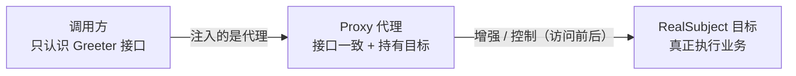
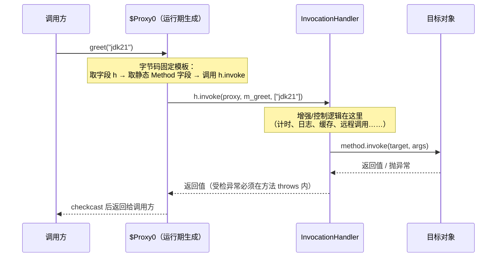
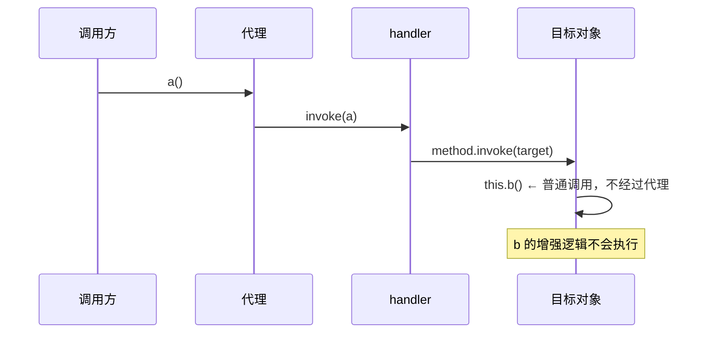

# 代理模式与动态代理：从静态代理到字节码增强

> 一句话概括：代理模式不修改目标对象，只在「访问目标的前后」插入控制与增强；静态代理靠人肉为每个类写壳，JDK 动态代理在**运行期生成接口实现类** `$Proxy0` 并统一转发给 `InvocationHandler`，CGLIB 则用 ASM 生成**目标子类**——理解代理类从哪来、分发怎么走、边界在哪，就理解了 Spring AOP、MyBatis Mapper、RPC 客户端桩这些机制的共同地基。

预计阅读时间：大约 60 分钟

所属主题：[设计模式常见面试题总结](summary.md)

本文以 JDK 21 为基线（关键行为在 Corretto 21.0.6 上实测并反编译验证），版本差异单独标注；CGLIB 部分的事实已对照 Spring 6.x 源码专题核实。每个机制按「结论 → 机制 → 边界/代价 → 实践/追问」组织。Spring 视角的 JDK/CGLIB 源码对比在 [IoC & AOP](../backend/java/spring/ioc-and-aop.md) 第 5 章、代理在 Spring 里的角色映射在 [Spring 中的设计模式](../backend/java/spring/design-patterns.md) 第 4 章，本文写**通用 Java 视角**（$Proxy0 类结构、代理类缓存、手写分发器、RPC 与懒加载应用），与之互补而不重复。

---

## 0. 阅读路线与目录

| 读者 | 建议阅读 | 关注点 |
| --- | --- | --- |
| 初级（1 年内） | 1、2、3.1、5、6.1~6.2 | 会写静态代理与 JDK 动态代理最小示例，能说出代理/装饰器/适配器一句话区分 |
| 中级（1~3 年） | 全部，重点 3.2~3.4、4、6.3 | $Proxy0 类结构、代理类缓存键、CGLIB 机制、RPC 客户端为什么是代理 |
| 高级（3 年+） | 3.3~3.6、4、7、8 | 代理类的模块归属规则、UndeclaredThrowableException 边界、自调用与 native image 坑 |
| 选型/架构 | 5、6、7、8 | 两种代理的工程权衡、什么时候不该用代理、框架选型的版本归属 |

目录：

1. 代理模式：角色与一句话定位
2. 静态代理：手写一遍，才知道动态代理省掉了什么
3. JDK 动态代理：运行期生成 `$Proxy0` + `InvocationHandler` 分发
4. CGLIB：子类代理与字节码增强
5. JDK 代理 vs CGLIB：总对比
6. 工程应用：四个经典落点
7. 动态代理的坑
8. 高频面试追问集
9. 参考资料

---

## 1. 代理模式：角色与一句话定位

**结论**：代理模式为「目标对象」提供一个**接口相同的替身**，调用方拿到的实际是代理；代理控制对目标的访问，或在其前后插入增强逻辑。它的意图是——**不改目标对象，也不改调用方，把控制/增强插进访问路径里**。

### 1.1 三个角色

| GoF 角色 | 含义 | 本文示例中的对应 |
| --- | --- | --- |
| Subject（抽象主题） | 客户端依赖的接口 | `Greeter` |
| RealSubject（真实主题） | 真正干活的实现 | `SimpleGreeter` |
| Proxy（代理） | 与目标同接口的替身，持有目标引用（或代替目标） | `$Proxy0` / 手写的 `TimingGreeterProxy` |



角色的完整 UML 结构与抽象讨论见 [设计模式原则与 UML](principles-and-uml.md)；按「为什么要包一层」，经典教科书分类是：

| 种类 | 控制内容 | 例子 |
| --- | --- | --- |
| 远程代理（Remote） | 隐藏「目标在另一台机器」 | RPC 客户端桩（见 6.3） |
| 虚拟代理（Virtual） | 延迟到真正需要时才创建重对象 | Hibernate 懒加载实体（见 6.4） |
| 保护代理（Protection） | 按调用方权限放行/拒绝 | 权限校验切面 |
| 智能引用（Smart Reference） | 访问前后附加动作 | 计时、日志、引用计数（见 2 的示例） |

### 1.2 代理 vs 装饰器 vs 适配器：一句话区分

| 模式 | 接口 | 意图 | 一句话 |
| --- | --- | --- | --- |
| 代理 | **不变** | 控制访问；调用方可以**不知道**代理背后是谁（甚至没有目标） | 「我替它接待你」 |
| 装饰器 | **不变** | 叠加增强；必须持有一个真实对象，可层层包装 | 「我给它加点料」 |
| 适配器 | **转换** | 让不兼容接口协作 | 「我们把话说到一起去」 |

口诀：**看接口变没变——变了是适配器，没变再看意图：控制访问是代理，叠加增强是装饰器**。完整的三者结构辨析（含 Spring 里的实例与误判清单）在 [结构型模式辨析实战](structural-patterns.md)，此处只点到为止。

**追问：代理和装饰器结构几乎一样（同接口 + 组合持有），为什么算两个模式？** 因为意图决定分类：装饰器链上每个包装层都「知道」自己在增强，典型是可以无限叠加（`new A(new B(new C(...)))`）；代理关心的是「对目标的控制权」（远程、懒加载、保护），并且刻意**隐藏**自己与目标的差别。同一个类往这边写是代理、往那边写是装饰器，不是结构差异而是意图差异。

---

## 2. 静态代理：手写一遍，才知道动态代理省掉了什么

### 2.1 完整示例：接口 + 实现 + 手写代理

```java
// Subject：抽象主题
public interface Greeter {
    String greet(String name);
}

// RealSubject：真实主题，只写业务
public class SimpleGreeter implements Greeter {
    @Override
    public String greet(String name) { return "hello " + name; }
}

// Proxy：手写代理，加计时（智能引用）
public class TimingGreeterProxy implements Greeter {
    private final Greeter target;                       // 与目标同接口，组合持有

    public TimingGreeterProxy(Greeter target) { this.target = target; }

    @Override
    public String greet(String name) {
        long start = System.nanoTime();                 // 前置增强
        try {
            return target.greet(name);                  // 委托目标
        } finally {
            System.out.println("greet cost "            // 后置增强
                + (System.nanoTime() - start) + "ns");
        }
    }
}

// 调用方完全无感知：拿到的都是 Greeter
Greeter g = new TimingGreeterProxy(new SimpleGreeter());
System.out.println(g.greet("proxy"));      // hello proxy
// greet cost 12300ns
```

### 2.2 问题清单：静态代理的三个天花板

**结论**：静态代理机制本身没问题，问题是「每个目标类都要手写一份」——增强逻辑一多、目标类一多，成本线性爆炸。

| # | 问题 | 具体表现 |
| --- | --- | --- |
| 1 | **类爆炸** | 每个需要增强的目标类各写一个代理类；100 个 Service 要计时，就要 100 个 TimingXxxProxy |
| 2 | **增强逻辑复制粘贴** | 计时/日志/权限代码在每个代理类里各贴一份；改一处要改一百处 |
| 3 | **接口变更要同步改** | 目标接口加一个方法，所有手写代理必须同步补转发方法，漏一个就是编译错误或运行期缺失增强 |

把这三个问题抽象一下：代理类的**结构**千篇一律（同接口、持有目标、逐方法转发），只有「转发前后插入什么」在变化。那么正确的工程问法是——能不能**用一份代码描述所有代理类**，运行期按需生成？这就是动态代理的演进动机，一句话：

> **把「为每个类写代理」变成「为所有类生成代理」，把增强逻辑从代理类里抽出来收敛成一个回调对象。**

JDK 和 CGLIB 是这份答卷的两个实现：前者生成「接口实现类」，后者生成「目标子类」。

---

## 3. JDK 动态代理：运行期生成 `$Proxy0` + `InvocationHandler` 分发

### 3.1 最小可运行示例

只靠 JDK 内置 API（`java.lang.reflect.Proxy` + `java.lang.reflect.InvocationHandler`），零第三方依赖：

```java
import java.lang.reflect.InvocationHandler;
import java.lang.reflect.Proxy;

interface Greeter {
    String greet(String name);
    default String farewell() { return "bye"; }
}

class SimpleGreeter implements Greeter {
    public String greet(String name) { return "hello " + name; }
}

public class JdkProxyDemo {
    public static void main(String[] args) throws Throwable {
        Greeter target = new SimpleGreeter();

        InvocationHandler handler = (p, method, a) -> {
            System.out.println("[handler] " + method.getDeclaringClass().getName()
                + "#" + method.getName());
            if (method.isDefault()) {                    // default 方法：JDK 16+ 用 invokeDefault 执行接口默认实现
                return InvocationHandler.invokeDefault(p, method, a);
            }
            return method.invoke(target, a);             // 其余：反射委托目标
        };

        Greeter proxy = (Greeter) Proxy.newProxyInstance(
            Greeter.class.getClassLoader(),              // ① 用哪个类加载器定义代理类
            new Class<?>[]{ Greeter.class },             // ② 代理要实现哪些接口
            handler);                                    // ③ 所有方法调用的分发终点

        System.out.println(proxy.greet("jdk21"));        // 经 handler 委托 target
        System.out.println(proxy.farewell());            // default 方法走 invokeDefault
        System.out.println(proxy.getClass().getName());  // 代理类名（见 3.3）
    }
}
```

运行输出（JDK 21 实测）：

```text
[handler] Greeter#greet
hello jdk21
[handler] Greeter#farewell
bye
$Proxy0
```

三个关键事实立刻浮出来：

1. `proxy.getClass().getName()` 打印的是 **`$Proxy0`**——这个类在编译期不存在，是 JVM 运行期生成的（为什么不是 `jdk.proxyN.$Proxy0`，见 3.3 的模块归属规则）；
2. `greet` 的调用没有进入 `SimpleGreeter` 的方法体，而是先进入 handler——**代理把「调用哪个方法」翻译成了「handler 收到 (proxy, method, args)」**；
3. `InvocationHandler` 完全不认识 `Greeter`——它只拿得到 `Method` 对象。**一份 handler 逻辑可以服务任意接口**，这就是「一份代码描述所有代理类」的实现方式。

完整调用时序：



### 3.2 `$Proxy0` 的真实结构：继承 Proxy + 实现接口列表

**结论**：JDK 生成的代理类是一个**继承 `java.lang.reflect.Proxy`、实现全部指定接口**的 final 类；每个方法体是同一段固定字节码模板——「加载 handler 字段 → 加载静态 `Method` 字段 → 调用 `handler.invoke`」；它继承 `Proxy` 占掉了唯一的继承名额，这就是 **JDK 动态代理只能基于接口**的根源。

用 `-Djdk.proxy.ProxyGenerator.saveGeneratedFiles=true`（JDK 9+ 属性名；JDK 8 为 `-Dsun.misc.ProxyGenerator.saveGeneratedFiles=true`）把生成类 dump 出来，`javap -p` 看结构（JDK 21 实测，对应 3.1 的示例）：

```text
final class $Proxy0 extends java.lang.reflect.Proxy implements Greeter {
  private static final java.lang.reflect.Method m0;   // Object#hashCode
  private static final java.lang.reflect.Method m1;   // Object#equals
  private static final java.lang.reflect.Method m2;   // Object#toString
  private static final java.lang.reflect.Method m3;   // Greeter#greet
  private static final java.lang.reflect.Method m4;   // Greeter#farewell
  public $Proxy0(java.lang.reflect.InvocationHandler); // 唯一构造器：收 handler
  public final int hashCode();
  public final boolean equals(java.lang.Object);
  public final java.lang.String toString();
  public final java.lang.String greet(java.lang.String);
  public final java.lang.String farewell();
  static {};                                            // <clinit>：初始化 m0~m4
  private static java.lang.invoke.MethodHandles$Lookup proxyClassLookup(...);
}
```

逐个部分解释，每一处都有源码锚点（`java.lang.reflect.ProxyGenerator`，JDK 21 为 java.base 内包级私有类）：

| 结构 | 作用 | 生成逻辑锚点 |
| --- | --- | --- |
| `extends java.lang.reflect.Proxy` | 携带 `InvocationHandler h` 字段与 `Proxy(InvocationHandler)` 构造器 | `ProxyGenerator` 常量 `JLR_PROXY`，类声明第二参数 |
| `implements <接口列表>` | 与目标「接口一致」，调用方类型兼容 | `ProxyGenerator#generateProxyClass` 的 `interfaces` 参数 |
| 静态 `Method` 字段（m0~mN） | **每个被代理方法缓存一个 `Method` 对象**，`<clinit>` 里用 `Class.getMethod` 一次性初始化——调用时不再做方法查找 | 各 `ProxyMethod` 的字段生成 |
| 每个方法体 | 固定模板分发（见下方字节码） | `ProxyGenerator` 的方法体生成代码 |
| `proxyClassLookup` | 返回代理类的私有 `Lookup`，供 `InvocationHandler#invokeDefault` 以 `invokespecial` 语义执行 default 方法（JDK 16+） | JDK 16 起引入 |

`greet` 的完整字节码（`javap -c` 实测）——这就是「每个方法转发 InvocationHandler#invoke」的字面证据：

```text
public final java.lang.String greet(java.lang.String);
  Code:
     0: aload_0                          // this
     1: getfield #24   // Field Proxy.h:Ljava/lang/reflect/InvocationHandler;
     4: aload_0                          // 第一参数：proxy 自身
     5: getstatic #67  // Field m3:Ljava/lang/reflect/Method;
     8: iconst_1
     9: anewarray     #49  // class java/lang/Object   // 装配参数数组
    12: dup
    13: iconst_0
    14: aload_1
    15: aastore
    16: invokeinterface #32,  4
        // InterfaceMethod InvocationHandler.invoke:(Ljava/lang/Object;Ljava/lang/reflect/Method;[Ljava/lang/Object;)Ljava/lang/Object;
    21: checkcast     #62  // class java/lang/String     // 返回值收窄
    24: areturn
```

**边界与代价**：

- **单继承名额被占用**：`$Proxy0 extends Proxy`，Java 不允许多继承，所以代理类不可能再去继承目标类——只能实现接口。这是「JDK 动态代理只能代理接口」的完整机制解释（CGLIB 生成子类正是绕开这一点的另一条路，见第 4 章）。
- **代理类比目标「轻」**：代理类没有业务状态，只有 handler 引用和 Method 缓存；但每个代理类仍是一个真实加载的类，占用元空间（Metaspace）——接口组合千变万化的场景下类数量仍可能膨胀，靠缓存兜底（见 3.4）。
- **代理类是 `final` 的**：不能再被继承或二次增强；对代理再做代理，只能再生成一个新的 `$ProxyN`。

**追问：为什么方法体要传 `proxy` 给 handler（invoke 第一参数）？** 让 handler 能反向操作代理实例——典型用途是执行接口 default 方法（`InvocationHandler#invokeDefault(proxy, method, args)`）或把 proxy 传回给调用链。它也带来一个经典约束：**handler 里不要把 proxy 存进任何长生命周期结构**，否则代理实例（连同其类加载器）无法被回收。

### 3.3 生成的类放在哪：包名与模块归属的版本矩阵

**结论**：代理类名 = 「所属包 + `$Proxy` + 自增序号」；所属包由**代理接口的可见性**决定，JDK 9 引入模块系统后还多了一层「动态模块」归属。同一版本下不同接口可见性会得到完全不同的类名——这是许多「实验现象对不上」的根源。

| 代理接口情形 | JDK 8（实测） | JDK 11（实测） | JDK 21（实测） |
| --- | --- | --- | --- |
| **public 接口**（classpath） | `com.sun.proxy.$Proxy0` | `com.sun.proxy.$Proxy0` | `jdk.proxyN.$ProxyM`（动态模块） |
| **包级私有接口** | 接口自身包，如 `com.demo2.$Proxy0` | 同左 | 同左 |
| 包级私有接口且在默认包 | `$Proxy0`（裸名，无包） | 同左（机制与 8 一致） | `$Proxy0`（裸名，无包） |
| 具名模块中**非导出包**的 public 接口 | —（无模块系统） | 动态模块 + 封装包 `com.sun.proxy.jdk.proxyN`（源码核实） | 同左，dump 路径 `com/sun/proxy/jdk/proxy1/$Proxy2.class` 实测 |

机制（源码锚点 `Proxy$ProxyBuilder#proxyClassContext`，JDK 21）：

- 接口全是 **public 且在已导出包**：代理类放进**动态模块**（每个 ClassLoader 一个，名字 `jdk.proxy1`、`jdk.proxy2`……自增计数，见 `Proxy$ProxyBuilder#getDynamicModule`），包名 = 模块名（`jdk.proxyN`），所以类名形如 `jdk.proxy1.$Proxy0`（**此条是 JDK 17+ 行为**；JDK 9~16 的 public 接口代理落在未命名模块的 `com.sun.proxy` 包，见下表）；
- 存在**包级私有**接口：代理类直接定义在该接口**自身的包与模块**里（可能是未命名模块），访问级别与接口一致——默认包接口的代理类因此是裸名 `$Proxy0`；
- 存在**非导出包**的 public 接口：仍进动态模块，但落在**不导出**的封装包 `com.sun.proxy.jdk.proxyN` 里（前缀常量 `ReflectUtil.PROXY_PACKAGE` 至今仍是 `com.sun.proxy`，JDK 21 dump 路径可证）；
- **序号 N 是 JVM 级自增计数器**（`nextUniqueNumber`），不是固定值——「jdk.proxy2」里的 2 只说明当时已创建过 2 个动态模块，不要背具体编号。

版本差异（已逐版核对源码，重点版本已实测）：

| 版本 | 变化 |
| --- | --- |
| JDK 8 | 缓存用 `WeakCache`，生成器是 `sun.misc.ProxyGenerator`，class 路径 public 接口的代理类一律 `com.sun.proxy.$ProxyN` |
| JDK 9（JPMS） | 重写为 `ProxyBuilder` + `ClassLoaderValue` 缓存；`ProxyGenerator` 迁到 `java.lang.reflect`（**包级私有，无公开 API**）；为具名模块接口引入动态模块 |
| JDK 17 | class 路径的 public 接口也迁入动态模块，类名变 `jdk.proxyN.$ProxyM`——兄弟文档说「JDK 17+ 打印 jdk.proxy2.$Proxy0」指的正是 **public 接口**情形 |
| JDK 21 | 规则同 17（实测一致）；新增 `-Djdk.proxy.debug=true` 可打印每个代理类的「模块/类名/加载器」轨迹 |

**实践**：排查「代理类到底长什么样」时按顺序做：① 加 `-Djdk.proxy.debug=true` 看归属；② 加 `-Djdk.proxy.ProxyGenerator.saveGeneratedFiles=true` dump 类文件；③ `javap -p -c` 反编译。三步在任何环境都能做，不需要附加工具。

### 3.4 代理类缓存：同一个「类加载器 + 接口列表」只生成一次

**结论**：代理类按 **(ClassLoader, 接口列表)** 作为键缓存，同一组合重复请求返回**同一个 `Class`**，不会重复生成；接口列表**顺序不同**视为不同键，生成两个不同的类。

机制与版本归属（源码核实，这是最容易答错的版本题）：

| JDK | 缓存实现 | 源码锚点 |
| --- | --- | --- |
| **JDK 8** | `WeakCache<ClassLoader, Class<?>[], Class<?>> proxyClassCache`（弱引用键/值，二级键由 `KeyFactory` 按接口数量选择 Key0/Key1/Key2/KeyX） | `Proxy#newProxyInstance` → `proxyClassCache.get`，工厂 `Proxy$ProxyClassFactory#apply` |
| **JDK 9+（含 21）** | `ClassLoaderValue<Constructor<?>> proxyCache` + 内部 `ProxyBuilder`：单接口 `proxyCache.sub(intf).computeIfAbsent(loader, ...)`，多接口 `proxyCache.sub(intfs)`——按 loader 挂载、以接口（列表）为子键 | `Proxy$ProxyBuilder#build`、`Proxy#getProxyConstructor` |

两点必须分清的口径：

1. **「缓存」是实现行为不是 javadoc 契约**：JDK 21 的 `Proxy#newProxyInstance` javadoc 只承诺「签名与返回」，没有出现 "cached" 字样；"already been defined ... returned" 的表述只写在**已废弃**的 `Proxy#getProxyClass` 文档里。面试可以说「实现层保证同一组合复用」，不要说「javadoc 保证」。
2. **顺序敏感性是 javadoc 明文**：*"two requests for a proxy class with the same combination of interfaces but in a different order will result in two distinct proxy classes"*——同组合不同顺序 = 两个类。实测佐证（JDK 21）：`[A,B]` 得 `$Proxy3`，`[B,A]` 得 `$Proxy4`；同序重复请求两次，`getClass() ==` 为 true。

实测验证代码（三个版本输出一致）：

```java
Greeter p1 = (Greeter) Proxy.newProxyInstance(cl, new Class<?>[]{ Greeter.class }, h);
Greeter p2 = (Greeter) Proxy.newProxyInstance(cl, new Class<?>[]{ Greeter.class }, h);
System.out.println(p1.getClass() == p2.getClass());   // true：同 (loader, [Greeter]) 命中同一 Class
```

**边界与代价**：缓存对 ClassLoader 与代理类都是弱引用语义（JDK 8 `WeakCache`、JDK 9+ `ClassLoaderValue` 均以弱引用持有 loader 键），loader 不可达后代理类可随类卸载回收——动态生成的类**不是**永久驻留；但若 handler/外部代码强引用了代理实例或其 `Class` 对象，则无法回收。另外：接口列表里出现重复元素、不可见接口、sealed/hidden 接口等非法组合，在生成前就会抛 `IllegalArgumentException`（`validateProxyInterfaces`），不会生成半成品。

### 3.5 手写简化版：不用 Proxy API，还原「分发」本质

**结论**：把 `$Proxy0` 生成物「反编译」回源码只需要三件事——实现接口、持有 handler、逐方法转发。写一遍就能看清：**代理类的唯一职责是分发，业务逻辑全部在 handler 里**。

```java
import java.lang.reflect.InvocationHandler;
import java.lang.reflect.Method;
import java.lang.reflect.UndeclaredThrowableException;

interface Greeter { String greet(String name); }

class GreeterProxy implements Greeter {                  // 手写版 $Proxy0
    private final InvocationHandler h;                   // 对应 extends Proxy 带来的 h 字段
    private static final Method M_GREET;                 // 对应静态 Method 字段（m3）

    static {
        try { M_GREET = Greeter.class.getMethod("greet", String.class); }
        catch (NoSuchMethodException e) { throw new InternalError(e); }
    }

    GreeterProxy(InvocationHandler h) { this.h = h; }    // 对应唯一构造器

    @Override
    public String greet(String name) {
        try {                                            // 与生成字节码的异常表逐行对应
            return (String) h.invoke(this, M_GREET, new Object[]{ name });
        } catch (Error | RuntimeException e) {
            throw e;                                     // Error/RuntimeException 原样抛出
        } catch (Throwable e) {
            throw new UndeclaredThrowableException(e);   // 未声明的受检异常 → 包装
        }
    }
}
```

这段源码与 3.2 的字节码（方法体 + 异常表）一一对应，也解释了为什么运行期生成的代理类**只能**被 `ProxyGenerator` 这类字节码工具产出——它要在运行期把上述模板按接口方法逐一「打印」成字节码。理解了这段代码，`JdkDynamicAopProxy`、MyBatis `MapperProxy` 全都只是「handler 的不同实现」（见 6.1、6.2）。

### 3.6 边界与代价：invoke 合同里的那些坑

**结论**：`InvocationHandler#invoke` 是一份精确的合同——Object 方法也走 handler、受检异常受 throws 约束、default 方法要走 `invokeDefault`、参数可能是 null。每一条都有实测行为。

| 边界 | 机制 | 实测/依据 |
| --- | --- | --- |
| **只能代理接口方法** | 类没有实现接口就无法生成「实现它的代理」 | `$Proxy0` 已继承 `Proxy`，单继承名额用尽（3.2） |
| **`hashCode`/`equals`/`toString` 也进 handler** | 生成类把这三个 `Object` 方法注册为 m0/m1/m2，与接口方法同样分发；传入 handler 的 `Method` 的 declaringClass 是 `java.lang.Object` | javadoc 明文 + ProxyGenerator 源码 + 实测（3.1 输出可见 `java.lang.Object#hashCode`） |
| **其余 Object 方法不转发** | `getClass`/`wait`/`notify` 等未被代理类覆写，行为等同普通对象 | javadoc："Other public methods of a proxy instance inherited from Object are not overridden" |
| **受检异常受 throws 约束** | handler 抛出接口方法未声明的受检异常 → 调用方收到 `UndeclaredThrowableException`；Error/RuntimeException 原样抛出 | 实测 + 生成字节码异常表（3.2/3.5） |
| **default 方法也进 handler** | 接口 default 方法不是「自带实现」绕过代理，同样被转发；JDK 16 前执行默认体要靠 `MethodHandles` 反射技巧，16 起用 `InvocationHandler#invokeDefault(proxy, method, args)`（`invokespecial` 语义） | javadoc（Since 16）+ 实测 |
| **args 可能为 null** | 无参方法的 args 是 `null` 不是空数组——handler 里先判空再展开 | `InvocationHandler#invoke` javadoc 明文 |
| **重复方法取首个接口的 Method** | 多接口声明同一方法时，handler 收到的是**接口列表中首个**声明该方法的接口的 `Method` | javadoc 明文 |
| **返回值类型检查** | handler 返回 null 且方法返回基本类型 → `NullPointerException`；类型不兼容 → `ClassCastException` | javadoc 明文 |

异常边界的实测代码（JDK 21）：

```java
interface Svc { String work() throws java.io.IOException; }

// handler 抛未声明的受检异常（ParseException）→ 调用方收到 UndeclaredThrowableException
// handler 抛已声明的 IOException               → 原样抛给调用方
// handler 返回 42（方法声明返回 String）        → ClassCastException
```

**追问：为什么 `hashCode`/`equals`/`toString` 的特殊处理重要？** 两个实用推论：① 把代理放进 `HashSet`/作为 Map key 时，哈希与相等性由 **handler 决定**——MyBatis Mapper 代理的 equals 比较的是 handler 自身对象同一性，两次 `getMapper` 的代理 `equals` 为 false（详见 [MyBatis Mapper 接口动态代理与参数绑定](../backend/java/mybatis/mapper-proxy-and-binding.md) 3.2）；② 日志框架打印对象走 `toString`，代理打印出来的往往是 handler 的类名而不是目标类名，排障时先想到这一层。

---

## 4. CGLIB：子类代理与字节码增强

**结论**：CGLIB（Code Generation Library）基于 ASM 在运行期生成**目标类的子类**，覆写可代理方法并把调用路由到 `MethodInterceptor`；它绕开了「JDK 代理只能接口」的限制，代价是 final 类/final 方法无法代理。

### 4.1 机制三件套

| 组件 | 作用 | 锚点 |
| --- | --- | --- |
| `Enhancer` | 配置超类/接口/回调，生成子类字节码并定义、实例化 | `net.sf.cglib.proxy.Enhancer#create`（Spring 内为 `org.springframework.cglib.proxy.Enhancer`，Spring 3.2 起重打包进 spring-core） |
| `MethodInterceptor` | 拦截入口，等价于 JDK 侧的 `InvocationHandler` | `MethodInterceptor#intercept(obj, method, args, methodProxy)` |
| `MethodProxy` + `FastClass` | 为目标类与代理类各生成一个「方法索引表」，按 int 索引直调方法，省去 `Method.invoke` 反射开销；`methodProxy.invokeSuper(obj, args)` 调父类（目标）实现 | `MethodProxy#invokeSuper`、`FastClass#invoke` |

最小骨架：

```java
Enhancer enhancer = new Enhancer();
enhancer.setSuperclass(SimpleGreeter.class);          // 子类代理：不要求接口
enhancer.setCallback((MethodInterceptor) (obj, method, args, proxy) -> {
    long t = System.nanoTime();
    try {
        return proxy.invokeSuper(obj, args);          // 索引直调父类实现
    } finally {
        System.out.println(method.getName() + " cost " + (System.nanoTime() - t) + "ns");
    }
});
SimpleGreeter proxy = (SimpleGreeter) enhancer.create();   // 代理是目标的子类
```

### 4.2 限制与实例创建

- **final 类无法代理**：子类代理的前提是「能继承」，final 类直接生成失败；**final 方法、private 方法、static 方法无法覆写**，即使切点匹配到也**静默不增强**——比报错更危险。
- **Objenesis 不调构造器**：Spring 用 Objenesis 实例化 CGLIB 代理（Spring 4.0 起），不执行任何构造器——代理只是「壳」，状态在目标对象里；这也避免目标构造器副作用执行两次。推论：**代理对象自身字段未初始化**（见 7.2）。
- **FastClass 的历史地位**：早期 JDK 反射慢，索引直调优势明显；JDK 18+ 反射底层改为 MethodHandle 实现（JEP 416），两者差距已明显缩小——「CGLIB 一定更快」是过时结论。

Spring 视角的完整源码走读——`DefaultAopProxyFactory#createAopProxy` 的选择逻辑、`ObjenesisCglibAopProxy#createProxyClassAndInstance`、`CglibAopProxy.DynamicAdvisedInterceptor#intercept`、Boot 2.0 起默认 CGLIB 的版本归属——已在 [IoC & AOP 详解](../backend/java/spring/ioc-and-aop.md) 5.2~5.4 展开，本文不重复。

---

## 5. JDK 代理 vs CGLIB：总对比

| 维度 | JDK 动态代理 | CGLIB |
| --- | --- | --- |
| **原理** | 运行期生成「接口实现类」`$Proxy0`，**继承 `java.lang.reflect.Proxy`** | 运行期用 ASM 生成**目标类子类** |
| **前提** | 目标必须实现接口（无接口可用时只能换 CGLIB） | 目标类可继承（不能是 final 类） |
| **限制** | 只增强接口方法；非接口方法不生效 | final/private/static 方法不增强（静默） |
| **拦截入口** | `InvocationHandler#invoke` | `MethodInterceptor#intercept` |
| **目标调用方式** | `Method.invoke` 反射 | FastClass 索引直调（JDK 18+ 反射优化后差距缩小） |
| **代理实例创建** | 反射调 `$Proxy0(InvocationHandler)` 构造器 | Spring 用 Objenesis，**不调任何构造器** |
| **依赖** | JDK 内置，零依赖 | 需 cglib + ASM（或 Spring 内置副本） |
| **生成器** | `java.lang.reflect.ProxyGenerator`（包级私有） | `net.sf.cglib`（Spring 重打包为 `org.springframework.cglib`） |
| **调试手段** | `-Djdk.proxy.debug=true` / `-Djdk.proxy.ProxyGenerator.saveGeneratedFiles=true` + `javap` | 生成类可用 `DebuggingClassWriter` 落盘（cglib 自带） |
| **native image** | 运行期不能定义新类，需构建期 AOT 预生成（Boot 3） | 同左 |

一句话选型：**能选接口代理就选接口代理**（无侵入、零依赖、语义干净）；需要「按类注入」「无接口目标」时才用 CGLIB，并接受 final 限制。这也正是 Spring 的默认策略轨迹：Framework 层「有接口走 JDK、无接口走 CGLIB」，Boot 2.0 起默认统一 CGLIB（版本归属细节见 [IoC & AOP 详解](../backend/java/spring/ioc-and-aop.md) 5.4）。

---

## 6. 工程应用：四个经典落点

面试问「你在项目里怎么用动态代理」，按下面四个落点答，每个都能落到具体框架源码。

### 6.1 Spring AOP：代理替换原始对象

Spring 容器在 Bean 初始化后用 JDK/CGLIB 生成代理并**替换原始对象放进单例池**，`JdkDynamicAopProxy` 就是那个 `InvocationHandler`。事务、缓存、异步、自定义切面全部建立在这层代理上。完整机制（代理生成时机、拦截器链、自调用失效）见 [IoC & AOP 详解](../backend/java/spring/ioc-and-aop.md)，模式角色映射见 [Spring 中的设计模式](../backend/java/spring/design-patterns.md) 第 4 章。

### 6.2 MyBatis Mapper：没有实现类的接口怎么跑

`@Mapper` 接口**没有实现类**——实例就是运行期生成的 JDK 代理。`MapperProxyFactory#newInstance` 调 `Proxy.newProxyInstance` 生成以 `MapperProxy` 为 handler 的代理；`MapperProxy#invoke` 把「接口名 + 方法名」翻译成 MappedStatement 再交给 SqlSession 执行。这是「接口即契约、代理即实现」最教科书的应用，完整源码走读见 [MyBatis Mapper 接口动态代理与参数绑定](../backend/java/mybatis/mapper-proxy-and-binding.md)。

### 6.3 RPC 客户端：把接口调用翻译成网络请求

**结论**：RPC 框架的消费端桩（stub）就是一个动态代理——调用方写的是「本地方法调用」，代理在 `invoke` 里完成「编码参数 → 网络请求 → 等待响应 → 反序列化返回」。Spring Cloud OpenFeign 的 `@FeignClient` 接口同样由 JDK 动态代理驱动（feign-core 的 `ReflectiveFeign#newInstance`）；Dubbo 的 `ProxyFactory` 是 SPI 扩展点，默认 Javassist 生成代理，也内置 JDK 动态代理实现。

为什么 RPC 非动态代理不可：服务接口有几十上百个，每个都手写静态代理桩就是第 2 章的类爆炸问题再现；而一个 `RpcInvocationHandler` 服务所有接口：

```java
// 自研 RPC 最小骨架：代理拦截方法调用 → 编码 → 发请求 → 反序列化返回
public class RpcInvocationHandler implements InvocationHandler {
    private final Class<?> serviceInterface;      // 接口即契约：服务名从这里来
    private final Connection connection;

    public RpcInvocationHandler(Class<?> serviceInterface, Connection connection) {
        this.serviceInterface = serviceInterface;
        this.connection = connection;
    }

    @Override
    public Object invoke(Object proxy, Method method, Object[] args) throws Throwable {
        if (method.getDeclaringClass() == Object.class) {   // toString/equals 走本地语义
            return method.invoke(this, args);
        }
        RpcRequest request = new RpcRequest(                 // ① 编码：接口名 + 方法签名 + 参数
            serviceInterface.getName(),
            method.getName(),
            method.getParameterTypes(),
            args);
        byte[] response = connection.send(request);          // ② 网络（真实实现含超时/重试/负载均衡）
        return deserialize(response, method.getReturnType()); // ③ 反序列化为声明的返回类型
    }
}

// 使用侧：与调用本地服务一模一样
UserService userSvc = (UserService) Proxy.newProxyInstance(
    UserService.class.getClassLoader(),
    new Class<?>[]{ UserService.class },
    new RpcInvocationHandler(UserService.class, connection));
User u = userSvc.findById(42L);      // ← 一次透明的远程调用
```

这就是「远程代理」：调用方**不知道**自己面对的是网络——接口相同、语义相同，位置被代理隐藏。

### 6.4 懒加载代理：虚拟代理的标准应用

Hibernate 的懒加载实体是虚拟代理：查询主对象时不加载关联对象，给关联属性塞一个代理（由字节码生成库生成子类——Hibernate 5.3 起默认 Byte Buddy，历史上用过 Javassist/CGLIB），第一次真正访问关联对象的方法时才触发 SQL。Spring Data JPA 的 `getReferenceById`（旧名 `getOne`）返回的也是这种代理——**方法第一次被调用才查库**，所以「拿到的对象不为 null 但库里可能根本没有」这类诡异现象，根源都在这里。

### 6.5 彩蛋：JDK 自己也在用

运行期反射拿到的**注解实例本身就是动态代理**：JDK 21 实测，反射触发注解处理时 debug 轨迹出现 `jdk.proxy1.$Proxy1 implements java.lang.annotation.Retention`——注解的「实例」是 `ProxyGenerator` 为注解类型生成的代理。动态代理不是框架的专利，它就在 `java.lang.reflect` 的日常路径里。

---

## 7. 动态代理的坑

### 7.1 handler 里的自调用：绕过代理的经典同源问题

**结论**：代理增强的是「经过代理的调用」。目标对象内部的 `this.method()` 走的是原始对象，不经过代理，也就**不进 handler**——与 Spring 事务/缓存自调用失效完全同源。

```java
// handler 委托给 target：method.invoke(target, args)
// target 内部：
public void a() {
    this.b();        // ❌ this 是原始对象，不经过代理 → b 的增强（计时/事务）丢失
}
```



排查特征：**不报错、只是不生效**。解法与 Spring 侧一致——拆对象让调用跨过代理边界，或自引用代理对象（拿代理引用而非 this）。Spring 场景的三种解法对比见 [IoC & AOP 详解](../backend/java/spring/ioc-and-aop.md) 7.1~7.2。

### 7.2 代理对象的字段是未初始化的

CGLIB 代理由 Objenesis 创建，**不执行任何构造器**（见 4.2）。推论：绕过方法直接读代理的字段（反射 `getDeclaredField` / 调试器直接展开代理对象），看到的全是默认值——状态在目标对象里，不在代理上。别在代理对象上找状态，`CglibAopProxy` 时代目标的构造器副作用会执行两次的历史坑也源于此（Objenesis 的引入动机）。

### 7.3 native image 下运行期生成代理受限

**结论**：GraalVM native image 在构建期就封闭了类空间，运行期不能定义新类——动态代理、CGLIB 全部失效，必须提前「注册」代理类。

| 环境 | 处理方式 |
| --- | --- |
| GraalVM 原生方式 | 构建期提供 `proxy-config.json`（或 reachability metadata）声明「为哪些接口生成代理」 |
| Spring Boot 3+ | Spring AOT 在构建期预生成代理类，运行期直接加载（[IoC & AOP](../backend/java/spring/ioc-and-aop.md) 5.3 的 native image 行） |
| Quarkus | `@RegisterForReflection` 及构建期扩展统一处理 |

**排查特征**：普通 JVM 正常、native image 下启动或首次调用才报错（找不到代理类/反射不可达）。上 AOT 前先审计代码里所有 `Proxy.newProxyInstance` 与第三方库的动态代理使用。

### 7.4 其他高频小坑

| 坑 | 表现 | 根源 |
| --- | --- | --- |
| handler 忘记处理 `hashCode`/`equals`/`toString` | 代理进集合行为诡异；日志打印出 handler 类名 | Object 方法同样走 handler（3.6） |
| 无参方法误用 `args[0]` | NPE | 无参方法 args 为 **null** 不是空数组 |
| 未声明受检异常 | `UndeclaredThrowableException` 藏住真实异常 | invoke 合同的 throws 约束（3.6），unwrap cause 排查 |
| 接口顺序调换来调去 | 同组合生成多个代理类、元空间膨胀 | 顺序参与缓存键（3.4） |
| 用完即弃的接口组合（如按规则动态拼接口） | 类数量失控 | 每个新组合都生成新类；收敛接口集合或复用组合 |

**什么时候不该用代理**：增强逻辑只服务一个类且不常变化 → 直接改代码或手写装饰器更直观（参考 §2 的静态代理）；性能热点路径的每次调用都要穿一层代理 + 拦截器链 → 考虑编译期织入或手写；把动态代理当万能补丁、到处包一层来「救」设计问题，只会让调用链不可读——代理解决的是「横向、批量、无侵入」的增强，不是修补个别坏味道。模式取舍的完整讨论见 [模式的现代演进与过度设计防线](modern-java-and-anti-patterns.md)。

---

## 8. 高频面试追问集

**Q1：为什么 JDK 动态代理只能代理接口？**

期望答案：生成的代理类 `$Proxy0` **已经继承了 `java.lang.reflect.Proxy`**（为了统一携带 `InvocationHandler h` 字段与构造器），而 Java 是单继承——它不可能再去继承目标类，只能实现接口。所以「目标必须有接口」不是设计偏好而是机制约束；要代理类只能走「生成子类」的路线，这正是 CGLIB 存在的理由。答出「`$Proxy0` extends Proxy」比答「因为单继承」完整一个层次。

**Q2：CGLIB 为什么不能代理 final 类/final 方法？**

期望答案：CGLIB 的原理是 ASM 生成**目标子类**并覆写方法——final 类不能被继承（生成即失败），final 方法不能被覆写（覆写编译不过），private/static 方法对子类不可见或不参与虚分派。后果分两档：final 类是**直接报错**；final/private/static 方法是**静默不增强**，只在部分框架下留 warning——静默失效比报错危险，代码评审应把「被代理类的方法不加 final」列为检查项。补充加分项：final 类**实现接口**时 JDK 代理仍然可用，「final 一律不能代理」是错误的一刀切。

**Q3：动态代理和静态代理的本质区别？**

期望答案：**代理类字节码的生成时机**——静态代理在编译期由人（或工具）写好 .java 编译出 .class；动态代理在运行期由 `ProxyGenerator`/ASM 拼出字节码并定义加载。结构上两者完全同构（同接口、持有目标/handler、逐方法转发），本质差异只有「谁在什么时候产出类」。由此推出动态代理的收益：一份 handler 服务所有接口（消灭复制粘贴）、按需生成（无目标接口组合就不生成类）；代价：字节码生成开销、类元数据占用、可读性下降（要 dump 反编译才能看到类）。

**Q4：InvocationHandler 里 `method.invoke` 抛了 `InvocationTargetException` 怎么处理？**

期望答案：`Method.invoke` 会把目标方法抛出的**任何**异常包成 `InvocationTargetException`，真实异常在 `getTargetException()`（部分路径 `getCause()` 也可能为 null，取真实异常用 `getTargetException()`）。handler 必须先 unwrap 再决定怎么抛：受检且接口已声明 → 原样抛出；受检但未声明 → 包装成业务异常或 RuntimeException，否则调用方只会收到 `UndeclaredThrowableException`，真实异常被藏起来。同时区分两类异常：`InvocationTargetException` 是「目标方法炸了」，其余反射异常（`IllegalAccessException` 等）是「反射本身失败」，排查方向完全不同。

**Q5：代理类缓存的 key 是什么？**

期望答案：**(ClassLoader, 接口列表)**，且接口列表**有序**——同一组合不同顺序是两个不同的类（javadoc 明文）。实现随版本变：JDK 8 是 `WeakCache<ClassLoader, Class<?>[], Class<?>>`（`proxyClassCache`，二级键由 KeyFactory 按接口数选择）；JDK 9 起重写为 `ClassLoaderValue` + `ProxyBuilder`，按 loader 挂载、以接口（列表）为子键 `computeIfAbsent`。补充口径：javadoc 只在已废弃的 `getProxyClass` 里描述了复用行为，`newProxyInstance` 的缓存是实现细节而非文档承诺。

**Q6：Spring AOP 用的哪种动态代理？版本归属？**

期望答案：Framework 层默认策略——目标有接口走 JDK 动态代理，无接口走 CGLIB，`proxyTargetClass=true` 强制 CGLIB（`DefaultAopProxyFactory#createAopProxy`）；**Spring Boot 2.0 起 `spring.aop.proxy-target-class` 默认 true，统一 CGLIB**（避免「JDK 代理只实现接口、按实现类注入报类型不匹配」的经典坑），Boot 3.x 延续。版本归属必须答准：默认 CGLIB 是 **Boot 的行为**，裸 Framework 至今默认 JDK 优先。完整依据见 [IoC & AOP 详解](../backend/java/spring/ioc-and-aop.md) 5.4。

**Q7：RPC 框架为什么用动态代理而不是静态代理？**

期望答案：服务接口数量庞大且持续变化，静态代理桩要为每个接口手写「编码-发包-收包」逻辑，类爆炸 + 复制粘贴；动态代理让**一份 `InvocationHandler` 服务所有接口**——接口名即服务名、`Method` 即方法签名，新增接口零成本接入。此外动态代理天然支持运行期才确定的服务接口（注册中心动态发现），静态代理做不到。另答出「远程代理意图：让调用方无感知位置」加分。

**Q8：代理模式和装饰器模式怎么区分？**

期望答案：两者结构相同（同接口 + 组合持有目标），按**意图**分类。口诀：**看接口变没变——变了是适配器；没变看意图——控制访问是代理，叠加增强是装饰器**。再给一个鉴别细节：装饰器链可无限叠加且每层知道自己在增强；代理刻意让调用方分不清「代理还是目标」（远程/虚拟/保护代理都隐藏存在感）。举例：RPC stub 是代理（隐藏远程），`HttpServletRequestWrapper` 是装饰器（显式包装增强），`HandlerAdapter` 是适配器（换接口）。

**Q9：接口的 default 方法在动态代理里怎么执行？**

期望答案：default 方法**同样被转发给 handler**（生成类照常覆写它），不会自动执行默认实现。要执行默认体：JDK 16+ 用静态方法 `InvocationHandler#invokeDefault(proxy, method, args)`（以 `invokespecial` 语义调用）；JDK 16 之前只能用 `MethodHandles` 构造私有 Lookup 的反射技巧。handler 也可以选择不调默认体——比如给老接口的 default 方法加统一的增强逻辑。

**Q10：怎么观察生成的代理类？**

期望答案：三步——① `-Djdk.proxy.debug=true` 打印代理类的模块/类名/加载器（JDK 21 起）；② `-Djdk.proxy.ProxyGenerator.saveGeneratedFiles=true` 把 `$ProxyN.class` 落盘（JDK 8 属性名为 `-Dsun.misc.ProxyGenerator.saveGeneratedFiles=true`）；③ `javap -p -c` 反编译看结构与分发字节码。能顺手答出「JDK 8 是 com.sun.proxy 包、JDK 17 起 public 接口代理在动态模块 jdk.proxyN」就是版本跟进的加分证据。

---

## 9. 参考资料

- JDK 21 javadoc · [Proxy](https://docs.oracle.com/en/java/javase/21/docs/api/java.base/java/lang/reflect/Proxy.html)：`newProxyInstance` 签名与约束、代理类属性、包与模块归属规则、接口顺序敏感性、`UndeclaredThrowableException` 合同
- JDK 21 javadoc · [InvocationHandler](https://docs.oracle.com/en/java/javase/21/docs/api/java.base/java/lang/reflect/InvocationHandler.html)：`invoke` 合同、`invokeDefault`（Since 16）
- OpenJDK 源码（GitHub `openjdk/jdk21`）：`java.lang.reflect.Proxy`（`ProxyBuilder#proxyClassContext`、`#getDynamicModule`、`ClassLoaderValue proxyCache`）、`java.lang.reflect.ProxyGenerator`（类结构模板与异常表生成）
- OpenJDK 源码（GitHub `openjdk/jdk8`）：`java.lang.reflect.Proxy`（`WeakCache proxyClassCache`、`KeyFactory`、`ProxyClassFactory#apply`）、`sun.misc.ProxyGenerator`
- 本文实测环境：Corretto 21.0.6 / Corretto 11.0.24 / Corretto 1.8.0_452，`javap` 反编译与三版本行为矩阵见 3.2/3.3/3.4
- GoF《设计模式：可复用面向对象软件的基础》——代理模式角色定义与远程/虚拟/保护/智能引用分类
- Spring Framework 官方文档 · AOP：<https://docs.spring.io/spring-framework/reference/core/aop.html>（代理机制与 CGLIB 封装）
- 兄弟专题：[Spring 中的设计模式](../backend/java/spring/design-patterns.md) 第 4 章（Spring 代理视角）、[IoC & AOP 详解](../backend/java/spring/ioc-and-aop.md) 第 5 章（JDK/CGLIB 源码对比）、[MyBatis Mapper 接口动态代理与参数绑定](../backend/java/mybatis/mapper-proxy-and-binding.md)（MapperProxy 走读）、[结构型模式辨析实战](structural-patterns.md)、[JDK 标准库中的设计模式巡礼](patterns-in-jdk.md)（JDK 自用代理更多例证）、[设计模式常见面试题总结](summary.md)

---

## 附：一页速记

**模式与结构**
1. 代理 = 同接口替身 + 控制访问/增强；Subject/RealSubject/Proxy 三角色。
2. 口诀：接口变了是适配器；没变看意图——控制访问是代理，叠加增强是装饰器。
3. 静态代理三天花板：类爆炸、增强复制粘贴、接口变更要同步改；演进动机一句话：「为每个类写代理」变「为所有类生成代理」。

**JDK 动态代理**
4. `$Proxy0` extends Proxy + implements 接口列表——单继承名额被占，这就是只能代理接口的根源。
5. 每个方法体是固定模板：取 `h` 字段 → 取静态 `Method` 字段 → `h.invoke(proxy, method, args)`；`hashCode`/`equals`/`toString` 也走 handler。
6. 类名 = 包 + `$Proxy` + 自增序号；public 接口：JDK 8/11 在 `com.sun.proxy`，JDK 17+ 在动态模块 `jdk.proxyN`；包级私有接口落在接口自身包（默认包 → 裸名 `$Proxy0`）。
7. 缓存键 = (ClassLoader, 有序接口列表)；JDK 8 `WeakCache`，JDK 9+ `ClassLoaderValue`；顺序不同 = 两个类。
8. 合同四条：未声明受检异常 → `UndeclaredThrowableException`；无参方法 args 为 null；default 方法用 `invokeDefault`（JDK 16+）；重复方法取首个接口的 `Method`。

**CGLIB**
9. ASM 生成目标子类 + `MethodInterceptor` + FastClass 索引直调 + Objenesis 不调构造器；final 类报错、final/private/static 方法静默不增强。
10. Spring 选型：有接口 JDK、无接口 CGLIB（`DefaultAopProxyFactory#createAopProxy`）；Boot 2.0 起默认统一 CGLIB。

**应用与坑**
11. 四个落点：Spring AOP（代理替换原始对象）、MyBatis Mapper（接口无实现类）、RPC stub（远程代理）、Hibernate/JPA 懒加载（虚拟代理）；JDK 注解实例本身就是动态代理。
12. 三大坑：自调用绕过代理（不报错只失效）、代理对象字段未初始化（Objenesis）、native image 不能运行期生成类（AOT 预生成/注册）。
13. 排障三板斧：`-Djdk.proxy.debug=true` → saveGeneratedFiles 落盘 → `javap -p -c`。

**一句话**
> 动态代理的全部秘密只有一句：**运行期把「接口方法调用」翻译成「一个 handler 收到 (proxy, method, args)」**——Spring AOP 的拦截器链、MyBatis 的 SQL 翻译、RPC 的网络编码，都只是同一个翻译点的三种 handler 实现；而它的一切边界（接口限定、自调用失效、异常包装、final 限制），都写在「翻译发生的位置」上。
