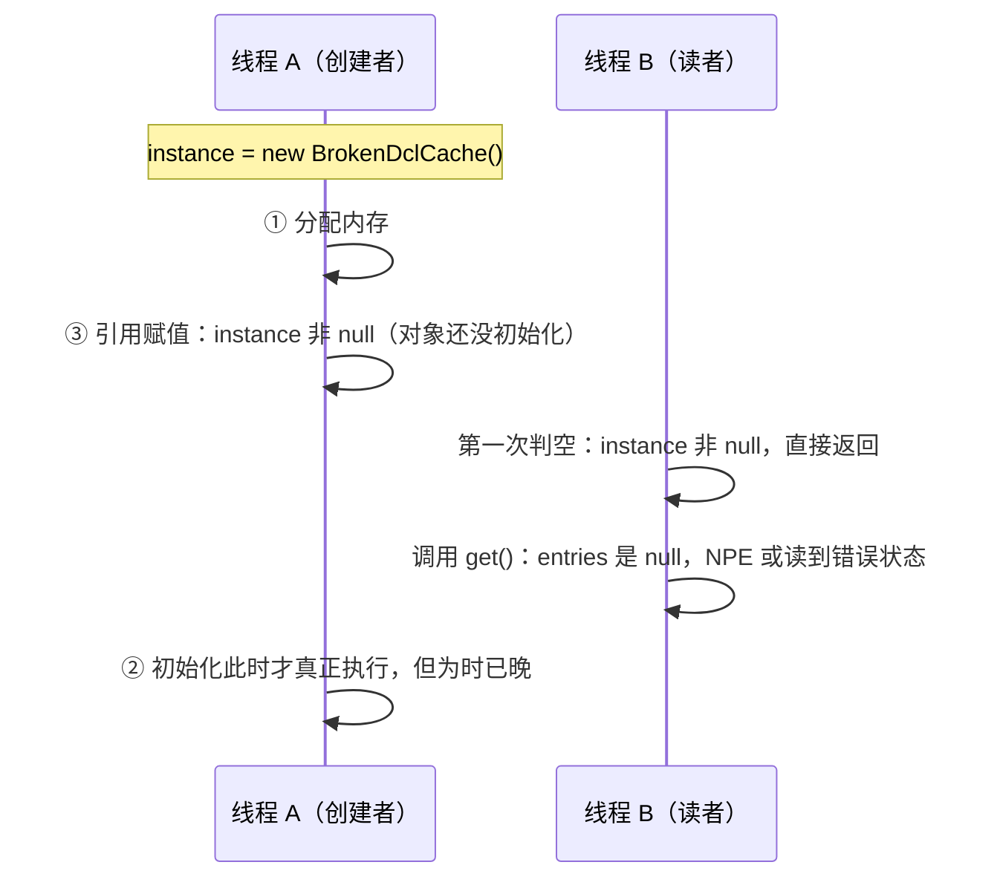

# 单例模式全解：从七种写法到破坏与防御

> 一句话概括：单例模式用「JVM 类初始化的线程安全性」或「显式同步」换取一个全局唯一实例——难点从来不是写出单例，而是写出**不能被反射、序列化、克隆破坏**，且**不拖累测试与类加载**的单例，以及知道什么时候根本不该写。

预计阅读时间：大约 60 分钟

所属主题：[设计模式常见面试题总结](summary.md)

本文以 JDK 21 为基线（源码行号对照 Corretto 21.0.6，小版本间可能浮动），源码锚点用 `类名#方法名` 标注，所有关键 JDK 行为均已对照 JDK 21 官方文档或本机 src.zip 源码核实，未逐行核验处单独注明。每个机制按「结论 → 机制 → 边界/代价 → 实践/追问」展开；Spring 的注册表式单例是另一个话题，见 [Spring 中的设计模式](../backend/java/spring/design-patterns.md) 第 3 章，本文只在第 5 章做对比、不重复展开。

---

## 0. 阅读路线

| 读者 | 建议阅读 | 关注点 |
| --- | --- | --- |
| 初级（1 年内） | 1、2.1、2.2、2.4、2.6、2.8、7、8.1 | 五种主流写法怎么写、总对比表、一句话结论 |
| 中级（1~3 年） | 全部，重点 2.3~2.5、3、8.1~8.5 | DCL 的重排机制、Holder 的类初始化锁、三种破坏与防御 |
| 高级（3 年+） | 3.2、4、8.6~8.9、9 | readResolve 的漏洞、多 ClassLoader、初始化顺序陷阱、锁竞争 |
| 选型/架构 | 2.8、4、5、6、7 | 写法取舍、容器托管的替代、什么时候不该写单例 |

目录：

1. 开篇：单例解决什么问题
2. 七种写法：可运行代码与机制
3. 三种破坏与防御：反射、序列化、克隆
4. 单例的工程问题：全局状态、测试、类加载器与锁
5. 与 Spring 注册表式单例对比
6. JDK 里的单例：Runtime、Toolkit、Desktop
7. 实践建议：现代 Java 项目里单例的落点
8. 高频面试追问集
9. 参考资料

---

## 1. 开篇：单例解决什么问题

**结论**：单例模式（Singleton）保证一个类**全局只有一个实例**，并提供一个全局访问点。它适合的判断标准只有一条：**这个实例代表一份"全局唯一"的资源或状态**——进程级配置中心、连接池、`Runtime`、文件系统句柄、ID 生成器的种子。反过来，凡是"每份独立的上下文该有一份"的对象（订单、请求、任务），套单例都是错的。

| 适合 | 不适合 |
| --- | --- |
| 全局唯一资源：配置、连接池、缓存门面、`Runtime` | 每个业务上下文一份的对象（订单、请求） |
| 创建成本极高、且注定全局复用 | 会随环境变化的多态实现（该交给依赖注入） |
| 无状态的工具入口（如枚举注册表） | 需要按租户/用户隔离的状态 |

GoF《设计模式》给它的定位是创建型模式，与工厂、建造者同族（见兄弟专题 [工厂与建造者](factory-and-builder.md)）；但单例又常被批评为"最常被滥用"的模式——因为它的实现手段（私有构造器 + 静态字段 + 全局访问点）天然引入隐藏耦合与全局可变状态，这部分代价在第 4 章展开。

一个容易被忽略的事实：**"只有一个实例"不是单例模式的目的，而是手段**。目的是"控制对唯一资源的访问"（GoF 原话：让类负责保存自己的唯一实例，并保证没有其他实例被创建）。理解这一点，才能回答第 5 章的问题——为什么 Spring 托管了全容器唯一的 Bean，却不肯用私有构造器。

---

## 2. 七种写法：可运行代码与机制

先把七种写法列出来。注意第三种是**故意保留的错误示范**——面试里"双重检查锁为什么要 volatile"是最高频的追问，只有先看清错误版的漏洞，才能答出正确版。

1. 饿汉式：类加载即初始化
2. 懒汉式：方法级 synchronized
3. 双重检查锁（无 volatile）：错误示范
4. 双重检查锁（volatile）：正确写法
5. 静态内部类（Holder）：懒加载 + 无锁线程安全
6. 枚举单例：Effective Java 推荐
7. CAS / AtomicReference：了解即可

### 2.1 写法一：饿汉式

```java
public class EagerConfig {
    // 字段初始化在类初始化（<clinit>）阶段执行，随类加载立即创建
    private static final EagerConfig INSTANCE = new EagerConfig();

    private EagerConfig() {
        // 防反射守卫：合法创建发生在类初始化期，此时 INSTANCE 尚未赋值；
        // 之后任何人（包括反射）再调构造器，INSTANCE 已非 null，直接失败
        if (INSTANCE != null) {
            throw new IllegalStateException("单例已存在，禁止再次创建");
        }
        // ... 读配置、初始化资源
    }

    public static EagerConfig getInstance() {
        return INSTANCE;
    }
}
```

**结论**：饿汉式是最简单的可靠写法——实例在类初始化阶段创建，线程安全由 JVM 保证，代码里一个锁都不用写。

**机制**：`static final INSTANCE = new EagerConfig()` 在类初始化方法（字节码里的 `<clinit>`）中执行。JVM 规范要求**一个类只能被初始化一次，且初始化过程对其他线程互斥**：JLS §12.4.2 描述了初始化步骤，JVMS §5.5 明确"对类的初始化锁同步"，正在初始化的类被其他线程访问时必须阻塞等待。所以"谁先 getInstance 谁触发初始化、后来的阻塞等结果"，唯一性天然成立——**这是所有不写锁的写法共同的安全垫**。

**边界与代价**：

- **不懒加载**：类被加载初始化就创建实例。而类加载时机不完全受你控制——本类被 `new`、静态方法被调用、静态字段被读写、被反射探测、被子类初始化都会触发（JLS §12.4.1）。一个只引用了 `EagerConfig.class` 常量池却从不调用方法的类不会触发，但"觉得没人用就不会加载"是不可靠的假设。
- **构造器抛异常的后果严重**：初始化一旦失败，该类进入"erroneous"状态，后续任何访问抛 `NoClassDefFoundError`——不是一次可重试的失败，是这类在本进程内的死刑（JLS §12.4.2）。
- 初始化慢的实例会把耗时摊到"第一个触发的动作"上：可能是容器启动，也可能是第一个请求。

**实践/追问**：创建便宜、注定要用的实例（配置、注册表）用饿汉式最省心；创建昂贵、可能不用、或需要资源就绪后才该建的，换第 5 种 Holder。追问"饿汉式为什么线程安全"时，答案不是"final 修饰"而是"类初始化由 JVM 加锁且仅一次"。

### 2.2 写法二：懒汉式（方法级 synchronized）

```java
public class LazyConnectionManager {
    private static LazyConnectionManager instance;

    private LazyConnectionManager() {}

    public static synchronized LazyConnectionManager getInstance() {
        if (instance == null) {
            instance = new LazyConnectionManager();
        }
        return instance;
    }
}
```

**结论**：懒汉式能正确实现懒加载 + 线程安全，但**每次访问都要抢同一把类锁**，高并发下把所有人串行排队——能用，性能差。

**机制**：`synchronized` 修饰静态方法 = 锁 `LazyConnectionManager.class`。安全性来自两个保证：① 锁互斥使"判空 → 创建"成为原子，两个线程不可能各造一份；② 监视器锁的 happens-before 规则（JLS §17.4.5：解锁先于后续对同一把锁的加锁）保证后来者能看见前者写的 `instance`。

**边界与代价**：初始化完成后，判空早就不成立了，但**锁还在每次抢**。偏向锁自 JDK 15 起默认禁用并最终移除（JEP 374），"无竞争时 synchronized 近乎免费"的旧时代已经过去；在每次请求都要 `getInstance()` 的热路径上，这个开销通常不是瓶颈，**锁竞争引起的排队**才是——所有线程在同一把锁上串行，哪怕只是读。此外 synchronized 方法是 API 的一部分：子类覆写后如果忘了同步，安全性就没了（继承的脆弱性）。

**实践/追问**：这是面试教学价值大于工程价值的写法——它让你能讲清楚"锁粒度太粗"的问题，然后自然引出 DCL 和 Holder。追问"懒汉式为什么慢"，答"每次读都过同一把类锁、初始化后锁毫无意义"，并顺势指出 JDK 15+ 偏向锁移除这个版本细节。

### 2.3 写法三：双重检查锁（无 volatile）——错误示范

```java
public class BrokenDclCache {
    private static BrokenDclCache instance;   // ❌ 缺 volatile

    private Map<String, String> entries;      // 非 final 的可变状态，构造器里赋值

    private BrokenDclCache() {
        entries = new HashMap<>();
        entries.put("warmup", "done");        // 假设这是必须完成的初始化写
    }

    public static BrokenDclCache getInstance() {
        if (instance == null) {                        // ① 第一次判空：多数访问无锁直达
            synchronized (BrokenDclCache.class) {      // ② 抢类锁
                if (instance == null) {                // ③ 第二次判空：持锁者防重复创建
                    instance = new BrokenDclCache();   // ④ 危险的一行
                }
            }
        }
        return instance;
    }

    public String get(String key) { return entries.get(key); }
}
```

**结论**：DCL 的结构本身是对的（两次判空 + 锁内创建），缺 volatile 时**另一个线程可能拿到一个非 null 但字段还没初始化的"半成品对象"**。这是《Java 并发编程实战》§16.2.4 正式宣布失效的写法。

**机制**：`instance = new BrokenDclCache()` 不是原子操作，它编译为三步：

| 步骤 | 动作 | 说明 |
| --- | --- | --- |
| ① | 分配内存 | `new` 指令，在堆上分配对象空间 |
| ② | 初始化 | 执行构造器：给 `entries` 赋值、写入 "warmup" |
| ③ | 引用赋值 | 把引用写入静态字段 `instance` |

**规范顺序是 ①②③。但 `instance` 不是 volatile，JMM 允许编译器/JIT 把 ③ 与 ② 重排**（两者都是普通写，相互之间没有 happens-before 约束）。于是可能出现 ①③②：



注意线程 B 甚至**不进同步块**——第一次判空（①）的动机是让热路径绕开锁，而恰恰是这个无锁读绕开了所有 happens-before 保证：B 可以看到 ③ 的结果却看不到 ② 的结果。这是 JMM 重排序问题的经典案例，volatile 与 happens-before 的完整机制见 [JMM 与 volatile](../backend/java/concurrency/jmm-and-volatile.md)。

**边界与代价**：两次判空本身不是错的——第一次判空省锁、第二次判空防重复创建，这个骨架在正确版里原样保留。错的只有一个字：字段少了 `volatile`。

**实践/追问**：面试答"无 volatile 的 DCL 有什么问题"，完整答法是四步：说出 new 的三步 → 指出 ②③ 可重排 → 推演"拿到半初始化对象"的时序 → 给出 volatile 修复。只答"会重排"拿不到分，能推演出时序才算懂。关于"现代 JVM 上真的会发生吗"，见 8.7——理论风险与工程态度要分开答。

### 2.4 写法四：双重检查锁（DCL + volatile）——正确写法

```java
public class DclCache {
    private static volatile DclCache instance;   // volatile 禁止重排 + 保证可见性

    private final Map<String, String> entries = new HashMap<>();

    private DclCache() {}

    public static DclCache getInstance() {
        DclCache local = instance;               // 局部变量缓存一次 volatile 读（微优化）
        if (local == null) {
            synchronized (DclCache.class) {
                local = instance;                // 进锁后必须重新读，不能沿用旧值
                if (local == null) {
                    instance = local = new DclCache();
                }
            }
        }
        return local;
    }
}
```

**结论**：给字段加 `volatile` 是 DCL 的唯一补丁——它同时解决**重排**和**可见性**两个问题，让"先看到引用、后看到初始化"不可能发生。

**机制**，两层：

1. **规范层（happens-before）**：JLS §17.4.5 规定，对 volatile 变量的写先于后续对同一变量的读。`instance = new DclCache()` 是 volatile 写，排在它之前的所有普通写（构造器里对 `entries` 的赋值）都 happens-before 任何读到非 null `instance` 的线程。所以读到引用的线程**必然**看到完整的初始化结果——不是"大概率看见"，是内存模型保证。
2. **实现层（内存屏障）**：HotSpot 参照 JSR-133 Cookbook（非规范文档）在 volatile 写前插入 StoreStore 屏障，禁止"构造器内的普通写"与"volatile 引用写"重排；volatile 读后配 acquire 语义。x86 上 acquire/release 基本免费、StoreLoad 才是贵的，这也是"不加 volatile 在 x86 测试里往往不炸"的硬件根源——**测试不炸不代表正确**。

两次判空的必要性也要说清：

| 判空 | 位置 | 作用 | 能不能省 |
| --- | --- | --- | --- |
| 第一次 | 锁外 | 初始化完成后，热路径无锁直达 | 不能省，省了就退化成写法二 |
| 第二次 | 锁内 | 两个线程同时通过第一次判空时，只有一个创建 | 不能省，省了会造出两个实例 |

**边界与代价**：volatile 读比普通读略贵（屏障限制优化），`local` 局部变量缓存读是惯用微优化，但**进锁后必须重新读**——局部变量可能是在抢锁前读到的 null。此外 volatile 只保护"引用发布"这一个点：实例内部的可变状态仍要自己保证线程安全，DCL 不给实例的状态上保险。

**实践/追问**：DCL 值得写在生产代码里的场景非常窄（资源昂贵 + 不确定是否用到 + 无法用类初始化期创建 + 无容器），多数情况 Holder（2.5）更优且更简单。DCL 的主要价值是面试：它是检验 JMM 理解的最好试金石。

### 2.5 写法五：静态内部类（Holder）

```java
public class ReportEngine {
    private ReportEngine() {}

    /** 首次引用 Holder 才会加载并初始化 Holder，实例创建随之发生 */
    private static class Holder {
        static final ReportEngine INSTANCE = new ReportEngine();
    }

    public static ReportEngine getInstance() {
        return Holder.INSTANCE;   // 唯一的"初始化触发器"
    }
}
```

**结论**：Holder 是**懒加载 + 线程安全的最优解**——两者都来自 JVM 的类初始化机制，全程没有一行同步代码。

**机制**，两句话讲完：

1. **懒加载的根源**：内部类 `Holder` 平时根本不加载。JLS §12.4.1 规定，类在其"主动使用"（创建实例、读写静态字段、调用静态方法等）时才初始化——`ReportEngine` 本身的加载初始化不会牵连 `Holder`，只有第一次执行 `Holder.INSTANCE` 的静态字段读才触发 `Holder` 的初始化。所以实例创建被精确推迟到第一次 `getInstance()`。
2. **线程安全的根源**：与饿汉式同源——类初始化由 JVM 加"初始化锁"且全局仅一次（JVMS §5.5）。第一个到达的线程执行 `<clinit>` 创建实例，其余线程阻塞等待，醒来后直接看到完成的 `INSTANCE`。**不是"不需要锁"，是 JVM 替你加了锁且只加这一次**——答出这句就把"为什么无锁也安全"说透了。

**边界与代价**：几乎为零。要挑的话：① 同样不防反射、不防序列化（见第 3 章），需要时叠加构造器守卫与 `readResolve`；② 构造器抛异常同样导致 `NoClassDefFoundError` 死刑；③ `Holder` 的初始化失败只会影响 Holder 自己的类，外层类不受牵连，比饿汉式炸得更隔离一点。另外注意一个冷知识：JLS §12.4.1 中**编译期常量**（`static final` 的基本类型/String 字面量）的读不触发初始化，所以"final 就一定触发类加载"的说法是错的。

**实践/追问**：无容器场景下手写懒加载单例，Holder 应是默认选择。追问"Holder 为什么不需要 volatile/synchronized"：`<clinit>` 只执行一次且互斥，实例在类初始化里"发布"完毕，之后 `Holder.INSTANCE` 的读是普通读但安全——因为初始化锁的释放-获取关系已经建立了 happens-before。

### 2.6 写法六：枚举单例

```java
public enum Registry {
    INSTANCE;                                  // 唯一实例，就是唯一的枚举常量

    private final Map<String, String> configs = new ConcurrentHashMap<>();

    public void put(String key, String value) { configs.put(key, value); }
    public String get(String key) { return configs.get(key); }
}

// 使用：Registry.INSTANCE.get("app.name")
```

**结论**：Effective Java（第 3 版 Item 3）的结论——**单元素枚举是实现单例的最佳方式**：防反射与防序列化由 JVM 硬保证，一行防御代码都不用写。代价是不懒加载、不能继承别的类。

**机制**，两条 JVM 级硬保证：

1. **防反射**：枚举常量在枚举类的 `<clinit>` 里创建，反射试图调枚举构造器会被 JDK 直接拒绝。JDK 21 官方文档对 `java.lang.reflect.Constructor#newInstance` 的说明：当"构造器属于枚举类"（this constructor pertains to an enum class）时抛 `IllegalArgumentException`。源码依据在 `Constructor#acquireConstructorAccessor`（JDK 21，`java.base/java/lang/reflect/Constructor.java:546-547`）：

   ```java
   // Constructor#acquireConstructorAccessor（JDK 21，节选）
   // Ensure the declaring class is not an Enum class.
   if ((clazz.getModifiers() & Modifier.ENUM) != 0)
       throw new IllegalArgumentException("Cannot reflectively create enum objects");
   ```

   早期实现在 `sun.reflect` 内部，JDK 9 模块化后并入 `java.base`，行为自 Java 5 引入枚举以来未变。

2. **防序列化**：普通类的反序列化走"分配对象 + 反射填字段"，天然绕过构造器、产出新实例。枚举被 JVM 特殊处理：`ObjectInputStream#readEnum`（JDK 21 源码 `ObjectInputStream.java:2200-2222`）从流里只读**常量名**，然后调 `Enum.valueOf(Class, String)` 取回**既有的那个常量**——不可能产生新实例。官方文档进一步明确：枚举类型自定义的 `readObject`/`readObjectNoData`/`readResolve` 在反序列化时**全部被忽略**，所有枚举类型的 serialVersionUID 固定为 0L。事实上 `java.lang.Enum` 自己的 `readObject` 直接 `throw new InvalidObjectException("can't deserialize enum")`（JDK 21 源码 `Enum.java:311-318`），只是它根本不会被调到——真正的防线是 `readEnum` 这条专用路径。

**边界与代价**：

- **不懒加载**：枚举常量创建在 `<clinit>` 里，本质是"自带防破坏的饿汉式"。需要真正懒加载时选 Holder。
- **不能继承**：枚举已隐式继承 `java.lang.Enum`，无法再 extends 其他类；只能实现接口。需要继承体系时改用 Holder + 构造器守卫。
- **心智成本**："枚举是类"——它可以有字段、方法、构造器，很多人不知道；反过来团队成员看到 `enum` 当单例也需要解释一句。代码评审里最好配一条注释。
- 枚举有隐式方法（`values()`、`valueOf`、`ordinal`），作为单例 API 略显噪音，但无实际危害。

**实践/追问**：没有容器、需要全局唯一、又要防反射防序列化时，枚举是终点答案。追问"枚举为什么防反射"，给 `Constructor#newInstance` 的 IAE 条款加源码行号；追问"枚举为什么防序列化"，给 `readEnum` → `Enum.valueOf` 这条专用路径，并强调"枚举的 readObject 被忽略"这个细节，都是能直接拉开差距的点。

### 2.7 写法七：CAS / AtomicReference

```java
import java.util.concurrent.atomic.AtomicReference;

public class CasIdGenerator {
    private static final AtomicReference<CasIdGenerator> REF = new AtomicReference<>();
    private final AtomicLong seq = new AtomicLong();

    private CasIdGenerator() {}

    public static CasIdGenerator getInstance() {
        while (true) {
            CasIdGenerator current = REF.get();
            if (current != null) {
                return current;
            }
            current = new CasIdGenerator();        // 竞争失败时这个实例会被整个丢弃
            if (REF.compareAndSet(null, current)) {
                return current;
            }
        }
    }

    public long next() { return seq.incrementAndGet(); }
}
```

**结论**：CAS 变体能保证唯一且安全发布，但**构造器可能被并发执行多次**（只有胜者的实例被留下，败者的整个丢弃）——它牺牲"构造恰好一次"换无锁，工程上几乎没有真实使用场景，列出是为了完整与面试辨析。

**机制**：`AtomicReference` 的 value 字段本身是 volatile，`compareAndSet` 是 volatile 读-改-写（HotSpot 用 `lock cmpxchg` 实现，全屏障），胜者写入的引用对后续读者安全可见。安全性成立，代价有三：构造器内的副作用会被重复执行（连数据库连接池都不该这么造）、竞争激烈时自旋浪费 CPU、代码可读性差。

**实践/追问**：面试被问"CAS 能不能实现单例"时，标准答案是"能保证唯一引用与安全发布，但构造器会多次执行，所以一般不用"——能主动说出"构造多次"这个坑，比写对代码更重要。

### 2.8 七种写法总对比

| # | 写法 | 懒加载 | 线程安全 | 防反射 | 防序列化 | 复杂度 | 推荐 |
| --- | --- | --- | --- | --- | --- | --- | --- |
| 1 | 饿汉式 | 否（类加载即建） | 是（类初始化锁） | 否（可加构造器守卫） | 否（可加 readResolve） | 低 | ✅ 简单场景首选之一 |
| 2 | 懒汉式（方法级 synchronized） | 是 | 是（每次访问过类锁） | 否 | 否 | 低 | ❌ 锁粒度太粗 |
| 3 | DCL 无 volatile | 是 | **否**（半初始化风险） | 否 | 否 | 中 | ❌ 经典错误示范 |
| 4 | DCL + volatile | 是 | 是 | 否 | 否 | 中高 | ⚠️ 可用，面试重点，工程上不如 Holder |
| 5 | 静态内部类 Holder | **是** | 是（类初始化锁） | 否（可加构造器守卫） | 否（可加 readResolve） | 低 | ✅ 手写懒加载首选 |
| 6 | 枚举 | 否（clinit 内创建） | 是 | **是**（JDK 硬保证） | **是**（JDK 硬保证） | 极低 | ✅✅ Effective Java 首选 |
| 7 | CAS / AtomicReference | 是 | 是（volatile + CAS） | 否 | 否 | 中 | ❌ 构造器可能多次执行 |

读表要点：**懒加载与防破坏是正交的两个维度**——枚举赢在防破坏但输掉懒加载，Holder 赢在懒加载但需要自己补防御；没有一种写法六边形全满，所以第 7 章才给出分场景的推荐顺序。

---

## 3. 三种破坏与防御：反射、序列化、克隆

**结论**：私有构造器挡得住 `new`，挡不住运行时绕过语言层的三条路——反射调构造器、反序列化分配新对象、克隆复制实例。防御手段分别是构造器守卫、`readResolve`、拒绝 `Cloneable`；而枚举对前两者免疫。

### 3.1 反射破坏与防御

攻击代码只需两行（对无防御的饿汉/Holder/DCL 类都有效）：

```java
public class ReflectionAttack {
    public static void main(String[] args) throws Exception {
        Constructor<EagerConfig> c = EagerConfig.class.getDeclaredConstructor();
        c.setAccessible(true);                 // 打破 private 访问检查
        EagerConfig copy = c.newInstance();    // 拿到第二个实例
        System.out.println(copy == EagerConfig.getInstance());   // false
    }
}
```

**防御**：构造器守卫——构造器里检查实例已存在则抛异常（2.1 的 `EagerConfig` 已内置）：

```java
private EagerConfig() {
    if (INSTANCE != null) {
        throw new IllegalStateException("单例已存在，禁止再次创建");
    }
}
```

**机制**：守卫成立的依赖链条值得说清——官方文档对 `Constructor#newInstance` 的描述是"若访问与参数检查通过、实例化将进行，**构造器所属类会先被初始化**"。也就是说反射调用构造器前，`<clinit>` 已执行完、`INSTANCE` 已非 null，守卫必然命中。注意两个前提：

- 守卫只对**类初始化期创建实例**的写法（饿汉、Holder）可靠。DCL 这种"首次 `getInstance()` 才创建"的写法，在类初始化完成后、首次调用前，`instance` 还是 null，守卫形同虚设。
- 守卫判空必须判**静态字段**本身。判 `this` 毫无意义——新造的对象永远不会"等于自己已存在"。

**边界与代价**：枚举天然免疫（2.6 的源码依据）。另一个边界来自模块系统：JDK 16 起默认强封装（JEP 396）、JDK 17 完成强封装（JEP 403）后，对**未 open 的具名模块**里的类 `setAccessible(true)` 直接抛 `InaccessibleObjectException`——攻击面缩小了，但业务代码通常在 unnamed module，反射依旧畅通，防御还得自己写。

**追问**：为什么反射调构造器前类一定已初始化、守卫为什么必然生效？答：`newInstance` 的契约包含"先初始化声明类"，而初始化是一次性的、互斥的；守卫读的是初始化完成后必然非 null 的静态字段。

### 3.2 序列化破坏与防御

**结论**：实现 `Serializable` 的单例，反序列化会**绕过构造器新造一个实例**——除非写 `readResolve`。Java 对象反序列化的机制是"先分配裸对象、再填字段"，构造器（无论公有私有）根本不执行，这是它与反射攻击的本质区别。

```java
// 攻击演示
try (var oos = new ObjectOutputStream(new FileOutputStream("s.bin"));
     var ois = new ObjectInputStream(new FileInputStream("s.bin"))) {
    oos.writeObject(ConfigHolder.getInstance());
    ConfigHolder copy = (ConfigHolder) ois.readObject();
    System.out.println(copy == ConfigHolder.getInstance());   // 无防御时：false
}
```

**防御**：`readResolve`——反序列化完成后，`ObjectInputStream` 检查类是否定义了 `readResolve` 方法（`ObjectStreamClass#hasReadResolveMethod`），有则调用它（`ObjectStreamClass#invokeReadResolve`），**用返回值替换流中刚造出的对象**（JDK 21 源码 `ObjectInputStream.java:2289-2293`）：

```java
public class ConfigHolder implements Serializable {
    private static final long serialVersionUID = 1L;
    private static final ConfigHolder INSTANCE = new ConfigHolder();

    // 状态字段一律 transient：见下方"为什么"
    private transient Map<String, String> data = new HashMap<>();

    private ConfigHolder() {}

    public static ConfigHolder getInstance() { return INSTANCE; }

    /** 反序列化结束时被调用，返回值替换"新造的对象" */
    private Object readResolve() {
        return INSTANCE;
    }
}
```

**机制**：`readResolve` 的替换发生在对象图解析阶段，正常流上确实只会留下一份实例。但 Effective Java（第 3 版 Item 89）指出它有个著名漏洞：**替换前，那个"废弃实例"已经存在于对象图里**——如果类里有非 transient 的字段引用了别的对象（或嵌套对象反过来引用单例），攻击者可以构造一个精心设计的流，让那份废弃实例的引用挂在可达对象上存活下来，从而拿到第二个实例。所以守则是：**依赖 `readResolve` 做实例控制时，所有实例字段必须是 transient**（或不可变）。示例里 `data` 标了 transient 就是这个原因。

**边界与代价**：枚举再次免疫——`readEnum` 走 `Enum.valueOf`，根本不经过"造对象"这条路径，枚举的 `readResolve` 即便写了也会被忽略（2.6）。另外注意：`readResolve` 返回的是 `Object`，签名写错（返回类型不是 Object、方法名拼错）会导致防御静默失效——方法名必须精确为 `readResolve` 且无参。

**追问**：`readResolve` 之后为什么还要 transient？答：替换前废弃实例在对象图中可达，非 transient 引用会让攻击者借道拿到它；Item 89 的 Elvis 例子就是经典攻击样本。

### 3.3 克隆破坏与防御

**结论**：克隆的破坏力最小，因为**默认就是安全的**——单例类只要不实现 `Cloneable`，`Object#clone()` 对它抛 `CloneNotSupportedException`，克隆不出第二份。需要防御的只有一种情况：类被迫实现 `Cloneable`（比如父类要求）。

```java
public class LicenseManager {
    private static final LicenseManager INSTANCE = new LicenseManager();
    private LicenseManager() {}
    public static LicenseManager getInstance() { return INSTANCE; }

    /** 类层次被要求 Cloneable 时，显式拒绝克隆 */
    @Override
    protected Object clone() throws CloneNotSupportedException {
        throw new CloneNotSupportedException("单例禁止克隆");
    }
}
```

**机制**：`Object#clone` 的契约是：类未实现 `Cloneable` 时抛 `CloneNotSupportedException`。注意 `clone()` 是浅拷贝且**不调构造器**（直接按位复制字段），所以"私有构造器 + 构造器守卫"对克隆毫无作用——这也是三种破坏里唯一让守卫失效的路径，好在默认防御已经在语言层。

### 3.4 防御组合：一张速查表

| 破坏手段 | 绕过什么 | 默认防线 | 显式防御 | 枚举 |
| --- | --- | --- | --- | --- |
| 反射 | private 构造器 | 无 | 构造器守卫（判静态字段非 null 抛异常；仅类初始化期创建的写法可靠） | 免疫（`Constructor#newInstance` IAE） |
| 序列化 | 构造器整体（不执行） | 不实现 `Serializable` | `readResolve` + 所有实例字段 transient | 免疫（`readEnum` → `Enum.valueOf`） |
| 克隆 | 构造器 + 守卫（按位复制） | 不实现 `Cloneable`（`Object#clone` 抛异常） | 被迫实现时覆写 `clone()` 抛异常 | 免疫（`Cloneable` 无法对枚举生效，`Enum` 未实现） |

手写单例的完整防御清单：**私有构造器 + 守卫 + `readResolve` + transient + 不实现 `Cloneable`**——五件套写全，才追得上枚举的"零成本防御"。这正是 Effective Java 推荐枚举的经济学：五件套换一个关键字。

---

## 4. 单例的工程问题：全局状态、测试、类加载器与锁

写法层面七种穷尽了，但单例真正咬人的地方在工程层面。这一章是高级/资深面试的分水岭，也是兄弟专题 [现代 Java 与反模式](modern-java-and-anti-patterns.md) 的重点话题之一。

### 4.1 全局可变状态与隐藏依赖：服务定位器反模式

**结论**：`Singleton.getInstance()` 是一次**对静态全局 API 的硬编码调用**——依赖关系不出现在构造器签名、接口契约和类型系统里，谁都能偷偷调，类之间的耦合图从此不可见。

**机制**：对比两种写法：

```java
// 隐藏依赖：签名里看不出 OrderService 依赖什么，测试时无法替换
public class OrderService {
    public Order find(long id) {
        return ConfigCenter.getInstance().getFeature("order.cache")   // 偷偷依赖 1
             + BillingClient.getInstance().query(id);                 // 偷偷依赖 2
    }
}

// 显式依赖：依赖在构造器上，替换实现、打桩测试都只是一行参数的事
public class OrderService {
    private final ConfigCenter config;
    private final BillingClient billing;
    public OrderService(ConfigCenter config, BillingClient billing) { ... }
}
```

单例一旦被多个类当"服务定位器"用，它就成了隐式上下文：换实现（把文件配置换成 Apollo）要改所有调用点；并发修改单例内部可变状态没有编译期约束；调用方的初始化顺序依赖被埋进运行期。

**边界与代价**：GoF 把"全局访问点"当特性，现代工程实践把它当债务——依赖注入容器（Spring/Guice/Dagger）正是对这个特性的整体替代：唯一性交给容器注册表（第 5 章），可见性交给构造器签名。

**实践/追问**：面试答"单例的缺点"，第一句就该是"引入隐藏耦合与全局可变状态"，然后才是"测试难"。只背"线程安全"是初级答案。

### 4.2 测试困难

**结论**：单例难 mock、难重置、难隔离——它是静态的、私有的、常驻的，三个属性都站在可测试性的反面。

| 痛点 | 表现 | 常见的错误解法 |
| --- | --- | --- |
| 无法注入替身 | 被测类内部 `getInstance()`，Mockito 拦不到 | mockStatic（PowerMock 时代遗产，脆弱且拖慢测试） |
| 状态跨测试泄漏 | 单测 A 写进单例的状态，单测 B 意外读到 → 测试顺序依赖 | 写 `reset()` 方法（等于公开承认状态污染，还引出生产环境误用的风险） |
| 不可重建 | 构造器私有 + 实例常驻，测试里没有"重来一次" | 反射重建（又回到第 3 章的攻防） |

**实践**：正确解法不是"把单例测好"，而是**让单例可被替换**——接口 + 构造器注入（4.1 的右例）：生产环境注入真实现，测试注入 stub；唯一性交给容器或装配代码，而不是类自己。手写单例留给真正"无依赖、纯静态语义"的极小对象（如无状态注册表）。

### 4.3 类加载器隔离：单例真的只有一个吗

**结论**：JVM 单例的"全局"是**类加载器级**的，不是进程级的——同一个类被两个 ClassLoader 各加载一次，就是两个独立的类、两份独立的静态字段、两个单例。

**机制**：类的唯一性由「类名 + 定义类加载器」决定。Tomcat 的每个 webapp 一个 `WebappClassLoader`，OSGi 每个bundle 一套空间，甚至 `-Djava.system.class.loader` 自定义加载器也会造成父子双份。表现：两个 webapp 各有一份 `ConfigCenter.INSTANCE`，互不知道对方的存在；排查时 `instanceof` 跨加载器比较恒为 false，是这类问题的典型现场。

```java
// 排查手段：确认是否同一加载器
System.out.println(ConfigCenter.class.getClassLoader());   // 两个实例若打印不同加载器，即坐实
```

**实践**：容器环境要么把该类放到**共享/父加载器可见的位置**（Tomcat 的 shared lib），要么接受"每容器一份"并把跨进程一致性交给外部存储（数据库/配置中心），要么干脆用容器级注册表（Spring 的 singleton 本来就是"每容器一份"，见第 5 章——它不假装自己是 JVM 单例，反而语义诚实）。

### 4.4 懒加载与初始化顺序陷阱

**结论**：单例的静态字段初始化依赖其他单例时，**初始化顺序由"谁的 `<clinit>` 先被触发"决定，而触发顺序不可控**——极端情况死锁，常见情况读到 null。

**机制**：两个陷阱分属两种情况。

陷阱一：**同线程递归初始化读到半成品**。JLS §12.4.2 允许递归初始化（正在初始化 A 的线程可以再访问 A），于是跨类的循环引用会造出 null：

```java
class ServiceRegistry {
    static final ServiceRegistry INSTANCE = new ServiceRegistry();  // ①
    private final LogSink sink = LogSink.INSTANCE;    // ② 触发 LogSink 初始化
}
class LogSink {
    static final LogSink INSTANCE = new LogSink();
    private final Object owner = ServiceRegistry.INSTANCE;   // ③ 此时 ① 尚未完成赋值 → owner = null
}
```

`ServiceRegistry` 的构造器执行中触发 `LogSink` 初始化，而 `LogSink` 又回头读 `ServiceRegistry.INSTANCE`——赋值（①）要等构造器返回后才发生，`LogSink.owner` 永久为 null，**编译运行都不报错**。

陷阱二：**跨线程初始化死锁**。线程 1 在初始化 A（其 clinit 引用 B），线程 2 同时在初始化 B（其 clinit 引用 A）：按 JVMS §5.5，双方各持自己类的初始化锁、等待对方完成，互相阻塞——类初始化死锁，jstack 里能看到两个线程分别 BLOCKED 在两个 `<clinit>` 上。

**实践**：静态字段之间不搞循环引用；初始化有依赖关系的单例，用显式装配（一个静态入口按序创建，或直接用 DI 容器）；排查手段认准 jstack 的 `<clinit>` 线程栈。

### 4.5 锁竞争热点

**结论**：懒汉式的 synchronized `getInstance` 在高并发下是一个**全局串行化点**——所有线程在同一把类锁上排队，而排队本身就是可测量的事故源。

**机制**：初始化完成后锁毫无必要却仍在每次调用时争夺。量化直觉：无竞争 monitor 进入是几十纳秒级（JDK 15 偏向锁移除后每次都走 CAS 路径），单次看着无所谓；但在每秒数万次调用的热路径上，锁的排队效应（线程上下文切换、锁队列管理）会放大成毫秒级长尾。真正的杀手是**锁内还干了别的**——有人在 synchronized 方法里塞了配置重载之类的逻辑，锁持有时间暴涨，所有 `getInstance()` 调用跟着一起慢。

**实践**：结论与 2.8 一致——热路径上用饿汉/Holder（初始化后零锁、零 volatile 读），或 DCL（初始化后只剩 volatile 读）。反过来说，**不要为了"省一次 volatile 读"把写法四降级成写法三**：省下的是纳秒，赌上的是内存模型正确性。

---

## 5. 与 Spring 注册表式单例对比

**结论**：GoF 单例是「**类自治**」——唯一性写在类内部（私有构造器 + 静态字段）；Spring 单例是「**容器托管**」——唯一性由外部注册表（`singletonObjects`）保证，类本身是普通 POJO。同一个词，两种语义。

完整机制、源码与"为什么容器不用私有构造器"的四条理由（容器要实例化任意第三方类、要掌控注入/AOP/销毁全流程、作用域要可切换、可测试性）见 [Spring 中的设计模式](../backend/java/spring/design-patterns.md) 第 3 章，这里只放对比结论：

| 维度 | GoF 单例（本文） | Spring 单例 Bean |
| --- | --- | --- |
| 唯一性由谁保证 | 类内部静态字段 | 容器注册表（beanName → 实例） |
| 构造器 | private，禁止外部 new | public，容器与测试都能 new |
| 唯一性粒度 | 每 ClassLoader 一份（4.3） | **每容器**一份，两个容器两份 |
| 懒加载 | 可选（Holder/枚举） | BeanFactory 懒加载；ApplicationContext 预实例化 |
| 生命周期 | 类自己管，常驻到进程结束 | 容器管：注入、初始化、销毁回调 |
| 可测试性 | 差（4.2） | 脱离容器直接 new，或换配置 |

**追问：Spring 单例是 GoF 单例吗？** 不是。它借了"单例"这个词，实现上更像"注册表模式 + 缓存"；GoF 的七种写法对它全部不适用——容器恰恰**不能**用私有构造器，否则第 3 章那套"反射实例化 + 填充依赖"的流程就走不通。反过来说，GoF 单例的私有构造器正是它可测试性差的总根源。

---

## 6. JDK 里的单例：Runtime、Toolkit、Desktop

JDK 自己是单例写法的活教材，三个实例恰好覆盖三种写法（锚点均已对照 JDK 21 源码核实）：

| 类 | 写法 | 关键源码 | 备注 |
| --- | --- | --- | --- |
| `java.lang.Runtime` | **饿汉式** | `Runtime.java:123`：`private static final Runtime currentRuntime = new Runtime();`；`:135` `getRuntime()` 直接返回；`:140` `private Runtime() {}` | 无守卫、无 readResolve——JDK 信任自己的类不会被业务反射 |
| `java.awt.Toolkit` | **懒汉式（synchronized）** | `Toolkit#getDefaultToolkit`（`java.desktop` 模块，`Toolkit.java:593-605`）：`public static synchronized` + null 判断 + `PlatformGraphicsInfo.createToolkit()` | headless 环境下包装为 `HeadlessToolkit`（596-600 行分支）；具体实现类按平台决定（Windows 为 WToolkit、macOS 为 LWCToolKit，常识性描述，未逐行核验属性读取链） |
| `java.awt.Desktop` | **懒汉式（synchronized）+ 平台探测** | `Desktop#getDesktop`（`Desktop.java:301`）：`public static synchronized`；`:303` 不支持时抛异常；`private Desktop()` 在 `:271` | **平台可用性**：Windows、macOS、多数桌面 Linux 支持；无头服务器/容器不支持——必须先 `Desktop.isDesktopSupported()` 探测，否则 `getDesktop()` 抛 `HeadlessException` |

三个观察值得带进面试：

1. **JDK 也不统一**：Runtime 用饿汉（核心类，注定要建），Toolkit/Desktop 用懒汉 synchronized（创建贵且可能用不到，且调用频率低、锁不构成热点）——写法选择的依据是**创建成本 × 使用频率**，不是"哪个更高级"。
2. **JDK 不写防御五件套**：`Runtime` 没有构造器守卫也没有 `readResolve`。框架作者与业务作者的防御预算不同：JDK 类处于加载器根部、攻击面可控，业务类面对的是任意代码，所以要写全 3.4 的清单。
3. `Toolkit` 证明了写法二（synchronized 懒汉）**在低频调用下完全合理**——别把"懒汉式性能差"背成教条，锁的代价要看调用频率。

JDK 里更多模式实例（迭代器、适配器、装饰器、享元等）见兄弟专题 [JDK 中的设计模式](patterns-in-jdk.md)。

---

## 7. 实践建议：现代 Java 项目里单例的落点

**结论**：现代 Java 项目里，"全局唯一"这件事的默认答案是**交给容器**（Spring/Guice/Dagger 的单例作用域），手写单例只剩一个窄口子——**没有容器的场景**（CLI 工具、JDK Agent/premain、纯 JDK 库、Android 小模块）。

按场景给推荐顺序：

| 场景 | 首选 | 次选 | 说明 |
| --- | --- | --- | --- |
| 有 DI 容器 | 容器托管单例 Bean | — | 唯一性、生命周期、测试替身全解决；单例作用域的边界见 [Spring 中的设计模式](../backend/java/spring/design-patterns.md) 第 3 章 |
| 无容器 + 需防反射/序列化（SDK、库） | **枚举** | Holder + 防御五件套 | Effective Java Item 3 的结论；枚举不能继承时退到 Holder |
| 无容器 + 需要懒加载 | **Holder** | DCL + volatile | Holder 更简单且无锁；DCL 留给"创建依赖外部资源就绪"的场景 |
| 创建便宜且必然使用 | **饿汉式** | 枚举 | 唯一性最简单，失败也炸得最早（fail fast） |
| 面试与教学 | DCL 全家桶 | 懒汉式 | 讲透 JMM 的最好素材，但别写进生产代码 |

四条纪律：

1. **先问"真的需要单例吗"**：要的是"唯一实例"还是"方便的全局访问点"？后者是反模式（4.1），用注入替代。
2. **手写单例默认无状态**：可变全局状态是并发事故与测试灾难的共同根源；状态放实例字段并考虑不可变。
3. **防御与场景匹配**：库/SDK 类写全 3.4 五件套或直接用枚举；应用内部类（受控环境）可以省略反射/序列化防御，把预算花在可测试性上。
4. **构造器里不做重活**：类初始化失败是 `NoClassDefFoundError` 死刑（2.1）；昂贵初始化配懒加载（Holder），失败的恢复策略用显式重试逻辑而不是指望重新 `<clinit>`。

设计原则层面的展开（为什么全局单例与依赖倒置原则冲突）见兄弟专题 [设计原则与 UML](principles-and-uml.md)。

---

## 8. 高频面试追问集

**Q1：双重检查锁为什么要 volatile？给完整答法。**

期望答案：`new` 分三步——分配内存 → 初始化 → 引用赋值；`instance` 无 volatile 时，②③ 两个普通写可被编译器/JIT 重排，另一线程可能在锁外第一次判空读到**非 null 但未初始化**的引用，对其字段访问得到 NPE 或错误状态。volatile 提供两层保证：JLS §17.4.5 的 happens-before（volatile 写之前的所有普通写，对读到该 volatile 的线程可见）；实现层的内存屏障禁止重排。最后补一句：两次判空各有职责（外层省锁、内层防重复创建），错的不在结构，在缺 volatile。

**Q2：静态内部类（Holder）为什么既懒加载又线程安全？**

期望答案：懒加载源于 JLS §12.4.1——内部类只在首次主动使用时加载初始化，`Holder.INSTANCE` 的第一次读才触发；线程安全源于 JVM 类初始化机制——JVMS §5.5 保证一个类的初始化全局一次且对其他线程互斥（类初始化锁），唯一性由 JVM 而不是代码保证。一句话总结："不是不需要锁，是 JVM 替你加了锁且只加一次。"

**Q3：枚举为什么防反射、防序列化？**

期望答案：防反射——JDK 明确规定枚举构造器不能被反射调用，`Constructor#newInstance` 的 javadoc 写明构造器属于枚举类时抛 `IllegalArgumentException`（JDK 21 源码在 `Constructor#acquireConstructorAccessor`，判断 `Modifier.ENUM` 后直接抛 "Cannot reflectively create enum objects"）。防序列化——枚举不走"分配对象+填字段"的反序列化路径，`ObjectInputStream#readEnum` 只读常量名然后 `Enum.valueOf` 取回既有常量；枚举自定义的 `readObject`/`readResolve` 均被忽略，serialVersionUID 固定 0L。代价：不懒加载、不能继承。

**Q4：Spring 单例 Bean 和 GoF 单例的区别？**

期望答案：唯一性保证者不同——GoF 靠类内部静态字段（类自治），Spring 靠容器注册表 `singletonObjects`（容器托管）；粒度不同——GoF 是每 ClassLoader 一份，Spring 是每容器一份（两个 ApplicationContext 两份）；构造器不同——GoF 私有禁止 new，Spring 必须公开让容器反射实例化、注入、代理。所以"Spring 单例不是单例模式"，它是注册表 + 缓存，借了名字而已。容器不用私有构造器的根本原因：要掌控创建全过程（见 [Spring 中的设计模式](../backend/java/spring/design-patterns.md) 第 3 章）。

**Q5：单例怎么写单元测试？**

期望答案：分两层答。手写单例本身可测的部分（纯逻辑）可以直接调 `getInstance()` 测；但**依赖单例的类**没法在单测里替换它——这是单例最大的工程代价。正确解法是被测类不直接调 `getInstance()`，而是通过构造器注入接口，测试注入 stub；手写单例只保留给无状态纯工具。错误解法是 PowerMock/mockStatic 或给单例加 `reset()`——前者脆弱拖慢测试，后者等于公开承认全局可变状态。

**Q6：懒加载到底有什么真正的收益？**

期望答案：两个真实场景。① **初始化成本高且大概率用不到**：如 AWT `Toolkit`——无头服务器上图形栈根本不用建，懒加载省的是真金白银的启动时间与内存；② **依赖未就绪**：实例创建需要配置中心、日志目录等运行时依赖就绪，类加载期（可能早于一切初始化）创建不了，必须推迟到首次使用。反例也要说：创建便宜、注定要用的实例懒加载纯属浪费复杂度——饿汉式更简单、失败更早暴露。

**Q7：指令重排在现代 JVM 上真的会发生吗？工程上怎么对待？**

期望答案：诚实分三层。① 硬件层：x86-64 的 TSO 内存模型本身不重排 store-store，所以"存储重排"在 x86 上主要由编译器/JIT 的优化（如把引用赋值提前）造成，理论风险真实存在但触发依赖具体 JIT 决策；ARM 等弱内存模型硬件上就可能重排。② 规范层：JMM 允许无 happens-before 的读写重排，"我测了没出事"不是证据——这是并发 bug 的经典形态（低概率、难复现、后果严重）。③ 工程层：有个技术性例外——若单例状态全是 final 字段，JLS §17.5 的 final 字段语义保证"见到引用即见到构造器写入的 final 值"，风险缩小到非 final 可变字段；但这不是省掉 volatile 的理由，volatile 是一个关键字的规范正确解，代码评审不值得为它辩论。

**Q8：多 ClassLoader 部署下单例失效怎么办？**

期望答案：先承认机制——类的唯一身份是"类名 + 定义类加载器"，Tomcat 每 webapp、OSGi 每 bundle 各有加载器，同名类多份加载就是多份单例。然后给方案：需要跨部署单元共享时，把类移到共享/父加载器可见的位置（如 Tomcat shared lib）；否则接受"每容器一份"语义，跨进程一致性交给外部存储；最稳的是干脆不用 JVM 单例承载共享状态，用 Spring 这类容器级注册表（它明确说自己是"每容器单例"，语义诚实）。排查手段：打印 `getClass().getClassLoader()`，两个实例加载器不同即坐实。

**Q9：有了 readResolve 为什么所有字段还要 transient？**

期望答案：`readResolve` 的替换发生在反序列化对象图解析阶段，替换前那个"废弃实例"已经在对象图里；若类有非 transient 引用字段（或嵌套对象反向引用单例），攻击者可构造特制的流让废弃实例的引用从这些字段存活下来，从而拿到第二份实例——Effective Java Item 89 的经典攻击。所以实例控制型单例的所有实例字段必须 transient 或不可变；更稳的做法是直接用枚举，让 JVM 在 `readEnum` 路径上彻底绕开"造对象"。

**Q10：两次判空能省掉一次吗？分别省掉会怎样？**

期望答案：不能省。省掉外层判空 → 退化为懒汉式，初始化完成后每次访问仍抢类锁；省掉内层判空 → 两个线程同时穿过外层判空后先后进锁，各造一个实例，第二个覆盖第一个，前面线程持有的还是旧实例（更糟的是构造有副作用时副作用执行两次）。外层的价值是性能（锁外直达），内层的价值是正确性（锁内互斥创建），一个都不能少。

**Q11：枚举单例有什么缺点？什么时候不用枚举？**

期望答案：三个：不懒加载（常量在 `<clinit>` 创建，本质是带防御的饿汉式）；不能继承其他类（已继承 `java.lang.Enum`，只能实现接口）；"枚举当类用"的心智成本。不用枚举的场景：需要懒加载（选 Holder）、需要继承体系（选 Holder + 防御五件套）、以及把枚举当命名空间滥用导致枚举膨胀的设计。

**Q12：单例的构造器抛异常会怎样？**

期望答案：饿汉/Holder/枚举的创建发生在类初始化，构造器抛异常 → `ExceptionInInitializerError`（首个触发线程收到），且该类进入错误状态，**后续任何访问抛 `NoClassDefFoundError`**——本进程内不可恢复，不是可重试失败。所以：构造器里不做可能失败的重活（IO、网络）；确实可能失败的资源用懒加载 + 显式的失败处理路径，而不是指望重新初始化类。

---

## 9. 参考资料

- Effective Java（第 3 版）Joshua Bloch —— Item 3（用私有构造器或枚举类型强化单例）、Item 89（实例控制：枚举优于 readResolve，含废弃实例攻击）
- Java Concurrency in Practice Brian Goetz 等 —— §16.2.4 双重检查锁的失效分析
- JLS（Java SE 21）§12.4（类初始化时机）、§12.4.2（初始化过程与递归初始化）、§17.4.5（happens-before）、§17.5（final 字段语义）
- JVMS（Java SE 21）§5.5（类初始化过程与初始化锁）
- JDK 21 官方文档：[`Constructor#newInstance`](https://docs.oracle.com/en/java/javase/21/docs/api/java.base/java/lang/reflect/Constructor.html)（枚举 IAE 条款）、[`ObjectInputStream`](https://docs.oracle.com/en/java/javase/21/docs/api/java.base/java/io/ObjectInputStream.html)（枚举反序列化专用说明）、[`Runtime`](https://docs.oracle.com/en/java/javase/21/docs/api/java.base/java/lang/Runtime.html)
- JDK 21 源码（Corretto 21.0.6 核实）：`Runtime.java:123/135-140`、`Constructor.java:546-547`、`ObjectInputStream.java:2200-2222（readEnum）/2289-2293（readResolve 路径）`、`Enum.java:311-318`、`Toolkit.java:593-605`、`Desktop.java:271/301-303`
- JSR-133 Cookbook（ Jeremy Manson 维护，非规范文档，HotSpot 内存屏障实现参考）
- JEP 374：Disable and Deprecate Biased Locking（JDK 15）
- 本文主题入口：[设计模式常见面试题总结](summary.md)
- 兄弟专题：[设计原则与 UML](principles-and-uml.md)、[工厂与建造者](factory-and-builder.md)、[代理模式](proxy.md)、[结构型模式](structural-patterns.md)、[JDK 中的设计模式](patterns-in-jdk.md)、[现代 Java 与反模式](modern-java-and-anti-patterns.md)
- 跨主题：[Spring 中的设计模式（第 3 章：注册表式单例）](../backend/java/spring/design-patterns.md)、[JMM 与 volatile](../backend/java/concurrency/jmm-and-volatile.md)

---

## 附：一页速记

**写法层**
1. 不写锁的写法都靠同一个安全垫：**类初始化由 JVM 加锁且全局仅一次**（JVMS §5.5）。
2. 七选三：枚举（防破坏最强、不懒加载）、Holder（懒加载最简、需自己补防御）、饿汉（最简、炸得最早）。懒汉式与 DCL 的教学价值大于工程价值。
3. DCL = 两次判空 + volatile。缺 volatile：new 三步（分配 → 初始化 → 引用赋值）中后两步可重排 → 半初始化对象。volatile 给 happens-before + 屏障。

**破坏层**
4. 三条破坏路径都绕构造器：反射（绕 private）、序列化（根本不调构造器）、克隆（按位复制）。
5. 防御五件套：私有构造器 + 构造器守卫 + `readResolve` + 全字段 transient + 不实现 `Cloneable`；守卫判的是静态字段，且只对类初始化期创建的写法可靠。
6. 枚举对反射/序列化天然免疫：`Constructor#newInstance` 对枚举抛 IAE；`ObjectInputStream#readEnum` 走 `Enum.valueOf` 不造新对象。

**工程层**
7. 单例第一罪状是隐藏耦合：`getInstance()` 不出现在构造器签名里，测试无法替换——首选接口 + 注入，唯一性交容器。
8. 类的唯一身份 = 类名 + 定义加载器；Tomcat/OSGi 多加载器 = 多份单例，"全局"其实是"每加载器全局"。
9. 静态字段循环引用会读到 null（递归初始化），跨线程 `<clinit>` 互相引用会死锁；构造器抛异常 = `NoClassDefFoundError` 死刑。
10. 热路径选饿汉/Holder（零锁）；写法二整把类锁串行所有调用，JDK 15 起偏向锁移除后更没有"免费锁"。

**一句话**
> 单例模式的全部难点都在"唯一"这两个字上：类自治的写法要跟反射、序列化、克隆、类加载器轮番搏斗，而容器托管直接把"唯一"外包给注册表——所以现代 Java 的默认答案是：能用容器就别手写，手写就用枚举或 Holder。
