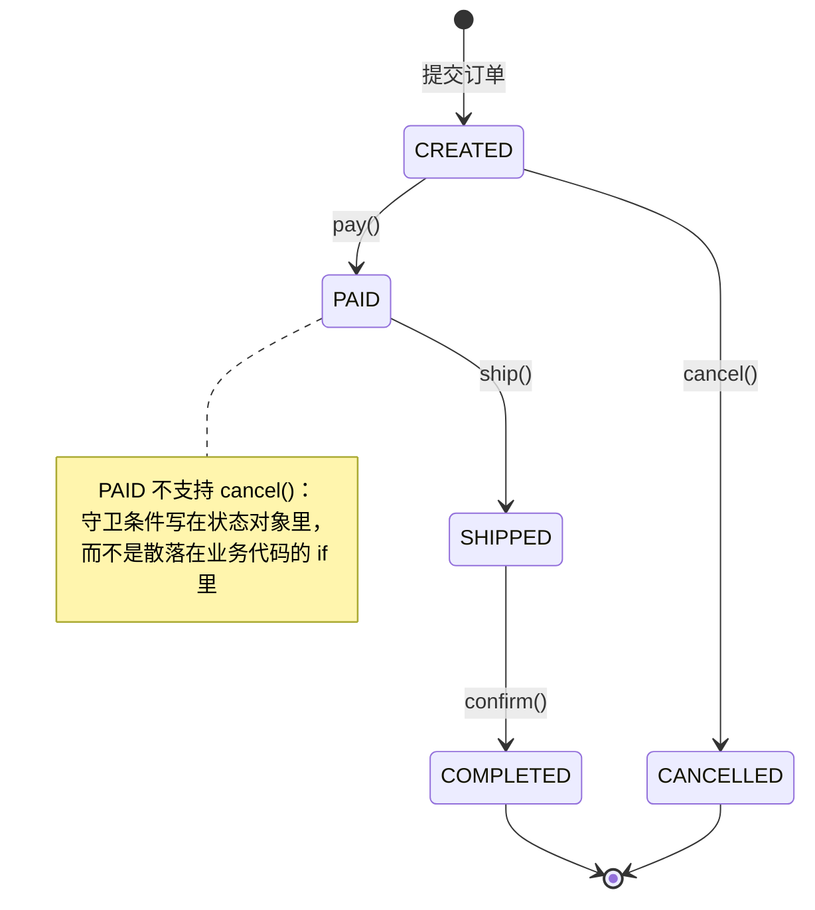
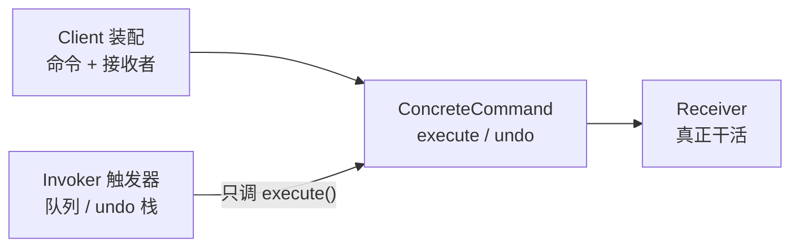

# 行为型模式实战：策略、模板方法、状态、命令

> 一句话概括：行为型模式解决的都是同一类问题——**把「怎么做事」从「什么时候做、由谁做、对谁做」中剥离**：
> 策略换掉整个算法，模板方法只换流程中的一步，状态让行为随内部状态自动流转，命令把一个请求变成可排队、可撤销、可重放的对象。
> 本文按「结论 → 机制 → 边界/代价 → 实践/追问」逐一展开，配可运行示例、JDK 源码锚点与一张四模式辨析总表。

预计阅读时间：大约 70 分钟

所属主题：[设计模式常见面试题总结](summary.md)

本文以 JDK 21 为基线（Lambda 相关语法自 JDK 8 起可用），源码锚点统一用 `类名#方法名` 标注；JDK 侧关键片段已对照 JDK 21 源码（`java.base`）核实，Servlet 侧对照 Tomcat 10.1.x（jakarta.servlet 6.0 实现）源码核实，未核实项会明确说明。模式定义与原则基础见 [principles-and-uml](principles-and-uml.md)，创建型见 [singleton](singleton.md) 与 [factory-and-builder](factory-and-builder.md)，结构型见 [proxy](proxy.md) 与 [structural-patterns](structural-patterns.md)；Spring 框架视角的模板方法与策略见 [Spring 中的设计模式](../backend/java/spring/design-patterns.md)，本文只做一段话交叉引用，不重复。

---

## 0. 阅读路线

| 读者 | 建议阅读 | 关注点 |
| --- | --- | --- |
| 初级（1 年内） | 1、2.1~2.2、3.1、4.1、5.1、6 | 四个模式各解决什么问题、最小示例长什么样、Comparator 和 Runnable 为什么算模式 |
| 中级（1~3 年） | 全部，重点 2.3~2.4、3.2~3.4、4.2~4.3、5.2~5.5 | 注册表消除 if-else、JDK 源码锚点、状态 vs 策略辨析、undo 怎么实现 |
| 高级（3 年+） | 2.5、3.5、4.4、5.6、7 | 策略族膨胀、枚举 + switch 的适用边界、undo 的现场一致性、Lambda 替代的限度 |
| 选型/架构 | 各节「边界与代价」、4.4、6、7 | 什么时候不该套模式、状态机框架的取舍、注册表的线程安全与配置化 |

目录：

1. 开篇：行为型模式的统一动机
2. 策略模式：把「怎么算」从调用方剥离
3. 模板方法模式：把「流程骨架」固定住
4. 状态模式：让行为随内部状态流转
5. 命令模式：把「请求」变成一等公民
6. 四模式辨析总表
7. 高频面试追问集
8. 参考资料

---

## 1. 开篇：行为型模式的统一动机

### 1.1 四种「变」，一个共同解法

创建型模式管「对象怎么造」，结构型模式管「对象怎么组装」，**行为型模式管「行为怎么分配与流转」**。展开成四个高频的具体问题：

| 变化的是什么 | 具体痛点 | 对应模式 | 一句话解法 |
| --- | --- | --- | --- |
| **算法**在变：同一件事有多种做法 | 调用方被 `if-else`/`switch` 淹没，加一种做法改一堆分支 | 策略 | 把「怎么做」封装成可整体替换的对象 |
| **步骤**在变：流程骨架固定，某一步不同 | 取连接/关连接/异常处理反复复制粘贴 | 模板方法 | 骨架固定，变化步骤留空（继承或回调） |
| **行为随时间变**：同一对象不同时期行为不同 | 状态判断散落几十处 `if (status == ...)` | 状态 | 行为委托给当前状态对象，流转规则内聚在状态里 |
| **请求**本身在变：要排队、撤销、记录、重放 | 请求的创建和执行焊死在一起 | 命令 | 把请求封装成对象，交给别人在合适时机执行 |

四个模式的公共机制都是「**封装一个行为单元 + 委托调用**」——区别只在封装的对象（算法 / 步骤 / 状态下的行为 / 请求）和谁掌控切换（调用方 / 模板 / 状态自身 / Invoker）。**面试先答公共动机再答差异**，比背四个类图更能体现理解。

### 1.2 其余行为型去哪看

GoF 11 个行为型模式里，本文选真实业务与 JDK 里出现频率最高的四个展开。其余的归属：

| 模式 | 去处 |
| --- | --- |
| 观察者 / 中介者 | [observer-and-event-driven](observer-and-event-driven.md)（Spring 事件机制也在 [Spring 设计模式](../backend/java/spring/design-patterns.md) 第 6 章） |
| 责任链 / 解释器 | [chain-of-responsibility](chain-of-responsibility.md)（Filter/Interceptor/Advice 链见 [Spring 设计模式](../backend/java/spring/design-patterns.md) 第 9 章） |
| 迭代器 / 备忘录 | [patterns-in-jdk](patterns-in-jdk.md)（JDK 集合与 `undo` 相关模式） |
| 访问者 / 命令的变体 | [modern-java-and-anti-patterns](modern-java-and-anti-patterns.md)（Lambda 与函数式对行为型模式的改写） |

---

## 2. 策略模式：把「怎么算」从调用方剥离

### 2.1 结构与最小示例：Comparator 就是策略

**结论**：策略模式定义一族可互换的算法，各自封装、统一接口，**运行时选一个替调用方干活**——调用方只面向接口，不关心具体算法。

GoF 角色：Strategy（策略接口）、ConcreteStrategy（具体算法）、Context（持有策略并调用）。而 JDK 里你每天都在用策略模式：

```java
import java.util.ArrayList;
import java.util.Comparator;
import java.util.List;

public class ComparatorDemo {
    public static void main(String[] args) {
        List<String> words = new ArrayList<>(List.of("banana", "fig", "apple"));
        words.sort(Comparator.comparingInt(String::length));   // 按长度（策略一）
        System.out.println(words);                             // [fig, apple, banana]

        words.sort(Comparator.naturalOrder());                 // 按字典序（策略二）
        System.out.println(words);                             // [apple, banana, fig]

        // 比较器组合（JDK 8+ 默认方法/静态方法）：组合出「先按长度、再按字典序」
        Comparator<String> byLenThenAlpha = Comparator.comparingInt(String::length)
                .thenComparing(Comparator.naturalOrder());
        System.out.println(byLenThenAlpha.compare("ab", "bc")); // -1：同长时按字典序分胜负
    }
}
```

`Collections#sort` 的机制一目了然（JDK 21 源码已核实）：`Collections#sort` 一行委托 `list.sort(c)`，`ArrayList#sort` 再委托 `Arrays.sort(elementData, 0, size, c)`——排序的**骨架**（TimSort）固定，**比较规则**整段换掉。`Comparator` 就是策略接口，`sort` 是 Context，lambda 是具体策略。

**边界与代价**：策略要可互换，前提是各实现**对调用方透明**——`sort` 不管你按什么排，只要求「compare 出全序」。如果算法之间输入输出契约不一致（有的返回 BigDecimal、有的返回 int），硬抽统一接口只会得到一堆 `Object` 强转。

### 2.2 经典场景：消除 if-else——折扣与支付渠道

**结论**：策略模式最经典的工程用法是把「按类型分派的 `switch`」改成「接口 + 实现族 + 注册表」。收益不是「用了模式」，而是三件实事：**新增算法只加类不改旧代码（开闭原则）、选择逻辑收敛到一处、每个算法可独立单测**。

改造前——每个活动都要改这个方法，分支越长越不敢动：

```java
// 反面教材：分支逻辑长在调用方身上
public BigDecimal calcPrice(String userType, BigDecimal price) {
    switch (userType) {
        case "NORMAL": return price;
        case "VIP":    return price.multiply(new BigDecimal("0.8"));
        case "SVIP":   return price.multiply(new BigDecimal("0.7"));
        case "FULL":   return price.compareTo(HUNDRED) >= 0 ? price.subtract(TWENTY) : price;
        default: throw new IllegalArgumentException("unknown user type: " + userType);
    }
}
```

改造后——完整可运行示例（单文件直接 `javac && java`）：

```java
import java.math.BigDecimal;
import java.math.RoundingMode;
import java.util.Map;
import java.util.concurrent.ConcurrentHashMap;

/** 策略接口：一个方法 = 一个可整体替换的算法 */
@FunctionalInterface
interface DiscountStrategy {
    BigDecimal apply(BigDecimal price);
}

/** 有配置的策略：字段决定行为，lambda 表达不了这份「配置身份」，要用类 */
final class PercentageDiscount implements DiscountStrategy {
    private final BigDecimal rate;                       // 0.8 表示打 8 折
    PercentageDiscount(BigDecimal rate) { this.rate = rate; }
    @Override public BigDecimal apply(BigDecimal price) {
        return price.multiply(rate).setScale(2, RoundingMode.HALF_UP);
    }
}

final class FullReductionDiscount implements DiscountStrategy {
    private final BigDecimal threshold;                  // 满 threshold 减 reduction
    private final BigDecimal reduction;
    FullReductionDiscount(BigDecimal threshold, BigDecimal reduction) {
        this.threshold = threshold; this.reduction = reduction;
    }
    @Override public BigDecimal apply(BigDecimal price) {
        return price.compareTo(threshold) >= 0
                ? price.subtract(reduction).setScale(2, RoundingMode.HALF_UP) : price;
    }
}

/** 注册表：选择逻辑收敛到一处；ConcurrentHashMap 保证并发注册/读取安全 */
final class DiscountRegistry {
    private static final Map<String, DiscountStrategy> REGISTRY = new ConcurrentHashMap<>();
    static void register(String key, DiscountStrategy s) { REGISTRY.put(key, s); }
    static DiscountStrategy of(String key) {
        DiscountStrategy s = REGISTRY.get(key);
        if (s == null) throw new IllegalArgumentException("unknown discount: " + key);
        return s;
    }
    static {                                             // 静态注册：应用启动时集中登记
        register("none", price -> price.setScale(2, RoundingMode.HALF_UP));   // 无状态策略：lambda
        register("vip",  new PercentageDiscount(new BigDecimal("0.8")));      // 有配置策略：类
        register("full", new FullReductionDiscount(new BigDecimal("100"), new BigDecimal("20")));
    }
}

public class StrategyDemo {
    public static void main(String[] args) {
        BigDecimal price = new BigDecimal("120");
        System.out.println(DiscountRegistry.of("none").apply(price));   // 120.00
        System.out.println(DiscountRegistry.of("vip").apply(price));    // 96.00
        System.out.println(DiscountRegistry.of("full").apply(price));   // 100.00

        // 新增活动 = 注册一个新策略，不改任何已有代码
        DiscountRegistry.register("new-user",
                p -> p.subtract(new BigDecimal("5")).setScale(2, RoundingMode.HALF_UP));
        System.out.println(DiscountRegistry.of("new-user").apply(price)); // 115.00
    }
}
```

Spring 环境下注册表通常是**免费的**：容器本身就是策略注册表，注入所有实现再按 key 收口（支付渠道版）：

```java
public interface PayChannel {
    String key();
    PayResult pay(PayRequest req);        // PayRequest/PayResult 为业务参数对象（示意）
}

@Component class AlipayChannel implements PayChannel {
    public String key() { return "alipay"; }
    public PayResult pay(PayRequest req) { /* 调支付宝 SDK */ return null; }
}
@Component class WechatChannel implements PayChannel {
    public String key() { return "wechat"; }
    public PayResult pay(PayRequest req) { /* 调微信支付 SDK */ return null; }
}

@Service
public class PayService {
    private final Map<String, PayChannel> channels;

    public PayService(List<PayChannel> impls) {   // Spring 注入接口的全部实现
        this.channels = impls.stream().collect(
                Collectors.toUnmodifiableMap(PayChannel::key, Function.identity()));
    }

    public PayResult pay(String channel, PayRequest req) {
        PayChannel c = channels.get(channel);
        if (c == null) throw new IllegalArgumentException("unsupported channel: " + channel);
        return c.pay(req);
    }
}
```

Spring 也支持直接注入 `Map<String, PayChannel>`（key 为 bean name），两种写法等价；显式收集的好处是 key 命名不受 bean name 约束。这个「策略族 + 容器注册表」组合在框架里随处可见，Spring 侧的 `InstantiationStrategy`/`ViewResolver` 分析见 [Spring 设计模式](../backend/java/spring/design-patterns.md) 第 8 章，本文不再重复。

### 2.3 JDK 实例：线程池拒绝策略与 ThreadFactory

**结论**：`ThreadPoolExecutor` 的第 7 个构造参数 `RejectedExecutionHandler` 是教科书级的策略字段——**池满时「怎么办」整段可替换**，四种内置策略 + 自定义实现就是策略族。

**机制**（以下均已对照 JDK 21 源码核实）。拒绝只有一个调用点：`ThreadPoolExecutor#reject` 一行委托 `handler.rejectedExecution(command, this)`；`execute()` 有两条路径会走到它——入队成功后的复核发现池已 shutdown（`remove` 掉刚入队的任务再拒绝），以及队列满且线程数已达 max（`addWorker` 失败）：

```java
// ThreadPoolExecutor#execute（JDK 21，节选）
if (isRunning(c) && workQueue.offer(command)) {
    int recheck = ctl.get();
    if (! isRunning(recheck) && remove(command))
        reject(command);                       // ① 入队后池被 shutdown：拒绝
    else if (workerCountOf(recheck) == 0)
        addWorker(null, false);
}
else if (!addWorker(command, false))
    reject(command);                           // ② 队列满 + 线程满：拒绝

// ThreadPoolExecutor#reject —— 策略调用点，就一行
final void reject(Runnable command) { handler.rejectedExecution(command, this); }
```

四种内置策略的实际行为（源码锚点为各自类的 `#rejectedExecution`）：

| 策略 | `rejectedExecution` 行为（JDK 21 源码） | 适用 | 高频坑 |
| --- | --- | --- | --- |
| `AbortPolicy`（默认） | 直接抛 `RejectedExecutionException` | 不允许丢任务、调用方能处理失败 | 未捕获异常打穿调用线程 |
| `DiscardPolicy` | **空方法体，静默丢弃**，无日志无异常 | 可容忍丢失的场景 | 出了问题**没有任何痕迹**，排查极难 |
| `DiscardOldestPolicy` | 未 shutdown 时 `e.getQueue().poll()` 丢弃**队首最老任务**，再重试 `e.execute(r)`；已 shutdown 则直接丢弃新任务 | 只关心最新值（如实时行情刷新） | 被丢的队首任务若是 `Future` **不会被 cancel**，等它的人永久阻塞（javadoc 给了带 cancel 的自定义版本） |
| `CallerRunsPolicy` | 未 shutdown 时在**提交任务的线程里直接 `r.run()`**；已 shutdown 则静默丢弃 | 不许丢任务、可接受提交方变慢——天然背压 | 任务跑在调用者线程：调用方被占住、ThreadLocal 上下文是调用者的；shutdown 后静默丢弃 |

完整源码走读、过载组合设计与事故案例见 [线程池专题](../backend/java/concurrency/thread-pool.md) 第 5 节，此处不重复。这里只强调模式视角的两点：

1. **「拒绝」本身也是行为**——内置四种不够用时，实现 `RejectedExecutionHandler`（落库、降级、告警）就是在写一个新的具体策略，池的其余部分一行不改；
2. **选择发生在装配期**（构造参数传入），这和折扣案例的「注册表运行时选择」是策略模式的两种装配方式：静态装配简单安全，动态装配灵活但要管好并发。

`ThreadFactory` 是单方法策略的另一个实例：线程池创建 Worker 时通过 `getThreadFactory().newThread(this)`（`ThreadPoolExecutor.Worker` 构造器，JDK 21 源码）造线程，**「线程怎么创建」（命名、守护态、优先级、线程组）整段交给策略**：

```java
private static final AtomicInteger SEQ = new AtomicInteger();
ThreadFactory factory = r -> {
    Thread t = new Thread(r, "pay-worker-" + SEQ.incrementAndGet());  // 命名便于排障
    t.setDaemon(false);
    return t;
};
```

### 2.4 Lambda 简化与它的边界（JDK 8+）

**结论**：**单方法策略接口**（函数式接口）自 JDK 8 起可以直接用 lambda/方法引用充当具体策略——`Comparator.comparing`、`pool.submit(() -> ...)`、注册表里的 `price -> price` 都是。但三种情况仍然要写类：

| 情况 | 原因 | 例子 |
| --- | --- | --- |
| **有配置/有状态** | lambda 没有字段，配置只能靠闭包捕获 effectively final 变量，多份配置就要写多个 lambda 或列表 | `PercentageDiscount`（rate 字段）、满减（两个字段） |
| **多方法接口** | lambda 只能实现一个抽象方法 | `RejectedExecutionHandler` 只有 `rejectedExecution` 一个方法所以能 lambda；两个抽象方法的接口不行 |
| **需复用/需命名/需单测** | 内联 lambda 散落各处无法单独测试、难以引用 | 复杂计价逻辑抽成具名类，单测直接 `new` 出来断言 |

**追问：lambda 当策略，注册表里存的是什么？** 存的是接口的实例——lambda 编译成实现该接口的类实例（`invokedynamic` 生成，非匿名内部类），放进 `Map<String, DiscountStrategy>` 与放一个 `new XxxStrategy()` 完全同构。**lambda 是写法简化，不是模式替代**：注册表、装配、委托调用的结构一点没变。

### 2.5 边界与代价

- **策略族膨胀后，「选择」成为新的维护点**：注册表 key 怎么定（业务枚举还是字符串）、配置驱动还是代码驱动、新策略谁负责注册——这些不设计好，if-else 只是变成了注册表里的 if-else。选型视角：**分支逻辑收敛到一个工厂/注册表，比散落 N 个调用方好；但注册表本身也要单一入口**。
- **运行时切换要管线程安全**：多线程动态注册/读取策略用 `ConcurrentHashMap`；更稳妥的是**装配期确定后封只读**（`Map.copyOf` / `Collections.unmodifiableMap`），把「谁有权注册」限到启动代码——开放 `register` 给运行期意味着策略可被篡改，是一类隐蔽的线上事故源。
- **策略对象的状态纪律**：注册表复用同一实例，要求策略**无状态或不可变**（字段 `final` + 构造器注入）；可变状态的策略要么每次新建，要么内部自己保证线程安全。
- **可观测性**：分支消除后，「这次到底用了哪个策略」要打出来（日志打印 key 或策略提供 `describe()`），否则线上只能靠断点。

**追问：什么时候不该用策略模式？** 见 7 的 Q7：分支少且稳定时，switch 更直白。

---

## 3. 模板方法模式：把「流程骨架」固定住

### 3.1 继承式：骨架 + 钩子

**结论**：模板方法在父类里把**不变的流程骨架**固化（通常标 `final`），把**会变的一步或几步**留成抽象方法（子类必须实现）和钩子方法（子类按需覆写）。

完整可运行示例——导出器的骨架是固定的（开资源 → 逐行转换写出 → 页脚 → 收尾），只有「一行怎么转」是变化点，页脚是钩子：

```java
import java.util.List;

abstract class DataExporter<T> {
    /** 模板方法：final 防止子类打乱流程顺序 */
    public final void export(List<T> data) {
        open();
        for (T row : data) {
            write(transform(row));            // ← 唯一的变化点（抽象方法）
        }
        if (needFooter()) {                   // ← 钩子：默认 true，子类可选覆写
            writeFooter();
        }
        close();
    }

    protected abstract String transform(T row);      // 必须实现的变化点
    protected boolean needFooter() { return true; }  // 钩子：父类给默认实现

    private void open()  { System.out.println("== open file =="); }
    private void write(String s) { System.out.println(s); }
    private void writeFooter() { System.out.println("== footer =="); }
    private void close() { System.out.println("== close file =="); }
}

final class CsvExporter extends DataExporter<String> {
    @Override protected String transform(String row) { return row; }
}

final class HtmlExporter extends DataExporter<Integer> {
    @Override protected String transform(Integer row) { return "<td>" + row + "</td>"; }
    @Override protected boolean needFooter() { return false; }   // 关闭钩子
}

public class TemplateDemo {
    public static void main(String[] args) {
        new CsvExporter().export(List.of("a", "b"));
        // == open file == / a / b / == footer == / == close file ==
        new HtmlExporter().export(List.of(1, 2));
        // == open file == / <td>1</td> / <td>2</td> / == close file ==（无页脚）
    }
}
```

三个构成要件，缺一个就不算模板方法：

| 要件 | 本例 | 作用 |
| --- | --- | --- |
| 模板方法（final） | `export` | 固定调用顺序，子类无法重排流程 |
| 抽象变化点 | `transform` | 子类必须填的空 |
| 钩子（hook） | `needFooter` | 父类给默认实现，子类**选择性**覆写——区别于必须实现的抽象方法 |

### 3.2 JDK / Servlet 实例：HttpServlet#service 与 AbstractList

**结论**：Servlet 体系的 `HttpServlet` 是继承式模板方法最著名的实例——`service` 固定「按 HTTP 方法分派」的骨架，`doGet`/`doPost` 等是留给子类的钩子。

**机制**（对照 Tomcat 10.1.17 实现源码核实；Servlet 属 jakarta.servlet 规范，非 JDK）。`HttpServlet` 有两层 `service`：public 的 `HttpServlet#service(ServletRequest, ServletResponse)` 把请求强转成 HTTP 类型后委托 protected 版本；protected 的 `HttpServlet#service(HttpServletRequest, HttpServletResponse)` 按 `req.getMethod()` 分派（源码为 if-else 链，节选保留结构）：

```java
// jakarta.servlet.http.HttpServlet#service(HttpServletRequest, HttpServletResponse)（结构节选）
String method = req.getMethod();
if (method.equals(METHOD_GET)) {
    long lastModified = getLastModified(req);        // ← 钩子：默认 -1 表示不支持缓存协商
    if (lastModified == -1) {
        doGet(req, resp);
    } else if (/* If-Modified-Since 命中 */) {
        resp.setStatus(HttpServletResponse.SC_NOT_MODIFIED);   // 304，连 doGet 都不用调
    } else {
        doGet(req, resp);
    }
} else if (method.equals(METHOD_HEAD))   { doHead(req, resp); }
else if (method.equals(METHOD_POST))     { doPost(req, resp); }
else if (method.equals(METHOD_PUT))      { doPut(req, resp); }
else if (method.equals(METHOD_DELETE))   { doDelete(req, resp); }
else if (method.equals(METHOD_OPTIONS))  { doOptions(req, resp); }
else if (method.equals(METHOD_TRACE))    { doTrace(req, resp); }
else resp.sendError(SC_NOT_IMPLEMENTED, /* 未实现的方法 */);
```

两个值得写进面试答案的细节：

1. **`doGet`/`doPost` 的默认实现不是空方法，而是返回 405**（`HttpServlet#doGet` 调 `sendMethodNotAllowed`，已核实；HTTP/1.1 及以上返回 405，更早的协议版本返回 400）——所以子类**必须覆写**才有意义，这与「父类默认空实现的钩子」是两类钩子：前者是「不覆写就报错」，后者是「不覆写走默认」；
2. `getLastModified` 是第三个钩子：默认返回 -1 关闭 `If-Modified-Since` 缓存协商，覆写后 `service` 骨架自动帮你处理 304——**框架把「缓存协商」做进骨架，把「资源最后修改时间」留给子类**，这正是模板方法的价值分工。

JDK 集合框架的**骨架实现**（skeletal implementation）是同思想的另一面。`AbstractList`（JDK 21 源码已核实）只把 `get` 留成抽象方法（`size()` 来自 `AbstractCollection`），然后用这两个抽象方法组装出完整的迭代器——子类实现 `get`/`size` 两个方法，就自动获得 `iterator()`、`ListIterator`、`subList` 等全套能力：

```java
// java.util.AbstractList（JDK 21，节选）
public abstract E get(int index);                 // 唯一必须实现的抽象方法

public Iterator<E> iterator() { return new Itr(); }

private class Itr implements Iterator<E> {        // 骨架用 size()/get() 组装完整迭代器
    public boolean hasNext() { return cursor != size(); }
    public E next() {
        /* 检查 modCount（fail-fast 契约，见 patterns-in-jdk）*/
        E next = get(i);                          // ← 委托给子类实现的 get
        /* ... */
    }
}
```

测试框架同样如此：JUnit 4 的 Runner 把「`@BeforeClass` → `@Before` → `@Test` → `@After` → `@AfterClass`」的固定生命周期写在框架里（反射扫描注解并按序执行），测试类只填 `@Test` 方法这个变化点；JUnit 5 改用 Extension 回调，从继承式偏向组合式。JUnit 内部实现细节本文未逐行核实，生命周期顺序以官方文档为准。

### 3.3 回调式：用组合替代继承

**结论**：模板方法不一定要继承——**把骨架做成一个普通类，变化步骤以参数（回调对象）传入**，就是回调式模板。它消灭了继承耦合：一个模板实例服务所有业务，业务类不用绑死在任何父类上。

最贴近 JDK 的例子：给 `Thread` 传 `Runnable`。`Thread` 把「创建线程 → 启动 → 执行 → 收尾」的骨架固定，`run()` 的内容由构造参数提供——**同一思想的组合式形态**：

```java
new Thread(() -> System.out.println("hook")).start();   // 骨架在 Thread，变化点是你传的 lambda
```

Spring 的 `JdbcTemplate`/`RestTemplate`/`TransactionTemplate` 是回调式模板的完整体系（固定「取连接 → 建 Statement → 异常翻译 → 释放资源」骨架，把 SQL 执行留给回调），源码走读与角色映射见 [Spring 设计模式](../backend/java/spring/design-patterns.md) 第 5 章，此处只给一句衔接：**回调式 = 「GoF 继承式模板」在组合优先时代的工程演化**，代价是回调嵌套深时栈帧可读性下降（异常被模板翻译过，排查要看 cause 链）。

### 3.4 模板 vs 策略辨析

| 维度 | 模板方法 | 策略 |
| --- | --- | --- |
| 变的是什么 | 骨架中的**个别步骤** | **整个算法** |
| 流程控制权 | 在模板（好莱坞原则：别找我们，我们找你） | 在调用方（调用方选好策略并驱动它） |
| 结构 | 继承（骨架+钩子）或回调（组合） | 组合 + 委托 |
| 典型问句 | 「流程一样，其中一步不同」 | 「整件事做法不同」 |
| 例子 | `HttpServlet`：分派骨架不可换，`doGet` 可换 | `RejectedExecutionHandler`：拒绝行为整段可换 |

判断口诀：**只换一步 → 模板；整件事换做法 → 策略**。两者还能嵌套——模板的某个变化点本身可以是一个策略接口（如骨架固定「拒绝时调 handler」，handler 是策略）。

### 3.5 边界与代价

- **继承耦合是继承式模板的固有代价**：子类绑死父类实现，父类重构牵连所有子类；Java 单继承进一步占用了子类的唯一继承名额。回调式（3.3）是替代方案，代价是多一层间接与回调嵌套。
- **钩子顺序敏感，且失效是静默的**：父类调整步骤顺序、或子类忘记调 `super.xxx()`，行为变化不会报错。模板方法标 `final` 能挡住「子类重排流程」这一类事故，挡不住「父类自己改流程」——所以骨架的稳定性要靠设计评审保证。
- **不要为一次性逻辑抽模板**：抽象的收益来自重复，没有重复就没有收益；两个实现就急着抽骨架，第三次变化时往往发现抽象错了。
- **排查特点**：模板隐藏资源管理与异常翻译，栈里全是框架帧；JDBC 场景要看 cause 链找原始 `SQLException`。

---

## 4. 状态模式：让行为随内部状态流转

### 4.1 结构与订单状态机完整示例

**结论**：状态模式把「对象在某个状态下的行为」封装进独立的状态类，Context 持有当前状态并把行为委托给它，**流转规则内聚在状态对象里**（状态方法返回下一个状态）——从而消灭散落在各处的 `if (status == ...)`。

GoF 角色：Context（持有 State）、State（状态接口）、ConcreteState（各状态，行为 + 流转）。订单状态机：



完整可运行示例（单文件直接 `javac && java`）：

```java
/** 状态接口：每个事件返回下一个状态——流转规则内聚在状态类里 */
interface OrderState {
    OrderState pay();      // 支付
    OrderState ship();     // 发货
    OrderState confirm();  // 确认收货
    OrderState cancel();   // 取消

    default OrderState illegal(String event) {
        throw new IllegalStateException(
                "状态 " + getClass().getSimpleName() + " 不支持操作 " + event);
    }
}

/** 基类：默认全部非法迁移，具体状态只覆写合法的那几条——守卫条件一目了然 */
abstract class AbstractOrderState implements OrderState {
    public OrderState pay()     { return illegal("pay"); }
    public OrderState ship()    { return illegal("ship"); }
    public OrderState confirm() { return illegal("confirm"); }
    public OrderState cancel()  { return illegal("cancel"); }
}

final class Created extends AbstractOrderState {          // 待支付
    @Override public OrderState pay()    { return new Paid(); }
    @Override public OrderState cancel() { return new Cancelled(); }
}

final class Paid extends AbstractOrderState {             // 已支付
    @Override public OrderState ship()   { return new Shipped(); }
    // 已支付不允许直接 cancel：这条守卫写在这里，全库搜索即可找到全部流转规则
}

final class Shipped extends AbstractOrderState {          // 已发货
    @Override public OrderState confirm(){ return new Completed(); }
}

final class Completed extends AbstractOrderState {}       // 已完成：终态
final class Cancelled extends AbstractOrderState {}       // 已取消：终态

/** Context：持有当前状态，所有行为委托给它；Context 自己不写任何 if */
class Order {
    private OrderState state = new Created();

    public void pay()     { state = state.pay(); }
    public void ship()    { state = state.ship(); }
    public void confirm() { state = state.confirm(); }
    public void cancel()  { state = state.cancel(); }
    public String state() { return state.getClass().getSimpleName(); }
}

public class StateDemo {
    public static void main(String[] args) {
        Order order = new Order();
        order.pay();                             // 待支付 → 已支付
        order.ship();                            // 已支付 → 已发货
        try {
            order.cancel();                      // 已发货不支持取消
        } catch (IllegalStateException e) {
            System.out.println(e.getMessage());  // 状态 Shipped 不支持操作 cancel
        }
        order.confirm();                         // 已发货 → 已完成
        System.out.println(order.state());       // Completed
    }
}
```

三个设计要点：

| 要点 | 本例体现 |
| --- | --- |
| 行为委托 | `Order.pay()` 一行，真实逻辑在 `Created#pay` |
| 流转内聚 | 「已支付之后能干什么」只写在 `Paid` 类里，非法事件抛 `IllegalStateException` |
| 守卫条件 | 「已支付不可取消」是 `Paid` 类里**不存在 `cancel` 覆写**这一事实，而非某处 if |

**实践**：示例每次流转都 `new` 新状态对象，是为直观；状态对象通常**无字段**，生产上应单例化复用——`enum` 常量天然满足（枚举常量可覆写方法，本质是「每状态一个单例子类」，上面五个状态类可以压成一个 `enum OrderStatus implements OrderState`，是状态模式的枚举形态）。

### 4.2 JDK 实例与状态机框架

**结论**：JDK 里最常被提到的 `Thread.State` **是状态的「定义」，不是状态模式的「实现」**——面试时主动说清这一点是加分项。

**机制**（JDK 21 已核实）：`Thread.State` 是一个 6 值枚举——`NEW`、`RUNNABLE`、`BLOCKED`、`WAITING`、`TIMED_WAITING`、`TERMINATED`（源码 `Thread.State` 枚举声明处）。它只描述线程处于什么状态，供 `Thread#getState()` 查询与监控用：**没有 State 对象持有行为、没有「委托当前状态」的调用、流转由 JVM 内部驱动而非状态对象**。它回答的是「线程现在怎么样」，状态模式回答的是「处于这个状态的对象该干什么、下一步去哪」。

需要真正的状态机基础设施时（状态多、带守卫/动作/持久化/可视化），可以上独立框架：Spring 生态的 [Spring Statemachine](https://spring.io/projects/spring-statemachine) 提供声明式配置（状态、事件、守卫、动作）与持久化/监控支持；SMC（State Machine Compiler）走「配置文件生成状态机代码」路线。选型见 4.4。

### 4.3 状态 vs 策略辨析（高频面试题）

**结论**：两者类图几乎相同（接口 + 实现族 + Context 持有 + 委托），**意图与驱动方完全不同**。

| 维度 | 策略 | 状态 |
| --- | --- | --- |
| 解决什么 | 一件事有多种做法，选一种 | 对象的行为随内部状态改变 |
| 切换由谁触发 | **调用方**显式选择（注册表查 key、构造参数传入），选完后通常不再变 | **状态对象自身**在处理事件时决定下一个状态，运行期持续流转 |
| 实现之间是否感知彼此 | 策略之间**互不感知**、互相独立 | 状态之间**互相知晓**（`pay()` 返回 `new Paid()`），构成一张迁移图 |
| Context 是否有「记忆」 | 无——Context 只是委托 | 有——状态本身就是随时间变化的记忆 |
| 例子 | 拒绝策略、支付渠道 | 订单状态机 |

判断口诀（一句话即可在面试里立住）：**问「谁能触发切换」——调用方切换是策略，状态自己流转是状态**。再补一刀：把折扣策略从「8 折」换成「满减」需要业务决策（调用方选择）；订单从「待支付」变「已支付」是支付事件自然触发的（内部流转）——前者是策略，后者是状态。

### 4.4 边界：枚举 + switch 什么时候就够

**结论**：状态模式解决的是「行为 + 流转规则」的复杂度，**状态少且迁移简单时它就是过度设计**。

| 复杂度 | 建议 |
| --- | --- |
| 2~3 个状态、无守卫条件、流转线性 | `enum OrderStatus` + 单个 switch 分派，或状态位 + 数据库状态字段——直白、可查、无抽象层 |
| 状态 ≥ 4，或迁移带守卫条件（如「已支付不可取消」「超时自动取消」） | 状态模式或状态机框架：把守卫收进状态类，规则可穷举可单测 |
| 需要历史回溯、并发流转控制、持久化与可视化审计 | 上状态机框架（Spring Statemachine 等）；框架的代价是学习成本与抽象层，**简单状态机别急着上框架** |

判断顺序建议：先问「状态会继续变多吗、迁移会加守卫吗」——会，就提前把状态收进类型（枚举或状态类），别让状态判断散落；不会，switch 到死也无妨。观察者式的「状态变更通知」（状态变了顺带发事件）不属于状态模式职责，见 [observer-and-event-driven](observer-and-event-driven.md)。

---

## 5. 命令模式：把「请求」变成一等公民

### 5.1 结构与 JDK 实例：Runnable/Callable 就是命令

**结论**：命令模式把「一个请求/操作」封装成对象（携带接收者与参数），于是请求可以**被传递、排队、日志化、撤销、重放**——因为「做什么」变成了一等公民。



JDK 里你每天提交的 `Runnable`/`Callable` 就是命令：**lambda 是具体命令，线程池是 Invoker**：

```java
// Invoker：线程池（参数与拒绝策略详见 ../backend/java/concurrency/thread-pool.md）
ThreadPoolExecutor pool = new ThreadPoolExecutor(
        2, 4, 60, TimeUnit.SECONDS,
        new ArrayBlockingQueue<>(100),
        new ThreadPoolExecutor.AbortPolicy());

pool.submit(() -> sendEmail(orderId));   // ← ConcreteCommand：lambda 携带参数与动作
// 机制：submit 把命令对象放进 workQueue，worker 线程取出执行（ThreadPoolExecutor#execute）——
// 「请求的创建」与「请求的执行」在时间与线程上彻底解耦
```

锚点与归属：`Runnable#run` / `Callable#call` 是命令接口（`Callable#call` 比 `Runnable#run` 多了返回值与受检异常），`ThreadPoolExecutor#execute` 是 Invoker 的入队逻辑。线程池七参数与过载设计见 [线程池专题](../backend/java/concurrency/thread-pool.md)。

### 5.2 用途一：请求参数化与队列化

**结论**：命令让「请求」可以像数据一样被存储与调度——线程池任务队列、MQ 消息、定时任务调度，本质都是「命令对象进队列，消费者按节奏执行」。

这一用途的工程价值在 5.1 的例子中已经体现，不再给第二份代码。要点只有一条：**队列里的命令要能独立于创建现场执行**——闭包捕获的变量（orderId）在提交时已固定，这就是「参数化」；如果命令依赖 ThreadLocal 上下文（用户、租户），跨线程执行会拿不到，需要显式传递（见 [ThreadLocal 与上下文传递](../backend/java/concurrency/threadlocal.md)）。

### 5.3 用途二：可撤销操作（undo 栈）

**结论**：undo 的实现要点是**命令成对**（`execute` + `undo`）且**具体命令捕获恢复现场所需的前值**——Invoker 只维护一个栈。

完整可运行示例（单文件直接 `javac && java`）：

```java
import java.util.ArrayDeque;
import java.util.Deque;

/** Receiver：真正干活的接收者（文档本体），对命令与撤销一无所知 */
class Document {
    private final StringBuilder buf = new StringBuilder();
    void insert(int pos, String s) { buf.insert(pos, s); }
    void delete(int pos, int len)  { buf.delete(pos, pos + len); }
    @Override public String toString() { return buf.toString(); }
}

/** Command：execute 与 undo 成对出现 */
interface EditCommand {
    void execute();
    void undo();
}

/** 具体命令 1：插入。undo = 删掉同一段 */
final class InsertCommand implements EditCommand {
    private final Document doc; private final int pos; private final String text;
    InsertCommand(Document doc, int pos, String text) { this.doc = doc; this.pos = pos; this.text = text; }
    public void execute() { doc.insert(pos, text); }
    public void undo()    { doc.delete(pos, text.length()); }
}

/** 具体命令 2：删除。undo = 把删掉的内容放回去——所以命令必须「记住前值」 */
final class DeleteCommand implements EditCommand {
    private final Document doc; private final int pos; private final String removed;
    DeleteCommand(Document doc, int pos, String removed) { this.doc = doc; this.pos = pos; this.removed = removed; }
    public void execute() { doc.delete(pos, removed.length()); }
    public void undo()    { doc.insert(pos, removed); }
}

/** Invoker：触发命令、维护 undo 栈，不关心命令内容 */
class Editor {
    private final Document doc = new Document();
    private final Deque<EditCommand> history = new ArrayDeque<>();

    void submit(EditCommand cmd) { cmd.execute(); history.push(cmd); }
    void undo() { if (!history.isEmpty()) history.pop().undo(); }

    Document doc() { return doc; }
    @Override public String toString() { return doc.toString(); }
}

public class CommandDemo {
    public static void main(String[] args) {
        Editor editor = new Editor();
        editor.submit(new InsertCommand(editor.doc(), 0, "hello"));   // "hello"
        editor.submit(new InsertCommand(editor.doc(), 5, " world"));  // "hello world"
        editor.submit(new DeleteCommand(editor.doc(), 5, " "));       // "helloworld"
        System.out.println(editor);                                   // helloworld

        editor.undo();   // 撤销删除 → "hello world"
        editor.undo();   // 撤销插入 → "hello"
        editor.undo();   // 撤销插入 → ""
        System.out.println("after undo: [" + editor + "]");           // after undo: []
    }
}
```

`DeleteCommand` 为什么要构造器传入 `removed`？因为 **undo 需要的是「执行前的现场」，而现场在 execute 之后就不存在了**——必须在 execute 之前捕获。这也是「有状态命令仍需写类」的直接原因（见 5.5）。

### 5.4 用途三：日志与审计（命令持久化重放）

**结论**：命令对象天然可序列化——把命令**先持久化再执行**，就得到了审计流水与故障重放能力。数据库 WAL/binlog、Redis AOF、MQ 的消费记录，都是「记录命令、按序重放」的命令思想在基础设施层的应用。

```java
// 思路示意：命令 record 可序列化 → 落库 → 需要时可重放
record FreezeAccountCommand(String accountId, BigDecimal amount, Instant at) { }

// 审计流水：INSERT INTO command_log(type, payload, operator, created_at) —— 先记后做
// 故障重放：按 created_at 序重放 payload 重建最终状态
//         ——前提是命令幂等：重放两次与一次结果相同（天然幂等的命令才可重放）
```

边界：重放要求**命令幂等**且中间状态可重建；操作类命令（发短信、扣库存）重放会重复副作用，需要业务幂等键兜底。这与事务消息/对账的设计同源，属于把「命令」从内存对象升级为「可持久化事实」。

### 5.5 Lambda 简化与命令 vs 策略 vs 观察者

**结论**：无状态的命令直接用 lambda/方法引用（`pool.submit(() -> sendEmail(orderId))`、`Runnable`、`Consumer<T>`）；**需要恢复现场（undo）或有多个方法的命令仍需类**——lambda 没有「记忆」，而 undo 的本质就是记忆。

三者一句话辨析：

| 模式 | 关注点 | 一句话 |
| --- | --- | --- |
| 策略 | 怎么做 | 调用方挑一个算法替自己干活 |
| 命令 | 做什么 | 把一件事封装成对象交给别人执行，常带排队/撤销/记录 |
| 观察者 | 谁被影响 | 事件发生时反向广播给所有关心的人（见 [observer-and-event-driven](observer-and-event-driven.md)） |

命令与策略都「封装行为」，分水岭在**意图**：策略是「同一件事的多种做法选一」，命令是「把这件事本身记下来、传出去」；命令的命令族之间没有互换语义（插入命令和删除命令不是同一件事的两种做法）。命令与观察者都「解耦发送方与处理方」，分水岭在**方向**：命令是「我交给你，等你执行」（一对一、可控制时机），观察者是「我一喊，所有订阅者都动」（一对多、即时广播）。

### 5.6 边界与代价

- **命令类膨胀**：每个操作一对 execute/undo，操作多时类数量线性增长。缓解：参数化的命令用一个类配枚举 type（代价是 switch 回潮，见 [modern-java-and-anti-patterns](modern-java-and-anti-patterns.md)）；宏命令（`MacroCommand` 持有命令列表、undo 逆序回放）用组合思想压缩粒度（组合模式见 [structural-patterns](structural-patterns.md)）。
- **undo 的现场一致性**：本例按「位置 + 前值」恢复，若两条命令交错修改同一段文本，按索引回滚可能错位——工业编辑器按内容而非位置存储（或整段快照/CRDT）。业务系统同理：**多命令共享可变状态时，undo 的正确性设计比命令模式本身难**。
- **重放与幂等**：见 5.4，非幂等命令不能裸重放。
- **不该用**：只需要「调用一个方法」时，命令对象是纯开销——lambda 已经是最小命令，别再为它包一层接口 + Invoker。

---

## 6. 四模式辨析总表

| 维度 | 策略 | 模板方法 | 状态 | 命令 |
| --- | --- | --- | --- | --- |
| 变化的是什么 | 整个算法 | 骨架中的个别步骤 | 行为随内部状态改变 | 一个请求/操作 |
| 谁选择/填空 | 调用方（注册表查 key、构造传入） | 模板固定流程，子类/回调填空 | 当前状态对象决定 | Client 装配，Invoker 触发 |
| 谁驱动切换 | **调用方**显式切换，通常一次选定 | 编译期/装配期确定 | **状态对象**随事件自动流转，持续变化 | Invoker 按时机执行（队列/栈） |
| 实现之间关系 | 互不感知 | 靠同一骨架串联 | **互相知晓**，构成迁移图 | 互相独立，可组合成宏命令 |
| 是否需要记「现场」 | 通常无状态 | 无 | 状态即记忆 | undo/重放需捕获前值 |
| 典型场景 | 支付渠道、折扣、拒绝策略 | Servlet service、JdbcTemplate、导出器 | 订单状态机、审批流 | 任务队列、编辑器 undo、审计重放 |
| 一句话记忆 | 换整个算法 | 换一步骤 | 行为自己流转 | 请求变对象 |

三组高频两两辨析的口诀：

- **策略 vs 状态**：谁能触发切换——调用方切换是策略，状态自己流转是状态（4.3）；
- **模板 vs 策略**：换一步是模板，换整个算法是策略（3.4）；
- **命令 vs 策略 vs 观察者**：命令管「做什么」（记下来），策略管「怎么做」（选一个），观察者管「谁被影响」（广播）（5.5）。

---

## 7. 高频面试追问集

**Q1：怎么用策略模式消除 if-else？**

> 期望答案（完整四段）：① 结论——把每个分支抽成实现统一接口的策略类，用注册表按 key 查找替代 switch。② 机制——策略接口（一个方法）+ 实现族 + 注册表：`Map<String, Strategy>`，Spring 环境直接注入 `List<Strategy>` 收成 Map（key 用策略自报的 `key()` 或 bean name），业务侧 `registry.of(type).apply(...)`。③ 边界——分支少且稳定时 switch 更直白，别为了模式而模式；注册表要用 `ConcurrentHashMap`，且生产上建议装配期封只读，避免运行期被篡改。④ 实践——新增活动只加一个类 + 一行注册，旧代码零改动；策略无状态可单例复用，有配置的字段 `final`。

**Q2：状态模式和策略模式类图几乎一样，怎么答区别？**

> 期望答案：结构同（接口 + 实现族 + Context 持有 + 委托），意图与驱动方不同。策略由**调用方**选择固定算法，策略之间互不感知；状态由**状态对象**在处理事件时决定下一个状态、自动流转，状态之间互相知晓构成迁移图。口诀：「谁能触发切换」。举例收尾：支付渠道从支付宝切到微信是调用方决策（策略）；订单从待支付到已支付是支付事件自然触发（状态）。

**Q3：命令模式的 undo 怎么实现？**

> 期望答案：命令接口成对定义 `execute()`/`undo()`；**具体命令在 execute 前捕获恢复现场所需的前值**（删除命令要记住被删的内容、修改命令要记住旧值）；Invoker 维护 undo 栈，undo 时出栈调用 `undo()`；redo 用另一个栈（undo 时把命令压入 redo 栈）。边界：多条命令交错修改同一状态时按「位置」恢复会错位，要按内容或整段快照恢复；宏命令 undo 要逆序回放。

**Q4：Runnable 是命令模式吗？**

> 期望答案：是命令模式的具体应用——`Runnable#run` 是命令接口，lambda/匿名类是具体命令，线程池（`ThreadPoolExecutor#execute` 把命令放进 workQueue）是 Invoker，任务对象是 Receiver。它展示了命令模式的核心收益：请求与执行在时间（排队）、空间（线程）上解耦，且可被队列调度、可拒绝、可审计。`Callable#call` 是带返回值和受检异常的变体。注意它是命令模式的实例，不是「GoF 命令模式的完整教学实现」——JDK 从不声称自己在用什么模式，是我们在分析时做的角色映射。

**Q5：模板方法的钩子方法是什么？**

> 期望答案：父类在模板方法里预留、给出**默认实现**、子类**选择性覆写**的方法——区别于抽象方法（子类必须实现）。作用是让子类控制骨架的某些开关而不是整个流程。两类典型：条件钩子（`needFooter()` 返回 boolean 决定是否执行某步）、数据钩子（`HttpServlet#getLastModified` 默认 -1 关闭缓存协商，覆写后骨架自动处理 304）。还有一个反直觉细节：`HttpServlet#doGet` 的默认实现是返回 405 而非空操作——「不覆写就报错」是钩子的防御形态。模板方法本身建议 `final`，防止子类重排流程。

**Q6：策略模式策略太多怎么办？**

> 期望答案：三层递进。① 注册表本身（`Map<key, Strategy>`）就是答案的一半——选择逻辑收敛到一处；② key 从硬编码升级为**配置驱动**（数据库/配置中心存「场景 → 策略 key」映射，新增活动不发版）或组合 key（`渠道_活动类型` 一级路由 + 策略内部二级路由）；③ 策略族再大按领域拆注册表（支付策略一张表、优惠策略一张表），别让一张全局 Map 变成新的上帝对象。补充：策略类本身用容器托管（Spring 注入收集），注册动作自动化，避免手工登记遗漏。

**Q7：什么时候不该用策略模式？**

> 期望答案：分支少（两三个）且稳定时，switch/if-else 更直白——一眼看到全部分支，没有间接层，IDE 跳转友好。策略模式的收益来自「算法族会持续增长、算法需要独立复用/单测、调用方不该知道算法细节」；三个前提都不成立时引入策略，只换来 N 个类和一个注册表的维护成本。另外：分支逻辑本质是**数据**（不同费率、不同文案）而不是**行为**时，查配置表比策略类更合适。

**Q8：Lambda 能完全替代这些模式吗？**

> 期望答案：不能完全替代，只能简化**无状态、单方法**的形态。策略：单方法接口可用 lambda（`Comparator`、`RejectedExecutionHandler` 注册表里的内联实现），有配置/多方法/需复用单测的仍要类。模板方法：回调式模板天然配合 lambda（`JdbcTemplate.query(sql, rowMapper)`），但继承式模板的骨架+钩子结构 lambda 给不了。状态：状态需要「记忆」（当前是谁、下一步去哪），lambda 无状态，替代不了。命令：无状态命令可以 lambda（`Runnable`），undo 命令要捕获前值，仍是类。总结一句：**lambda 简化了「行为作为参数传递」的写法，但「谁持有状态、谁驱动切换、谁管生命周期」这些结构问题依然要用模式回答**。

**Q9：命令、策略、观察者怎么区分？**

> 期望答案：策略是「调用方挑一个算法替自己干活」（关注怎么做）；命令是「把一件事封装成对象交给别人执行」，可排队、可撤销、可审计（关注做什么）；观察者是「事件发生时反向广播给所有订阅者」（关注谁被影响，一对多）。命令与观察者都解耦发送方与处理方，但命令是一对一且时机可控（进队列），观察者是一对多且即时广播。

**Q10：模板方法的「继承式」和「回调式」怎么选？**

> 期望答案：继承式适合「骨架属于一个稳定的类型体系」（HttpServlet、JUnit Runner），子类与骨架共享受保护方法与状态；回调式适合「骨架是通用设施、服务所有调用方」（JdbcTemplate、给 Thread 传 Runnable），避免继承耦合、一个模板实例服务全部业务。现代代码优先回调式（组合优于继承）；当「变化步骤」需要访问大量骨架内部状态时，继承式反而更自然。代价对：继承式绑死父类实现且占用唯一继承名额，回调式回调嵌套深、异常被翻译、排查看 cause 链。

---

## 8. 参考资料

- GoF《设计模式：可复用面向对象软件的基础》——策略 / 模板方法 / 状态 / 命令的角色定义与意图原文
- JDK 21 源码（本文已核实清单）：`ThreadPoolExecutor#execute` / `#reject` 与 `AbortPolicy` / `DiscardPolicy` / `DiscardOldestPolicy` / `CallerRunsPolicy` 各自的 `#rejectedExecution`、`ThreadPoolExecutor.Worker` 构造器（`getThreadFactory().newThread`）、`Thread.State` 枚举（六值）、`AbstractList#get` 与内部类 `Itr`、`Collections#sort` → `ArrayList#sort`、`Comparator` 的 `comparing`/`thenComparing`/`reversed`
- JDK javadoc：`java.util.concurrent.ThreadPoolExecutor`（四种内置 handler 的行为与 DiscardOldestPolicy 的 Future 注意事项）、`java.lang.Thread.State`
- Tomcat 10.1.x 源码 `jakarta/servlet/http/HttpServlet.java`（Servlet 6.0 实现；`service` 分派结构、`doGet` 默认 405、`getLastModified` 钩子已对照核实）
- [Spring 中的设计模式](../backend/java/spring/design-patterns.md)——JdbcTemplate 模板回调（第 5 章）与 Spring 策略族（第 8 章）
- [线程池原理与工程实践](../backend/java/concurrency/thread-pool.md)——拒绝策略源码走读与过载设计
- Spring Statemachine：<https://spring.io/projects/spring-statemachine>
- 兄弟专题：[原则与 UML](principles-and-uml.md)、[单例](singleton.md)、[工厂与建造者](factory-and-builder.md)、[代理](proxy.md)、[结构型模式](structural-patterns.md)、[观察者与事件驱动](observer-and-event-driven.md)、[责任链](chain-of-responsibility.md)、[JDK 中的模式](patterns-in-jdk.md)、[现代 Java 与反模式](modern-java-and-anti-patterns.md)
- 本文未逐行核实、以官方文档为准的项：JUnit 4 Runner 的生命周期执行细节（3.2 一段）、Spring Statemachine / SMC 的能力描述（4.2 一段）

---

## 附：一页速记

**统一视角**
1. 行为型模式都在回答「行为怎么分配与流转」：策略封装算法、模板封装流程、状态封装状态下的行为、命令封装请求；共同机制是「封装行为单元 + 委托调用」。

**策略**
2. 接口 + 实现族 + 注册表；`Comparator`/`RejectedExecutionHandler`/`ThreadFactory` 都是策略；消除 if-else 的收益是开闭、选择逻辑收敛、可独立单测。
3. lambda 简化无状态单方法策略；有配置、多方法、需复用单测仍写类；注册表用 `ConcurrentHashMap`，装配期封只读更稳。
4. 拒绝策略四选一：Abort 抛异常（默认）、Discard 静默丢、DiscardOldest 丢队首重试、CallerRuns 调用线程执行（天然背压，shutdown 后静默丢）。

**模板方法**
5. final 骨架 + 抽象变化点 + 钩子；`HttpServlet#service` 分派 doGet/doPost（默认 405），`AbstractList` 用 `get`/`size` 组装出迭代器。
6. 回调式模板（组合替代继承）：JdbcTemplate、给 Thread 传 Runnable；换一步是模板，换整个算法是策略。

**状态**
7. Context 持有 State、行为委托、流转规则内聚在状态类；`Thread.State` 是状态定义不是状态模式实现。
8. 状态 vs 策略口诀：**谁能触发切换**——调用方切换是策略，状态自己流转是状态。
9. 状态少且无守卫用枚举 + switch；状态多、带守卫、要审计才上状态模式或状态机框架。

**命令**
10. Runnable/Callable 是命令、线程池是 Invoker；三大用途：排队（任务队列/MQ）、撤销（undo 栈 + 前值捕获）、审计（先持久化后执行，重放要幂等）。
11. undo 的本质是记忆：execute 前捕获现场，lambda 没有，所以有状态命令仍写类。
12. 一句话三分：策略管怎么做，命令管做什么，观察者管谁被影响。

**一句话**
> 这四个模式都不是「为了解耦而解耦」——策略让分支可增不改旧码，模板让流程只暴露变化点，状态让流转规则可穷举，命令让请求可排队可撤销；**判断值不值得用的唯一标准，是那块「变」是否真的会反复发生。**
