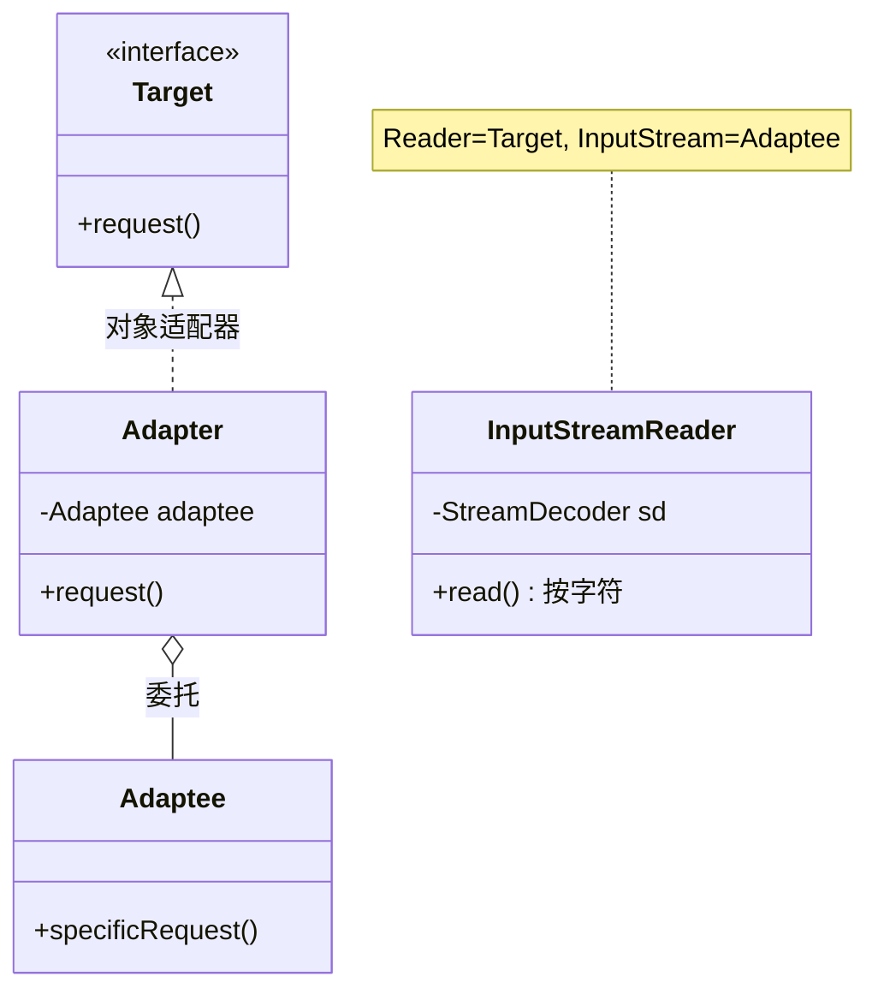
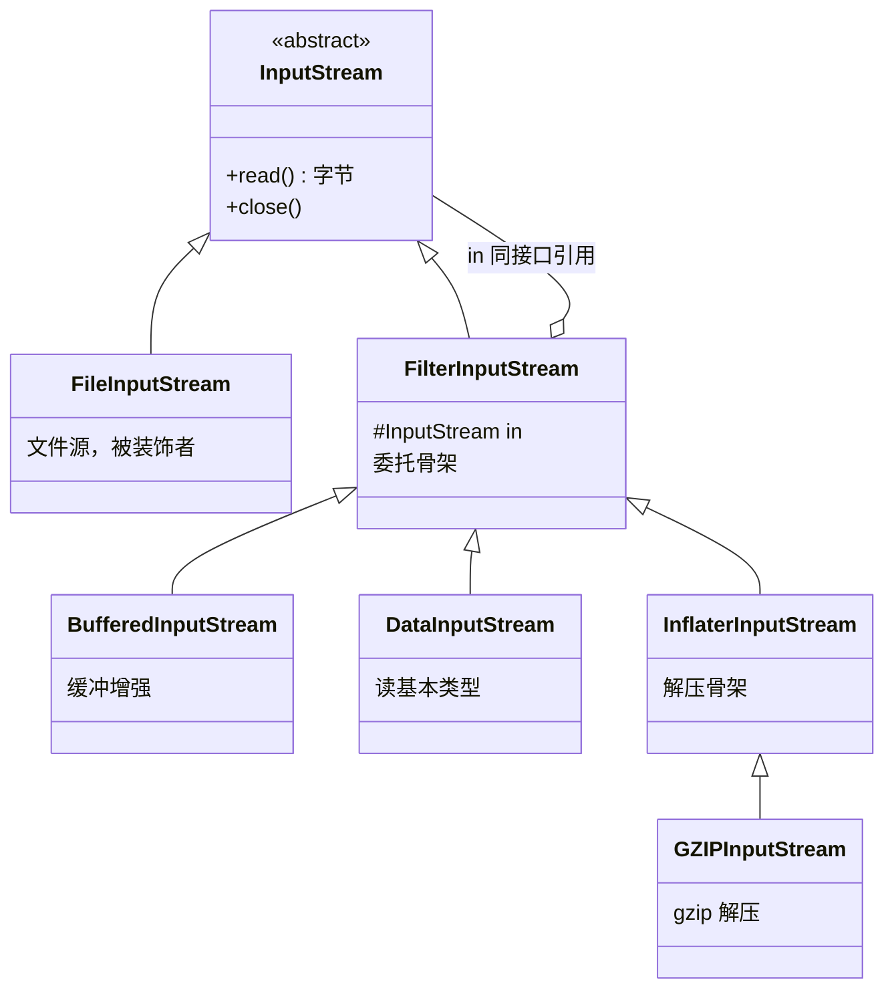
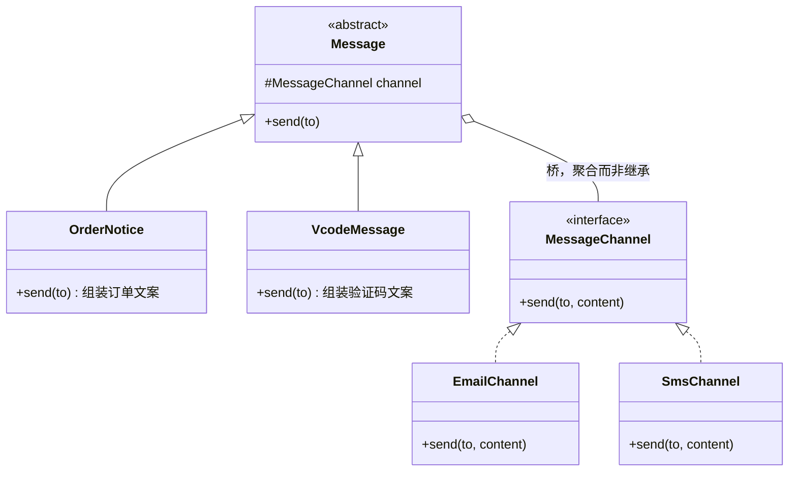

# 结构型模式辨析实战：适配器、装饰器、外观、组合、享元、桥接

> 一句话概括：结构型模式回答的不是「对象怎么创建」，而是「怎么用组合与包装把已有类拼成更大的结构」——
> 六个模式的差别只在两个问题上：**接口变不变、包一层还是包一层树**。本文用 JDK 21 源码逐一拆解它们的结构、边界与辨析口径。

预计阅读时间：大约 60 分钟

所属主题：[设计模式常见面试题总结](summary.md)

本文以 JDK 21（Corretto 21.0.6）为基线，源码锚点用 `类名#方法名` 标注，所有 JDK 行为均已对照本机 JDK 21 源码核实，版本差异单独说明。每个模式按「结论 → 机制 → 边界/代价 → 实践/追问」展开；代理模式结构高度相关，完整展开见 [代理模式专题](proxy.md)，本文只做辨析对照。Spring 视角的适配器（HandlerAdapter）与装饰器/组合应用见 [Spring 中的设计模式](../backend/java/spring/design-patterns.md)，不重复。

---

## 0. 阅读路线

| 读者 | 建议阅读 | 关注点 |
| --- | --- | --- |
| 初级（1 年内） | 1、2.1~2.3、3.1~3.2、4.1~4.2、8 总表 | 每个模式是什么、怎么用、最小示例能跑通 |
| 中级（1~3 年） | 全部，重点 2.4、3.3~3.4、6.2~6.3、9 | JDK 源码证据、对象适配器 vs 类适配器、== 陷阱 |
| 高级（3 年+） | 5.3、6.4、7.3~7.4、10 | 辨析口径、失效与排查、桥接 vs 适配器术语混用 |
| 选型/架构 | 1、各节「边界/代价」、8、9 | 什么时候不该包这层、模式带来的间接层由谁买单 |

目录：

1. 开篇：结构型模式的统一动机
2. 适配器：改接口，让不兼容者协作
3. 装饰器：保接口，同型叠加增强
4. 外观：给子系统一个统一入口
5. 组合：部分与整体统一对待
6. 享元：共享细粒度的不可变对象
7. 桥接：分离两个独立变化的维度
8. 四者辨析总表：适配器 vs 装饰器 vs 代理 vs 外观
9. 六个结构型横向总表
10. 高频面试追问集
11. 参考资料

---

## 1. 开篇：结构型模式的统一动机

创建型模式（单例、工厂、建造者，见 [singleton.md](singleton.md) 与 [factory-and-builder.md](factory-and-builder.md)）回答「对象由谁创建」；结构型模式回答「**已有对象怎么拼成更大的结构**」。它们的公共手段是**组合与包装**——不重写类，而是在外面套一层：

- 套一层**转换接口** → 适配器；
- 套一层**同接口做增强** → 装饰器；
- 套一层**收拢多个子系统入口** → 外观；
- 套**一棵递归的树** → 组合；
- 用**缓存共享**减少要创建的对象 → 享元；
- 让**两个维度的抽象各自演化、运行时组合** → 桥接。

六个模式一句话定位总表：

| 模式 | 一句话定位 | 结构关键词 | 代表实例（JDK/生态） |
| --- | --- | --- | --- |
| 适配器 Adapter | **改接口**，让不兼容的两个类协作 | Target/Adaptee/Adapter，一对一转换 | `Arrays#asList`、`InputStreamReader` |
| 装饰器 Decorator | **保接口**，同型包装、逐层叠加职责 | 同接口 + 持有同接口引用 | `FilterInputStream` 装饰器族 |
| 外观 Facade | 多个子系统收拢成一个**统一入口** | 一对多聚合 | SLF4J `LoggerFactory` |
| 组合 Composite | **部分-整体**树形结构，客户统一对待叶子与子树 | Component/Leaf/Composite 递归容器 | `java.awt.Container` |
| 享元 Flyweight | 共享**不可变的内部状态**，减少细粒度对象数量 | 工厂 + 缓存，外部状态传参 | `IntegerCache`、String 常量池 |
| 桥接 Bridge | **抽象轴与实现轴分离**，两个维度独立演化 | 抽象持有实现引用（聚合） | JDBC API 与各数据库 Driver |

> 面试高频题「适配器、装饰器、代理、外观四者辨析」放在第 8 章专门展开，代理的完整机制（JDK 动态代理、Spring AOP）见 [代理模式专题](proxy.md)。

---

## 2. 适配器：改接口，让不兼容者协作

### 2.1 结论与结构

**结论**：适配器在两个**已经存在、无法修改**的接口之间做转换——客户面向 Target 编程，Adapter 实现 Target 并内部委托 Adaptee。它不增强任何行为，只做「接口形状」的翻译。



两个角色都不改：Target 是「客户期望的接口」，Adaptee 是「已经存在但接口对不上的类」。Adapter 是中间的翻译层。

### 2.2 对象适配器 vs 类适配器：继承与组合的分野

| 维度 | 类适配器（继承实现） | 对象适配器（组合委托） |
| --- | --- | --- |
| 实现方式 | `Adapter extends Adaptee implements Target` | `Adapter implements Target`，内部持有 `Adaptee` 引用 |
| 适配范围 | 只能适配 Adaptee **及其子类** | 任何 Adaptee 及其子类实例都能传进来 |
| Java 可用性 | **受单继承限制**：继承 Adaptee 后不能再继承别的类 | 无限制，还允许运行时换被适配者 |
| 前提 | 要求能看到并继承 Adaptee（第三方 final 类做不到） | 只要能拿到引用即可 |

**为什么 Java 世界几乎只用对象适配器**：单继承是稀缺资源（继承了 Adaptee 就断了其他扩展路径）；final 类无法被继承适配；GoF 原书也明确「优先使用对象适配器」。类适配器在 Java 里主要出现在「Adaptee 是个简单基类、Adapter 本来就需要继承它」的场景，属于例外而不是常规。

### 2.3 JDK 实例一：Arrays#asList——数组到 List 的视图适配

`Arrays#asList` 的 javadoc（JDK 21 源码 `Arrays.java` L4179 起）写得很直白：*"Returns a fixed-size list backed by the specified array"*、*"This method acts as bridge between array-based and collection-based APIs"*——它就是「数组 API」与「集合 API」之间的适配器。

```java
String[] arr = {"a", "b", "c"};
List<String> list = Arrays.asList(arr);

// 1) 返回的是 Arrays$ArrayList（Arrays 的私有内部类），不是 java.util.ArrayList
System.out.println(list.getClass());   // class java.util.Arrays$ArrayList

// 2) 视图语义：数组与 list 双向可见
arr[0] = "A";
System.out.println(list.get(0));       // A（改数组，list 变了）
list.set(1, "B");
System.out.println(arr[1]);            // B（改 list，数组变了）

// 3) set 允许，改变 size 的操作抛 UnsupportedOperationException
list.set(2, "C");    // OK：javadoc 明确 "The list returned by this method is modifiable"
list.add("d");       // UnsupportedOperationException
```

**机制**：`Arrays#asList` 直接 `new ArrayList<>(a)`（这里解析到的是 `Arrays$ArrayList`，`extends AbstractList implements RandomAccess`，内部只存一个 `final E[] a`，`size()` 返回 `a.length`）。因为背后就是原数组，所以「固定大小、双向可见」是结构必然，不是设计选择。

**边界/代价**：javadoc 对此有三个明确警示——改变 size 的方法「leave the list unchanged and throw `UnsupportedOperationException`」；数组类型与 T 不一致时可能抛 `ArrayStoreException`；且*「The list returned by this method is modifiable」*（可 set，不可 add）——「asList 返回不可变 List」是错误认知，真正不可变的是 `List.of`。详见第 10 章 Q2。

### 2.4 JDK 实例二：InputStreamReader——字节流到字符流的接口转换

`InputStreamReader` 的类声明是 `public class InputStreamReader extends Reader`，javadoc 第一句（JDK 21 源码 L35）：*"An InputStreamReader is a bridge from byte streams to character streams"*。

- Target = `Reader`（字符流接口：客户要按字符读）；
- Adaptee = `InputStream`（字节流接口：底层只有字节可用）；
- Adapter = `InputStreamReader`，内部持有一个 `StreamDecoder sd` 做字符集解码。

```java
// 字节流（InputStream）适配成字符流（Reader）：按字符读，按指定字符集解码
try (Reader reader = new InputStreamReader(
        new FileInputStream("data.txt"), StandardCharsets.UTF_8)) {
    int c;
    while ((c = reader.read()) != -1) {
        // c 是一个「字符」而不是一个字节
    }
}
```

**为什么不能直接读字节**（这是高频追问，完整答法见第 10 章 Q4）：字符 ≠ 字节，UTF-8 一个字符占 1~4 个字节；自己按字节拼字符要处理编码边界、半字符、字节序，极易出乱码。`Reader` 接口把这些问题收编进 `StreamDecoder` 统一解决——这正是适配器的价值：**把「接口不匹配 + 正确性陷阱」一并封装掉**。对称地，`OutputStreamWriter extends Writer` 把字符流适配回字节流（内部 `StreamEncoder`）。

### 2.5 JDK 实例三：Collections#list(Enumeration)——旧接口到新接口

```java
// JDK 21 源码 Collections#list（L5705）：
public static <T> ArrayList<T> list(Enumeration<T> e) {
    ArrayList<T> l = new ArrayList<>();
    while (e.hasMoreElements())
        l.add(e.nextElement());
    return l;
}
```

这是 JDK 1.2 集合框架改造时的历史适配器：`Enumeration`（`hasMoreElements`/`nextElement`）是 Vector/Hashtable 时代的遍历接口，新框架统一为 `Iterator`/`Collection`。`Collections#list` 把旧接口的元素搬运成 `ArrayList`，让遗留 API 的产物可以直接进入集合世界。

### 2.6 边界与代价：适配是「补救」性质

- **适配器是面向现实的妥协**，不是设计的起点：理想设计在源头统一接口，适配器的存在往往意味着「两套系统对不上」。面试里能主动说出「适配器解决的是集成问题，不是建模问题」是加分项。
- 适配层多一次间接调用，性能可忽略；真正代价在**排障**——问题可能出在 Target 或 Adaptee 两侧，中间多一层翻译要先定位。
- Spring 视角的适配器（`HandlerAdapter` 统一调度异构 Handler）见 [Spring 中的设计模式](../backend/java/spring/design-patterns.md) 第 7 章，那里还分析了 Spring 的变体：靠 `supports()` 匹配的无状态类型适配器。

**实践**：写新系统时遇到第三方 SDK，先包一层自家接口的适配器再投入使用，第三方更换时只改适配器——这是适配器模式最稳的日常用法。

---

## 3. 装饰器：保接口，同型叠加增强

### 3.1 结论与结构

**结论**：装饰器与被装饰对象**实现同一接口**、内部**持有同一接口的引用**，覆写方法时「先做自己增强的事，再（或前后）委托给被装饰者」。因为接口一致，装饰器可以再包装饰器，**职责在运行时自由叠加**——这是继承做不到的。

四个要素缺一不可：

1. 与目标**同接口**（这是与适配器的分界线）；
2. 持有**同接口引用**（这是能叠加的原因）;
3. **覆写 + 委托**（增强发生在委托前后）；
4. **可叠加**（每层只解决一件事）。

### 3.2 JDK 实例：java.io 的 InputStream 装饰器族

java.io 是装饰器模式的教科书现场。装饰器骨架是 `FilterInputStream`——它的 javadoc（JDK 21 源码 L29 起）：*"A FilterInputStream wraps some other input stream, which it uses as its basic source of data, possibly transforming the data along the way or providing additional functionality"*，内部就是 `protected volatile InputStream in`。



（继承链已对照 JDK 21 源码核实：`FilterInputStream extends InputStream`、`InflaterInputStream extends FilterInputStream`、`GZIPInputStream extends InflaterInputStream`。）

叠加示例——同一个 `InputStream` 接口，层层包装出「gzip 解压 + 缓冲」的组合能力：

```java
// 每层只解决一件事：FileInputStream 负责打开文件，
// GZIPInputStream 负责解压，BufferedInputStream 负责减少系统调用
try (InputStream in = new GZIPInputStream(
        new BufferedInputStream(new FileInputStream("app.log.gz"), 8192))) {
    int b;
    while ((b = in.read()) != -1) {
        process(b);
    }
}
```

缓冲层贴住物理源（减少 syscall），解压层贴近业务语义——**叠加顺序不同，行为与性能不同**，这是装饰器的固有敏感点。

### 3.3 JDK 实例：Collections 的包装方法也是装饰器

`Collections#unmodifiableList` / `#synchronizedList` 返回的类型实现 `List` 接口并包装原 List——同接口、同引用、覆写增强，完全符合装饰器定义：

```java
// JDK 21 源码 Collections$SynchronizedList（L2690 起，简化）
static class SynchronizedList<E>
        extends SynchronizedCollection<E>
        implements List<E> {
    final List<E> list;                          // 同接口引用
    final Object mutex;                          // 锁对象
    public E get(int index) {
        synchronized (mutex) { return list.get(index); }   // 覆写 + 委托
    }
    // ...
}
```

两个方法是装饰器的两个方向：`unmodifiableList` 是**收窄型**装饰（把可变操作变成抛异常），`synchronizedList` 是**增强型**装饰（给每个方法加锁）。注意 `synchronizedList` 的同步覆盖范围有边界，见第 10 章 Q7。

### 3.4 Spring 视角：HttpServletRequestWrapper

Servlet 的 `HttpServletRequestWrapper` 实现 `HttpServletRequest` 并持有原请求，覆写 `getInputStream()` 等方法即可增强。Spring 的 `ContentCachingRequestWrapper` 用它解决「请求体只能读一次」的问题（日志/验签读完，业务还要读）。角色映射与源码见 [Spring 中的设计模式](../backend/java/spring/design-patterns.md) 第 10.1 节；它挂在 Filter 里生效的完整链路见 [MVC 请求流程](../backend/java/spring/mvc-request-flow.md)。

### 3.5 装饰器 vs 继承：组合的自由度

| 维度 | 继承扩展 | 装饰器扩展 |
| --- | --- | --- |
| 职责组合数 | M 种职责 × N 种源 = M×N 个子类（类爆炸） | M 个装饰器 + N 个源类 = M+N，自由叠加 |
| 叠加时机 | **编译期固定**：子类写死 | **运行时动态**：new 出来一层层包 |
| 与被扩展者的耦合 | is-a，强耦合基类实现 | has-a，只耦合接口 |
| 典型代价 | 父类实现暴露给子类，破坏封装 | 排查栈深、小对象多、顺序敏感 |

这正是**合成复用原则**（优先组合而非继承）的教科书案例，原则的完整展开见 [原则与 UML 基础](principles-and-uml.md)。io 流若用继承实现「带缓冲的 gzip 文件流」「带缓冲的 zip 网络流」「不解压的缓冲 SSL 流」……子类数量按职责数指数膨胀；装饰器只需 3 个装饰类。

### 3.6 边界与代价

- **身份语义被破坏**：包装后的对象 `getClass()` 不再是原类型，`instanceof FileInputStream` 失败；`this` 语义、equals/hashCode 也要留意。
- **叠加顺序敏感**：`BufferedInputStream` 包在解压层外与内，行为正确性通常都成立，但性能与「读提前」语义不同；团队约定里应固定惯用顺序。
- **嵌套过深可读性差**：五层构造器嵌套很难读——用 Builder 或工厂方法收敛构造过程（见 [工厂与建造者专题](factory-and-builder.md) 的建造者部分）。
- **什么时候不该用**：只有一个增强、且不打算组合时，直接写一个包装类即可，不必套抽象装饰器骨架；为「未来可能的叠加」提前造 Filter 家族是过度设计。

---

## 4. 外观：给子系统一个统一入口

### 4.1 结论与最小示例

**结论**：外观为**一组子系统接口**定义一个更高层的统一入口，客户只认识外观、不逐个依赖子系统；子系统的能力**没有变**，只是使用方式变简单了。

最小示例——下单流程聚合库存、支付、物流三个子系统：

```java
class InventoryService { void deduct(String sku, int count) { /* ... */ } }
class PaymentService    { void pay(String orderId, long amount) { /* ... */ } }
class LogisticsService  { void dispatch(String orderId, String addr) { /* ... */ } }

/** 外观：一个入口收拢三个子系统的调用顺序 */
class OrderFacade {
    private final InventoryService inventory;
    private final PaymentService payment;
    private final LogisticsService logistics;

    OrderFacade(InventoryService i, PaymentService p, LogisticsService l) {
        this.inventory = i; this.payment = p; this.logistics = l;
    }

    public void placeOrder(String orderId, String sku, int count,
                           long amount, String addr) {
        inventory.deduct(sku, count);
        payment.pay(orderId, amount);
        logistics.dispatch(orderId, addr);
    }
}
```

调用方从「认识 3 个服务、知道 3 步顺序」变成「认识 1 个外观方法」。注意外观**只是入口聚合**：扣库存、支付、物流的业务规则仍在子系统里。

### 4.2 外观 vs 适配器：一对多简化 vs 一对一转换

| 维度 | 外观 | 适配器 |
| --- | --- | --- |
| 被包对象 | **多个**子系统，接口各自正常 | **一个** Adaptee，接口不匹配 |
| 做的事 | 简化使用（收拢入口、编排顺序） | 转换接口（翻译形状） |
| 子系统是否受损 | 不受损，子系统仍可直接使用 | Adaptee 原接口仍可用 |
| 动机 | 降低使用成本与依赖面 | 让不兼容者协作 |

一句话：**接口太多找外观，接口不对找适配器**。两者也可以叠用——外观内部调用若干适配器是常见组合。

### 4.3 JDK/生态实例：SLF4J 作为日志门面

SLF4J 的名字就叫 *Simple Logging **Facade** for Java*。应用代码只面向 `LoggerFactory` 统一入口：

```java
Logger log = LoggerFactory.getLogger(OrderService.class);
log.info("order {} created", orderId);
```

`LoggerFactory#getLogger` 背后绑定到 classpath 上具体的日志实现（Logback、Log4j2……），应用不 import 任何实现类型。这兼具两种味道：作为**统一入口**它是外观；「应用 API 与日志实现两轴独立演化」的意义上它又体现了桥接精神——所以第 7 章还会回来对照它。面试口径：**日常叫它「日志门面」即可，属于外观视角；GoF 桥接的判断标准见第 7 章**。

### 4.4 边界与代价：外观不是上帝类

- 外观只做**入口聚合与编排**，一旦开始承载业务规则（比如「扣库存失败要补偿支付」的完整流程实现），它就从门面膨胀成上帝类——编排顺序可以放外观，业务规则留在子系统。
- 外观方法爆炸（十几个 placeOrder 变体）是「子系统边界划分有问题」的信号，该拆子系统而不是继续加方法。
- 外观增加一层间接：出问题时日志要能看清「外观 → 子系统」的分界，否则排障会多绕一层。

---

## 5. 组合：部分与整体统一对待

### 5.1 结论与结构

**结论**：组合模式用 `Component` 抽象统一「叶子（Leaf）」与「容器（Composite）」，Composite 内部持有 `Component` 集合并**递归委托**，客户对「一个对象」和「一棵子树」调用同一接口——整体与部分一致对待。

| 角色 | 职责 | 关键点 |
| --- | --- | --- |
| Component | Leaf 与 Composite 的统一抽象 | 声明业务方法；管理子节点的方法放不放这里决定下面两种风格 |
| Leaf | 树的末端 | 没有「包含」，业务方法直接实现 |
| Composite | 容器节点 | 持有 `List<Component>`，业务方法遍历子节点递归委托 |

管理子节点的方法放 Component（**透明式**：客户无需区分叶子和容器，但 Leaf 被迫实现无意义的 add）还是放 Composite（**安全式**：类型安全，但客户要 instanceof 区分）——GoF 两种风格都成立，多数业务代码选安全式；JDK AWT 按这个定义属于**安全式**（`add` 定义在 `Container` 而非 `Component` 上，客户端要持有 `Container` 类型才能挂子节点），透明式的典型是 GoF 原书的 Graphic 图形层次（`insert`/`remove` 声明在 Component，Leaf 抛 `UnsupportedOperationException`）。

### 5.2 JDK 实例一：java.awt.Container/Component

`Container extends Component`（JDK 21 源码 `java.desktop/java/awt/Container.java` L97 已核实），容器内部持有子组件列表，`container.add(new Button())` 把叶子挂进树；`repaint()`/`paint()` 沿树递归传播——客户调用的是同一个 `Component` 接口，不关心它是一个按钮还是一整个面板。注意它是**安全式**的标准实现：`add` 定义在 `Container` 上而非 `Component` 上，但 `Container` 仍然是 `Component`，树上的任何节点都能被统一处理。

### 5.3 最小示例与 Spring 视角

安全式风格的业务示例——文件树求总大小：

```java
interface FsNode { long size(); }                          // Component

record FileNode(String name, long bytes) implements FsNode {  // Leaf
    public long size() { return bytes; }
}

final class DirNode implements FsNode {                    // Composite
    private final List<FsNode> children = new ArrayList<>();
    void add(FsNode n) { children.add(n); }                // 管理方法只在 Composite
    public long size() {
        return children.stream().mapToLong(FsNode::size).sum();  // 递归委托
    }
}

// 客户端：对文件与目录调用同一个 size()，无需区分
FsNode tree = new DirNode();
((DirNode) tree).add(new FileNode("a.txt", 100));
System.out.println(tree.size());
```

Spring 里的标准案例是 `CompositeCacheManager`：实现 `CacheManager`，内部持有 `List<CacheManager>`，`getCache` 依次向子管理器询问——调用方不关心背后是一个还是多个缓存管理器（`CompositeCacheManager#getCache`），角色映射见 [Spring 中的设计模式](../backend/java/spring/design-patterns.md) 第 10.3 节。

### 5.4 组合 vs 装饰器辨析

| 维度 | 组合 | 装饰器 |
| --- | --- | --- |
| 包裹数量 | 一个 Composite 包**多个**子节点（树） | 一个装饰器包**一个**对象（链） |
| 意图 | 部分-整体**结构聚合** | 行为**增强** |
| 对被包对象的改动 | 无（只是被收进集合） | 无（调用被覆写方法） |
| 快速判断 | 需要遍历/统计/统一渲染一棵树 | 需要给单个对象叠功能 |

两者结构上都「同接口 + 持有同接口引用」，所以 io 流族理论上也能画成树——但 io 的意图是增强不是聚合，归类看意图不看结构。与享元一样，这条「结构相似、意图定类」的原则同样适用于第 8 章的四者辨析。

### 5.5 边界与代价

- 透明式让 Leaf 背上无意义的 `add`/`remove`（AWT 之外的许多框架选择抛 `UnsupportedOperationException`），安全式则把类型判断推给客户——两种代价选其一。
- 深树的递归委托有栈深度与遍历成本；树上做高频统计（如 size）可考虑在 Composite 缓存聚合结果，但要让失效传播正确。
- 适用前提是「部分-整体」层级**确实存在**：组织架构、菜单、目录、GUI 组件是真树；把扁平列表硬说成组合模式没有意义。

---

## 6. 享元：共享细粒度的不可变对象

### 6.1 结论与结构

**结论**：享元把对象状态拆成两部分——**内部状态（intrinsic）**不可变、可被多个使用点共享；**外部状态（extrinsic）**随场景变化、由客户在调用时传参。用**享元工厂 + 缓存**保证「相同内部状态只有一份实例」。

| 角色 | 职责 | JDK 对应 |
| --- | --- | --- |
| Flyweight（享元） | 只含不可变内部状态 | `Integer`（值不可变）、`Boolean` |
| FlyweightFactory | 创建 + 缓存，按内部状态复用 | `Integer#valueOf` 背后的 `IntegerCache` |
| Client | 持有享元引用，传入外部状态 | 自动装箱处的使用代码 |

### 6.2 JDK 实例一：IntegerCache 与 == 陷阱

**结论**：`Integer#valueOf` 对 -128~127（含两端）返回缓存实例，区间外每次新建对象——这是 JLS 5.1.7 对自动装箱身份语义的强制要求。

源码锚点（JDK 21，`Integer.java`）：

```java
// Integer#valueOf(int)（L1069 起，简化）
public static Integer valueOf(int i) {
    if (i >= IntegerCache.low && i <= IntegerCache.high)
        return IntegerCache.cache[i + (-IntegerCache.low)];   // 命中缓存
    return new Integer(i);                                    // 区间外新建
}
```

`Integer.IntegerCache`（L1009 起）的关键事实，均已对照源码核实：

- `static final int low = -128`（固定）；`high` 默认 127；
- javadoc 明确：*「Cache to support the object identity semantics of autoboxing for values between -128 and 127 (inclusive) as required by JLS」*——区间下限是语言规范要求；
- javadoc 同样明确：*「The size of the cache may be controlled by the `-XX:AutoBoxCacheMax=<size>` option」*——**上限可调**。实现上该选项被转成保存属性 `java.lang.Integer.IntegerCache.high`，且源码取 `h = Math.max(parseInt(...), 127)`：**只能向上调、永远不低于 127**，不存在把缓存调小的说法；
- JDK 21 细节：缓存数组可从 CDS 归档恢复（`CDS.initializeFromArchive(IntegerCache.class)`），JVM 类数据共享会预先归档这批 Integer 对象——冷知识，说明这块缓存被视为启动关键路径。

`==` 陷阱演示（可直接运行）：

```java
Integer a = 127, b = 127;
System.out.println(a == b);   // true：两者都来自 IntegerCache.cache，同一实例

Integer c = 128, d = 128;
System.out.println(c == d);   // false：区间外，valueOf 各自 new Integer(128)
```

陷阱的实际杀伤面：装箱后的 `Integer` 作为 Map 的 key 或集合元素时，127 与 128 行为不一致；`equals` 永远安全。**规则：包装类型的相等判断一律用 `equals` 或比较 `intValue()`，`==` 只用于 null 判断。**

### 6.3 JDK 实例二与三：String 常量池与 Boolean#valueOf

**String 常量池**。`String#intern()` 的 javadoc（JDK 21 源码 L4618 起）：*"A pool of strings, initially empty, is maintained privately by the class String"*，native 方法返回字符串在池中的规范实例。字面量在编译期就进入常量池；运行期字符串调 `intern()` 可入池复用。它满足享元的前提与 Integer 相同：**String 不可变**。常量池的位置演变（永久代 → 堆）属于 JVM 话题，见 [JDK 中的设计模式实例](patterns-in-jdk.md)。

**Boolean#valueOf**。JDK 21 源码（L178 起）只有一行：

```java
public static Boolean valueOf(boolean b) {
    return (b ? TRUE : FALSE);   // TRUE/FALSE 是 public static final 的两个缓存实例
}
```

只有两个可能值，直接预建两个常量实例——享元的极限形态，也解释了为什么 `Boolean` 装箱值 `==` 比较永远安全而 `Integer` 不安全：**缓存覆盖了全部值域，而 Integer 只覆盖一段**。

### 6.4 享元 vs 对象池：共享不可变 vs 复用可变生命周期

| 维度 | 享元 | 对象池 |
| --- | --- | --- |
| 复用对象的方式 | **同一实例同时服务多个使用点**（共享） | 实例**同一时刻只属于一个借出者**（复用） |
| 对象状态 | 必须不可变（内部状态） | 可变，借出 → 修改 → 归还 → 重置 |
| 获取成本 | 查缓存即返回，永不耗尽 | 池空时阻塞/创建，需要归还机制 |
| 典型实现 | IntegerCache、String 池、Boolean.valueOf | 数据库连接池、线程池 |
| 失效条件 | 内部状态一旦可变即全线崩溃 | 归还漏做即泄漏 |

一句话：**享元是「一份东西大家看」，对象池是「轮流借给大家用」**。判断对象该进享元还是对象池，看它是否可变。

### 6.5 线程安全与边界

- **内部状态必须不可变**：共享意味着任意多的线程同时持有同一实例；`Integer`、`String`、`Boolean` 都因不可变而天然线程安全。若享元带可变字段，一个使用点的写入会串味到所有使用点——这是享元模式的铁律，也是它最大的失效场景。
- 享元工厂的缓存要线程安全：JDK 用类初始化（`IntegerCache` 是静态初始化，天然由类加载机制保证可见性）；自建享元工厂用 `ConcurrentHashMap.computeIfAbsent`。
- **代价**：节省内存与分配的同时，引入查表开销与缓存管理复杂度；GoF 自己也指出外部状态传参让调用代码变啰嗦。对象数量少、无重复时不要上享元。
- 享元与单例的边界：单例保证「一个类一个实例」，享元按内部状态缓存「每个状态一份实例」——享元工厂的缓存本质是**以状态为 key 的注册表**，更细的口径对比见 [单例模式专题](singleton.md)。

**追问：享元工厂和普通工厂什么关系？** 享元工厂是「带缓存的工厂」：创建逻辑委托给构造（甚至 private 构造器），重点在**缓存命中复用**而不是「怎么造」。工厂模式的展开见 [工厂与建造者专题](factory-and-builder.md)。

---

## 7. 桥接：分离两个独立变化的维度

### 7.1 结论与动机：类爆炸

**结论**：桥接把「抽象维度」与「实现维度」拆成**两个独立的继承/实现体系**，抽象通过**聚合**（持有实现引用，而非继承实现）连接实现，两个维度各自演化、运行时组合。

动机从类爆炸看最直观。需求：3 种消息（订单通知、验证码、营销）× 3 种渠道（邮件、短信、站内信）：

| 做法 | 类数量 | 问题 |
| --- | --- | --- |
| 多层继承（抽象类继承渠道，子类继承消息类型） | 3 × 3 = 9 个具体类 + 中间层 | M×N 爆炸；加一个维度要乘一遍 |
| 桥接 | 3 个消息类 + 3 个渠道类 = M + N | 两轴独立扩展，加维度只做加法 |

### 7.2 结构与最小示例



```java
// 实现维度：发送渠道，可独立替换
interface MessageChannel { void send(String to, String content); }
class EmailChannel implements MessageChannel {
    public void send(String to, String content) { /* SMTP */ }
}
class SmsChannel implements MessageChannel {
    public void send(String to, String content) { /* 运营商网关 */ }
}

// 抽象维度：消息类型，持有渠道引用（两个变化轴在这里相接）
abstract class Message {
    protected final MessageChannel channel;          // 桥：聚合，不是 extends
    protected Message(MessageChannel channel) { this.channel = channel; }
    public abstract void send(String to);
}
class OrderNotice extends Message {
    OrderNotice(MessageChannel c) { super(c); }
    public void send(String to) { channel.send(to, "您的订单已发货"); }
}

// 运行时自由组合两个维度
new OrderNotice(new EmailChannel()).send("a@x.com");
new OrderNotice(new SmsChannel()).send("13800000000");
```

关键在 `Message o-- MessageChannel` 是**聚合**：抽象不继承实现（那只会造出第三层继承），而是持有引用。UML 里聚合与组合的区别见 [原则与 UML 基础](principles-and-uml.md)。

### 7.3 JDBC：最经典的桥接现场

应用代码面向 `java.sql` 的抽象 API 编程，从不 import 厂商类：

```java
// 应用只认识接口：Connection/Statement/ResultSet
try (Connection conn = DriverManager.getConnection(url, user, pwd);
     Statement stmt = conn.createStatement();
     ResultSet rs = stmt.executeQuery("select id, name from users")) {
    while (rs.next()) { /* ... */ }
}
```

| 桥接角色 | JDBC 对应 |
| --- | --- |
| 抽象轴（API，相对稳定） | `java.sql.Connection` / `Statement` / `ResultSet` 及应用侧代码 |
| 实现轴（驱动，独立演化） | 各数据库 `Driver` 实现（MySQL、PostgreSQL、Oracle……） |
| 桥/接线处 | `DriverManager#getConnection` 按 URL 协议选择并返回对应实现 |

两个轴独立变化：**换数据库只换驱动与 URL，应用代码不动；JDBC API 升级（如 4.x 加接口默认方法）不动驱动实现细节**。诚实说明：JDBC 里 `Driver` 家族同时有抽象工厂色彩（`Connection` 由 Driver 创建），教材通常以「抽象工厂 + 桥接的混合」描述它；面试答桥接时抓「API 轴与实现轴分离」这一点即可。

### 7.4 术语辨析：SLF4J 的 "bridge" 不是 GoF 桥接

SLF4J 生态里有一批名字带 bridge 的东西（jul-to-slf4j、jcl-over-slf4j、log4j-over-slf4j），代表是 `org.slf4j.bridge.SLF4JBridgeHandler`（extends `java.util.logging.Handler`，SLF4J 1.5.1 起提供）。其官方 javadoc：*"Bridge/route all JUL log records to the SLF4J API"*——用法是 `SLF4JBridgeHandler.install()` 把这个 Handler 装到 JUL root logger，把 JUL 的 `LogRecord` **重定向**给 SLF4J 处理。

**它不是 GoF 桥接**：没有「抽象轴 + 实现轴」两个独立演化的维度，做的事是把旧日志 API 的调用转给新 API——形态上接近**适配器/重定向**，动机是日志系统迁移（让旧组件的日志汇入统一后端）。而「应用面向 SLF4J 门面 API、实现是 Logback/Log4j2」的分层（见 4.3）在「两个轴各自演化」的意义上更贴近桥接精神。**术语混用是现实，面试答 GoF 桥接时以「两轴分离、聚合连接」为判断标准，不要被 "bridge" 字样带偏**。

### 7.5 边界与代价

- 桥接必然多一层间接（抽象持有实现引用、每次调用穿一层委托）；只有**一个维度**会变时不要上桥接——直接继承或构造器注入即可，为「未来可能的第二维度」提前建桥是过度设计。
- 判断「是否存在两个独立变化轴」是难点：形状 × 颜色是；消息 × 渠道是；「类型 × 类型」叠出来的继承层级不是两个轴，那是该用组合模式或拆职责的信号。
- 与策略模式的分界：策略替换的是**同一维度里的一种算法**；桥接分离的是**两个正交维度的演化**。若发现「桥」的另一头只有一个实现且没有第二个的迹象，多半该写成策略或普通组合。

---

## 8. 四者辨析总表：适配器 vs 装饰器 vs 代理 vs 外观

面试最高频的结构型辨析题。四者都是「包一层」，差异在意图与形状：

| 维度 | 适配器 | 装饰器 | 代理 | 外观 |
| --- | --- | --- | --- | --- |
| 接口是否变化 | **变**（转换成 Target） | **不变**（同接口） | **不变**（同接口） | **变**（新的更高层入口） |
| 意图 | 让不兼容者协作 | 动态叠加行为增强 | 控制对目标的访问（延迟/远程/权限/缓存） | 简化子系统的使用 |
| 包装数量 | 一对一 | 一对一，**可无限叠加** | 一对一（代理控制目标） | **一对多**（收拢多个子系统） |
| 客户能否自由组合 | 不能，适配关系固定 | **能**，一层层 new 出来 | 通常不能，代理由框架/工厂生成 | 不能，入口固定 |
| 典型例子 | `Arrays#asList`、`InputStreamReader` | `FilterInputStream` 族、`unmodifiableList` | JDK 动态代理、Spring AOP | SLF4J `LoggerFactory`、OrderFacade |
| Spring 代表 | `HandlerAdapter` | `HttpServletRequestWrapper` | AOP 代理 | `JdbcTemplate`（对 JDBC 的简化入口；换个视角它也是模板方法，见 Spring 篇第 5 章） |

**快速判断口诀**：

```text
接口变了看方向：多个收成一个 → 外观；一对一翻译 → 适配器。
接口没变看意图：能自由叠加增强 → 装饰器；控制访问/由框架生成 → 代理。
```

一个有效的追问套路：问「**客户能不能绕过这层包装直接用被包对象**」。外观与适配器的场景里客户本来就无法（或不该）直接用原始接口；装饰器与代理的接口没变，客户「能绕过」——区别只在代理会刻意**不让你绕**（框架注入代理），装饰器只是恰好包了这层。

---

## 9. 六个结构型横向总表

| 模式 | 结构关键词 | 意图 | JDK 实例 | 常见误用 |
| --- | --- | --- | --- | --- |
| 适配器 | Target/Adaptee/Adapter，一对一翻译 | 转换接口让不兼容者协作 | `Arrays#asList`、`InputStreamReader`、`Collections#list` | 把「增强行为」说成适配；为了新代码而提前造适配层 |
| 装饰器 | 同接口 + 同引用，覆写委托 | 运行时叠加职责 | `FilterInputStream` 族、`Collections#synchronizedList` | 叠加五层不收敛；用它全面替代继承 |
| 外观 | 统一入口聚合多子系统 | 降低使用成本 | SLF4J `LoggerFactory`、下单 OrderFacade | 往外观里塞业务规则变成上帝类 |
| 组合 | Component/Leaf/Composite 递归 | 部分-整体统一对待 | `java.awt.Container` | 把装饰链当组合树；为扁平结构硬套树 |
| 享元 | 内部/外部状态，工厂缓存 | 共享细粒度对象省内存 | `IntegerCache`、String 常量池、`Boolean#valueOf` | 对**可变对象**做享元；值少又无重复还硬上缓存 |
| 桥接 | 抽象持有实现引用（聚合） | 两个变化轴独立演化 | JDBC API / Driver | 只有一个维度会变也建桥；把多层继承改名就叫桥接 |

对照表里的行为型兄弟模式（策略、模板方法、观察者、责任链）见 [策略/模板/状态/命令专题](strategy-template-state-command.md)、[观察者与事件驱动专题](observer-and-event-driven.md) 与 [责任链专题](chain-of-responsibility.md)。

---

## 10. 高频面试追问集

**Q1：装饰器和代理结构几乎一样，怎么区分？**

期望答案：两者都是「同接口 + 持有同接口引用 + 覆写委托」，结构同源，GoF 也承认这一点；区分靠**意图与使用方式**。装饰器的意图是**增强**，客户知道并自由控制叠加顺序（`new BufferedInputStream(new GZIPInputStream(...))`），每层增强职责单一；代理的意图是**控制访问**——延迟加载、远程调用、权限、缓存、日志，代理通常由框架生成、对客户透明，且代理可以**拒绝转发**（不调 target，如权限拦截直接返回），还常管理目标的创建与生命周期（延迟实例化）。Spring AOP 的代理是典型：客户拿到的是注入好的代理，不知道也不需要知道包装层数。答出「结构相同、意图分野；代理可以不行使目标行为而装饰器一定会委托」即为完整。完整代理机制见 [代理模式专题](proxy.md)。

**Q2：Arrays.asList 返回的 List 能 add 吗？**

期望答案：不能。`Arrays#asList` 返回的是 `java.util.Arrays$ArrayList`（Arrays 的私有内部类，**不是** `java.util.ArrayList`），内部直接持有原数组，`size()` 返回 `a.length`——固定大小的视图。所有改变 size 的操作（add/remove/clear）抛 `UnsupportedOperationException`；`set` 是允许的（javadoc 明确 "The list returned by this method is modifiable"），且数组与 list 双向可见。需要可增删的副本用 `new ArrayList<>(Arrays.asList(...))`，需要真正不可变用 `List.of`。把 asList 当「快速建 ArrayList」是高频事故源。

**Q3：Integer 缓存的范围与 == 陷阱？**

期望答案：`Integer#valueOf` 对 -128~127（含两端）返回 `IntegerCache.cache` 中的同一实例，区间是 JLS 5.1.7 对装箱身份语义的要求；上限可通过 `-XX:AutoBoxCacheMax=<size>` 向上调整（实现取 `Math.max(h, 127)`，只能调高不能低于 127）。128 开始每次 `new Integer`，所以 `127 == 127`（装箱后）为 true、`128 == 128` 为 false。结论：包装类型比较一律 `equals`，`==` 只判 null；这段缓存是享元模式在 JDK 的标准实现。

**Q4：为什么要用 InputStreamReader 而不是直接读字节？**

期望答案：字符与字节不是一回事——UTF-8 下一个字符占 1~4 个字节，`InputStream` 只提供字节接口。直接读字节意味着自己处理字符集解码、多字节边界（跨 buffer 的半个字符）与乱码问题，极易出错。`InputStreamReader` 是字节流到字符流的适配器（javadoc 原话 "a bridge from byte streams to character streams"），内部 `StreamDecoder` 按指定 Charset 统一解码并处理边界；再套 `BufferedReader` 还能按行读。选字符流的本质是「把正确处理编码的责任交给标准库」。

**Q5：外观和适配器的区别？**

期望答案：看被包对象数量与动机。适配器是**一对一**接口翻译，动机是「接口不匹配、无法直接协作」（`InputStreamReader` 把字节接口翻译成字符接口）；外观是**一对多**入口收拢，动机是「子系统没问题但接口太多、调用太散」（SLF4J 统一日志入口）。口诀：接口不对找适配，接口太多找外观。两者可叠用：外观内部调用适配器。

**Q6：享元为什么要求内部状态不可变？**

期望答案：享元的收益来自「一份实例同时服务多个使用点」。内部状态可变时，任意使用点的写操作都会影响所有共享者——省内存立刻变成数据串味事故（比如共享的 `Integer` 若能 setValue，整个 JVM 的运算都会互相污染）。所以享元必须把可变部分拆成外部状态由调用方传参（JDBC 的 `Connection` 就不共享，因为可变——它走对象池复用而不是享元共享）。缓存侧配合不可变性，共享才线程安全。

**Q7：Collections.synchronizedList 迭代时还要手动加锁吗？**

期望答案：要。javadoc 明确写 *「It is imperative that the user manually synchronize on the returned list when traversing it via Iterator, Spliterator or Stream」*——`synchronizedList` 只保证**单个方法调用**原子（get/add 都在 mutex 里），而「迭代完整个集合」是多次调用的复合操作，迭代期间其他线程 add/remove 会产生非确定行为（常见表现 `ConcurrentModificationException`）。正确写法是 `synchronized (list) { for (...) ... }`，锁对象必须是返回的包装对象本身（内部 mutex 与它同源）。高频场景更推荐 `java.util.concurrent` 的 `CopyOnWriteArrayList` 或并发队列，见 [并发容器专题](../backend/java/concurrency/concurrent-collections.md)。

**Q8：桥接模式在 JDBC 里谁抽象、谁实现？**

期望答案：抽象轴是 `java.sql` 的 API 层——`Connection`/`Statement`/`ResultSet` 接口与应用侧面向接口的代码；实现轴是各数据库厂商的 Driver 及其连接实现。`DriverManager#getConnection` 按 URL 协议把两轴接起来返回具体实现。「抽象」与「实现」不是「接口 vs 类」，而是**两个会独立变化的维度**：JDBC API 升级不影响驱动实现方式，换数据库不动应用代码。这就是桥接「两轴分离、聚合连接」的判断标准，也顺带说明为什么 SLF4JBridgeHandler 名字带 bridge 却只是日志重定向（见 7.4）。

**Q9：享元和单例的区别？享元工厂和单例注册表像吗？**

期望答案：单例约束「一个类全局一个实例」，访问入口固定（`getInstance` 或容器注册表）；享元按**内部状态**缓存「每个状态一份实例」，状态空间里可能有 N 份，每份服务多个使用者。享元工厂内部确实是「以状态为 key 的注册表」，与 Spring 的单例注册表（beanName → 实例）形似——区别是单例注册表的 key 是「类型/名字」且实例是完整业务对象，享元的 key 是「不可变状态」且对象极小极多。口径见 [单例模式专题](singleton.md)。

**Q10：什么时候不该用这些结构型模式？**

期望答案：三个信号。① 没有「第二个变化点」的明确预期时不上桥接/装饰器家族——多一层间接就多一层排障成本；② 包装层数超过两三层时用 Builder/工厂收敛，否则可读性崩坏；③ 适配器/外观是**集成手段**，新系统设计阶段就该统一接口，而不是默认先对不上再补翻译层。反向信号（该用而没用）更危险：第三方 SDK 裸调用散落全工程、职责叠加靠继承造出十几个子类。模式滥用的完整清单见 [模式的现代演进与过度设计防线](modern-java-and-anti-patterns.md)。

---

## 11. 参考资料

- GoF《设计模式：可复用面向对象软件的基础》—— Adapter / Decorator / Facade / Composite / Flyweight / Bridge 六章，类适配器与对象适配器、透明式与安全式组合的原始出处
- JDK 21 源码（本文对照 Corretto 21.0.6 核实）：`Integer#valueOf`、`Integer.IntegerCache`、`Arrays#asList`、`Arrays$ArrayList`、`Collections#synchronizedList`、`Collections$SynchronizedList`、`Collections#list`、`InputStreamReader`、`OutputStreamWriter`、`FilterInputStream`、`InflaterInputStream`、`GZIPInputStream`、`Boolean#valueOf`、`String#intern`、`java.awt.Container`
- JDK API 文档：`Collections#synchronizedList`（迭代须手动同步的原文）、`Integer.IntegerCache`（`-XX:AutoBoxCacheMax` 说明）、`Arrays#asList`（"bridge between array-based and collection-based APIs"）
- SLF4J：`org.slf4j.bridge.SLF4JBridgeHandler` javadoc（<https://www.slf4j.org/apidocs/org/slf4j/bridge/SLF4JBridgeHandler.html>，"Bridge/route all JUL log records to the SLF4J API"）
- Spring 视角对照：[Spring 中的设计模式](../backend/java/spring/design-patterns.md)（HandlerAdapter、HttpServletRequestWrapper、CompositeCacheManager）
- 兄弟专题：[原则与 UML 基础](principles-and-uml.md)、[单例模式](singleton.md)、[工厂与建造者](factory-and-builder.md)、[代理模式](proxy.md)、[JDK 标准库中的设计模式巡礼](patterns-in-jdk.md)、[模式的现代演进与过度设计防线](modern-java-and-anti-patterns.md)

---

## 附：一页速记

**统一视角**
1. 结构型 = 用组合/包装拼结构：接口变了（一对一）→ 适配；同接口可叠加 → 装饰；多接口收成入口 → 外观；包成树 → 组合；缓存共享 → 享元；两轴分离 → 桥接。
2. 口诀：**接口不对找适配，接口太多找外观，能叠加找装饰，控制访问找代理**（代理完整机制见 proxy.md）。

**适配器**
3. 对象适配器（组合）优先于类适配器（继承）：Java 单继承 + final 类限制。
4. JDK 三件套：`Arrays.asList`（数组→List 固定视图，set 可用 add 抛 UOE）、`InputStreamReader`（字节→字符，内部 StreamDecoder）、`Collections.list(Enumeration)`（旧枚举→集合）。

**装饰器**
5. 四要素：同接口、持同接口引用、覆写委托、可叠加；`FilterInputStream` 是骨架（`protected volatile InputStream in`）。
6. `unmodifiableList`/`synchronizedList` 是装饰器；比继承省 M×N → M+N（合成复用原则）；代价：顺序敏感、身份语义破坏。

**外观与组合**
7. 外观只是入口聚合，业务规则留子系统，塞进去就是上帝类；SLF4J `LoggerFactory` 是门面代表。
8. 组合 = 部分-整体统一对待：`Container extends Component` 递归；与装饰器的分界是「一个包多个 vs 一个包一个」。

**享元**
9. 内部状态不可变才可共享；外部状态传参。`Integer#valueOf` 缓存 -128~127（JLS 要求，`-XX:AutoBoxCacheMax` 只能上调）；`Boolean.valueOf` 返回 TRUE/FALSE；`String#intern` 走常量池。
10. `==` 陷阱：127 装箱相等、128 不等——包装类型一律 `equals`。享元是「共享不可变」，对象池是「轮流复用可变」。

**桥接**
11. 两轴独立演化（消息×渠道、API×驱动），抽象**聚合**实现而非继承；M×N 继承爆炸 → M+N。
12. JDBC：抽象轴 = `java.sql` API，实现轴 = 厂商 Driver，`DriverManager` 接线。SLF4JBridgeHandler 名字带 bridge，实际是日志 API 重定向（适配），不是 GoF 桥接。

**一句话**
> 六个结构型模式共享同一句话：**不改（或最小改）已有类，在外面拼一层**——拼的方向（转换、增强、收拢、聚合、共享、分离两轴）决定了它是哪一个模式，也决定了它的边界在哪里。
