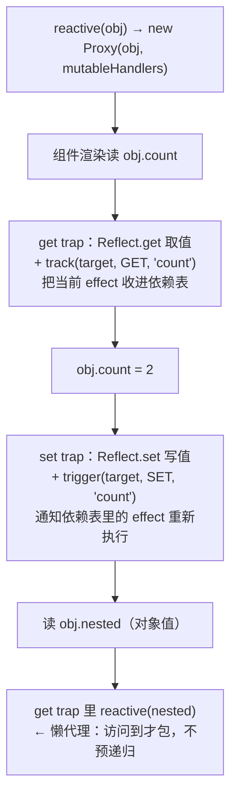

# ES6+ 核心语法与现代 JavaScript 特性

> 一句话概括：ES6+ 不是「一堆新写法」，而是把「迭代协议、元编程（Proxy/Reflect/Symbol）、硬私有（#field）、空值安全（?. / ??）」这几套**底层机制**补进了语言——
> 本文讲清每套机制**hook 了什么、在哪里失效、代价是什么**，并按 ES2022→ES2026 时间线给出「哪个运行时能用」的选型账。

预计阅读时间：大约 100 分钟

所属主题：[JavaScript 基础常见面试题总结](summary.md)

**版本基线**：以 **ECMAScript ES2025**（第 16 版，2025-06 批准）为基准；**ES2026**（第 17 版，2026-06-30 批准）与 **ES2027 在途提案**均经在线核实（tc39 `finished-proposals` / MDN browser-compat-data / v8.dev，核实日期 **2026-11-27**）。浏览器以当前 Chrome/V8 为准，Node.js 以 **22 LTS（V8 12.4）/ 24 LTS（V8 13.6）** 为准。规范锚点用 ECMA-262 **命名章节 / 语法产生式**（如 `sec-proxy-objects`、`Reflect`、`Symbol.toPrimitive`、`OptionalExpression`），不标注未核实的章节号。本文示例除注明外均可在 **Node 22+ / 现代浏览器**直接运行；关键行为已在 Node 20（V8 11.3）实测，涉及 ES2024+ 新 API 的版本归属以在线 BCD 为准。

> 与兄弟专题的分工：本文聚焦「**语法与语言特性本身**」。`let/const` 的作用域/TDZ、箭头函数 `this`、原型链、事件循环、Promise 内部、迭代器/生成器协议、模块系统、GC 等**机制深挖**在对应专题，本文只给结论 + 交叉链接，不重复展开。

---

## 0. 阅读路线

| 读者 | 建议阅读 | 关注点 |
| --- | --- | --- |
| 初级（1 年内） | 1.1~1.6、3.1~3.2、5.1、6 时间线速览、7.1 | 解构/展开/模板串怎么写、`?.`/`??` 怎么用、class 字段长什么样、严格模式差异 |
| 中级（1~3 年） | 1 全部、2、3、4.1~4.4、5、6、7 | 默认值触发条件、well-known symbols、Proxy 13 trap 与不变量、Vue3 响应式、私有字段 |
| 高级（3 年+） | 1.7、2.3、3.4、4.2/4.5/4.6、5.2~5.3、6.5~6.6、8 | 不变量与 deopt、`?.` 短路边界、硬私有 brand check、ES2026 运行时可用性、Temporal/装饰器现状 |
| 选型/架构 | 1.7、4.5、6.5、8.1~8.4 | Map/Set 选型、Proxy vs defineProperty、新特性兼容策略（Babel/polyfill/基线浏览器） |

目录：

1. ES6（ES2015）核心语法：从「会写」到「懂机制」
2. Symbol 与 well-known symbols
3. 可选链 `?.` 与空值合并 `??`（ES2020）+ 逻辑赋值（ES2021）
4. Proxy / Reflect：元编程与 Vue3 响应式
5. class 增强（ES2022）：字段、硬私有、静态块
6. ES2022~ES2026 特性时间线总表
7. 严格模式：差异清单与自动严格
8. 展望与选型：Temporal / 装饰器 / using / 兼容策略
9. 高频追问集
10. 参考资料
- 附：一页速记

---

## 1. ES6（ES2015）核心语法：从「会写」到「懂机制」

ES6 是 JavaScript 的分水岭。本节不罗列所有语法，而是挑**面试最常深挖机制**的几项，按「结论 → 机制 → 边界 → 实践」展开。

### 1.1 解构赋值：默认值只在 `undefined` 时触发

**结论**：解构按「模式匹配」从数组/对象取值；**默认值仅当取到的值严格等于 `undefined` 时才生效**，`null` 不触发。

```js
// Node 22+ / 浏览器，ES2015
const { a = 10, b = 20 } = { a: null, b: undefined };
console.log(a, b);            // null 20  ← null 不触发默认值，undefined 触发

let x = 1, y = 2;
[x, y] = [y, x];              // 交换变量，无需临时变量
console.log(x, y);            // 2 1

// 嵌套 + 重命名 + 默认值
const { user: { name = '匿名', address: { city = '未知' } = {} } = {} } = {};
console.log(name, city);      // 匿名 未知

// 函数参数解构：整个参数默认 {}，内部字段再各自默认
function draw({ size = 'big', coords: { x = 0, y = 0 } = {} } = {}) {
  return `${size}@${x},${y}`;
}
draw();                       // 'big@0,0'  ← 不传参也不报错
draw({ size: 'small' });      // 'small@0,0'
```

**机制**（规范锚点：ECMA-262 `sec-destructuring-assignment`）：

- **数组解构**走**迭代协议**（`Symbol.iterator`），所以任何可迭代对象（Set、Map、生成器、字符串）都能被数组模式解构；
- **对象解构**走**属性读取**（`GetV`），按 key 取值，与顺序无关；
- 默认值是一个**惰性表达式**：只有对应位置 `=== undefined` 才求值。`null` 是一个「确定的值」，不触发。

**边界/代价**：

- 解构 `null`/`undefined` 本身会抛 `TypeError`（`const {a} = null` 炸），所以参数解构常配 `= {}` 兜底；
- 默认值表达式可以引用**前面的**参数/变量，但引用后面未初始化的会踩 TDZ（见 1.4）；
- 对象解构取不到嵌套层时，需要给中间层也加 `= {}`，否则 `undefined.city` 抛错。

**实践/追问**：接口返回值兜底用解构默认值比 `obj && obj.a || 'x'` 更精确——后者会把 `0`/`''` 也吞掉（这正是 `??` 要解决的问题，见第 3 章）。

> **追问：为什么 `null` 不触发默认值？** 期望答案：规范规定默认值只在值 `=== undefined` 时求值；`null` 表示「显式的空值」，是有效取值，语义上不应被覆盖。这也是 `??` 与 `||` 的分界（第 3 章）。

### 1.2 展开 / rest：浅拷贝语义

**结论**：`...` 在**字面量/调用**里是「展开」（spread），在**解构/参数**里是「收集」（rest）；对象/数组展开都是**浅拷贝**——只复制第一层，嵌套对象仍共享引用。

```js
// ES2015 数组展开 / ES2018 对象展开（sec-object-rest-spread）
const inner = { deep: 1 };
const copy = { ...{ inner } };
copy.inner.deep = 2;
console.log(inner.deep);      // 2  ← 浅拷贝，嵌套对象被共享

function sum(...nums) { return nums.reduce((a, b) => a + b, 0); }
sum(1, 2, 3);                 // 6  ← rest 收集成真数组

const [first, ...restArr] = [1, 2, 3];   // restArr = [2, 3]
const { a, ...restObj } = { a: 1, b: 2, c: 3 }; // restObj = { b: 2, c: 3 }
```

**机制**：数组展开调用迭代器逐个取值；对象展开（ES2018）等价于把源对象的**自有可枚举属性**（含 Symbol 键）逐个 `CreateDataProperty` 到目标，**后者覆盖前者**。rest 则把「剩余」收集成新数组/新对象。

**边界/代价**：

- **浅拷贝**是最高频坑：`{...state}` 不会克隆 `state.user`，改嵌套仍污染原对象。深拷贝方案（`structuredClone`、递归、`JSON.parse(JSON.stringify)`）的取舍见 [对象属性与拷贝](objects-properties-and-copy.md)；
- 对象展开**不复制原型链上的属性**，也**不触发 getter 求值后再拷贝描述符**——它读 getter 的值拷成数据属性；
- rest 参数必须是**最后一个**，且 rest 收集的是真数组（区别于 `arguments` 类数组，见 [this 与函数调用](this-binding-and-function-call.md)）。

**实践**：不可变更新（Redux/React state）用 `{...state, count: state.count + 1}`；需要深克隆且无函数/循环引用时用 `structuredClone`（Node 17+ / 现代浏览器）。

### 1.3 模板字符串与标签模板

**结论**：模板字符串支持插值与多行；**标签模板**（tagged template）把「字符串片段数组 + 插值」交给一个函数处理，是 styled-components、SQL 防注入、i18n 的底层机制。

```js
// 普通模板串
const name = '世界';
console.log(`你好，${name}！`);   // 你好，世界！

// 标签模板：第一个参数是「字符串片段数组」（带 raw 属性），其余是插值
function tag(strings, ...values) {
  console.log(strings);      // ['a\nb', 'c']（cooked，转义已解析）
  console.log(strings.raw);  // ['a\\nb', 'c']（raw，原始文本）
  console.log(values);       // [1]
  return strings[0] + values[0] + strings[1];
}
tag`a\nb${1}c`;
```

**机制**（规范锚点：ECMA-262 `TemplateLiteral` / `sec-tagged-templates`）：`tag\`...\`` 等价于 `tag(['a\nb','c'], 1)`。字符串片段数组**被冻结**且带 `.raw`；ES2018「模板字面量修订」后，标签模板里即使有非法转义序列也不报错（cooked 对应位置为 `undefined`，raw 仍保留），这让 DSL 能自定义转义。

**实践/追问：标签模板实际用在哪？**

```js
// ① SQL 防注入：值走参数化，绝不拼进 SQL 文本
function sql(strings, ...values) {
  return { text: strings.join('?'), values };  // 占位符 + 参数分离
}
const id = 1;
sql`SELECT * FROM users WHERE id = ${id}`;
// { text: 'SELECT * FROM users WHERE id = ?', values: [1] }

// ② styled-components：css`color: ${p => p.color};` 把插值变成动态样式函数
// ③ i18n / GraphQL（gql`...`）/ HTML 转义：统一在 tag 里处理插值
```

> **追问：标签模板和普通模板串本质区别？** 期望答案：普通模板串直接求值拼字符串；标签模板把「片段数组 + 插值」交给函数，函数能拿到 `raw`、能决定如何拼接/转义/参数化，因此能做防注入与 DSL。

### 1.4 默认参数：与作用域 / TDZ 的交互

**结论**：默认参数在**调用时**求值（不是定义时），拥有**独立的作用域**，且**不计入 `function.length`**；默认值表达式引用后续参数会踩 TDZ。

```js
// 默认参数不计入 length
console.log(((a, b = 1, c = 2) => 0).length);  // 1（只数第一个默认值之前的参数）

// 默认值可引用前面的参数
function f(a = 1, b = a) { return [a, b]; }
f();                          // [1, 1]

// 引用后续参数 → TDZ ReferenceError
try { (function g(p = q, q = 2) { return p; })(); }
catch (e) { console.log(e.constructor.name); }  // ReferenceError

// 默认参数与函数体同名 let → SyntaxError（参数作用域与体作用域冲突）
try { eval('function h(a = 1) { let a = 2; }'); }
catch (e) { console.log(e.constructor.name); }  // SyntaxError
```

**机制**：含默认值的参数会创建一个**独立的参数环境记录**（parameter scope），函数体是它的子作用域。默认值从左到右求值，引用尚未初始化的绑定即 TDZ。`length` 只统计**第一个默认值之前**的形参个数。

**边界**：默认参数让 `arguments` 与形参**不再映射**（非严格模式下原本映射，有默认值后断开）；`this`/作用域细节见 [作用域、闭包与执行上下文](scope-closures-and-execution-context.md)。

### 1.5 属性 / 方法简写与计算属性名

```js
const key = 'dynamic';
const value = 42;
const obj = {
  value,                       // 属性简写：{ value: value }
  [key]: 'computed',           // 计算属性名（ES2015）
  method() { return this.value; },  // 方法简写（无 function 关键字）
  get double() { return this.value * 2; },
};
```

**结论**：简写只是语法糖，语义不变；**计算属性名**让 key 可以是任意表达式（含 Symbol），是「用 Symbol 做私有键」的基础（见第 2 章）。方法简写定义的方法**没有 `prototype`**、不能 `new`，`super` 只在简写方法里可用（详见 [原型链与继承](prototype-chain-and-inheritance.md)）。

### 1.6 `for...of` 与迭代协议

**结论**：`for...of` 遍历**可迭代对象**（消费 `Symbol.iterator`），拿到的是**值**；`for...in` 遍历**可枚举字符串键**（含原型链），拿到的是**键**。

```js
const arr = ['a', 'b'];
for (const v of arr) console.log(v);      // 'a' 'b'（值）
for (const k in arr) console.log(k);      // '0' '1'（键，且会含原型可枚举键）

for (const ch of 'hi') console.log(ch);   // 'h' 'i'（字符串按码点迭代）
for (const [k, v] of new Map([[1, 'a']])) console.log(k, v); // 1 'a'
```

**机制**：`for...of` 调用对象的 `[Symbol.iterator]()` 得到迭代器，反复 `next()` 直到 `done`。数组、字符串、Map、Set、arguments、NodeList、生成器都内置了迭代器；**普通对象默认不可迭代**（`for...of {}` 抛错）。迭代协议、生成器、自定义迭代器、ES2025 Iterator helpers 的完整机制见 [迭代器与生成器](iterators-and-generators.md)。

**边界**：`for...of` 是「活迭代」而非快照——Map/Set 在迭代中新增的项**会**被访问到（按插入序），删除未访问项则跳过；数组迭代器每步**按规范读取当前 length**（缩短即提前结束、增长会继续，实测迭代中把 length 缩到 1 只产出 `[1]`）。`for...in` 会枚举原型链可枚举键，遍历自有属性请用 `Object.keys` / `Object.hasOwn`（见 6.1）。

### 1.7 Map / Set vs Object / Array 选型

**结论**：键类型多样、频繁增删、需要保序与 `.size` → **Map/Set**；纯字符串键、要 JSON 序列化、字面量直观 → **Object**；有序索引集合 → **Array**；去重 → **Set**。

| 维度 | Object | Map | Array | Set |
| --- | --- | --- | --- | --- |
| 键类型 | 字符串 / Symbol | **任意值**（对象、NaN、函数都行） | 整数索引 | 任意值（唯一） |
| 顺序 | 整数键升序 + 其余按插入 | **严格插入序** | 索引序 | 插入序 |
| 大小 | 手动 `Object.keys().length` | `.size`（O(1)） | `.length` | `.size` |
| 迭代 | `for...in` / `Object.keys` | `for...of` / `.forEach` | `for...of` | `for...of` |
| 默认原型 | 有（`toString` 等可被覆盖/污染） | 无原型键干扰 | 有 | 无 |
| JSON 序列化 | 直接 `JSON.stringify` | 需先转数组/对象 | 直接 | 需先转数组 |
| 频繁增删性能 | 删除触发 hidden class 退化 | **哈希表，增删稳定** | 中间增删 O(N) | 哈希表 |
| 弱引用版本 | — | `WeakMap`（键须对象/Symbol） | — | `WeakSet` |

```js
// Map 键可以是对象；Object 会把对象键转成 '[object Object]'
const k1 = {}, k2 = {};
const m = new Map([[k1, 'a'], [k2, 'b']]);
m.get(k1);                    // 'a'
const o = {}; o[k1] = 'a'; o[k2] = 'b';  // 互相覆盖，只剩一个键

// 顺序差异（实测）
[...new Map([[2, 'b'], [1, 'a']]).keys()];  // [2, 1] 插入序
Object.keys({ 2: 'b', 1: 'a' });            // ['1', '2'] 整数键升序
```

**边界/代价**：

- Map/Set 的键用 **SameValueZero** 比较（`NaN` 等于 `NaN`，`+0`/`-0` 视为同键），与 `===` 略有差异；
- Map/Set **不能直接 JSON 序列化**，跨进程/存储要转换；
- 需要「键被 GC 后自动清理」用 `WeakMap`/`WeakSet`（键不可枚举、无 `.size`），机制与内存账见 [内存管理与 GC](memory-management-and-gc.md)；ES2023 起 **Symbol 也可作 WeakMap 键**（见 6.2）。

**实践**：缓存/字典用 Map（避免原型污染、保序、`.size`）；去重用 Set；纯数据 DTO 用 Object（序列化友好）。

### 1.8 `let` / `const` 与箭头函数：只给结论

- **`let`/`const`**：块级作用域 + TDZ（声明前访问抛 `ReferenceError`）+ 不绑定全局对象 + 不可重复声明。`const` 锁的是**绑定**不是值（对象内容仍可改）。作用域链、闭包、TDZ 的完整机制见 [作用域、闭包与执行上下文](scope-closures-and-execution-context.md)。
- **箭头函数**：没有自己的 `this`/`arguments`/`super`/`new.target`，`this` 在**定义时**继承外层词法作用域，不能 `new`、没有 `prototype`。`this` 绑定四种规则与箭头函数的定位见 [this 绑定与函数调用](this-binding-and-function-call.md)。

> 这两项是 summary 级结论，本文不重复深挖；面试要能说出「箭头函数 `this` 是词法继承、 call/apply 改不了」即可，细节去对应专题。

---

## 2. Symbol 与 well-known symbols

### 2.1 Symbol 基础与全局注册表

**结论**：Symbol 是**唯一且不可变**的原始值，主要用作「不会冲突的属性键」；`Symbol()` 每次创建新值，`Symbol.for(key)` 走**全局注册表**（同 key 返回同一 Symbol）。

```js
Symbol('id') === Symbol('id');        // false（局部 Symbol 各自唯一）
Symbol.for('app.id') === Symbol.for('app.id');  // true（全局注册表）
Symbol.keyFor(Symbol.for('app.id'));  // 'app.id'
Symbol.keyFor(Symbol('x'));           // undefined（局部 Symbol 不在注册表）

const obj = { [Symbol('secret')]: 1 };
Object.keys(obj);                     // []（Symbol 键不被常规枚举）
Object.getOwnPropertySymbols(obj);    // [Symbol(secret)]
```

**机制**（规范锚点：ECMA-262 `sec-symbol-objects`、`sec-symbol.for`、`sec-symbol.keyfor`）：`Symbol.for` 在**跨 realm 的全局注册表**里按字符串 key 查/建；`Symbol.keyFor` 反查。Symbol 键**不被 `for...in`/`Object.keys`/`JSON.stringify` 枚举**，但 `Object.getOwnPropertySymbols` 和 `Reflect.ownKeys` 能拿到——所以 Symbol 键是「**隐藏而非私有**」（真私有见第 5 章 `#field`）。

**边界**：`Symbol()` 不能 `new`（不是构造器）；Symbol 转字符串需要显式 `String(sym)` 或 `.description`（ES2019），隐式拼接抛 `TypeError`。

### 2.2 well-known symbols：各自 hook 什么

well-known symbols 是语言内置的「**协议钩子**」，对象通过实现它们来**自定义内置行为**。这是 ES6 元编程的核心。

| Symbol | hook 的行为 | 触发场景 | 深挖专题 |
| --- | --- | --- | --- |
| `Symbol.iterator` | 默认**同步迭代器** | `for...of`、数组展开、数组解构、`yield*` | [迭代器与生成器](iterators-and-generators.md) |
| `Symbol.asyncIterator` | 默认**异步迭代器** | `for await...of` | [迭代器与生成器](iterators-and-generators.md) / [Promise](promise-and-async-await.md) |
| `Symbol.toPrimitive` | **转原始值** | `+obj`、`${obj}`、`obj == 1`、`<` 比较 | [类型与隐式转换](types-and-coercion.md) |
| `Symbol.hasInstance` | **`instanceof` 右侧** | `x instanceof C` | [原型链与继承](prototype-chain-and-inheritance.md) |
| `Symbol.toStringTag` | `Object.prototype.toString` 的**标签** | `{}.toString.call(x)` → `[object Tag]` | [类型与隐式转换](types-and-coercion.md) |
| `Symbol.species` | **派生对象的构造器** | `arr.map/filter/slice`、`Promise.then` 返回什么类型 | [原型链与继承](prototype-chain-and-inheritance.md) |
| `Symbol.match` / `matchAll` / `replace` / `search` / `split` | 字符串的**正则方法** | `str.match(re)` 等会先查 `re[Symbol.match]` | — |
| `Symbol.isConcatSpreadable` | `concat` 是否**展开**该对象 | `arr.concat(obj)` | — |
| `Symbol.unscopables` | `with` 语句**排除**哪些键 | `with`（严格模式已禁用） | [作用域](scope-closures-and-execution-context.md) |

### 2.3 `Symbol.toPrimitive`：一个钩子统一三种转换

**结论**：`Symbol.toPrimitive` 是**优先级最高**的转原始值钩子，接收 `hint`（`'number'`/`'string'`/`'default'`），一个方法覆盖 `valueOf`/`toString` 的分工。

```js
const money = {
  amount: 5,
  [Symbol.toPrimitive](hint) {
    return hint === 'number' ? this.amount : `¥${this.amount}`;
  },
};
+money;          // 5      ← hint='number'
`${money}`;      // '¥5'   ← hint='string'
money + '';      // '¥5'   ← hint='default'（+ 运算符对非 Date 默认 default）
```

**机制**（规范锚点：ECMA-262 `sec-symbol.toprimitive`、`ToPrimitive` 抽象操作）：转原始值时先查 `Symbol.toPrimitive`，有就调用并传 hint；没有才退回 `valueOf`/`toString`（顺序由 hint 决定）。`Date` 是唯一默认 hint 为 `'string'` 的内置对象。完整转换规则（`==` 与 `===`、`ToNumber`/`ToString`）见 [类型与隐式转换](types-and-coercion.md)。

### 2.4 `Symbol.species`：控制派生类型

**结论**：`Symbol.species` 让子类决定「内置方法返回的派生对象用哪个构造器」，默认返回 `this.constructor`。

```js
class MyArray extends Array {
  static get [Symbol.species]() { return Array; }  // map/filter 返回普通 Array
}
const a = new MyArray(1, 2, 3);
a.map(x => x * 2) instanceof MyArray;  // false（返回 Array）
a.map(x => x * 2) instanceof Array;    // true
```

**机制**（规范锚点：`sec-symbol.species`、`SpeciesConstructor`）：`Array.prototype.map`/`filter`/`slice`、`Promise.prototype.then` 等通过 `SpeciesConstructor(O, defaultConstructor)` 决定返回类型。想「子类方法仍返回子类」就保持默认；想「退回基类」就覆写 species。`Promise` 的 species 与异步链细节见 [Promise 与 async/await](promise-and-async-await.md)。

---

## 3. 可选链 `?.` 与空值合并 `??`（ES2020）+ 逻辑赋值（ES2021）

### 3.1 可选链 `?.`：短路的是「整条链」，但只护「紧邻左值」

**结论**：`a?.b` 在 `a` 为 `null`/`undefined` 时**短路返回 `undefined`**，且**短路会终止整条可选链**——后面的属性访问、方法调用都不再执行。但 `?.` **只保护它紧邻的左操作数**，链中后续的非可选访问仍可能抛错。

```js
// 短路：后面的调用根本不执行
let calls = 0;
const obj = null;
obj?.method(++calls);         // undefined，calls 仍为 0（method 没被调）

// 整链短路：a 为 nullish → 后面 .b.c 全部跳过
null?.a.b.c;                  // undefined（不抛错）

// 关键边界：?. 只护紧邻左值！a 非空但 a.b 为 null → .c 仍抛错
({ a: null })?.a.b;           // TypeError: Cannot read properties of null (reading 'b')
({ a: null })?.a?.b;          // undefined（每一层都要 ?. 才安全）

// 括号打断短路链
(null?.a).b;                  // TypeError（括号外是普通访问，不再受短路保护）
```

**机制**（规范锚点：ECMA-262 语法产生式 `OptionalExpression` / `OptionalChain`，`sec-left-hand-side-expressions`）：可选链是一个**语法整体**，求值时若 `?.` 左侧为 nullish，**整个 `OptionalChain` 短路**为 `undefined`。但短路只由「`?.` 紧邻左值」触发；`a?.b.c` 中 `a` 非空时，`a.b` 正常求值，`.c` 是**普通**属性访问，`a.b` 为 null 就抛错。

**三种形式**：`obj?.prop`（属性）、`obj?.[expr]`（计算键）、`func?.(args)`（调用）。

**边界/代价**：

- `?.` **不能用于赋值左侧**：`obj?.a = 1` 是 `SyntaxError`（实测）；
- `?.` 对**未声明变量**仍抛 `ReferenceError`（只豁免 `null`/`undefined`，不豁免「不存在」）：`undeclared?.foo` 抛错（实测）；
- `delete obj?.a` **合法**（可选链可用于 `delete`，实测返回 `true`）；
- 不要滥用 `?.` 掩盖「本该存在」的数据缺失——它会把 bug 静默成 `undefined`。

> **追问：`a?.b.c` 和 `a?.b?.c` 区别？** 期望答案：前者只在 `a` 为 nullish 时短路，`a.b` 为 null 时 `.c` 仍抛错；后者每层都护。`?.` 护的是紧邻左值，不是「整条链上所有可能为空的环节」。

### 3.2 空值合并 `??` vs 逻辑或 `||`

**结论**：`??` 只在左值为 **`null`/`undefined`** 时取右值；`||` 在左值为**任何 falsy**（`0`/`''`/`false`/`NaN`/`null`/`undefined`）时取右值。**需要保留 `0`/`''`/`false` 时必须用 `??`**。

| 左值 `a` | `a ?? b` | `a \|\| b` |
| --- | --- | --- |
| `null` | `b` | `b` |
| `undefined` | `b` | `b` |
| `0` | **`0`** | `b` |
| `''` | **`''`** | `b` |
| `false` | **`false`** | `b` |
| `NaN` | **`NaN`** | `b` |

```js
0 ?? 5;        // 0     0 || 5;        // 5
'' ?? 'x';     // ''    '' || 'x';     // 'x'
false ?? true; // false false || true; // true

// 典型场景：配置项 0 是合法值，不能被默认值吞掉
function setTimeout(ms) {
  ms = ms ?? 3000;   // 传 0 表示「立即」，应保留；用 || 会把 0 变成 3000
}
```

**机制**（规范锚点：语法产生式 `CoalesceExpression`）：`??` 判断的是 `null`/`undefined`（即 `== null`），不是 falsy。

**边界**：`??` **不能与 `&&`/`||` 直接混用**，必须加括号消歧，否则 `SyntaxError`（实测 `a || b ?? c` 抛错）：写 `(a || b) ?? c` 或 `a || (b ?? c)`。

> **追问：什么时候必须区分 `??` 和 `||`？** 期望答案：当 `0`、`''`、`false`、`NaN` 是**合法业务值**时（数量、空字符串、开关、计时），必须用 `??` 只兜 null/undefined；用 `||` 会把这些合法值误判为「缺省」而覆盖。

### 3.3 逻辑赋值 `??=` `||=` `&&=`（ES2021）

**结论**：三个逻辑赋值运算符把「判断 + 赋值」合一，**短路时不赋值**。

```js
const cfg = { timeout: 0, name: '', retries: null };
cfg.timeout ||= 3000;   // 0 是 falsy → 赋 3000
cfg.name ??= 'default'; // '' 非 nullish → 不赋，保留 ''
cfg.retries ??= 3;      // null → 赋 3
cfg.count &&= 2;        // count 为 undefined（falsy）→ 短路，不赋
console.log(cfg);       // { timeout: 3000, name: '', retries: 3 }
```

| 运算符 | 等价 | 何时赋值 |
| --- | --- | --- |
| `a ??= b` | `a ?? (a = b)` | `a` 为 `null`/`undefined` |
| `a \|\|= b` | `a \|\| (a = b)` | `a` 为 falsy |
| `a &&= b` | `a && (a = b)` | `a` 为 truthy |

**边界**：与 `??` 一样，逻辑赋值也遵循短路——`&&=` 在左值 falsy 时**完全不赋值**（不是赋 falsy）。常用于「懒初始化缓存」：`cache[key] ??= compute()`。

### 3.4 可选链 / 空值合并边界小结

| 表达式 | 结果 | 原因 |
| --- | --- | --- |
| `obj?.a = 1` | `SyntaxError` | `?.` 不能做赋值左侧 |
| `delete obj?.a` | 合法 | `delete` 允许可选链 |
| `undeclared?.x` | `ReferenceError` | 只豁免 nullish，不豁免未声明 |
| `a \|\| b ?? c` | `SyntaxError` | `??` 与 `\|\|`/`&&` 混用须加括号 |
| `null?.a.b` | `undefined` | 整链短路 |
| `({a:null})?.a.b` | `TypeError` | `?.` 只护紧邻左值 |
| `(null?.a).b` | `TypeError` | 括号打断短路链 |

---

## 4. Proxy / Reflect：元编程与 Vue3 响应式

### 4.1 Proxy 13 种 trap 速查

**结论**：`Proxy` 用一组 **trap（陷阱）** 拦截对象的**基本操作**，每种 trap 与 `Reflect` 上的同名方法**一一对应**。共 **13 种**。

| trap | 拦截的操作 | 对应 Reflect 方法 |
| --- | --- | --- |
| `getPrototypeOf` | `Object.getPrototypeOf` / `__proto__` | `Reflect.getPrototypeOf` |
| `setPrototypeOf` | `Object.setPrototypeOf` | `Reflect.setPrototypeOf` |
| `isExtensible` | `Object.isExtensible` | `Reflect.isExtensible` |
| `preventExtensions` | `Object.preventExtensions` | `Reflect.preventExtensions` |
| `getOwnPropertyDescriptor` | `Object.getOwnPropertyDescriptor` | `Reflect.getOwnPropertyDescriptor` |
| `defineProperty` | `Object.defineProperty` | `Reflect.defineProperty` |
| `has` | `in` 操作符 | `Reflect.has` |
| `get` | 读属性 `obj.x` | `Reflect.get` |
| `set` | 写属性 `obj.x = v` | `Reflect.set` |
| `deleteProperty` | `delete obj.x` | `Reflect.deleteProperty` |
| `ownKeys` | `Object.keys` / `Reflect.ownKeys` / `for...in` | `Reflect.ownKeys` |
| `apply` | 函数调用 `fn()` | `Reflect.apply` |
| `construct` | `new fn()` | `Reflect.construct` |

```js
// Node 22+ / 浏览器，ES2015（sec-proxy-objects）
const target = { a: 1 };
const proxy = new Proxy(target, {
  get(t, key, receiver) {
    console.log('读', key);
    return Reflect.get(t, key, receiver);   // 委托默认行为
  },
  set(t, key, value, receiver) {
    console.log('写', key, value);
    return Reflect.set(t, key, value, receiver);
  },
});
proxy.a;        // 读 a → 1
proxy.b = 2;    // 写 b 2
```

**机制**：Proxy 是一个** exotic object**，自身不存数据，把操作转发给 `target`，转发前先过 handler 的 trap。trap 缺省时直接走 target 的默认内部方法。

### 4.2 不变量（invariants）：Proxy 不能「谎报」

**结论**：trap 的返回值**必须与 target 的真实状态一致**，否则引擎抛 `TypeError`。这是 Proxy 的**安全边界**——它不能伪造不可配置属性、不能隐藏不可配置自有属性、不能给不可扩展对象凭空加键。

```js
const target = {};
Object.defineProperty(target, 'fixed', { value: 42, writable: false, configurable: false });

// ① get 不能谎报「不可配置且不可写」属性的值
new Proxy(target, { get: () => 999 }).fixed;        // TypeError（实测）

// ② getOwnPropertyDescriptor 不能把不可配置报成可配置
const p2 = new Proxy(target, {
  getOwnPropertyDescriptor: () => ({ value: 42, writable: true, enumerable: true, configurable: true }),
});
Object.getOwnPropertyDescriptor(p2, 'fixed');        // TypeError（实测）

// ③ has 不能隐藏「不可配置的自有属性」
const p3 = new Proxy(target, { has: () => false });
'fixed' in p3;                                      // TypeError（实测）

// ④ ownKeys 不能给「不可扩展」对象报告不存在的键
const sealed = Object.preventExtensions({});
Object.keys(new Proxy(sealed, { ownKeys: () => ['ghost'] }));  // TypeError（实测）
```

**机制**（规范锚点：`sec-proxy-objects` 各内部方法的 invariants 段落）：每个 trap 对应的内部方法都列了不变量，核心几条：

| 不变量 | 含义 |
| --- | --- |
| 不可配置 + 不可写的数据属性 | `get` 必须返回该真实值；`getOwnPropertyDescriptor` 不能报成可配置/可写 |
| 不可配置的自有属性 | `has` 不能报 `false`；`ownKeys` 必须包含它；`deleteProperty` 不能成功 |
| 不可扩展的 target | `ownKeys` 不能多出 target 没有的键；`isExtensible` 必须报 `false`；`preventExtensions` 成功后 target 必须真不可扩展 |
| `getPrototypeOf` | target 不可扩展时，必须返回 target 的真实原型 |

**边界/代价**：不变量意味着 **Proxy 不是「全能拦截」**——对 `Object.freeze`/`preventExtensions` 后的对象，很多谎报会被引擎拒绝。设计响应式/校验代理时，要意识到「冻结对象的代理能力受限」。

> **追问：Proxy 有什么限制？** 期望答案三层：① **不变量**（不能谎报不可配置属性等）；② **性能**（代理分派 + 可能 deopt，见 4.6）；③ **this/私有字段**（代理上访问 `#field` 会 brand check 失败，见 5.2）。

### 4.3 Reflect 的意义：与 trap 一一对应的「函数式默认行为」

**结论**：`Reflect` 把原本散落在 `Object`/操作符上的内部操作**收敛成一组函数**，与 Proxy trap 一一对应，让 trap 能「**调用默认行为**」并正确传递 `receiver`。

```js
// Reflect.get 的 receiver 语义：getter 里的 this 指向 receiver
const base = { get label() { return this.name; } };
const proxy = new Proxy(base, {
  get(t, k, recv) { return Reflect.get(t, k, recv); },  // 传 receiver
});
const derived = Object.create(proxy);
derived.name = 'derived';
derived.label;        // 'derived'（实测）← getter 的 this 是 derived，不是 base
```

**机制**（规范锚点：`sec-reflect`）：

- **一一对应**：13 个 trap ↔ 13 个 `Reflect` 方法，trap 里 `return Reflect.xxx(target, ...)` 就是「放行默认行为」；
- **receiver 语义**：`Reflect.get/set` 的第三/四参数 `receiver` 决定 getter/setter 里 `this` 的指向，这是 Proxy 继承场景正确性的关键；
- **函数式**：`Reflect.has(obj, k)` 等价 `k in obj`、`Reflect.ownKeys` 等价「自有键全集」，把操作符变成可传参、可组合的函数；
- **返回值更合理**：`Reflect.defineProperty` 返回布尔（`Object.defineProperty` 失败抛错），`Reflect.deleteProperty` 返回布尔。

**实践**：写 trap 时**优先用 `Reflect` 委托**而非手动 `target[key]`——后者会丢 receiver、丢原型链语义。Vue3 的 handler 全程用 `Reflect.get/set`（见 4.4）。

### 4.4 Vue3 响应式简化原理：get 里 track，set 里 trigger，懒代理深层

**结论**：Vue3 用 `Proxy` 拦截读写——**`get` 里 `track`（收集依赖）、`set` 里 `trigger`（派发更新）**；深层对象**不在初始化时递归代理，而是访问到才代理（懒代理）**。



**机制**（源码锚点：`vuejs/core` `packages/reactivity/src/baseHandlers.ts`，已核对）：

- handler 是 `MutableReactiveHandler` 实例（导出名 `mutableHandlers`），`get` 里 `track(target, TrackOpTypes.GET, key)`，`set` 里按 `ADD`/`SET` 调 `trigger`，`deleteProperty` 触发 `DELETE`，`has`/`ownKeys` 分别 track `HAS`/`ITERATE`；
- **懒代理**：`get` 取到的值若是对象，`return isReadonly ? readonly(res) : reactive(res)`——**只有真正被读到的嵌套对象才被包成代理**，避免 Vue2 那种初始化全量递归；
- **数组特殊处理**：`includes`/`indexOf`/`push` 等身份敏感/会改 length 的方法走 `arrayInstrumentations`（单独文件），避免代理身份导致 `includes(rawItem)` 找不到；
- `set` 里 `value = toRaw(value)` 存原始值，且只在 `target === toRaw(receiver)` 且值真变化（`hasChanged`）时才 trigger，避免原型链写入与无意义更新触发副作用。

**边界**：

- `reactive` 只对**对象**生效（原始值用 `ref`）；`shallowReactive` 只代理第一层；
- 解构 `reactive` 对象会**丢失响应性**（拿到的是原始值快照），要用 `toRefs`；
- 代理身份问题：`reactive(obj) !== obj`，把代理和原始对象混用会出 bug，统一用 `toRaw` 取原始。

### 4.5 Proxy vs `Object.defineProperty`（Vue2 vs Vue3）

**结论**：`defineProperty` 只能劫持**单个已知属性的 get/set**；Proxy 拦截**整个对象的 13 种操作**。这是 Vue3 换 Proxy 的根本原因。

| 维度 | `Object.defineProperty`（Vue2） | `Proxy`（Vue3） |
| --- | --- | --- |
| 拦截粒度 | 单个**已知**属性 | **整个对象**，13 种操作 |
| 新增 / 删除属性 | **检测不到**（需 `Vue.set` / `Vue.delete`） | `set` / `deleteProperty` trap **天然检测** |
| 数组索引 / length | 索引赋值**理论上可** defineProperty 劫持（Vue2 出于性能未做）；length 因 `configurable:false` **永不能**转存取器（重写 7 个数组方法 hack） | `get`/`set` **天然拦截**索引与 length |
| 初始化成本 | **递归遍历所有层级**逐个 defineProperty（深递归） | **懒代理**，访问到才包（见 4.4） |
| 可拦截操作 | 仅 get/set | get/set/has/deleteProperty/ownKeys/… |
| 运行时性能 | 初始化重、运行时接近原生 | 初始化轻、运行时有代理分派开销（可能 deopt） |
| `this` / 私有字段 | 无影响 | 代理上访问 `#field` 会 brand check 失败（见 5.2） |
| 兼容性 | ES5，可 polyfill | ES2015，**无法 polyfill**（见 8.4） |

> **精确区分**（避免读成「规范限制」）：数组**索引**是普通可配置属性，理论上能用 defineProperty 逐个劫持，Vue2 是出于**性能权衡**未做（非规范禁止）；而 **length** 的描述符 `configurable:false`，**规范层面永远不能**转成存取器属性，这才是无法劫持的硬限制（实测：索引 getter 劫持生效，length 转存取器抛 `TypeError`）。详见 [对象属性与拷贝](objects-properties-and-copy.md) §2.3。

> **追问：Vue3 为什么用 Proxy 不用 defineProperty？** 期望答案：① defineProperty 只能劫持已知属性的 get/set，**新增/删除属性、数组索引/length 都检测不到**，Vue2 靠 `Vue.set` 和重写数组方法打补丁；② Proxy 拦截整个对象 13 种操作，天然覆盖这些场景；③ defineProperty 要初始化递归全量劫持，Proxy 可**懒代理**，初始化更轻；④ 代价是 Proxy 无法 polyfill、有运行时开销、与私有字段/身份敏感方法有坑（Vue3 用 arrayInstrumentations 等处理）。

### 4.6 性能代价、deopt 与可撤销 Proxy

**结论**：Proxy 有**固有运行时开销**（每次操作多一层 trap 分派），且可能让 V8 **去优化（deopt）**；`Proxy.revocable` 提供「**一次性失效**」能力。

```js
// 可撤销 Proxy：revoke 后任何操作都抛 TypeError
const { proxy, revoke } = Proxy.revocable({ a: 1 }, {});
proxy.a;        // 1
revoke();
proxy.a;        // TypeError（实测）
```

**边界/代价**：

- **性能**：代理对象的属性访问无法走 V8 的 inline cache / hidden class 快路径，热点路径上比普通对象慢；trap 里再做重逻辑（如 Vue 的 track/trigger）会放大开销。Vue3 用「懒代理 + 只读短路 + 值未变不 trigger」缓解；
- **deopt**：对同一对象「有时代理有时裸用」、或代理与原始对象混用，会让优化代码失效；
- **不可 polyfill**：Proxy 的拦截能力无法用 ES5 模拟（这是它和 `defineProperty` 的本质差异），要兼容旧浏览器只能换方案；
- **`this` 指向**：通过代理调用方法时，方法内 `this` 是代理；若方法访问 `#私有字段`，brand check 会失败（见 5.2）——这是「Proxy 包装 class 实例」的经典坑。

**实践**：响应式/校验/日志等「需要拦截」的场景才用 Proxy；纯数据传递别套代理。需要「授权一次性访问」用 `Proxy.revocable`（如沙箱、临时凭证）。

---

## 5. class 增强（ES2022）：字段、硬私有、静态块

> class 的基础（构造器、`extends`/`super`、原型链、`new` 做了什么）见 [原型链与继承](prototype-chain-and-inheritance.md)。本节只讲 ES2022 定稿的**字段 / 私有 / 静态块**增强。注意：这些特性引擎**早已实现**（公有字段 Chrome 72 / 私有字段 Chrome 74），但**规范定稿在 ES2022**。

### 5.1 实例 / 静态字段：是 `define` 不是 `set`

**结论**：class 字段在实例化时**按书写顺序**初始化；字段初始化用的是 **`DefineOwnProperty`（define 语义）**，**不是赋值（set 语义）**——所以**子类字段会遮蔽父类的同名 getter/setter，而不触发它**。

```js
class Parent {
  set v(val) { this._v = val; }
  get v() { return this._v; }
}
class Child extends Parent {
  v = 100;                    // 字段：define 一个自有数据属性
}
const c = new Child();
c.v;                          // 100（实测）
Object.hasOwn(c, 'v');        // true（自有数据属性）
c._v;                         // undefined ← 父类 setter 根本没被调用！
```

**机制**（规范锚点：`sec-class-definitions`、`InitializeInstanceElements`）：字段初始化等价于 `Object.defineProperty(this, 'v', { value: 100, writable: true, enumerable: true, configurable: true })`，**不走原型链上的 setter**。这与「在构造器里 `this.v = 100`」（set 语义，会触发父 setter）**行为不同**——是高频深挖点。

```js
class Counter {
  count = 0;                  // 实例字段：每个实例各一份
  static total = 0;           // 静态字段：挂在类上
  inc() { this.count++; Counter.total++; }
}
```

**边界**：字段初始化在 `super()` 之后、构造器体之前执行；字段里引用 `this` 指向实例；静态字段引用 `this` 指向类。

### 5.2 `#` 私有字段：硬私有 + brand check

**结论**：`#field` 是**语言级硬私有**——外部**语法上不可访问**，访问会抛错；每个实例带一个**内部 brand**，方法被「借」到非实例上调用会因 **brand check** 失败抛 `TypeError`；ES2022 起可用 **`#x in obj`** 安全检测。

```js
class Counter {
  #n = 0;                              // 硬私有字段
  inc() { return ++this.#n; }
  static isCounter(o) { return #n in o; }  // ES2022 ergonomic brand check
}
const ct = new Counter();
ct.inc();
Counter.isCounter(ct);        // true（实测）
Counter.isCounter({});        // false（实测）
ct.#n;                        // SyntaxError（外部语法不可访问）
Counter.prototype.inc.call({});  // TypeError（brand check 失败，实测）
```

**机制**（规范锚点：`PrivateName` / `sec-private-names`、`in` 的私有分支）：`#n` 不是字符串键，而是一个**私有名（Private Name）**，存在实例的 `[[PrivateElements]]` 内部槽里；访问时先做 **brand check**（确认对象真有这个私有名），没有就抛 `TypeError`。`#n in obj` 是规范特批的「检测私有名是否存在」语法，不触发 brand check 抛错。

**三种「私有」方案对比**：

| 方案 | 真私有？ | 外部能否访问/改 | 检测手段 | 代价 |
| --- | --- | --- | --- | --- |
| `#field`（ES2022） | **是**（硬私有） | 语法不可访问 | `#x in obj` | 与 Proxy/序列化有坑；方法借用会 brand check 失败 |
| `_name` 约定 | 否 | **能**（只是约定） | 无 | 零成本，但无强制力 |
| `WeakMap` 闭包 | 是（外部拿不到 key） | 不能 | 无原生 `in` | 需额外 WeakMap；GC 友好；方法需绑定实例 |

```js
// WeakMap 方案（ES2015 时代的硬私有）
const _n = new WeakMap();
class WCounter {
  constructor() { _n.set(this, 0); }
  inc() { const v = _n.get(this) + 1; _n.set(this, v); return v; }
}
```

**边界/代价**（高级考点）：

- **Proxy 坑**：`new Proxy(instance, {})` 后调用访问 `#field` 的方法会 brand check 失败——因为 `this` 是代理而非原实例。解法：方法里用 `toRaw` 思路取回原始对象，或不用 Proxy 包带私有字段的实例；
- **序列化**：`JSON.stringify` **看不到** `#field`（不在自有字符串键里），要序列化需显式暴露 getter；
- **继承**：子类**不能**访问父类的 `#field`（私有名按类隔离），父类需提供受保护方法。

> **追问：`#field` 和 `_约定`/`WeakMap` 怎么选？** 期望答案：要语言级强制私有 + 现代运行时 → `#field`（注意 Proxy/序列化坑）；要兼容旧环境或避免 brand check 问题 → WeakMap；只是团队约定、无强制需求 → `_` 前缀。

### 5.3 static 初始化块

**结论**：`static { ... }` 块在**类定义时执行一次**，与静态字段**按书写顺序**交错执行，适合「需要多语句/try-catch 的静态初始化」。

```js
const order = [];
class S {
  static a = order.push('field-a');
  static { order.push('block-1'); }
  static b = order.push('field-b');
  static { order.push('block-2'); }
}
order;   // ['field-a', 'block-1', 'field-b', 'block-2']（实测，按书写顺序）
```

**机制**（规范锚点：`sec-class-static-block`，ES2022）：静态块在类定义求值时执行，`this` 指向类本身，可访问私有名；多个静态块/字段按出现顺序执行。典型用途：初始化静态 `Map`、做需要 try-catch 的静态配置加载。

---

## 6. ES2022~ES2026 特性时间线总表

> **版本归属口径**：以 tc39 `finished-proposals` 的「Expected Publication Year」为准（在线核实 2026-11-27）。**引擎实现往往早于规范定稿**（如 class 字段 Chrome 72 就有，ES2022 才定稿），下表「Chrome/Node」列给的是**引擎可用版本**，「版本」列给的是**规范归属**。Node 列基于 **22 LTS（V8 12.4）/ 24 LTS（V8 13.6）**。

### 6.1 ES2022（合并计 8 行）

> **计数口径**：tc39 `finished-proposals` 把 **Class fields / Private methods / Static class features** 三个独立提案（各自仓库）合并为**一行**，故按表格行计为 **8 行**；若按独立提案计则多于此（class fields 与 private methods 是不同提案）。下表按官方 8 行呈现。

| 特性 | 一句话用途 | 示例 | Chrome | Node 22 / 24 |
| --- | --- | --- | --- | --- |
| `.at()` | 负索引取元素（数组/字符串/TypedArray） | `[1,2,3].at(-1)` → `3` | 92 | ✅ / ✅（16.6+） |
| `Object.hasOwn` | 安全的自有属性判断（替代 `hasOwnProperty`） | `Object.hasOwn(obj,'k')` | 93 | ✅ / ✅（16.9+） |
| Top-level await | ESM 顶层直接 `await` | `const d = await fetch(...)` | 89 | ✅ / ✅（14.8+，仅 ESM） |
| Error cause | 错误链：`new Error(msg,{cause})` | `throw new Error('x',{cause:e})` | 93 | ✅ / ✅（16.9+） |
| Class fields / 私有方法 | 公有/私有字段、私有方法/访问器（见第 5 章） | `#x=1; #m(){}` | 72/74/84 | ✅ / ✅ |
| `#x in obj` brand check | 检测私有字段 | `#x in obj` | 91 | ✅ / ✅（16.4+） |
| RegExp match indices `/d` | 匹配结果的起止索引 | `re.exec(s).indices` | 90 | ✅ / ✅（16+） |
| Class Static Block | 类定义时执行一次的静态初始化（见 5.3） | `static { ... }` | 94 | ✅ / ✅（16.11+） |

```js
// Object.hasOwn vs hasOwnProperty：Object.create(null) 没有 hasOwnProperty
const bare = Object.create(null); bare.k = 1;
Object.hasOwn(bare, 'k');     // true（实测）
bare.hasOwnProperty;          // undefined（实测）→ 调 .hasOwnProperty() 会炸

// .at 负索引
[1, 2, 3].at(-1);             // 3（实测）

// top-level await（仅 ESM，.mjs / type:module）
// const config = await loadConfig();   // 模块顶层直接 await
```

**Top-level await 边界**：只在 **ESM** 可用（CommonJS 不行）；它会**阻塞依赖该模块的父模块求值**，滥用会拖慢启动甚至造成死锁。模块加载/求值机制见 [模块：CommonJS 与 ESM](modules-commonjs-and-esm.md)。

### 6.2 ES2023（4 项）

| 特性 | 一句话用途 | 示例 | Chrome | Node 22 / 24 |
| --- | --- | --- | --- | --- |
| Change Array by Copy | **不可变**数组方法 | `toSorted/toSpliced/toReversed/with` | 110 | ✅ / ✅（20+） |
| Array find from last | 从尾部找 | `findLast/findLastIndex` | 97 | ✅ / ✅（18+） |
| Hashbang Grammar | 规范承认 `#!` 行 | `#!/usr/bin/env node` | 74 | ✅ / ✅ |
| Symbols as WeakMap keys | Symbol 可作 WeakMap 键 | `new WeakMap().set(sym, v)` | 109 | ✅ / ✅（20.1+） |

```js
// 不可变数组方法：返回新数组，不改原数组（实测）
const a = [3, 1, 2];
const b = a.toSorted();       // [1,2,3]，a 仍是 [3,1,2]
a.toReversed();               // [2,1,3]
a.with(0, 99);                // [99,1,2]（替换索引 0）
a.toSpliced(1, 1);            // [3,2]

// findLast / findLastIndex
[1, 2, 3, 2].findLast(x => x === 2);       // 2（最后一个）
[1, 2, 3, 2].findLastIndex(x => x === 2);  // 3
```

**结论**：`toSorted/toSpliced/toReversed/with` 是 `sort/splice/reverse/索引赋值` 的**不可变版本**，配合 React/Redux 不可变更新非常顺手；`findLast` 补齐了「从尾部找」的空白。

### 6.3 ES2024（7 项）

| 特性 | 一句话用途 | 示例 | Chrome | Node 22 / 24 |
| --- | --- | --- | --- | --- |
| `Object.groupBy` / `Map.groupBy` | 按回调分组 | `Object.groupBy(arr, fn)` | 117 | ✅ / ✅（21+） |
| `Promise.withResolvers` | 一次性拿 promise+resolve+reject | `const {promise,resolve}=Promise.withResolvers()` | 119 | ✅ / ✅（22+） |
| ArrayBuffer transfer | **转移**所有权（零拷贝） | `buf.transfer()` | 114 | ✅ / ✅（21+） |
| Resizable ArrayBuffer | 可伸缩缓冲区 | `new ArrayBuffer(8,{maxByteLength:16})` | 111 | ✅ / ✅（20+） |
| Well-formed Unicode strings | 检测/修复孤立代理项 | `str.isWellFormed()/toWellFormed()` | 111 | ✅ / ✅（20+） |
| RegExp `v` flag | 升级 `u`：集合运算/字符串字面量 | `re = /[\p{Letter}--[a-z]]/v` | 112 | ✅ / ✅（20+） |
| `Atomics.waitAsync` | 异步等待共享内存 | `Atomics.waitAsync(i32,0,v)` | 90 | ✅ / ✅（16+） |

```js
// Object.groupBy（ES2024，Node 21+）
Object.groupBy([1, 2, 3, 4], n => n % 2 === 0 ? 'even' : 'odd');
// { odd: [1,3], even: [2,4] }

// Promise.withResolvers：把 resolve/reject 暴露到外部（事件转 Promise 常用）
const { promise, resolve, reject } = Promise.withResolvers();
// 细节与 Promise 内部见 promise-and-async-await.md

// well-formed Unicode：孤立代理项（lone surrogate）检测
'\uD800'.isWellFormed();      // false
'\uD800'.toWellFormed();      // '\uFFFD'（替换为 U+FFFD）
```

**结论**：`groupBy` 终结了手写 reduce 分组；`withResolvers` 简化「外部控制 Promise」；ArrayBuffer transfer/resizable 面向高性能二进制处理；`v` flag 是 `u` 的超集（支持字符类集合差 `--`、交 `&&`）。

### 6.4 ES2025（10 项，在线核实）

> 来源：tc39 `finished-proposals`（Expected Publication Year = 2025）+ MDN BCD。ES2025 为第 16 版，2025-06 批准。

| 特性 | 一句话用途 | 示例 | Chrome | Node 22 / 24 |
| --- | --- | --- | --- | --- |
| **Sync Iterator helpers** | 迭代器链式 `map/filter/take/…` | `it.map(f).take(3)` | 122 | ✅ / ✅（22+） |
| **New Set methods** | 集合运算 | `a.union(b)/intersection(b)/…` | 122 | ✅ / ✅（22+） |
| **Import Attributes** | `with { type:'json' }` | `import d from './x.json' with {type:'json'}` | 123 | ✅ / ✅（20.10+，22.12 稳定） |
| **JSON Modules** | 直接 import JSON | 同上 | 123 | ✅ / ✅（22.12 稳定） |
| **RegExp.escape** | 转义正则特殊字符 | `RegExp.escape('a.b')` → `'a\\.b'` | 136 | ❌ / ✅（24+） |
| **Float16Array** + `Math.f16round` | 半精度浮点（ML/图形） | `new Float16Array([1.5])` | 135 | ❌ / ✅（24+） |
| **Promise.try** | 同步/异步统一包成 Promise | `Promise.try(fn)` | 128 | ❌ / ✅（23+） |
| **RegExp Modifiers** | 内联修饰符 `(?i:…)` | `/(?i:abc)/` | 125 | ❌ / ✅（23+） |
| **Duplicate named capture groups** | 不同分支同名捕获组 | `/(?<x>a)|(?<x>b)/` | 125 | ❌ / ✅（23+） |
| Redeclarable global eval vars | 允许 eval 引入的全局 var 重声明 | （ niche，略） | — | — |

```js
// Iterator helpers（ES2025，Node 22+）：惰性链式，不立即求值
function* nums() { yield 1; yield 2; yield 3; yield 4; }
nums().filter(x => x % 2 === 0).map(x => x * 10).toArray();  // [20, 40]
// 完整协议与 helpers 见 iterators-and-generators.md

// Set 新方法（ES2025，Node 22+）
const a = new Set([1, 2, 3]), b = new Set([2, 3, 4]);
a.union(b);                 // Set {1,2,3,4}
a.intersection(b);          // Set {2,3}
a.difference(b);            // Set {1}
a.symmetricDifference(b);   // Set {1,4}
a.isSubsetOf(b);            // false

// Import attributes + JSON modules（Node 22.12+ 稳定）
// import pkg from './package.json' with { type: 'json' };

// RegExp.escape（Node 24+）：把用户输入安全塞进正则
RegExp.escape('price: $5.00');   // 'price: \\$5\\.00'

// Float16Array（Node 24+）：半精度，省内存（注意：不是「精度修正」）
new Float16Array([1.5, 2.5]);    // 16 位浮点，ML 推理/图形常用
Math.f16round(1.337);            // 按半精度舍入
```

**两个易混点（高级）**：

- **Float16Array ≠ 浮点精度修正**：它是**半精度（16 位）存储**，精度反而**更低**，用于省内存（ML/图形）；真正「修正浮点求和精度」的是 **ES2026 的 `Math.sumPrecise`**（见 6.5）。
- **Iterator helpers 是惰性**的：`map/filter/take` 返回新迭代器，**不调用 `next` 就不求值**，`toArray()/reduce()` 才消费。这与数组方法（立即求值）本质不同，详见 [迭代器与生成器](iterators-and-generators.md)。

**Import attributes 版本细节**（在线核实）：`with` 语法 Chrome 123 / Safari 17.2 / **Firefox 138**；Node 20.10 起从旧 `assert` 切到 `with`，**Node 22.0 移除 `assert`**，**22.12 起 import attributes / JSON modules 不再实验**。旧资料里的 `assert { type:'json' }` 已废弃。

### 6.5 ES2026（7 项，在线核实）

> 来源：tc39 `finished-proposals`（Expected Publication Year = 2026）+ MDN BCD（核实 2026-11-27）。ES2026 为第 17 版，**2026-06-30 批准**。**注意：引擎实现进度参差**，下表 Node 列按 BCD 实测口径，**Node 22/24 并不能用全部 ES2026 特性**。

| 特性 | 一句话用途 | 示例 | Chrome | Node 22 / 24 |
| --- | --- | --- | --- | --- |
| **Array.fromAsync** | 异步可迭代 → 数组 | `await Array.fromAsync(asyncGen())` | 121 | ✅ / ✅（22+） |
| **Error.isError** | 跨 realm 可靠判 Error | `Error.isError(e)` | 134 | ❌ / ⚠️（24.3+，24.0 部分） |
| **Math.sumPrecise** | 精确浮点求和（补偿求和） | `Math.sumPrecise([0.1,0.2])` → `0.3` | 147 | ❌ / ❌（BCD 暂无 Node） |
| **Uint8Array base64/hex** | 二进制 ⇄ base64/hex | `u8.toBase64()/fromBase64()` | 140 | ❌ / ❌（25+） |
| **Map/WeakMap Upsert** | `getOrInsert`/`getOrInsertComputed` | `m.getOrInsert(k, def)` | 145 | ❌ / ❌（26+） |
| **Iterator.concat** | 顺序连接多个迭代器 | `Iterator.concat(it1, it2)` | 146 | ❌ / ❌（26+） |
| **JSON.parse source access** + `JSON.rawJSON` | reviver 拿原始文本/无损大数 | `JSON.parse(s,(k,v,{source})=>…)` | 114 | ✅ / ✅（21+） |

```js
// Array.fromAsync（ES2026，Node 22+）：异步版 Array.from
async function* pages() { yield 1; yield 2; yield 3; }
await Array.fromAsync(pages());        // [1,2,3]
// 与 Promise.all 区别：fromAsync 逐个 await（惰性、顺序），all 并发。见 promise-and-async-await.md

// Error.isError（Node 24.3+）：跨 iframe/worker/vm 可靠判 Error
Error.isError(new TypeError('x'));     // true
Error.isError({ name: 'Error' });      // false（instanceof 跨 realm 会误判，这个不会）

// Math.sumPrecise（Chrome 147+，Node 暂未）：补偿求和修正浮点误差
Math.sumPrecise([0.1, 0.2]);           // 0.3（而非 0.30000000000000004）
Math.sumPrecise([1e20, 1, -1e20]);     // 1（朴素 reduce 会得 0）

// Uint8Array base64/hex（Node 25+）
new Uint8Array([72, 105]).toBase64();  // 'SGk='
Uint8Array.fromBase64('SGk=');         // Uint8Array [72,105]

// Map Upsert（Node 26+）：一次访问完成「取或插」
const cache = new Map();
cache.getOrInsertComputed('k', () => []).push(1);  // 不存在则建 [] 再 push

// JSON.rawJSON + source access（Node 21+）：无损大整数
JSON.stringify({ id: JSON.rawJSON('9007199254740993') });  // 不丢精度
JSON.parse('{"n":9007199254740993}', (k, v, { source }) =>
  k === 'n' ? BigInt(source) : v);     // 用原始文本还原 BigInt
```

**选型结论（高级）**：**「ES2026 已发布」≠「你的运行时能用」**。以 Node 22/24 LTS 为基线时：`Array.fromAsync`、`JSON.rawJSON`/source access 可直接用；`Error.isError` 需 24.3+；`Math.sumPrecise`/base64/Upsert/`Iterator.concat` 在 22/24 **尚不可用**（需 polyfill 或等 Node 25/26）。做兼容决策要**逐特性查 BCD**，不能按「版本年」一刀切。

### 6.6 ES2027 在途（stage 4，尚未发布）

> 这些提案已到 **stage 4**（finished），归属 **ES2027**（在线核实），但**部分引擎已提前实现**。

| 特性 | 状态 | 引擎实现（在线核实） |
| --- | --- | --- |
| **Temporal** | stage 4 → ES2027 | Firefox 139 / Chrome 144 / Node 26；Safari 未实现（见 8.1） |
| **Explicit Resource Management（`using`）** | stage 4 → ES2027 | Chrome 134 / Firefox 141 / Safari 27.3 / Node 24（V8 13.6）（见 8.3） |
| Iterator chunking / Includes / Join / Joint Iteration | stage 4 → ES2027 | 陆续实现中 |
| `Atomics.pause` | stage 4 → ES2027 | 陆续实现中 |
| Dynamic Code Brand Checks | stage 4 → ES2027 | 陆续实现中 |

---

## 7. 严格模式：差异清单与自动严格

### 7.1 差异清单

**结论**：严格模式（`'use strict'`）把若干「静默错误」变成**显式抛错**，并禁用若干危险特性。

| 行为 | 非严格（sloppy） | 严格（strict） |
| --- | --- | --- |
| 普通函数调用的 `this` | `globalThis` | **`undefined`** |
| 未声明变量赋值 | 静默创建全局变量 | **`ReferenceError`** |
| 八进制字面量 `010` | 允许（=8） | **`SyntaxError`** |
| `arguments.callee` | 允许 | **`TypeError`** |
| `eval` 内变量作用域 | 泄漏到外层 | **独立作用域** |
| 重复参数名 `function f(a,a)` | 允许 | **`SyntaxError`** |
| `delete` 变量/不可配置属性 | 静默 `false` | **`SyntaxError`/`TypeError`** |
| `with` 语句 | 允许 | **`SyntaxError`** |
| 保留字（`implements`/`interface` 等）做标识符 | 允许 | **`SyntaxError`** |
| 函数声明在块级 | 提升到函数/全局 | 块级作用域 |

```js
// 严格模式实测（注意：ESM 自动严格，下列在 .mjs 中天然严格）
(function () { 'use strict'; return this; })();   // undefined（实测）
(function () { 'use strict'; undeclared = 1; })(); // ReferenceError（实测）
eval('"use strict"; var o = 010;');                // SyntaxError（实测）
(function () { 'use strict'; return arguments.callee; })(); // TypeError（实测）
(function () { 'use strict'; eval('var v=1'); return typeof v; })(); // 'undefined'（实测，eval 独立作用域）
eval('"use strict"; function dup(a, a) {}');       // SyntaxError（实测）
```

### 7.2 为什么 ESM 与 class 自动严格；`'use strict'` 的位置

**结论**：**ESM 模块体**与 **class 体****自动严格**，无需写 `'use strict'`；`'use strict'` 只能放在**脚本顶部**或**函数体顶部**，放在块级（`if`/`{}`）里**无效**。

```js
// class 体自动严格：方法用 undefined 调用，this 是 undefined（实测）
class K { m() { return this; } }
new K().m.call(undefined);    // undefined（严格）；非严格会是 globalThis

// ESM（.mjs / type:module）整个模块自动严格
// 所以在 .mjs 里写普通函数，this 也是 undefined（本文验证脚本即如此）
```

**机制**（规范锚点：`sec-strict-mode-of-ecmascript`、`sec-modules`、`sec-class-definitions`）：规范规定模块代码与 class 体**强制严格**；这是为了让现代代码默认安全（避免静默全局污染、`this` 误指向）。`'use strict'` 是**指令序言（directive prologue）**，只在脚本/函数体的**最前面**生效，块级语句里写它只是一个普通字符串表达式，无效果。

**实践**：写 ESM/class 不必再加 `'use strict'`；维护老脚本时在文件顶部加。严格模式不影响 `?.`/`??`/解构等新语法（它们与模式无关）。

---

## 8. 展望与选型：Temporal / 装饰器 / using / 兼容策略

### 8.1 Temporal：替代 Date / moment / dayjs 的下一代日期时间

**结论**：Temporal 是**不可变、带时区、纳秒精度、类型分明**的日期时间 API，**stage 4，归属 ES2027**，但引擎已提前实现：**Firefox 139（2025-05）/ Chrome 144（2026-01）/ Node 26（2026-05）**，**Safari 尚未实现**（在线核实 2026-11-27）。

**为什么替代 Date / moment / dayjs**：

| 痛点 | `Date` | `moment` | `dayjs` | `Temporal` |
| --- | --- | --- | --- | --- |
| 可变性 | **可变**（`setX` 改自身） | **可变** | 不可变 | **不可变** |
| 月份索引 | **0-based**（0=一月，经典坑） | 0-based | 0-based | **1-based**（`PlainDate` 月 1~12） |
| 时区 | 仅本地/UTC，无 IANA 时区 | 插件 | 插件 | **原生 IANA 时区**（`ZonedDateTime`） |
| 精度 | 毫秒 | 毫秒 | 毫秒 | **纳秒** |
| 类型 | 一个 Date 混用日期/时间/时刻 | 同 | 同 | **分明**：`PlainDate`/`PlainTime`/`PlainDateTime`/`ZonedDateTime`/`Instant`/`Duration` |
| 解析 | 实现不一致 | 一致 | 一致 | **ISO 8601 严格** |

```js
// Temporal（Chrome 144+ / Node 26+ / Firefox 139+；旧环境用 temporal-polyfill）
// const { Temporal } = require('temporal-polyfill');  // 稳定版 polyfill
const d = Temporal.PlainDate.from('2026-11-27');
d.add({ days: 1 }).toString();        // '2026-11-28'（不可变，返回新对象）
const z = Temporal.ZonedDateTime.from('2026-11-27T10:00[America/New_York]');
z.withTimeZone('Asia/Shanghai').toString();  // 跨时区换算
```

**边界/代价**：

- **Safari 未实现**、Node 22/24 也没有（Node 26 才有），生产要用 **polyfill**：`temporal-polyfill`（稳定）、`@js-temporal/polyfill`（alpha）、`temporal-polyfill-lite`（RC，体积小）；
- API 面大、与 `Date` 互转有学习成本；**不要**在只需简单时间戳的场景强上 Temporal。

**实践**：新项目、需要时区/不可变/高精度 → Temporal（配 polyfill 兜底）；只需轻量格式化且已用 dayjs → 维持 dayjs；`Date` 仅用于与旧 API 互操作。

### 8.2 装饰器现状：stage 2.7，与 TS 装饰器有差异

**结论**：TC39 装饰器提案当前 **stage 2.7**（在线核实：active-proposals 列在 Stage 2.7；提案 README 头部标 2.7、FAQ 仍称 stage 3，**口径不一致**，以官方 active 列表为准），**尚无原生引擎实现**；**TypeScript 5.0（2023-03）起实现了 stage-3 版装饰器**，Babel 有对应插件。

**与 TS 旧版 `experimentalDecorators` 的关键差异**（点到为止）：

| 维度 | TS 旧版（legacy / experimental） | TC39 stage-3 版（TS 5.0+） |
| --- | --- | --- |
| 参数装饰器 | 支持 | **不支持**（留待未来内置装饰器） |
| 求值顺序 | 实例装饰器先于静态 | **按程序书写顺序**（不区分静态/实例） |
| 字段语义 | 依赖初始化器调 setter | 字段像 `Object.defineProperty` |
| 传参 | 完整 property descriptor | 「被装饰物 + context 对象」，**不能改属性描述符** |

**实践**：用 TS 5.0+ 的新装饰器（无需 `experimentalDecorators`）；依赖参数装饰器的旧库（如部分 NestJS/Angular 写法）仍需 legacy 模式。**别把「TS 能编译装饰器」当成「JS 原生支持装饰器」**——原生引擎还没实现。

### 8.3 Explicit Resource Management：`using` / `await using`

**结论**：`using` 声明实现**确定性资源释放**（类似 C# `using` / Python `with`），离开作用域自动调 `Symbol.dispose`；**stage 4，归属 ES2027**，但 **Chrome 134 / Firefox 141 / Safari 27.3 / Node 24（V8 13.6）已实现**（在线核实）。

```js
// using（Chrome 134+ / Node 24+）
class FileHandle {
  [Symbol.dispose]() { console.log('关闭文件'); }
}
{
  using f = new FileHandle();
  // ... 使用 f
}   // 离开块自动调 f[Symbol.dispose]() → '关闭文件'
// await using 用于异步释放（Symbol.asyncDispose）
```

**边界**：归属 ES2027（规范未发布），但引擎已提前落地；Node 22 无、Node 24 有。适合「文件/连接/锁」等需要确定性清理的场景，替代手写 `try...finally`。

### 8.4 工程视角：新特性兼容策略

**结论**：兼容新特性有三条路——**Babel 语法降级**、**core-js 运行时 polyfill**、**抬高基线浏览器**；关键分清「**语法**可降级」「**API**可 polyfill」「**机制**不可 polyfill」。

| 类别 | 例子 | 能否 Babel 降级 | 能否 polyfill | 策略 |
| --- | --- | --- | --- | --- |
| **新语法** | `?.` `??` 解构 class 字段 `#x` | ✅ 转旧语法 | — | Babel + browserslist |
| **新 API（可模拟）** | `Object.hasOwn` `.at()` `Array.fromAsync` `groupBy` | ❌（是 API 不是语法） | ✅ core-js | core-js 按需引入 |
| **新机制（不可模拟）** | **Proxy**、`Symbol`（部分）、`BigInt`、`WeakRef`、`Error.isError`（跨 realm） | ❌ | ❌ / 不可靠 | **只能抬基线**或换方案 |

**机制**：

- **Babel** 把新**语法**转成旧语法（`?.` → `a == null ? void 0 : a.b`），但**不补 API**；
- **core-js** 在运行时**补 API**（`Object.hasOwn` 等），但**补不了 Proxy**——拦截能力无法用 ES5 模拟（这正是 Vue3 放弃 IE 的原因）；
- **基线浏览器策略**：用 `browserslist` + [Baseline](https://web.dev/baseline)（widely available）确定目标，新特性「全绿」才直接用，否则降级/polyfill。

**实践/选型**：

- 面向现代浏览器（Baseline widely available）→ 直接用新语法 + 新 API，少打包；
- 要兼容旧环境 → Babel（语法）+ core-js（API），**但 Proxy/BigInt 等不可 polyfill 的特性必须抬基线或放弃**；
- **逐特性查 BCD**（如 6.5 所示，ES2026 在 Node 22/24 并非全可用），不要按「ES 版本年」一刀切判断可用性。

> **追问：为什么 Proxy 不能 polyfill？** 期望答案：Proxy 拦截的是对象**内部方法**（get/set/has/ownKeys 等 13 种），ES5 没有等价能力去「劫持任意对象的任意操作」；`defineProperty` 只能劫持已知属性的 get/set，模拟不了新增/删除/has/ownKeys 等。所以 Proxy 是「不可 polyfill 的机制级特性」，要兼容只能抬基线。

---

## 9. 高频追问集

**Q1：Vue3 为什么用 Proxy 不用 defineProperty？**
期望答案：① defineProperty 只劫持**已知属性的 get/set**，新增/删除属性、数组索引/length 检测不到（Vue2 靠 `Vue.set` + 重写数组方法 hack）；② Proxy 拦截整个对象 **13 种操作**，天然覆盖；③ defineProperty 初始化要**递归全量**劫持，Proxy 可**懒代理**（访问到才包），初始化更轻；④ 代价：Proxy 不可 polyfill、有运行时开销/deopt、与私有字段/身份敏感方法有坑（Vue3 用 `arrayInstrumentations`、`toRaw` 处理）。源码锚点 `baseHandlers.ts`：get 里 `track`、set 里 `trigger`。

**Q2：`??` 和 `||` 什么时候必须区分？**
期望答案：当 `0`/`''`/`false`/`NaN` 是**合法业务值**时必须用 `??`（只兜 null/undefined）；`||` 会把所有 falsy 都覆盖。典型：数量 0、空字符串、开关 false、计时 0。另注意 `??` 与 `||`/`&&` 混用要加括号。

**Q3：解构默认值为什么 `null` 不触发？**
期望答案：规范规定默认值**仅在值 `=== undefined` 时求值**；`null` 是「显式空值」，是有效取值，语义上不该被覆盖。数组解构走迭代协议、对象解构走属性读取，默认值是惰性表达式。

**Q4：Proxy 有什么限制？**
期望答案三层：① **不变量**——不能谎报不可配置/不可写属性、不能隐藏不可配置自有属性、不能给不可扩展对象加键（违反抛 TypeError）；② **性能**——代理分派开销、可能 deopt、不可 polyfill；③ **this/私有字段**——代理上访问 `#field` 会 brand check 失败，身份敏感方法（数组 includes）需特殊处理。

**Q5：标签模板实际用在哪？**
期望答案：把「字符串片段数组（含 `.raw`）+ 插值」交给函数处理——① **SQL 防注入**（值参数化，不拼文本）；② **styled-components**（插值变动态样式）；③ **i18n / GraphQL（gql）/ HTML 转义**。本质是「让函数决定如何拼接/转义」，普通模板串只是直接求值。

**Q6：`a?.b.c` 和 `a?.b?.c` 区别？**
期望答案：`?.` 只护**紧邻左值**。`a?.b.c` 仅在 `a` 为 nullish 时短路整链；`a` 非空但 `a.b` 为 null 时 `.c` 仍抛 TypeError。要每层都安全得写 `a?.b?.c`。括号 `(a?.b).c` 会打断短路链。

**Q7：class 字段为什么不走父类 setter？**
期望答案：字段初始化是 **define 语义**（`DefineOwnProperty`），不是 set 语义，直接在实例上定义自有数据属性，**不触发原型链上的 setter**。所以子类同名字段会遮蔽父类 getter/setter。这与构造器里 `this.x = v`（set 语义）行为不同。

**Q8：`#field` 和 WeakMap 私有怎么选？**
期望答案：`#field` 是语言级硬私有 + brand check + `#x in obj` 检测，但与 Proxy/序列化有坑、方法借用会失败；WeakMap 靠「外部拿不到 key」实现私有，GC 友好、无 brand check 问题，但需额外 WeakMap、无原生检测。现代运行时优先 `#field`，要避坑或兼容旧环境用 WeakMap。

**Q9：ES2026 发布了就能在 Node 22/24 用吗？**
期望答案：不能一刀切。ES2026（2026-06-30 批准）的 7 项里，Node 22/24 可用 `Array.fromAsync`、`JSON.rawJSON`/source access；`Error.isError` 需 24.3+；`Math.sumPrecise`/base64/Upsert/`Iterator.concat` 在 22/24 尚不可用（需 25/26 或 polyfill）。要逐特性查 BCD。

**Q10：Temporal 现在能用吗？为什么替代 Date？**
期望答案：stage 4、归属 ES2027，但 Firefox 139/Chrome 144/Node 26 已实现，Safari 未实现；旧环境用 `temporal-polyfill`。替代 Date 因为：不可变、月份 1-based、原生 IANA 时区、纳秒精度、类型分明（PlainDate/ZonedDateTime/Instant 等）、ISO 8601 严格解析。

---

## 10. 参考资料

**规范与提案（官方）**

- ECMA-262（ECMAScript 语言规范）：<https://tc39.es/ecma262/>（本文锚点：`sec-proxy-objects`、`sec-reflect`、`sec-symbol.toprimitive`/`sec-symbol.iterator`/`sec-symbol.hasinstance`/`sec-symbol.tostringtag`/`sec-symbol.species`、`sec-destructuring-assignment`、`sec-class-definitions`、`sec-strict-mode-of-ecmascript`、`sec-object.hasown`、`sec-array.prototype.at`、语法产生式 `OptionalExpression`/`CoalesceExpression`）
- TC39 提案流程与已完成提案：<https://github.com/tc39/proposals/blob/main/finished-proposals.md>（ES2022~ES2027 版本归属口径）、active 列表 <https://github.com/tc39/proposals>（装饰器 stage 2.7）
- Temporal 提案：<https://github.com/tc39/proposal-temporal>（stage 4、引擎实现状态、polyfill 清单）
- 装饰器提案：<https://github.com/tc39/proposal-decorators>
- Explicit Resource Management：<https://github.com/tc39/proposal-explicit-resource-management>

**MDN（机制与兼容性）**

- Proxy：<https://developer.mozilla.org/en-US/docs/Web/JavaScript/Reference/Global_Objects/Proxy>
- Reflect：<https://developer.mozilla.org/en-US/docs/Web/JavaScript/Reference/Global_Objects/Reflect>
- Symbol：<https://developer.mozilla.org/en-US/docs/Web/JavaScript/Reference/Global_Objects/Symbol>
- 可选链：<https://developer.mozilla.org/en-US/docs/Web/JavaScript/Reference/Operators/Optional_chaining>
- 空值合并：<https://developer.mozilla.org/en-US/docs/Web/JavaScript/Reference/Operators/Nullish_coalescing>
- 私有字段：<https://developer.mozilla.org/en-US/docs/Web/JavaScript/Reference/Classes/Private_features>
- 严格模式：<https://developer.mozilla.org/en-US/docs/Web/JavaScript/Reference/Strict_mode>
- Array.fromAsync：<https://developer.mozilla.org/en-US/docs/Web/JavaScript/Reference/Global_Objects/Array/fromAsync>
- MDN browser-compat-data（本文版本数据来源）：<https://github.com/mdn/browser-compat-data>

**引擎与运行时**

- V8 特性页（import attributes 等）：<https://v8.dev/features/import-attributes>
- Node.js ESM 文档（import attributes / JSON modules 版本与稳定性）：<https://nodejs.org/api/esm.html>
- Node.js 24 发布说明（V8 13.6）：<https://nodejs.org/en/blog/release/v24.0.0>
- caniuse（BCD 镜像）：<https://caniuse.com/mdn-javascript_statements_import_import_attributes>、<https://caniuse.com/mdn-javascript_statements_using>
- Baseline：<https://web.dev/baseline>

**框架源码**

- Vue3 响应式 handler：`vuejs/core` `packages/reactivity/src/baseHandlers.ts`（`mutableHandlers`、get→`track`、set→`trigger`、懒代理、`arrayInstrumentations`）：<https://github.com/vuejs/core/blob/main/packages/reactivity/src/baseHandlers.ts>
- Vue3 响应式深入：<https://vuejs.org/guide/extras/reactivity-in-depth.html>

**兄弟专题**（机制深挖，本文不重复）

- [类型与隐式转换](types-and-coercion.md)、[作用域、闭包与执行上下文](scope-closures-and-execution-context.md)、[this 绑定与函数调用](this-binding-and-function-call.md)、[原型链与继承](prototype-chain-and-inheritance.md)、[事件循环](event-loop.md)、[Promise 与 async/await](promise-and-async-await.md)、[迭代器与生成器](iterators-and-generators.md)、[模块：CommonJS 与 ESM](modules-commonjs-and-esm.md)、[内存管理与 GC](memory-management-and-gc.md)、[对象属性与拷贝](objects-properties-and-copy.md)

---

## 附：一页速记

**ES6 语法**
1. 解构默认值**只在 `undefined` 触发**，`null` 不触发；数组解构走迭代器、对象解构走属性读取。
2. 展开/rest 都是**浅拷贝**；对象展开后者覆盖前者、不拷原型。
3. 标签模板 = `tag(片段数组(带raw), ...插值)`，用于 SQL 防注入 / styled-components / i18n。
4. 默认参数**调用时求值、独立作用域、不计 length**，引用后续参数踩 TDZ。
5. `for...of` 取值（消费 `Symbol.iterator`），`for...in` 取键（含原型）；普通对象不可迭代。
6. Map/Set：任意键、插入序、`.size`、增删稳定；Object：字符串键、整数键升序、JSON 友好。

**Symbol / 空值安全**
7. well-known symbols 是协议钩子：`iterator`/`toPrimitive`/`hasInstance`/`toStringTag`/`species` 各 hook 一种内置行为。
8. `Symbol.for` 走全局注册表；Symbol 键是「隐藏非私有」。
9. `?.` 只护**紧邻左值**、短路整链；不能做赋值左侧；`delete o?.a` 合法；未声明变量仍抛。
10. `??` 只兜 null/undefined，`||` 兜所有 falsy；保留 0/''/false 用 `??`；与 `||`/`&&` 混用要加括号。

**Proxy / class**
11. Proxy 13 trap ↔ Reflect 13 方法；trap 用 `Reflect` 委托并传 `receiver`。
12. Proxy **不变量**：不能谎报不可配置属性、不能隐藏不可配置自有键、不能给不可扩展对象加键。
13. Vue3：get→track、set→trigger、**懒代理**深层；Proxy 不可 polyfill、有 deopt、与 `#field` 有 brand check 坑。
14. class 字段是 **define 语义**（不走父 setter）；`#field` 硬私有 + brand check + `#x in obj`；static 块按书写顺序。

**时间线 / 选型**
15. ES2022：`.at`/`Object.hasOwn`/top-level await/error cause/class 字段定稿。
16. ES2023：不可变数组方法 `toSorted/with/…`、`findLast`、hashbang、Symbol 作 WeakMap 键。
17. ES2024：`groupBy`/`Promise.withResolvers`/ArrayBuffer transfer+resizable/well-formed Unicode/`v` flag。
18. ES2025：Iterator helpers、Set 新方法、import attributes（`with`）、`RegExp.escape`、Float16Array、`Promise.try`。
19. ES2026（2026-06-30 批准）：`Array.fromAsync`/`Error.isError`/`Math.sumPrecise`/base64/Upsert/`Iterator.concat`/`JSON.rawJSON`——**Node 22/24 并非全可用，逐特性查 BCD**。
20. Temporal/`using` 是 **stage 4 → ES2027**，引擎已提前实现（Temporal：FF139/Chrome144/Node26；using：Chrome134/Node24）；装饰器 **stage 2.7**，TS 5.0 实现的是 stage-3 版。
21. 兼容三路：Babel 降**语法**、core-js 补 **API**、**Proxy/BigInt 等机制不可 polyfill 只能抬基线**。

**一句话**
> ES6+ 的每个新特性，本质都是把某种「底层机制」交到你手里——迭代协议、元编程拦截、硬私有、空值安全。**知道它 hook 了什么、在哪里失效、代价由谁承担，比记住写法更重要。**