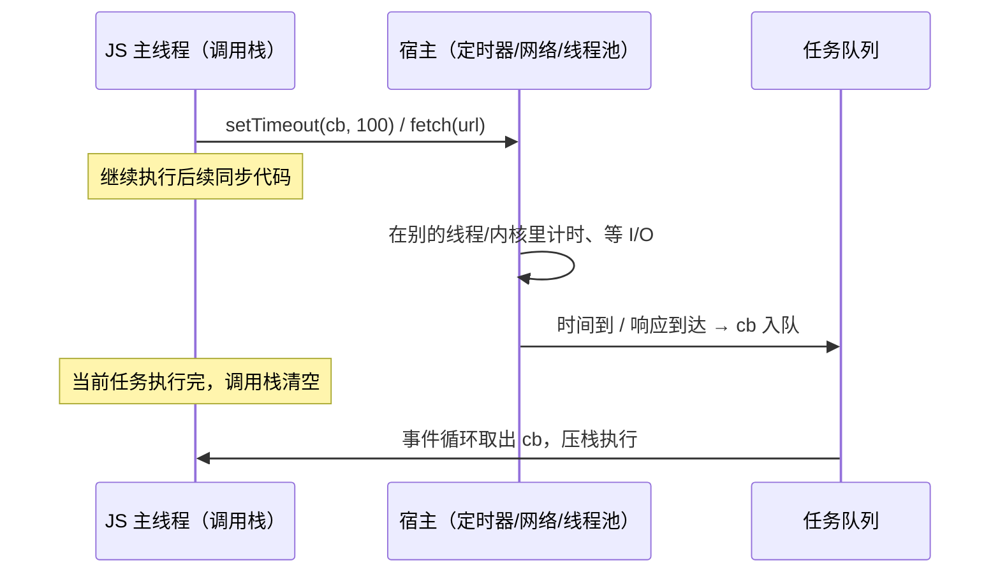
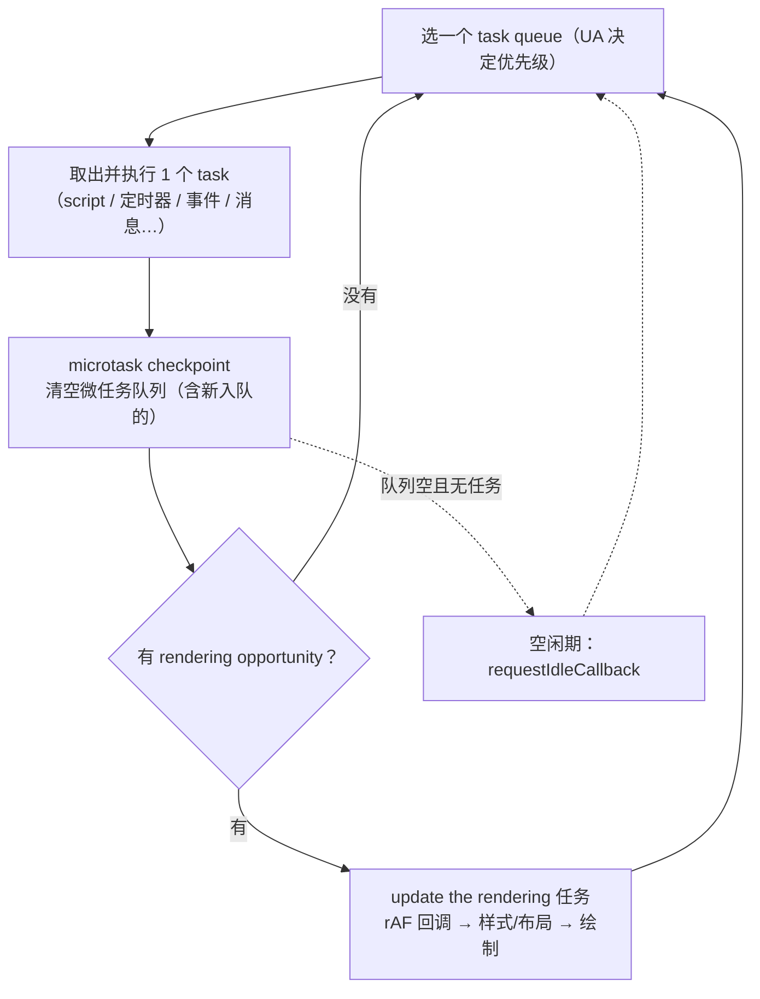
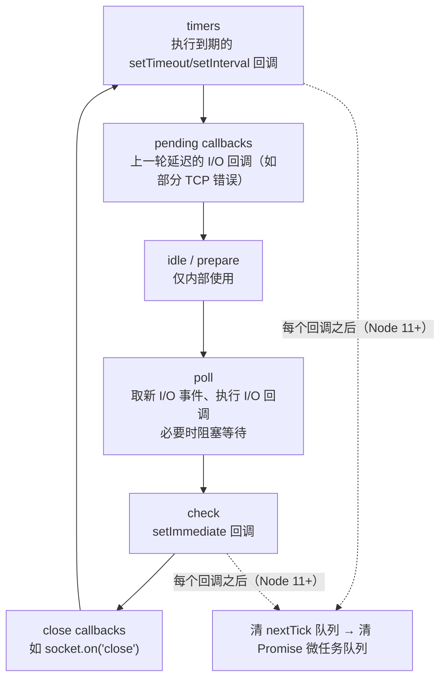

# 事件循环：浏览器与 Node 的异步调度

> 一句话概括：JavaScript 本身是单线程的，所谓「异步」是宿主环境（浏览器 / libuv）在别的线程或内核里完成等待、再把回调塞进队列；
> 事件循环就是「调用栈清空后，按什么规则从哪个队列取回调执行」的调度策略——浏览器按 HTML 规范「一轮一个 task + 清空微任务 + 可能渲染」，Node 按 libuv 六阶段循环，两者的差异与版本演进正是所有输出顺序题的根源。

预计阅读时间：大约 65 分钟

所属主题：[JavaScript 基础常见面试题总结](summary.md)

版本基线：规范以 **ECMAScript ES2025 + HTML Living Standard**（event loop 章节）为准；浏览器以当前稳定版 Chrome 为准，Node.js 以 **22/24 LTS**（libuv）为准。本文 Node 示例在本机 **Node v20.11.1** 实测（所涉行为与 22/24 一致），浏览器示例标注 browser 环境；Node 11 前后、libuv 1.45（Node 20）前后、ES2019 await 优化等版本差异单独注明。每个机制按「结论 → 机制 → 边界/代价 → 实践/追问」组织。

---

## 0. 阅读路线

| 读者 | 建议阅读 | 关注点 |
| --- | --- | --- |
| 初级（1 年内） | 1、2.1~2.3、4.1~4.2、5.1、9 | 单线程与异步的关系、宏任务/微任务是什么、会做基础输出题、setTimeout(0) 不是 0 |
| 中级（1~3 年） | 全部，重点 2.4、3、4.3~4.5、6.1~6.6、7 | 规范处理模型、渲染时机、then 返回 Promise 的额外 tick、libuv 六阶段、Node 11 分水岭 |
| 高级（3 年+） | 3.4、4.3、6.3~6.7、8 全部 | 长任务与 INP、thenable 同化的规范细节、libuv 1.45 定时器位置变化、饿死与排查 |
| 选型/架构 | 5.2~5.3、7、8.3~8.4 | 定时器节流对业务的影响、跨环境调度一致性、长任务拆分方案与 React/Vue 的调度选择 |

目录：

1. 为什么需要事件循环：单线程 JS 与多线程宿主
2. 浏览器事件循环处理模型（HTML spec）
3. 渲染时机：rAF、rIC 与长任务
4. 输出题方法论与经典题精讲
5. setTimeout 细节：钳制、节流与漂移
6. Node 事件循环（libuv）
7. 浏览器 vs Node 对比总表
8. 边界与实践：饿死、长任务拆分与框架调度
9. 高频追问集
10. 参考资料

---

## 1. 为什么需要事件循环：单线程 JS 与多线程宿主

### 1.1 JS 为什么是单线程

**结论**：JavaScript 的**执行**是单线程的——同一时刻只有一个调用栈在跑你的代码；但「等待」这件事被外包给了宿主环境，事件循环负责把等待的结果（回调）接回这个唯一的线程。

单线程不是缺陷而是设计：JS 诞生就是为了操作 DOM，如果多个线程同时改同一棵 DOM 树，就需要复杂的锁与同步，浏览器选择「一条主线程 + 队列」来回避这个问题。代价是：**任何一段同步代码执行期间，其他一切（定时器回调、点击事件、渲染）都得排队**。

调用栈、执行上下文与作用域链的机制见 [执行上下文与作用域](scope-closures-and-execution-context.md)，本文只强调一点：事件循环取出的每个回调，都是在调用栈上**新建一个执行上下文**从头执行——回调不是「插进」你当前代码中间，而是等你彻底跑完。

### 1.2 宿主是多线程的

**机制**：以 Chrome 为例，一个标签页对应一个渲染进程，里面除了 JS 主线程，还有定时器调度、网络、合成与光栅化等线程/任务通道；Node 则靠 libuv 把 I/O 交给操作系统异步机制（epoll/kqueue/IOCP）或内部线程池。

| 宿主 | 「等待」由谁做 | 说明 |
| --- | --- | --- |
| 浏览器 | 定时器调度（概念上的「定时器线程」） | `setTimeout` 的计时不在 JS 线程；Chrome 实际实现是渲染进程内的调度器与任务队列，「定时器线程」是便于理解的概念模型 |
| 浏览器 | 网络线程 | fetch/XHR 的请求与响应接收；完成后把回调任务入队 |
| 浏览器 | 事件触发线程 | 点击、滚动等 UI 事件发生时，把事件处理任务入队 |
| 浏览器 | 合成/光栅化线程 | 绘制合成不占用 JS 主线程（但样式计算、布局在主线程） |
| Node | OS 异步 I/O（epoll/kqueue/IOCP） | 网络 socket 等非阻塞 I/O，由事件通知机制驱动 poll 阶段 |
| Node | libuv 线程池（默认 4 线程，`UV_THREADPOOL_SIZE` 可调） | `fs`、`dns.lookup`、部分 crypto/zlib 等无法非阻塞化的操作在线程池执行 |

### 1.3 异步的完整链路：宿主执行 → 回调入队 → 栈空取任务



**结论**：异步 API 的「异步」只发生在**等待阶段**；回调本身永远回到主线程同步执行。所以 `setTimeout(fn, 100)` 的语义是「**至少** 100ms 后，**且主线程有空时**才执行 fn」，不是「100ms 后准时执行」。

### 1.4 边界与追问

- **单线程 ≠ 没有并行**：Web Worker / Node `worker_threads` 可以开真正的并行线程，但它们各有自己的事件循环与堆，不共享 JS 对象（只能传消息或 SharedArrayBuffer）。「JS 单线程」指的是**每个执行环境内**单线程。
- **run-to-completion**：一个任务一旦开始执行就会跑完，不会被其他任务打断（没有抢占）。这既是「输出题可以逐步推演」的前提，也是长任务会卡死页面的原因（见 3.4）。

**追问：为什么回调不能立刻执行，非要等调用栈清空？**
期望答案：JS 没有抢占式调度，回调执行需要新建执行上下文压栈；若允许打断当前代码，共享状态会在任意指令间被改写，单线程的简单性就不存在了。队列 + 栈空检查是用「延迟」换「确定性」。

---

## 2. 浏览器事件循环处理模型（HTML spec）

### 2.1 一轮循环 = 一个 task → 清空微任务 → 可能渲染

**结论**：HTML Living Standard 的「event loop processing model」规定，一轮循环**只取一个 task（俗称宏任务）执行，随后执行 microtask checkpoint 清空微任务队列，渲染更新则不一定发生**。

规范步骤（简化转述，锚点见参考资料）：

1. 若存在含 runnable task 的 task queue，**以实现自定义的方式**选一个队列（微任务队列不是 task queue，不会被选中）；
2. 取出该队列的**第一个** runnable task 并执行它的 steps；
3. **Perform a microtask checkpoint**（清空微任务队列，包括清空过程中新入队的）；
4. 上报长任务（report long tasks，见 3.4）；
5. 无任务可跑时进入空闲期（requestIdleCallback 的机会）；
6. 渲染另走一条线：当某个 navigable 出现 **rendering opportunity** 时，在 **rendering task source** 上入队一个「update the rendering」任务（见第 3 章）。



**关键细节**：「取一个 task」的粒度是**一个回调**，不是一批。两个到期的 `setTimeout` 回调是两个 task，中间隔着一次完整的微任务清空——这正是输出题的骨架。

### 2.2 task（宏任务）来源表

规范里每个 task 都归属一个 **task source**，同源任务进同一个队列、保证 FIFO；不同源队列之间的取舍由 UA 决定（例如可以让用户输入任务优先，避免界面饿死）。

| 来源 | task source | 备注 |
| --- | --- | --- |
| 整段 `<script>` 执行 | 脚本执行相关任务 | 经典脚本的求值本身就是一个 task；模块求值见 6.7 的 Node 对照 |
| `setTimeout` / `setInterval` 回调 | timer task source | 到期后入队，见第 5 章的钳制与节流 |
| fetch / XHR 完成回调 | networking task source | 网络等待在网络线程，回调入主线程队列 |
| UI 事件（click、keydown…） | DOM manipulation / user interaction task source | 每次事件派发是一个 task |
| `postMessage` / `MessageChannel` | posted message task source | 无 4ms 钳制，常用于调度（见 8.3） |
| `setImmediate` | **浏览器没有此 API** | 仅 Node（与已废弃的 IE 私有实现） |

### 2.3 microtask 来源表

| 来源 | 入队时机 | 备注 |
| --- | --- | --- |
| `Promise.then/catch/finally` 反应 | promise settled 时入队 `PromiseReactionJob` | 已 settled 的 promise 调 `.then` 也会**立即入队**（不是同步执行） |
| `await` 之后的续体 | 被 await 的 promise settled 后 | ES2019 优化后原生 promise 只需 1 个 tick，见 4.2 |
| `queueMicrotask(fn)` | 调用时立即入队 | 跨环境语义一致，见第 7 章 |
| `MutationObserver` 回调 | DOM 变更后的 microtask checkpoint | 批量合并一次回调，不是每次变更一个 |

**机制**：每个事件循环只有**一个** microtask queue（ECMA-262 的 Job Queue 由宿主实现承载，HTML 将其实现为微任务队列）。checkpoint 的语义是「**一直取队头执行，直到队列为空**」——微任务里再入队的微任务，会在**同一次** checkpoint 里继续执行，不会等到下一个 task。这是微任务能饿死渲染与宏任务的根源（见 8.1）。

### 2.4 术语与边界：「宏任务」不是规范词

- 规范只有 **task** 与 **microtask**；「宏任务（macrotask）」是社区对 task 的俗称，面试可用，但要知道规范锚点。
- **microtask checkpoint 不止发生在 task 结束时**：只要 JS 执行上下文栈清空（例如一个事件监听器回调返回后、一次 `click()` 同步派发返回后），就会执行 checkpoint。所以同一个 task 内多个回调之间也会插微任务，不必等整个 task 结束。
- Promise 构造器的 executor 是**同步执行**的，`new Promise(...)` 本身不入队任何任务；入队的是后续 `.then` 注册的反应。Promise 内部机制详见 [Promise 与 async/await](promise-and-async-await.md)。

**追问：微任务一定在整个宏任务结束后才执行吗？**
期望答案：不一定。checkpoint 在「task 执行完」和「调用栈清空」时都会触发；一个 task 里若有多次栈清空（如逐个派发事件监听器），微任务会穿插其间。但**微任务执行期间不会被 task 打断**，这一点始终成立。

---

## 3. 渲染时机：rAF、rIC 与长任务

### 3.1 渲染不是每轮都发生

**结论**：「update the rendering」是 rendering task source 上的一个普通 task，只在浏览器认为有 **rendering opportunity**（通常对齐显示器刷新率）时才入队；60Hz 屏幕约每 16.67ms 一次，**不是每轮事件循环都渲染**。

规范给了 UA 明确的跳过自由（「Unnecessary rendering」步骤）：没有可见变化、没有待执行的 rAF 回调、页面 hidden、或 UA 出于其他原因（例如**把多个定时器回调合并执行、中间不插渲染**）都可以跳过。这解释了两件事：

- 一个 task 里改 1000 次 DOM，只会渲染最终状态一次——中间态用户看不到；
- 高频 `setTimeout` 回调之间**不保证**有渲染帧，别用「每轮循环渲染一次」做动画假设。

### 3.2 requestAnimationFrame：渲染前、微任务后

**机制**：rAF 回调在「update the rendering」任务内部执行，位置在**样式计算、布局、绘制之前**（规范步骤：resize/scroll → 媒体查询 → 动画事件 → **run the animation frame callbacks** → ResizeObserver/样式布局 → 绘制）。因此：

- rAF 回调里改 DOM，会体现在**本帧**；rAF 回调里再注册的 rAF，要等**下一帧**；
- 微任务 checkpoint 先于渲染任务，所以**同一轮里 Promise.then 一定先于 rAF 回调**；
- rAF 回调属于渲染任务，它执行完后照常清微任务；rAF 与 `setTimeout` 回调的先后**没有保证**（取决于渲染机会何时到来）。

```js
// browser（Chrome 当前稳定版）
const box = document.querySelector('#box');
box.style.width = '100px';                       // 同步改 DOM，尚未渲染
Promise.resolve().then(() => {
  console.log('microtask：DOM 已改，但还没渲染');  // 先执行
});
requestAnimationFrame(() => {
  console.log('rAF：本帧绘制前，可读布局', box.getBoundingClientRect().width);
});
// 输出顺序：microtask 一定在 rAF 前；rAF 与页面其他 task 的相对顺序不保证
```

**实践**：动画用 rAF 而不是 `setTimeout(fn, 16)`——rAF 与刷新率对齐（120Hz 屏自动 8.3ms 一帧）、后台标签页自动暂停省电、浏览器可合并优化。`setTimeout` 的 16ms 与屏幕刷新不同步，会丢帧/抖动。

### 3.3 requestIdleCallback：空闲期捡时间

**机制**：事件循环无任务可跑时进入空闲期，rIC 回调拿到一个 `deadline`。规范规定 deadline 取三者最小值：

| 上限 | 值 | 意图 |
| --- | --- | --- |
| 空闲期起点 + 50ms | 50ms 封顶 | 保证对新用户输入的响应（人类感知阈值） |
| 下一个到期定时器的时间 | 动态 | 不挡住定时器 |
| 下一次渲染机会（60Hz 时约 16.67ms 后） | 动态 | 不掉帧 |

**边界**：空闲期可能**永远不来**（页面一直忙），rIC 回调可能长期不执行，可用 `{ timeout }` 兜底强制执行；**Safari 至今不支持 rIC**（截至本文撰写，跨浏览器方案需降级到 `setTimeout`/`MessageChannel`）。rIC 里不要做 DOM 写操作——它跑在帧末，改 DOM 会引发下一帧的额外样式/布局计算。

### 3.4 长任务（>50ms）：渲染与交互的敌人

**结论**：单个 task 执行超过 **50ms** 即为长任务（规范 processing model 里的「report long tasks」步骤，阈值 50ms 来自 RAIL 模型对人类感知的划分）。长任务期间主线程被独占：**渲染停帧、点击/键盘事件排队**，直接恶化 INP（Interaction to Next Paint，2024 年 3 月起取代 FID 成为 Core Web Vitals 指标）。

帧预算账本（60Hz）：

| 项目 | 预算 |
| --- | --- |
| 一帧总时长 | ≈16.67ms |
| JS + 样式 + 布局 + 绘制 + 合成 | 全部塞进这 16.67ms |
| 留给 JS 的经验值 | ≤10ms（其余给渲染管线） |
| 长任务判定线 | 50ms（约 3 帧） |

```js
// browser：用 PerformanceObserver 抓长任务（Chrome）
new PerformanceObserver(list => {
  for (const entry of list.getEntries()) {
    console.warn('长任务:', entry.duration.toFixed(1), 'ms', entry.attribution);
  }
}).observe({ type: 'longtask', buffered: true });
```

**实践/排查**：Chrome DevTools Performance 面板里红色三角标记的 Long Task 就是它；优化方向是「拆分 + 让出主线程」，方案对比见 8.3。

**追问：为什么微任务执行久了也算长任务？**
期望答案：microtask checkpoint 发生在 task 执行过程中/结束时，微任务里跑的仍是主线程同步代码；一个几百毫秒的微任务风暴同样独占主线程、阻塞渲染，且比宏任务更糟——它连「下一个 task」的机会都不给（见 8.1）。

---

## 4. 输出题方法论与经典题精讲

### 4.1 三步推演法

所有输出题都用同一套算法推演，不要背答案：

1. **同步阶段**：把当前 task（整段脚本）从头跑到尾，记录输出；遇到异步 API 只登记「谁在什么条件下入哪个队」；
2. **微任务阶段**：调用栈清空 → 清空微任务队列，**执行中新入队的微任务继续在本轮执行**，直到队列空；
3. **下一个 task**：取下一个宏任务，回到第 1 步。Node 环境在微任务前多一步「清空 nextTick 队列」（见 6.4）。

两条展开规则（ES2019 语义）：

- **`await x` 右侧同步求值**：`await fn()` 会先同步调用 `fn()`；`await` 只把**其后的代码**变成微任务续体。await 原生 Promise 时，续体在该 promise settled 后 **1 个 tick** 入队执行；
- **Promise 构造器同步执行**：executor 立即跑，`resolve()` 只是把 promise 置为 fulfilled；`.then` 回调在 settled 时入队微任务。

### 4.2 题一：async/await + Promise + setTimeout（browser / Node 12+ 通用）

```js
async function async1() {
  console.log('async1 start');
  await async2();
  console.log('async1 end');
}
async function async2() {
  console.log('async2');
}
console.log('script start');
setTimeout(() => console.log('setTimeout'), 0);
async1();
new Promise(resolve => {
  console.log('promise1');
  resolve();
}).then(() => console.log('promise2'));
console.log('script end');
```

逐步推演（J = 微任务，T = 定时器任务）：

| 步 | 动作 | 输出 | 微任务队列 | 宏任务队列 |
| --- | --- | --- | --- | --- |
| 1 | `console.log('script start')` | script start | [] | [] |
| 2 | `setTimeout` 登记 T1 | — | [] | [T1] |
| 3 | `async1()`：打印后调 `async2()`（同步） | async1 start、async2 | [] | [T1] |
| 4 | `await` 已 fulfilled 的 async2 返回 promise → 续体 J1 入队 | — | [J1] | [T1] |
| 5 | executor 同步执行，`resolve()` 后 `.then` 登记 J2 | promise1 | [J1, J2] | [T1] |
| 6 | `console.log('script end')`，脚本 task 结束 | script end | [J1, J2] | [T1] |
| 7 | checkpoint：J1 恢复 async1 | async1 end | [J2] | [T1] |
| 8 | checkpoint：J2 | promise2 | [] | [T1] |
| 9 | 下一个 task：T1 | setTimeout | [] | [] |

**答案**：`script start → async1 start → async2 → promise1 → script end → async1 end → promise2 → setTimeout`（Node v20.11.1 实测一致）。

**版本注（高频考点）**：`async1 end` 先于 `promise2` 是 **ES2019 await 优化**后的结果（tc39/ecma262#1250，V8 7.2 / Chrome 72 / Node 12 起默认）。优化前每个 `await` 要创建 2 个额外 promise、至少 **3 个微任务 tick**，老引擎（如 Node 10）上 `promise2` 会先于 `async1 end` 输出。优化后 await 原生 Promise 只需 **1 个 tick**，且入队时机（步骤 4）早于 `.then`（步骤 5），所以排在前面。面试答出「1 tick vs 3 tick 的版本分水岭」是明显加分项。

### 4.3 题二：then 返回 Promise 的额外 tick（browser / Node 通用）

```js
Promise.resolve().then(() => {
  console.log(0);
  return Promise.resolve(4);
}).then(res => console.log(res));

Promise.resolve().then(() => console.log(1))
  .then(() => console.log(2))
  .then(() => console.log(3))
  .then(() => console.log(5))
  .then(() => console.log(6));
```

**答案**：`0 1 2 3 4 5 6`（Node v20.11.1 实测一致）。很多人直觉是 `0 4 1 2 3 5 6`，错在忽略了「then 回调返回 promise」的**同化（assimilation）成本**。

**机制**：then 回调返回一个 thenable 时，外层 promise 不能立刻 fulfilled，规范要经过 `NewPromiseResolveThenableJob`（调用 `returned.then(resolve, reject)`）再触发一次 `PromiseReactionJob` 才能真正 resolve——**凭空多出 2 个微任务 tick**。

逐步推演（T1 = 打印 0 的回调，U1~U5 = 打印 1/2/3/5/6 的链，J1/J2 = 同化产生的两个 job，T2 = 打印 res 的回调）：

| 步 | 执行 | 输出 | 执行后微任务队列 |
| --- | --- | --- | --- |
| 0 | 同步注册两条链 | — | [T1, U1] |
| 1 | T1：打印 0，返回 Promise.resolve(4) → 入队同化 job J1 | 0 | [U1, J1] |
| 2 | U1：打印 1，返回 undefined → 立即 resolve → U2 入队 | 1 | [J1, U2] |
| 3 | J1：调用 `P4.then(resolveA)` → P4 已 fulfilled → J2 入队 | — | [U2, J2] |
| 4 | U2：打印 2 → U3 入队 | 2 | [J2, U3] |
| 5 | J2：resolveA(4) → 外层 promise fulfilled → T2 入队 | — | [U3, T2] |
| 6 | U3：打印 3 → U4 入队 | 3 | [T2, U4] |
| 7 | T2：打印 res | 4 | [U4] |
| 8 | U4：打印 5 → U5 入队 | 5 | [U5] |
| 9 | U5：打印 6 | 6 | [] |

**边界**：返回**非 thenable 值**（如 `return 4`）没有这 2 个 tick，直接 resolve；返回**自定义 thenable**（非原生 Promise）同样走同化路径。规范锚点：ECMA-262 `NewPromiseResolveThenableJob`、`PromiseReactionJob`。

### 4.4 题三：Node 四队列混合（Node 11+，CJS）

```js
// Node 22/24（本机 v20.11.1 实测）
setTimeout(() => console.log('timeout'), 0);
setImmediate(() => console.log('immediate'));
Promise.resolve().then(() => console.log('promise'));
process.nextTick(() => console.log('nextTick'));
console.log('sync');
```

| 步 | 动作 | 输出 | nextTick 队列 | 微任务队列 |
| --- | --- | --- | --- | --- |
| 1 | 登记 timeout（timers）、immediate（check） | — | [] | [] |
| 2 | `.then` 登记反应；`nextTick` 登记回调 | — | [nextTick] | [promise] |
| 3 | 同步打印，主模块操作结束 | sync | [nextTick] | [promise] |
| 4 | 先清 nextTick 队列 | nextTick | [] | [promise] |
| 5 | 再清微任务队列 | promise | [] | [] |
| 6 | 进入事件循环：timers 与 check 的先后**不确定** | timeout / immediate | — | — |

**答案**：`sync → nextTick → promise → {timeout, immediate}（后两者顺序不保证）`。本机实测 5 次均为 timeout 先，但规范与官方文档明确这是**非确定性**的，原因见 6.6。

**ESM 变体（版本无关，模块机制差异）**：同样代码放进 `.mjs`，顶层输出变为 `sync → promise → nextTick → …`——ES 模块的求值本身被包在一个 promise job 里，顶层登记的 nextTick 要等当前微任务处理完才轮到。官方文档给出的对照例（`start bar foo zoo baz`）已在本机 `--input-type=module` 复现。模块加载机制见 [CommonJS 与 ESM](modules-commonjs-and-esm.md)。

### 4.5 易错点清单

| 易错点 | 正确理解 |
| --- | --- |
| `await 42` 不产生微任务 | 错。非 promise 值会被 `PromiseResolve` 包成已 fulfilled 的 promise，续体仍入队，**同样让出 1 个 tick** |
| `await` 后面的代码「同步执行」 | 错。只有 await **右侧表达式**同步求值，续体是微任务 |
| `.then` 注册时回调就入队 | 不一定。promise 还 pending 时只登记反应，**settled 那一刻**才入队 |
| 微任务里入队的微任务等下一轮 | 错。同一次 checkpoint 内继续执行，直到队列空 |
| `setTimeout(fn, 0)` 立即执行 | 错。它是下一个（或更后的）task，且受钳制/节流，见第 5 章 |
| Node 输出题直接套浏览器规则 | Node 多一个 nextTick 队列且优先级更高；Node 11 前后微任务清空时机不同，见 6.5 |

---

## 5. setTimeout 细节：钳制、节流与漂移

### 5.1 0ms 不是 0：规范钳制与宿主下限

**结论**：`setTimeout(fn, 0)` 的实际延迟 = **宿主下限 + 排队等待**，永远不是 0。

| 环境 | 下限规则 | 依据 |
| --- | --- | --- |
| 浏览器 | **嵌套层级 > 5 且 timeout < 4 时，钳到 4ms** | HTML spec timers 章节原文：「If nestingLevel is greater than 5, and timeout is less than 4, then set timeout to 4」 |
| 浏览器 | 嵌套层级对 `setTimeout` 与 `setInterval` **合并计数** | 规范 note：nesting level 统计的是该算法的嵌套调用，不区分具体方法 |
| Node | delay < 1（或 NaN、> 2147483647）时置为 **1ms**，**没有 4ms 嵌套钳制** | Node timers 文档；本机实测 `setTimeout(0)` ≈1.6ms，8 层嵌套共 ≈10.9ms（每层 ≈1.3ms） |

「嵌套层级」指**在定时器回调里再注册定时器**的层数：页面顶层注册的前 5 层不受 4ms 钳制，第 6 层起每层至少 4ms。所以用 `setTimeout` 递归做高频轮询，频率上限实际是 ~250 次/秒而不是 1000 次/秒。

**边界**：下限只是「最早可入队时间」，主线程被长任务占着时，实际执行可以晚得多——定时器给的是 **threshold（阈值）不是 guarantee（保证）**，Node 官方文档对此有明确措辞。

### 5.2 后台标签页节流（Chrome）

**结论**：页面隐藏后，Chrome 会大幅降低定时器的检查频率——这是浏览器省电策略，不是 bug，**依赖后台定时器的业务（倒计时、轮询、心跳）必须考虑**。

| 阶段 | 触发条件 | 定时器检查频率 |
| --- | --- | --- |
| 正常 | 页面可见 | 不节流（仍有 4ms 嵌套钳制） |
| Throttling | 页面 hidden（<5 分钟）等常规后台条件 | **每秒检查一次**（≈1000ms 粒度，相近定时器被批量合并） |
| Intensive throttling（Chrome 88，2021-01 起） | hidden **超过 5 分钟** + 链式计数 ≥5 + 静音 ≥30s + 无 WebRTC | **每分钟检查一次** |

豁免情形：播放声音的页面、WebRTC 活跃连接等可免于深度节流。HTML spec 本身允许 UA 做这类钳制，1000ms/60s 的具体数值是 Chrome 的实现策略（其他浏览器类似但不完全相同）。

**实践**：后台仍需精确计时的场景，用 Web Worker 里的定时器（不受页面节流同等约束）、`visibilitychange` 时校准时间戳（用 `Date.now()` 差值而不是累加 tick），或服务端对时。

### 5.3 setInterval 的漂移与「递归 setTimeout」替代

**机制**：`setInterval(fn, 1000)` 按**固定节拍**把回调入队，不管上一次是否执行完：

- 回调耗时 300ms → 实际间隔被压缩，长期看节拍漂移；
- 主线程被长任务阻塞 → 错过的节拍**不会补齐**，可能连续跳过或背靠背执行；
- 后台节流下，间隔完全失真。

**替代方案**：递归 `setTimeout`——本次**执行完**再计时下一次，间隔语义变成「两次执行之间至少歇 1000ms」，永不重叠：

```js
// browser / Node 通用：自适应轮询
function poll() {
  doWork();                    // 耗时不可控
  setTimeout(poll, 1000);      // 做完才计时，间隔 = 工作耗时 + 1000ms
}
setTimeout(poll, 1000);
```

| 维度 | setInterval | 递归 setTimeout |
| --- | --- | --- |
| 节拍 | 固定频率（可能漂移/跳拍） | 上次完成后固定延迟 |
| 重叠风险 | 回调慢时可能堆积 | 永不重叠 |
| 取消 | `clearInterval(id)` | 不再注册即停止（或 `clearTimeout`） |
| 适用 | 对绝对频率有要求且回调极短 | 轮询、动画外的周期任务（默认推荐） |

### 5.4 回调里的 this

`setTimeout` 回调以普通函数调用执行：浏览器非严格模式下 `this` 是 `window`（严格模式 `undefined`），Node 中是 `Timeout` 对象——**不是**注册时的上下文。需要绑定用箭头函数或 `bind`，机制见 [this 绑定与函数调用](this-binding-and-function-call.md)。

**追问：为什么嵌套 5 层后才钳 4ms，而不是所有 setTimeout 都钳？**
期望答案：历史妥协——早期网页用 `setTimeout(fn, 0)` 做动画/让出主线程，一刀切 4ms 会拖慢正常用法；嵌套调用才是「拿定时器当高频循环」的滥用模式，规范只钳它。答出「规范原文 + 设计动机」即可。

---

## 6. Node 事件循环（libuv）

### 6.1 六阶段循环

**结论**：Node 的事件循环由 libuv 驱动（`uv_run`，源码 `libuv/src/unix/core.c`），每一轮（tick）按固定顺序经过六个阶段，每个阶段有自己的回调队列。



> 注：此图为经典环表示；libuv 1.45（Node 20）起每轮从 pending callbacks 开始，timers 移至 close callbacks 之后、同轮末尾执行（见 6.3）。

| 阶段 | 执行什么 | 备注 |
| --- | --- | --- |
| timers | 到期的 `setTimeout`/`setInterval` 回调 | 阈值语义，可能因 poll 阻塞而晚执行 |
| pending callbacks | 被推迟到下一轮的 I/O 回调 | 如某些系统上的 `ECONNREFUSED` TCP 错误 |
| idle / prepare | 仅 libuv/Node 内部使用 | 每轮都经过 |
| poll | 计算阻塞时长 → 处理 I/O 事件队列 | 绝大多数 I/O 回调在这里；见 6.2 |
| check | `setImmediate` 回调 | 设计语义：poll 结束后立即执行 |
| close callbacks | 关闭类回调 | 如 `socket.destroy()` 后的 `'close'` 事件 |

循环退出条件：没有待处理的异步 I/O 与定时器时，Node 干净退出（这就是空脚本立刻结束、而 `server.listen` 让进程常驻的原因）。

### 6.2 poll 阶段：阻塞等待与「防饿死」

**机制**（官方文档口径）：进入 poll 时——

- 队列**非空**：同步逐个执行回调，直到队列清空或达到系统相关的硬上限（防止 I/O 风暴饿死其他阶段）；
- 队列**空**且**有 setImmediate 待执行**：立刻结束 poll，进入 check；
- 队列**空**且**没有 setImmediate**：**阻塞等待**新 I/O 事件（这就是 Node 空闲时 CPU 为 0 的原因）；
- 阻塞时长会参考最近的到期定时器：poll 不会睡过下一个 timer 的阈值。

**边界**：poll 里一个慢回调可以把整个循环拖住——官方例子：100ms 的定时器 + poll 里 95ms 的 I/O 等待 + 10ms 回调，定时器实际延迟 105ms。「timers 阶段何时执行，技术上由 poll 阶段控制」。

### 6.3 版本注：libuv 1.45（Node 20）起 timers 移到 poll 之后

**结论**：**libuv 1.45.0（Node.js 20）起，每轮循环中 timers 在 poll 阶段之后运行**；更早版本 timers 在 poll 之前。为向后兼容，进入事件循环前仍会先跑一次 timers。

这是官方 event loop 文档明确标注的变化。对本文基线（Node 22/24）而言，分析 `setTimeout` vs `setImmediate` 时要按新顺序推演；网上大量旧教程的「timers → … → poll」图是 Node 18 及以前的口径。六阶段的**名称与相对顺序**不变，变的是 timers 在一轮中的切入点。

### 6.4 Node 的两个「加塞」队列：nextTick 与微任务

**结论**：Node 在 libuv 阶段之外维护两个高优先级队列，处理顺序是 **nextTick 队列 → Promise 微任务队列**，时机是「**当前操作完成后、事件循环继续前**」，与当前处于哪个阶段无关。

| 队列 | 归属 | 入队 API | 优先级 |
| --- | --- | --- | --- |
| nextTick queue | **Node 私有**，不属于 libuv | `process.nextTick` | 最高：先于 Promise 微任务 |
| microtask queue | V8 Job Queue 的宿主实现 | `Promise.then`、`queueMicrotask` | 次之：先于任何阶段回调 |

**源码锚点**（Node 22/24 源码）：

- `lib/internal/process/task_queues.js`：`processTicksAndRejections`——先循环清空 nextTick 队列，再 `runMicrotasks()`；
- `src/api/callback.cc`：`InternalCallbackScope::Close()`——每次 C++→JS 回调收尾时调用 `context->GetMicrotaskQueue()->PerformCheckpoint(isolate)` 并触发 tick 回调（即上面的 JS 函数）。这是「每个回调后清队列」的 C++ 侧落点。

**边界**：`process.nextTick` 的语义是「当前操作一结束就执行」，比 `setImmediate`（下一轮 check）更急——官方文档直言这两个 API 的名字**起反了**，并推荐优先用 `setImmediate`，因为 nextTick 的递归会饿死 I/O（见 8.2）。

### 6.5 Node 11 分水岭：微任务从「阶段间」改为「每个回调后」

**结论**：**Node 11.0.0 起，nextTick 与微任务在每个 timer/immediate 回调之后立即清空**（对齐浏览器「每个 task 后 checkpoint」）；**Node ≤10 是在阶段切换（C++/JS 边界）时才清**，一个阶段内的多个回调会连着跑完。

依据：Node v11.0.0 官方 release notes「Timers: nextTick queue will be run after each immediate and timer. #22842」；同版本还实验性加入了 `queueMicrotask()`（#22951）。

```js
// Node 11+（本机 v20.11.1 实测）
setTimeout(() => {
  console.log('timeout1');
  Promise.resolve().then(() => console.log('promise1'));
}, 0);
setTimeout(() => {
  console.log('timeout2');
  Promise.resolve().then(() => console.log('promise2'));
}, 0);
```

| 版本 | 输出 | 原因 |
| --- | --- | --- |
| Node ≤10 | `timeout1 timeout2 promise1 promise2` | timers 阶段把两个到期回调连着跑完，阶段结束才清微任务 |
| Node 11+（含 12/20/22/24） | `timeout1 promise1 timeout2 promise2` | 每个 timer 回调后立刻清 nextTick + 微任务，与浏览器一致 |

（Node ≤10 的输出引自官方 PR/release notes 与社区复现记录，本机无旧版本运行时，未实测。）

**实践**：这个变化让「浏览器写的异步逻辑搬到 Node」行为一致，但也可能破坏依赖旧行为的代码——Node 10 → 12 LTS 升级指南把它列为需要注意的行为差异。面试答版本归属时务必说「**11 引入、12 LTS 普及**」，不要说成 12 才有。

### 6.6 setImmediate vs setTimeout(fn, 0)：何时确定、何时不确定

**结论**：

- **主模块（非 I/O 回调）中**：两者顺序**不确定**，官方文档明确「bound by the performance of the process」；
- **I/O 回调内**（如 `fs.readFile` 回调）：`setImmediate` **一定先**于 `setTimeout(fn, 0)`。

**机制**：Node 把 `setTimeout(fn, 0)` 置为 1ms。主模块执行完进入循环时，若已耗时 ≥1ms，定时器已到期，timers 先跑；若 <1ms，定时器未到期，循环走到 check 先跑 immediate——取决于进程启动耗时，所以不确定（本机实测 5 次均 timeout 先，但这不构成保证）。

I/O 回调内则完全确定：回调在 **poll** 阶段执行，此时注册 immediate（check）与 timer（timers）；poll 结束后**必然先到 check**，check/close 之后才轮到 timers（libuv 1.45 起 timers 就在同轮末尾，见 6.3）——无论哪个版本，immediate 都先于 timeout。

```js
// Node 22/24（本机 v20.11.1 实测）：I/O 回调内顺序确定
const fs = require('fs');
fs.readFile(__filename, () => {
  setTimeout(() => console.log('timeout'), 0);
  setImmediate(() => console.log('immediate'));
});
// 输出恒为：immediate → timeout
```

**追问：为什么官方推荐 setImmediate 而不是 setTimeout(0)？**
期望答案：语义清晰（「当前 poll 结束后执行」）、在 I/O 回调内顺序确定、不受定时器阈值/钳制影响；`setTimeout(0)` 的「0」在两个环境里都不是 0，且顺序依赖运行时性能。

### 6.7 ESM 顶层的队列顺序反转

`.mjs` 顶层代码的求值被模块加载器包在 promise job 里执行，因此顶层注册的 `process.nextTick` 回调要等**当前微任务 checkpoint 继续清完**才处理，出现与 CJS 相反的顺序。官方对照例（本机 `node --input-type=module` 实测复现）：

```js
// .mjs（Node 22/24）
console.log('start');
setImmediate(() => console.log('baz'));
new Promise(r => r('bar')).then(v => {
  console.log(v);
  process.nextTick(() => console.log('zoo'));
});
process.nextTick(() => console.log('foo'));
// 输出：start → bar → foo → zoo → baz（CJS 中为 start → foo → bar → zoo → baz）
```

**边界**：这不是「nextTick 优先级变了」，而是**顶层代码本身所处的执行位置变了**（从「主模块操作」变成「微任务 job 内」）。写跨模块系统的初始化代码时不要依赖 nextTick 与 Promise 的相对顺序。

---

## 7. 浏览器 vs Node 对比总表

| 维度 | 浏览器（HTML Living Standard） | Node 22/24（libuv） |
| --- | --- | --- |
| 循环模型 | 一轮取**一个 task**，UA 决定队列优先级 | 六阶段固定顺序循环 |
| 微任务清空点 | 每个 task 后 + 调用栈清空时 | Node 11+：每个 timer/immediate 回调后 + 阶段间（≤10 仅阶段间） |
| 额外队列 | 无 | **nextTick 队列**，优先于 Promise 微任务 |
| `setImmediate` | 无 | check 阶段 |
| `setTimeout(0)` 下限 | 嵌套 >5 层钳 4ms | 1ms，无嵌套钳制 |
| 后台节流 | hidden 页 1s、深度节流 1min（Chrome） | 无（进程不区分前后台） |
| 渲染 | update the rendering / rAF / rIC | 无渲染概念 |
| I/O 回调 | networking 等 task source | poll 阶段（OS 异步）+ 线程池（fs/dns 等） |
| `queueMicrotask` | Chrome 71+ | Node 11+（#22951） |
| 长任务观测 | PerformanceObserver `longtask`、INP | 无内建指标，可用事件循环延迟监控 |

**queueMicrotask 的跨环境一致性**：两个环境中它都是「把一个回调直接入队微任务队列」，语义等价于 `Promise.resolve().then(fn)` 但**不创建 promise 对象**、开销更小，且异常走全局错误上报而不是变成 unhandled rejection。需要「当前同步代码结束后、下一个 task 前」执行的逻辑，跨环境首选它；**不要**在 Node 里用 `process.nextTick` 替代——它优先级更高且浏览器没有，会破坏同构代码的行为一致性。

---

## 8. 边界与实践：饿死、长任务拆分与框架调度

### 8.1 微任务无限递归：饿死渲染与一切宏任务

**结论**：微任务里不断入队新微任务，checkpoint 永远清不空，**渲染和所有宏任务（包括用户输入）永远得不到执行**——页面表现为彻底冻结，比等价的宏任务递归严重得多。

```js
// browser：危险示例，页面将冻结（勿在生产页面运行）
function microLoop() {
  Promise.resolve().then(microLoop);   // 每次 checkpoint 都产生新微任务
}
microLoop();
setTimeout(() => console.log('永远轮不到我'), 0);
// 对比：setTimeout 递归每轮之间仍有 checkpoint 与渲染机会，页面不会冻死
```

**机制对照**：宏任务递归（`setTimeout` 自调用）每执行一个 task 就让出一次主线程，渲染与输入可以插进来；微任务递归**不让出**，因为「清空微任务」本身就是当前 task 收尾的一部分。

**边界/代价**：长链微任务还会把回调闭包引用的作用域一直挂在队列上，延迟 GC 回收（见 [内存管理与 GC](memory-management-and-gc.md)）；真实事故形态通常是「状态更新触发订阅、订阅又触发状态更新」的微任务风暴，而不是教科书式的裸递归。

### 8.2 Node：nextTick 递归饿死 I/O

官方文档明确警告：递归 `process.nextTick` 可以「starve your I/O」——nextTick 队列在事件循环继续前被清空，递归入队让循环永远走不到 poll。

```js
// Node：危险示例，I/O 回调永远不执行
function tickLoop() { process.nextTick(tickLoop); }
tickLoop();
require('fs').readFile(__filename, () => console.log('永远轮不到我'));
// 改用 setImmediate 递归则安全：每轮 check 后循环照常推进，I/O 有机会执行
```

**实践**：Node 里「尽快但让出循环」的延迟操作用 `setImmediate`；`process.nextTick` 留给「必须在当前操作收尾、事件循环继续前完成」的窄场景（如构造函数里异步派发事件，让调用方先注册监听器）。

### 8.3 长任务拆分：让出主线程的方案选型

**结论**：把 >50ms 的工作切成小片、片间让出主线程，是治理 INP 的核心手段。让出方式有优劣之分：

| 方案 | 机制 | 优点 | 缺点 |
| --- | --- | --- | --- |
| `scheduler.yield()` | 让出后续体以**继承的优先级排到队首** | 不丢失任务优先级、不被无关任务插队；语义专为拆分设计 | Chrome 129+（2024-09）、Firefox 142+（2025-08）；**Safari 尚不支持**，需降级 |
| `MessageChannel` | port.postMessage 入队一个 posted message task | 无 4ms 钳制；后台标签页仍会触发；React Scheduler 的选择 | 续体排到队尾，可能被其他任务插队 |
| `setTimeout(fn, 0)` | timer task | 兼容性最好 | 嵌套 >5 层钳 4ms；后台节流到 1s/1min；续体排队尾 |
| `requestAnimationFrame` | 渲染任务内 | 与帧对齐 | 后台暂停、频率绑刷新率，不适合纯计算拆分 |
| `await Promise.resolve()` | **微任务** | 零延迟 | **不让出主线程**——渲染与输入仍被阻塞，拆分长任务时是错误选项 |

```js
// browser：官方推荐的降级写法（Chrome 129+ 原生，其余降级 setTimeout）
async function yieldToMain() {
  if ('scheduler' in window && 'yield' in window.scheduler) {
    return window.scheduler.yield();
  }
  return new Promise(resolve => setTimeout(resolve, 0));
}

async function processItems(items) {
  for (let i = 0; i < items.length; i++) {
    handle(items[i]);
    if (i % 100 === 99) await yieldToMain();   // 每 100 条让出一次
  }
}
```

**React Scheduler 为什么用 MessageChannel**：React 的时间切片（约 5ms 一片）需要一个「尽快执行、无钳制、后台也能跑」的宏任务通道。`setTimeout` 有 4ms 嵌套钳制且后台被节流；rAF 后台暂停且绑刷新率；`MessageChannel` 的 message 任务没有这些限制，于是成为 DOM 环境下的调度载体（Node/测试环境降级 `setImmediate`）。`scheduler.yield` 普及后，「续体优先级继承」比 MessageChannel 的队尾语义更适合框架调度，是明确的演进方向。

### 8.4 框架案例：Vue nextTick 为什么是微任务

**结论**：Vue 3 的 `nextTick` 与组件更新队列都挂在**微任务**上——源码 `packages/runtime-core/src/scheduler.ts`：

```ts
const resolvedPromise = Promise.resolve()
let currentFlushPromise = null
function queueFlush() {
  if (!currentFlushPromise) {
    currentFlushPromise = resolvedPromise.then(flushJobs)  // 微任务里批量刷新
  }
}
export function nextTick(fn) {
  const p = currentFlushPromise || resolvedPromise
  return fn ? p.then(fn) : p
}
```

**为什么选微任务**：同一个 tick 里多次修改响应式状态，`queueFlush` 只登记一次 flush——所有 DOM 更新在**当前同步代码结束后、下一次渲染前**批量完成，用户只看到一帧最终结果。若用宏任务（setTimeout），flush 前可能插入一次渲染，把中间态画出来（多一帧闪烁），且受 4ms 钳制/后台节流影响。这正是 2.3 节「微任务先于渲染」的工程兑现。

**边界**：微任务 flush 也意味着 `nextTick` 回调里再改状态会开启新一轮 flush（仍在渲染前），写「改状态 → nextTick 读 DOM」的代码是安全的；但别在 nextTick 里做重计算——它仍占主线程，计入长任务。

### 8.5 排查清单

| 症状 | 排查手段 |
| --- | --- |
| 页面掉帧/点击无响应 | Performance 面板找 Long Task（红三角）；`PerformanceObserver('longtask')` 线上采样；看 INP 归因 |
| 定时器「不准」 | 先排除后台节流（5.2）与长任务阻塞（5.1），再怀疑逻辑 |
| Node 请求延迟毛刺 | 事件循环延迟监控（定时 `setImmediate` 测漂移）；检查同步 fs、大 JSON 解析、nextTick/微任务风暴 |
| 输出顺序与预期不符 | 按 4.1 三步法重推；确认 Node 版本（11 分水岭）、CJS/ESM（6.7）、是否 I/O 回调内（6.6） |

---

## 9. 高频追问集

**Q1：为什么 Vue 的 nextTick 用微任务而不是宏任务？**
期望答案：DOM 更新要在「当前同步代码结束后、下一次渲染前」批量完成。微任务 checkpoint 先于渲染任务，同一 tick 的多次状态变更合并成一次 flush、一帧呈现；宏任务可能让中间态先渲染一帧，还受 4ms 钳制与后台节流影响。Vue 3 源码即 `resolvedPromise.then(flushJobs)`。

**Q2：Promise.then 和 setTimeout 谁先执行？**
期望答案：同一轮登记的两者，`.then` 先。脚本 task 结束即清微任务队列，`setTimeout` 回调是下一个 task；且浏览器中它至少是下一轮、Node 中还有 1ms 下限。本质是「微任务在当前 task 收尾时清空，宏任务要等下一轮调度」。

**Q3：async/await 和 Promise.then 的输出有什么差异？**
期望答案：ES2019 优化后 await 原生 Promise 只需 1 个微任务 tick，且续体入队时机在 await 表达式求值处——题一中 `async1 end` 先于后注册的 `promise2`。优化前（Node ≤10 / Chrome <72）await 要 3 个 tick，顺序相反。另外 then 回调**返回 promise** 会额外多 2 个 tick（thenable 同化），await 一个 pending promise 则没有这个问题。

**Q4：Node 里 setTimeout(fn, 0) 和 setImmediate 的顺序为什么不确定？**
期望答案：主模块中，0 被置为 1ms；进入事件循环时若已耗时 ≥1ms 则定时器到期、timers 先跑，否则 poll→check 先跑 immediate——取决于进程性能，官方明确非确定。I/O 回调内则确定 immediate 先：回调在 poll 执行，poll 后必到 check，check/close 之后才到 timers（1.45 起为同轮末尾）。

**Q5：微任务和宏任务各举三个。**
期望答案：微任务——Promise.then/catch/finally 反应、queueMicrotask、MutationObserver（await 续体也算）；宏任务——script 整体执行、setTimeout/setInterval 回调、UI 事件、postMessage/MessageChannel、I/O 回调（Node 另有 setImmediate）。注意「宏任务」是俗称，规范词是 task。

**Q6：微任务递归为什么能饿死渲染，宏任务递归不能？**
期望答案：checkpoint 语义是「清到队列空」，微任务里再入队微任务会无限延长当前 checkpoint，渲染任务与下一个 task 永远排不上；宏任务一次只取一个，每个之间都有 checkpoint 与渲染机会。Node 的 nextTick 递归同理饿死 I/O。

**Q7：动画为什么用 requestAnimationFrame 而不是 setTimeout(fn, 16)？**
期望答案：rAF 与显示器刷新率对齐（高刷屏自动适配）、后台标签页自动暂停、浏览器可合并优化；setTimeout 的 16ms 与刷新不同步会抖动，且受嵌套钳制与后台节流。rAF 回调在渲染任务内、样式布局之前执行，改 DOM 正好赶上本帧。

**Q8：Node 11 对事件循环改了什么？为什么重要？**
期望答案：nextTick 与微任务从「阶段切换时清空」改为「每个 timer/immediate 回调后清空」（PR #22842），对齐浏览器每个 task 后 checkpoint 的语义；同版本引入 queueMicrotask。重要性：同一段代码在 Node 10 与 11+ 输出不同（t1 t2 p1 p2 vs t1 p1 t2 p2），升级 LTS 时是明确的行为差异点。

---

## 10. 参考资料

**规范**

- HTML Living Standard · event loop processing model：<https://html.spec.whatwg.org/multipage/webappapis.html#event-loop-processing-model>（task 选取、microtask checkpoint、report long tasks、idle deadline 50ms、rendering opportunity 与 update the rendering 步骤）
- HTML Living Standard · timers：<https://html.spec.whatwg.org/multipage/timers-and-user-prompts.html#timers>（「If nestingLevel is greater than 5, and timeout is less than 4, then set timeout to 4」原文）
- ECMA-262 · Jobs 与 Job Queue：<https://tc39.es/ecma262/#sec-jobs>；`HostEnqueuePromiseJob`、`PromiseReactionJob`、`NewPromiseResolveThenableJob`、`Await` 各节
- tc39/ecma262 PR #1250（await tick 优化）：<https://github.com/tc39/ecma262/pull/1250>

**Node / libuv**

- Node.js 官方指南 · Event Loop, Timers, and nextTick：<https://nodejs.org/en/learn/asynchronous-work/event-loop-timers-and-nexttick>（六阶段、poll 阻塞、libuv 1.45/Node 20 timers 位置变化）
- Node.js 官方指南 · Understanding setImmediate：<https://nodejs.org/en/learn/asynchronous-work/understanding-setimmediate>（nextTick 队列优先于微任务、ESM 顺序对照例）
- Node.js v11.0.0 release notes：<https://nodejs.org/en/blog/release/v11.0.0>（「nextTick queue will be run after each immediate and timer. #22842」、queueMicrotask #22951）
- Node.js 10 LTS → 12 LTS 差异：<https://nodejs.org/en/blog/uncategorized/10-lts-to-12-lts>
- libuv 设计文档（阶段与 uv_run）：<http://docs.libuv.org/en/v1.x/design.html>
- 源码锚点：libuv `src/unix/core.c` `uv_run`/`uv_backend_timeout`；Node `src/api/callback.cc` `InternalCallbackScope::Close`（PerformCheckpoint + tick 回调）、`lib/internal/process/task_queues.js` `processTicksAndRejections`（nextTick 队列先于 runMicrotasks）

**浏览器实现与性能**

- V8 博客 · Fast async functions and promises：<https://v8.dev/blog/fast-async>（await 3 tick → 1 tick，V8 7.2 / Chrome 72）
- Chrome · Timer throttling in Chrome 88：<https://developer.chrome.com/blog/timer-throttling-in-chrome-88>（后台每秒检查、intensive throttling 每分钟）
- Chrome · Introducing the scheduler.yield origin trial：<https://developer.chrome.com/blog/introducing-scheduler-yield-origin-trial>；Chrome 129 release notes（scheduler.yield 稳定版）：<https://developer.chrome.com/release-notes/129>
- web.dev · INP：<https://web.dev/articles/inp>

**框架源码**

- Vue 3 scheduler（nextTick/queueFlush）：<https://github.com/vuejs/core/blob/main/packages/runtime-core/src/scheduler.ts>

**兄弟专题**：[Promise 与 async/await](promise-and-async-await.md)、[执行上下文与作用域](scope-closures-and-execution-context.md)、[this 绑定与函数调用](this-binding-and-function-call.md)、[CommonJS 与 ESM](modules-commonjs-and-esm.md)、[内存管理与 GC](memory-management-and-gc.md)

**未验证项说明**：Node ≤10 的输出对比引自官方 release notes/PR 与社区复现，本机无旧版本运行时未实测；Safari 不支持 requestIdleCallback/scheduler.yield 为撰写时（2026-11）的公开兼容性口径。

---

## 附：一页速记

**模型**
1. JS 执行单线程、宿主多线程：等待外包，回调入队，栈空才取；定时器给的是阈值不是保证。
2. 浏览器一轮 = 1 个 task → 清空微任务（含新入队）→ 可能渲染；「宏任务」是俗称，规范词是 task。
3. task 来源：script、setTimeout/setInterval、I/O、UI 事件、postMessage/MessageChannel；微任务来源：Promise 反应、await 续体、queueMicrotask、MutationObserver。
4. 渲染不是每轮都有：rendering opportunity ≈ 刷新率（60Hz→16.67ms）；rAF 在渲染任务内、样式布局前；微任务先于 rAF。

**输出题**
5. 三步法：同步跑完 → 清微任务（清到空）→ 下一个宏任务；Node 微任务前加一步 nextTick。
6. await 右侧同步、续体微任务；ES2019 起 await 原生 Promise 只 1 tick（V8 7.2/Chrome 72/Node 12），旧引擎 3 tick。
7. then 回调返回 promise 多 2 tick（thenable 同化）：经典题答案 0 1 2 3 4 5 6。

**定时器**
8. 浏览器嵌套 >5 层钳 4ms；Node 下限 1ms 无嵌套钳制；后台 Chrome 1s、深度节流 1min（Chrome 88）。
9. setInterval 会漂移/跳拍，周期任务默认用递归 setTimeout。

**Node**
10. 六阶段：timers → pending → idle/prepare → poll → check → close；poll 可阻塞等待；libuv 1.45（Node 20）起每轮从 pending 开始、timers 移至 close 之后（同轮末尾）。
11. nextTick 队列 > Promise 微任务 > 阶段回调；Node 11 起每个 timer/immediate 回调后清队列（此前阶段间才清）。
12. 主模块 timeout(0) vs immediate 不确定；I/O 回调内 immediate 恒先；ESM 顶层 nextTick 排在已入队微任务之后。

**边界与选型**
13. 微任务/nextTick 递归饿死渲染与 I/O；宏任务递归不会。拆长任务用 scheduler.yield（Chrome 129+）/MessageChannel，别用 await Promise.resolve()（不让出主线程）。
14. React Scheduler 用 MessageChannel（无钳制、后台可跑）；Vue nextTick 用微任务（渲染前批量 flush，一帧呈现）。
15. 跨环境「栈空后尽快执行」首选 queueMicrotask；>50ms 即长任务，盯 INP。

**一句话**
> 事件循环的所有考题，本质都在问同一件事：**你知道每个回调排在哪个队列、队列在什么时机被清空、以及这个时机在两个宿主和不同版本里差在哪里。**
