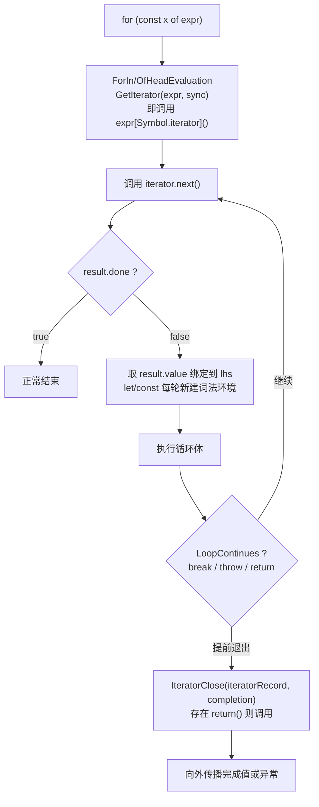
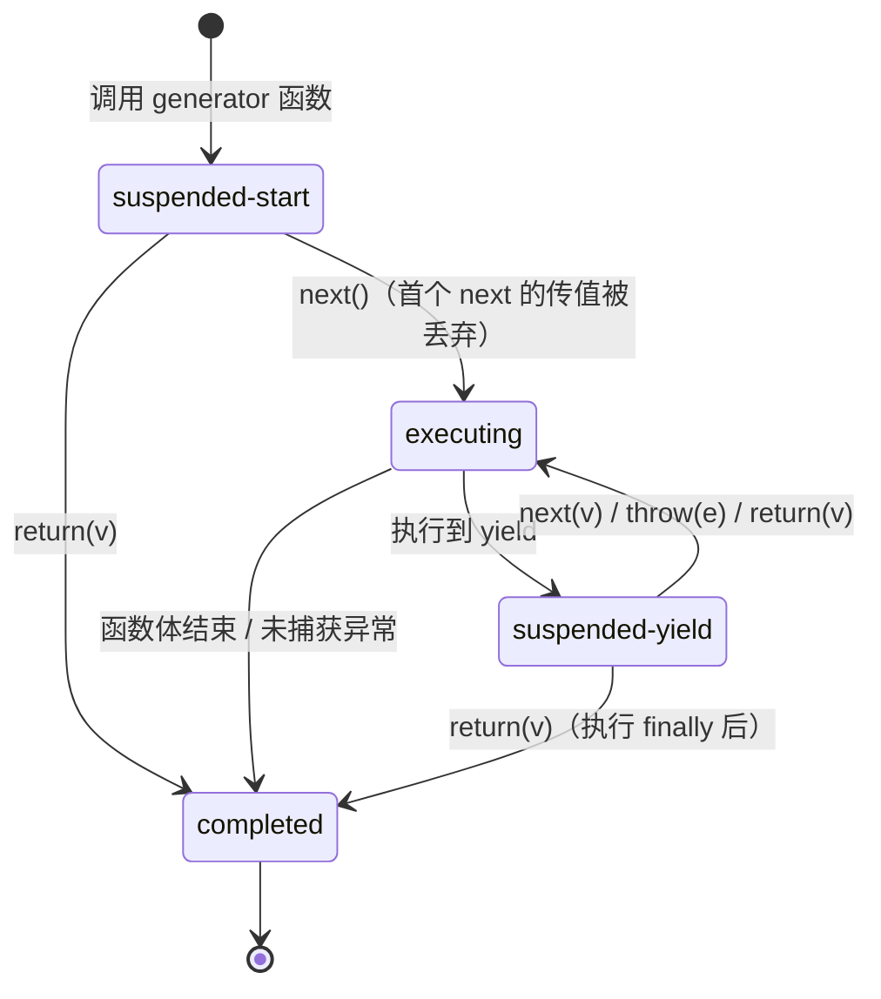
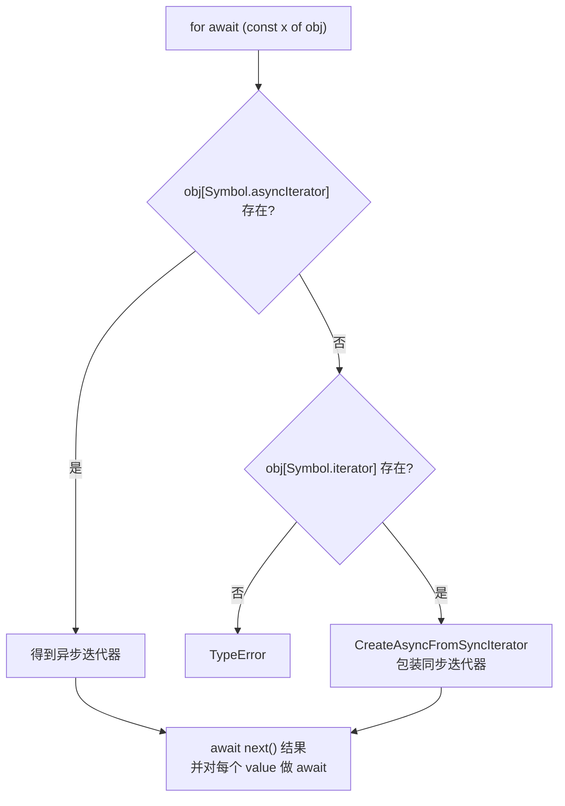

# 迭代器、生成器与异步迭代

> 一句话概括：迭代协议把「怎么遍历」从数据结构里解耦出来，生成器把函数执行变成可暂停/恢复的状态机，异步迭代把这套模型延伸到 Promise 世界——三者共同构成 JavaScript 惰性求值与流式处理的地基；本文讲清协议细节、状态机、规范锚点与工程边界。

预计阅读时间：大约 75 分钟

所属主题：[JavaScript 基础常见面试题总结](summary.md)

版本基线：ECMAScript ES2025（ECMA-262 第 16 版，Iterator helpers 归属 ES2025）；浏览器以当前 Chrome/V8 为准（Iterator helpers 自 Chrome 122 可用），Node.js 以 22/24 LTS 为准。规范锚点用 ECMA-262 概念/内置方法标注（如 `GetIterator`、`IteratorClose`、`GeneratorFunction`、`AsyncGenerator`）；helpers 清单、状态机枚举与浏览器版本已对照 ES2025 规范快照与 MDN 兼容性数据在线核实。

---

## 0. 阅读路线

| 读者 | 建议章节 | 关注点 |
| --- | --- | --- |
| 初级（1 年内） | 1.1~1.2、2.3、3.1、4.1、6.1、9 | 两个协议是什么、内置可迭代对象、三种遍历对比、generator 基本写法 |
| 中级（1~3 年） | 全部，重点 2.1~2.2、4.2~4.5、5.2、6.2 | IteratorClose 清理、状态机、next 传值、yield* 委托、co 执行器、async generator |
| 高级（3 年+） | 2.2、4.2、4.5、5.3、6.3~6.4、7.2、8 | 规范级细节、无限序列与内存、流的提前退出与锁、helper 内部机制、误用排查 |
| 选型/架构 | 3.2、5.1、7.3~7.4、8.3 | 一次性 vs 可重复迭代、协程的代价、helpers vs 数组方法、什么时候不必用 generator |

目录：

1. 迭代协议：一套统一的遍历接口
2. for...of 的完整机制
3. 迭代器与语法糖：谁在消费协议
4. Generator：可暂停的函数
5. Generator 与协程
6. 异步迭代
7. ES2025 Iterator helpers
8. 边界与实践清单
9. 高频追问集
10. 参考资料

---

## 1. 迭代协议：一套统一的遍历接口

### 1.1 两个协议：Iterator 与 Iterable

**结论**：JS 的遍历能力建立在两个「鸭子类型」协议上——**Iterator 协议**规定「怎么取下一个值」，**Iterable 协议**规定「怎么拿到一个迭代器」。所有遍历语法（`for...of`、展开、解构、`Array.from`）只认协议，不认具体类型。

| 协议 | 要求 | 规范锚点（ECMA-262） |
| --- | --- | --- |
| Iterator | 有 `next()` 方法，返回 `{ value, done }` 对象（IteratorResult）；可选 `return()` / `throw()` | The Iterator Interface（§27.1.1.2，必需属性 Table 81、可选属性 Table 82） |
| Iterable | 有 `[Symbol.iterator]()` 方法，调用后返回一个迭代器 | The Iterable Interface；`GetIterator(obj, kind)`（§7.4.4） |

```js
// browser 控制台 / Node 22+ 均可运行
const arr = [10, 20];
const it = arr[Symbol.iterator](); // Iterable → Iterator
it.next(); // { value: 10, done: false }
it.next(); // { value: 20, done: false }
it.next(); // { value: undefined, done: true }
it.next(); // { value: undefined, done: true }（done 之后保持 done）
```

**机制**：`GetIterator(obj, sync)` 的步骤就是「取 `obj[Symbol.iterator]` 方法 → 调用 → 校验结果是对象」，任何一步不满足就抛 `TypeError`。规范还约定：**一旦某次 `next()` 返回 `done: true`，后续调用应当继续返回 `done: true`**——但注意原文措辞是 should，**规范并未强制**（not enforced），写自定义迭代器时要自己保证这个不变式。

**边界/代价**：协议是约定而非继承关系——不继承任何内置类、只要形状对就能参与遍历；反过来，`next` 返回非对象（比如返回数字）会在消费端抛 `TypeError`。`return()` / `throw()` 是可选的：数组迭代器就没有 `return`（无需清理），生成器两者都有（见第 4 章）。

**追问：迭代器协议解决了什么问题？**
期望答案：**统一遍历接口，解耦数据结构与遍历算法**。数组、字符串、Map、Set、链表、无限序列只要实现协议，就能复用 `for...of`、展开、解构等全部语法；遍历方不需要知道数据怎么存，数据方不需要知道谁在遍历。这也是惰性求值（按需计算下一个值）能进入语言语法的前提。

### 1.2 内置可迭代对象清单

| 对象 | 遍历内容 | 备注 |
| --- | --- | --- |
| `Array` | 元素值 | 按索引升序；**空槽（hole）产出 `undefined`** |
| `String` | **码点**（code point） | 代理对作为一个整体产出，见下例 |
| `Map` | `[key, value]` 对 | 插入序 |
| `Set` | 值 | 插入序 |
| `TypedArray` | 元素值 | 如 `Uint8Array` |
| `arguments` | 实参值 | 类数组对象中少数可迭代的 |
| `NodeList`（DOM） | 节点 | `querySelectorAll` 的返回值；`HTMLCollection` 不可迭代 |
| generator 对象 | `yield` 的值 | 见第 4 章 |
| Iterator helpers 结果 | 管道变换后的值 | ES2025，见第 7 章 |

```js
// browser / Node 22+
[...'👍a'];      // ['👍', 'a']：按码点迭代，代理对不被拆开
'👍a'.split(''); // ['\ud83d', '\udc4d', 'a']：按 UTF-16 码元拆分
```

**普通对象不可迭代**：`{ a: 1 }` 没有 `[Symbol.iterator]` 方法，`[...obj]` 与 `for...of obj` 都会抛 `TypeError: obj is not iterable`。原因不是「做不到」，而是**语义上没有公认的默认遍历**：对象是属性袋，键有字符串和 Symbol 两类，遍历值还是键、要不要含原型链、顺序如何，都没有像数组那样自然的答案（`for...in` 的「枚举键」语义见 2.3，它不走迭代协议）。

让对象可迭代的正确姿势是**按实例定义**，而不是污染 `Object.prototype`：

```js
// browser / Node 22+
const obj = { a: 1, b: 2 };
obj[Symbol.iterator] = function* () {
  for (const key of Object.keys(this)) yield [key, this[key]];
};
[...obj]; // [['a', 1], ['b', 2]]
```

**边界**：给 `Object.prototype[Symbol.iterator]` 打补丁会让**所有对象**突然可迭代，展开、解构、`Array.from` 的行为全部被改变，第三方库的防御性检查也会失效——这是明确的反模式。需要「对象 → 数组」时优先用 `Object.keys/values/entries`。

### 1.3 手写可迭代对象：range 与链表

**结论**：实现 Iterable 协议的关键是**每次 `[Symbol.iterator]()` 返回一个全新的迭代器**，这样对象才能被重复遍历。

```js
// browser / Node 22+：可重复迭代的 range
const range = {
  from: 1,
  to: 5,
  [Symbol.iterator]() {
    let current = this.from;
    const last = this.to;
    return {
      next() {
        return current <= last
          ? { value: current++, done: false }
          : { value: undefined, done: true };
      },
      [Symbol.iterator]() { return this; } // 迭代器自身也可迭代（协议惯例）
    };
  }
};
[...range]; // [1, 2, 3, 4, 5]
[...range]; // 仍是 [1, 2, 3, 4, 5]：第二次调用拿到的是新迭代器
```

用 generator 方法实现协议更简洁——**每次调用 generator 函数天然返回新对象**，链表遍历一行循环就够：

```js
// browser / Node 22+
class ListNode {
  constructor(value, next = null) { this.value = value; this.next = next; }
  *[Symbol.iterator]() {
    let node = this;
    while (node) { yield node.value; node = node.next; }
  }
}
const list = new ListNode(1, new ListNode(2, new ListNode(3)));
[...list]; // [1, 2, 3]
[...list]; // [1, 2, 3]：可重复迭代
```

**边界/代价**：手写 `next()` 要自己维护游标与 `done` 不变式，容易写错；generator 把状态管理交给引擎，代价是每次恢复有一层状态机调度开销（小数据量下可忽略）。**实践**：对外暴露的 API 尽量返回「可迭代对象」而不是「迭代器」，把一次性消费的风险挡在接口之外（见 3.2）。

---

## 2. for...of 的完整机制

### 2.1 GetIterator → next 循环 → IteratorClose

**结论**：`for...of` 是迭代协议之上的语法糖，规范拆成两个抽象操作：`ForIn/OfHeadEvaluation`（§14.7.5.6）负责拿迭代器，`ForIn/OfBodyEvaluation`（§14.7.5.7）负责驱动循环并在**提前退出时关闭迭代器**。



**机制**要点：

- `next()` 的返回值必须是对象，否则抛 `TypeError`；`done` 为 true 时循环结束，`value` 被丢弃（所以 generator 的 `return` 值不会出现在 `for...of` 里）；
- **`let`/`const` 声明的循环变量每轮都有独立绑定**（规范为每轮创建新的 DeclarativeEnvironment），闭包捕获不会串值——这与 `var` 的经典陷阱形成对照，词法环境机制见 [作用域、闭包与执行上下文](scope-closures-and-execution-context.md)；
- `for...of` 不读 `length`、不按下标访问，因此对任何可迭代对象都成立，包括没有 `length` 的 Map/Set/generator。

```js
// browser / Node 22+
const fns = [];
for (const i of [1, 2, 3]) fns.push(() => i);
fns.map(f => f()); // [1, 2, 3]：每轮独立的 i 绑定
```

### 2.2 提前退出与 return() 清理

**结论**：`break`、`throw`、`return` 导致的提前退出都会触发 `IteratorClose`（§7.4.11）：**若迭代器提供 `return()` 就调用它**，给迭代器一个释放资源的机会。这是 `for...of` 相对 `forEach` 的关键工程优势——遍历可以和安全清理绑定。

```js
// browser / Node 22+：自定义迭代器的 return 清理
function countdown(n) {
  return {
    next() {
      return n > 0 ? { value: n--, done: false } : { value: undefined, done: true };
    },
    return() {
      console.log('countdown 被提前关闭，执行清理');
      n = 0;
      return { value: undefined, done: true }; // return() 必须返回对象
    },
    [Symbol.iterator]() { return this; }
  };
}
for (const x of countdown(3)) {
  if (x === 2) break; // 触发 IteratorClose → 调用 return()
}
// 输出：countdown 被提前关闭，执行清理
```

generator 的 `return()` 会恢复函数体并注入 return 完成，因此 **`try...finally` 的清理逻辑在提前退出时也会执行**：

```js
// browser / Node 22+
function* withCleanup() {
  try {
    yield 1;
    yield 2;
  } finally {
    console.log('finally：正常结束或提前退出都会执行');
  }
}
for (const v of withCleanup()) {
  if (v === 1) break;
}
// 输出：finally：正常结束或提前退出都会执行
```

**边界（规范级细节，高级追问点）**——`IteratorClose` 的异常优先级：

| 情形 | 行为 |
| --- | --- |
| 迭代器没有 `return` | 跳过，直接传播原完成/异常 |
| 循环体本身抛异常 | **原异常优先**：即使 `return()` 也抛异常，向外传播的仍是循环体的异常 |
| 正常 `break`，`return()` 抛异常 | `return()` 的异常向外传播 |
| `return()` 返回值不是对象 | 抛 `TypeError` |

异步版本是 `AsyncIteratorClose`（§7.4.13）：调用 `return()` 后还会 **await 其结果**，所以 `for await...of` 里 `break` 会等清理完成（Node 流的 destroy、Web 流的 cancel 都挂在这条路径上，见 6.3）。

**追问：break 一定会调用 return() 吗？**
期望答案：不一定——只有迭代器**提供了** `return` 才调用。数组迭代器没有 `return`（无资源可清理），generator 和自定义资源型迭代器有。写资源型迭代器时把清理放进 `return()`（或 generator 的 `finally`），而不是指望调用方记得手动关闭。

### 2.3 for...of vs for...in vs forEach

| 维度 | `for...of` | `for...in` | `forEach` |
| --- | --- | --- | --- |
| 消费什么 | 迭代协议（值） | 对象的**可枚举字符串键**（含原型链，不含 Symbol 键） | 数组自身索引（跳过空槽） |
| 拿到什么 | `value` | `key`（字符串） | `(value, index, array)` |
| 顺序 | 由迭代器决定 | 整数样键升序在前，其余按插入序 | 索引升序 |
| `break` / `continue` | ✅ | ✅ | ❌（回调里 `return` 只跳过本轮） |
| 异步支持 | `for await...of` | ❌ | ❌（async 回调不被等待） |
| 适用 | 数组/字符串/Map/Set/自定义结构的统一遍历 | 枚举对象键（日常更推荐 `Object.keys`） | 数组的副作用遍历 |

两个容易忽略的差异：

```js
// browser / Node 22+
const sparse = [, 1];
sparse.forEach(v => console.log(v)); // 只输出 1：forEach 跳过空槽
for (const v of sparse) console.log(v); // undefined, 1：for...of 访问空槽

const base = { inherited: 1 };
const child = Object.create(base);
child.own = 2;
for (const k in child) console.log(k); // own, inherited：含原型链可枚举键
```

**实践**：遍历值用 `for...of`，遍历键用 `Object.keys/entries` + `for...of`；`for...in` 留给确实需要含原型链枚举的场景（如 mixin 工具），并配合 `Object.hasOwn` 过滤。`forEach` 里写 `async` 回调是经典事故——回调的 Promise 没人等，循环瞬间跑完，详见 [Promise 与 async/await](promise-and-async-await.md)。

---

## 3. 迭代器与语法糖：谁在消费协议

### 3.1 展开、解构、Array.from、yield* 都在消费迭代协议

**结论**：ES2015 的一批「新语法」底层是同一套协议消费逻辑，这也是它们能对任意可迭代对象生效的原因。ES6+ 语法全景见 [ES6+ 与现代 JavaScript](es6-plus-and-modern-js.md)。

| 语法 | 消费方式 | 备注 |
| --- | --- | --- |
| `[...iterable]` / `f(...iterable)` | `GetIterator` → 循环 `next` | 要求**可迭代对象**；裸迭代器（无 `[Symbol.iterator]`）不行 |
| 数组解构 `const [a, ...rest] = iterable` | 同上 | rest 元素消费剩余迭代 |
| `Array.from(iterable[, mapFn])` | `GetIterator` → 逐项收集 | **还接受类数组对象**；mapFn 逐项变换 |
| `new Set(iterable)` / `new Map(iterable)` | `GetIterator` | Map 要求产出 `[key, value]` |
| `yield* iterable` | `GetIterator` + next/throw/return 转发 | 见 4.5 |
| `for...of` / `for await...of` | `GetIterator(obj, sync/async)` | 见第 2、6 章 |

```js
// browser / Node 22+
function* abc() { yield 'a'; yield 'b'; yield 'c'; }
[...abc()];                          // ['a', 'b', 'c']
const [first, ...rest] = abc();      // first='a', rest=['b', 'c']
Array.from(abc(), x => x.toUpperCase()); // ['A', 'B', 'C']
new Set(abc());                      // Set { 'a', 'b', 'c' }
```

**`Array.from` 与展开的边界差异**：`Array.from` 额外支持类数组（有 `length` 和索引即可），展开只认迭代协议：

```js
// browser / Node 22+
const arrayLike = { length: 3, 0: 'a', 1: 'b', 2: 'c' };
Array.from(arrayLike); // ['a', 'b', 'c']
// [...arrayLike];     // ❌ TypeError: arrayLike is not iterable
Array.from({ length: 3 }); // [undefined, undefined, undefined]
```

### 3.2 一次性消费 vs 可重复迭代对象

**结论**：**迭代器是有状态的一次性游标，可迭代对象是「每次生产新游标」的工厂**。分清这两个角色，能避免一大半「第二次遍历是空的」事故。

```js
// browser / Node 22+
const it = [1, 2, 3].values(); // values() 返回的是迭代器
[...it]; // [1, 2, 3]
[...it]; // []：迭代器已耗尽，不会重置

const arr = [1, 2, 3];         // arr 是可迭代对象
[...arr]; [...arr]; // 两次都是 [1, 2, 3]：每次 [Symbol.iterator]() 返回新迭代器
```

**机制**：数组的 `[Symbol.iterator]` 每次调用都创建新的 Array Iterator；而 generator 对象的 `[Symbol.iterator]()` **返回自身**（继承自 `%Iterator.prototype%`，见 4.6），所以 generator 对象虽然「可迭代」，却和迭代器一样是一次性的。ES2025 的 helper 管道与底层迭代器**共享同一数据源**，官方文档明确「没有任何办法 fork 一个迭代器让它被多次遍历」。

**实践**：

- 函数参数声明为「接受可迭代对象」，需要多次遍历时内部先 `Array.from` 物化，或要求调用方传数组/工厂函数；
- 需要重复消费 generator 的结果时，**重新调用 generator 函数**拿新对象，而不是复用旧对象；
- 把「一次性」写进接口文档——流（stream）类 API 天然一次性，这是特性不是 bug。

---

## 4. Generator：可暂停的函数

### 4.1 function* 与 yield：调用不执行

**结论**：调用 generator 函数**不执行函数体**，而是返回一个 generator 对象；函数体由 `next()` 驱动，遇到 `yield` 暂停并交出一个值。规范上 `GeneratorFunction` 创建的对象带 `[[GeneratorState]]`、`[[GeneratorContext]]` 内部槽（§27.5）。

```js
// browser / Node 22+
function* hello() {
  console.log('开始');
  yield 1;
  console.log('恢复');
  yield 2;
  return 3;
}
const g = hello(); // 此刻什么都不打印
g.next(); // 打印「开始」，返回 { value: 1, done: false }
g.next(); // 打印「恢复」，返回 { value: 2, done: false }
g.next(); // { value: 3, done: true }（return 值出现在这里，不在 for...of 里）
g.next(); // { value: undefined, done: true }
```

**机制（原型链）**：`g` → `hello.prototype` → `%GeneratorPrototype%`（提供 `next/return/throw`）→ `%Iterator.prototype%`（提供 `[Symbol.iterator]` 与 ES2025 helpers）→ `Object.prototype`。这条链解释了 generator 对象为什么既是迭代器又是可迭代对象、为什么能直接 `.map().take()`。继承机制详见 [原型链与继承](prototype-chain-and-inheritance.md)。

### 4.2 状态机：四个状态

**结论**：generator 的行为完全由 `[[GeneratorState]]` 状态机决定。ES2025 规范（Table 91，Properties of Generator Instances）枚举四个值：**suspended-start、executing、suspended-yield、completed**。



**机制**：暂停时引擎保存的是 `[[GeneratorContext]]`——**整个执行上下文**（词法环境、变量绑定、求值位置），而不仅仅是几个变量。这就是 generator 能「记住局部变量和代码执行到哪一行」的原因，也是它和普通闭包的本质区别：闭包保存环境，generator 保存环境 + 控制流位置。执行上下文结构见 [作用域、闭包与执行上下文](scope-closures-and-execution-context.md)。

**边界**：

- **executing 状态不可重入**：在 generator 执行期间再次 `next()` 抛 `TypeError: Generator is already running`；
- **completed 不可逆**：一旦完成，后续 `next()` 永远 `{ value: undefined, done: true }`。

```js
// browser / Node 22+：重入演示
let g;
function* f() {
  yield g.next(); // 求值 yield 右侧时 g 正处于 executing → TypeError
}
g = f();
g.next(); // TypeError: Generator is already running
```

### 4.3 next 传值：yield 是表达式

**结论**：`yield` 是表达式，**它的值等于下一次 `next(v)` 传入的 `v`**——这让 generator 成为双向通道：向外产出值，向内接收值。

```js
// browser / Node 22+
function* ask() {
  const name = yield '你叫什么名字？';
  const age = yield `你好 ${name}，多大了？`;
  return `${name} ${age} 岁`;
}
const g = ask();
g.next();        // { value: '你叫什么名字？', done: false }
g.next('小明');   // '小明' 成为第一个 yield 表达式的值
                 // → { value: '你好 小明，多大了？', done: false }
g.next(18);      // → { value: '小明 18 岁', done: true }
```

**边界**：**第一个 `next()` 的传值被丢弃**。规范上 `GeneratorResume` 在 suspended-start 状态只负责启动执行，此时函数体还没跑起来，没有任何暂停中的 `yield` 在等值。初始参数请走 generator 函数的形参：`function* ask(init) { ... }`。

**追问：为什么第一个 next 传值没用？**
期望答案：第一次 next 时生成器处于 suspended-start，函数体尚未执行，不存在暂停的 yield 表达式来接收这个值；规范直接忽略它。要传初始值用函数参数。

### 4.4 return 与 throw：注入完成与异常

**结论**：`return(v)` 与 `throw(e)` 不是「从外部终止」，而是**在暂停点注入一个 return/throw 完成**，让函数体有机会走 `finally`/`catch`——清理逻辑因此可控。

```js
// browser / Node 22+
function* demo() {
  try {
    yield 1;
    yield 2;
  } catch (e) {
    console.log('捕获注入的异常:', e.message);
    yield 'recover';
  } finally {
    console.log('清理');
  }
}
const g = demo();
g.next();                 // { value: 1, done: false }
g.throw(new Error('boom')); // 打印「捕获注入的异常: boom」
                          // → { value: 'recover', done: false }
g.return('end');          // 打印「清理」→ { value: 'end', done: true }
g.next();                 // { value: undefined, done: true }
```

| 方法 | 语义 | 状态变化 |
| --- | --- | --- |
| `next(v)` | 恢复执行，`v` 成为暂停处 yield 表达式的值 | suspended-* → executing |
| `return(v)` | 在暂停点注入 return 完成，触发 finally | → completed，返回 `{ value: v, done: true }` |
| `throw(e)` | 在暂停点注入异常，可被体内 try/catch 捕获 | 未捕获 → completed；捕获后继续 |

**边界**：对已 completed 的 generator 调 `return(v)` 返回 `{ value: v, done: true }`，调 `throw(e)` 则直接把 `e` 抛给调用方（不再进入函数体）。`for...of` 的 `break` 正是走 `return()` 这条路径（2.2）。

### 4.5 yield* 委托：双向传值与返回值

**结论**：`yield*` 把迭代控制权**委托**给另一个可迭代对象/迭代器：外层 next/throw/return 全部转发给内层，内层 `return` 的值成为 `yield*` 表达式的值。规范锚点：YieldExpression 的 Runtime Semantics: Evaluation（ES2025 §15.5.5，`GetIterator(value, generatorKind)` 起步）。

```js
// browser / Node 22+
function* inner() {
  const x = yield 'a';
  const y = yield 'b';
  return x + y;
}
function* outer() {
  const sum = yield* inner(); // sum 拿到 inner 的 return 值
  yield `sum=${sum}`;
}
const g = outer();
g.next();    // { value: 'a', done: false }
g.next(1);   // 转发 inner.next(1) → { value: 'b', done: false }
g.next(2);   // inner return 3 → yield* 表达式值为 3
             // → { value: 'sum=3', done: false }
g.next();    // { value: undefined, done: true }
```

委托的完整转发规则（规范逐步定义）：

| 外层收到 | yield* 的行为 |
| --- | --- |
| `next(v)` | 转发 `inner.next(v)`；内层 `done: true` 时，其 `value` 作为 **yield\* 表达式的值**返回给外层函数体 |
| `throw(e)` | 内层有 `throw` 就转发；**没有则先 `IteratorClose(inner)` 再抛 TypeError**（协议违规） |
| `return(v)` | 内层有 `return` 就转发；没有则直接把 `v` 作为外层的返回值 |

两个常用推论：

```js
// browser / Node 22+
function* flatten() { yield* [1, 2]; yield* [3]; }
[...flatten()]; // [1, 2, 3]：yield* 任何可迭代对象，不只是 generator

function* g() { const r = yield* [1, 2]; return r; }
g.next(); // { value: 1, done: false }
g.next(); // { value: 2, done: false }
g.next(); // { value: undefined, done: true }
// 数组迭代器的 return 值是 undefined，所以 r === undefined
```

**边界**：async generator 里的 `yield*` 可以委托**异步**可迭代对象——`GetIterator` 按 async 模式取迭代器，每一步都 `Await`（见第 6 章）。反过来，同步 generator 里 `yield*` 一个纯异步迭代器（如 async generator 对象）会因找不到 `[Symbol.iterator]` 直接抛 `TypeError: not iterable`（已在 Node 22 实测）。

**追问：yield\* 和 yield 的区别？**
期望答案：`yield` 产出**一个值**并暂停；`yield*` 委托**一个 iterable 的完整迭代过程**，双向转发 next/throw/return，且表达式值是内层的 return 值。`yield [1,2]` 产出一个数组，`yield* [1,2]` 产出两个数。

### 4.6 既是迭代器又是可迭代对象

**结论**：generator 对象同时符合两个协议——有 `next/return/throw`（Iterator），且 `[Symbol.iterator]()` 返回 `this`（Iterable，方法继承自 `%Iterator.prototype%`）。

```js
// browser / Node 22+
function* g() { yield 1; yield 2; }
const it = g();
it[Symbol.iterator]() === it; // true
[...it]; // [1, 2]
[...it]; // []：返回 this 意味着它和迭代器一样是一次性的
```

**边界/代价**：「可迭代」不等于「可重复迭代」。generator 对象、数组迭代器、helper 管道都是一次性的；只有「每次返回新迭代器」的对象（数组、Map、1.3 的 range）才可重复遍历。这个区别是 3.2 全部误用的根源。

---

## 5. Generator 与协程

### 5.1 协作式让出执行权

**结论**：generator 是 JS 里的**协程**实现：执行权由代码**主动让出**（yield），由调用方决定何时恢复（next），而不是被调度器抢占。它不创建并行——JS 主线程仍是单线程，generator 只是把「一段执行」切成可控制的片段。

| 维度 | generator（协程） | 线程 |
| --- | --- | --- |
| 调度 | 协作式：yield 让出，next 恢复 | 抢占式：OS 调度 |
| 切换成本 | 保存/恢复执行上下文，用户态轻量切换 | 内核态切换 + 栈保存，成本高 |
| 并行 | 无（单线程内交替） | 多核并行 |
| 竞态 | 让出点之间是原子的，竞态面小 | 任意指令间都可能切换，需锁 |
| 适用 | 惰性序列、状态机、异步编排 | CPU 并行（JS 里用 Worker） |

**边界**：yield 点之间不会被打断，这既是优点（无需锁）也是限制——**一个不让出的 generator 会独占主线程**，和写死循环没有区别。事件循环与任务调度见 [事件循环](event-loop.md)。

### 5.2 手写 co 自动执行器：async/await 的前身

**结论**：`yield Promise` + 「then 里调 next」的自动执行器，就能用同步写法编排异步——这正是 `async/await` 的思想原型：**async 函数 ≈ generator + 内置自动执行器**。

```js
// browser / Node 22+：最小 co 执行器
function co(genFn, ...args) {
  const gen = genFn(...args);
  return new Promise((resolve, reject) => {
    function step(nextFn) {
      let result;
      try {
        result = nextFn();
      } catch (err) {
        return reject(err); // generator 体内未捕获的异常
      }
      if (result.done) return resolve(result.value);
      Promise.resolve(result.value).then(
        (v) => step(() => gen.next(v)),   // resolve 值注入 yield 表达式
        (e) => step(() => gen.throw(e))   // reject 作为异常注入暂停点
      );
    }
    step(() => gen.next());
  });
}

co(function* () {
  const a = yield Promise.resolve(1);
  const b = yield Promise.resolve(a + 1);
  return b;
}).then(console.log); // 2
```

**机制**：执行器循环做三件事——`next()` 拿到 yield 出的 Promise → `then` 等待 → 把结果经 `next(v)`/`throw(e)` 注入回暂停点。错误处理靠 `gen.throw` 在 yield 处抛异常，让 generator 体内的 `try/catch` 能接住，与 `await` 的 try/catch 语义一致。Promise 微任务时序见 [事件循环](event-loop.md) 与 [Promise 与 async/await](promise-and-async-await.md)。

对照关系：

| generator + co | async/await |
| --- | --- |
| `yield promise` | `await promise` |
| 执行器 `gen.next(v)` | 引擎在 await resolve 后恢复 |
| 执行器 `gen.throw(e)` | await rejection 在暂停点抛出 |
| 手动/第三方驱动 | 引擎内置驱动（AsyncFunction + `Await` 抽象操作） |
| 返回值任意 | **永远返回 Promise** |

**边界（必须说清）**：这是**概念等价，不是规范层面的字面语法糖**——async 函数在规范里有独立机制（AsyncFunction 对象、`Await`），并非编译成 generator。实际差异：async 函数没有 `next/throw/return` 控制面、不能暂停在任意 yield 点做惰性求值、调用即开始执行（generator 调用不执行）。**追问「generator 和 async 函数的区别与联系」时，先答联系（自动执行器模型），再答这三条差异**，才算完整。

### 5.3 惰性无限序列与内存优势

**结论**：generator 让「无限序列」成为合法抽象——**值在被索取时才计算**，内存只保留 O(1) 的状态变量，而不是物化整个序列。

```js
// browser / Node 22+
function* fibonacci() {
  let [a, b] = [0, 1];
  while (true) {
    yield a;
    [a, b] = [b, a + b];
  }
}
const fib = fibonacci();
[fib.next().value, fib.next().value, fib.next().value]; // [0, 1, 1]

// ES2025（Chrome 122+ / Node 22+）：惰性管道取前 10 个
fibonacci().take(10).toArray(); // [0, 1, 1, 2, 3, 5, 8, 13, 21, 34]
```

**机制**：暂停中的 generator 通过 `[[GeneratorContext]]` 保留被引用的变量（上例只有 `a`、`b`），未被引用的中间值可被 GC 回收——一亿项的斐波那契「序列」也只占两个变量的内存。相对地，`Array.from({length: 1e8}, ...)` 会立刻物化一亿元素。GC 与保留关系见 [内存管理与 GC](memory-management-and-gc.md)。

**边界/代价**：

- 无限序列**必须配退出机制**：`take(n)`、`find/some/every` 短路、或 `for...of` + `break`；对它调 `toArray()`/`reduce()` 或不带 break 地 `for...of` 会死循环；
- 长期持有暂停中的 generator 会保留其上下文引用的对象，不用时置空引用，避免「协程泄漏」；
- 每次 `next()` 有状态机恢复开销，**小数组的密集数值计算未必比直接循环快**——惰性的收益在「可能用不完」的场景，不在裸速度。

---

## 6. 异步迭代

### 6.1 Symbol.asyncIterator 与 for await...of

**结论**：ES2018 把迭代协议复制到异步世界：**async iterator** 的 `next()` 返回 `Promise<{value, done}>`，**async iterable** 提供 `[Symbol.asyncIterator]()`；`for await...of` 是消费语法。

| 协议 | 同步 | 异步 |
| --- | --- | --- |
| 迭代器 | `next()` → `{value, done}` | `next()` → `Promise<{value, done}>` |
| 可迭代 | `[Symbol.iterator]()` | `[Symbol.asyncIterator]()` |
| 消费语法 | `for...of` | `for await...of`（仅 async 上下文内） |
| 关闭操作 | `IteratorClose` | `AsyncIteratorClose`（await return 结果） |

**机制（关键且高频）**：`GetIterator(obj, async)` **先找 `Symbol.asyncIterator`，找不到会回退到 `Symbol.iterator`**，并用 `CreateAsyncFromSyncIterator`（§27.1.6.1）把同步迭代器包装成异步的；包装层的 `AsyncFromSyncIteratorContinuation` 对每个 value 做 `PromiseResolve`——即 **`for await...of` 可以消费同步可迭代对象，且逐项 await 每个值**。



```js
// browser / Node 22+
(async () => {
  // 数组是同步可迭代对象：for await 逐项 await
  for await (const v of [Promise.resolve(1), Promise.resolve(2)]) {
    console.log(v); // 1, 2
  }
  for await (const v of [10, 20]) console.log(v); // 10, 20：普通值也合法
})();
```

**边界**：回退机制意味着「`for await` 能跑」**不代表数据源真的是异步流**——对同步数组用 `for await` 只是每项多一次微任务等待，没有背压、没有并发收益（见 6.4）。

### 6.2 async generator：async function* + yield

**结论**：`async function*` 组合了 async 函数与 generator：体内可以 `await` 也可以 `yield`，产出的对象是**异步迭代器**（`next/return/throw` 都返回 Promise），用 `for await...of` 消费。

```js
// browser / Node 22+
async function* ticker(n) {
  for (let i = 0; i < n; i++) {
    await new Promise(r => setTimeout(r, 100));
    yield i;
  }
}
(async () => {
  for await (const v of ticker(3)) console.log(v); // 0, 1, 2，每隔约 100ms
})();

const g = ticker(1);
g.next() instanceof Promise; // true：next 返回 Promise<{value, done}>
```

**机制**：async generator 内部用 `[[AsyncGeneratorQueue]]` 把 next/throw/return 请求**排队串行处理**——同一时刻只有一个请求在执行，其余等待，因此**并发调多个 `next()` 不会并行推进函数体**，而是按调用顺序依次完成。ES2025 规范（Table 92）的 `[[AsyncGeneratorState]]` 枚举为 **suspended-start、suspended-yield、executing、draining-queue、completed**；注意不少旧资料写的 `awaiting-return` 是早期版本的状态名，ES2025 的枚举已改为 `draining-queue`——答状态机题时以 ES2025 口径为准。

**边界**：

- `yield` 出的值如果是 Promise，`for await` 会 await 它；async generator 里 `yield*` 委托同步可迭代对象时**同样走 async 回退包装、逐项 await 并解包**——`yield* [Promise.resolve(1)]` 产出的是 `1` 而不是 Promise（Node 22 实测）；
- async generator 同样一次性、同样不可重入；
- 体内未捕获异常 → 对应 `next()` 的 Promise reject → `for await` 处抛出，走 `AsyncIteratorClose`。

### 6.3 Node Readable 与 Web ReadableStream 的异步迭代

**结论**：两套主流流 API 都实现了异步迭代协议，`for await...of` 是消费它们的标准姿势；**提前退出会触发流的清理**，但清理语义不同。

```js
// Node 22（readable[Symbol.asyncIterator] 自 v10.0.0 引入，v11.14.0 起不再实验性）
const fs = require('node:fs');
(async () => {
  const readable = fs.createReadStream('package.json', { encoding: 'utf8' });
  try {
    for await (const chunk of readable) {
      console.log(chunk.length);
      break; // 提前退出 → 流被 destroy()
    }
  } catch (err) {
    console.error('流错误会在这里抛出', err);
  }
})();
```

```js
// Web ReadableStream：Chrome 124+ / Firefox 110+ / Node 16.5+（Node 22 全局可用）
// 注意：Safari 直到 27 才支持 ReadableStream 的异步迭代（MDN BCD 核实）
const stream = new ReadableStream({
  start(controller) {
    controller.enqueue('a');
    controller.enqueue('b');
    controller.close();
  }
});
(async () => {
  for await (const chunk of stream) console.log(chunk); // a, b
})();
```

| 维度 | Node `Readable` | Web `ReadableStream` |
| --- | --- | --- |
| 协议入口 | `[Symbol.asyncIterator]()` | `[Symbol.asyncIterator]()` / `values()` |
| 提前退出（break/throw/return） | **destroy() 流** | **cancel() 流**并释放 reader 锁 |
| 避免退出即销毁 | `readable.iterator({ destroyOnReturn: false })`（v16.3.0+） | `stream.values({ preventCancel: true })` |
| 块大小 | `highWaterMark` | 队列策略（desiredSize） |
| 版本 | v10.0.0+ | Chrome 124 / Firefox 110 / Node 16.5 / Safari 27 |

**机制（Web 流，WHATWG Streams 规范 §4.2.5）**：异步迭代会**锁定流**（其他消费者拿不到 reader）；迭代器的 `return()`（例如 break 触发）默认执行 cancel 并释放锁。需要「读一半就走、流留给别人」时用 `values({ preventCancel: true })`。

**错误处理与提前退出实践**：

- 错误统一用 `try/catch` 包住 `for await`——Node 流的 `'error'` 事件、Web 流的 error 状态都会变成循环处抛出的异常；
- `break` 之后**不要再复用同一个流**：Node 流已 destroy、Web 流已 cancel（或锁已释放但数据已消费）；
- 需要「只看不消费完」的 Web 流场景显式 `preventCancel`，否则 break 会取消上游数据源（可能中断网络请求）。

### 6.4 for await 的串行陷阱

**结论**：`for await...of` 是**逐项串行**的：每一项处理完才取下一项。要并发，用 `Promise.all`，而不是把 await 放进循环。

```js
// browser / Node 22+（urls 为字符串数组）
// ❌ 串行：总耗时 ≈ 各请求耗时之和
for (const url of urls) {
  const res = await fetch(url);
  results.push(await res.json());
}

// ✅ 并发：总耗时 ≈ 最慢的一个
const results = await Promise.all(urls.map(async (url) => {
  const res = await fetch(url);
  return res.json();
}));
```

一个隐蔽的中间形态：`for await (const p of urls.map(fetch))`——`map` 已把请求**全部同时发出**（并发发生在创建时），但消费仍是串行；若中途某项 reject 导致循环抛出，**其余已发出的 Promise 无人处理**，可能产生 unhandled rejection。需要并发 + 完整错误处理时，`Promise.all`（一败即败）或 `Promise.allSettled`（逐项收结果）才是对的抽象。并发编排细节见 [Promise 与 async/await](promise-and-async-await.md)。

**实践**：`for await` 留给**真正的流**（文件、网络分块、async generator）——它们的语义就是「按序处理每一项」；对「一批独立任务」默认 `Promise.all` + 并发上限控制。

---

## 7. ES2025 Iterator helpers

### 7.1 清单与版本归属

**结论**：ES2025 给 `%Iterator.prototype%` 增加了一组可链式调用的方法（Iterator helpers 提案，Stage 4 已并入 ES2025），**所有迭代器——generator、数组迭代器、Map/Set 迭代器——都自动获得这组能力**。以下清单已对照 ES2025 规范快照（§27.1.3~27.1.4）逐一核实。

| 方法 | 类别 | 行为 | 数组对应物 |
| --- | --- | --- | --- |
| `map(fn)` | 惰性 | 逐项变换 | `Array.prototype.map` |
| `filter(fn)` | 惰性 | 逐项过滤 | `filter` |
| `take(n)` | 惰性 | 最多取 n 项后结束 | `slice(0, n)`（近似） |
| `drop(n)` | 惰性 | 跳过前 n 项 | `slice(n)`（近似） |
| `flatMap(fn)` | 惰性 | 映射后展开（fn 须返回可迭代对象） | `flatMap` |
| `reduce(fn[, init])` | 终端 | 归约为单值，消费迭代器 | `reduce` |
| `toArray()` | 终端 | 物化为数组 | `[...it]` |
| `forEach(fn)` | 终端 | 逐项副作用 | `forEach` |
| `some(fn)` / `every(fn)` / `find(fn)` | 终端（短路） | 命中即停 | 同名方法 |

另有三个配套成员：

- **`Iterator.from(obj)`**：把可迭代对象或「iterator-like」（只有 `next` 的对象）转成真正的 Iterator；已是 Iterator 实例则原样返回，否则包一层（规范 `%WrapForValidIteratorPrototype%`）；
- **`Iterator` 构造函数**：抽象基类，**直接 `new Iterator()` 抛错**，设计意图是被继承（`class MyIt extends Iterator { next() {...} }`）；
- **`Iterator.prototype[Symbol.iterator]()`**：返回 `this`，让 helper 结果可以直接展开/`for...of`。

**版本归属（MDN BCD 核实）**：Chrome 122、Firefox 131、Safari 18.4、Node.js 22.0.0 起可用；**Node 20 及以下没有 `Iterator` 全局对象**，需要 core-js 等 polyfill。本文基线 Node 22/24 均内置。

**边界（防混淆）**：当前 MDN 上还能看到 `chunks()`、`windows()`、`includes()`、`join()`、`Iterator.concat()`、`Iterator.zip()` 等方法——它们来自**后续提案，不属于 ES2025**（ES2025 规范快照中不存在）；异步版 helpers（`AsyncIterator.prototype.map` 等）是独立提案（目前 Stage 2），同样不在 ES2025。面试答「ES2025 新增」时以上表 11 个方法 + `Iterator.from` 为准。

### 7.2 惰性管道机制

**结论**：helpers 是**惰性**的——`map/filter/take/drop/flatMap` 只搭建管道，**每次 `next()` 才从底层拉取并计算一项**，不产生中间数组，因此能安全地架在无限序列上。

```js
// Chrome 122+ / Node 22+
function* naturals() { let n = 1; while (true) yield n++; }

const pipeline = naturals()
  .map(x => { console.log('map', x); return x * x; })
  .filter(x => x % 2 === 0);
// 此刻没有任何输出：管道尚未消费

pipeline.take(3).toArray();
// 依次打印 map 1 … map 6，结果 [4, 16, 36]
// 只计算到第 6 个自然数就停了——take(3) 拿满即止
```

**机制（规范级，高级追问点）**：

- 每个 helper 返回一个 iterator helper 对象，内部槽 `[[UnderlyingIterator]]` 指向底层迭代器；规范实现上它**复用了 generator 机制**（带 `[[GeneratorState]]`，brand 为 `"Iterator Helper"`）——helpers 可以理解为「引擎内置的、用 generator 写的管道」；
- **`next()` 不接受参数**：`%IteratorHelperPrototype%.next()` 的签名是零参，你传给 `next(v)` 的值**不会转发**给底层迭代器（generator 的双向传值在管道里失效）；
- **`return()` 会关闭底层**：helper 的 `return()` 对 `[[UnderlyingIterator]]` 执行 `IteratorClose`——所以 `for...of` helper 管道时 break，底层 generator 的 finally 会执行；
- **不实现 `throw()`**：管道不承诺异常转发语义。

```js
// Chrome 122+ / Node 22+：return 转发演示
function* src() {
  try { yield 1; yield 2; yield 3; }
  finally { console.log('源迭代器被清理'); }
}
for (const v of src().map(x => x * 10)) {
  if (v === 10) break; // helper.return() → IteratorClose(源) → finally
}
// 输出：源迭代器被清理
```

### 7.3 与数组方法对比

| 维度 | 数组方法 | Iterator helpers |
| --- | --- | --- |
| 求值时机 | 急切：每步立即遍历、产生中间数组 | 惰性：next 驱动，逐项拉取 |
| 无限序列 | 不可能（先要有数组） | 友好：take/find/some/every 短路 |
| 中断能力 | 仅 some/every/find 短路 | take/drop 限量 + 短路方法 |
| 内存 | 每步 O(N) 中间结果 | 管道状态 O(1)（toArray 除外） |
| 可重复性 | 数组可反复遍历 | 一次性，无法 fork |
| 随机访问/length | 有 | 无 |
| 适用 | 中小数据、需要索引/复用 | 流式、惰性、可能用不完的大数据 |

**示例：从无限序列取前 N 个满足条件的值**（数组方法做不到，因为无法先物化无限数组）：

```js
// Chrome 122+ / Node 22+
function* naturals() { let n = 1; while (true) yield n++; }

// 前 5 个「平方后是偶数」的自然数的平方
naturals().map(x => x * x).filter(x => x % 2 === 0).take(5).toArray();
// [4, 16, 36, 64, 100]

// 无限序列上直接 find（短路，无需 take）
function* fib() { let [a, b] = [0, 1]; while (true) { yield a; [a, b] = [b, a + b]; } }
fib().find(x => x > 100); // 144
```

```js
// Chrome 122+ / Node 22+：flatMap 与参数校验
[1, 2, 3].values().flatMap(x => [x, x * 10]).toArray(); // [1, 10, 2, 20, 3, 30]
// flatMap 的 mapper 必须返回可迭代对象，否则消费时抛 TypeError（惰性：调用时不校验返回值）
// take/drop 的参数在调用时即做 ToNumber 校验：NaN 或负数 → 立即抛 RangeError
// ES2025 仅抛 RangeError、不关闭底层迭代器；「非法 limit 关闭迭代器」是 ES2027 草案的后续改动
```

### 7.4 边界与代价

- **一次性**：helper 与底层共享数据源，消费过的管道不能重来；`toArray()` 之后管道即耗尽；
- **终端方法 + 无限序列 = 死循环**：`reduce/toArray/forEach` 没有短路语义，无限源上禁用；
- **helpers 长在迭代器上，不是可迭代对象上**：`arr.map(...)` 走的仍是急切的数组方法；要用 helpers 需 `arr.values().map(...)` 或 `Iterator.from(arr).map(...)`。这是「给数组加了惰性方法」的常见误解；
- **`Iterator.from` 的包装语义**：对已是 Iterator 实例的对象原样返回（不复制），对普通可迭代对象/iterator-like 包一层——包装层同样一次性；
- **性能账**：每项值要穿过若干层 generator 恢复与回调调用，**小数组上通常不比数组方法快**；收益在「避免物化中间结果」与「提前终止」，数据量大、选择率低、可能用不完时才划算。

---

## 8. 边界与实践清单

### 8.1 语法边界

**yield 不能跨普通函数边界**：`yield` 只能出现在 generator 函数**体内**。暂停/恢复保存的是 generator 自己的执行上下文，普通回调是独立的栈帧，无法把整个调用栈挂起（JS 的协程是 stackless 的）：

```js
function* bad() {
  [1, 2, 3].forEach(x => {
    // yield x; // ❌ SyntaxError：yield 不在 generator 函数体内
  });
}
```

绕法：回调里收集、回调外 yield；或把回调本身写成 generator 再 `yield*`。**也没有箭头 generator**——规范只定义了 `function*` 声明/表达式与方法简写（`*method() {}`）三种形式，`*() => {}` 不合法。async generator 同理：`await`/`yield` 只在 `async function*` 体内有效。

### 8.2 一次性迭代器误用清单

| 症状 | 原因 | 修复 |
| --- | --- | --- |
| 第二次展开/遍历是空的 | 迭代器已耗尽（3.2） | 传可迭代对象或数组；重新创建迭代器 |
| generator 对象遍历两次，第二次空 | `[Symbol.iterator]()` 返回 this（4.6） | 重新调用 generator 函数拿新对象 |
| helper 管道复用，第二次空 | 与底层共享数据源（7.4） | 重建管道，或先 toArray 物化 |
| 同一个流 for await 两次报错/无数据 | 流已消费/destroy/cancel（6.3） | 重新创建流；Web 流注意锁 |
| `for await` 同步数组「看起来能用」 | 回退包装（6.1） | 明确数据源性质；并发需求改 Promise.all |

### 8.3 什么时候用 generator，什么时候不必

| 场景 | 推荐 | 理由 |
| --- | --- | --- |
| 惰性/无限序列、大数据管道 | generator + helpers | O(1) 内存、可短路 |
| 协议解析、复杂状态机 | generator 或显式状态机 | yield 天然表达「等待下一个输入」 |
| 自定义控制流（重试退避、协作调度、co 式编排） | generator + 执行器 | 需要暂停/恢复控制面 |
| 普通异步业务编排 | **直接 async/await** | 不需要手动控制面，引擎驱动更省心 |
| 中小数组变换 | **数组方法** | 更简单、通常更快、可复用 |
| 文件/网络流处理 | 流 API + for await | 背压、生态、清理语义现成 |
| 需要真并行 | Worker / 子进程 | generator 不提供并行（5.1） |

**实践约定**：接口接受 iterable 而非 iterator；资源清理放 generator 的 finally / 迭代器的 return；无限序列必须有 take/break 出口；团队代码评审把「复用一次性迭代器」列为检查项。能说出「这个场景不该用 generator」，比多背一个 yield 用法更能体现判断力。

---

## 9. 高频追问集

**Q1：为什么 for...of 能 break 而 forEach 不能？**
期望答案：`for...of` 是**语句**，控制流在循环结构本身，break 直接结束循环并触发 `IteratorClose`；`forEach` 是**函数调用**，回调只是普通函数，`return` 仅结束当前回调，无法影响外层遍历。需要中断用 `for...of`，或数组的 `some/every/find` 短路。

**Q2：如何让普通对象支持 for...of？**
期望答案：给对象定义 `[Symbol.iterator]` 方法（可用 generator 方法），按需 yield 键、值或 entries。不要改 `Object.prototype`——会让所有对象可迭代，破坏展开/解构的既有语义。日常转换优先 `Object.entries`。

**Q3：generator 和 async 函数的区别与联系？**
期望答案：联系——async/await 概念上等价于「generator + 自动执行器」（yield Promise ↔ await，then 里 next ↔ 引擎恢复）。区别——async 函数永远返回 Promise、没有 next/throw/return 控制面、调用即执行；generator 调用不执行、可惰性可同步。注意这是概念模型，不是规范层面的字面语法糖。

**Q4：yield\* 和 yield 的区别？**
期望答案：yield 产出一个值；yield* 委托另一个 iterable 的完整迭代，双向转发 next/throw/return，表达式值是内层的 return 值。内层没有 throw/return 方法时按规范分别走 IteratorClose+TypeError / 直接返回。

**Q5：迭代器协议解决了什么问题？**
期望答案：统一遍历接口，解耦数据结构与遍历算法——任何实现协议的结构都能复用 for...of/展开/解构/Array.from；同时让惰性、按需计算进入语言语法。

**Q6：为什么第一个 next() 的传值被丢弃？**
期望答案：首次 next 时处于 suspended-start，函数体尚未执行，没有暂停中的 yield 接收值，规范忽略该参数。初始值走 generator 函数形参。

**Q7：for...of 里 break 一定调用 return() 吗？return() 抛异常会怎样？**
期望答案：只有迭代器提供 return 才调用。循环体自身抛异常时原异常优先，return 的异常被忽略；正常 break 时 return 的异常向外传播；return 返回值必须是对象，否则 TypeError。

**Q8：for await...of 能消费同步可迭代对象吗？**
期望答案：能。GetIterator 的 async 模式回退到 Symbol.iterator，用 CreateAsyncFromSyncIterator 包装，并对每个 value 做 PromiseResolve（逐项 await）。所以 for await 一个 Promise 数组会逐项等待，但这是串行消费，不是并发执行。

**Q9：Iterator helpers 是惰性的吗？和数组方法有何本质区别？**
期望答案：惰性——next 驱动逐项计算，无中间数组，可架在无限序列上并用 take/find 短路；代价是一次性、无随机访问。数组方法急切求值、每步物化中间数组，但可重复遍历。ES2025 归属，Chrome 122 / Node 22 起可用。

**Q10：generator 为什么能表达无限序列而不爆内存？**
期望答案：函数体暂停在 yield，只保留 O(1) 状态变量与执行上下文，值按需计算不物化；配合 take/find/break 退出。长期持有暂停的 generator 会保留其上下文引用的对象，注意释放。

**Q11：yield 为什么不能跨普通函数边界？为什么没有箭头 generator？**
期望答案：暂停/恢复作用于 generator 自身的执行上下文，普通函数调用是独立栈帧，JS 不支持挂起整个调用栈（stackless 协程）；规范未定义箭头 generator 语法，function* 只有声明/表达式/方法简写三种形式。

**Q12：helper 的 next 会透传参数吗？return 会关闭底层吗？**
期望答案：`%IteratorHelperPrototype%.next()` 零参，传值不转发（generator 双向通道在管道中失效）；return() 会对底层迭代器执行 IteratorClose，清理可传播；不实现 throw。

---

## 10. 参考资料

**MDN（行为与兼容性）**

- Iteration protocols：<https://developer.mozilla.org/en-US/docs/Web/JavaScript/Reference/Iteration_protocols>
- for...of：<https://developer.mozilla.org/en-US/docs/Web/JavaScript/Reference/Statements/for...of>；for await...of：<https://developer.mozilla.org/en-US/docs/Web/JavaScript/Reference/Statements/for-await...of>
- function*：<https://developer.mozilla.org/en-US/docs/Web/JavaScript/Reference/Statements/function*>；yield*：<https://developer.mozilla.org/en-US/docs/Web/JavaScript/Reference/Operators/yield*>
- Iterator（helpers 总览）：<https://developer.mozilla.org/en-US/docs/Web/JavaScript/Reference/Global_Objects/Iterator>；Symbol.asyncIterator：<https://developer.mozilla.org/en-US/docs/Web/JavaScript/Reference/Global_Objects/Symbol/asyncIterator>
- ReadableStream：<https://developer.mozilla.org/en-US/docs/Web/API/ReadableStream>
- 兼容性数据（本文版本号的核实来源）：<https://github.com/mdn/browser-compat-data>（javascript/builtins/Iterator.json、api/ReadableStream.json）

**ECMA-262 ES2025 规范锚点（已对照规范快照核实）**

- `GetIterator` / `IteratorClose` / `AsyncIteratorClose`：<https://tc39.es/ecma262/2025/multipage/abstract-operations.html#sec-getiterator>、`#sec-iteratorclose`、`#sec-asynciteratorclose`
- Iterator 接口与 Iterator helpers：<https://tc39.es/ecma262/2025/multipage/control-abstraction-objects.html#sec-iterator-interface>、`#sec-iterator-helper-objects`、`#sec-iterator.prototype`（含 `%IteratorHelperPrototype%.next/.return`）
- `Iterator.from`：同上 `#sec-iterator.from`
- GeneratorFunction / Generator 对象（Table 91 `[[GeneratorState]]`）：同上 `#sec-generatorfunction-objects`、`#sec-generator-objects`
- AsyncGenerator（Table 92 `[[AsyncGeneratorState]]`、`[[AsyncGeneratorQueue]]`）：同上 `#sec-asyncgenerator-objects`
- `CreateAsyncFromSyncIterator` / `AsyncFromSyncIteratorContinuation`：同上 `#sec-createasyncfromsynciterator`、`#sec-asyncfromsynciteratorcontinuation`
- `ForIn/OfHeadEvaluation` / `ForIn/OfBodyEvaluation`：<https://tc39.es/ecma262/2025/multipage/ecmascript-language-statements-and-declarations.html#sec-runtime-semantics-forinofheadevaluation>、`#sec-runtime-semantics-forin-div-ofbodyevaluation-lhs-stmt-iterator-lhskind-labelset`
- yield / yield* 求值（委托转发规则）：<https://tc39.es/ecma262/2025/multipage/ecmascript-language-functions-and-classes.html#sec-generator-function-definitions-runtime-semantics-evaluation>

**其他官方来源**

- WHATWG Streams（ReadableStream 异步迭代、锁与 cancel）：<https://streams.spec.whatwg.org/#rs-asynciterator>
- Node.js 22 流文档（readable[Symbol.asyncIterator]）：<https://nodejs.org/docs/latest-v22.x/api/stream.html#readablesymbolasynciterator>；Web Streams：<https://nodejs.org/docs/latest-v22.x/api/webstreams.html>
- Iterator helpers 提案（Stage 4，已并入 ES2025）：<https://github.com/tc39/proposal-iterator-helpers>
- Async iterator helpers 提案（Stage 2，未并入 ES2025）：<https://github.com/tc39/proposal-async-iterator-helpers>

**兄弟专题**：[JavaScript 基础常见面试题总结](summary.md)、[ES6+ 与现代 JavaScript](es6-plus-and-modern-js.md)、[Promise 与 async/await](promise-and-async-await.md)、[事件循环](event-loop.md)、[作用域、闭包与执行上下文](scope-closures-and-execution-context.md)、[原型链与继承](prototype-chain-and-inheritance.md)、[内存管理与 GC](memory-management-and-gc.md)

---

## 附：一页速记

**协议层**
1. Iterator = `next()` → `{value, done}`；Iterable = `[Symbol.iterator]()` → 迭代器；`GetIterator` 是统一入口。
2. 内置可迭代：Array/String（按码点）/Map/Set/TypedArray/arguments/NodeList；普通对象不可迭代，按实例加 `[Symbol.iterator]`，别动 Object.prototype。
3. 迭代器一次性，可迭代对象每次产新迭代器；generator 对象 `[Symbol.iterator]()` 返回 this，所以也是一次性。

**for...of 层**
4. GetIterator → 循环 next → 提前退出（break/throw/return）触发 IteratorClose 调 return()；循环体异常优先于 return 异常。
5. for...of 遍历值可 break；for...in 遍历可枚举字符串键（含原型链）；forEach 跳空槽、不能 break、不等 async 回调。
6. let/const 循环变量每轮独立绑定；展开/解构/Array.from/yield* 都消费同一协议。

**Generator 层**
7. 调用不执行；状态机 suspended-start → executing ⇄ suspended-yield → completed；executing 不可重入。
8. yield 是表达式，值 = 下一次 next 的传参；首个 next 传值被丢弃；return/throw 在暂停点注入完成/异常，finally 必达。
9. yield* 委托：双向转发 next/throw/return，表达式值 = 内层 return 值。
10. async ≈ generator + 自动执行器（概念模型，非字面语法糖）；无限序列 O(1) 内存，必须配 take/break 出口。

**异步迭代层**
11. for await 可消费同步迭代器：回退包装 + 逐项 await；async generator 请求排队串行，next 返回 Promise。
12. Node Readable break → destroy；Web ReadableStream break → cancel + 释放锁（preventCancel 可免）；Safari 27 才支持 Web 流异步迭代。
13. for await 是串行消费；并发用 Promise.all/allSettled，别把 await 塞进循环。

**ES2025 helpers 层**
14. 11 个方法：map/filter/take/drop/flatMap 惰性，reduce/toArray/forEach/some/every/find 终端；另有 Iterator.from 与抽象基类 Iterator。
15. Chrome 122 / Firefox 131 / Safari 18.4 / Node 22 起可用；chunks/windows/zip 等是后续提案，不属于 ES2025。
16. helper 内部是 generator 机制：next 零参不转发，return 关闭底层，无 throw；一次性、无 fork；无限源禁用 toArray/reduce。

**一句话**
> 迭代协议统一了「怎么遍历」，generator 把执行变成可控的状态机，异步迭代把这套控制延伸到 Promise——知道谁一次性、谁负责清理、哪里是串行，就用对了这三件套。