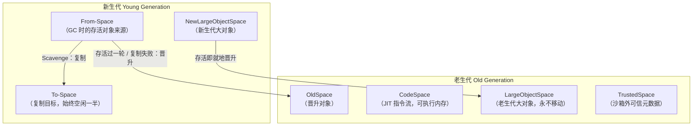
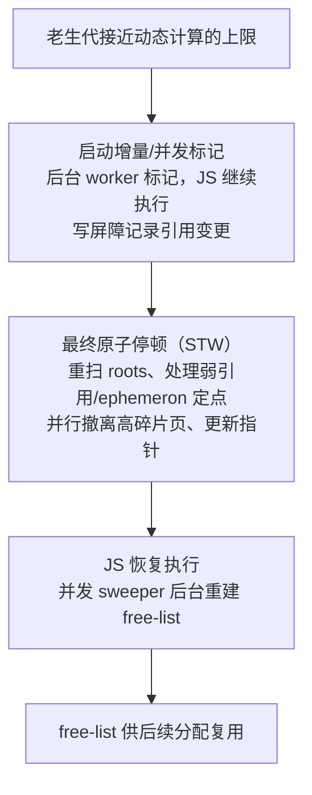
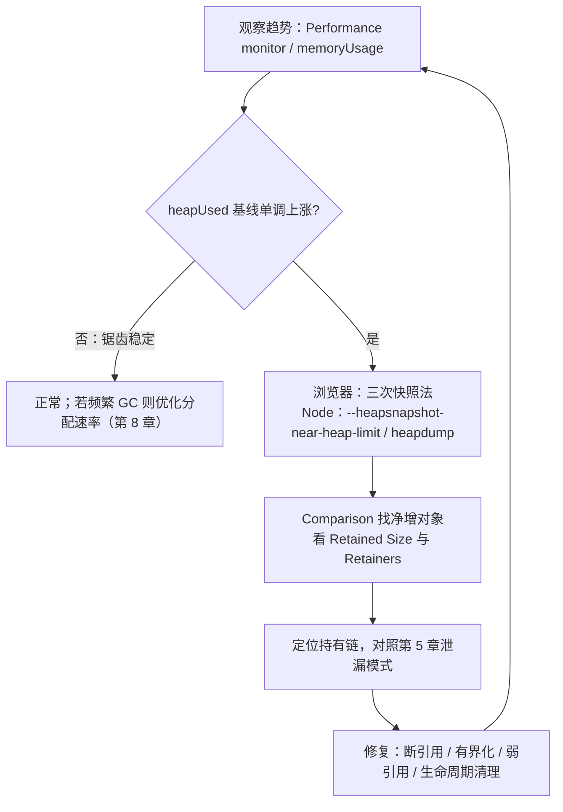

# 内存管理与垃圾回收

> 一句话概括：JS 把「何时释放内存」交给了 GC，但「对象是否可达」仍然由你的代码决定——
> 本文讲清 V8 如何判定可达、如何分代回收、停顿从哪里来，以及内存泄漏如何产生、定位与修复。

预计阅读时间：大约 80 分钟

所属主题：[JavaScript 基础常见面试题总结](summary.md)

本文以当前 V8 为基线（Chrome 稳定版；Node.js 22 LTS 内置 V8 12.4、Node.js 24 LTS 内置 V8 13.6）。源码锚点用「文件路径 + 类名#方法名」标注，基于 v8/v8 主干于 2026-11 核验；GC 算法演进注明年代/版本归属，V8 官方博客（v8.dev/blog）作为权威佐证。引擎实现细节随版本变化，语言语义以 ECMAScript 规范为准；**无法从官方来源核实的流行说法会明确标注**。总结文档给结论，本文给机制与证据：每个机制按「结论 → 机制 → 边界/代价 → 实践/排查」展开。

---

## 0. 阅读路线

| 读者 | 建议阅读 | 关注点 |
| --- | --- | --- |
| 初级（1 年内） | 1.1~1.2、2.1~2.4、3.1~3.3、5 全部、9 快问 | 栈堆分工、什么是可达、GC 基本流程、泄漏长什么样怎么修 |
| 中级（1~3 年） | 全部，重点 1.3、3.4~3.5、4.2~4.6、6、7.1~7.3 | 晋升条件源码、三色标记与写屏障、触发时机、三次快照法、弱引用语义 |
| 高级（3 年+） | 3.4~3.6、4 全部、6.3、7 全部、8 | age mark 与复制失败回退、STW 残余场景、Node 排查工具链、ephemeron 与 job 保活、MinorMS |
| 选型/架构 | 3.6、7.4、8 全部、9 | 复制 vs 标记清扫的取舍、缓存方案选型、什么时候该关心 GC、什么时候不该优化 |

目录：

1. JS 内存模型：栈与堆
2. 可达性与 GC Roots
3. V8 分代堆：新生代与老生代
4. 老生代回收与 Orinoco：停顿是怎么降下来的
5. 内存泄漏常见场景：代码与修复
6. 排查实战：浏览器与 Node
7. 弱引用家族：WeakMap、WeakRef 与 FinalizationRegistry
8. 边界与工程权衡
9. 高频追问集
10. 参考资料

---

## 1. JS 内存模型：栈与堆

### 1.1 内存生命周期：分配 → 使用 → 释放

**结论**：JS 是自动内存管理语言——值在声明/创建时自动分配，使用时读写，**释放交给垃圾回收器**。开发者不控制释放时机，只控制「引用关系」。

MDN 把内存生命周期概括为三步：分配（allocate）→ 使用（use）→ 释放（release）。多数问题出在第三步：「判断一块内存是否仍被需要」在理论上不可判定，GC 只能用**可达性**做保守近似——从根出发能走到的对象一律视为存活，哪怕业务上早已废弃。这正是第 5 章所有泄漏的总根源：**GC 没有错，是引用图错了**。

### 1.2 栈与堆的分工

**结论**：调用帧（局部变量、参数、返回地址）在**栈**上，随函数调用/返回自动进出；对象本体在**堆**上，生命周期由引用关系决定、由 GC 管理。

| 维度 | 栈（stack） | 堆（heap） |
| --- | --- | --- |
| 存什么 | 调用帧：原始值、指向堆对象的引用（指针）、返回地址 | 对象、数组、函数、闭包环境（Context）等 |
| 大小 | 帧大小在编译/调用期基本确定 | 运行时动态分配，大小不一 |
| 生命周期 | 与调用帧绑定，函数返回即销毁（LIFO） | 可跨调用帧共享，直到不可达才被 GC 回收 |
| 管理方式 | 移动栈指针，零 GC 成本 | 分配器 + GC（分代、标记、复制、整理） |
| 访问速度 | 快（连续内存、缓存友好） | 相对慢（指针跳转、可能碎片化） |

**为什么这样设计**：两个判据——**大小是否固定**与**生命周期是否已知**。原始值大小固定、生命周期通常不超过当前调用，放栈上最便宜；对象大小动态、可能被多处长期共享（返回的对象、闭包捕获的变量、挂到全局的缓存），生命周期无法在编译期确定，只能放堆上交给 GC。

```js
// browser / Node 均可运行
function makeCounter() {
  let count = 0;             // 原始值，但被内层函数捕获
  return function () {       // 闭包：生命周期可能远超 makeCounter
    return ++count;
  };
}
const next = makeCounter();  // makeCounter 的调用帧此刻已销毁
console.log(next(), next()); // 1 2 —— count 仍然活着
```

`count` 是原始值，为什么调用帧销毁后它还活着？因为它被闭包捕获，V8 把它放进了**堆上的 Context 对象**——这就是下一节要纠正的刻板印象。

### 1.3 「原始值在栈、对象在堆」的准确边界

**结论**：这句话是教学简化，不是语言保证。ECMAScript 规范只定义值语义（原始值按值比较、对象按引用比较，见 [类型与转换](types-and-coercion.md)），**从不规定存储位置**；MDN 的 Memory management 一文甚至完全不讨论栈堆划分。存储布局是引擎实现细节，V8 的真实情况：

| 值类别 | V8 中的典型形态 | 边界说明 |
| --- | --- | --- |
| 小整数 | **Smi**（tagged immediate）：直接编码在指针字里，存于寄存器/栈槽 | 不单独分配堆内存；超出 Smi 表示范围则装箱 |
| 小数 / 大整数 | **HeapNumber**：堆对象 | 是「原始值」，但本体在堆上 |
| 字符串 | 堆对象（SeqString 等），不可变 | 有 cons/sliced/thin string 等优化形态；`s.substring()` 可能只存区间不复制 |
| 布尔 / null / undefined | 根对象 / 立即数 | 引擎内置，无所谓栈堆 |
| 对象 / 数组 / 函数 | 堆对象 | 栈上只存引用 |
| **被闭包捕获的变量（含原始值）** | **堆上的 Context 对象** | 调用帧销毁后仍可达，见 1.2 示例 |
| 未逃逸的临时对象 | 可能被 TurboFan **逃逸分析 / 标量替换**优化掉 | 优化后根本不分配堆内存，拆成寄存器/栈上的标量；这是 JIT 优化，不是语义保证 |

两条高频纠偏：

1. **闭包捕获的原始值在堆上**。外层函数返回后调用帧没了，被捕获变量必须搬到堆 Context 才能继续存活。机制与 Context 链细节见 [作用域、闭包与执行上下文](scope-closures-and-execution-context.md)。
2. **「对象一定在堆上」也不绝对**。TurboFan 的逃逸分析可以证明某个对象不逃逸出当前函数，进而做标量替换（scalar replacement），把字段拆成标量直接放寄存器/栈——堆分配被整个消除。这类优化随版本与代码形态变化，**不能写依赖它的代码**，但它说明「栈堆划分」是引擎的自由而非语言的承诺。

**追问：为什么闭包捕获的原始值不能留在栈上？**
栈帧随函数返回销毁，而闭包的生命周期可能远超外层函数（被返回、被注册为回调）。要让变量活过调用帧，只能把它放到生命周期由引用关系管理的堆上。

---

## 2. 可达性与 GC Roots

### 2.1 GC 回收的是「不可达」对象，不是「没人用」的对象

**结论**：现代引擎的 GC 判定标准是**可达性（reachability）**——从一组根（roots）出发，沿引用边能走到的对象存活，走不到的回收。MDN 的表述：「This algorithm reduces the definition of 'an object is no longer needed' to 'an object is unreachable'.」

注意这个近似的方向：**不可达 ⇒ 一定可回收；可达 ⇏ 一定还需要**。一个从全局数组可达、但业务上再也不会读取的对象，GC 会永远保活它——这就是泄漏。所以「JS 有 GC 为什么还会泄漏」的答案是：GC 忠实地执行可达性，泄漏是你写出了「不该存在的可达路径」。

### 2.2 Roots 有哪些

| 根类别 | 具体内容 |
| --- | --- |
| 全局对象 | 浏览器 `window` / Node `globalThis`，及其属性链上一切可达对象 |
| 当前调用栈 | 各活跃调用帧里的局部变量、参数、`this` |
| 活跃闭包与句柄 | 被引用的闭包及其 Context；引擎的 handle scopes、global handles（跨堆引用，如 DOM 包装对象） |
| 引擎内部 | 内置对象 map、符号表、编译缓存等（DevTools 快照里「GC roots」节点的口径） |

一个高级细节：V8 近年引入**保守栈扫描（Conservative Stack Scanning）**——扫描栈时把「看起来像堆指针」的字都当作潜在引用。这意味着栈上残留的旧值也可能意外保活对象，「不可达」的判定在工程上比理论更保守。这也是为什么同一份代码在不同引擎/版本下，对象被回收的时机可能不同（第 7 章弱引用的不确定性来源之一）。

### 2.3 引用计数 vs 标记清除

| 维度 | 引用计数（reference counting） | 标记清除（mark-and-sweep） |
| --- | --- | --- |
| 判定依据 | 每个对象维护「被引用次数」，归零即回收 | 从 roots 遍历引用图，不可达即回收 |
| 循环引用 | **回收不了**：环上每个对象计数 ≥ 1，永不归零 | **天然解决**：环整体不可达就整体回收 |
| 回收时机 | 引用归零即刻（可预测，但维护计数有持续开销） | GC 周期触发（时机不可预测） |
| 停顿 | 无集中停顿，但每次赋值都要增减计数 | 有停顿（现代引擎用增量/并发摊薄，见第 4 章） |
| 现状 | **没有现代 JS 引擎再用它做主 GC**（MDN 明确） | 所有现代引擎的主算法；分代/增量/并发都是它的实现改进 |

### 2.4 循环引用：引用计数的死穴，标记清除的免费午餐

```js
// browser / Node 均可运行（MDN 经典示例）
function f() {
  const x = {};
  const y = {};
  x.a = y;   // x 引用 y
  y.a = x;   // y 引用 x
  return "azerty";
}
f(); // 函数返回后，x、y 从任何 root 都不可达
```

- **引用计数视角**：`x.a = y` 让 y 计数 +1，`y.a = x` 让 x 计数 +1。函数返回、栈上引用消失后，x 和 y 的计数仍各为 1（来自对方），永不归零 → 泄漏。
- **标记清除视角**：GC 从 roots 出发遍历，根本走不到 x 和 y（环没有入口），两者都标记为不可达 → 整环回收。**环本身不是问题，「环不可达」才是回收的充分条件。**

### 2.5 老 IE 的跨边界循环引用泄漏（历史，口径要精确）

**结论**：老 IE 的泄漏不是「JScript 用引用计数」，而是**两套内存管理的边界问题**：JScript 引擎对纯 JS 对象用标记清除（纯 JS 循环引用本来就能回收），但 DOM/ActiveX 等原生对象由 **COM 引用计数**管理，JScript GC 管不到它们。于是「JS 对象 ⇄ DOM 对象」的**跨边界环**两边都等对方先释放，谁也无法回收。

```js
// IE6/7 时代的经典泄漏（现代浏览器已无此问题）
var myGlobalObject;
function setup() {
  var div = document.createElement("div");
  myGlobalObject = { element: div };  // JS 对象 → DOM
  div.expando = myGlobalObject;       // DOM expando → JS 对象，跨边界环
}
```

微软官方文档（Understanding and Solving Internet Explorer Leak Patterns / Circular Memory Leak Mitigation）给出的演进：

| 版本 | 行为 |
| --- | --- |
| IE6 | 跨边界环直到**进程终止**才断开 |
| IE7（及 XP SP2 的 IE6 更新） | **页面导航离开**时断开挂在 DOM 树上的环；未挂树的仍泄漏 |
| IE8 | JScript GC 把被 JS 引用的 DOM 对象**当作 JScript 对象统一管理**，运行期即可断环，此模式不再泄漏 |

当年的修复手法是手动置 `null` 断环、避免 expando。现代浏览器里 V8 与 Blink 的 Oilpan 已走向**统一堆（Unified Heap）**协同标记（V8 官方 GC 文档），JS⇄DOM 循环引用不再是问题。

**追问：为什么现代浏览器不怕 JS⇄DOM 循环引用？**
因为可达性分析覆盖了整张引用图（统一堆/协同标记），环只要从 roots 不可达就整体回收；引用计数才怕环，而它已不是主算法。面试里把「老 IE 泄漏」说成「JS 用引用计数所以循环引用泄漏」是常见扣分点——精确口径是**跨 COM 边界**。

---

## 3. V8 分代堆：新生代与老生代

### 3.1 分代假说

**结论**：V8 分代设计的依据是**分代假说（generational hypothesis）——绝大多数对象朝生夕死**。V8 官方 GC 文档原文：「V8 exploits the generational hypothesis (most allocated objects die shortly after creation)」。

推论很直接：把新对象集中在一块**小空间**里高频、廉价地回收（只处理少量幸存者），把熬过多次回收的「老对象」挪到**大空间**里低频回收。为少数长寿对象频繁扫描整个堆是不划算的。

### 3.2 堆空间全景



对应源码的空间枚举（`src/common/globals.h` `AllocationSpace`）：

| 空间 | 枚举名 | 存什么 / 特点 |
| --- | --- | --- |
| 只读空间 | `RO_SPACE` | 不可变、永不移动的内置对象 |
| 新生代 | `NEW_SPACE` | 常规新对象；Scavenger 用双半空间（`SemiSpaceNewSpace`），MinorMS 用分页（`PagedNewSpace`） |
| 老生代 | `OLD_SPACE` | 晋升对象，标记-清除 + 选择性整理 |
| 代码空间 | `CODE_SPACE` | JIT 生成的指令流（`InstructionStream`），可执行内存 |
| 可信空间 | `TRUSTED_SPACE` | 沙箱外的可信元数据（近年新增） |
| 大对象空间 | `NEW_LO_SPACE` / `LO_SPACE` / `CODE_LO_SPACE` | 超过常规对象上限的大对象，**永不移动** |
| 共享空间 | `SHARED_SPACE` 等 | 多 isolate 共享（如共享字符串），有专门的 Shared GC |

几个关键数字与事实（核验自官方文档与 `globals.h`）：

- 常规页 `NormalPage` 为 **256 KB**；大对象阈值 `kMaxRegularHeapObjectSize = 1 << (kPageSizeBits - 1)`，即**页大小的一半（约 128 KB）**。源码注释明确：超过它的对象进大对象空间，「are never moved in memory」。
- 新生代双半空间设计意味着**总有一半空间始终空闲**，用来接收复制的幸存者（trash-talk 博客口径）；新生代整体上限约 **16 MiB**（随设备/flag 变化，2017 年 parallel Scavenger 博客历史口径），Node 可用 `--max-semi-space-size` 调整。
- 大对象**不经过复制**：新生代大对象存活后直接就地晋升到老生代大对象空间（页元数据改挂，对象本体不动）。
- V8 堆之外还有 CppHeap（Oilpan，管理 Blink 的 C++/DOM 对象），与 V8 协同标记，见 2.5。

### 3.3 新生代：Scavenge 复制算法

**结论**：新生代默认用 **Cheney 式半空间复制（Scavenge）**——只搬存活对象，死对象根本不碰，成本与**存活字节数**成正比，且复制后天然无碎片。

**机制**（`src/heap/scavenger.cc` `ScavengerCollector::CollectGarbage`、`Scavenger`）：

1. 平时在活跃半空间里**线性分配**（bump pointer，移动指针即可，极快）；
2. 空间满（NewSpace 分配失败）→ 触发 Minor GC；
3. **翻转半空间**（`SemiSpaceNewSpace::SwapSemiSpaces`）：原活跃空间成为 From-Space，空闲的成为 To-Space；
4. 从 **roots + remembered set** 扫描：roots 是栈/全局/句柄；remembered set 记录**老生代→新生代**的引用槽位（由分代写屏障维护），这样不必扫描整个老生代就能找到所有存活新对象；
5. 存活对象**复制**到 To-Space（紧凑排列，消除碎片），或按 3.4 的条件**晋升**老生代；原对象的 MapWord 被 CAS 写入 **forwarding address**（转发指针），其他线程/后续扫描据此更新指针，也避免重复复制；
6. 复制完成后 From-Space 整体作废，半空间再翻转回来继续分配。

**并行化**：V8 **6.2（2017-11）起默认并行 Scavenger**——主线程与 worker 线程动态工作窃取（work stealing），各任务用 thread-local allocation buffer 无同步分配；标记、复制、更新指针三个阶段**交错执行**而非分阶段锁步。官方博客数据：主线程新生代 GC 总耗时降低约 **20%–50%**。注意「并行」不等于「不停顿」：Scavenge 期间 JS 仍然暂停（见 4.5）。

**边界/代价**：复制算法的软肋是**高存活率**——最坏情况所有对象都存活，就要复制全部字节，停顿随之拉长。这正是 MinorMS（3.6）与高存活率批量晋升（3.4）要解决的问题。

### 3.4 对象什么时候进老生代（晋升条件，源码口径）

**结论**：当前 V8 的晋升判断核心是**年龄标记（age mark）——存活过一轮 Scavenge 的对象下一轮直接晋升**；辅以「To-space 复制失败回退晋升」「高存活率批量晋升」等启发式。

**机制一：age mark（主规则）**

每轮 Scavenge 收尾时，把年龄标记设为当前分配顶（`src/heap/new-spaces.cc` `SemiSpaceNewSpace#SetAgeMarkAndBelowAgeMarkPageFlags`）：

```cpp
age_mark_ = allocation_top();   // 本轮幸存对象的分配顶
```

下一轮 Scavenge 时，地址低于 age mark 的对象就是「上一轮已经存活过」的，直接晋升（`src/heap/new-spaces-inl.h`）：

```cpp
bool SemiSpaceNewSpace::ShouldBePromoted(Address object) const {
  return IsAddressBelowAgeMark(object);
}
```

这与 trash-talk 博客的「nursery → intermediate → old」口径一致：新对象第一轮存活后留在新生代成为 intermediate，**再存活一轮就进老生代**。

**机制二：复制失败回退（`src/heap/scavenger.cc` `Scavenger#EvacuateObjectDefault`，简化）**

```cpp
if (!ShouldBePromoted(object.address())) {
  // A semi-space copy may fail due to fragmentation. In that case, we
  // try to promote the object.
  if (SemiSpaceCopyObject(...)) return ...;   // 先尝试复制到 To-Space
}
if (PromoteObject(...)) return ...;           // 复制失败 → 晋升老生代
if (SemiSpaceCopyObject(...)) return ...;     // 晋升也失败 → 再试复制
```

官方 GC 文档把这表述为「when To-Space fills past a high-water threshold」——To-space 装不下时直接晋升，避免对象在新生代里被反复复制。

**机制三：高存活率批量晋升**（`scavenger.cc` `ShouldPromoteAllYoungObjects`，受 `--scavenger-high-survival-promotion` 控制）：如果上一轮新生代存活率很高，本轮幸存对象大概率下一轮还活着，索性全部直接晋升，省掉「先复制到新生代、再复制到老年代」两次搬运。

**机制四：大对象与页级晋升**：大对象不复制，存活即就地晋升（3.2）；保守栈扫描 pin 住的页可以整页（256 KB）就地挂到老生代（`ShouldPageBePromoted`，quarantined pages 机制）。

> **核验说明（重要）**：面试资料广泛流传「To 空间占用超过 **25%** 时对象直接晋升」。本文核验了当前主干的 `scavenger.cc`、`new-spaces.cc`、`new-spaces-inl.h` 以及 V8 8.4 时代（2020）的 `scavenger.cc`/`scavenger-inl.h`，**均未找到 25% 这一常量或比例判断**；当前实现就是上述 age mark + 复制失败回退 + 高存活率启发式。该数字可能来自更早版本或二手转述，**本文无法核实其出处**。面试建议按源码口径回答「存活过一轮 Scavenge（age mark）+ To-space 不足时回退晋升」，并知道 25% 是流行但未经当前源码证实的说法。

**追问：为什么存活一轮就晋升，而不是像某些 JVM 那样熬过多轮？**
这是复制成本与老生代回收成本的权衡：新生代空间小、Scavenge 频繁，让长寿对象多复制几轮纯属浪费；age mark 用「一轮存活」近似「大概率长寿」，简单且无需每对象维护年龄计数。不同引擎/版本策略不同，不存在唯一正确答案。

### 3.5 老生代：标记-清除 + 选择性整理

**结论**：老生代存活率高，复制不划算，改用**标记-清除（mark-sweep）**回收死对象、用 free-list 复用空间；**只对碎片化严重的页做整理（compaction）**，而不是每次全堆搬移。

**机制**（`src/heap/mark-compact.cc` `MarkCompactCollector`；trash-talk 博客）：

1. **Marking**：从 roots 标记所有可达对象（增量/并发执行，见第 4 章）；
2. **Sweeping**：遍历页，把死对象留下的空隙填入 Filler 对象、挂进 **free-list**（按块大小分桶，供后续分配快速查找）；
3. **Compaction（选择性）**：按碎片启发式挑选少数高碎片页作为 evacuation candidate，把其存活对象搬到其他页的空隙里，更新所有指向它们的指针。

**边界/代价**：compaction 要移动对象并更新全部引用指针，成本高——「分配大量长寿对象时，复制它们的代价很高」（trash-talk 原文）。所以 V8 的「标记-整理」是**标记-清除为主、整理为辅**：多数页只 sweep 不搬移。面试说「老生代每次 GC 都全堆整理」是错误口径。

### 3.6 新生代的新选项：Minor Mark-Sweep（MinorMS）

**结论**：复制算法不是新生代的唯一解。近年 V8 新增了 **MinorMS**（`--minor-ms` 开关，`src/heap/minor-mark-sweep.cc` `MinorMarkSweepCollector`）：新生代改用分页布局（`PagedNewSpace`），以**并发/并行标记 + 非复制清扫**替代半空间复制，高存活页整页就地晋升老生代。

官方 GC 文档（核验时点）仍将 **Scavenger 标为默认 Minor GC**，MinorMS 是 flag 启用的替代实现；其默认化的具体版本本文未核实。它针对的正是 3.3 的软肋：新生代很大或存活率很高时，复制成本不可忽视，标记-清扫反而更省。

**启示**：「新生代必用复制、老生代必用标记整理」是**历史默认与经验权衡**，不是物理定律。能说出 MinorMS 的存在与动机，说明你跟进了引擎演进。

---

## 4. 老生代回收与 Orinoco：停顿是怎么降下来的

### 4.1 Orinoco 演进时间线

**Orinoco** 是 V8 GC 项目的代号，目标把顺序执行的 stop-the-world 收集器改造成「**mostly parallel and concurrent collector with incremental fallback**」（trash-talk 原文）。关键节点（均核验自 V8 官方博客）：

| 年代/版本 | 特性 | 效果（博客数据） |
| --- | --- | --- |
| 2015 年前 | **增量标记**已是既有基础设施（idle-time GC 博客已在讨论「每个标记步骤 < 5ms」的目标） | 把标记切片摊到 JS 执行间隙 |
| 2015-08（Chrome 41 调度器 / Chrome 45 强化） | **idle-time GC**：借 Blink 任务调度器在空闲期做 GC，任务带 deadline | Gmail 空闲时 JS 堆减少约 **45%**；工作站 43% 的 GC 在空闲期完成 |
| 2015-10（Chrome 41–46，Jank Busters Part One） | **并发清扫** old/code/map space、并发 unmap 未用页 | 渲染密集型 WebGL 游戏停顿最多减少 **50%** |
| 2017-11（**V8 6.2**） | **并行 Scavenger** 成为新生代默认 | 主线程新生代 GC 总耗时降低 **20%–50%** |
| 2018-06（**Chrome 64 / Node.js 10** 默认启用） | **并发标记**：后台 worker 与 JS 同时跑 | 主线程标记时间减少 **60%–70%** |
| 2019-01 | trash-talk 博客总结 Orinoco 全貌 | 「mostly parallel and concurrent, incremental fallback」 |
| 近年（主干文档） | MinorMS（`--minor-ms`）、保守栈扫描、V8/Oilpan 统一堆、共享堆 GC | 默认化版本本文未逐一核实 |

### 4.2 三色标记与写屏障

**结论**：标记阶段用**三色抽象**描述进度；增量/并发标记期间 JS 还在改引用图，靠**写屏障（write barrier）**维护不变式，防止「活对象被漏标」。

三色（concurrent-marking 博客：用 2 个 mark bit 编码）：

| 颜色 | mark bits | 含义 |
| --- | --- | --- |
| 白（white） | 00 | 尚未发现；标记结束后仍为白 = 不可达，回收 |
| 灰（grey） | 10 | 已发现、在标记工作列表里，字段还没扫完 |
| 黑（black） | 11 | 自身与全部字段都已扫描 |

标记从 roots 开始：发现对象 → 置灰入队；弹出灰对象、扫完字段 → 置黑。**没有灰对象时标记结束，剩余白对象全部回收**。

问题：这个算法只在「应用暂停」时正确。增量/并发标记期间 JS 继续执行，可能把白对象藏进黑对象里（黑→白边），导致漏标。解法是写屏障——**增量标记用 Dijkstra 风格屏障，维护「黑不指白」的强三色不变式**（博客伪代码）：

```cpp
write_barrier(object, field_offset, value) {
  if (color(object) == black && color(value) == white) {
    set_color(value, grey);
    marking_worklist.push(value);
  }
}
```

**并发标记的屏障更保守**：为避免昂贵的内存 fence，去掉源对象颜色检查，改用 relaxed 原子写 + 原子白→灰 CAS：

```cpp
// Called after atomic_relaxed_write(&object.field, value);
write_barrier(object, field_offset, value) {
  if (color(value) == white && atomic_color_transition(value, white, grey)) {
    marking_worklist.push(value);
  }
}
```

代价是可能多标活一些实际不可达的对象（保守但安全）。另外别忘了**分代写屏障**是另一回事：老生代对象写入新生代引用时，把槽位记进 remembered set（3.3），供 Scavenge 当根用。

### 4.3 增量 / 并行 / 并发：三个词的分寸

| 术语 | 谁在干活 | 应用是否暂停 | 博客定义 |
| --- | --- | --- | --- |
| **增量（incremental）** | 主线程，切成小片 | 片间 JS 继续跑 | 「main thread does a small amount of work intermittently」 |
| **并行（parallel）** | 主线程 + worker 一起 | **全程暂停** | 「application is paused throughout the parallel marking phase」 |
| **并发（concurrent）** | 主要在 worker 线程 | **JS 继续跑** | 「application can continue running while concurrent marking is in progress」 |

并发标记叠加在既有增量标记基础设施上（博客原文：「We integrated concurrent marking into the existing incremental marking infrastructure」），worker 之间用分段工作列表 + 工作窃取协作；对优化代码对象、hidden class、弱集合等需要加锁的结构，worker 会 bailout 交回主线程处理。

### 4.4 并发清扫与 lazy sweeping

标记结束后的清扫**不必在停顿内完成**：主线程在停顿里启动并发 sweeper 任务（`src/heap/sweeper.cc` `Sweeper`），它们与 JS 执行并行地重建 free-list；分配器按需从 free-list 取空间。这种「清扫推迟到后台/按需完成」的做法常被称作 **lazy sweeping**（当前官方文档用 parallel/concurrent sweeping 表述，语义一致）。trash-talk 原文：这些任务「can continue even when JavaScript is running on the main thread」。

### 4.5 Major GC 全流程与停顿来源



**为什么能降停顿**：标记是 Major GC 的大头——大堆全量标记可能超过 **100 ms**（ACM Queue idle-time GC 文章口径），远超 16.6 ms 帧预算。把标记挪到后台（并发）或切片（增量），主线程停顿就只剩「最终原子停顿」：重扫 roots 确认存活、处理弱引用/ephemeron、撤离（compaction）与指针更新。

**全停顿（stop-the-world）仍然存在的场景**：

| 场景 | 为什么必须停 |
| --- | --- |
| Minor GC（Scavenge）全程 | 复制 + 指针更新需要一致视图；虽然多线程并行，但 JS 暂停 |
| Major GC 最终原子停顿 | roots 重扫、弱引用/ephemeron 定点计算、撤离与指针更新不能在 JS 改图时进行 |
| 接近堆上限的最后手段 GC | OOM 前的全力回收（last-resort OOM recovery） |
| 共享堆 GC | 跨 isolate 的 GlobalSafepoint，所有 client isolate 一起停 |

**追问：都有并发标记了，为什么还会卡？**
并发只覆盖了标记；最终停顿、Minor GC、compaction 仍是 STW。堆越大、存活对象越多、碎片越重，残余停顿越长。工程上靠「减少分配速率 + 控制堆规模 + 避免病态碎片」缓解，而不是指望 GC 零停顿。

### 4.6 Minor GC vs Major GC 触发时机

| 收集器 | 触发条件（官方 GC 文档口径） |
| --- | --- |
| Scavenger（默认 Minor GC） | **NewSpace 分配失败**（活跃半空间满） |
| MinorMS（`--minor-ms`） | 新生代分配上限 |
| MarkCompactCollector（Major GC） | **老生代分配上限**（动态计算的 limit）、**外部内存压力**、**idle task**、**OOM 前最后手段** |
| 增量/并发标记启动 | 堆接近动态计算的上限时提前启动（trash-talk） |
| Shared GC | 共享空间分配失败/上限，`Heap#CollectGarbageShared` |

入口锚点：`src/heap/heap.cc` `Heap#CollectGarbage` / `Heap#PerformGarbageCollection`（按请求空间与 GC 状态选择收集器）。

Node 视角：`--max-old-space-size` 设定老生代上限；接近上限时 V8 花更多时间做 GC 试图腾空间，最终仍不够就抛出标志性 OOM：`FATAL ERROR: Ineffective mark-compacts near heap limit Allocation failed - JavaScript heap out of memory`。

---

## 5. 内存泄漏常见场景：代码与修复

**总纲**：泄漏 = 对象业务上已废弃，但仍从 roots 可达。下面每个场景都给出「谁持有谁」的根因、可运行代码与修复。环境除注明外 browser / Node 通用。

### 5.1 意外全局变量

```js
// ❌ 非严格模式：未声明赋值会挂到全局对象上，永不回收
function leak() {
  accidental = new Array(1e6).fill("x");   // 没有 let/const/var！
}
leak(); // globalThis.accidental 从此常驻

// ✅ 修复一：严格模式让未声明赋值直接抛错
"use strict";
function safe() {
  // accidental = ...  → ReferenceError
  const local = new Array(1e6).fill("x");  // 函数返回即可回收
}

// ✅ 修复二：用 ESM——模块默认严格模式，且顶层变量不是全局属性
```

非严格模式下函数里 `this` 指向全局对象，`this.data = ...` 同样制造意外全局（`this` 绑定规则见 [this 绑定与函数调用](this-binding-and-function-call.md)）。ESM 的模块作用域见 [模块：CommonJS 与 ESM](modules-commonjs-and-esm.md)。

### 5.2 被遗忘的定时器与回调

```js
// ❌ browser：组件销毁了，interval 还在跑，闭包持有的大对象与 DOM 全部保活
function startWidget() {
  const hugeData = new Array(1e6).fill(0);
  const el = document.getElementById("widget");
  setInterval(() => {
    el.textContent = hugeData.length;   // 闭包持有 hugeData 和 el
  }, 1000);
}
// 即使 el 从 DOM 移除，interval 仍被引擎定时器表持有 → 整条引用链活着

// ✅ 修复：把清理纳入生命周期
function startWidgetFixed() {
  const hugeData = new Array(1e6).fill(0);
  const el = document.getElementById("widget");
  const timer = setInterval(() => { el.textContent = hugeData.length; }, 1000);
  return () => clearInterval(timer);    // 销毁时调用 dispose()
}
```

定时器是 GC root 级别的持有者（引擎定时器表 → 回调闭包 → 捕获的一切）。**创建即约定销毁**，或用 `AbortController` 统一管理（见 5.5）。

### 5.3 脱离 DOM 的引用（detached DOM）

官方定义：「A node is said to be 'detached' when it's removed from the DOM tree but some JavaScript still references it.」——节点离开了文档树，但 JS 还引用着它，整棵子树都回收不了。

```js
// ❌ browser：长生命周期对象持有已移除的节点
const cache = {};
function buildList() {
  const ul = document.createElement("ul");
  for (let i = 0; i < 1000; i++) ul.appendChild(document.createElement("li"));
  document.body.appendChild(ul);
  cache.list = ul;          // 缓存持有
  return ul;
}
const ul = buildList();
document.body.removeChild(ul);  // 从 DOM 移除，但 cache.list 仍引用 → detached 泄漏

// ✅ 修复一：不再需要时显式断开
delete cache.list;
// ✅ 修复二：元数据用 WeakMap 挂（键是节点，节点可回收时元数据随之可回收，见 7.1）
const meta = new WeakMap();
meta.set(ul, { builtAt: Date.now() });   // 不阻止 ul 回收
```

排查：DevTools 堆快照 Class filter 输入 `Detached`，或用 **Detached elements** profile 直接看游离节点与数量（第 6 章）。

### 5.4 闭包意外保留大对象

**机制**：V8 只把**被内层函数引用**的变量提升进堆 Context；但**同一作用域的多个闭包共享同一个 Context**——一个闭包用了大对象，另一个长期存活的闭包就会间接保住它，哪怕它自己根本不用。V8 官方 weak-references 文章明确警告过这个共享环境陷阱。

```js
// ❌ browser/Node：长命闭包与短命闭包共享 Context
function setup() {
  const hugeData = new Array(1e6).fill(0);   // 只被 report 使用
  const name = "widget";
  const report = () => console.log(hugeData.length);  // 用完即弃
  const getName = () => name;                // 被长期注册为回调
  report();
  return getName;   // hugeData 本可回收，但共享 Context 让它跟着 getName 活着
}
const cb = setup();   // cb 存活期间，hugeData 一直占着内存

// ✅ 修复：把大对象隔离进独立作用域，不与长命闭包共享 Context
function setupFixed() {
  const name = "widget";
  {
    const hugeData = new Array(1e6).fill(0);
    console.log(hugeData.length);   // 块级作用域，用完即可回收
  }
  return () => name;
}
```

**纠偏**：「闭包一定保留整个外层作用域的所有变量」是错误口径——V8 按需捕获；真正的坑是**共享 Context**。闭包机制本身见 [作用域、闭包与执行上下文](scope-closures-and-execution-context.md)。

### 5.5 未移除的事件监听器

```js
// ❌ browser：监听器挂在长生命周期目标上，闭包持有已废弃的组件
class Panel {
  constructor(el) {
    this.el = el;
    this.data = new Array(1e6).fill(0);
    window.addEventListener("resize", () => this.render());  // window 是 root 级持有者
  }
  render() { /* 用 this.data */ }
}
// Panel 实例从 DOM/业务移除后，window 的监听器表仍持有箭头函数 → this → 整个实例

// ✅ 修复一：AbortController 统一解绑
class PanelFixed {
  #ac = new AbortController();
  constructor(el) {
    this.el = el;
    window.addEventListener("resize", () => this.render(), { signal: this.#ac.signal });
  }
  dispose() { this.#ac.abort(); }   // 一行解绑所有监听
}
// ✅ 修复二：成对 removeEventListener（注意必须是同一个函数引用）
```

注意区分：监听器挂在**已移除且无外部引用的节点自身**上，现代引擎可以连同环一起回收；真正泄漏的是挂在 **window/document/长命 EventEmitter** 上的监听器。Node 的 `EventEmitter` 同理，`setMaxListeners` 警告就是这类泄漏的信号。

### 5.6 无限增长的缓存

```js
// ❌ Node/browser：模块级 Map 只进不出，进程/页面活多久它涨多久
const cache = new Map();
function getUser(id) {
  if (!cache.has(id)) cache.set(id, fetchUserSync(id));   // 永不淘汰
  return cache.get(id);
}

// ✅ 修复一：LRU，容量有界（Map 保持插入序，最旧键在迭代器头部）
class LRU {
  constructor(max = 500) { this.max = max; this.map = new Map(); }
  get(k) {
    if (!this.map.has(k)) return undefined;
    const v = this.map.get(k);
    this.map.delete(k); this.map.set(k, v);   // 刷新到最新
    return v;
  }
  set(k, v) {
    if (this.map.has(k)) this.map.delete(k);
    this.map.set(k, v);
    if (this.map.size > this.max) this.map.delete(this.map.keys().next().value);
  }
}

// ✅ 修复二：键是对象、元数据应随键消亡 → WeakMap（见 7.1）
// ✅ 修复三：值本身应可回收 → Map<key, WeakRef<value>> + FinalizationRegistry 清理（见 7.2/7.3）
```

选型细节见 7.4：**WeakMap 只弱持有键**，键活着时值仍被强引用——「键长期存活但值早已无用」的缓存，WeakMap 救不了，要用 WeakRef 值或 LRU。

### 5.7 Node 中未清理的模块级状态

```js
// ❌ Node：模块缓存 = 进程级单例，per-request 数据堆进模块数组就是泄漏
// stats.js
const requests = [];                       // 模块级，进程活多久它活多久
export function record(req) {
  requests.push({ url: req.url, body: req.body, at: Date.now() });  // 只进不出
}

// ✅ 修复：状态放请求作用域；确需聚合就用有界结构 + 定期清理
const recent = new LRU(1000);              // 复用 5.6 的 LRU
export function recordFixed(req) {
  recent.set(req.id, { url: req.url, at: Date.now() });   // 不持有 body 等大对象
}
```

模块级状态之所以危险：CommonJS/ESM 的模块实例在进程生命周期内被缓存复用（机制见 [模块：CommonJS 与 ESM](modules-commonjs-and-esm.md)），它就是一个天然 GC root。另外，未关闭的句柄（server、timer、socket）会让事件循环无法退出（见 [事件循环](event-loop.md)），优雅停机时务必清理。

### 5.8 场景速查

| 场景 | 泄漏根因（谁持有谁） | 修复手法 | 排查信号 |
| --- | --- | --- | --- |
| 意外全局 | 全局对象 → 大对象 | 严格模式 / let / ESM | 快照里 window 下异常属性 |
| 遗忘定时器 | 引擎定时器表 → 闭包 → 捕获物 | clearInterval / dispose | 组件销毁后 heap 不回落 |
| detached DOM | 长命 JS 对象 → 已移除节点 | 置 null / WeakMap | `Detached` filter / Detached elements |
| 闭包共享 Context | 长命闭包 → 共享 Context → 大对象 | 隔离作用域 / 按需捕获 | Retainers 里的 Context |
| 未移除监听器 | window/EventEmitter → 闭包 → 组件 | AbortController / removeEventListener | listeners 计数上涨 |
| 无界缓存 | 模块级 Map → 全部历史值 | LRU / WeakMap / WeakRef | Map size 单调上涨 |
| Node 模块状态 | 模块缓存 → per-request 数据 | 请求作用域 / 有界 / 清理 | heapUsed 基线上涨、OOM |

---

## 6. 排查实战：浏览器与 Node

### 6.1 先分清：泄漏 vs 正常增长 vs 频繁 GC

| 曲线形态 | 判断 | 依据 |
| --- | --- | --- |
| 锯齿状涨跌，**基线稳定** | 正常：分配 → GC 回落 | 官方文档：频繁涨跌代表频繁 GC，不是泄漏 |
| 锯齿状涨跌，**基线单调上涨**（每次回落后比上次高） | 泄漏嫌疑 | 「the JS heap ends higher than it began … potentially mean a memory leak」 |
| heapUsed 稳定但 **rss 持续上涨** | 堆外/native 内存（Buffer、ArrayBuffer backing store 等） | 看 `external` / `arrayBuffers` 字段（6.3） |
| 频繁涨跌且幅度大 | 频繁 GC，分配速率过高 | 第 8 章的分配优化 |

### 6.2 Chrome DevTools

**实时观察**（先定性再定量）：

- **Performance monitor**（More tools → Performance monitor）：实时 JS heap size 曲线，操作页面看基线是否抬升；
- **Task Manager**（Shift+Esc）：启用 JavaScript memory 列，关注括号里的 **live 数**（可达对象占用）——官方文档明确「If this number is increasing, either new objects are being created, or the existing objects are growing」；
- **Performance 面板**勾选 Memory 录制：Overview 的 HEAP 图 + Counter（JS heap、documents、DOM nodes、listeners），节点数阶梯上涨对应每次创建操作。

**Heap snapshot 基础**：拍快照前**自动先做一次 GC**（官方口径），所以快照只含可达对象——这正好排除「还没回收的垃圾」干扰。四种视图：

| 视图 | 用途 |
| --- | --- |
| Summary | 按构造器分组看对象与内存，追 DOM 泄漏 |
| **Comparison** | 对比两张快照的差异，确认泄漏（核心视图） |
| Containment | 从 GC roots 往下看引用结构，分析闭包与全局持有 |
| Statistics | 内存构成饼图（code/strings/arrays/typed arrays/system） |

三个关键列：**Distance**（到 root 的最短距离）、**Shallow Size**（对象自身占用）、**Retained Size**（删除该对象能释放的总内存，含其独占的依赖）。找泄漏看 Retained Size 大的可疑对象，再沿 **Retainers**（谁引用它）反查持有链。

**三次快照法**（定位「操作后应释放却没释放」的对象）：

1. 页面稳定后拍 **Snapshot 1**（基线，快照前已自动 GC）；
2. 执行可疑操作 N 次（如打开再关闭弹窗 N 次）；
3. 拍 **Snapshot 2**；
4. **再重复同样操作 N 次**；
5. 拍 **Snapshot 3**，切到 **Comparison** 视图对比 Snapshot 2；
6. 筛选器选 **「Objects allocated between Snapshots 1 and 2」**（官方名称）——只看第一轮操作分配、且到第三轮仍存活的对象。这些就是「本该释放却泄漏」的候选；展开看 Retainers 定位持有链，对照第 5 章模式修复。

官方文档还给出等价的**四步对比法**：拍快照 → 执行操作 → **执行反向操作并重复几次** → 再拍快照用 Comparison 对比。核心思想一致：可逆操作不应留下净增对象。

**Allocation timeline**（现名 **Allocations on timeline**，旧称 Allocation instrumentation on timeline）：录制期间**蓝色竖条 = 新内存分配**，是泄漏候选；放大某段蓝条可把 Constructor 面板过滤为该时段分配的对象，直接看到分配来源。**Allocation sampling** 则按函数统计分配（Heavy/Bottom Up 视图），开销更低，适合长时间采样。

**Detached elements** profile：直接列出被 JS 保活的游离 DOM 节点与数量（5.3）。

**一个排查者自己制造的坑**：DevTools 控制台会保活它求值/打印过的对象（快照筛选器里专门有「Objects retained by the DevTools console」）。排查时**不要 console.log 嫌疑对象**、不要在控制台反复求值持有它们，否则你看到的就是工具自己造成的「泄漏」。

### 6.3 Node

**趋势观察**（可运行，Node 22/24）：

```js
// monitor.js —— node monitor.js
const v8 = require("node:v8");
setInterval(() => {
  const m = process.memoryUsage();
  const h = v8.getHeapStatistics();
  console.log(
    `rss=${(m.rss / 1048576).toFixed(1)}M`,
    `heapUsed=${(m.heapUsed / 1048576).toFixed(1)}M`,
    `external=${(m.external / 1048576).toFixed(1)}M`,
    `limit=${(h.heap_size_limit / 1048576).toFixed(0)}M`,
    `detachedCtx=${h.number_of_detached_contexts}`
  );
}, 2000);
```

| API / 字段 | 含义 | 排查用法 |
| --- | --- | --- |
| `process.memoryUsage().rss` | 进程常驻内存（含堆外） | rss 涨但 heapUsed 稳 → 查 native/Buffer |
| `.heapTotal` / `.heapUsed` | V8 堆已申请 / 已使用 | heapUsed 基线单调上涨 → 泄漏嫌疑 |
| `.external` / `.arrayBuffers` | 堆外内存 / ArrayBuffer backing store | 定位 Buffer、TypedArray 增长 |
| `v8.getHeapStatistics().heap_size_limit` | 当前堆上限 | 对照 `--max-old-space-size` |
| `.number_of_detached_contexts` | 已脱离但仍被引用的上下文数 | 持续增长 → context 泄漏（vm 等场景） |

**常用启动参数**（Node CLI 文档）：

| 参数 | 作用 |
| --- | --- |
| `--max-old-space-size=4096` | 老生代上限（单位 **MiB**）。默认值由 V8 依可用内存推算（精确公式本文未核实）；容器里建议显式设定，避免 OOM 被内核杀掉 |
| `--max-old-space-size-percentage=75` | 按可用内存百分比设上限，优先于上一条 |
| `--max-semi-space-size=16` | 新生代半空间上限（MiB）：调大 → Scavenge 次数减少、吞吐提升，但单次停顿与内存占用上升（第 8 章权衡） |
| `--trace-gc` / `--trace-gc-verbose` | 打印每次 GC：Scavenge / Mark-Compact、前后堆大小、停顿 ms、触发原因 |
| `--expose-gc` | 暴露 `globalThis.gc()`（Node 22.3+ 文档化），手动触发 GC 辅助实验 |
| `--heapsnapshot-near-heap-limit=3` | **OOM 前自动落盘最多 3 份堆快照**（v15.1+，v22.22.1 转正），对比快照找持续增长的对象——线上泄漏排查利器 |

`--trace-gc` 输出示意（格式随版本略有差异）：

```text
[...]  30 ms: Scavenge 11.5 (16.4) -> 4.2 (16.4) MB, 1.29 / 0.00 ms  allocation failure
[...] 297 ms: Mark-Compact 206.7 (318.7) -> 186.0 (315.8) MB, 70.42 / 0.00 ms  finalize incremental marking via stack guard; GC in old space requested
```

读法：Scavenge 后堆几乎不降 → 新对象大量存活/晋升；Mark-Compact 频繁且回收率低 → 老生代被长命对象占满，接近上限。

**其他工具**（点到为止）：`v8.queryObjects(Constructor)`（**Node 22+** 新增）按构造器统计堆上实例数/摘要，适合写泄漏回归测试；`heapdump` 包按需落盘快照供 DevTools 分析；Clinic.js（doctor/heapprofiler）做事件循环延迟与堆增长的综合诊断。

### 6.4 排查路线



---

## 7. 弱引用家族：WeakMap、WeakRef 与 FinalizationRegistry

### 7.1 WeakMap / WeakSet：键弱值强的 ephemeron

**结论**：WeakMap 的**键是弱引用**——键对象不因「作为键」而被保活；但**键存活期间，值被强引用**。V8 官方文章点明这层语义的学名：「A more accurate name for this kind of relationship is **ephemeron**」。键被回收后，值才成为可回收候选（若无其他强引用）。

| 特性 | 说明 |
| --- | --- |
| 键类型 | 对象 + **非注册 symbol**（ES2023 起；`Symbol.for()` 的注册 symbol 不行，因为它可被重新创建、全局可达） |
| 值类型 | 任意 |
| 不可枚举 | 无 `keys()`/`values()`/`entries()`/`forEach`/`size`/`clear`。原因：暴露键列表 = 暴露 GC 状态 → 程序行为随 GC 时机变化，引入非确定性（MDN 口径） |
| ephemeron 语义 | **值引用键不会保活键**：`wm.set(k, { back: k })` 中 k 仍可回收——条目不是普通的强引用边 |

**与 GC 的交互**：标记阶段把 ephemeron 表/弱引用放入专门的弱工作列表，**在标记末期由主线程做定点（fixpoint）处理**：先独立判定键的存活，再决定值是否标记（V8 官方 marking-and-sweeping 文档；Scavenger 里也有 `ephemeron_table_list`）。这就是「值→键」的边不会让键复活的原因。

**典型应用**（可运行，browser）：

```js
// ① DOM 元数据：节点可回收时元数据随之可回收，且不污染节点自身属性
const clicked = new WeakMap();
document.querySelectorAll("button").forEach((btn) => {
  clicked.set(btn, false);
  btn.addEventListener("click", () => clicked.set(btn, true));
});
// 按钮从 DOM 移除且无其他引用 → 按钮与元数据一起回收
// 对比：btn.clicked = false 会出现在 Object.keys，且可被外部读写

// ② 私有数据：外部无法通过反射拿到（对比 Symbol 属性仍可被 getOwnPropertySymbols 取到）
const privates = new WeakMap();
class Widget {
  constructor(el) { privates.set(this, { el, count: 0 }); }
  tick() { privates.get(this).count++; }
}
// 现代代码也可用 #private 字段；WeakMap 版可跨实例互访、且兼容旧环境
```

### 7.2 WeakRef：真正的弱引用（ES2021）

**结论**：`WeakRef` 持有目标对象的**真弱引用**，不阻止回收；`deref()` 返回目标或 `undefined`（目标已被回收时）。它是「观察对象生命周期」的窗口，语义几乎完全不受保证——**能不用就不用**（MDN/V8 一致口径）。

```js
// browser / Node 14.6+：URL → 大对象缓存，值可被 GC 回收
const cache = new Map();
function getBigData(url) {
  const ref = cache.get(url);
  const cached = ref?.deref();          // 可能 undefined：已被回收
  if (cached) return cached;
  const data = loadBigData(url);
  cache.set(url, new WeakRef(data));
  return data;
}
```

三条关键边界（MDN 口径）：

1. **deref 可能永远不返回 undefined**：即使没有强引用，GC 也可能一直不决定回收该对象。「引擎从不 GC 也完全符合规范」。
2. **job 内保活（KeepDuringJob）**：刚创建 WeakRef 或刚 `deref()` 拿到的目标，**在当前 JavaScript job 结束前不会被回收**（包括脚本 job 末尾运行的 promise reaction jobs）。也就是说，你只能在**事件循环的回合之间**观察到对象被回收（事件循环与 job 见 [事件循环](event-loop.md)、[Promise 与 async/await](promise-and-async-await.md)）。这是规范故意抹平引擎差异的设计。
3. **同一 job 内多个指向同一目标的 WeakRef，deref 结果一致**；目标不可更换，永远是原对象或 undefined。

### 7.3 FinalizationRegistry：清理通知，不是析构函数（ES2021）

**结论**：注册对象被回收后**可能**收到清理回调——「may be called then, or some time later, or not at all」（MDN 原文）。它只适合**辅助性的内存优化**，绝不能承担关键逻辑。

```js
// browser / Node 14.6+：配合 WeakRef 缓存，清理失效条目
const registry = new FinalizationRegistry((key) => {
  // 注意：回调里 deref 一定是 undefined（目标先于回调被清空）
  if (cache.get(key)?.deref() === undefined) cache.delete(key);
});
function getBigData(url) {
  // ...同 7.2...
  registry.register(data, url, data);   // heldValue=url；token=data 便于 unregister
  return data;
}
```

必须记住的边界（MDN + V8 官方文章）：

| 边界 | 说明 |
| --- | --- |
| 不保证执行 | 程序退出（关标签页）、registry 自身不可达时，回调可能永远不跑 |
| 时机不定 | 可能远晚于回收；**绝不同步执行**，总在当前 job 结束之后 |
| 顺序不定 | 两个 registry 的回调不保证相邻执行 |
| heldValue 被强引用 | **绝不能把目标对象本身当 heldValue**，否则目标永不可回收 |
| registry 要保活 | 注册表不被它注册的对象保活；通常放全局变量，否则自己先被回收 |
| 与 WeakRef 的时序 | 目标的 WeakRef 先于（或同时于）清理回调被清空——回调里 deref 必得 undefined |
| cleanupSome | 早期提案的 `cleanupSome()` **已从最终标准移除**，不要依赖（提案历史） |

**关键资源释放不要用 FinalizationRegistry**：文件句柄、连接、锁必须用确定性手段——`try...finally`、显式 `dispose()`，或预计 ES2027 的显式资源管理（`using` / `Symbol.dispose`，Chrome 134+ / Firefox 141+ / Node 24 已实现，见 [ES6+ 与现代 JS](es6-plus-and-modern-js.md)）。V8 官方文章的定位很直白：这类能力「work best when used sparingly … we expect most usage to happen within frameworks or libraries」。

### 7.4 选型对照

| 方案 | 键 | 值的生命周期 | 可枚举 | 适用 |
| --- | --- | --- | --- | --- |
| `Map` | 任意类型，强引用 | 与 Map 同生死 | ✅ | 需要遍历/size、键为原始值、生命周期自己控制 |
| `WeakMap` | 对象/非注册 symbol，弱引用 | 键活着时值强引用；键死值可死 | ❌ | 对象元数据、私有数据、键消亡即无用的缓存 |
| `Map` + `WeakRef`（+ FinalizationRegistry） | 任意，强引用 | **值可被 GC 回收**，deref 判空 | ✅（键） | 键长期存活但值可能不再需要的大对象缓存 |
| LRU（有界 Map） | 任意 | 容量淘汰，确定性 | ✅ | 需要可控内存上限、不依赖 GC 时机的缓存 |

**追问：WeakMap 和 Map 怎么选？**
先问「键死了之后这份数据还有没有用」：没用 → WeakMap；还有用/需要遍历/键是原始值 → Map；键活着但值可能过期 → WeakRef 值或 LRU。WeakMap 不是「更省内存的 Map」，它是**生命周期绑定工具**。

---

## 8. 边界与工程权衡

### 8.1 GC 停顿与帧预算

60 fps 的帧预算是 **16.6 ms**（Jank Busters 口径）。GC 与渲染争抢同一个主线程：

- Minor GC 在多数对象死亡时通常 **< 1 ms**（ACM Queue 口径），但高存活率时显著拉长；
- 大堆全量标记可 **> 100 ms**——增量/并发标记把它摊薄，但最终原子停顿仍在（4.5）；
- GC 停顿叠加在长任务上，直接表现为掉帧/输入延迟（任务与渲染的调度见 [事件循环](event-loop.md)）。

实践：动画/渲染循环（`requestAnimationFrame`）里**避免每帧分配**——Gmail 内存管理文章给游戏开发者的建议是「为了 16 ms 帧预算，每帧分配趋近于零」；把大计算切片、复用对象、控制堆规模。

### 8.2 内存换 CPU：对象池与复用的适用与滥用

| 维度 | 适用 | 滥用 |
| --- | --- | --- |
| 场景 | 高频、同构、短命对象：游戏粒子/子弹、渲染向量、解析器临时节点 | 普通业务代码 everywhere 池化 |
| 收益 | 分配速率下降 → Scavenge 频率下降 → 停顿减少 | V8 bump-pointer 分配本来就极快，省不了多少 |
| 代价 | 池本身是**强根**（常驻内存）；池对象晋升老生代 → Major GC 更重；状态重置 bug、复杂度 | 用内存和复杂度换不存在的收益 |

另一个明确的权衡旋钮：`--max-semi-space-size` 调大新生代 → Scavenge 次数减少、吞吐提升，但**单次停顿更长、内存占用更高**。吞吐与延迟不可兼得，按场景选。

**原则**：先测量（`--trace-gc`、DevTools timeline）确认 GC 真是瓶颈，再优化。「日常业务先写清晰的代码，GC 调优是测量驱动的最后一公里」。

### 8.3 大数组与 TypedArray

- 普通 `Array` 存的是**元素指针**：数值元素可能逐个装箱成 HeapNumber（除非是 PACKED_SMI_ELEMENTS 等优化形态），百万级数值数组的指针 + 装箱开销可观；
- `TypedArray`（如 `Float64Array`）是**连续定长数值内存**：每元素固定 8 字节、无装箱、缓存友好；其 backing store（ArrayBuffer）在 **V8 堆外**，计入 `external`/`arrayBuffers`（6.3），对象头本身仍在堆内；
- 边界：定长（`resizable ArrayBuffer` 是新选项）、类型单一、detach/transfer 语义（`postMessage` 转移所有权避免拷贝）。

结论：百万级数值数据优先 TypedArray；小数组不必过度设计。

### 8.4 什么时候该关心 GC

| 场景 | 该做什么 | 不必做什么 |
| --- | --- | --- |
| 实时渲染 / 游戏 / 高频交互 | 控制每帧分配、对象池、TypedArray、监控停顿 | 不必追求零 GC（做不到） |
| 低端设备 | 控制堆规模、减少长命对象、避免病态碎片 | 不必照搬桌面端参数 |
| 长驻 Node 服务 | **防泄漏**（第 5 章）、有界缓存、监控 heapUsed 基线、设好 `--max-old-space-size` | 不必为每次分配焦虑 |
| 大数据处理 | 流式/分批、TypedArray、及时释放大对象引用 | 不必一次性 load 全量 |
| 日常业务 CRUD | 避免泄漏模式、写清晰代码 | **不必微优化分配**——过早优化与无视泄漏是两个极端 |

**立场**：GC 是引擎给你的免费午餐，但「可达性」这份账单始终由你的代码签单。先保证无泄漏、无病态分配，再谈调优。

---

## 9. 高频追问集

**Q1：为什么新生代用复制算法，老生代用标记-整理？**
期望答案：成本结构不同。复制算法成本与**存活对象**成正比——新生代绝大多数对象死亡，只搬少量幸存者，极快且复制后无碎片；老生代存活率高，复制大量长寿对象不划算，改用标记-清除回收死对象、free-list 复用空间，只对高碎片页做选择性整理（compaction）。补一句「新生代也有 MinorMS 标记-清扫替代方案」能体现跟进。

**Q2：对象什么时候进老生代？**
期望答案：主规则是 age mark——存活过一轮 Scavenge（地址低于年龄标记）下一轮直接晋升；辅以 To-space 复制失败回退晋升、高存活率批量晋升；大对象不复制、存活即就地晋升。能说出「25% 是流行说法但当前源码无此常量」是加分项（见 3.4 核验说明）。

**Q3：闭包一定造成内存泄漏吗？**
期望答案：不一定。闭包是正常机制，V8 只把被引用的变量提升进 Context；泄漏发生在「长命闭包经共享 Context 保活了不再需要的大对象」。修复靠隔离作用域、按需捕获、及时断开长命引用。把「闭包=泄漏」一刀切是错误口径。

**Q4：如何定位内存泄漏？说出三次快照法步骤。**
期望答案：先看趋势（Performance monitor / memoryUsage）确认基线单调上涨；再拍 Snapshot 1 → 执行可疑操作 N 次 → Snapshot 2 → 重复操作 N 次 → Snapshot 3，用 Comparison 对比 2/3 并筛选「Objects allocated between Snapshots 1 and 2」，看 Retained Size 与 Retainers 定位持有链；Node 侧用 `--heapsnapshot-near-heap-limit` 自动落盘快照对比。注意快照前自动 GC、控制台自身会保活对象。

**Q5：WeakMap 和 Map 的区别与选型？**
期望答案：WeakMap 键弱引用（对象/非注册 symbol）、不可枚举、无 size，键存活期间值强引用（ephemeron）；Map 全强引用、可枚举、键任意。选型看「键死后数据还有没有用」：元数据/私有数据/随键消亡的缓存用 WeakMap；需要遍历或键为原始值用 Map；键长命但值可过期用 Map+WeakRef 或 LRU。

**Q6：标记清除如何解决循环引用？**
期望答案：它判定的是「从 roots 可达」而非「引用数归零」。互相引用的两个对象若从 roots 不可达，整环都被回收；引用计数则因环上计数永不归零而泄漏。老 IE 的精确口径是 JScript（标记清除）与 DOM/COM（引用计数）的**跨边界环**，IE8 起统一管理后解决。

**Q7：都有并发标记了，为什么 GC 还会停顿？**
期望答案：并发只覆盖标记阶段。Minor GC 全程 STW（并行但暂停）；Major GC 仍有最终原子停顿——重扫 roots、弱引用/ephemeron 定点、撤离与指针更新需要一致视图；接近堆上限还有最后手段 GC。堆越大、存活越多、碎片越重，残余停顿越长。

**Q8：WeakRef 的 deref 什么时候返回 undefined？刚 deref 的对象会被立刻回收吗？**
期望答案：目标被 GC 回收后返回 undefined，但 GC 可能一直不回收（永远拿得到）。刚创建/deref 的目标受 job 内保活（KeepDuringJob）保护，当前 job（含末尾的 promise reaction jobs）结束前不会回收——只能在事件循环回合之间观察到回收。所以不能用 WeakRef 写依赖回收时机的正确性逻辑。

---

## 10. 参考资料

**官方文档与博客**

- MDN · JavaScript Memory management：<https://developer.mozilla.org/en-US/docs/Web/JavaScript/Memory_management>（可达性、引用计数 vs 标记清除、弱引用家族总览）
- V8 官方 GC 文档：<https://chromium.googlesource.com/v8/v8/+/HEAD/docs/heap/garbage-collection.md>（收集器/触发条件/晋升/统一堆）；Marking and Sweeping：<https://chromium.googlesource.com/v8/v8/+/HEAD/docs/heap/marking-and-sweeping.md>
- V8 博客 · Trash talk: the Orinoco garbage collector（2019-01-03）：<https://v8.dev/blog/trash-talk>
- V8 博客 · Concurrent marking in V8（2018-06-11，Chrome 64 / Node 10）：<https://v8.dev/blog/concurrent-marking>
- V8 博客 · Orinoco: parallel Scavenger（2017-11-29，V8 6.2）：<https://v8.dev/blog/orinoco-parallel-scavenger>
- V8 博客 · Jank Busters Part One（2015-10-30，Chrome 41–46）：<https://v8.dev/blog/jank-busters>
- V8 博客 · Free garbage collection（idle-time GC，2015-08-07）：<https://v8.dev/blog/free-garbage-collection>
- V8 features · Weak references（ES2021，Chrome 84 / Node 14.6+）：<https://v8.dev/features/weak-references>
- ACM Queue · Idle-Time Garbage-Collection Scheduling：<https://queue.acm.org/detail.cfm?id=2977741>（分代假说、停顿量级）
- Chrome DevTools · Fix memory problems：<https://developer.chrome.com/docs/devtools/memory-problems>；Heap snapshot reference：<https://developer.chrome.com/docs/devtools/memory-problems/heap-snapshots>
- MDN · WeakMap / WeakRef / FinalizationRegistry：<https://developer.mozilla.org/en-US/docs/Web/JavaScript/Reference/Global_Objects/WeakMap>、<https://developer.mozilla.org/en-US/docs/Web/JavaScript/Reference/Global_Objects/WeakRef>、<https://developer.mozilla.org/en-US/docs/Web/JavaScript/Reference/Global_Objects/FinalizationRegistry>
- Node.js 文档 · process.memoryUsage：<https://nodejs.org/docs/latest-v22.x/api/process.html#processmemoryusage>；v8 模块：<https://nodejs.org/docs/latest-v22.x/api/v8.html>；CLI（V8 options）：<https://nodejs.org/docs/latest-v22.x/api/cli.html>
- Node.js 22.0.0 / 24.0.0 发布说明（V8 12.4 / 13.6、v8.queryObjects）：<https://nodejs.org/en/blog/release/v22.0.0>、<https://nodejs.org/en/blog/release/v24.0.0>
- Microsoft Learn · Understanding and Solving Internet Explorer Leak Patterns：<https://learn.microsoft.com/en-us/previous-versions/ms976398(v=msdn.10)>；Circular Memory Leak Mitigation（IE8）：<https://learn.microsoft.com/en-au/previous-versions/windows/internet-explorer/ie-developer/platform-apis/dd361842(v=vs.85)>
- TC39 proposal-weakrefs（含 cleanupSome 移除等提案历史）：<https://github.com/tc39/proposal-weakrefs>
- TC39 finished proposals（Explicit Resource Management：Stage 4，Expected Publication Year **2027**）：<https://github.com/tc39/proposals/blob/main/finished-proposals.md>

**本文源码锚点（v8/v8 主干，2026-11 核验）**

- `src/heap/heap.cc`：`Heap#CollectGarbage` / `Heap#PerformGarbageCollection`（GC 入口与收集器选择）
- `src/heap/scavenger.cc`：`ScavengerCollector#CollectGarbage`、`ScavengerJobTask`（并行 Scavenge）、`Scavenger#ScavengeObject` / `#EvacuateObjectDefault` / `#ShouldBePromoted`、`ShouldPromoteAllYoungObjects`（高存活率批量晋升）
- `src/heap/new-spaces.cc`：`SemiSpaceNewSpace#SwapSemiSpaces`（半空间翻转）、`#SetAgeMarkAndBelowAgeMarkPageFlags`（age mark 设置）、`#ShouldPageBePromoted`（页级晋升）
- `src/heap/new-spaces-inl.h`：`SemiSpaceNewSpace#ShouldBePromoted` / `#IsAddressBelowAgeMark`（晋升判断本体）
- `src/heap/mark-compact.cc`：`MarkCompactCollector`（`#MarkLiveObjects` 最终原子停顿）
- `src/heap/incremental-marking.cc`：`IncrementalMarking#Start`；`src/heap/sweeper.cc`：`Sweeper`（并发清扫）
- `src/heap/minor-mark-sweep.cc`：`MinorMarkSweepCollector`（`--minor-ms`）
- `src/common/globals.h`：`AllocationSpace` 枚举、`kMaxRegularHeapObjectSize`（大对象阈值 = 页大小一半）

**兄弟专题**

- [作用域、闭包与执行上下文](scope-closures-and-execution-context.md)（Context 与捕获机制）
- [事件循环](event-loop.md)（job/任务调度与 GC 停顿）
- [Promise 与 async/await](promise-and-async-await.md)（promise reaction jobs 与 KeepDuringJob）
- [类型与转换](types-and-coercion.md)（原始值/对象的值语义）
- [this 绑定与函数调用](this-binding-and-function-call.md)（非严格 this 与意外全局）
- [模块：CommonJS 与 ESM](modules-commonjs-and-esm.md)（模块缓存与模块级状态）
- [ES6+ 与现代 JS](es6-plus-and-modern-js.md)（显式资源管理 using）

---

## 附：一页速记

**内存模型**
1. 栈放调用帧（原始值/引用），堆放对象；判据是「大小是否固定、生命周期是否已知」。
2. 「原始值在栈」是简化：Smi 是立即数、小数装箱成 HeapNumber、字符串是堆对象、闭包捕获的原始值在堆 Context；TurboFan 逃逸分析可消除未逃逸对象的堆分配。

**可达性**
3. GC 回收「不可达」而非「没人用」；roots = 全局对象 + 调用栈 + 活跃闭包/句柄 + 引擎内部。
4. 引用计数怕循环引用，标记清除不怕；现代引擎都用标记清除。老 IE 泄漏的精确口径是 JScript⇄DOM/COM 跨边界环，IE8 起解决。

**分代堆**
5. 分代假说：多数对象朝生夕死。新生代半空间复制（Scavenge，成本∝存活字节），老生代标记-清除 + 选择性整理。
6. 晋升：存活过一轮 Scavenge（age mark）→ 老生代；To-space 复制失败回退晋升；高存活率批量晋升；大对象就地晋升、永不移动。「25%」是流行但未经当前源码证实的说法。
7. 页 256 KB，大对象阈值约 128 KB（页一半）；新生代上限约 16 MiB（历史口径，随设备/flag 变化）。MinorMS（--minor-ms）是新生代标记-清扫新选项。

**Orinoco**
8. 演进：idle GC（2015）→ 并发清扫（2015）→ 并行 Scavenger（V8 6.2，2017）→ 并发标记（Chrome 64/Node 10，2018）。
9. 三色标记 + 写屏障（增量维护黑不指白；并发更保守）；增量=主线程切片、并行=暂停中多核、并发=JS 继续跑。
10. STW 仍在：Minor GC 全程、Major 最终原子停顿、近上限最后手段 GC。触发：Minor=新空间分配失败；Major=老生代上限/外部内存压力/idle/OOM 兜底。

**泄漏与排查**
11. 泄漏七模式：意外全局、遗忘定时器、detached DOM、闭包共享 Context、未移除监听器、无界缓存、Node 模块级状态。修复=断引用/有界化/弱引用/生命周期清理。
12. 锯齿基线稳定=正常，基线单调上涨=泄漏；heapUsed 稳但 rss 涨=堆外内存。
13. 三次快照法 + Comparison 筛选「Objects allocated between Snapshots 1 and 2」看 Retainers；Node 用 memoryUsage/getHeapStatistics/--trace-gc/--heapsnapshot-near-heap-limit/v8.queryObjects（22+）。快照前自动 GC；控制台会保活对象。

**弱引用与权衡**
14. WeakMap 键弱值强（ephemeron）、不可枚举；WeakRef deref 可能 undefined、job 内保活；FinalizationRegistry 回调不保证执行，关键资源用 try/finally 或 using。
15. 帧预算 16.6 ms；对象池只适合高频同构短命对象，池本身是强根；大数值数组用 TypedArray（backing store 在堆外）。
16. 日常业务先防泄漏、再谈调优；GC 调优是测量驱动的最后一公里。

**一句话**
> GC 替你管理「何时释放」，但你始终在签「是否可达」这张账单——知道引用图从哪里长出来，就知道内存从哪里漏出去。
