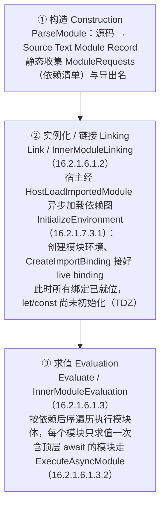

# 模块系统：CommonJS 与 ESM

> 一句话概括：CommonJS 是「运行时同步加载 + 值拷贝」的服务器方案，ESM 是「编译期静态声明 + 异步加载 + live binding」的语言标准——
> 两者的几乎全部差异（tree shaking、循环依赖行为、互操作坑）都能从这一次设计交换推导出来；本文讲清机制、边界与选型。

预计阅读时间：大约 80 分钟

所属主题：[JavaScript 基础常见面试题总结](summary.md)

本文以 **ECMAScript ES2025（ECMA-262 第 16 版）模块规范 + Node.js 22/24 LTS** 为基线，浏览器以当前 Chrome 为准。规范锚点用 ES2025 章节号（如 `16.2.1.6 Cyclic Module Records`），Node 源码锚点基于 `v22.x` 分支（如 `lib/internal/modules/cjs/loader.js`）。文中全部示例在 **Node v22.23.2** 实测通过，`require(esm)` 另用 v24.14.0 / v20.11.1 做跨版本对照；Node 版本相关行为均已对照 nodejs.org 官方文档与发布说明在线核实。总结文档给结论，本文给机制与证据：每个机制按「结论 → 机制 → 边界/代价 → 实践/追问」展开。

---

## 0. 阅读路线

| 读者 | 建议阅读 | 关注点 |
| --- | --- | --- |
| 初级（1 年内） | 1、2.1~2.3、3.1、3.3、4、10 | 模块化演进、require/exports 怎么写、值拷贝 vs live binding、对比总表 |
| 中级（1~3 年） | 全部，重点 2.4、3.2、3.4~3.5、5、7 | 缓存与热重载、三阶段与规范锚点、循环依赖两种行为、tree shaking 原理 |
| 高级（3 年+） | 3.2~3.3、5.2、6.2~6.4、8.3~8.4 | CreateImportBinding/TDZ 规范细节、cjs-module-lexer 边界、require(esm) 版本线、dual package hazard |
| 选型/架构 | 4、6.4、7.3、9 | 双格式发布策略、module-sync 条件、ESM-only 的基线判断、迁移清单 |

目录：

1. 模块化演进：从 IIFE 到 ESM
2. CommonJS 机制：包装函数、值拷贝与缓存
3. ESM 机制：静态结构、三阶段与 live binding
4. CJS vs ESM 对比总表
5. 循环依赖：部分导出 vs TDZ
6. 混用与互操作：格式判定、require(esm)、dual package hazard
7. tree shaking：为什么 ESM 可以而 CJS 不行
8. 动态能力与生态：import()、import.meta、import attributes、exports 字段
9. 边界与选型：什么时候用哪个
10. 高频追问集
11. 参考资料

---

## 1. 模块化演进：从 IIFE 到 ESM

### 1.1 没有模块系统的年代

**结论**：模块系统解决三件事——**命名空间隔离、依赖声明、加载顺序**。ES2015 之前语言层面没有模块，社区用模式与约定硬造了三代方案。

最早的浏览器脚本共享一个全局作用域，两个文件定义同名函数就互相覆盖，依赖顺序全靠 `<script>` 标签的排列手工维护：

```html
<!-- 顺序错了就炸：jquery 必须在 plugin 之前 -->
<script src="jquery.js"></script>
<script src="jquery.plugin.js"></script>
<script src="app.js"></script>
```

第一代解法是 **IIFE + 命名空间对象**：用函数作用域藏起私有变量，把公开 API 挂到一个全局对象上：

```js
var MyApp = MyApp || {};
MyApp.utils = (function () {
  var privateHelper = function () { /* 外部不可见 */ };
  return { format: function (s) { return privateHelper(s); } };
})();
```

它解决了隔离，但没解决依赖声明与加载——`MyApp` 仍是全局变量，谁先谁后仍靠人肉。

### 1.2 演进时间线

| 阶段 | 时间 | 代表 | 加载方式 | 一句话定位 |
| --- | --- | --- | --- | --- |
| 全局函数 / IIFE 命名空间 | 2000s | jQuery 插件模式 | `<script>` 顺序加载 | 只有隔离，没有依赖管理 |
| **CommonJS** | 2009 | Node.js | **运行时同步** `require()` | 服务器端事实标准；模块即文件，导出即对象 |
| AMD | ~2011 | RequireJS | 浏览器**异步** `define(deps, factory)` | 为浏览器网络环境改造 CJS：依赖前置、回调执行 |
| CMD | ~2012 | SeaJS | 浏览器异步加载、**就近执行** | 与 AMD 同期，`require` 写在用到之处；历史方案，点到为止 |
| UMD | ~2013 | 各类库的发行模板 | 运行时探测环境 | 不是新规范，是「同一份代码兼容 CJS/AMD/全局」的包装模板 |
| **ESM** | ES2015（2015） | 语言标准 | **编译期声明 + 宿主异步加载** | 唯一的语言级标准；浏览器原生（Chrome 61+）、Node 12+ 稳定 |

UMD 的骨架值得认得（面试偶尔让手写）：

```js
(function (root, factory) {
  if (typeof module === 'object' && module.exports) module.exports = factory(); // CJS
  else if (typeof define === 'function' && define.amd) define(factory);          // AMD
  else root.MyLib = factory();                                                   // 全局
})(this, function () { return { /* ... */ }; });
```

ESM 标准化之后，AMD/CMD/UMD 都进入了退场通道：新项目不再需要它们，但读老库源码时仍会碰到。ES2015 之后的语言特性演进见 [ES6+ 与现代 JavaScript](es6-plus-and-modern-js.md)。

### 1.3 为什么浏览器不能直接用 CommonJS

**结论**：CJS 的 `require` 是**同步的运行时函数调用**，这个设计在服务器成立、在浏览器不成立。

| 维度 | 服务器（Node） | 浏览器 |
| --- | --- | --- |
| 模块在哪 | 本地磁盘，读取 µs~ms 级 | 网络远端，一次请求几十~几百 ms |
| 同步加载的代价 | 可接受：阻塞的是自己的进程 | 不可接受：同步等待会**阻塞主线程**，页面冻结 |
| 依赖能否预知 | 不需要：执行到 `require` 再读文件 | 需要：只有提前知道依赖清单，才能**并行预取** |
| 导出能否静态分析 | 不需要：`module.exports` 运行时是什么就是什么 | 需要：静态结构才能做加载优化与死代码消除 |

CJS 把「声明依赖」和「加载依赖」合并成一次运行时调用，浏览器拿不到任何可提前分析的信息。ESM 的核心设计正是把两者拆开：**`import`/`export` 是编译期静态声明，加载交给宿主异步完成**（规范里的 `HostLoadImportedModule`，见 3.2）。这一拆，并行加载、tree shaking、循环依赖的确定性处理才全部成为可能。

**追问：那浏览器能不能用同步 XHR 模拟 require？** 技术上能（早期确有这种 shim），但同步 XHR 阻塞主线程、无法并行、已被浏览器标记废弃——这正是 AMD 当年诞生的原因，也是「CJS 不适合浏览器」的工程注脚。

---

## 2. CommonJS 机制：包装函数、值拷贝与缓存

### 2.1 模块包装函数：模块作用域是「函数作用域」

**结论**：Node 执行 CJS 模块前，把源码包进一个五参数函数——模块里的「顶层变量」其实是**函数局部变量**，`require`/`exports`/`module`/`__filename`/`__dirname` 都是**注入的参数**，不是全局变量。

Node v22.x 源码（`lib/internal/modules/cjs/loader.js`，实测摘录）：

```js
// lib/internal/modules/cjs/loader.js（Node v22.x）
const wrapper = [
  '(function (exports, require, module, __filename, __dirname) { ',
  '\n});',
];
let wrap = function (script) {
  return Module.wrapper[0] + script + Module.wrapper[1];
};
```

包装后的源码经 `compileFunctionForCJSLoader`（V8 `compileFunction`）编译成函数再调用。两个直接推论（均已实测）：

```js
// thistest.cjs —— node thistest.cjs（Node v22.23.2）
console.log(this === module.exports); // true
```

- **CJS 顶层 `this` 指向 `module.exports`**：包装函数以 `module.exports` 为 `this` 调用（普通函数调用的 this 规则见 [this 绑定与函数调用](this-binding-and-function-call.md)）；
- 模块里 `var x = 1` 不会污染全局——它只是包装函数的局部变量。模块作用域与执行环境的完整机制见 [作用域、闭包与执行上下文](scope-closures-and-execution-context.md)。

**边界**：`Module.wrapper` 是可写的（源码里用 Proxy 包了一层），理论上能改包装签名——没有任何正当理由这么做，但它解释了为什么某些注入式工具（如测试框架的模块沙箱）能拦截模块变量。

### 2.2 运行时同步加载与解析规则

**结论**：`require(X)` 是一次**同步函数调用**：解析路径 → 读文件 → 包装编译 → 立即执行 → 返回 `module.exports`。执行到这一行才发生加载，因此 `require` 可以出现在任何位置——if 里、函数里、循环里，参数可以是变量。

```js
// 合法：运行时按需加载，路径可以是计算结果
const lang = process.env.LANG || 'en';
const messages = require(`./i18n/${lang}.js`);
```

解析规则（`require` 专属，ESM 没有这些便利，见 6.1）：

| 输入 | 行为 |
| --- | --- |
| 精确文件名存在 | 直接按扩展名对应格式加载 |
| `X` 不存在 | 依次尝试 `X.js` → `X.json` → `X.node`（**扩展名探测**） |
| `X` 是目录 | 找 `X/package.json` 的 `main`，再试 `X/index.js` 等（**目录索引**） |
| 裸名（`'lodash'`） | 从当前目录的 `node_modules` 逐级向上查找 |
| `node:` 前缀 | 直接加载内置模块，**绕过 require.cache** |

**边界与代价**：动态性是把双刃剑——打包器无法静态枚举 `require(变量)` 的依赖（第 7 章 tree shaking 的根源之一）；同步加载在服务器可接受，但意味着 CJS 模块图里**任何一个模块的顶层代码都在 require 调用栈里同步执行**，一个模块顶层死循环会卡住整个加载链。

### 2.3 输出语义：值拷贝（原始值快照、对象共享引用）

**结论**：`require` 返回的是**导出那一刻 `module.exports` 的值**——原始值是快照，对象是共享引用。导出方之后重新赋值内部变量，导入方**看不到**；但修改共享对象的属性，双方都可见。

```js
// 文件结构：copy/counter.cjs、copy/main.cjs
// ---- counter.cjs ----
let count = 0;
function increment() { count += 1; }
module.exports = { count, increment };

// ---- main.cjs ----
const { count, increment } = require('./counter.cjs');
console.log('before:', count); // 0
increment();
console.log('after:', count);  // 0 —— 仍是 0！
```

实测输出（Node v22.23.2）：`before: 0`、`after: 0`。机制：`module.exports = { count, increment }` 执行时，`count` 的**当前值 0 被拷贝进导出对象**；之后 `increment` 改的是模块内部的 `count` 绑定，与导出对象上的 `count` 属性再无关系。

对象则不同——拷贝的是**引用**：

```js
// 文件结构：obj/store.cjs、obj/main.cjs
// ---- store.cjs ----
const state = { n: 0 };
function bump() { state.n += 1; }
module.exports = { state, bump };

// ---- main.cjs ----
const { state, bump } = require('./store.cjs');
bump();
console.log('state.n:', state.n); // 1 —— 同一个对象，属性修改可见
```

这与普通的对象赋值/浅拷贝语义完全一致（详见 [对象、属性与拷贝](objects-properties-and-copy.md)），CJS 没有任何魔法：**「值拷贝」拷的是 `module.exports` 这个值本身**。

**module.exports vs exports（高频坑）**：`exports` 只是模块执行前被赋值为 `module.exports` 的**局部别名**，`require` 返回的永远是 `module.exports`：

```js
// ---- alias/bad.cjs ----
exports = { hello: true };        // 只重绑了局部变量，导出无效
// ---- alias/good.cjs ----
module.exports = { hello: true }; // 正确
// ---- alias/main.cjs ----
console.log(require('./bad.cjs'));  // {}
console.log(require('./good.cjs')); // { hello: true }
```

实测输出与注释一致。规则一句话：**往对象上挂属性用 `exports.x` 或 `module.exports.x` 都行；整体替换导出必须用 `module.exports =`**。官方文档另强调：替换必须**同步立即**完成，放在 `setTimeout` 回调里赋值 `module.exports` 对消费者无效——因为 `require` 早已返回了旧对象。

**追问：为什么 CJS 设计成值拷贝而不是 live binding？** CJS 的导出是「运行时求值一个表达式得到对象」，没有静态绑定概念可言；值拷贝实现最简单、与 JS 赋值语义一致。代价是导出方与导入方的状态可能悄悄分叉——ESM 用 live binding 修正了这一点（3.3）。

### 2.4 require.cache：缓存、热重载与它的坑

**结论**：CJS 模块**按解析后的绝对文件名缓存**在 `require.cache`，同一文件只执行一次；删除缓存条目可强制重新执行——这是 CJS 热重载的原理。

```js
// 文件结构：cache/mod.cjs、cache/main.cjs
// ---- mod.cjs ----
module.exports = { ts: Date.now() };
// ---- main.cjs ----
const p = require.resolve('./mod.cjs');
const first = require('./mod.cjs');
setTimeout(() => {
  delete require.cache[p];
  const second = require('./mod.cjs');
  console.log('same object?', first === second); // false
}, 20);
```

实测输出 `same object? false`。机制：`Module._load` 先查缓存，命中直接返回 `module.exports`；未命中则**先创建 Module 对象放入缓存、再执行模块代码**——这个「先占位后执行」的顺序正是循环依赖时能拿到部分导出的原因（第 5 章）。

**边界与代价**（官方文档明确列出的坑）：

| 坑 | 说明 |
| --- | --- |
| 原生 addon 不可重载 | 删除 `.node` 模块缓存后再 require 会报错 |
| `node:` 前缀绕过缓存 | 往 `require.cache.fs` 塞假对象只能骗到 `require('fs')`，骗不到 `require('node:fs')` |
| 大小写不敏感文件系统 | macOS/Windows 上 `require('./foo')` 与 `require('./FOO')` 解析为不同缓存键，**同一文件两份实例** |
| 热重载的内存泄漏 | 旧模块对象若仍被闭包/定时器/事件监听引用，GC 无法回收；反复热重载会累积旧版本代码与状态（见 [内存管理与 GC](memory-management-and-gc.md)） |
| 状态分叉 | 删缓存只影响之后的 require，已持有旧导出的模块不会更新——热重载后系统里同时存在新旧两套状态 |

ESM 没有 `require.cache`：ESM loader 有自己独立的缓存，且**没有公开的删除 API**——「删缓存热重载」是 CJS 专属能力，ESM 的热更新要靠构建工具（HMR）在应用层实现。

---

## 3. ESM 机制：静态结构、三阶段与 live binding

### 3.1 静态结构：依赖图在编译期确定

**结论**：`import`/`export` 是**声明而非语句**——必须位于模块顶层、模块路径必须是字符串字面量。解析源码即可得到完整依赖图与导入/导出清单，不需要执行任何代码。

```js
import { foo } from './lib.mjs';      // ✅ 顶层声明
if (cond) { import { x } from './a.mjs'; } // ❌ SyntaxError：不在顶层
const path = './a.mjs';
import { x } from path;               // ❌ SyntaxError：不是字面量
```

三个直接推论：

1. **import 提升**：无论 `import` 写在源码哪个位置，依赖模块都**先于本模块体**加载并求值。实测（5.2 的循环依赖例子里可见）：入口模块的第一行 `console.log` 之前，依赖模块的顶层代码已经执行完。
2. **条件加载只能用动态 `import()`**（第 8 章）：静态结构不允许「看情况决定依赖谁」。
3. **打包器可以做静态分析**：这是 tree shaking 的前提（第 7 章）。

规范锚点：依赖清单由静态语义 `ModuleRequests`（ES2025 `16.2.1.4`）在解析期收集；`import`/`export` 的 Early Errors（`16.2.2.1`、`16.2.3.1`）禁止非顶层、非字面量用法。

### 3.2 三阶段：构造 → 实例化/链接 → 求值

**结论**：ESM 的生命周期分三个阶段，**所有模块的链接在任何模块求值之前完成**——这是 ESM 循环依赖行为与 CJS 截然不同的根源。



对照规范（ES2025 第 16.2 章）：

| 阶段 | 规范操作 | 做什么 |
| --- | --- | --- |
| 构造 | `ParseModule`（16.2.1.7.1） | 解析源码，建立 Module Record，收集依赖与导出名 |
| 加载 | `LoadRequestedModules` → **`HostLoadImportedModule`**（16.2.1.10） | **宿主钩子**：Node 读磁盘、浏览器发网络请求，异步并行拉取整张依赖图 |
| 链接 | `Link` / `InnerModuleLinking`（16.2.1.6.1.2） | 递归链接依赖；对每个模块调 `InitializeEnvironment`：创建模块环境记录，用 `CreateImportBinding` 把导入名接到导出方的绑定上；`ResolveExport` 解析失败（导出不存在/歧义）**此时就抛 SyntaxError**，不等执行 |
| 求值 | `Evaluate` / `InnerModuleEvaluation`（16.2.1.6.1.3） | 后序遍历执行模块体；函数声明在链接阶段的环境初始化时就已创建并初始化，`let/const` 到求值执行到声明处才初始化 |

两个值得记住的细节：

- **加载是宿主的、异步的**：规范只定义 `HostLoadImportedModule` 钩子的契约，不规定怎么读文件/发请求——这就是同一套模块语义能同时跑在 Node 和浏览器的原因。
- **旧版规范里链接 + 环境初始化合称 `ModuleDeclarationInstantiation`**，ES2025 已拆为 `Link` 与 `InitializeEnvironment` 两步；旧锚点 `sec-moduledeclarationinstantiation` 如今指向 `Link`。面试资料里看到旧名字不要慌，是同一个东西的演进。

**边界与代价**：三阶段意味着**错误暴露时机分层**——语法错误在构造期、导出不存在在链接期、业务异常在求值期。另外，**求值失败会被记住**：模块记录保留求值错误，再次 `import` 同一模块拿到的是同一个错误，不会重试执行（规范 `InnerModuleEvaluation` 对已求值模块直接返回原结果）。排查「模块初始化失败后再也不恢复」类问题时先想到这一条。

### 3.3 live binding：导入是只读视图，不是值拷贝

**结论**：ESM 的导入绑定是导出方绑定的**只读间接引用（immutable indirect binding）**——导出方更新，导入方立即可见（原始值也一样）；导入方不能给导入绑定赋值。

```js
// 文件结构：live/counter.mjs、live/main.mjs
// ---- counter.mjs ----
export let count = 0;
export function increment() { count += 1; }
// ---- main.mjs ----
import { count, increment } from './counter.mjs';
console.log('before:', count); // 0
increment();
console.log('after:', count);  // 1 —— live binding！
```

实测输出 `before: 0`、`after: 1`，与 2.3 的 CJS 版本（永远是 0）形成对照。

**机制**（规范锚点，均已对照 ES2025 原文核实）：

- `InitializeEnvironment` 对每个导入项调用 **`CreateImportBinding`**（9.1.1.5.5），规范原文：创建「**initialized immutable indirect binding**」——绑定本身已初始化（所以导入名没有 TDZ），但它不存值，而是记录「去哪个模块的哪个绑定取值」；
- 读导入名走模块环境记录的 **`GetBindingValue`**（9.1.1.5.1）：间接绑定**返回目标绑定的当前值**；若目标绑定尚未初始化（导出方的 `let/const` 还没执行到），**抛 ReferenceError**——这就是 ESM 循环依赖 TDZ 的规范根源（5.2）；
- 写导入名走 `SetMutableBinding`：immutable 绑定在严格模式下**抛 TypeError**。实测：

```js
// assign/main.mjs
import { count } from './counter.mjs';
count = 5; // TypeError: Assignment to constant variable.（实测）
```

**「live binding 不是传引用」——两个高频误解一次说清**：

| 误解 | 事实 |
| --- | --- |
| 「live binding 就是传了个指针/引用」 | 不是。导入方拿到的不是「值的引用」，而是**对导出方绑定的只读视图**；原始值更新同样可见，用「传引用」解释不了这一点 |
| 「解构导入也能保持 live」 | 不能。`const { count } = await import(...)` 或任何解构/传参都是**取值瞬间的快照**。实测：CJS 里 `const { count } = await import('./counter.mjs')` 后调用 `increment()`，本地 `count` 仍是 0 |

**命名空间对象（`import * as ns`）**是 live binding 的集中体现，由 `GetModuleNamespace`（16.2.1.13）→ `ModuleNamespaceCreate` 创建，是一个**模块命名空间外来对象**（10.4.6），实测性质：

```js
// ns/main.mjs
import * as ns from './mod.mjs'; // mod.mjs 导出 zebra、apple、default
Object.getPrototypeOf(ns); // null —— 无原型，不是普通对象
Object.keys(ns);           // ['apple', 'default', 'zebra'] —— 键按字典序排序
Object.isExtensible(ns);   // false —— 不可扩展
ns.apple = 99;             // TypeError: Cannot assign to read only property（实测）
```

它的每个属性都是对应导出绑定的 getter 视图（`[[Set]]` 恒返回 false），所以 `ns.count` 同样 live。注意 `Object.keys` 排序是规范行为（`[[OwnPropertyKeys]]` 按码元排序），不是引擎巧合。

**实践**：需要「可写的共享状态」时，ESM 的惯用法是导出一个对象或导出 getter/setter 函数，而不是指望给导入绑定赋值；需要跨模块响应式状态时，live binding 天然适合「配置热更新」「计数器」这类场景。

### 3.4 严格模式、this 与缺失的 CJS 变量

**结论**：ESM **一律按严格模式执行**，顶层 `this` 是 `undefined`，没有 `require`/`exports`/`module`/`__filename`/`__dirname`。

实测（Node v22.23.2）：

```js
// thistest.mjs
console.log(this); // undefined
```

规范依据：模块环境记录的 `GetThisBinding`（9.1.1.5.4）**直接返回 undefined**；模块代码永远按严格模式处理（ES2025 16.2.1，MDN 亦明确「Modules are automatically in strict mode」）。

CJS 变量的替代方案：

| CJS | ESM 替代 | 版本备注 |
| --- | --- | --- |
| `__filename` / `__dirname` | `import.meta.filename` / `import.meta.dirname` | Node v21.2.0 / v20.11.0 引入，v24.0.0 / v22.16.0 起稳定；通用写法 `new URL('.', import.meta.url)` |
| `require` | `import`；确需同步 require 时 `module.createRequire(import.meta.url)` | `createRequire` Node v12.2.0+ |
| `require.resolve` | `import.meta.resolve(specifier)` | v20.0.0 / v18.19.0 起同步返回字符串；v20.6.0 起免 flag |
| `require.main === module` | `import.meta.main` | Node v24.2.0 / v22.18.0 引入 |
| `require.cache` | 无对应物 | ESM loader 缓存不公开 |

### 3.5 顶层 await 与异步模块

**结论**：ES2022 起 ESM 支持**顶层 await**；含顶层 await 的模块成为「异步模块」，**它的导入方会等它求值完成后再执行**——await 的等待沿依赖图向上传播。

```js
// config.mjs
const resp = await fetch('https://example.com/config.json'); // 顶层 await
export const config = await resp.json();
// main.mjs
import { config } from './config.mjs'; // main 的模块体在 config 求值完成后才执行
console.log(config);
```

机制：`Evaluate` 发现模块含顶层 await 时走 `ExecuteAsyncModule`（16.2.1.6.1.3.2），模块体在 await 处暂停；完成后经 `GatherAvailableAncestors` / `AsyncModuleExecutionFulfilled` 唤醒等待它的祖先模块。等待与恢复的调度落在微任务上，与事件循环的关系见 [事件循环](event-loop.md) 与 [Promise 与 async/await](promise-and-async-await.md)。

**边界与代价**：

- 顶层 await **阻塞导入方**：滥用会把并行加载退化成串行等待，入口模块顶层 await 一个慢接口 = 整个应用启动被拖住；
- **含顶层 await 的模块（及其依赖图）不能被 `require()`**，抛 `ERR_REQUIRE_ASYNC_MODULE`（6.3 实测）——这是 require(esm) 时代最重要的限制；
- CJS 永远不支持顶层 await（包装函数不是 async 函数）。

---

## 4. CJS vs ESM 对比总表

| 维度 | CommonJS | ESM |
| --- | --- | --- |
| 规范层级 | Node 社区约定（非语言标准） | ECMA-262 语言标准（ES2015 起） |
| 加载时机 | **运行时同步**：执行到 require 才加载 | **编译期声明**依赖图，宿主异步加载，三阶段执行 |
| 输出语义 | **值拷贝**：原始值快照、对象共享引用 | **live binding**：导出方绑定的只读视图 |
| 导入方可写吗 | 可以（改的是拷贝/共享对象） | 不可以，赋值抛 TypeError |
| 顶层 this | `module.exports` | `undefined` |
| 严格模式 | 默认非严格（可自行 'use strict'） | 一律严格 |
| 顶层 await | 不支持 | 支持（ES2022+，异步模块） |
| 动态性 | require 可在任意位置、参数可为变量 | 静态 import 必须顶层 + 字面量；动态用 import() |
| tree shaking | 难以可靠实现 | 可以（静态结构 + sideEffects） |
| 循环依赖 | 返回**未完成的部分 exports** | 先链接后求值；函数声明可用，let/const 触发 TDZ |
| 缓存 | `require.cache`，可删条目热重载 | loader 独立缓存，无公开清除 API |
| 浏览器 | 不原生支持，需打包转换 | 原生 `<script type="module">`（Chrome 61+） |
| 路径解析 | 扩展名探测、目录索引、node_modules | 相对路径必须写全扩展名；裸名靠 package.json exports / import maps |
| 文件判定 | `.cjs`；`.js` + 最近 package.json `type: "commonjs"` 或缺省 | `.mjs`；`.js` + `type: "module"`；无标记时语法检测（Node 22.7+ 默认） |

一句话记忆：**CJS 是「运行时的对象传递」，ESM 是「编译期的绑定接线」**。后面所有章节都是这句话的展开。

---

## 5. 循环依赖：部分导出 vs TDZ

### 5.1 CommonJS：拿到的是「半成品」

**结论**：CJS 循环依赖**不报错**，但后进入环的模块拿到的是对方**尚未执行完的部分 exports**——值是什么取决于执行顺序，脆弱且隐蔽。

完整例子（实测于 Node v22.23.2）：

```js
// 文件结构：cycle/a.cjs、cycle/b.cjs、cycle/main.cjs
// ---- a.cjs ----
console.log('a 开始');
exports.done = false;
const b = require('./b.cjs');
console.log('在 a 中，b.done =', b.done);
exports.done = true;
console.log('a 结束');
// ---- b.cjs ----
console.log('b 开始');
exports.done = false;
const a = require('./a.cjs');
console.log('在 b 中，a.done =', a.done);
exports.done = true;
console.log('b 结束');
// ---- main.cjs ----
require('./a.cjs');
require('./b.cjs');
```

实测输出：

```text
a 开始
b 开始
在 b 中，a.done = false   ← b 拿到的是 a 的半成品：只执行到 exports.done = false
b 结束
在 a 中，b.done = true    ← b 已完整执行完
a 结束
```

**机制**：`Module._load` 在**执行模块代码之前**就把 Module 对象放进缓存。a 执行到 `require('./b.cjs')` 时 b 开始执行；b 再 `require('./a.cjs')` 命中缓存，拿到的 a 只执行了前两行——`done` 还是 `false`，且**之后 a 把 done 改成 true，b 手里的拷贝也不会变**（值拷贝语义，2.3）。

**边界**：如果 a 的导出是整体替换（`module.exports = {...}` 写在 require b 之后），b 拿到的甚至是**空对象 `{}`**——比部分导出更糟。CJS 循环依赖「能跑」只是运气好，导出形态与 require 位置稍有变化就悄悄出错。

### 5.2 ESM：先链接后求值，函数可用、let/const 触发 TDZ

**结论**：ESM 循环依赖**不拿到半成品**——所有模块的绑定在链接阶段就已接好；但 `let/const` 导出在求值执行到声明处才初始化，**提前访问抛 ReferenceError（TDZ）**；函数声明因为在环境初始化时就已创建，跨循环调用反而安全。

**例一：函数声明，正常工作**（实测）：

```js
// 文件结构：cyclefn/a.mjs、cyclefn/b.mjs，入口 node cyclefn/a.mjs
// ---- a.mjs ----
import { bar } from './b.mjs';
console.log('a 调用 bar():', bar());
export function foo() { return 'foo'; }
// ---- b.mjs ----
import { foo } from './a.mjs';
console.log('b 调用 foo():', foo());
export function bar() { return 'bar'; }
```

实测输出：

```text
b 调用 foo(): foo   ← b 先求值（a 的依赖），此时 a 的模块体还没执行，但 foo 已可用
a 调用 bar(): bar
```

机制：求值按依赖后序遍历，b 先执行；b 调用 `foo` 时 a 尚未求值，但**函数声明在 `InitializeEnvironment` 阶段就已创建并初始化**（函数提升的模块版），所以调用成功。

**例二：const 导出，TDZ 报错**（实测）：

```js
// 文件结构：cycletdz/a.mjs、cycletdz/b.mjs，入口 node cycletdz/a.mjs
// ---- a.mjs ----
import { b } from './b.mjs';
console.log('a 看到 b =', b);
export const a = 'a';
// ---- b.mjs ----
import { a } from './a.mjs';
console.log('b 看到 a =', a); // a 的 const 尚未初始化
export const b = 'b';
```

实测输出：

```text
ReferenceError: Cannot access 'a' before initialization
    at file:///.../cycletdz/b.mjs:2:25
```

机制：b 先求值，读导入绑定 `a` → `GetBindingValue` 沿间接绑定找到 a 模块的 `a` 绑定 → 尚未初始化 → **ReferenceError**（9.1.1.5.1）。注意报错位置在 **b.mjs**——是「谁提前读谁炸」，不是「谁声明晚谁炸」。TDZ 的完整机制见 [作用域、闭包与执行上下文](scope-closures-and-execution-context.md)。

**两种循环依赖行为对照**：

| 维度 | CJS | ESM |
| --- | --- | --- |
| 环中拿到什么 | 对方已执行部分的 exports **拷贝** | 对方绑定的 **live 视图**（值随对方求值进度变化） |
| 访问未就绪的导出 | 静默拿到 undefined / 旧值 | let/const：**ReferenceError**；函数声明：可用 |
| 错误暴露 | 运行期逻辑错误，难排查 | 启动即炸，栈指向提前访问处 |
| 后续更新可见吗 | 不可见（拷贝已定格） | 可见（对方初始化完成后读到新值） |

### 5.3 工程上如何打破循环

**结论**：循环依赖是设计坏味道，两种模块系统下都应优先重构消除，而不是依赖各自的「容忍机制」。

| 手段 | 做法 | 适用 |
| --- | --- | --- |
| **提取公共模块** | 把 a、b 共同依赖的部分抽到 c，a→c、b→c，环消失 | 最常见：环往往源于共享逻辑放错了位置 |
| **依赖倒置** | b 不再 import a，改为 a 把回调/接口传给 b（参数注入、事件、注册表） | 插件/回调类双向关系 |
| 延迟访问 | CJS 把 require 移进函数体（调用时才加载）；ESM 在调用时 `await import()` | 无法重构时的逃生门，掩盖而非消除 |
| 静态检查 | ESLint `import/no-cycle`、madge 画依赖图 | CI 防线，防止新环引入 |

**追问：为什么 ESM 循环依赖「有时」报 ReferenceError？** 取决于两件事：导出形态（函数声明链接期就初始化，let/const 求值期才初始化）与访问时机（是否在对方初始化前读）。把例二的 `const` 换成函数声明就不炸——这不是引擎不稳定，是规范行为。

---

## 6. 混用与互操作：格式判定、require(esm)、dual package hazard

### 6.1 一个文件到底是 CJS 还是 ESM：判定规则

**结论**：Node 按「**扩展名优先，其次最近 package.json 的 type，最后语法检测**」判定模块格式。

| 条件 | 格式 |
| --- | --- |
| `.mjs` | **永远 ESM**，无视 type |
| `.cjs` | **永远 CJS**，无视 type |
| `.js` / 无扩展名 + 最近 package.json `"type": "module"` | ESM |
| `.js` / 无扩展名 + `"type": "commonjs"` 或无 type 字段 | CJS（无 type 时先按 CJS 解析，失败再语法检测，见下） |
| `.json` | JSON 模块（CJS 直接 require；ESM 需 import attributes，8.3） |

「最近的 package.json」：从文件所在目录逐级向上找，**到 node_modules 或文件系统根为止**。所以包内部的 type 不会泄漏到包外。

**语法检测（module syntax detection）**：无显式标记的「歧义 .js」先按 CJS 解析，若因 ESM 语法（import/export/import.meta/顶层 await 等）解析失败，则改按 ESM 重试。版本线（官方文档核实）：v21.1.0 / v20.10.0 以 `--experimental-detect-module` 引入，**v22.7.0 / v20.19.0 起默认开启**。官方明确提示：歧义文件里写 ESM 语法有**双重解析的性能代价**，包作者应始终显式声明 `"type"`。

**ESM 解析比 require 严格**：相对/绝对路径**必须写全扩展名**、不支持目录索引（`import './utils'` 报错，要写 `'./utils/index.mjs'`）；`require` 才有扩展名探测与目录索引。这是 CJS 迁移 ESM 时改动量最大的一处。

### 6.2 ESM import CJS：default 指向 module.exports，命名导出靠静态分析

**结论**：ESM 可以 import CJS 模块。`default` 导入拿到整个 `module.exports`；**命名导入靠对 CJS 源码的启发式静态分析**，不保证成功。

```js
// 文件结构：interop/lib.cjs、interop/main.mjs
// ---- lib.cjs ----
exports.foo = 'foo';
exports.bar = 'bar';
// ---- main.mjs ----
import lib, { foo } from './lib.cjs';
console.log(lib); // { foo: 'foo', bar: 'bar' } —— default = module.exports
console.log(foo); // 'foo' —— 命名导出被静态分析识别（实测）
```

**机制**：CJS 命名空间必须在 CJS 模块**求值之前**构造（ESM 链接阶段就要接绑定），所以 Node 对 CJS 源码做**启发式静态分析**提取导出名——传统实现是 **cjs-module-lexer**（v14.13.0 / v12.20.0 引入命名导出检测；当前官方文档指向其后继实现 merve）。它覆盖常见模式：`exports.x =`、`module.exports = { a, b }`、转译器输出等。

**边界（必须知道的三条）**：

1. **动态导出识别不了**：`exports[name] = ...`、运行时拼装的 `module.exports` 不在静态模式内——命名导入拿到 undefined 或直接链接报错，此时改用 default 导入；
2. **没有 live binding**：官方文档明确「Live binding updates or new exports added to `module.exports` are not detected」——CJS 模块执行中/后新增的导出，命名导入看不到；
3. v23.0.0 起 CJS 命名空间额外提供 `'module.exports'` 命名导出，与 default 同值，用于无歧义地指代 CJS 的导出值。

### 6.3 CJS require ESM：从 ERR_REQUIRE_ESM 到原生支持

**结论**：**现在可以了**。Node **v22.12.0（LTS）/ v23.0.0 起默认支持 `require()` 同步 ES 模块**（v20.19.0 回移），唯一硬限制：**模块自身或其依赖图含顶层 await 时抛 `ERR_REQUIRE_ASYNC_MODULE`**。

版本时间线（nodejs.org 官方文档 + 发布说明核实）：

| 版本 | 行为 |
| --- | --- |
| ≤ v20.16 / v22.0~22.11 之前 | `require()` ESM 抛 **`ERR_REQUIRE_ESM`**（实测 v20.11.1） |
| v20.17.0 / v22.0.0 | 引入 `--experimental-require-module` flag 支持 |
| **v23.0.0** | **默认开启**（仍实验性，首次使用打 warning） |
| **v22.12.0（LTS 'Jod'）** | **默认开启**；同时支持 `'module.exports'` 互操作导出 |
| v20.19.0 | 回移到 20.x，默认开启且不再打 warning |
| v23.5.0 / v22.13.0 | 默认不再打实验性 warning（`--trace-require-module` 可追踪） |
| v25.4.0 | 特性不再是实验性 |

实测（Node v22.23.2，v24.14.0 结果一致）：

```js
// 文件结构：reqesm/point.mjs、reqesm/main.cjs
// ---- point.mjs ----
export default class Point { constructor(x, y) { this.x = x; this.y = y; } }
export const ORIGIN = 'origin';
// ---- main.cjs ----
const ns = require('./point.mjs');
console.log(ns);
// [Module: null prototype] { ORIGIN: 'origin', __esModule: true, default: [class Point] }
console.log(ns.default.name, ns.ORIGIN); // Point origin
```

要点：

- **返回的是模块命名空间对象**（不是 `module.exports` 式的普通对象）：default 导出在 `.default` 上，命名导出平铺；
- 命名空间含 default 导出时 Node 会附加 **`__esModule: true`** 标记，供转译工具识别（官方标注该属性仍是实验性的，手写 CJS 不应依赖它）；
- ESM 侧可用 **`export { Point as 'module.exports' }`** 定制 require 的返回值——实测 `require('./point.mjs')` 直接返回 `Point` 类本身（`typeof` 为 function）；**代价是命名导出对 CJS 消费者丢失**，需要把命名成员挂到 default 上；
- **顶层 await 限制**实测：

```js
// reqesm/tla.mjs
await new Promise(r => setTimeout(r, 10));
export const x = 1;
// reqesm/tla-main.cjs
try { require('./tla.mjs'); } catch (e) { console.log(e.code); } // ERR_REQUIRE_ASYNC_MODULE
```

注意限制针对**整张依赖图**：被 require 的模块自己没写 await，但它 import 的模块写了，一样抛错。此时应改用 `await import()`。辅助手段：`process.features.require_module` 检测支持、`--no-require-module` 关闭、`--trace-require-module` 定位使用点。

**追问：require(esm) 是同步的，ESM 加载不是异步的吗？** 加载阶段（读文件、建依赖图）在 Node 里可以同步完成（磁盘 IO），真正不能同步的是**顶层 await 的求值**——所以限制精确地落在 TLA 上，而不是 ESM 本身。

### 6.4 dual package hazard：同一个包，两份实例

**结论**：一个包同时发布 CJS 与 ESM 两份产物、用 `import`/`require` 条件分别指向时，**同一个进程里可能加载出两个互不相干的模块实例**——这就是 dual package hazard。

```json
{
  "name": "some-lib",
  "exports": {
    "import": "./index.mjs",
    "require": "./index.cjs"
  }
}
```

应用里一部分代码 `import 'some-lib'`、另一部分 `require('some-lib')`（或依赖树里两种加载方式并存），于是：

| 症状 | 原因 |
| --- | --- |
| 单例失效 | 两份模块各有一份模块级状态（缓存、连接池、计数器） |
| `instanceof` 失败 | 两份代码各定义了一份类，A 实例不是 B 类的实例 |
| 状态分叉 | 往「同一个配置对象」写值，实际写进了两个对象 |
| 体积翻倍 | 打包产物里同一库出现两份 |

**缓解策略**（按推荐顺序）：

1. **ESM 包装 CJS**：只维护一份 CJS 实现，`index.mjs` 仅做 `export { ... } from './index.cjs'` 式的再导出——状态只有一份。代价是 ESM 消费者拿不到真正的 live binding（CJS 侧是值拷贝）；
2. **`module-sync` 条件**（Node **v22.10.0 / v23.0.0** 引入，发布说明核实）：它同时匹配 `import` 与 `require()`，指向**同一份同步 ESM**；老 Node 不认识该条件，落到 `default` 的 CJS 兜底——新 Node 上彻底消除双实例：

```json
{
  "type": "module",
  "exports": {
    "node": {
      "module-sync": "./index.js",
      "default": "./dist/index.cjs"
    },
    "default": "./index.js"
  }
}
```

3. **单格式发布**：基线允许时直接 ESM-only（Node 22.12+ 的消费者可以 require 它），或 CJS-only；
4. 把有状态部分外置（进程级全局、外部存储），让双实例不承载状态——治标手段。

官方对 `module-sync` 的定位是**过渡期特性检测**：当所有活跃 LTS 都支持 require(esm) 后，库应升 major 版本、删掉 CJS 产物与该条件。

---

## 7. tree shaking：为什么 ESM 可以而 CJS 不行

### 7.1 机制：静态结构 + 死代码消除

**结论**：tree shaking = **依赖 ESM 的静态导入/导出结构标记「哪些导出被用到」，再由打包器做死代码消除（DCE）删掉未使用的部分**。它不是 ESM 运行时的能力，而是**构建期**能力——Node 直接运行 ESM 并不会「少加载」未使用的导出。

```js
// utils.mjs 导出 a、b、c
export function a() { /* ... */ }
export function b() { /* ... */ }
export function c() { /* ... */ }
// app.mjs
import { a } from './utils.mjs'; // 只用了 a
a();
// 打包器（Rollup/webpack/esbuild）分析后：产物里只有 a，b、c 被消除
```

能做到的前提正是 3.1 的静态结构：`import { a }` 在**编译期**就告诉打包器「这个模块只用了 a」；导出清单同样编译期可知。配套机制：

- **`sideEffects` 标记**（package.json）：`"sideEffects": false` 告诉打包器「本包任何模块未被引用导出时可整体丢弃」；有副作用的文件（CSS 引入、polyfill）要列白名单：`"sideEffects": ["*.css", "./src/polyfills.js"]`；
- 未标记时打包器只能保守保留「可能有副作用」的模块—— shaking 效果大打折扣。

### 7.2 为什么 CJS 无法可靠 shake

**结论**：CJS 的导入导出都是**运行时行为**，静态分析拿不到可靠结论：

| CJS 写法 | 静态分析的困境 |
| --- | --- |
| `require('./' + name)` | 依赖集合运行时才确定，无法枚举 |
| `if (cond) require('./heavy')` | 不知道 cond，只能保守包含 |
| `exports[key] = fn` | 导出名是变量，导出清单不可知 |
| `module.exports = await load()` | 导出值运行时才产生 |
| `const m = require('x'); m[key]()` | 用了哪个导出取决于运行时 key |

打包器对 CJS 模块只能当黑盒：**整个模块保留**。这也是「ESM 包体积更小」说法的真正来源——不是 ESM 运行时更快，而是 ESM 让构建期裁剪成为可能。

### 7.3 与 minify 的区别、边界与代价

| 维度 | tree shaking | minify（压缩） |
| --- | --- | --- |
| 做什么 | **删除**未使用的导出/模块 | **改写**保留代码：缩短标识符、去空白、合并表达式 |
| 依赖什么 | 静态模块结构 + 副作用标记 | 语法解析，与模块系统无关 |
| 作用对象 | 模块间 | 模块内 |
| 顺序 | 先 shake 再 minify | 在 shake 之后 |

**边界**：

- `sideEffects: false` 标错会**静默删掉必要副作用**（样式丢失、polyfill 失效）——这是 shaking 相关线上事故的头号来源；
- **barrel 文件**（`index.js` 里 `export * from './a'` 层层转发）会放大依赖图，shaking 效果依赖打包器对 re-export 的追踪能力；
- 动态 `import()` 产生的是**代码分割点**（chunk），不是 shaking——两者常被混为一谈；
- 依赖链里混入 CJS 包，该包就是 shaking 的黑洞（7.2），所以库作者发布 ESM 产物对生态包体积有直接贡献。

---

## 8. 动态能力与生态：import()、import.meta、import attributes、exports 字段

### 8.1 动态 import()：两种模块系统里都能用

**结论**：`import(specifier)` 是**运行时表达式**，返回 `Promise<模块命名空间>`；它在 ESM、CJS 甚至普通 `<script>` 里都可用，是静态 import 之外唯一的条件/按需加载手段。

```js
// dyn/main.cjs —— CJS 里用动态 import 加载 ESM（实测于 Node v22.23.2）
(async () => {
  const mod = await import('../live/counter.mjs');
  mod.increment();
  console.log(mod.count); // 1 —— 通过命名空间访问保持 live
  const { count } = mod;  // ⚠️ 解构是快照：此后 mod.count 再变，count 不动
})();
```

要点与边界：

- 失败时 Promise reject（路径错误、语法错误、求值异常），**必须 catch**——动态加载的错误不在启动期暴露；
- 打包器把动态 import 识别为**分割点**，实现路由级懒加载；
- 再次强调 3.3 的坑：**解构命名空间 = 取值快照**，需要 live 就保留命名空间引用（`mod.count`）；
- CJS 里 `require(esm)`（6.3）与 `import()` 的分工：同步拿用 require（无 TLA 时），异步/含 TLA 用 import()。

### 8.2 import.meta：模块自己的元信息

**结论**：`import.meta` 是宿主注入的元信息对象，ESM 专属（CJS 里是语法错误）。

| 属性 | 含义 | 环境/版本 |
| --- | --- | --- |
| `import.meta.url` | 当前模块的绝对 URL（Node 里是 `file:` URL） | 浏览器与 Node 共有，标准行为 |
| `import.meta.resolve(spec)` | 按当前模块解析 specifier，返回 URL 字符串 | Node v13.9.0/v12.16.2 引入；v20.0.0/v18.19.0 起同步返回字符串；v20.6.0 起免 flag |
| `import.meta.dirname` / `.filename` | 等价 `__dirname` / `__filename` | Node v21.2.0/v20.11.0 引入，v24.0.0/v22.16.0 稳定；仅 file: 模块 |
| `import.meta.main` | 当前模块是否入口（等价 `require.main === module`） | Node v24.2.0/v22.18.0 引入 |

`resolve` 的边界（官方文档）：可能触发同步文件系统操作；**在自定义 loader 钩子内不可用**（会死锁）。浏览器端标准只保证 `url`，其余属性目前主要由 Node 提供。

### 8.3 import attributes：ES2025 的 JSON 模块

**结论**：**import attributes 在 ES2025 正式成为标准**：`import ... with { type: 'json' }` 告诉宿主按什么类型解析非 JS 模块；JSON 模块**必须**带 `type: 'json'`，且**只有 default 导出**。

```js
// 文件结构：attrs/data.json、attrs/main.mjs（实测于 Node v22.23.2）
// ---- data.json ----
// { "name": "demo", "n": 42 }
// ---- main.mjs ----
import data from './data.json' with { type: 'json' };
console.log(data.name, data.n); // demo 42
const dyn = await import('./data.json', { with: { type: 'json' } }); // 动态形式
console.log(dyn.default.n);     // 42
```

规范锚点（ES2025）：`WithClauseToAttributes`（16.2.2.4）、`HostGetSupportedImportAttributes`（16.2.1.12.1）、JSON 走 `ParseJSONModule`（16.2.1.8.2）创建 Synthetic Module Record。属性是**给宿主的提示而非断言**：宿主不支持该类型就报错，不会「猜」。

版本线（在线核实）：

| 环境 | 关键节点 |
| --- | --- |
| Node | `assert` 语法（import assertions）v17.1.0/v16.14.0 实验引入 → **v22.0.0 移除 assert** → `with` 语法 v21.0.0/v20.10.0/v18.20.0 实验引入 → **v22.12.0/v23.1.0 起稳定**（JSON modules 同步稳定） |
| Chrome | `assert` 语法 Chrome 91~125（已移除）；**`with` 语法 Chrome 123+**（Safari 17.2+、Firefox 138+） |
| 规范 | import assertions 提案被 import attributes 取代，后者进入 **ES2025** |

**边界**：JSON 模块没有命名导出（`import { name } from './data.json'` 不行）；Node 里 `require('./data.json')` 仍然直接可用（CJS 的 JSON 加载不走 attributes）；文本模块（`type: 'text'`）在 Node 仍是 `--experimental-import-text` 后的早期实验特性，不要用于生产。

### 8.4 package.json exports 与条件导出

**结论**：`exports` 字段定义包的**公开入口与条件分支**，优先级高于 `main`，且一旦声明就**封装所有未列出的子路径**。

```json
{
  "name": "my-lib",
  "exports": {
    ".": {
      "types": "./dist/index.d.ts",
      "import": "./dist/index.mjs",
      "require": "./dist/index.cjs",
      "default": "./dist/index.mjs"
    },
    "./utils": "./dist/utils.mjs",
    "./internal/*": null
  }
}
```

规则要点（官方文档核实）：

| 规则 | 说明 |
| --- | --- |
| **键序即优先级** | 条件按对象键顺序匹配，先命中先用；**从最具体到最一般**排列，`default` 永远放最后 |
| `import` / `require` | 分别匹配「经 import/import() 加载」与「经 require() 加载」，**互斥**；匹配的是加载方式，与目标文件格式无关 |
| `module-sync` | 同时匹配 import 与 require，期望指向无 TLA 的 ESM（6.4） |
| `default` | 通用兜底，任何环境都匹配——官方建议环境分支尽量带 default，让未知宿主有路可走 |
| 封装 | 未列出的子路径 import/require 抛 **`ERR_PACKAGE_PATH_NOT_EXPORTED`**；`null` 目标显式封禁；注意这不是强封装（绝对路径直 require 仍能绕过） |
| 目标路径 | 必须以 `./` 开头，禁止 `..`/`node_modules` 段穿越 |
| 子路径模式 | `"./features/*.js": "./src/features/*.js"`，`*` 是纯字符串替换 |
| `imports` 字段 | `#` 开头的包内私有映射，可映射到外部包，与 exports 互补 |

**追问：为什么 ESM 里 `import 'pkg/sub'` 经常报错而 require 没事？** 两层原因：exports 封装（未声明 sub）+ ESM 不做扩展名探测（要写全 `sub.mjs`）。迁移时这两类报错占大头。

### 8.5 浏览器原生 ESM（点到为止）

```html
<script type="module" src="/app.mjs"></script>
<script nomodule src="/legacy.js"></script> <!-- 老浏览器兜底 -->
```

- `<script type="module">` Chrome 61+ 原生支持；默认 **defer 语义**（不阻塞解析）、自动严格模式、模块作用域、同一 URL 只执行一次；
- 模块请求走 **CORS**：跨域模块必须带正确的 CORS 头，`file://` 直接打开页面会因 CORS 失败——本地开发要起 HTTP 服务；
- 浏览器不认裸名（`import 'lodash'`），**import maps**（Chrome 89+）把裸名映射到 URL，是不打包直接用原生 ESM 的关键拼图；
- 生产环境仍普遍打包：HTTP/2 之后请求数不再是唯一瓶颈，但瀑布式依赖发现、缓存粒度与 shaking 收益让「构建期打包 + 运行时 ESM」仍是主流。

---

## 9. 边界与选型：什么时候用哪个

### 9.1 易错认知清单

| 说法 | 判定 |
| --- | --- |
| 「ESM 导入是值拷贝」 | ❌ live binding，原始值更新也可见（3.3 实测） |
| 「live binding 就是传引用」 | ❌ 是只读间接绑定/视图，不是值的指针（3.3） |
| 「ESM 导入可以重新赋值」 | ❌ TypeError（immutable binding，实测） |
| 「CJS 导出对象后改内部变量，导入方能看到」 | ❌ 原始值快照看不到；改共享对象属性才可见（2.3） |
| 「解构 import() 的结果保持 live」 | ❌ 解构瞬间快照（8.1 实测） |
| 「require(esm) 任何 ESM 都行」 | ❌ 依赖图含顶层 await 抛 ERR_REQUIRE_ASYNC_MODULE（6.3） |
| 「ESM 循环依赖一定报错」 | ❌ 函数声明跨环可用；let/const 提前访问才 TDZ（5.2） |
| 「Node 运行 ESM 会自动 tree shaking」 | ❌ shaking 是构建期能力（7.1） |

### 9.2 选型决策

**结论**：**新项目默认 ESM**；CJS 只在明确的兼容约束下保留；库作者按目标基线决定单格式还是双格式。

| 场景 | 建议 | 理由 |
| --- | --- | --- |
| 新应用（Node 22.12+/24） | **ESM**（`"type": "module"`） | 标准、live binding、TLA、与浏览器同构；require(esm) 已兜住 CJS 消费者 |
| 新浏览器项目 | **ESM + 打包器** | shaking、代码分割、原生语法 |
| 库，基线 Node 22.12+/24 | **ESM-only 可行** | 消费者可 require 同步 ESM；注意别用 TLA，否则断了 require 路径 |
| 库，需覆盖老 Node/老工具链 | **双格式**：module-sync + CJS 兜底，或 ESM 包装 CJS | 消除 dual hazard（6.4）；过渡期后升 major 收敛为单格式 |
| 存量 CJS 大仓 | 不必为改而改 | 值拷贝语义已被代码依赖，盲目迁移会引入 live binding 行为差异；按包渐进 |
| 重度动态 require / 老测试设施（如旧版 Jest CJS 变换） | CJS 仍合理 | 动态性是 CJS 的正当优势场景 |

### 9.3 CJS → ESM 迁移清单

1. package.json 加 `"type": "module"`（或逐文件改 `.mjs`）；
2. `require` → `import`；条件加载 → `await import()`；确需同步 require 第三方 CJS 用 `createRequire`；
3. 相对路径**补全扩展名**，目录索引写全 `index.mjs`；
4. `__dirname`/`__filename` → `import.meta.dirname`/`.filename`（或 `new URL('.', import.meta.url)`）；
5. JSON 导入加 `with { type: 'json' }`；
6. 检查顶层 await：若下游有 require 消费，移除或隔离到单独入口；
7. 检查循环依赖（`import/no-cycle`）：CJS 里「侥幸能跑」的环，ESM 下可能直接 TDZ；
8. 检查对「值拷贝」的隐式依赖：导出后重新赋值内部变量的模式，ESM 下行为会变（live）；
9. 双格式发布的话，按 6.4 配 exports 条件并写双实例回归测试（`instanceof`、单例状态）。

---

## 10. 高频追问集

**Q1：为什么 ESM 能 tree shaking 而 CJS 不能？**
期望答案：shaking 需要编译期知道「依赖谁、导出了什么、用了哪些」。ESM 的 import/export 是顶层静态声明、路径是字面量，依赖图与导出清单解析期可知，打包器据此标记未使用导出再做 DCE，配合 sideEffects 标记可整模块丢弃。CJS 的 require 是运行时调用（参数可为变量、可条件执行），exports 是运行时对象赋值，静态分析无法可靠枚举，只能整模块保留。注意 shaking 是构建期能力，不是 ESM 运行时特性；它与 minify（改写保留代码）正交。

**Q2：CJS 循环依赖输出什么？为什么？**
期望答案：不报错，后进入环的模块拿到对方**已执行部分**的 exports。因为 Module._load 先建缓存占位再执行代码，环中 require 命中缓存拿到半成品；且值拷贝语义下，对方后续补全的导出不会反映到已拿到的拷贝上。能写出 5.1 的 a/b 例子与输出（b 看到 a.done=false，a 看到 b.done=true）即为合格。

**Q3：ESM 循环依赖为什么有时报 ReferenceError？**
期望答案：ESM 先完成全部链接（CreateImportBinding 接好间接绑定）再按后序求值。函数声明在 InitializeEnvironment 阶段就初始化，跨环调用可用；let/const 到求值执行到声明处才初始化，此前经导入绑定访问会走 GetBindingValue 发现目标未初始化，抛 ReferenceError（TDZ）。报错位置在「提前读的一方」，不是声明晚的一方。

**Q4：require(esm) 现在支持了吗？什么版本？**
期望答案：支持。v20.17.0/v22.0.0 以 --experimental-require-module 引入；**v23.0.0 与 v22.12.0（LTS）起默认开启**，v20.19.0 回移，v25.4.0 起不再实验性。返回模块命名空间对象（default 在 .default，附 __esModule 标记）；硬限制是模块或依赖图含顶层 await 时抛 ERR_REQUIRE_ASYNC_MODULE，此时改用 import()。老版本（如 20.11）抛 ERR_REQUIRE_ESM。

**Q5：dual package hazard 是什么？怎么解？**
期望答案：同一包的 import/require 条件指向两份产物，进程里加载出两个实例——单例状态分叉、instanceof 失败。解法：ESM 薄包装 CJS（状态只有一份）；module-sync 条件（v22.10.0/v23.0.0 引入）让新 Node 的 import 与 require 拿同一份 ESM、老 Node 落 CJS 兜底；或基线允许时单格式发布。

**Q6：import 和 require 能混用吗？**
期望答案：能，但有方向性规则。ESM import CJS：default 拿 module.exports，命名导出靠 cjs-module-lexer 类静态分析（动态导出识别不了、无 live binding）。CJS require ESM：22.12+/23+ 原生支持同步 ESM（无 TLA），返回命名空间；老版本只能 await import()。动态 import() 两边都可用。文件判定按 .mjs/.cjs 优先、其次最近 package.json type、最后语法检测（22.7+ 默认）。

**Q7：ESM 的 live binding 和「传引用」有什么区别？**
期望答案：live binding 是导入方对导出方**绑定的只读间接视图**（CreateImportBinding 创建 immutable indirect binding），读时实时取目标绑定的值——原始值更新也可见，这不是「值的引用」能解释的；导入方赋值抛 TypeError。解构、传参都会退化为快照。

**Q8：为什么 ESM 顶层 this 是 undefined，CJS 是 module.exports？**
期望答案：CJS 源码被包进普通函数并以 module.exports 为 this 调用；ESM 是严格模式的模块环境，规范规定模块环境记录的 GetThisBinding 返回 undefined。顺带能答出 ESM 一律严格模式、没有 require/__dirname 等注入变量。

**Q9：import 写在文件末尾，依赖是什么时候加载的？**
期望答案：import 是声明不是语句，解析期就收集进依赖图；加载与求值都先于本模块体执行（「import 提升」）。所以条件加载必须用动态 import()，静态 import 的位置不影响执行顺序。

**Q10：require.cache 删掉就能热重载，ESM 为什么不行？**
期望答案：CJS 缓存是公开对象、按解析文件名键控，删条目后下次 require 重新执行。ESM loader 缓存独立且不公开删除 API，模块求值结果（含错误）被规范层面记住；ESM 热更新靠构建工具 HMR 在应用层替换。另要能说出 CJS 热重载的坑：旧引用不释放导致泄漏、新旧状态并存、native addon 不可重载。

---

## 11. 参考资料

**官方文档（版本行为均据此在线核实）**

- Node.js · Modules: ECMAScript modules：<https://nodejs.org/api/esm.html>（require(esm) 限制、import attributes 版本表、import.meta、CJS 命名空间与命名导出检测、与 CJS 的差异清单）
- Node.js · Modules: CommonJS modules：<https://nodejs.org/api/modules.html>（模块包装函数、Loading ECMAScript modules using require() 版本表与 ERR_REQUIRE_ASYNC_MODULE、require.cache、module.exports vs exports）
- Node.js · Modules: Packages：<https://nodejs.org/api/packages.html>（type 判定、语法检测版本、exports/条件导出/module-sync、封装与解析规则）
- Node.js 发布说明：[v22.12.0 'Jod' LTS](https://nodejs.org/en/blog/release/v22.12.0)（require(esm) 默认开启）、[v23.0.0](https://nodejs.org/en/blog/release/v23.0.0)（require(esm) 默认开启）、[v22.10.0](https://nodejs.org/en/blog/release/v22.10.0)（module-sync 条件）、[v20.19.0](https://nodejs.org/en/blog/release/v20.19.0)（回移与语法检测默认开启）
- ECMA-262 ES2025 · Scripts and Modules：<https://tc39.es/ecma262/2025/multipage/ecmascript-language-scripts-and-modules.html>
- MDN · import：<https://developer.mozilla.org/en-US/docs/Web/JavaScript/Reference/Statements/import>（严格模式、浏览器兼容：with 语法 Chrome 123+）
- MDN · import.meta：<https://developer.mozilla.org/en-US/docs/Web/JavaScript/Reference/Operators/import.meta>
- MDN · `<script type="module">`：<https://developer.mozilla.org/en-US/docs/Web/HTML/Element/script/type/module>；import maps：<https://developer.mozilla.org/en-US/docs/Web/HTML/Element/script/type/importmap>

**规范锚点（ES2025 章节号，均已对照原文）**

- `16.2.1.6` Cyclic Module Records；`Link`（16.2.1.6.1.2，旧锚点 sec-moduledeclarationlinking / sec-moduledeclarationinstantiation）、`InnerModuleLinking`、`Evaluate`（16.2.1.6.1.3）、`InnerModuleEvaluation`、`ExecuteAsyncModule`（16.2.1.6.1.3.2）、`GatherAvailableAncestors`
- `16.2.1.7` Source Text Module Records：`ParseModule`、`GetExportedNames`、`ResolveExport`、`InitializeEnvironment`（16.2.1.7.3.1）、`ExecuteModule`
- `HostLoadImportedModule`（16.2.1.10，宿主加载钩子）、`GetModuleNamespace`（16.2.1.13）、`ParseJSONModule`（16.2.1.8.2）、`WithClauseToAttributes`（16.2.2.4）、`HostGetSupportedImportAttributes`（16.2.1.12.1）
- `9.1.1.5` Module Environment Records：`GetBindingValue`（未初始化抛 ReferenceError）、`GetThisBinding`（返回 undefined）、`CreateImportBinding`（9.1.1.5.5，immutable indirect binding）；Declarative Environment Record `SetMutableBinding`（immutable 绑定抛 TypeError）
- `10.4.6` Module Namespace Exotic Objects（null 原型、键排序、不可扩展、[[Set]] 恒 false）

**Node 源码锚点（v22.x 分支，已对照源码）**

- `lib/internal/modules/cjs/loader.js`：`wrapper` 数组与 `Module.wrap`（模块包装）、`Module._load`/`Module._cache`（缓存与循环依赖占位）、`loadESMFromCJS`（require(esm) 入口）、`compileFunctionForCJSLoader`（包装后编译）
- `lib/internal/modules/esm/loader.js`（ModuleLoader）、`lib/internal/modules/esm/module_job.js`（ModuleJob：link/run 对应链接与求值）、`lib/internal/modules/esm/translators.js`（各格式翻译器）
- cjs-module-lexer：<https://github.com/nodejs/cjs-module-lexer>（CJS 命名导出静态分析；当前 Node 文档指向其后继实现 merve）

**兄弟专题**

- [作用域、闭包与执行上下文](scope-closures-and-execution-context.md)（模块环境记录、TDZ）
- [this 绑定与函数调用](this-binding-and-function-call.md)（CJS 包装函数的 this）
- [对象、属性与拷贝](objects-properties-and-copy.md)（值拷贝/引用语义）
- [Promise 与 async/await](promise-and-async-await.md)、[事件循环](event-loop.md)（顶层 await 与异步模块调度）
- [内存管理与 GC](memory-management-and-gc.md)（require.cache 与热重载泄漏）
- [ES6+ 与现代 JavaScript](es6-plus-and-modern-js.md)（ES2015 特性全景）

---

## 附：一页速记

**演进与定位**
1. IIFE 只有隔离；CJS（2009，Node）运行时同步；AMD/CMD 是浏览器异步过渡；UMD 是兼容包装；ESM（ES2015）是唯一语言标准。
2. 浏览器不能用 CJS 的根因：同步 require 阻塞网络等待、无静态依赖可预取。ESM 把「声明」与「加载」拆开。

**CommonJS**
3. 模块被包进 `function(exports, require, module, __filename, __dirname)`；顶层 this === module.exports。
4. 值拷贝：原始值快照、对象共享引用；整体替换导出必须 `module.exports =`（exports 只是别名），且必须同步赋值。
5. require.cache 按解析文件名缓存，先占位后执行；删缓存可热重载，但旧引用泄漏、新旧状态并存、addon 不可重载。

**ESM**
6. 静态结构：顶层 + 字面量；import 提升，依赖先求值；条件加载用 import()。
7. 三阶段：构造（ParseModule）→ 链接（Link + InitializeEnvironment，宿主经 HostLoadImportedModule 异步加载）→ 求值（Evaluate）；链接全部先于求值。
8. live binding = CreateImportBinding 的只读间接绑定：导出方更新立即可见（原始值也是），导入方赋值 TypeError；解构即快照。
9. 命名空间对象：null 原型、键排序、不可扩展、属性只读但 live。
10. 一律严格模式、this undefined、无 require/__dirname；顶层 await（ES2022+）使模块异步化并阻塞导入方。

**循环依赖**
11. CJS 拿半成品 exports（拷贝定格）；ESM 函数声明跨环可用、let/const 提前读抛 ReferenceError（TDZ），报错在提前读的一方。
12. 工程解法：提取公共模块、依赖倒置、import/no-cycle；延迟 require/import() 只是逃生门。

**互操作**
13. 格式判定：.mjs/.cjs 永远优先 → 最近 package.json type → 语法检测（22.7+ 默认）。
14. ESM import CJS：default = module.exports；命名导出靠静态分析（cjs-module-lexer），动态导出识别不了、无 live。
15. require(esm)：v22.12.0/v23.0.0 默认开启（v20.19.0 回移、v25.4.0 稳定）；返回命名空间 + __esModule；依赖图含 TLA 抛 ERR_REQUIRE_ASYNC_MODULE。
16. dual package hazard = 两份实例：用 ESM 包装 CJS、module-sync 条件（v22.10.0/v23.0.0）或单格式发布。

**生态与选型**
17. tree shaking = 静态结构 + DCE + sideEffects，构建期能力；CJS 动态 require/exports 是黑洞；与 minify 正交。
18. import attributes（ES2025）：`with { type: 'json' }`，JSON 只有 default；Node 22.12+ 稳定，Chrome 123+；assert 语法已废弃。
19. exports 条件键序即优先级，default 最后；import/require 互斥；ESM 路径必须写全扩展名。
20. 新项目默认 ESM；库按基线选 ESM-only / module-sync 双格式 / ESM 包装 CJS；存量 CJS 不为改而改。

**一句话**
> CJS 传递的是「运行时的值」，ESM 接线的是「编译期的绑定」——想清楚你要的是拷贝还是视图、是动态还是静态，模块系统的所有坑与所有选型就都有了答案。
