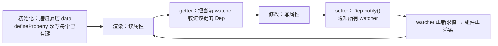
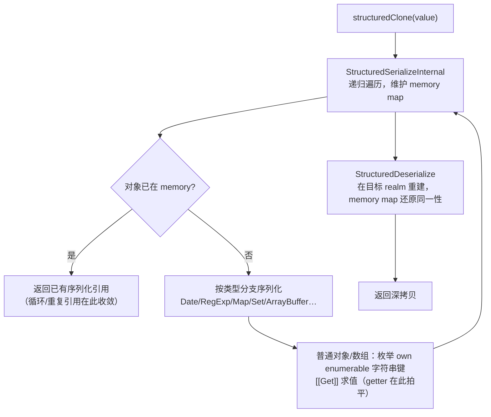

# 对象属性与深浅拷贝

> 一句话概括：JavaScript 对象的每个属性都带着一份「描述符元数据」，拷贝与冻结的一切行为差异——assign 触发 setter、freeze 冻不住嵌套、JSON 丢类型、structuredClone 丢原型——都能从两条规范路径推出来：**复制的是「值」还是「描述符」，走的是 `[[Set]]` 还是 `[[DefineOwnProperty]]`**。

预计阅读时间：大约 90 分钟

所属主题：[JavaScript 基础常见面试题总结](summary.md)

版本基线：本文以 **ECMAScript ES2025** 为基线，规范锚点用 ECMA-262 内置方法/抽象操作标注；**`structuredClone` 属 HTML Living Standard（不是 ECMA-262）**，浏览器 Chrome 98+ / Firefox 94+ / Safari 15.4+，Node.js **17.0.0+** 提供全局实现，本文以 Node 22/24 LTS 与当前 Chrome/V8 为准。除注明外，示例均可在 Node.js 17+ 与现代浏览器直接运行，全部输出已在 Node v20.11.1 实测核对。

---

## 0. 阅读路线

| 读者 | 建议章节 | 关注点 |
| --- | --- | --- |
| 初级（1 年内） | 1.1~1.2、2.1、3.1~3.2、5.1、6、11 | 描述符是什么、getter/setter 怎么用、freeze 为什么冻不住嵌套、JSON 拷贝丢什么 |
| 中级（1~3 年） | 1.3~1.4、2.2~2.3、4、5.2~5.3、7、9 | configurable 不可逆规则、Vue2 响应式局限、枚举顺序、assign vs 展开、structuredClone 支持清单 |
| 高级（3 年+） | 1.3、4.1、7.3~7.5、8、10 | 规范级描述符规则、OrdinaryOwnPropertyKeys、structuredClone 静默丢失清单、手写 deepClone、V8 属性存储 |
| 选型/架构 | 5.1、6~8 对比、9.2、10.2~10.3 | 四种拷贝方案怎么选、不可变数据与结构共享、什么时候不该深拷贝 |

目录：

1. 属性描述符：每个属性背后的「元数据」
2. getter/setter：存取器属性的三种用法与 Vue2 响应式
3. 对象完整性三档：preventExtensions / seal / freeze
4. 属性枚举与顺序
5. 浅拷贝：Object.assign vs 展开 vs 数组方法
6. 深拷贝方案一：JSON.parse(JSON.stringify) 的局限全清单
7. 深拷贝方案二：structuredClone（HTML 规范）
8. 深拷贝方案三：手写 deepClone（完整可运行）
9. 对象比较与不可变数据
10. 边界与性能：V8 属性存储与深拷贝的成本
11. 高频追问集
12. 参考资料

---

## 1. 属性描述符：每个属性背后的「元数据」

### 1.1 数据属性 vs 存取器属性

**结论**：JS 对象的属性不是「键 → 值」的简单映射，而是「键 → 描述符（Property Descriptor）」。描述符分两种 flavor，**一个属性只能是其中一种**：

| 描述符字段 | 数据属性 | 存取器属性 | 含义 |
| --- | --- | --- | --- |
| `value` | ✓ | ✗ | 属性值，默认 `undefined` |
| `writable` | ✓ | ✗ | 能否用赋值修改 `value`，默认见 1.2 |
| `get` | ✗ | ✓ | 读取时调用的函数，返回值作为属性值 |
| `set` | ✗ | ✓ | 赋值时调用的函数，接收新值作参数 |
| `enumerable` | ✓ | ✓ | 能否被 `for...in` / `Object.keys` 枚举 |
| `configurable` | ✓ | ✓ | 能否删除、能否修改描述符（见 1.3） |

规范锚点：ECMA-262 `Property Descriptor`、`Object.defineProperty`。描述符里同时出现 `value`/`writable` 与 `get`/`set` 会抛 `TypeError`——两种 flavor 互斥。

```js
// browser / Node 17+
const obj = {};
Object.defineProperty(obj, 'data', { value: 1, writable: true });
Object.defineProperty(obj, 'accessor', { get() { return 2; }, set(v) {} });
Object.defineProperty(obj, 'bad', { value: 1, get() { return 2; } });
// TypeError: Invalid property descriptor. Cannot both specify accessors and a value or writable attribute
```

### 1.2 两套默认值：字面量/赋值全 true，defineProperty 全 false

**结论**：用对象字面量或普通赋值创建的属性，`writable`/`enumerable`/`configurable` **默认全 true**；用 `Object.defineProperty` 创建时，未显式给出的布尔字段**默认全 false**。这是「为什么 defineProperty 定义的属性 for...in 遍历不到」的根源。

```js
// browser / Node 17+
const lit = { a: 1 };
const def = {};
Object.defineProperty(def, 'a', { value: 1 });

Object.getOwnPropertyDescriptor(lit, 'a');
// { value: 1, writable: true, enumerable: true, configurable: true }
Object.getOwnPropertyDescriptor(def, 'a');
// { value: 1, writable: false, enumerable: false, configurable: false }
```

| 创建方式 | writable | enumerable | configurable |
| --- | --- | --- | --- |
| `{ a: 1 }` / `obj.a = 1` | true | true | true |
| `Object.defineProperty(obj, 'a', { value: 1 })` | **false** | **false** | **false** |

**边界**：`defineProperty` 修改**已存在**的属性时，描述符里**省略的字段保持原值**，不会被重置为 false——「默认全 false」只针对新建属性。另外 `Object.defineProperty` 走 `[[DefineOwnProperty]]` 而非 `[[Set]]`，**即使目标已有 setter 也不会触发它**（这条在 5.2 对比 assign 时是关键）。

**追问：为什么内置对象的方法（如 `Array.prototype.push`）遍历不到？** 因为它们用 `enumerable: false` 定义。`for...in` 遍历数组会漏掉所有内置方法，这正是「不要用 for...in 遍历数组」的原因之一（另一个原因是它会带上原型链属性，见第 4 章）。

### 1.3 configurable:false 的不可逆性（规范级规则）

**结论**：`configurable: false` 是一道**单向门**——一旦关上，删除、改描述符、数据/存取器互转全部禁止；唯一的例外是 `writable: true → false` 允许（再想改回 true 就不行了）。

规范锚点：`OrdinaryDefineOwnProperty` → `ValidateAndApplyPropertyDescriptor`。后者对 `configurable: false` 的既有属性逐条校验：

| 操作（目标属性 configurable:false） | 允许？ | 说明 |
| --- | --- | --- |
| 删除属性 | ✗ | `delete` 返回 false（严格模式抛 TypeError） |
| `configurable` 改 true | ✗ | 不可逆 |
| 修改 `enumerable` | ✗ | 抛 TypeError |
| 数据属性 ⇄ 存取器属性互转 | ✗ | 抛 TypeError |
| 数据属性 `writable: true → false` | **✓** | 唯一允许的「收紧」 |
| 数据属性 `writable: false → true` | ✗ | 抛 TypeError |
| `writable: true` 时改 `value` | ✓ | 赋值或 defineProperty 都行 |
| `writable: false` 时改 `value` | ✗ | 抛 TypeError（**重新定义为相同值除外**） |
| 存取器属性改 `get`/`set` | ✗ | 哪怕换成行为相同的函数也抛 TypeError |

```js
// browser / Node 17+
const o = {};
Object.defineProperty(o, 'x', { value: 1, writable: true, configurable: false });

o.x = 2;                                   // ✓ writable:true，改值允许
Object.defineProperty(o, 'x', { writable: false }); // ✓ true→false 允许
try { Object.defineProperty(o, 'x', { writable: true }); } catch (e) {}  // ✗ TypeError：不可逆
try { Object.defineProperty(o, 'x', { value: 9 }); } catch (e) {}        // ✗ TypeError：writable:false
try { Object.defineProperty(o, 'x', { enumerable: true }); } catch (e) {} // ✗ TypeError
delete o.x;                                // false，x 仍在
Object.defineProperty(o, 'x', { value: 2 });        // ✓ 同值 redefine 允许
```

**一个容易混淆的对照**：`configurable: true` + `writable: false` 时，**赋值**改值失败（严格模式抛错），但 **defineProperty 改值成功**——因为 writable 只约束 `[[Set]]` 路径，不约束 `[[DefineOwnProperty]]` 路径。这两条路径的区分贯穿全文。

**实践**：`Object.freeze` 的本质就是把所有属性改成 `configurable: false` + 数据属性 `writable: false`（见第 3 章），所以冻结是**不可逆**的——没有 `Object.unfreeze`。

### 1.4 getOwnPropertyDescriptor(s) 与「描述符级复制」

| API | 返回 | 范围 |
| --- | --- | --- |
| `Object.getOwnPropertyDescriptor(obj, key)` | 单个属性的描述符对象（不存在则 undefined） | 仅 own |
| `Object.getOwnPropertyDescriptors(obj)`（ES2017） | 所有 own 属性键 → 描述符的映射 | 仅 own，含非枚举与 Symbol |
| `Object.defineProperties(obj, descriptors)` | 批量定义 | — |
| `Object.create(proto, descriptors)` | 以指定原型 + 描述符创建新对象 | — |

**结论**：`Object.assign` 和展开复制的是**值**，不是描述符（第 5 章）；要保留 `writable`/`enumerable`/`get`/`set`，必须走描述符级复制：

```js
// browser / Node 17+：描述符级浅拷贝，保留 getter 与只读标记
const src = {};
Object.defineProperty(src, 'ro', { value: 1, writable: false, enumerable: true });
Object.defineProperty(src, 'lazy', { get() { return 42; }, enumerable: true });

const copy = Object.create(Object.getPrototypeOf(src), Object.getOwnPropertyDescriptors(src));
Object.getOwnPropertyDescriptor(copy, 'ro').writable; // false（保留）
typeof Object.getOwnPropertyDescriptor(copy, 'lazy').get; // 'function'（getter 保留）
```

这也是第 8 章手写 deepClone 的核心思路：**逐键取描述符 → 递归克隆 `desc.value` → defineProperty 写回**。

---

## 2. getter/setter：存取器属性的三种用法与 Vue2 响应式

### 2.1 计算属性、访问校验、惰性求值

**结论**：存取器属性把「读/写一个字段」变成「执行一段逻辑」，三个典型用途：

```js
// browser / Node 17+
const user = {
  first: '三', last: '张',
  // ① 计算属性：不存冗余状态，读时现算
  get fullName() { return this.last + this.first; },
};
user.fullName; // '张三'

const account = {
  _balance: 0,
  // ② 访问校验：写入口统一拦截
  get balance() { return this._balance; },
  set balance(v) {
    if (typeof v !== 'number' || v < 0) throw new RangeError('余额必须是非负数');
    this._balance = v;
  },
};
account.balance = 100;  // ✓
account.balance = -1;   // RangeError

const config = {
  _cache: null,
  // ③ 惰性求值：第一次读才计算，之后复用
  get heavy() {
    if (this._cache === null) this._cache = expensiveCompute();
    return this._cache;
  },
};
```

**边界/代价**：getter 里**不要写 `this.同名属性`**（无限递归爆栈）；存取器属性没有 `value`，`JSON.stringify` 会调用 getter 取值（序列化的是求值结果）；每次读取都执行函数，热点路径上比普通字段慢（V8 对 accessor 的内联优化弱于数据属性，见第 10 章）。

### 2.2 this 指向「访问路径上的对象」，不一定是定义者

**结论**：getter/setter 的 `this` 是**访问该属性时的接收者（receiver）**，继承场景下指向子对象而非定义属性的父对象。

```js
// browser / Node 17+
const holder = { _v: 1, get v() { return this._v; } };
const child = Object.create(holder);
child._v = 42;
child.v; // 42 —— this 指向 child，不是 holder
```

**实践**：把状态存到 `this._v` 而不是闭包变量，才能让每个继承者拥有独立状态；若用闭包变量，所有继承者会共享同一份（这是「原型上定义存取器」的经典坑）。`this` 的完整绑定规则见 [this 绑定与函数调用](this-binding-and-function-call.md)。

### 2.3 Vue2 响应式：defineProperty 递归劫持 + 依赖收集

**结论**：Vue2 在初始化时**递归遍历 data 的所有已有键**，用 `Object.defineProperty` 把每个键改写成 getter/setter；getter 里收集依赖（当前正在求值的 watcher），setter 里通知依赖更新。



最小可运行骨架（简化示意，省略 watcher 调度与异步队列）：

```js
// browser / Node 17+
let currentWatcher = null;
function defineReactive(obj, key, val) {
  const dep = new Set();
  Object.defineProperty(obj, key, {
    enumerable: true, configurable: true,
    get() { if (currentWatcher) dep.add(currentWatcher); return val; },
    set(nv) { if (nv === val) return; val = nv; dep.forEach(w => w()); },
  });
}
const data = { count: 0 };
defineReactive(data, 'count', data.count);
let rendered = 0;
currentWatcher = () => { rendered++; };
data.count;        // 渲染时读取 → 收集依赖
currentWatcher = null;
data.count = 1;    // setter → 通知 → rendered === 1
```

**局限（面试分水岭）**——官方文档口径与规范层面的精确解释：

| 检测不到的变更 | 表面原因 | 精确机制 |
| --- | --- | --- |
| 对象**新增**属性 `vm.b = 2` | 「JS 限制」 | defineProperty 本身能定义新属性，但 Vue **只在初始化时遍历已有键**，新键没有 getter/setter，无从拦截。解法 `Vue.set(obj, key, val)` / `this.$set` |
| 对象**删除**属性 `delete vm.a` | 同上 | delete 不经过任何 setter。解法 `Vue.delete` / `this.$delete` |
| 数组**索引赋值** `arr[0] = x` | 「JS 限制」 | defineProperty **理论上可以**劫持数组索引，Vue2 出于性能与收益权衡**没有做**（不是规范禁止） |
| 数组 **length 赋值** `arr.length = 0` | 「JS 限制」 | 这条是**规范层面真的做不到**：`length` 是 `configurable: false` 的数据属性，由 1.3 规则，**永远不能转成存取器**，无法挂 setter |

数组的折中方案：**重写 7 个变异方法**。Vue2 源码（`src/core/observer/array.ts`，v2.7.16）用 `Object.create(Array.prototype)` 造一个中间原型，在其上以非枚举方式定义 `push / pop / shift / unshift / splice / sort / reverse` 的包装版，再把被观察数组的 `__proto__` 指向它：

```js
// Vue 2.7.16 src/core/observer/array.ts（节选）
const methodsToPatch = ['push', 'pop', 'shift', 'unshift', 'splice', 'sort', 'reverse'];
methodsToPatch.forEach(function (method) {
  const original = arrayProto[method];
  def(arrayMethods, method, function mutator(...args) {
    const result = original.apply(this, args);   // 先执行原生方法
    const ob = this.__ob__;
    let inserted;
    switch (method) {
      case 'push': case 'unshift': inserted = args; break;
      case 'splice': inserted = args.slice(2); break;  // 只观察新插入的元素
    }
    if (inserted) ob.observeArray(inserted);
    ob.dep.notify();                              // 再通知依赖
    return result;
  });
});
```

所以 `arr.splice(0, 1, x)` 能触发更新而 `arr[0] = x` 不能；`push` 进来的新对象也会被 `observeArray` 递归劫持。

**追问：Vue3 为什么换 Proxy？** Proxy 在**对象层面**拦截 `get/set/deleteProperty/ownKeys` 等 13 种操作，天然覆盖「新增/删除属性」「数组索引」「length」，无需初始化遍历、无需重写数组方法；代价是 Proxy 无法被 polyfill（IE 彻底出局）、每次访问多一层代理。Proxy 的完整陷阱见 [ES6+ 与现代 JS](es6-plus-and-modern-js.md) 的 Proxy 章节。

---

## 3. 对象完整性三档：preventExtensions / seal / freeze

### 3.1 三档对比

**结论**：三个 API 是**逐级收紧**的完整性等级，都只作用于对象**自身**（浅层），且都**不可逆**。

| 操作 | preventExtensions | seal | freeze |
| --- | --- | --- | --- |
| 新增属性 | ✗ | ✗ | ✗ |
| 删除属性 | ✓ | ✗ | ✗ |
| 修改已有属性值 | ✓ | ✓ | ✗ |
| 改描述符（enumerable/configurable） | ✓ | ✗ | ✗ |
| `writable: true → false` | ✓ | **✓**（1.3 的唯一例外） | ✗（已是 false） |
| 改原型（setPrototypeOf） | **✗** | ✗ | ✗ |
| 嵌套对象受影响？ | ✗ | ✗ | ✗ |
| 判定 API | `Object.isExtensible` 取反 | `Object.isSealed` | `Object.isFrozen` |

规范锚点：`Object.preventExtensions` → `[[PreventExtensions]]`；`Object.seal` / `Object.freeze` → `SetIntegrityLevel`，seal = 不可扩展 + 所有属性 `configurable: false`；freeze = seal + 所有**数据**属性 `writable: false`。

```js
// browser / Node 17+：每档独立验证（非严格模式失败静默，严格模式抛 TypeError）
const p = Object.preventExtensions({ a: 1 });
p.b = 2;          // 静默失败，'b' in p === false
delete p.a;       // true —— 仍可删
p.a = 9;          // ✓ 仍可改

const s = Object.seal({ a: 1 });
delete s.a;       // false
s.a = 9;          // ✓ 仍可改
Object.defineProperty(s, 'a', { enumerable: false }); // TypeError

const f = Object.freeze({ a: 1 });
f.a = 9;          // 静默失败，f.a 仍是 1
Object.isFrozen(f); // true
```

**两个容易答错的细节**：

1. **seal 后仍能把 `writable` 从 true 改 false**（1.3 规则），改完所有属性都不可写，对象就**达到了 frozen 状态**——`Object.isFrozen(sealedObj)` 会返回 true。seal 与 freeze 的边界不是「能不能改描述符」一刀切，而是「configurable 全 false 之后，writable 还能单向收紧」。
2. **三档都禁止改原型**：`OrdinarySetPrototypeOf` 对不可扩展对象直接返回 false（严格模式抛 TypeError），所以 `preventExtensions` 之后 `Object.setPrototypeOf` 同样失败（实测 `TypeError: #<Object> is not extensible`）。三档的真正区别只在「删 / 改值 / 改描述符」这三列。

### 3.2 freeze 是浅冻结 + 手写 deepFreeze

**结论**：`Object.freeze` 只冻结**第一层**属性的描述符，属性值指向的嵌套对象**完全不受影响**——「冻结的对象不可变，但不是常量」。

```js
// browser / Node 17+
const obj = Object.freeze({ internal: {} });
obj.internal.a = 'value';   // ✓ 嵌套对象没被冻结
obj.internal.a;             // 'value'
```

手写 deepFreeze（用 WeakSet 防循环引用，实测循环安全）：

```js
// browser / Node 17+
function deepFreeze(obj, seen = new WeakSet()) {
  if (obj === null || typeof obj !== 'object' || seen.has(obj)) return obj;
  seen.add(obj);
  Object.freeze(obj);
  for (const key of Reflect.ownKeys(obj)) {
    const desc = Object.getOwnPropertyDescriptor(obj, key);
    if ('value' in desc) deepFreeze(desc.value, seen); // 只递归数据属性的值
  }
  return obj;
}

const cyc = { name: 'root' };
cyc.self = cyc;
cyc.child = { deep: { v: 1 } };
deepFreeze(cyc);
Object.isFrozen(cyc);            // true
Object.isFrozen(cyc.child.deep); // true
cyc.self === cyc;                // true，循环引用未破坏
```

**边界/代价**：

- **不要冻结宿主对象**（`window`、DOM 节点）——可能破坏浏览器内部机制；MDN 明确警告。
- 函数的 `prototype.constructor` 指回函数自身，天然成环，没有 WeakSet 会无限递归。
- 冻结**存取器属性**时，getter/setter 函数本身不被冻结（见 3.3）。
- deepFreeze 是 O(n) 遍历 + 每个对象一次 freeze，大对象有成本；冻结后 V8 形状稳定，读路径反而可能受益（第 10 章）。

### 3.3 冻结的四个边界

| 边界 | 行为 | 原因 |
| --- | --- | --- |
| 冻结对象的 **setter 仍可调用** | `fa.x = 5` 不抛错，setter 执行 | freeze 只把**数据属性**改 writable:false，存取器属性的 get/set 不动；setter 内部若写**外部闭包变量**照样生效（写自身已冻结的数据属性才会失败） |
| 冻结**带元素的 TypedArray/DataView** | 抛 `TypeError: Cannot freeze array buffer views with elements` | 元素存在 buffer 里，freeze 管不到内部槽；**零长度**视图可以冻结 |
| 冻结数组后 `push` | 抛 TypeError（严格模式）/静默失败 | push 要新增索引 + 改 length，都被禁止 |
| `Object.freeze(原始值)` | ES2015+ **原样返回**，不抛错 | ES5 会抛 TypeError；ES2015 起规范改为「非对象直接返回」（`Object.freeze` 第 1 步） |

```js
// browser / Node 17+：setter 写外部变量，冻结后依然生效
let external = 0;
const fa = Object.freeze({
  get x() { return external; },
  set x(v) { external = v; },
});
fa.x = 5;
external; // 5 —— 冻结拦不住 setter 的副作用
```

**实践**：需要「真不可变」时，freeze 要配合**不可变更新**（第 9 章）——冻结只是兜底防线，不是数据流设计。Redux 开发态用 freeze 中间件检测意外 mutation，生产态关掉省成本，就是这个思路。

---

## 4. 属性枚举与顺序

### 4.1 OrdinaryOwnPropertyKeys：三段式顺序

**结论**：普通对象的 own 键顺序由 `OrdinaryOwnPropertyKeys` 规定，**三段式**：

1. **整数索引键**（array index：规范数字字符串且 `0 ≤ n < 2^32 − 1`）按**数值升序**；
2. **其余字符串键**按**创建（插入）顺序**；
3. **Symbol 键**按**创建顺序**。

```js
// browser / Node 17+：输出题
const sym1 = Symbol('s1'), sym2 = Symbol('s2');
const obj = { 2: 'b', 1: 'a', z: 1, [sym1]: 1, a: 1, 0: 'z', [sym2]: 2, '-1': 'neg' };

Object.keys(obj);
// ['0', '1', '2', 'z', 'a', '-1']
Reflect.ownKeys(obj).map(String);
// ['0', '1', '2', 'z', 'a', '-1', 'Symbol(s1)', 'Symbol(s2)']
```

**三个边界**（都实测验证）：

- `'-1'`、`'1.5'`、`'01'` **不是** array index（负数/小数/前导零），落入字符串组按插入序；
- `4294967295`（= 2^32 − 1）**不是** array index（上界开区间），同样落入字符串组——它看起来「排在数字后面」可能只是插入序的巧合；
- 整数键在引擎里**以字符串存储**，`Object.keys` 返回的永远是字符串数组。

```js
// browser / Node 17+：2^32-1 边界
const boundary = { 2: 'b', 4294967295: 'big', 1: 'a', '-1': 'neg', 0: 'z' };
Object.keys(boundary); // ['0', '1', '2', '4294967295', '-1']
// 4294967295 在字符串组（插入序第一个），不是整数升序的一部分
```

**追问：Proxy 能改顺序吗？** 能。`ownKeys` 陷阱返回的数组顺序就是枚举顺序（但要满足不变式：不可扩展目标的键必须全部出现等）。所以「三段式」只对**普通对象**成立， exotic 对象（Proxy、Module Namespace 等）各有自己的 `[[OwnPropertyKeys]]`。

### 4.2 四种枚举 API 对比

| API | own/继承 | 枚举性过滤 | 字符串键 | Symbol 键 | 顺序 |
| --- | --- | --- | --- | --- | --- |
| `for...in` | **own + 原型链** | 只 enumerable | ✓ | ✗ | 三段式（逐层原型） |
| `Object.keys` | 仅 own | 只 enumerable | ✓ | ✗ | 三段式 |
| `Object.getOwnPropertyNames` | 仅 own | **不过滤** | ✓ | ✗ | 三段式 |
| `Object.getOwnPropertySymbols` | 仅 own | **不过滤** | ✗ | ✓ | 插入序 |
| `Reflect.ownKeys` | 仅 own | **不过滤** | ✓ | ✓ | 三段式 |

规范锚点：`Object.keys` → `EnumerableOwnProperties(O, key)`；`for...in` → `EnumerateObjectProperties`；`Reflect.ownKeys` → `[[OwnPropertyKeys]]`。`Reflect.ownKeys` 等价于 `getOwnPropertyNames().concat(getOwnPropertySymbols())`（普通对象）。

```js
// browser / Node 17+
const proto = { inherited: 1 };
const child = Object.create(proto);
child.own = 2;
for (const k in child) console.log(k); // 'own', 'inherited' —— 带上原型链
Object.keys(child);                    // ['own']

const ne = {};
Object.defineProperty(ne, 'hidden', { value: 1, enumerable: false });
ne.shown = 2;
Object.keys(ne);               // ['shown']
Object.getOwnPropertyNames(ne); // ['hidden', 'shown']
Reflect.ownKeys(ne);            // ['hidden', 'shown']
```

**实践**：遍历 own 数据用 `Object.keys`；要拿全量键（含非枚举/Symbol，如 deepClone）用 `Reflect.ownKeys`；`for...in` 几乎只该配 `hasOwnProperty` 过滤用于兼容场景，现代代码优先 `Object.entries`。

### 4.3 Object.assign / 展开只复制 own enumerable（含 Symbol）

**结论**：两者都**只复制 own + enumerable** 属性，**字符串键和 Symbol 键都复制**，非枚举与原型链属性都丢弃。

```js
// browser / Node 17+
const sym = Symbol('k');
const src = Object.create({ inherited: 1 }, {
  hidden: { value: 2, enumerable: false },
  shown:  { value: 3, enumerable: true },
  [sym]:  { value: 4, enumerable: true },
});
Object.keys(Object.assign({}, src)); // ['shown']
Object.assign({}, src)[sym];         // 4 —— Symbol 复制
Object.keys({ ...src });             // ['shown']
({ ...src })[sym];                   // 4
```

规范锚点：`Object.assign` 对每个源调 `EnumerableOwnProperties` 再 `Set(target, key, value, true)`；对象展开调 `CopyDataProperties(target, source, excludedItems)`，内部用 `CreateDataPropertyOrThrow`。**两条路径的差异是第 5 章的全部主题**。

---

## 5. 浅拷贝：Object.assign vs 展开 vs 数组方法

### 5.1 对比总表

| 维度 | `Object.assign(target, ...src)` | `{ ...src }` 展开 | `slice/concat/Array.from`（数组） |
| --- | --- | --- | --- |
| 规范路径 | `[[Get]]` 源 + **`[[Set]]` 目标** | `[[Get]]` 源 + **`CreateDataPropertyOrThrow`** | 各异（见 5.4） |
| 目标 | **修改并返回已有 target** | **创建新对象** | 创建新数组 |
| 触发目标 setter | **✓**（含原型链上的 setter） | ✗（定义 own 数据属性） | — |
| 目标只读属性 | **TypeError + 部分复制** | 无此问题（新对象） | — |
| 源 getter | 求值为值 | 求值为值 | — |
| 复制描述符？ | ✗ 只复制值 | ✗ 只复制值 | ✗ |
| 结果原型 | **保留 target 的原型** | 永远 `Object.prototype` | `Array.prototype` |
| Symbol 键 | ✓ | ✓ | — |
| 非枚举/继承属性 | ✗ | ✗ | ✗ |
| null/undefined 源 | 跳过 | 跳过 | — |
| 原始值目标 | 包装成对象（返回 object） | 无目标概念 | — |
| 嵌套对象 | **共享引用** | **共享引用** | **共享引用** |

### 5.2 assign 走 [[Set]]，展开走 [[DefineOwnProperty]]

**结论**：这是两者**唯一本质差异**，其余区别都是它的推论。

```js
// browser / Node 17+
// ① assign 触发目标自身的 setter
const withSetter = { _x: 0, set x(v) { this._x = v * 2; } };
Object.assign(withSetter, { x: 5 });
withSetter._x; // 10 —— setter 被调用，x 仍是 accessor，没有变成数据属性

// ② 展开创建新对象，x 是普通数据属性，setter 不参与
const spreadResult = { ...withSetter, x: 5 };
spreadResult.x;  // 5
spreadResult._x; // 10（从 withSetter 展开来的）

// ③ assign 会走原型链上的 setter；展开直接定义 own 属性遮蔽它
const proto = { set y(v) { this._y = v; } };
const t1 = Object.create(proto);
Object.assign(t1, { y: 7 });
t1._y;                              // 7
Object.hasOwn(t1, 'y');             // false —— own 属性根本没创建！

const t2 = { ...Object.create(proto), y: 7 };
Object.hasOwn(t2, 'y');             // true
t2.y;                               // 7
```

**④ assign 的「部分复制」坑**：目标有只读属性时抛 TypeError，但**抛错前已复制的属性留在目标上**——不是原子操作：

```js
// browser / Node 17+
const ro = Object.defineProperty({}, 'foo', { value: 1, writable: false });
try {
  Object.assign(ro, { bar: 2 }, { foo2: 3, foo: 3, foo3: 3 }, { baz: 4 });
} catch (e) { /* TypeError: Cannot assign to read only property 'foo' */ }
ro.bar;  // 2 —— 已复制
ro.foo2; // 3 —— 已复制
ro.foo3; // undefined —— 抛错点之后全部没复制
ro.baz;  // undefined
```

**追问：为什么展开不触发 setter？** 展开的目标是**刚创建的空对象**，`CopyDataProperties` 用 `CreateDataPropertyOrThrow` 直接定义 own 数据属性，走 `[[DefineOwnProperty]]`，根本不经过 `[[Set]]`，自然不查原型链 setter。这也是「合并配置到带 setter 的对象」该用 assign 还是展开的判断依据：**想触发校验逻辑用 assign，想要纯数据快照用展开**。

### 5.3 三个共同坑

| 坑 | 表现 | 解法 |
| --- | --- | --- |
| **嵌套共享** | `copy.nested === src.nested`，改嵌套互相影响 | 深拷贝（第 6~8 章）或不可变更新（第 9 章） |
| **原型丢失** | class 实例拷贝后 `instanceof` 为 false，方法全丢 | 描述符级复制 + `Object.create(proto)`（1.4 / 第 8 章），或重新构造 |
| **存取器拍平** | 源 getter 被求值成数据属性，动态计算能力丢失 | 描述符级复制保留 get/set |

```js
// browser / Node 17+
class Foo { constructor() { this.v = 1; } hi() { return 'hi'; } }
const copy = Object.assign({}, new Foo());
copy instanceof Foo;                    // false
Object.getPrototypeOf(copy) === Object.prototype; // true
copy.hi;                                // undefined —— 方法在原型上，没复制

const srcGetter = { get g() { return 42; } };
Object.getOwnPropertyDescriptor(Object.assign({}, srcGetter), 'g');
// { value: 42, writable: true, enumerable: true, configurable: true } —— getter 没了
```

### 5.4 数组浅拷贝四件套

```js
// browser / Node 17+
const arr = [{ n: 1 }];
const copies = [
  arr.slice(),      // 新数组，arr[0] 共享
  arr.concat(),     // 同上；受 Symbol.isConcatSpreadable 影响
  Array.from(arr),  // 同上；走迭代器，会把 holes 填成 undefined
  [...arr],         // 同上；走迭代器
];
copies.every(c => c[0] === arr[0]); // true —— 全是浅拷贝
```

| 方法 | 机制 | 稀疏数组 holes | 备注 |
| --- | --- | --- | --- |
| `slice()` | 按索引复制 own 属性 | **保留 holes** | 最接近「原样浅拷贝」 |
| `concat()` | 按索引复制 + 展开可展开项 | 保留 holes | `Symbol.isConcatSpreadable` 可控制类数组是否展开 |
| `Array.from()` | 走迭代器/类数组 | **holes → undefined** | 可带 mapFn |
| `[...arr]` | 走迭代器 | holes → undefined | 与 Array.from 等价（无 mapFn 时） |

**边界**：四者都**不复制数组的附加属性**（`arr.extra = 1` 会丢），也不保留原型子类。要完整复制数组（含附加属性、Symbol 键、holes），用第 8 章的 deepClone 数组分支。

---

## 6. 深拷贝方案一：JSON.parse(JSON.stringify) 的局限全清单

**结论**：JSON 法只适合「纯 JSON 数据」（字符串/数字/布尔/null/数组/普通对象嵌套），**任何超出 JSON 类型系统的东西都会丢失、变形或抛错**。它不是深拷贝的通用解，是「序列化再反序列化」的副作用。

| 输入 | 结果 | 原因 |
| --- | --- | --- |
| 对象属性值为 `undefined` / 函数 / Symbol | **属性整个消失** | JSON 没有这些类型，stringify 跳过 |
| **数组元素**为 `undefined` / 函数 / Symbol | **变成 `null`** | 数组位置必须保留，用 null 占位 |
| Symbol **键** | 消失 | 同上 |
| `Date` | **ISO 字符串**（不再是 Date） | `Date.prototype.toJSON` 钩子 |
| `RegExp` / `Map` / `Set` | **`{}`** | 没有可枚举 own 属性，stringify 输出空对象 |
| `NaN` / `±Infinity` | **`null`** | JSON 数字规范不含这些值 |
| `-0` | `0` | JSON 序列化规范化 |
| `BigInt` | **抛 TypeError** | 无 JSON 表示 |
| **循环引用** | **抛 TypeError** | stringify 无法终止 |
| 非枚举属性 | 消失 | 只序列化 enumerable own |
| 原型 / class 方法 | **丢失**，变普通对象 | 只序列化数据 |
| 稀疏数组 holes | 变 `null` | 同数组元素规则 |
| 顶层 `undefined` | `JSON.stringify` 返回 `undefined`（不是字符串） | 边界 |

验证代码（全部实测）：

```js
// browser / Node 17+
const sym = Symbol('s');
const src = {
  u: undefined, f() {}, s: sym,
  d: new Date('2026-01-01'), r: /ab/gi,
  m: new Map([[1, 2]]), st: new Set([1]),
  nan: NaN, inf: Infinity, neg0: -0, nested: { ok: 1 },
};
const copy = JSON.parse(JSON.stringify(src));
Object.keys(copy);        // ['d','r','m','st','nan','inf','neg0','nested'] —— u/f/s 消失
typeof copy.d;            // 'string'
copy.r;                   // {}
copy.m;                   // {}
copy.st;                  // {}
copy.nan;                 // null
copy.inf;                 // null
Object.is(copy.neg0, 0);  // true

JSON.parse(JSON.stringify([undefined, function () {}, sym, NaN]));
// [null, null, null, null]

const cyc = {}; cyc.self = cyc;
JSON.stringify(cyc);      // TypeError: Converting circular structure to JSON
JSON.stringify({ b: 1n }); // TypeError: Do not know how to serialize a BigInt

class Bar { constructor() { this.v = 1; } }
JSON.parse(JSON.stringify(new Bar())) instanceof Bar; // false
```

**追问：为什么 JSON 法丢 undefined 而不是变 null？** 对象属性「消失」和数组元素「变 null」是两条不同规则：对象键值对可以整体省略，数组必须保持长度与位置，所以用 null 占位。答出这个区分说明真懂序列化语义。

**实践**：JSON 法的唯一优势是**零依赖、跨 realm 安全、能过网络**；代价是上表全部。需要保留类型时用 structuredClone（第 7 章）；需要保留原型/描述符时用手写 deepClone（第 8 章）。

---

## 7. 深拷贝方案二：structuredClone（HTML 规范）

### 7.1 规范归属与版本

**结论**：`structuredClone` **不是 ECMAScript API**，而是 HTML Living Standard 定义的「结构化克隆」算法的同步封装，底层与 `postMessage`、IndexedDB 存储共用同一套序列化机制。

| 环境 | 支持版本 | 来源 |
| --- | --- | --- |
| Chrome / Edge | 98+ | HTML spec 兼容性表 |
| Firefox | 94+ | 同上 |
| Safari | 15.4+ | 同上 |
| Node.js | **17.0.0+**（全局 `structuredClone`） | Node 官方 globals 文档「Added in: v17.0.0」 |

规范锚点：HTML spec §2.7「Safe passing of structured data」——`StructuredSerializeInternal`、`StructuredDeserialize`、`StructuredSerializeWithTransfer`、`structuredClone()` API（`#dom-structuredclone`）。

### 7.2 支持类型表（在线核实 + 实测）

| 类型 | 支持 | 备注 |
| --- | --- | --- |
| 原始值（除 Symbol） | ✓ | **BigInt 支持**（JSON 法不支持） |
| 包装对象 Boolean/Number/String/BigInt | ✓ | 克隆后仍是包装对象 |
| `Date` | ✓ | 保留时间值 |
| `RegExp` | ✓ | **`lastIndex` 重置为 0** |
| `Map` / `Set` | ✓ | 键值递归深克隆 |
| `ArrayBuffer` | ✓ | 字节复制，独立 buffer |
| `TypedArray` / `DataView` | ✓ | 视图与 buffer 都克隆 |
| `Error`（7 种） | ✓ | `Error/EvalError/RangeError/ReferenceError/SyntaxError/TypeError/URIError`；name/message 必须序列化，stack/cause 预期序列化（Node 实测保留） |
| `DOMException` | ✓ | name/message |
| `Blob` / `File` / `FileList` | ✓ | 浏览器平台对象 |
| `ImageData` / `ImageBitmap` | ✓ | 浏览器；ImageBitmap 需 transfer 或 clone 语义 |
| `CryptoKey` / `DOMMatrix` / `DOMPoint` 等 | ✓ | 带 `[Serializable]` IDL 标记的平台对象 |
| **循环引用 / 重复引用** | ✓ | memory map 保证 `clone.self === clone`、共享对象克隆后仍共享 |
| 普通对象 / 数组 | ✓ | 仅 own enumerable 字符串键（见 7.3） |

```js
// browser / Node 17+
const src = { date: new Date(0), re: /ab/gi, map: new Map([['k', { v: 1 }]]), set: new Set([1]) };
src.re.lastIndex = 2;
const c = structuredClone(src);
c.date instanceof Date;        // true
c.re.lastIndex;                // 0 —— 重置
c.map.get('k') !== src.map.get('k'); // true —— 深克隆

const cyc = { name: 'root' }; cyc.self = cyc;
const shared = { s: 1 }; cyc.a = shared; cyc.b = shared;
const cc = structuredClone(cyc);
cc.self === cc;                // true —— 循环保留
cc.a === cc.b;                 // true —— 重复引用同一性保留
cc.a !== shared;               // true
```

### 7.3 不支持与「静默丢失」清单（面试高频）

**抛 `DataCloneError`（DOMException）的输入**：

| 输入 | 规范依据 |
| --- | --- |
| **函数**（含对象里嵌套的函数） | 不可序列化 |
| **Symbol**（原始值） | `StructuredSerializeInternal`：「If value is a Symbol, then throw DataCloneError」 |
| **DOM 节点** | 无 `[Serializable]` 标记 |
| **Proxy** | exotic object 分支：「if value is an exotic object and value is not %Object.prototype% … throw DataCloneError」 |
| 带特殊内部槽的对象（如 Promise、WeakMap） | 「if value has any internal slot other than [[Prototype]] or [[Extensible]] … throw DataCloneError」 |

**不抛错但「静默丢失/变形」的**（更危险）：

| 项 | 行为 |
| --- | --- |
| **Symbol 键** | 静默丢弃（只枚举字符串键） |
| **非枚举属性** | 静默丢弃 |
| **原型链** | **不遍历不复制**：class 实例 → 普通对象，原型上的方法/getter 全丢 |
| **own getter** | 被 `[[Get]]` **求值为数据属性**（动态计算能力丢失） |
| **描述符** | 不保留：frozen 对象克隆后变可写 |
| **RegExp.lastIndex** | 重置 0 |
| **Error 自定义 name** | 归一为 `'Error'`（不在 7 种名单内） |
| **`AggregateError`** | **不抛错**：带 `[[ErrorData]]` 走规范 Error 分支，name 不在 7 种名单 → 归一 `'Error'`，非枚举的 `errors` 静默丢失，克隆体 `instanceof AggregateError === false`（Node 20.11.1 实测）。部分新浏览器已支持完整克隆（whatwg/html#5749 拟纳入规范） |
| **class 私有字段 `#x`** | 不复制 |

```js
// browser / Node 17+
structuredClone(() => {});            // DataCloneError
structuredClone(Symbol('s'));         // DataCloneError
structuredClone(new Proxy({}, {}));   // DataCloneError
structuredClone({ [Symbol('k')]: 1 }); // {} —— Symbol 键静默丢失

class Point { constructor(x) { this.x = x; } get double() { return this.x * 2; } }
const pc = structuredClone(new Point(3));
pc instanceof Point;                  // false
Object.getPrototypeOf(pc) === Object.prototype; // true
pc.double;                            // undefined —— 原型 getter 没复制

const og = structuredClone({ get x() { return 7; } });
Object.getOwnPropertyDescriptor(og, 'x');
// { value: 7, writable: true, enumerable: true, configurable: true } —— own getter 拍平

const err = new TypeError('boom'); err.cause = new Error('root');
const ec = structuredClone(err);
ec instanceof TypeError;              // true
ec.message;                           // 'boom'
ec.cause.message;                     // 'root'（Node 实测）
const custom = new Error('x'); custom.name = 'MyError';
structuredClone(custom).name;         // 'Error' —— 归一

const agg = structuredClone(new AggregateError([new Error('i1')], 'agg'));
agg instanceof AggregateError;        // false —— 不抛错，静默克隆为普通 Error
agg.name;                             // 'Error'
agg.errors;                           // undefined —— 非枚举 errors 丢失（Node 20.11.1 实测）
```

### 7.4 transfer：转移而非复制

**结论**：`structuredClone(value, { transfer: [buf] })` 把 `ArrayBuffer` 的**底层内存所有权转移**给新对象，原 buffer 被 **detach**（`byteLength` 变 0），**零字节复制**。转移是**不可逆、不可重复**的操作。

```js
// browser / Node 17+
const buf = new ArrayBuffer(16);
new Uint8Array(buf)[0] = 42;
const transferred = structuredClone({ buf }, { transfer: [buf] });
buf.byteLength;                       // 0 —— 原 buffer 已 detach
transferred.buf.byteLength;           // 16
new Uint8Array(transferred.buf)[0];   // 42
new Uint8Array(buf);                  // TypeError: Cannot perform Construct on a detached ArrayBuffer
```

规范锚点：`StructuredSerializeWithTransfer` → `DetachArrayBuffer`。**实践**：向 Worker 传大 buffer 用 transfer 避免复制；「克隆后校验、原数据作废」的场景（MDN 示例）也用它防误改。`MessagePort`、`ImageBitmap`、`ReadableStream` 等也是 transferable。

### 7.5 机制：memory map 为什么能解循环



**追问：structuredClone 能拷贝函数吗？** 不能，抛 DataCloneError。函数的闭包环境无法序列化——这是结构化克隆与「任意对象图克隆」的根本边界。需要保留函数引用时用手写 deepClone（第 8 章，函数共享引用是设计选择）。

---

## 8. 深拷贝方案三：手写 deepClone（完整可运行）

**结论**：手写 deepClone 的核心是四件事——**WeakMap 解循环 + 保留同一性**、**Reflect.ownKeys 拿全量键**、**类型分支处理内置对象内部槽**、**描述符级复制保留原型与属性元数据**。下面这份实现全部测试实测通过。

```js
// browser / Node 17+：完整可运行
function deepClone(source, seen = new WeakMap()) {
  // 原始值与函数直接返回（函数共享引用是设计选择，见下文权衡）
  if (source === null || typeof source !== 'object') return source;
  // 循环引用 / 重复引用：返回已创建的克隆，保证同一性
  if (seen.has(source)) return seen.get(source);

  // 内置类型分支：内部槽无法用 defineProperty 复制，必须走构造器
  // 同样先登记 seen，保证共享的 Date/RegExp 引用克隆后仍是同一对象
  if (source instanceof Date) {
    const copy = new Date(source.getTime());
    seen.set(source, copy);
    return copy;
  }
  if (source instanceof RegExp) {
    const copy = new RegExp(source.source, source.flags);
    copy.lastIndex = source.lastIndex; // structuredClone 会丢，这里保留
    seen.set(source, copy);
    return copy;
  }
  if (source instanceof ArrayBuffer) {
    const copy = source.slice(0);
    seen.set(source, copy);
    return copy;
  }
  if (ArrayBuffer.isView(source)) {
    const buffer = deepClone(source.buffer, seen); // 共享 buffer 的视图克隆后仍共享
    const copy = source instanceof DataView
      ? new DataView(buffer, source.byteOffset, source.byteLength)
      : new source.constructor(buffer, source.byteOffset, source.length);
    seen.set(source, copy);
    return copy;
  }

  // 容器先创建空壳并登记 seen，再递归填充（否则循环引用会无限递归）
  let target;
  if (Array.isArray(source)) target = [];
  else if (source instanceof Map) target = new Map();
  else if (source instanceof Set) target = new Set();
  else target = Object.create(Object.getPrototypeOf(source)); // 保留原型
  seen.set(source, target);

  if (source instanceof Map) {
    for (const [k, v] of source) target.set(deepClone(k, seen), deepClone(v, seen));
    return target;
  }
  if (source instanceof Set) {
    for (const v of source) target.add(deepClone(v, seen));
    return target;
  }

  // 普通对象 / 数组：描述符级复制，保留 Symbol 键、非枚举、存取器、writable
  for (const key of Reflect.ownKeys(source)) {
    const desc = Object.getOwnPropertyDescriptor(source, key);
    if ('value' in desc) desc.value = deepClone(desc.value, seen);
    Object.defineProperty(target, key, desc);
  }
  return target;
}
```

测试用例（全部实测通过）：

```js
// browser / Node 17+
const symK = Symbol('k');
class Model { constructor() { this.v = 1; } hi() { return 'hi'; } }
const m = new Model();
m[symK] = 'sym';
Object.defineProperty(m, 'hidden', { value: { h: 1 }, enumerable: false });
Object.defineProperty(m, 'lazy', { get() { return this.v * 2; }, enumerable: true, configurable: true });
m.date = new Date(0);
m.re = /x/g; m.re.lastIndex = 1;
m.map = new Map([['a', { n: 1 }]]);
m.set = new Set([{ n: 2 }]);
m.arr = [1, , 3]; m.arr.extra = 'e';   // 稀疏数组 + 附加属性
m.self = m;                             // 循环引用
const sharedObj = { s: 1 }; m.p = sharedObj; m.q = sharedObj; // 重复引用
const u8 = new Uint8Array([1, 2]); m.u8 = u8; m.u8alias = u8; // 共享 buffer

const mc = deepClone(m);
mc instanceof Model;                    // true —— 原型保留
mc.hi();                                // 'hi'
mc[symK];                               // 'sym' —— Symbol 键保留
Object.getOwnPropertyDescriptor(mc, 'hidden').enumerable; // false
mc.hidden !== m.hidden;                 // true —— 非枚举值也深克隆
typeof Object.getOwnPropertyDescriptor(mc, 'lazy').get;   // 'function' —— getter 保留
mc.lazy;                                // 2
mc.re.lastIndex;                        // 1 —— structuredClone 会重置，这里保留
mc.map.get('a') !== m.map.get('a');     // true
mc.arr.length === 3 && !(1 in mc.arr);  // true —— holes 保留
mc.arr.extra;                           // 'e' —— 附加属性保留
mc.self === mc;                         // true —— 循环
mc.p === mc.q && mc.p !== sharedObj;    // true —— 同一性
mc.u8.buffer === mc.u8alias.buffer;     // true —— 共享 buffer 保留

const sharedDate = new Date(0);
const dc = deepClone({ a: sharedDate, b: sharedDate });
dc.a === dc.b && dc.a !== sharedDate;   // true —— 共享 Date 同一性保留（RegExp 同理）

const cm = new Map(); cm.set('self', cm);
const cmc = deepClone(cm); cmc.get('self') === cmc; // true —— Map 循环引用
Object.getPrototypeOf(deepClone(Object.create(null))); // null
```

**设计权衡（面试要能讲出「为什么这样选」）**：

| 决策 | 选择 | 代价/边界 |
| --- | --- | --- |
| 函数 | **共享引用**，不克隆 | 闭包环境无法复制；克隆体调用函数仍操作原闭包。structuredClone 选择直接抛错，更「诚实」 |
| 存取器 get/set | **共享函数**，保留描述符 | getter 若闭包引用原对象状态，克隆体的 getter 仍读原对象——这是根本局限，见 [作用域与闭包](scope-closures-and-execution-context.md) |
| 原型 | `Object.create(getPrototypeOf)` 保留 | **不执行构造器**：class 私有字段 `#x`、构造器副作用都不会有；`instanceof` 成立但对象可能「缺内脏」 |
| 描述符 | 全量复制（含非枚举/writable） | 比「只复制 enumerable 值」更忠实，但也把只读/隐藏属性带进克隆体 |
| WeakMap | 解循环 + 保同一性 | 键是弱引用，不阻止 GC；见 [内存管理与 GC](memory-management-and-gc.md) |
| 未覆盖类型 | Promise/WeakMap/WeakSet/Error 内部槽等 | WeakMap/WeakSet **不可克隆**（无法枚举内容）；Error 走通用分支可复制 message/stack/cause 但 name 归一问题不存在（描述符复制保留 own name） |

**追问：为什么容器要先登记 seen 再填充？** 若先递归填充再登记，遇到 `m.self = m` 会无限递归爆栈。先创建空壳登记，递归回到自身时命中 seen 返回空壳，循环就收敛了——和 structuredClone 的 memory map 是同一个思想。

**追问：描述符复制 vs 值复制怎么选？** 要「忠实快照」（保留只读/隐藏/getter）用描述符复制；要「纯数据迁移」（拍平 getter、丢弃元数据）用值复制。本实现选前者，因为手写 deepClone 的价值恰恰在 structuredClone 丢失的那些东西。

---

## 9. 对象比较与不可变数据

### 9.1 Object.is vs === vs 浅相等 vs 深相等

**结论**：四种「相等」是四个不同层级，`Object.is` 修的是 `===` 的两个特例（NaN、±0），浅/深相等修的是「引用 vs 内容」。

| 比较 | 规范锚点 | NaN | ±0 | 对象 |
| --- | --- | --- | --- | --- |
| `===` | `IsStrictlyEqual` | `NaN === NaN` → **false** | `0 === -0` → **true** | 比引用 |
| `Object.is` | `SameValue` | **true** | **false** | 比引用 |
| 浅相等 | 自定义：own keys 相同 + 逐值比较 | 取决于实现；本文实现与 React 均用 `Object.is`（NaN 相等） | 取决于实现；本文与 React 用 `Object.is`（±0 区分） | 第一层值比引用，嵌套仍比引用 |
| 深相等 | 自定义递归 / `lodash.isEqual` | 通常同 Object.is | 通常区分 | 递归比内容 |

```js
// browser / Node 17+
NaN === NaN;            // false
Object.is(NaN, NaN);    // true
0 === -0;               // true
Object.is(0, -0);       // false

// 浅相等：键集合相同 + 每个值 ===
function shallowEqual(a, b) {
  if (Object.is(a, b)) return true;
  if (typeof a !== 'object' || a === null || typeof b !== 'object' || b === null) return false;
  const ka = Object.keys(a), kb = Object.keys(b);
  return ka.length === kb.length && ka.every(k => Object.hasOwn(b, k) && Object.is(a[k], b[k]));
}
shallowEqual({ a: 1, b: { c: 2 } }, { a: 1, b: { c: 2 } }); // false —— b 是不同引用
shallowEqual({ a: 1 }, { a: 1 });                            // true
```

**边界**：`JSON.stringify` 比较深相等是**陷阱**——键顺序不同结果不同、undefined/函数丢失、循环抛错、Date 变字符串。深相等要么用成熟库（lodash.isEqual 处理 Map/Set/循环/TypedArray），要么明确限定「纯 JSON 数据 + 键序无关」。类型转换与 `==` 的完整规则见 [类型与隐式转换](types-and-coercion.md)。

**实践**：React 的 `memo` / `PureComponent` 用**浅相等**比较 props——这正是「不可变更新」成为 React 数据流默认范式的原因：只要每次更新都产生新引用，浅相等就能 O(1) 判定「没变」，无需深比较。

### 9.2 不可变数据：展开、immer 思路、ES2023 数组方法

**结论**：不可变更新的核心是**结构共享（structural sharing）**——只复制「变化路径」上的节点，未变化的子树直接共享引用。这比深拷贝便宜得多，且让浅相等生效。

```js
// browser / Node 17+：展开做不可变更新
const state = { user: { name: '张', addr: { city: '京' } }, list: [1, 2] };
const next = {
  ...state,
  user: { ...state.user, addr: { ...state.user.addr, city: '沪' } },
};
next.user.addr !== state.user.addr; // true —— 变化路径新建
next.list === state.list;           // true —— 未变化子树共享
```

| 方案 | 机制 | 适用 |
| --- | --- | --- |
| 展开 / `Object.assign({}, ...)` | 手动逐层复制变化路径 | 浅层状态、简单更新 |
| **immer** | Proxy 记录草稿上的 mutation，产出时只复制变化路径（结构共享） | 深层嵌套状态、Redux Toolkit 默认集成 |
| **ES2023 不可变数组方法** | `toSorted` / `toReversed` / `toSpliced` / `with` 返回新数组，原数组不变 | 数组排序/反转/替换，替代「先 slice 再 sort」 |

```js
// browser / Node 20+（ES2023，Chrome 110+ / Firefox 115+ / Safari 16+）
const a = [3, 1, 2];
a.toSorted();    // [1, 2, 3]，a 仍是 [3, 1, 2]
a.toReversed();  // [2, 1, 3]
a.with(0, 9);    // [9, 1, 2]
a.toSpliced(1, 1); // [3, 2]
```

ES2023 数组方法与 Proxy/immer 的更多细节见 [ES6+ 与现代 JS](es6-plus-and-modern-js.md)。

**追问：不可变更新和深拷贝什么关系？** 深拷贝是「全量复制」，不可变更新是「按需复制 + 共享」。状态管理场景几乎总是后者更优：O(变化路径深度) vs O(整棵树)，且天然配合浅相等做渲染优化。**深拷贝是不可变更新的退化特例（变化路径 = 全部）**。

---

## 10. 边界与性能：V8 属性存储与深拷贝的成本

### 10.1 hidden class 与字典模式（点到为止）

**结论**：V8 用 **hidden class（Shape）** 描述对象形状，让「相同结构的对象」共享属性偏移信息，inline cache（IC）据此把属性访问优化成近似字段直读。**频繁增删属性、用 defineProperty 改描述符**会破坏形状稳定性，让对象退回**字典模式（slow properties）**，IC 失效。

V8 官方博客《Fast properties in V8》确认的机制：

- 属性分 **elements**（整数索引）与 **properties**（命名）两个存储；命名属性又分 in-object（最快，对象体内）、fast（线性 properties store）、slow（字典）三种；
- 「相同属性、相同顺序」的对象共享 hidden class；每加一个命名属性默认产生新 hidden class（transition tree 复用）；
- **大量增删属性**时维护 descriptor array 与 hidden class 开销大，V8 改用字典模式——「inline cache 对字典属性不生效，通常更慢」；
- **对数组索引使用自定义描述符**（`Object.defineProperty(arr, 0, { value, configurable: false })`）会让 elements 退回 **slow elements**，「数组函数在 slow elements 上明显更慢」。

**实践推论**（经验性，非逐条源码核实）：

- 构造对象时**一次性按固定顺序赋齐属性**，比「先空对象再动态加」更利于形状稳定；
- `delete` 热点对象属性是反模式——用「置 undefined」或重建对象替代；
- 大量 `defineProperty` 改描述符（尤其 Vue2 式递归劫持）会让对象偏离 fast properties 路径，这是 defineProperty 响应式的隐性性能成本之一；
- `Object.freeze` 后形状不再变化，对读路径的形状稳定性是利好（推论）。

### 10.2 深拷贝大对象的成本与替代

| 成本 | 说明 |
| --- | --- |
| 时间 | O(n) 遍历 + 每个节点分配；structuredClone 是原生实现，通常快于 JSON 法与手写递归，但仍是全量复制 |
| 内存 | 瞬时双倍峰值（原对象 + 克隆），大对象易触发 GC 压力 |
| 递归深度 | 手写 deepClone 递归过深会爆栈（structuredClone 原生实现无此问题） |
| 语义损失 | 函数/闭包/私有字段/内部槽无法真正克隆（第 7、8 章） |

**替代方案优先级**：

1. **不可变更新 + 结构共享**（9.2）：状态管理首选，O(变化路径)；
2. **共享 + freeze**：只读快照直接共享引用，freeze 兜底防 mutation，零复制；
3. **transfer**：跨 Worker 传 buffer 用所有权转移，零字节复制（7.4）；
4. **规范化状态（normalize）**：把嵌套树拍平成 id → entity 映射，更新只改单条，从根本上消除深拷贝需求；
5. 真要全量深拷贝时：纯数据用 structuredClone，需保留原型/描述符用 deepClone，**别用 JSON 法**（第 6 章局限）。

### 10.3 什么时候不该深拷贝

- **只读快照**：freeze + 共享，不复制；
- **状态更新**：不可变更新，不深拷贝；
- **带行为的 class 实例**：克隆丢方法/私有字段，应**重新构造**（`new Model(data)`）而非克隆；
- **含函数/闭包的对象**：克隆体函数仍指向原闭包，「克隆」是假象——重新设计数据与行为分离；
- **热点路径**：每帧/每请求深拷贝大对象是性能事故，先问「能不能不复制」。

**一句话立场**：深拷贝是「最后手段」，不是「默认操作」。能共享就共享，能按需复制就按需复制，真要全量复制再选对工具。

---

## 11. 高频追问集

**Q1：如何深拷贝一个循环引用对象？**
期望答案：JSON 法直接抛 TypeError；structuredClone 用 memory map 原生支持循环与重复引用同一性；手写 deepClone 用 **WeakMap 登记「原对象 → 克隆」**，递归前先创建空壳登记，命中 seen 返回已建克隆。关键点是「先登记再填充」，否则爆栈。

**Q2：JSON 法为什么丢 undefined？数组里的 undefined 为什么变 null？**
期望答案：JSON 类型系统没有 undefined/函数/Symbol，对象属性整体省略；数组必须保持长度与位置，用 null 占位。两条规则不同，答出区分说明懂序列化语义。延伸：Date 变 ISO 字符串（toJSON 钩子）、RegExp/Map/Set 变 {}（无可枚举 own 属性）、NaN/Infinity 变 null、BigInt 抛错。

**Q3：Object.assign 和展开的区别？**
期望答案：本质是规范路径——assign 用 `[[Set]]` 目标（**触发 setter，含原型链 setter**；目标只读时 TypeError 且**部分复制**），展开用 `CreateDataPropertyOrThrow` 定义 own 数据属性（**不触发 setter**）。推论：assign 修改并返回已有 target、保留其原型；展开创建新对象、原型永远 Object.prototype。共同点：都只复制 own enumerable（含 Symbol）、都拍平源 getter、都不复制描述符、嵌套都共享。

**Q4：freeze 后嵌套对象为什么还能改？**
期望答案：freeze 是**浅冻结**，只把第一层属性改 configurable:false + 数据属性 writable:false，属性值指向的嵌套对象不受影响。要真不可变得 deepFreeze（递归 + WeakSet 防循环），或配合不可变更新。延伸：冻结对象的 setter 仍可调用（写外部闭包变量照样生效）；冻结带元素的 TypedArray 抛 TypeError。

**Q5：structuredClone 能拷贝函数吗？Proxy 呢？**
期望答案：都不能，抛 DataCloneError。函数闭包环境无法序列化；Proxy 是 exotic object，规范明确拒绝。Symbol 原始值同样抛错，但 **Symbol 键静默丢弃**（不抛错）。还要能说出静默丢失清单：原型链不复制（class 实例变普通对象）、own getter 拍平、非枚举丢弃、RegExp.lastIndex 重置、Error 自定义 name 归一为 'Error'、AggregateError 不抛错而是静默克隆为普通 Error（name 归一 'Error'、errors 丢失，Node 20.11.1 实测）。

**Q6：属性枚举顺序规则？**
期望答案：OrdinaryOwnPropertyKeys 三段式——整数索引键（array index：0 ≤ n < 2^32−1 的规范数字字符串）数值升序 → 其余字符串键插入序 → Symbol 键插入序。边界：'-1'/'1.5'/'01'/4294967295 都不是 array index，落字符串组。for...in 额外带原型链可枚举字符串键；Object.keys 仅 own enumerable 字符串；Reflect.ownKeys 全量 own（含非枚举/Symbol）。Proxy ownKeys 陷阱可改顺序。

**Q7：为什么 Vue2 检测不到数组 length 赋值，却理论上能检测索引赋值？**
期望答案：length 是 configurable:false 的数据属性，由描述符规则**永远不能转成存取器**，规范层面就挂不上 setter；数组索引理论上可以 defineProperty 劫持，Vue2 是出于性能权衡没做，改用重写 7 个变异方法（push/pop/shift/unshift/splice/sort/reverse）+ 数组级 Dep 通知。Vue3 换 Proxy 在对象层面拦截，天然覆盖这些场景。

**Q8：seal 和 freeze 的精确边界？**
期望答案：seal = 不可扩展 + 所有属性 configurable:false，**值仍可改**，且 writable 还能 true→false 单向收紧（收紧完就达到 frozen 状态，isFrozen 返回 true）；freeze = seal + 数据属性 writable:false。两者都不可逆、都浅层。preventExtensions 最弱：只禁新增与改原型，删/改值/改描述符都行。三档都禁止 setPrototypeOf（不可扩展对象的 [[SetPrototypeOf]] 直接失败）。

---

## 12. 参考资料

- MDN · Object.defineProperty：<https://developer.mozilla.org/en-US/docs/Web/JavaScript/Reference/Global_Objects/Object/defineProperty>（默认值、非 configurable 规则）
- MDN · Object.freeze：<https://developer.mozilla.org/en-US/docs/Web/JavaScript/Reference/Global_Objects/Object/freeze>（浅冻结、TypedArray 边界、存取器行为）
- MDN · Object.assign：<https://developer.mozilla.org/en-US/docs/Web/JavaScript/Reference/Global_Objects/Object/assign>（[[Get]]/[[Set]]、部分复制、Symbol）
- MDN · Reflect.ownKeys：<https://developer.mozilla.org/en-US/docs/Web/JavaScript/Reference/Global_Objects/Reflect/ownKeys>（三段式顺序）
- MDN · Window.structuredClone：<https://developer.mozilla.org/en-US/docs/Web/API/Window/structuredClone>
- MDN · Structured clone algorithm：<https://developer.mozilla.org/en-US/docs/Web/API/Web_Workers_API/Structured_clone_algorithm>（支持类型、Error 名单、静默丢失清单）
- HTML Living Standard · Safe passing of structured data：<https://html.spec.whatwg.org/multipage/structured-data.html>（`StructuredSerializeInternal`、`StructuredDeserialize`、`StructuredSerializeWithTransfer`、`#dom-structuredclone`）
- Node.js globals 文档：<https://nodejs.org/docs/latest-v22.x/api/globals.html>（structuredClone「Added in: v17.0.0」）
- ECMA-262 规范锚点（在线版 <https://tc39.es/ecma262/>，章节号随版本漂移，以操作名为准）：`Property Descriptor`、`OrdinaryDefineOwnProperty` / `ValidateAndApplyPropertyDescriptor`、`OrdinaryOwnPropertyKeys`、`SetIntegrityLevel` / `TestIntegrityLevel`、`Object.assign`、`CopyDataProperties` / `CreateDataPropertyOrThrow`、`EnumerableOwnProperties` / `EnumerateObjectProperties`、`SameValue` / `IsStrictlyEqual`、array index
- V8 博客 · Fast properties in V8：<https://v8.dev/blog/fast-properties>（hidden class、elements/properties、字典模式、slow elements）
- Vue2 官方 · Reactivity in Depth：<https://v2.vuejs.org/v2/guide/reactivity.html>（defineProperty 劫持、检测局限、Vue.set）
- Vue2 源码 · `src/core/observer/array.ts`（v2.7.16）：<https://github.com/vuejs/vue/blob/v2.7.16/src/core/observer/array.ts>（7 个变异方法重写）
- 兄弟专题：[类型与隐式转换](types-and-coercion.md)、[this 绑定与函数调用](this-binding-and-function-call.md)、[原型链与继承](prototype-chain-and-inheritance.md)、[作用域与闭包](scope-closures-and-execution-context.md)、[ES6+ 与现代 JS](es6-plus-and-modern-js.md)、[内存管理与 GC](memory-management-and-gc.md)

---

## 附：一页速记

**描述符**
1. 属性 = 键 → 描述符；数据属性（value/writable）vs 存取器（get/set），互斥。
2. 字面量/赋值默认全 true；defineProperty 新建默认全 false；修改已存在属性时省略字段保持原值。
3. configurable:false 单向门：删/改描述符/互转全禁；唯一例外 writable true→false；writable:false 改值抛错（同值 redefine 除外）。
4. defineProperty 走 [[DefineOwnProperty]]，不触发 setter；赋值走 [[Set]]，触发 setter。

**getter/setter 与 Vue2**
5. 三用途：计算属性、访问校验、惰性求值；this 指向访问路径上的对象（继承时是子对象）。
6. Vue2 = 初始化递归 defineProperty 劫持已有键 + getter 收集 Dep + setter 通知；新增/删除属性检测不到（Vue.set/delete）。
7. 数组索引理论上可劫持但 Vue2 没做；length 因 configurable:false 规范层面不能转存取器；折中重写 7 个变异方法。Vue3 换 Proxy。

**完整性**
8. preventExtensions（禁增）< seal（禁增删、configurable 全 false、值可改）< freeze（再禁改值）；都浅层、不可逆。
9. seal 后 writable 还能 true→false，收紧完即 frozen；freeze 冻不住嵌套，deepFreeze 要 WeakSet 防循环。
10. 冻结对象 setter 仍可调用；冻结带元素 TypedArray 抛错；freeze(原始值) ES2015+ 原样返回。

**枚举**
11. 三段式：整数索引升序 → 字符串插入序 → Symbol 插入序；'-1'/'01'/2^32−1 不是 array index。
12. for...in 带原型链可枚举字符串键；Object.keys 仅 own enumerable 字符串；Reflect.ownKeys 全量 own。
13. assign/展开只复制 own enumerable（含 Symbol），非枚举/继承丢弃。

**拷贝**
14. assign 走 [[Set]]：触发目标 setter（含原型）、只读目标 TypeError + 部分复制、保留 target 原型；展开走 CreateDataPropertyOrThrow：不触发 setter、新对象、原型永远 Object.prototype。
15. 共同坑：嵌套共享、原型丢失、getter 拍平、描述符不复制。数组 slice/concat 保 holes，Array.from/展开填 undefined。
16. JSON 法：undefined/函数/Symbol 属性消失（数组元素变 null）、Date 变字符串、RegExp/Map/Set 变 {}、NaN/Infinity 变 null、BigInt/循环抛错、原型丢失。
17. structuredClone（HTML 规范，Chrome 98+/Node 17+）：支持 Date/RegExp/Map/Set/ArrayBuffer/TypedArray/循环/BigInt；函数/Symbol/Proxy/DOM 抛 DataCloneError；静默丢 Symbol 键/非枚举/原型/lastIndex，getter 拍平，Error 自定义 name 归一；transfer 转移 buffer 零复制。
18. 手写 deepClone：WeakMap 解循环保同一性（先登记再填充）+ Reflect.ownKeys + 类型分支 + 描述符复制保原型；函数/getter 共享引用是设计选择，闭包与私有字段无法克隆。

**比较与性能**
19. Object.is（SameValue）：NaN 相等、±0 不等；=== 反之；浅相等 = own keys + 逐值 ===；深相等别用 JSON.stringify 比。
20. 不可变更新 = 结构共享，O(变化路径)；ES2023 toSorted/toReversed/toSpliced/with；深拷贝是最后手段。
21. V8：形状稳定 → hidden class + IC 快；频繁增删/defineProperty 改描述符 → 字典模式慢；数组索引自定义描述符 → slow elements。

**一句话**
> 拷贝与冻结的所有「坑」，本质都是同一个问题：**你复制/锁定的是「值」还是「描述符」，走的是 `[[Set]]` 还是 `[[DefineOwnProperty]]`**——分清这两条路径，行为就能推出来，不用背。