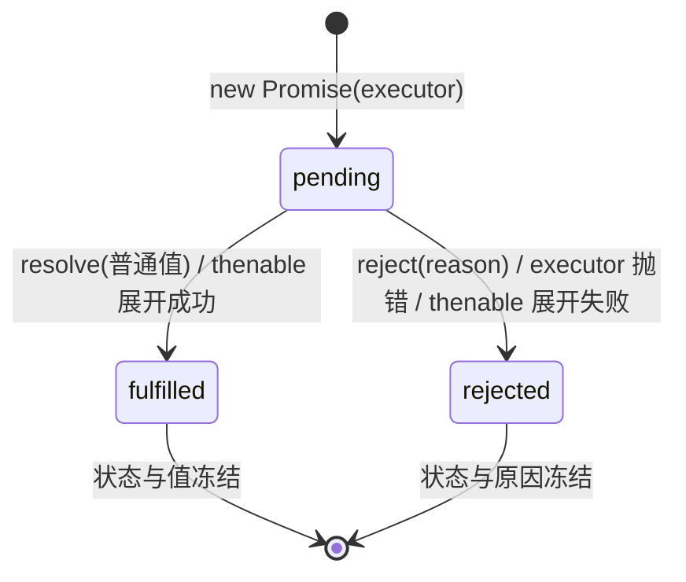
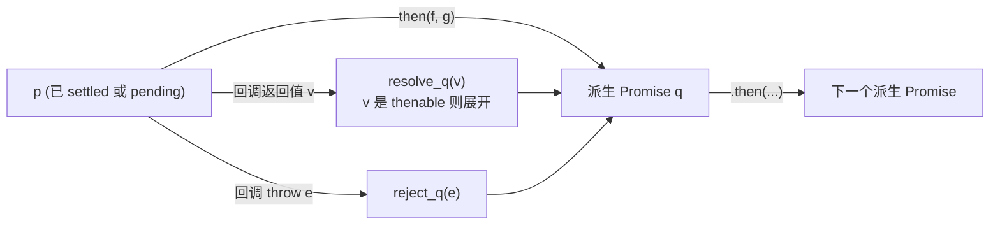

# Promise 与 async/await

> 一句话概括：Promise 是「一次性、不可逆的状态机 + 标准化的异步值容器」，它把回调时代「控制反转带来的信任问题」收编成规范保证；
> async/await 则可以理解为这台状态机之上的「generator + 自动执行器」（概念等价，非规范字面语法糖，引擎不创建 generator 对象）——理解状态机与微任务调度，才能解释所有输出顺序题、错误冒泡题和并发控制题。

预计阅读时间：大约 90 分钟

所属主题：[JavaScript 基础常见面试题总结](summary.md)

本文以 **ECMAScript ES2025（第 16 版，2025-06）** 为规范基线，浏览器以当前 Chrome/V8 为准，Node.js 以 **22/24 LTS** 为准。规范锚点使用 ECMA-262 的内置方法与抽象操作名（如 `Promise#then`、`PerformPromiseThen`、`PromiseResolve`、`NewPromiseCapability`、`Await`），不依赖会随版本漂移的章节号。新特性单独注明版本归属：`Promise.withResolvers` 为 ES2024、`Promise.try` 为 ES2025、`Array.fromAsync` 为 **ES2026**（2025-06 进入 Stage 4，已对照 TC39 finished-proposals 核实）。除特别标注外，所有示例均在 Node.js 环境实测通过（验证环境 Node 20.11.1，所涉行为与 22/24 LTS 一致；`withResolvers`/`try`/`fromAsync` 示例需 Node 22+/较新运行时，文中给出等价形式并在旧环境验证了逻辑）。总结文档给结论，本文给机制与证据：每个机制按「结论 → 机制 → 边界/代价 → 实践/追问」展开。

---

## 0. 阅读路线

| 读者 | 建议阅读 | 关注点 |
| --- | --- | --- |
| 初级（1 年内） | 1、2.1、3.1~3.3、4.4、5.3~5.4、6.1 | Promise 解决什么问题、三种状态、then 链怎么写、await 基本用法、组合器怎么选 |
| 中级（1~3 年） | 全部，重点 2.2、3.4~3.5、4、5.1~5.2、6.2~6.5、9 | thenable 展开、值穿透、错误全景、await 的规范展开与 tick 变化、手写 all/allSettled |
| 高级（3 年+） | 2.2~2.3、3.4 的 tick 账、5.2、7、8.1~8.3、9 的 Q4 | 微任务 tick 精确推导、并发调度器两种实现、超时/重试、可取消性边界、手写 Promise 与规范差距 |
| 选型/架构 | 6.1、7、8.2、8.4 | 组合器语义边界、并发控制成本、eager vs lazy、什么时候不该用 Promise |

目录：

1. 为什么需要 Promise：回调地狱与信任问题
2. 状态机：pending / fulfilled / rejected
3. then 机制：链式、微任务与值穿透
4. 错误处理全景
5. async/await 本质：generator + 自动执行器
6. 静态方法：语义对比与手写
7. 并发控制、超时与重试
8. 边界与选型
9. 高频追问集
10. 参考资料

---

## 1. 为什么需要 Promise：回调地狱与信任问题

### 1.1 回调地狱只是表象

**结论**：回调地狱（callback hell）的「金字塔缩进」只是可读性问题，真正致命的是**错误处理与组合能力的缺失**——每一层都要手写 `if (err)`，并行、竞速、超时这些组合逻辑没有统一载体。

```js
// Node 环境：回调风格的三步串行
getUser(id, (err, user) => {
  if (err) return handle(err);
  getOrders(user, (err, orders) => {
    if (err) return handle(err);
    getDetail(orders[0], (err, detail) => {
      if (err) return handle(err);
      render(detail); // 真正的业务逻辑被埋在第四层
    });
  });
});
```

这段代码有三个结构性缺陷：

| 缺陷 | 具体表现 |
| --- | --- |
| 错误处理重复且易漏 | 每层都要 `if (err)`，漏写一层错误就静默丢失 |
| 无法组合 | 「三个请求并行、全部完成后渲染」需要手写计数器；「任一成功即可」需要手写标志位 |
| 控制反转 | 你把「后续做什么」的回调交给第三方库，**何时调、调几次、同步还是异步调，全由对方决定** |

### 1.2 信任问题与 Zalgo

**结论**：回调模式的本质是控制反转（IoC）——你把代码的执行权交给别人，却没有任何规范保证对方守约。这类「可能同步可能异步」的不确定回调被称为 **Zalgo**（释放混乱之神），是回调时代最隐蔽的 bug 来源。

```js
// Node 环境：一个「不守约」的缓存读取函数
const cache = new Map();
function read(key, cb) {
  if (cache.has(key)) {
    cb(cache.get(key));        // 命中缓存：同步调用！
  } else {
    setTimeout(() => {         // 未命中：异步调用
      const v = load(key);
      cache.set(key, v);
      cb(v);
    }, 0);
  }
}

let state = 'init';
read('a', v => console.log('callback sees state =', state));
state = 'ready';
// 第一次调用（未命中）输出 ready；第二次调用（命中）输出 init
// 同一段业务代码，行为取决于缓存状态——这就是 Zalgo
```

问题清单：回调可能被调用 0 次、1 次、多次；可能同步执行（此时调用方的后续初始化还没跑完）；可能抛异常炸掉调用栈；可能永远不回来。**你无法写出对「调用时机」有确定预期的代码**。

### 1.3 Promise 是什么：状态机 + 异步值容器

**结论**：Promise 是一个**一次性、不可逆的状态机**，同时是**标准化的异步值容器**——它把「未来才会有的值（或错误）」封装成对象，用规范而非约定来保证行为。

Promise 对信任问题的回答是逐条的：

| 回调时代的信任问题 | Promise 的规范保证 |
| --- | --- |
| 回调可能同步执行（Zalgo） | `then` 回调**永远异步**（微任务），即使 Promise 已 settled（见 3.2） |
| 回调可能被调多次 | 状态只能改变一次，`resolve`/`reject` 只有第一次生效（见 2.1） |
| 错误处理各写各的 | 错误沿链冒泡，一个 `catch` 兜底（见 3.5、4） |
| 无法组合 | `then` 返回新 Promise 支持链式；`all`/`race`/`any`/`allSettled` 标准化组合（见 6） |
| 值的传递靠闭包约定 | 值作为状态机的 `[[PromiseResult]]`，沿链显式传递 |

**边界/代价**：Promise 只解决「单个异步值」的建模。它**不可取消、eager 执行、只承载一个值**——事件流、可取消任务、多值序列都超出它的设计范围（见 8）。另外「控制反转」并没有消失：你仍然把回调交给 Promise 实现，只是这次对方是**语言规范**而不是某个第三方库，信任从「人治」变成了「法治」。

**追问：Promise 是异步的吗？**
期望答案：要拆开说——`new Promise(executor)` 的 **executor 是同步立即执行的**（见 8.2），异步的是 `then` 回调的调度（微任务）和状态未来的落定。说「Promise 就是异步」是不精确的。

---

## 2. 状态机：pending / fulfilled / rejected

### 2.1 三态与不可逆

**结论**：Promise 只有 `pending → fulfilled` 或 `pending → rejected` 两条单行道；settled（fulfilled 或 rejected 的统称）之后状态与结果值都不可再变。`resolve`/`reject` 多次调用只有第一次生效，后续调用静默返回 `undefined`。



**机制**（规范锚点：Promise 实例内部槽、`Promise Resolve Functions`、`FulfillPromise`/`RejectPromise`）：

- 每个 Promise 实例有内部槽 `[[PromiseState]]`（pending/fulfilled/rejected）、`[[PromiseResult]]`（值或拒绝原因）、`[[PromiseFulfillReactions]]`/`[[PromiseRejectReactions]]`（待执行的 reaction 列表）、`[[PromiseIsHandled]]`（是否已有人处理拒绝，供宿主追踪 unhandledrejection）。
- executor 拿到的 `resolve`/`reject` 是共享同一个 `[[AlreadyResolved]]` 记录的内置函数：第一次调用把标志置 true，之后任何调用（无论 resolve 还是 reject）直接返回。**resolve 和 reject 互斥，先到先得**。
- `FulfillPromise`/`RejectPromise` 开头都有断言 `[[PromiseState]] is pending`——规范层面就不允许二次落定。

```js
// Node 环境：只生效第一次
const p = new Promise((resolve, reject) => {
  resolve('first');
  resolve('second');      // 静默忽略
  reject(new Error('x')); // 同样忽略
});
p.then(v => console.log(v)); // 输出: first
```

**边界/代价**：

- 「不可逆」意味着**没有重置、没有重放**。想重试只能创建新 Promise（见 7.4）；想多次取值应该用事件/异步迭代器而不是 Promise（见 8.4）。
- settled 后 `then` 仍然可以注册任意多次，每次都会拿到同一个冻结值——Promise 是「值容器」，不是「一次性事件」。
- executor 里 `resolve()` 之后的代码**仍会继续同步执行**（resolve 不是 return），这是高频坑：`resolve(); doSomethingElse();` 的副作用照样发生。

**追问：为什么设计成不可逆？**
期望答案：不可逆是「异步值容器」语义的前提——值一旦确定就是确定的，下游所有 `then` 看到的必须一致，否则链式推导和缓存（`Promise.resolve(p) === p`）都不成立。可变的「未来值」是 Observable/信号（signal）的领域，不是 Promise 的。

### 2.2 resolve ≠ fulfill：thenable 的递归展开

**结论**：`resolve(x)` 不一定让 Promise 立刻 fulfilled。若 `x` 是 **thenable**（拥有可调用 `then` 方法的对象），Promise 会「吸收」它：把自身的落定**委托**给 `x.then` 的结果，这个过程是异步的、可递归的。`reject(x)` 则永远直接落定为 rejected，不展开。

**机制**（规范锚点：`Promise Resolve Functions`，ES2025 §27.2.1.3.2 的步骤，此处按行为转述）：

1. `[[AlreadyResolved]]` 已为 true → 直接返回（2.1）；
2. `SameValue(resolution, promise)` → 用新建的 TypeError 拒绝自身（自解析，见 2.3）；
3. `resolution` 不是对象 → 直接 `FulfillPromise`；
4. **同步**执行 `Get(resolution, "then")`——这一步是属性读取，getter 抛错会直接变成 rejection；
5. `then` 不可调用 → 直接 `FulfillPromise`（普通对象原样作为值）；
6. `then` 可调用 → 入队一个 `NewPromiseResolveThenableJob`（旧版规范名 `PromiseResolveThenableJob`），**在微任务中**调用 `thenable.then(resolve, reject)`，把落定权交出去。

```js
// Node 环境：resolve 一个 Promise 与一个裸 thenable
const inner = new Promise(r => setTimeout(() => r('inner'), 5));
const outer = new Promise(r => r(inner)); // outer 不会立刻 fulfilled
outer.then(v => console.log(v));          // 5ms 后输出: inner

const thenable = { then(res) { console.log('then 只被调用一次'); res(42); } };
Promise.resolve(thenable).then(v => console.log(v));
// 输出: then 只被调用一次
// 输出: 42

// then 的 getter 抛错 → rejection（Get 是同步步骤）
const bad = { get then() { throw new Error('getter boom'); } };
Promise.resolve(bad).catch(e => console.log(e.message)); // getter boom
```

**递归吸收**：展开用的 `resolve`/`reject` 就是目标 Promise 自己的 resolving functions，所以 thenable 的 `then` 里再 resolve 另一个 thenable，会继续走同一套流程，层层委托直到遇到普通值或 rejection——这就是「递归吸收」。

**必须分清的两个「resolve」**（高频混淆点）：

| | executor 的 `resolve` 函数 | `PromiseResolve(C, x)` 抽象操作 |
| --- | --- | --- |
| 谁在用 | `new Promise` 内部、thenable 展开 job | `Promise.resolve` 静态方法、`Await`（见 5.2） |
| 原生 Promise 入参 | **照样走 thenable 展开**（多花微任务 tick） | 若 `x.constructor === C`，**原样返回 x**，不包装 |
| thenable 入参 | 入队 job 异步吸收 | 新建 Promise 再走左列流程 |
| 幂等性 | 只有第一次生效 | 无状态，每次调用独立 |

```js
// Node 环境：Promise.resolve 对原生 Promise 是恒等返回
const p = Promise.resolve(1);
console.log(Promise.resolve(p) === p);        // true
console.log(Promise.reject(p) === p);         // false：reject 永远新建，且不展开
```

**边界/代价**：

- thenable 展开是**异步**的：`resolve(已fulfilled的Promise)` 也要额外花微任务 tick（3.4 会算这笔账）。
- `then` 只被读取一次、调用一次，但**调用发生在微任务里**——thenable 的 `then` 方法里抛错会被 job 捕获并转为 rejection，不会炸掉调用栈。
- 跨 realm（iframe、Node `vm`）的 Promise 没有本 realm 的 `[[PromiseState]]` 内部槽，`IsPromise` 为 false，但只要有 `then` 方法就会被当 thenable 吸收——这是跨窗口传 Promise 仍能工作的原因。

**追问：`resolve(Promise)` 和 `return Promise` 有什么区别？**
期望答案：语义上都触发 thenable 展开、都会多花 tick；区别在入口——前者走 executor 的 resolve 函数（无条件展开），后者若发生在 `Promise.resolve`/`await` 路径上会先被 `PromiseResolve` 判断「同构造器原生 Promise 直接透传」。面试能答到「展开是异步的、有额外 tick」就已经超过多数候选人。

### 2.3 自解析：Chaining cycle

**结论**：用 Promise 自己 resolve 自己会触发 TypeError（`Chaining cycle detected for promise`），这是规范内置的死循环防护。

```js
// Node 环境
let self;
self = new Promise(r => { setTimeout(() => r(self), 0); });
self.catch(e => console.log(e.constructor.name, '-', e.message));
// TypeError - Chaining cycle detected for promise #<Promise>
```

**机制**：resolve 函数第 2 步 `SameValue(resolution, promise)` 命中即 `RejectPromise`。没有这个检查，状态机会永远等自己落定——pending 死锁。注意**间接循环**（A resolve B、B resolve A）规范不检测，两个 Promise 会永远 pending，这是手写 Promise 时容易漏掉的边界。

---

## 3. then 机制：链式、微任务与值穿透

### 3.1 then 返回新 Promise

**结论**：`p.then(onFulfilled, onRejected)` **不修改 p**，而是返回一个全新的「派生 Promise」；派生 Promise 的状态由回调的返回值/抛错决定。链式调用的每一环都是独立的状态机。

**机制**（规范锚点：`Promise#then` → `NewPromiseCapability` + `PerformPromiseThen`）：

1. `then` 用 `SpeciesConstructor(p, %Promise%)` 拿到构造器 C，`NewPromiseCapability(C)` 创建派生 Promise 并提取它的 resolve/reject；
2. `PerformPromiseThen(p, onFulfilled, onRejected, resultCapability)` 把两个回调包成 `PromiseReaction` 记录：p 还 pending 就挂进 `[[PromiseFulfillReactions]]`/`[[PromiseRejectReactions]]`；已 settled 就**立即入队** reaction job（见 3.2）；
3. 回调执行时（`NewPromiseReactionJob`）：返回值 → 调派生 Promise 的 resolve；抛错 → 调派生 Promise 的 reject。



`catch(onRejected)` 就是 `then(undefined, onRejected)` 的语法别名（规范原文：`Invoke(promise, "then", « undefined, onRejected »)`）；`finally(onFinally)` 则注册「成功失败都执行」的回调，并**把上游的值/原因原样透传**（除非 finally 回调自己抛错或返回 rejected Promise）。

**边界/代价**：每个 `then` 都新建 Promise 与 reaction 记录，长链有内存与调度开销（8.3）；`then` 的回调**只执行一次**——对同一个 p 注册两次 then 是两个独立 reaction，各执行一次，互不影响。

### 3.2 回调永远是微任务

**结论**：即使 Promise 已经 settled，`then` 回调也**不会同步执行**——`PerformPromiseThen` 对已落定的 Promise 走 `NewPromiseReactionJob` + `HostEnqueuePromiseJob`，把回调放进微任务队列。这是 Promise 对 Zalgo 的规范级回答。

```js
// Node 环境（browser 同理）
console.log('1');
Promise.resolve().then(() => console.log('3'));
setTimeout(() => console.log('4'), 0);
console.log('2');
// 输出: 1 2 3 4
// 微任务（3）在当前宏任务末尾清空，先于下一个宏任务 setTimeout（4）
```

**机制**：微任务队列在**每个宏任务结束、以及当前同步脚本执行完**时清空（microtask checkpoint），且清空过程中新入队的微任务也在本轮执行。Promise job 属于微任务，`setTimeout` 属于宏任务——完整的队列模型、`queueMicrotask`、Node 与浏览器差异见 [事件循环](event-loop.md)，本文只用到「微任务先于下一个宏任务」这一条。

**边界/代价**：

- 「永远异步」的代价是**至少一个微任务 tick 的延迟**，对已缓存的值也不例外——这是规范故意付出的成本，换取时序确定性。
- 微任务里再产生微任务会**饿死宏任务**：递归 `Promise.resolve().then(loop)` 会让 setTimeout/渲染永远得不到执行（浏览器里页面卡死）。高频循环要主动让出（`await new Promise(r => setTimeout(r))`）。

**追问：`queueMicrotask` 和 `Promise.then` 什么关系？**
期望答案：都是往微任务队列入队，`queueMicrotask` 是宿主提供的直接入口，没有 Promise 对象与状态机开销；两者在同一个队列里按入队顺序执行。需要「纯调度」用前者，需要「值与错误传递」用后者。

### 3.3 值穿透（value pass-through）

**结论**：`then` 的参数**不是函数**时会被忽略：成功路径上非函数 `onFulfilled` 让值原样透传给下一环；失败路径上非函数 `onRejected` 让错误原样继续冒泡。

**机制**（规范锚点：`PerformPromiseThen` + `NewPromiseReactionJob`）：`PerformPromiseThen` 对不可调用的回调不创建 JobCallback（handler 为 empty）；`NewPromiseReactionJob` 执行时若 handler 为 empty——fulfill 类型直接 `NormalCompletion(argument)`（值穿透），reject 类型直接 `ThrowCompletion(argument)`（错误穿透）。**穿透不是「跳过这一环」，这一环的派生 Promise 照样创建、照样落定**。

```js
// Node 环境
Promise.resolve(1).then(null).then('not a function').then(v => console.log(v)); // 1
Promise.reject(new Error('boom'))
  .then(() => console.log('不会执行'))
  .catch(e => console.log(e.message)); // boom：中间的 then 没有 onRejected，错误穿透
```

**实践**：`.then(null, onRejected)` 合法但可读性差，统一写 `.catch(onRejected)`。值穿透也解释了为什么 `p.then().then().then(f)` 中 f 仍能拿到 p 的值。

### 3.4 链中三种走向：return 值 / return Promise / throw

**结论**：回调的出口决定派生 Promise 的命运，只有三种：

| 回调出口 | 派生 Promise 的落定 | 微任务成本 |
| --- | --- | --- |
| `return 普通值`（含不写 return → undefined） | 立即以该值 fulfilled | 下一环回调 +1 tick |
| `return Promise/thenable` | **展开后**跟随其落定（成功或失败都跟随） | 原生 Promise 额外 +2 tick；同步 resolve 的裸 thenable +1 tick（见下） |
| `throw e` | 以 e rejected | 下一环错误回调 +1 tick |

**return Promise 为什么多 2 个 tick**（规范推导，已实测）：回调返回 thenable 后，派生 Promise 的 resolve 函数走入队 `NewPromiseResolveThenableJob`（第 1 个额外 tick）→ job 里调用 `thenable.then(resolve, reject)`，对已 fulfilled 的原生 Promise 又入队一个 reaction job（第 2 个额外 tick）→ 该 job 才真正 resolve 派生 Promise，触发下游 reaction。对比 return 普通值的「直接 FulfillPromise」，净增 2 tick。若返回的是**同步 resolve 的裸 thenable**，展开 job 内 `then(resolve)` 直接 fulfill 派生 Promise，没有中间那个 reaction job，只净增 1 tick——与 await 裸 thenable 的账同源（5.2 追问）。

```js
// Node 环境：return Promise 的额外 tick 可观测
Promise.resolve().then(() => { console.log('t1'); return Promise.resolve(); })
  .then(() => console.log('t4'));
Promise.resolve().then(() => console.log('t2')).then(() => console.log('t3'));
// 输出: t1 t2 t3 t4
// 若第一环 return 普通值，输出将是 t1 t2 t4 t3
```

**边界/代价**：

- **忘写 return 是链式第一坑**：`.then(() => { fetch(url) })` 的派生 Promise 立即以 undefined fulfilled，链「断」了——后续环节拿不到数据，fetch 的 rejection 也无人接管（变成 unhandledrejection）。
- return 一个**永远 pending** 的 Promise，整条链跟着永远 pending——排查「await 卡住」时优先检查链上有没有未落定的环节（8.3）。
- `throw` 只能抛同步错误；回调里启动的异步任务抛错不会被本环捕获（4.1）。

### 3.5 错误冒泡与 catch 后恢复

**结论**：rejection 沿链向下冒泡，跳过所有没有 `onRejected` 的环节，直到被最近的 `catch`（或 then 第二参数）接住；**catch 回调正常返回后，链恢复 fulfilled 状态继续向下**——catch 是「错误处理器」，不是「链的终点」。

```js
// Node 环境
Promise.resolve()
  .then(() => { throw new Error('step1'); })
  .then(() => console.log('跳过'))          // 无 onRejected，错误穿透
  .catch(e => { console.log(e.message); return 'recovered'; })
  .then(v => console.log(v));
// 输出: step1
// 输出: recovered（catch 返回普通值 → 链恢复 fulfilled）
```

**机制**：每一环的派生 Promise 被 reject 后，下游 `PerformPromiseThen` 注册的 reject reaction 若 handler 为 empty 就 `ThrowCompletion` 继续传递（3.3）；catch 回调的返回值走 3.4 的三种走向——返回普通值则恢复，**再 throw 或 return rejected Promise 则继续失败**。

**实践/追问**：

- catch 里 `return Promise.reject(e)` 或 `throw e` 是「记录日志后继续向上抛」的标准写法；只 `console.log(e)` 不抛，等于**吞错**（4.4）。
- **追问：catch 之后还能再 catch 吗？** 能。catch 本身也返回派生 Promise，它后面再挂 catch 捕获的是「catch 回调自己抛出的新错误」，不是原错误——原错误已被消费。
- **追问：为什么错误不会向上冒泡到父 Promise？** 因为链是单向的：父 Promise 的状态不受子 Promise 影响（then 不修改 p）。想要「子失败影响父」，必须显式 `return` 或 `await` 把子链接回来。

---

## 4. 错误处理全景

### 4.1 四层错误捕获

**结论**：Promise 体系的错误捕获分四层，前三层是「局部处理」，第四层是「全局兜底」；漏掉所有层才会变成 unhandledrejection。

| 层 | 捕获什么 | 机制 |
| --- | --- | --- |
| ① 构造器内同步 throw | executor 里的同步异常 | `Promise(executor)` 规范步骤：`Completion(Call(executor, ...))` 为 abrupt 且 Promise 仍 pending → 自动 reject。**executor 的 this 是 undefined**（规范以 undefined 为 thisArgument 调用，详见 [this 绑定](this-binding-and-function-call.md)） |
| ② then/catch/finally 回调内 throw | 回调的同步异常 | `NewPromiseReactionJob` 捕获 handler 的 abrupt completion → reject 派生 Promise |
| ③ async 函数内 try/catch | await 的 rejection + 同步异常 | await 把 rejection 转成「在 await 处 throw」（见 5.2），回到同步异常处理模型 |
| ④ 全局 unhandledrejection | 没有任何 handler 的 rejection | 宿主钩子 `HostPromiseRejectionTracker`，browser/Node 各自暴露事件（4.2） |

```js
// Node 环境：①② 层示例
new Promise(() => { throw new Error('exec'); })
  .catch(e => console.log('①', e.message));      // ① exec
Promise.resolve().then(() => { throw new Error('cb'); })
  .catch(e => console.log('②', e.message));      // ② cb
```

**边界**：①② 都只捕获**同步** throw。`new Promise(r => { setTimeout(() => { throw new Error('x'); }, 0); })` 里的异常发生在另一个宏任务栈上，Promise 无法捕获——Node 里直接进程崩溃，browser 里是 window.onerror。异步错误必须通过 `reject(e)` 显式交回。

### 4.2 unhandledrejection：browser 与 Node

**结论**：一个 Promise 被 reject 且在**本轮微任务清空时**仍没有任何 rejection handler，宿主就触发「未处理拒绝」通知；browser 派发 `unhandledrejection` 事件，Node 触发 `process` 的同名事件，且 **Node 15 起默认模式是 throw——直接以非零码终止进程**（本地实测 exit code 1）。

```js
// browser 环境
window.addEventListener('unhandledrejection', e => {
  console.error('未处理的拒绝:', e.reason);
  e.preventDefault(); // 阻止默认的控制台报错
});
window.addEventListener('rejectionhandled', e => {
  // 稍后又有人接住了这个 rejection（比如延迟挂的 catch）
});

// Node 环境（22/24 LTS 默认行为一致）
process.on('unhandledRejection', (reason, promise) => {
  console.error('未处理的拒绝:', reason);
  // 注册了监听器就不会走默认 throw，进程继续运行（已实测）
});
```

**机制**：`RejectPromise` 时若 `[[PromiseIsHandled]]` 为 false，调 `HostPromiseRejectionTracker(promise, "reject")`；之后 `PerformPromiseThen` 挂上 rejection handler 时再调 `"handle"`。宿主据此维护「未处理集合」，在微任务 checkpoint 检查并上报。这解释了两个现象：

- **延迟 catch 能「撤销」上报**：rejection 发生后才挂 catch，会先触发 unhandledrejection 再触发 rejectionhandled（browser）——所以「先 reject 后 catch」的写法在监控里会留下噪音。
- Node 的 `--unhandled-rejections` 可切换 `throw`（默认）/`strict`（当作未捕获异常）/`warn`/`warn-with-error-code`/`none`；**生产服务不要改成 warn 了事**，那等于把错误静默化。

**实践**：全局兜底只做「上报 + 优雅降级」，不能替代局部 catch；Node 服务建议在兜底里记录后主动 `process.exit(1)` 交给进程管理器重启，避免带着未知状态继续服务。

### 4.3 async 函数的 try/catch/finally

**结论**：async/await 把异步错误拉回同步的 try/catch 模型，这是它相对 then 链最大的工程价值；finally 的语义与同步版完全一致——**finally 里 return/throw 会覆盖 try/catch 的结果**。

```js
// Node 环境
async function load() {
  try {
    const user = await getUser();       // rejection → 在此处 throw
    return await getOrders(user);
  } catch (e) {
    if (e.code === 'NOT_FOUND') return [];  // 可预期的错误降级
    throw e;                                // 不可预期的继续上抛
  } finally {
    releaseLock();                          // 成功失败都执行
  }
}

// finally 覆盖返回值（已实测）
async function g() { try { return 'try'; } finally { return 'finally'; } }
g().then(v => console.log(v)); // finally（不是 try！）
```

**边界/代价**：

- `finally` 回调里 `await` 会推迟整条链的落定；finally 里抛错会**吞掉原始错误**——清理逻辑要自己保证不抛。
- try/catch 包不住「发出去就不管」的 Promise：`try { doAsync(); } catch {}` 中 doAsync 的 rejection 与这个 try 无关（没有 await 就没有 throw 点）。
- 多个独立 await 想分别降级时，不要套一个大 try——每个 await 单独包，或用 `allSettled`（6.3）。

### 4.4 三个高频坑

**坑一：then 里忘 return，链断 + 错误失联**（见 3.4）。修复：回调体改成表达式箭头函数，或显式 return。

**坑二：catch 吞错后链继续 fulfilled**。`.catch(e => log(e))` 之后下游拿到 undefined 照常执行，业务把「失败」当「空数据」处理。修复：catch 里要么 rethrow，要么返回**显式的降级值**并让下游能区分（如 `{ ok: false }`），要么用 allSettled 把成败结构化。

**坑三：forEach 不等待 async 回调**（已实测）：

```js
// Node 环境
const sleep = (ms, v) => new Promise(r => setTimeout(() => r(v), ms));
const arr = [30, 10, 20];

const out = [];
arr.forEach(async ms => { out.push(await sleep(ms, ms)); });
console.log(out); // []：forEach 同步返回，根本不看回调的返回值

// 正确姿势一：串行，用 for...of
for (const ms of arr) { out.push(await sleep(ms, ms)); } // [30, 10, 20]

// 正确姿势二：并行，用 map + Promise.all
const out2 = await Promise.all(arr.map(ms => sleep(ms, ms))); // [30, 10, 20]
```

**机制**：`forEach`/`map`/`filter` 的规范实现同步调用回调、忽略其返回值（map 收集的是 Promise 对象本身）。async 回调返回的 Promise 无人接管，其中的 rejection 全部变成 unhandledrejection。**经验法则：循环体里有 await，就用 for...of（串行）或 map + 组合器（并行），永远不用 forEach。**

### 4.5 Promise.try（ES2025）：把同步 throw 收编进链

**结论**：`Promise.try(fn, ...args)`（ES2025 新增）执行 fn，无论它同步返回、同步 throw 还是返回 Promise，统一得到一个 Promise——消灭「fn 可能同步抛错，`.catch` 接不住」的边界。

```js
// 需支持 ES2025 的运行时；旧环境等价形式（逻辑已在 Node 20 实测）：
function promiseTry(fn, ...args) {
  return new Promise(resolve => resolve(fn(...args)));
}
// 关键在 resolve 包在 executor 里：fn 同步 throw 会被构造器捕获为 rejection
promiseTry(() => { throw new Error('sync throw'); })
  .catch(e => console.log(e.message)); // sync throw
promiseTry(() => 42).then(v => console.log(v)); // 42
```

典型场景：包装「可能同步抛错的第三方函数」`Promise.try(() => JSON.parse(text))`，对比 `Promise.resolve().then(() => JSON.parse(text))` 少一层微任务且意图更直白。规范锚点：`Promise.try`（ES2025 §27.2.4.8）。

---

## 5. async/await 本质：generator + 自动执行器

### 5.1 语法糖：可暂停函数 + 自动驱动

**结论**：async/await（ES2017）= **generator 的暂停/恢复能力 + 一个自动把 yield 值喂给 Promise、拿到结果再 next 的执行器**。规范里 async 函数与 generator 共享同一套执行上下文挂起机制（`AsyncFunctionStart`/`AsyncBlockStart` 创建派生 Promise 并驱动函数体；Await 负责挂起与恢复），generator 本体见 [迭代器与生成器](iterators-and-generators.md)，执行上下文的挂起/恢复见 [作用域、闭包与执行上下文](scope-closures-and-execution-context.md)。

手写一个执行器就能看清这层关系（Node 环境，已实测）：

```js
function run(genFn) {
  return new Promise((resolve, reject) => {
    const gen = genFn();
    function step(nextFn) {
      let result;
      try { result = nextFn(); } catch (e) { reject(e); return; }
      if (result.done) { resolve(result.value); return; }
      Promise.resolve(result.value).then(
        v => step(() => gen.next(v)),   // 成功：把值送回去恢复执行
        e => step(() => gen.throw(e))   // 失败：在 yield 处抛错，让函数内 try/catch 接住
      );
    }
    step(() => gen.next());
  });
}

const sleep = (ms, v) => new Promise(r => setTimeout(() => r(v), ms));
run(function* () {
  const a = yield sleep(10, 1);
  const b = yield sleep(10, 2);
  return a + b;
}).then(v => console.log(v)); // 3
```

`async function` 就是把 `function*` 换成 `async`、`yield` 换成 `await`，再把这个 run 内置进引擎。`gen.throw(e)` 对应「await 的 rejection 在 await 处变成 throw」——这正是 async 函数里 try/catch 能接住异步错误的机制根源。

**边界**：类比是理解工具，不是实现事实——引擎并不真的创建 generator 对象，async 函数有独立的内部槽与 job 调度；且 await 的展开规则比 `Promise.resolve(yield值).then` 更精细（5.2）。

### 5.2 await 的规范展开与 ES2019 tick 变化

**结论**：ES2025 规范中 `Await(value)` 的核心两步是 **`PromiseResolve(%Promise%, value)` + `PerformPromiseThen(promise, onFulfilled, onRejected)`**：把值规范化成 Promise，挂上「恢复执行/在 await 处抛错」两个回调，然后**挂起当前执行上下文**。对已 settled 的原生 Promise，恢复只花 **1 个微任务 tick**。

**版本归属（已对照规范 diff 与 V8 博客核实）**：

| | ES2019 之前 | ES2019 起（tc39/ecma262#1250，V8 7.2 / Chrome 72 / Node 12） |
| --- | --- | --- |
| 规范步骤 | `NewPromiseCapability` 新建包装 Promise → `resolve(value)` → 对**包装** PerformPromiseThen | `PromiseResolve(%Promise%, value)`：原生 Promise **原样透传**，不再包装 |
| await 已 fulfilled 的原生 Promise | **3 tick**（thenable 展开 job → reaction job → 恢复 job） | **1 tick**（直接对原 Promise 挂 reaction） |
| await 非 Promise 值 | 1 tick（包装 Promise 被同步 fulfill，再挂 reaction） | 1 tick（PromiseResolve 仍会包装，但同步 fulfill） |
| 额外 Promise 对象 | 每次 await 多创建 2 个（包装 + 内部 throwaway） | 原生 Promise 场景省去包装 |

两个必须说准的点：

1. **3→1 的缩减针对「await 一个 Promise」**；await 非 Promise 值前后都是 1 tick——重点是 **await 永远不是 0 tick**，`await 42` 也会让出一次微任务，「await 普通值等于同步」是错误直觉。
2. 教学上常写 `await x ≈ Promise.resolve(x).then(恢复)`——这个等价在 **ES2019 之后**对 tick 数是成立的（Promise.resolve 对原生 Promise 也是恒等返回）；在 ES2019 之前不成立（旧规范无条件包装）。

```js
// Node 环境（Node 12+ / 现代浏览器，已实测）
(async () => { await null; console.log('after:await'); })();
Promise.resolve().then(() => console.log('tick:a')).then(() => console.log('tick:b'));
// 输出: after:await → tick:a → tick:b
// await null 只花 1 tick，先于第二个 then；ES2019 前的引擎顺序不同
```

经典输出顺序题的现代答案（Node 12+，已实测）：

```js
async function async2() { console.log('async2'); }
async function async1() {
  console.log('async1 start');
  await async2();            // async2() 返回已 fulfilled 的原生 Promise → 1 tick
  console.log('async1 end');
}
console.log('script start');
setTimeout(() => console.log('setTimeout'), 0);
async1();
new Promise(r => { console.log('promise1'); r(); }).then(() => console.log('promise2'));
console.log('script end');
// script start → async1 start → async2 → promise1 → script end
// → async1 end → promise2 → setTimeout
// Node 10 及以前：async1 end 在 promise2 之后（await 花 3 tick）
```

**追问：await 一个 thenable（非原生 Promise）花几 tick？**
期望答案：`PromiseResolve` 判定 `IsPromise` 为 false → 新建包装 Promise 并走 thenable 展开：入队展开 job（第 1 tick），job 内调用 `thenable.then(resolve)`——若 thenable **同步 resolve**，包装 Promise 立即 fulfilled，随即入队恢复 reaction（第 2 tick）。所以 **await 裸 thenable（同步 resolve）= 2 tick，比 await 原生 Promise（1 tick）只多 1 个展开 job**（已实测：`await {then(r){r(1)}}` 的输出插在 t1 与 t2 之间）。若 thenable 的 then 异步落定，或它本身是跨 realm 的原生 Promise（其 `.then` 会再入队一个 reaction job），才到 3 tick 及以上。「await 原生 Promise 最快」是有规范依据的性能细节。

### 5.3 async 函数恒返回 Promise

**结论**：async 函数的返回值**永远**是 Promise：return 普通值 → 以该值 fulfilled（经 resolve 展开规则）；函数体 throw（含未捕获的 await rejection）→ rejected；return 一个 Promise → 展开跟随。

```js
// Node 环境
async function f() { return 42; }
console.log(f() instanceof Promise); // true
f().then(v => console.log(v));       // 42
async function g() { throw new Error('x'); }
g().catch(e => console.log(e.message)); // x
```

**机制**：`AsyncFunctionStart` 先 `NewPromiseCapability(%Promise%)` 创建返回给调用方的 Promise，函数体正常结束用返回值 resolve 它、异常结束 reject 它。**调用 async 函数的那一刻，函数体同步执行到第一个 await 才让出**——「async 函数调用是异步的」是错误说法，异步的是 await 之后的部分。

**边界**：顶层 await（top-level await，**ES2022**）只允许在 **ESM 模块**中使用，CommonJS 不支持；它会阻塞模块图的求值，滥用会拖慢启动甚至造成模块间死锁，详见 [模块：CommonJS 与 ESM](modules-commonjs-and-esm.md)。

### 5.4 await 串行 vs Promise.all 并行

**结论**：`await a(); await b();` 是**串行**——b 要等 a 落定才开始；无依赖关系的任务应该**先同时启动、再统一 await**，耗时从「求和」变「取最大值」。

```js
// Node 环境，三个 100ms 任务（已实测）
const sleep = (ms, v) => new Promise(r => setTimeout(() => r(v), ms));

// 串行：约 300ms
let t = Date.now();
await sleep(100, 'a'); await sleep(100, 'b'); await sleep(100, 'c');
console.log(Date.now() - t); // ≈307ms

// 并行：约 100ms
t = Date.now();
await Promise.all([sleep(100, 'a'), sleep(100, 'b'), sleep(100, 'c')]);
console.log(Date.now() - t); // ≈102ms

// 需要分别拿结果时：先启动，后 await（同样约 100ms）
t = Date.now();
const pa = sleep(100, 'a'), pb = sleep(100, 'b');
const ra = await pa, rb = await pb;
console.log(Date.now() - t, ra, rb); // ≈102ms a b
```

**机制**：Promise 是 eager 的——`sleep(...)` 一调用定时器就开始跑；`await` 只是「等结果」，不是「启动任务」。串行写法把「启动 b」推迟到了「a 落定之后」，白白浪费等待窗口。

**边界/代价**：

- 并行不是免费的：并发打满下游（数据库连接池、限流 API）会引发雪崩，需要并发上限（第 7 章）。
- 有依赖关系的任务**必须**串行（b 需要 a 的结果），不要为了「看起来快」强行 all。
- `Promise.all` 快速失败语义：一个失败立即 reject，但**其余任务不会停**（9 的 Q1）。要「全部结果无论成败」用 allSettled。

**追问：`await Promise.all([...])` 和 `for...of + await` 怎么选？**
期望答案：无依赖、要吞吐 → all（或带并发上限的 pool）；有依赖、要顺序副作用、要提前 break → for...of。forEach 永远不选（4.4）。

---

## 6. 静态方法：语义对比与手写

### 6.1 语义对比表

**结论**：四个组合器的差异只在「何时落定、以什么落定」，背住这张表就覆盖了绝大多数选择题与场景题。

| 方法 | 成功条件 | 失败行为 | 空输入 `[]` | 结果顺序 | 版本 |
| --- | --- | --- | --- | --- | --- |
| `Promise.all` | **全部** fulfilled | **任一** rejected → 立即 reject（第一个失败的 reason） | fulfilled `[]` | 按**输入顺序**，与完成先后无关 | ES2015 |
| `Promise.allSettled` | 全部 settled 即 fulfilled | **永不 reject** | fulfilled `[]` | 按输入顺序，`{status:'fulfilled',value}` / `{status:'rejected',reason}` | ES2020 |
| `Promise.race` | 第一个 **settled**（无论成败） | 第一个 settled 是 rejected 就 reject | **永远 pending** | 单值 | ES2015 |
| `Promise.any` | 第一个 **fulfilled** | 全部 rejected → `AggregateError`（`.errors` 数组） | 立即 reject `AggregateError`（errors 为空） | 单值 | ES2021 |
| `Promise.resolve` | — | — | — | 原生同构造器 Promise 原样返回；thenable 展开；普通值包装 | ES2015 |
| `Promise.reject` | — | 永远新建 rejected Promise，**不展开**入参 | — | — | ES2015 |
| `Promise.try` | fn 正常返回 | fn 同步 throw 也变 rejection | — | — | ES2025 |
| `Promise.withResolvers` | — | — | — | 返回 `{promise, resolve, reject}` | ES2024 |

空输入行为已实测：`all([])`/`allSettled([])` → `[]`；`any([])` → AggregateError（errors.length=0）；`race([])` 100ms 后仍 pending。**`race([])` 永远 pending 是真实事故源**：用 race 做超时兜底时，若传入数组可能为空，整个 await 会卡死。

**选型速记**：要全部结果且一损俱损 → all；要全部结果且互不牵连 → allSettled；要最快响应（含失败）→ race；要最快成功（多源容灾）→ any。版本演进全景见 [ES6+ 与现代 JavaScript](es6-plus-and-modern-js.md)。

### 6.2 手写 Promise.all

**结论**：核心是「计数器 + 按索引写结果 + 任一失败立即 reject」。三个必查边界：空数组立即成功、非 Promise 项用 `Promise.resolve` 规范化、结果按输入顺序而非完成顺序。

```js
// Node 环境，已实测（含空数组/混合项/顺序/快速失败四组用例）
function promiseAll(iterable) {
  return new Promise((resolve, reject) => {
    const items = Array.from(iterable);      // 支持任意可迭代对象
    const results = new Array(items.length);
    let remaining = items.length;
    if (remaining === 0) { resolve(results); return; }  // 空数组：立即 fulfilled []
    items.forEach((item, i) => {
      Promise.resolve(item).then(value => {  // 非 Promise 项规范化
        results[i] = value;                  // 按输入索引写，保证顺序
        if (--remaining === 0) resolve(results);
      }, reject);                            // 任一失败：立即 reject，先到先得
    });
  });
}

// 验证输出：
// promiseAll([])                          → []
// promiseAll([sleep(30,'slow'), 1, sleep(10,'fast')]) → ['slow', 1, 'fast']
// promiseAll([sleep(30,'ok'), fail(10,'boom'), ...])  → reject: boom
```

**与规范的差距**（面试加分点）：规范用迭代器协议逐个取值（`GetIterator` + `IteratorStep`），**迭代过程本身抛错**（如自定义迭代器 next throw）也会 reject；`Array.from` 版本在迭代抛错时会同步 throw 而非 rejection。另外规范对每个项调 `PromiseResolve(C, item)`，C 是调用者的构造器（支持子类），手写版写死了原生 Promise。

### 6.3 手写 Promise.allSettled

**结论**：与 all 的唯一区别是**失败也计数**——两个回调都写结果、都递减计数器，因此永不 reject。

```js
// Node 环境，已实测（与原生 Promise.allSettled 输出逐项对照一致）
function promiseAllSettled(iterable) {
  return new Promise(resolve => {            // 注意：没有 reject 参数
    const items = Array.from(iterable);
    const results = new Array(items.length);
    let remaining = items.length;
    if (remaining === 0) { resolve(results); return; }
    items.forEach((item, i) => {
      Promise.resolve(item).then(
        value  => { results[i] = { status: 'fulfilled', value };
                    if (--remaining === 0) resolve(results); },
        reason => { results[i] = { status: 'rejected', reason };
                    if (--remaining === 0) resolve(results); }
      );
    });
  });
}
// promiseAllSettled([sleep(10,1), fail(5,'x'), 3])
// → [{status:'fulfilled',value:1}, {status:'rejected',reason:Error('x')}, {status:'fulfilled',value:3}]
```

**实践**：批量上报、批量清理、仪表盘多卡片加载这类「单点失败不该拖垮整体」的场景用 allSettled，然后对 rejected 项单独告警/重试。

### 6.4 resolve / reject 的细节

- `Promise.resolve(x)`：走 `PromiseResolve(this, x)`——同构造器原生 Promise **恒等返回**（可用作「是不是原生 Promise」的廉价判断）；thenable 展开；普通值包装。已实测 `Promise.resolve(p) === p` 为 true。
- `Promise.reject(x)`：**永远新建** rejected Promise，x 原样作为 reason，即使 x 是 Promise 也不展开（已实测 `Promise.reject(p) !== p`）。把 rejected Promise 当 reason 再 reject 一层，catch 拿到的是 Promise 对象而不是 Error——监控里看到 `reason: #<Promise>` 多半是这么来的。
- 两者都支持子类：`class MyP extends Promise {}` 时 `MyP.resolve(...)` 返回 MyP 实例（`NewPromiseCapability(C)` 以 C 构造），这是 `Symbol.species` 体系的一部分。

### 6.5 Promise.withResolvers（ES2024）

**结论**：`Promise.withResolvers()` 返回 `{ promise, resolve, reject }`，把「从 executor 里往外掏 resolve/reject」的样板代码标准化——动机是**让落定控制权与 Promise 同作用域**，典型用于事件桥接、队列、流。

```js
// 需 Node 22+ / Chrome 119+（ES2024）；等价形式已在 Node 20 实测
const { promise, resolve, reject } = Promise.withResolvers();
emitter.once('ready', resolve);   // 事件 → Promise 桥接，一行完成
emitter.once('error', reject);
await promise;

// 旧环境等价写法（withResolvers 就是它的标准化）：
function withResolvers() {
  let resolve, reject;
  const promise = new Promise((res, rej) => { resolve = res; reject = rej; });
  return { promise, resolve, reject };
}
```

对比旧写法的收益：不用 `let` 外挂两个变量、不用嵌套 executor、不会忘记赋值。规范锚点：`Promise.withResolvers`（ES2025 §27.2.4.9，内部就是 `NewPromiseCapability` + 三个 `CreateDataPropertyOrThrow`）。

### 6.6 Array.fromAsync（ES2026）：串行收集异步序列

**结论**：`Array.fromAsync(asyncItems)` 把异步可迭代对象（async generator、ReadableStream 等）**逐个 await、串行**收集成数组，返回 Promise；与 `Promise.all` 的「同时等待」语义相反。版本归属：**ES2026**（2025-06 进入 Stage 4，TC39 finished-proposals 标注 Expected Publication Year 2026；部分运行时已提前实现）。

```js
// 需支持该特性的较新运行时；旧环境等价形式：
async function toArray(asyncIterable) {
  const out = [];
  for await (const v of asyncIterable) out.push(v);
  return out;
}
```

**边界**：对同步可迭代对象，`Array.fromAsync` 会 await 每一项（串行），而 `Promise.all([...items])` 是并行——两者不可互换。异步迭代协议本身见 [迭代器与生成器](iterators-and-generators.md)。

---

## 7. 并发控制、超时与重试

### 7.1 asyncPool：执行器槽位法

**结论**：并发上限调度器的本质是「**limit 个 worker 槽位，每个槽位完成一个任务就领下一个**」，结果按输入索引收集。不需要 Promise.race，纯递归即可。

```js
// Node 环境，完整可运行，已实测（峰值并发=2，结果按输入顺序）
function asyncPool(limit, tasks) {
  return new Promise((resolve, reject) => {
    const results = [];
    let next = 0, finished = 0;
    if (tasks.length === 0) { resolve(results); return; }
    function worker() {
      if (next >= tasks.length) return;      // 没任务了，槽位退役
      const i = next++;                      // 领任务（单线程，无竞态）
      Promise.resolve().then(() => tasks[i]()).then(value => {
        results[i] = value;                  // 按输入索引写
        if (++finished === tasks.length) resolve(results);
        else worker();                       // 完成一个，领下一个
      }, reject);                            // 任一失败立即整体 reject
    }
    for (let i = 0; i < Math.min(limit, tasks.length); i++) worker();
  });
}

// 验证：5 个任务、limit=2
// 完成顺序 task2→task3→task1→task4→task5（按耗时），结果 [10,20,30,40,50]（按输入）
// 峰值并发 2；空任务数组 → []；某任务 throw → 整体 reject
```

**要点**：`tasks` 是**返回 Promise 的函数数组**（惰性任务），不是已启动的 Promise 数组——后者在传入前就全部开跑了，限流毫无意义（8.2 的 eager 问题）。`Promise.resolve().then(() => tasks[i]())` 把任务的同步 throw 也收编为 rejection。

### 7.2 asyncPool：Promise.race 法

**结论**：另一种等价实现——维护「正在跑的 Promise 池」，池满就 `await Promise.race(池)` 让出，等最快的一个完成后再塞新任务。

```js
// Node 环境，完整可运行，已实测（与槽位法输出一致）
async function asyncPoolRace(limit, tasks) {
  const results = [];
  const pool = new Set();
  for (const [i, task] of tasks.entries()) {
    const p = Promise.resolve().then(() => task());
    results[i] = p;                          // 先占位，保证顺序
    pool.add(p);
    const clean = () => pool.delete(p);
    p.then(clean, clean);                    // 成败都移出池
    if (pool.size >= limit) {
      await Promise.race(pool);              // 池满：等最快的一个 settled
    }
  }
  return Promise.all(results);               // 统一收口（含失败传播）
}
```

**两种实现对比**：

| | 槽位法 | race 法 |
| --- | --- | --- |
| 调度方式 | limit 个递归 worker 主动领任务 | for 循环推进 + 池满被动等待 |
| 额外开销 | 无 | 每轮 race 给池内**所有** Promise 挂 reaction（池大时开销可观） |
| 失败语义 | 立即 reject，但已启动任务继续跑 | 同左；race 对 rejection 也敏感，池内失败会提前结束等待 |
| 可读性 | 递归稍绕 | 线性直观 |

**边界/代价**：两种实现的「失败」都只是**不再等待/不再领新任务**，已启动的任务无法撤回（9 的 Q1）；需要真正止损要配合 AbortController（8.1）。race 法里 `Promise.race` 每轮重建 reaction，limit 很大时不如槽位法经济。

### 7.3 超时控制：race + finally 清 timer

**结论**：超时 = `Promise.race([任务, 超时Promise])`；**必须在 finally 里 clearTimeout**，否则任务先完成时定时器仍挂着——Node 里进程无法退出，browser 里白白持有回调闭包。

```js
// Node 环境，已实测（含 timer 清理验证：超时分支后进程立即退出）
function withTimeout(promise, ms) {
  let timer;
  const timeout = new Promise((_, reject) => {
    timer = setTimeout(() => reject(new Error(`timeout after ${ms}ms`)), ms);
  });
  return Promise.race([promise, timeout]).finally(() => clearTimeout(timer));
}

await withTimeout(fetchUser(), 3000); // 成功或超时都走 finally 清理
```

**边界**：超时 reject 后**原任务仍在跑**（Promise 不可取消），副作用照常发生——超时只是「我不等了」，不是「任务停了」。要真正中断，任务本身必须支持协作取消（8.1）；`AbortSignal.timeout(ms)`（较新运行时）可以直接生成定时 abort 信号，与 fetch 等原生配合更干净。

### 7.4 失败重试：指数退避

**结论**：重试 = 循环 + try/catch + 递增等待；**指数退避**（base × factor^attempt）避免故障时的重试风暴，生产上再加随机抖动（jitter）与上限。

```js
// Node 环境，已实测（第 3 次成功；重试耗尽后抛最后一个错误）
const sleep = ms => new Promise(r => setTimeout(r, ms));
async function retry(fn, { retries = 3, base = 100, factor = 2 } = {}) {
  let lastError;
  for (let attempt = 0; attempt <= retries; attempt++) {
    try { return await fn(attempt); }
    catch (e) {
      lastError = e;
      if (attempt === retries) break;
      await sleep(base * factor ** attempt); // 100 → 200 → 400...
    }
  }
  throw lastError;
}

let calls = 0;
const flaky = async () => { calls++; if (calls < 3) throw new Error('E' + calls); return 'ok'; };
await retry(flaky); // 'ok'，等待序列 100ms、200ms
```

**边界/代价**：

- **只重试幂等操作**：读请求、带幂等键的写；非幂等写（扣款）重试可能造成重复副作用。
- 区分可重试错误（网络超时、503）与不可重试错误（400、鉴权失败）——后者重试一万次也不会成功，应在 catch 里判断后直接抛。
- 重试次数与退避上限要封顶，否则一个持续故障的下游会把上游的等待时间拖到分钟级。

---

## 8. 边界与选型

### 8.1 Promise 不可取消：AbortController 协作模式

**结论**：Promise **没有取消 API**，这是设计决定而非遗漏——状态机不可逆（2.1），且一个 Promise 可能有多个下游消费者，取消语义无法统一。工程上的「取消」都是**协作式**的：任务本身监听取消信号，主动停止并 reject。

```js
// browser / Node 18+ 环境：fetch 原生支持信号
const ac = new AbortController();
const timer = setTimeout(() => ac.abort(), 3000);
try {
  const res = await fetch('/api/data', { signal: ac.signal });
  return await res.json();
} catch (e) {
  if (e.name === 'AbortError') return null; // 主动取消，按业务降级
  throw e;
} finally {
  clearTimeout(timer);
}

// 不支持信号的任务：包一层「可取消的等待」（已实测 abort 分支）
function cancellable(promise, signal) {
  return new Promise((resolve, reject) => {
    const onAbort = () => reject(signal.reason);
    signal.addEventListener('abort', onAbort, { once: true });
    promise.then(resolve, reject).finally(() =>
      signal.removeEventListener('abort', onAbort));
  });
}
```

**必须说清的边界**：`cancellable` 取消的只是**等待**——底层任务（定时器、计算、不支持 abort 的 IO）仍在跑完，副作用照常。真正的取消要求任务内部检查 `signal.aborted` 并提前退出。面试答「用 race 包一层就能取消 Promise」是不及格的，答「取消的是等待、任务需要协作」才是分水岭。

**代价**：被抛弃的 Promise 及其 reaction 链仍持有闭包引用，直到任务落定才可回收——大量「发出去就不管」的请求会拖住内存，详见 [内存管理与 GC](memory-management-and-gc.md)。

### 8.2 eager 执行，非惰性

**结论**：`new Promise(executor)` 的 executor **同步立即执行**（已实测），任务在构造那一刻就启动了；Promise 不是「描述的将来会跑的任务」，而是「已经在跑的任务的句柄」。

```js
// Node 环境
console.log('before');
const p = new Promise(r => { console.log('executor 同步运行'); r(); });
console.log('after');
// before → executor 同步运行 → after
```

**工程影响**：

- 并发限流必须传**函数**（`() => fetch(...)`）而不是 Promise 实例（7.1）——后者传入前就全启动了。
- 想要惰性，自己包一层：`const lazy = () => new Promise(...)`，调用时才启动。
- 对比概念（点到为止）：RxJS 的 **Observable** 是惰性、多值、可取消的流，subscribe 才启动；函数式库的 **Task** 是惰性单值。Promise 处在「eager + 单值 + 不可取消」这个坐标上——三者不是替代关系，是不同语义的容器。

### 8.3 then 链过长与「await 卡住」的排查

**结论**：长链的问题不是性能而是**可观测性**：错误栈断裂、中间状态不可见、某一环永远 pending 拖死全链。

排查清单（高级）：

| 症状 | 优先怀疑 | 手段 |
| --- | --- | --- |
| await 永远不返回 | 链上某环返回了永远 pending 的 Promise；`race([])`；executor 忘调 resolve/reject | 给每个异步环节加超时（7.3）；DevTools async 栈 / Node `--async-stack-traces` 定位挂起点 |
| 错误栈只有引擎帧 | then 匿名回调切断栈 | 回调具名化；用 async/await 改写（引擎保留异步栈）；包装错误用 `new Error(msg, { cause: e })`（ES2022）保留原因链 |
| 数据时有时无 | 忘 return（3.4）、forEach（4.4）、catch 吞错（4.4） |  lint 规则 `no-floating-promises`（typescript-eslint）/ `require-await`；评审清单 |
| 内存缓慢上涨 | 大量 pending Promise 持有闭包；未清理的 timer/listener | heap snapshot 看 Promise 保留链；finally 清理（7.3） |

**实践**：超过 3~4 环的 then 链优先改写为 async/await——不是性能原因，是**错误栈与阅读顺序**的原因；真正需要 then 的场景是「组合器编排」与「回调桥接」。

### 8.4 什么时候不该用 Promise

**结论**：Promise 建模的是「单个异步值」。超出这个形状的需求，硬套 Promise 会得到别扭甚至错误的抽象。

| 场景 | 为什么不适合 Promise | 更合适的工具 |
| --- | --- | --- |
| 持续事件流（点击、消息、WebSocket） | 一个 Promise 只有一个值；每次事件新建 Promise 既浪费又丢事件 | EventEmitter / Stream / 异步迭代器（`for await...of`） |
| 高频输入（搜索框、滚动、resize） | 每次按键都发请求 = 请求风暴；Promise 无法「只要最新一次」 | 防抖/节流 + 可取消请求（AbortController），或响应式流的 switchMap 语义 |
| 多值异步序列（分页拉取、LLM token 流） | all 要等全部、race 只取一个，都不匹配「逐个消费」 | async generator + `for await...of`（见 [迭代器与生成器](iterators-and-generators.md)） |
| CPU 密集计算 | Promise 不创造线程，计算照样阻塞事件循环 | worker_threads / Web Worker，Promise 只用于接收结果 |
| 需要取消/重试/背压的复杂编排 | 原生 Promise 无取消、无背压 | AbortController 协作、RxJS、或任务队列（BullMQ 等） |

**追问：那为什么不全用 Observable？**
期望答案：Observable 的能力（多值、惰性、取消、操作符）对应真实的学习与体积成本；团队 90% 的场景是「请求-响应」单值模型，Promise + async/await 是语言内置、零依赖、栈可读的最优解。**按数据形状选容器，而不是按库的流行度**。

---

## 9. 高频追问集

**Q1：Promise.all 一个任务失败后，其余任务还在跑吗？**
期望答案：**在跑**。已实测：all 在 5ms 时因第一个失败 reject，30ms 时另一个任务的副作用照常发生。Promise 不可取消（8.1），all 的「立即失败」只是**提前落定组合结果、忽略后续结果**，不会中断任何已启动的任务。追问「那怎么止损」→ 任务支持 AbortController 就在 catch 里 abort；不支持就只能接受副作用，或改用惰性任务 + 并发池（失败后不再领新任务，7.1）。

**Q2：如何实现一个可取消的 Promise？**
期望答案：先纠正前提——**Promise 本身不可取消**，能做的是协作式取消。两层：① 任务原生支持信号（fetch + AbortController）；② 不支持的任务包一层 `cancellable(promise, signal)`（8.1 代码），abort 时 reject 等待方。必须补充：**取消的是等待，不是任务**；任务要真停，内部必须检查 signal。再追问「为什么规范不加 cancel」→ 多消费者语义冲突 + 状态机不可逆的设计一致性。

**Q3：await 后面不是 Promise 会发生什么？**
期望答案：`Await` 先走 `PromiseResolve(%Promise%, value)`——普通值被包装成**同步 fulfilled** 的新 Promise，thenable 被异步展开，原生 Promise 原样透传；然后挂恢复回调。所以 `await 42` 合法且**仍花 1 个微任务 tick**，不是同步执行。加分项：ES2019（V8 7.2/Node 12）把 await 原生 Promise 从 3 tick 降到 1 tick（5.2 的表）；await 裸 thenable（同步 resolve）为 2 tick，比原生 Promise 多 1 个展开 job，then 异步落定或跨 realm 原生 Promise 则更多。

**Q4：手写一个 Promise 核心。**
期望答案：状态机 + 回调缓存 + 微任务调度 + then 返回新实例。下面是可运行的简化版（Node 环境，已实测：异步 resolve、链式、错误捕获、值穿透、executor 抛错、微任务时序六组用例）：

```js
class MyPromise {
  constructor(executor) {
    this.state = 'pending';
    this.value = undefined;
    this.callbacks = [];
    const resolve = value => {
      if (this.state !== 'pending') return;            // 只生效第一次
      if (value && typeof value.then === 'function') { // thenable 展开（简化）
        value.then(resolve, reject); return;
      }
      this.state = 'fulfilled'; this.value = value;
      this.callbacks.forEach(cb => cb.onFulfilled());
    };
    const reject = reason => {
      if (this.state !== 'pending') return;
      this.state = 'rejected'; this.value = reason;
      this.callbacks.forEach(cb => cb.onRejected());
    };
    try { executor(resolve, reject); } catch (e) { reject(e); } // 同步 throw → rejection
  }
  then(onFulfilled, onRejected) {
    onFulfilled = typeof onFulfilled === 'function' ? onFulfilled : v => v;        // 值穿透
    onRejected  = typeof onRejected  === 'function' ? onRejected  : e => { throw e; }; // 错误穿透
    return new MyPromise((resolve, reject) => {
      const run = (handler, arg) => queueMicrotask(() => {   // 永远微任务
        try { resolve(handler(arg)); } catch (e) { reject(e); }
      });
      const onF = () => run(onFulfilled, this.value);
      const onR = () => run(onRejected, this.value);
      if (this.state === 'fulfilled') onF();
      else if (this.state === 'rejected') onR();
      else this.callbacks.push({ onFulfilled: onF, onRejected: onR });
    });
  }
  catch(onRejected) { return this.then(undefined, onRejected); }
  static resolve(v) { return v instanceof MyPromise ? v : new MyPromise(r => r(v)); }
  static reject(e) { return new MyPromise((_, j) => j(e)); }
}
```

**与规范的差距**（主动说出来是高级信号）：

| 简化版 | 规范 |
| --- | --- |
| thenable 展开在 resolve 里**同步**递归调用 then | 入队 `NewPromiseResolveThenableJob`，then 在**微任务**中调用（时序不同） |
| 无自解析检查 | `SameValue` 命中 → TypeError（2.3） |
| `queueMicrotask` 模拟 | 规范是 `HostEnqueuePromiseJob`（宿主 job 队列，语义等价但层级不同） |
| 无 `[[PromiseIsHandled]]` | 规范支持宿主追踪 unhandledrejection（4.2） |
| 写死 MyPromise | 规范经 `NewPromiseCapability(C)`/`Symbol.species` 支持子类 |
| resolve/reject 各自闭包判断 | 规范共享 `[[AlreadyResolved]]` 记录（行为等价） |

**Q5：Promise 和 setTimeout 的输出顺序？**
期望答案：微任务先于下一个宏任务。`Promise.resolve().then(f)` 的 f 在当前同步代码执行完的微任务 checkpoint 就跑；`setTimeout(g, 0)` 的 g 要等下一个宏任务。所以 `console.log(1); Promise.resolve().then(() => console.log(3)); setTimeout(() => console.log(4)); console.log(2)` 输出 1 2 3 4。追问「then 里再 setTimeout / setTimeout 里再 then」→ 每轮宏任务末尾都清一次微任务队列；完整模型（含 Node 的 timers/poll/check 阶段与 nextTick 优先级）见 [事件循环](event-loop.md)。

**Q6：为什么 then 里 return 一个 Promise 会多两个微任务？**
期望答案：派生 Promise 的 resolve 收到 thenable → 入队展开 job（+1）→ job 调 `thenable.then(resolve)`，对已 settled 的原生 Promise 再入队 reaction job（+1）→ 才落定派生 Promise 触发下游。所以 return 普通值是 1 tick 到下游，return Promise 是 3 tick（3.4 已实测 t1 t2 t3 t4）。这也是「await 原生 Promise 比 await thenable 快」的同源机制。

---

## 10. 参考资料

以下规范锚点均已在 **ECMA-262 ES2025 年度快照**（tc39.es/ecma262/2025/）原文核对；版本归属对照 TC39 finished-proposals 核实。

- ECMA-262 ES2025（Promise 抽象操作，control-abstraction-objects 页）：
  - `PromiseResolve`：<https://tc39.es/ecma262/2025/multipage/control-abstraction-objects.html#sec-promise-resolve>
  - `NewPromiseCapability`：<https://tc39.es/ecma262/2025/multipage/control-abstraction-objects.html#sec-newpromisecapability>
  - `PerformPromiseThen`：<https://tc39.es/ecma262/2025/multipage/control-abstraction-objects.html#sec-performpromisethen>
  - `NewPromiseReactionJob`（值穿透/错误穿透）：<https://tc39.es/ecma262/2025/multipage/control-abstraction-objects.html#sec-newpromisereactionjob>
  - `NewPromiseResolveThenableJob`（旧版名 PromiseResolveThenableJob）：<https://tc39.es/ecma262/2025/multipage/control-abstraction-objects.html#sec-newpromiseresolvethenablejob>
  - Promise Resolve Functions（`[[AlreadyResolved]]`、自解析、then 读取）：<https://tc39.es/ecma262/2025/multipage/control-abstraction-objects.html#sec-promise-resolve-functions>
  - `Await`（PromiseResolve + PerformPromiseThen）：<https://tc39.es/ecma262/2025/multipage/control-abstraction-objects.html#await>
  - `Promise.try` / `Promise.withResolvers`：<https://tc39.es/ecma262/2025/multipage/control-abstraction-objects.html#sec-promise.try>、<https://tc39.es/ecma262/2025/multipage/control-abstraction-objects.html#sec-promise.withResolvers>
- MDN Promise 全家族（含各静态方法语义与兼容性表）：<https://developer.mozilla.org/en-US/docs/Web/JavaScript/Reference/Global_Objects/Promise>
- MDN async function / await：<https://developer.mozilla.org/en-US/docs/Web/JavaScript/Reference/Statements/async_function>、<https://developer.mozilla.org/en-US/docs/Web/JavaScript/Reference/Operators/await>
- MDN unhandledrejection 事件：<https://developer.mozilla.org/en-US/docs/Web/API/Window/unhandledrejection_event>
- MDN AbortController：<https://developer.mozilla.org/en-US/docs/Web/API/AbortController>
- V8 官方博客 *Faster async functions and promises*（await 3 tick → 1 tick、V8 7.2/Chrome 72、Node 12）：<https://v8.dev/blog/fast-async>
- ES2019 await 规范变更 diff（tc39/ecma262#1250）：<https://github.com/tc39/ecma262/pull/1250>
- TC39 finished-proposals（withResolvers=2024、Promise.try=2025、Array.fromAsync=2026、any=2021、allSettled=2020、top-level await=2022）：<https://github.com/tc39/proposals/blob/main/finished-proposals.md>
- Node.js process 文档（unhandledRejection、--unhandled-rejections，Node 15 起默认 throw）：<https://nodejs.org/docs/latest-v22.x/api/process.html#event-unhandledrejection>

---

## 附：一页速记

**状态机层**
1. Promise = 一次性不可逆状态机 + 标准化异步值容器；pending → fulfilled/rejected 单行道，resolve/reject 只生效第一次。
2. executor **同步执行**（eager）；resolve 普通值立即 fulfill，resolve thenable **异步递归展开**；reject 永不展开。
3. 自解析 → TypeError（Chaining cycle）；`Promise.resolve(p) === p`（原生同构造器恒等），`Promise.reject(p) !== p`。

**then 层**
4. then 返回**新** Promise；回调**永远微任务**（即使已 settled）；非函数参数值穿透/错误穿透。
5. 三种出口：return 值（+1 tick 到下游）、return Promise（+3 tick，多 2 个）、throw（reject 派生）。
6. 错误沿链冒泡到最近 catch；catch 正常返回后链**恢复 fulfilled**；忘 return = 链断 + 错误失联。

**错误层**
7. 四层捕获：构造器同步 throw → 回调 throw → async try/catch → 全局 unhandledrejection。
8. Node 15+ 未处理拒绝默认 **throw 退出进程**；browser 派发 unhandledrejection/rejectionhandled 事件。
9. forEach 不等待 async 回调；串行用 for...of，并行用 map + all；Promise.try（ES2025）收编同步 throw。

**async/await 层**
10. async/await = generator + 自动执行器；async 函数**恒返回 Promise**，调用时同步执行到第一个 await。
11. ES2025 Await = `PromiseResolve(%Promise%, v)` + `PerformPromiseThen`；ES2019（Node 12/Chrome 72）起 await 原生 Promise 3 tick → 1 tick；await 普通值也是 1 tick，**永远不是同步**。
12. 无依赖任务先启动后 await（或 all），耗时从求和变取最大值；有依赖才串行。

**组合器层**
13. all 全成才成、一败即败、按输入顺序；allSettled 永不 reject；race 第一个 settled（空数组永远 pending）；any 第一个 fulfilled、全败 AggregateError（ES2021）。
14. withResolvers（ES2024）= 标准化的「掏出 resolve/reject」；Array.fromAsync（**ES2026**）串行收集，与 all 的并行相反。

**工程层**
15. 并发上限：槽位法（worker 递归领任务）或 race 法（池满等最快）；任务必须传**函数**保持惰性。
16. 超时 = race + **finally 清 timer**；重试 = 指数退避 + 幂等前提 + 可重试错误判断。
17. Promise 不可取消：AbortController 协作，取消的是**等待**不是任务；事件流用 EventEmitter/异步迭代器，高频输入用防抖，CPU 密集用 Worker。

**一句话**
> Promise 的所有面试题，最终都指向同一个判断：**你是否把「异步值」当成一台由规范担保的状态机来推理——状态不可逆、回调必微任务、错误沿链走——而不是当成「碰巧能用的回调语法糖」。**
