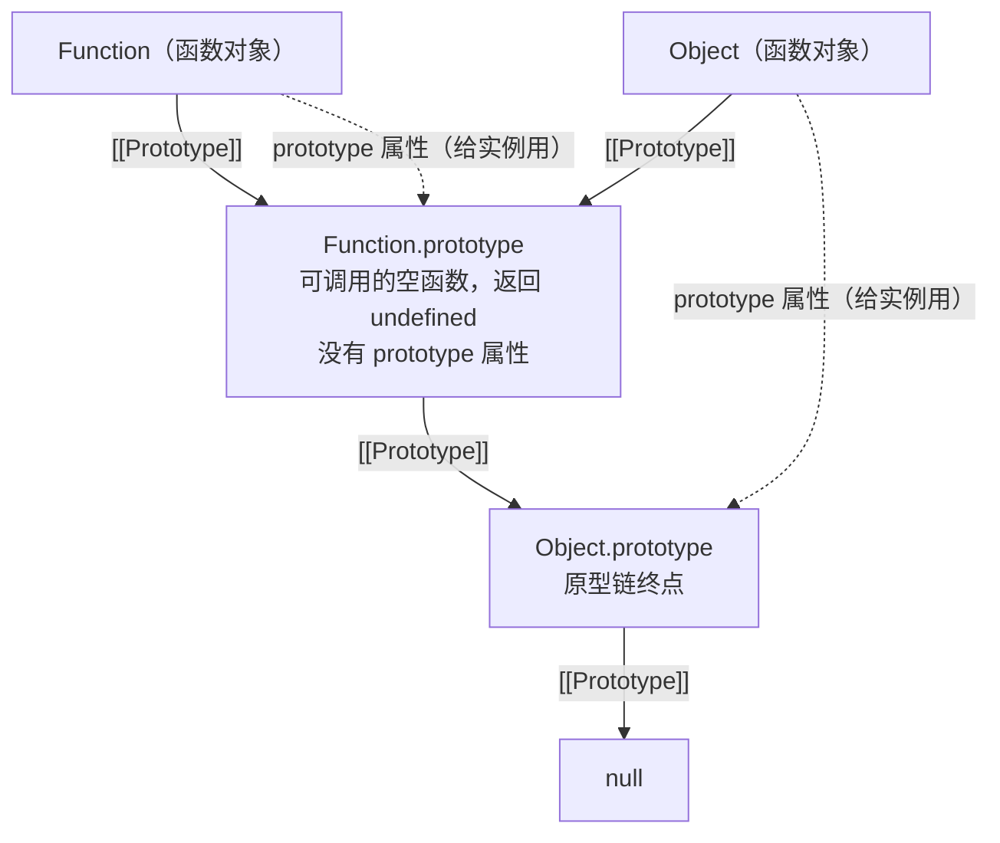
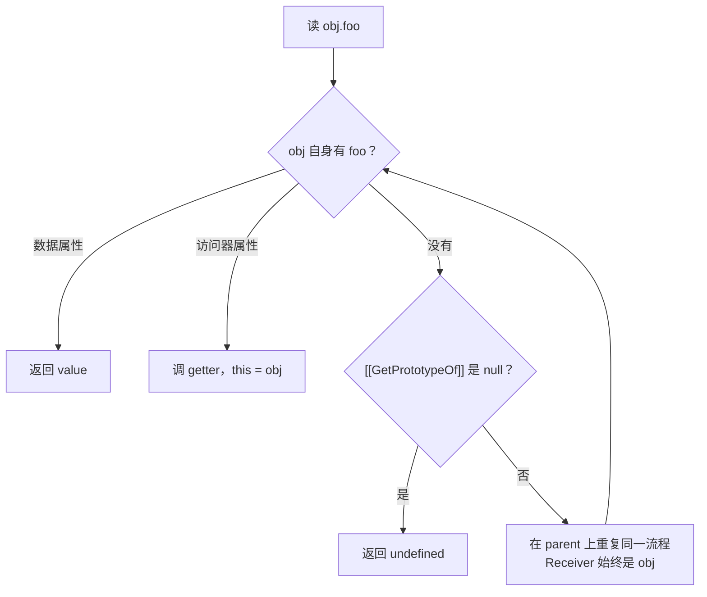
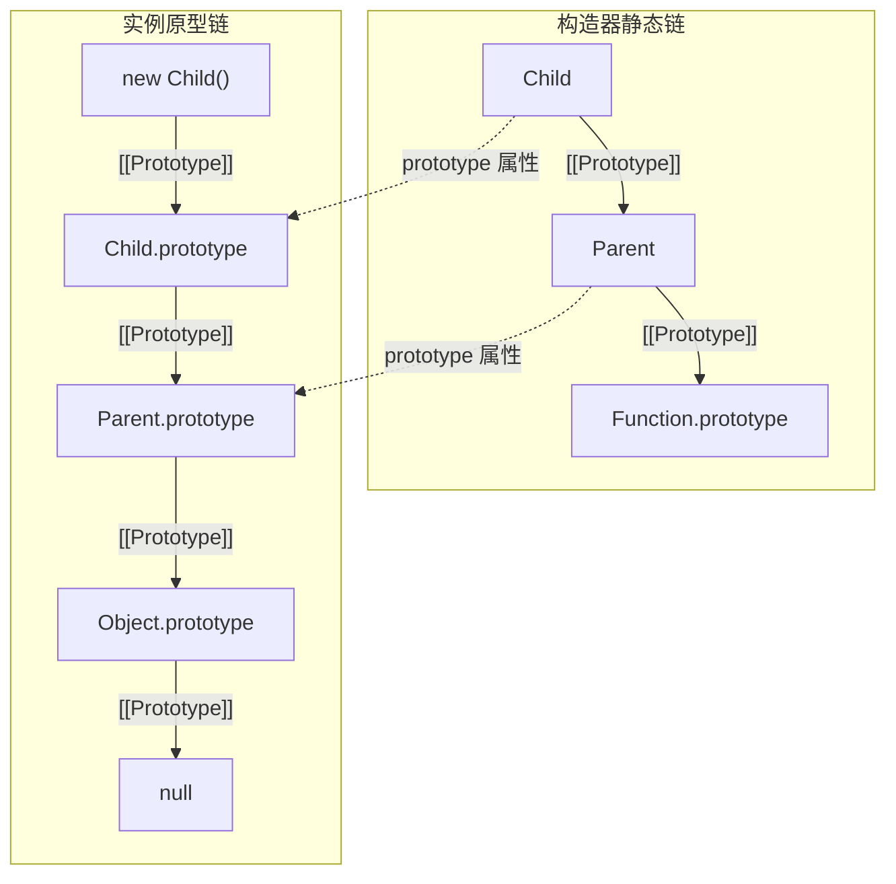
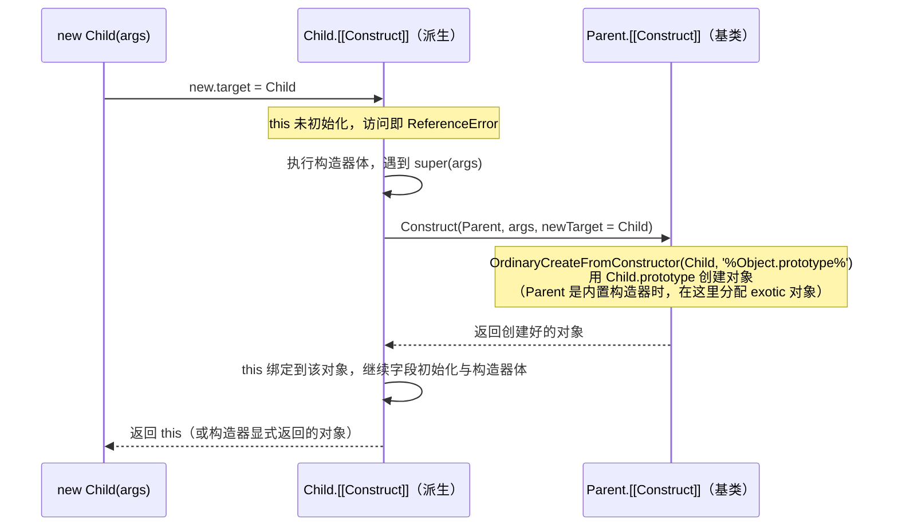
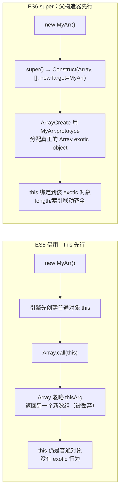
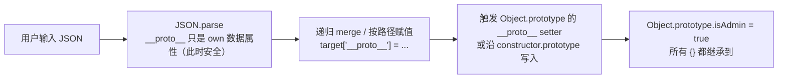

# 原型链与继承演进

> 一句话概括：JavaScript 的继承自始至终只有一套机制——**原型链**；从 ES5 的六种继承写法到 ES6 class，变的不是查找规则，而是「**谁来创建对象、原型链在什么时候接好**」。本文讲清三件套关系、查找与赋值的规范步骤、继承方案的演进逻辑、class 的真实语义，以及原型链污染与性能这两条工程边界。

预计阅读时间：大约 90 分钟

所属主题：[JavaScript 基础常见面试题总结](summary.md)

本文以 **ECMAScript ES2025** 为规范基线，浏览器以当前 Chrome/V8 为准，Node.js 以 22/24 LTS 为准。规范锚点用 ECMA-262 抽象操作/内置方法名标注，章节号按 ES2025 快照（`tc39.es/ecma262/2025/`）给出，随版本可能变动，以锚点名为准。所有示例均在 Node.js 实测通过（本地 v20.11.1；所验证行为自 ES2015–ES2022 起稳定，与 22/24 一致），规范算法已对照 ES2025 快照原文复核。

---

## 0. 阅读路线

| 读者 | 建议阅读 | 关注点 |
| --- | --- | --- |
| 初级（1 年内） | 1、2.1、3.1、5（代码 + 缺点表）、6.1~6.2 | 三件套是什么、查找怎么走、六种继承各自的坑、class 怎么写 |
| 中级（1~3 年） | 全部，重点 2.2~2.3、3.2~3.3、5.6、6.3~6.5、7 | 赋值规则、手写 instanceof、寄生组合式为什么最优、super 与双链、内置子类化 |
| 高级（3 年+） | 2.2 规范步骤、3.2 规范步骤与两条路径、6.4 super 机制、7.2 exotic 分配、8 | [[Get]]/[[Set]] 算法、OrdinaryHasInstance、[[Construct]] 与 new.target、原型链污染 |
| 选型/架构 | 4.2、5.6、6.6、8，重点每节「边界/代价」 | setPrototypeOf 性能账、class 不是纯语法糖、污染防御与原型修改代价 |

目录：

1. 三件套：prototype、`__proto__`、constructor
2. 原型链查找与赋值规则
3. instanceof：原理、手写与失效边界
4. Object.create 与 setPrototypeOf 的性能警告
5. 继承演进六方案
6. ES6 class：是语法糖，但不只是语法糖
7. 内置对象子类化：ES5 为什么不行，ES6 为什么行
8. 边界与安全：原型链污染与性能代价
9. 高频追问集
10. 参考资料

---

## 1. 三件套：prototype、`__proto__`、constructor

### 1.1 结论与分工

**结论**：三个名字指向两条不同的链——`prototype` 是**函数**的属性，决定「它 new 出来的实例继承谁」；`__proto__`（标准 API 是 `Object.getPrototypeOf`）是**对象**的原型指针，决定「我自己继承谁」；`constructor` 只是原型对象上一个指回函数的普通属性，**不参与任何运行时机制**。

| 名字 | 属于谁 | 本质 | 作用 |
| --- | --- | --- | --- |
| `prototype` | 函数（**箭头函数、绑定函数、类方法没有**） | 函数的 own 数据属性，值是一个对象 | `new F()` 时，实例的 [[Prototype]] 取自 `F.prototype`（经 `GetPrototypeFromConstructor`） |
| `__proto__` | 几乎所有对象（经 `Object.prototype` 继承） | **访问器属性**（get/set），Annex B 历史遗留 | get 调 `[[GetPrototypeOf]]`，set 调 `[[SetPrototypeOf]]`；标准用法是 `Object.getPrototypeOf` / `Object.setPrototypeOf` |
| `constructor` | 原型对象（如 `F.prototype`） | 普通数据属性，默认指回 `F` | 仅「注明出身」，可被改写、可丢失，**不能用于可靠的类型判断** |

`prototype` 属性的描述符也有讲究（实测）：

```js
// 环境：browser / Node
function F() {}
Object.getOwnPropertyDescriptor(F, 'prototype');
// { value: F.prototype, writable: true,  enumerable: false, configurable: false }
Object.getOwnPropertyDescriptor(class C {}, 'prototype');
// { value: C.prototype, writable: false, enumerable: false, configurable: false }
```

普通函数的 `prototype` **可写**（可以整体替换，这正是 ES5 继承的操作空间）；class 的 `prototype` **不可写**（不能整体替换，只能改它上面的属性）。两者都不可枚举、不可配置。

### 1.2 `__proto__` 的版本归属（高频扣分点）

`Object.prototype.__proto__` 是一个 `{ [[Enumerable]]: false, [[Configurable]]: true }` 的访问器属性：

- **ES2015–ES2021**：定义在 **Annex B**（B.2.2.1，`sec-object.prototype.__proto__`），属于「为 Web 浏览器兼容而保留的规范性可选特性」；
- **ES2022 起**：移入**正文 20.1.3.8**（get：20.1.3.8.1，set：20.1.3.8.2），仍标记 **Normative Optional, Legacy**。

也就是说「`__proto__` 是 Annex B 特性」这句话在 ES2022 之后要修正为「**历史上在 Annex B，现在是正文中标记 Legacy 的可选特性**」。无论哪个版本，标准都推荐用 `Object.getPrototypeOf` / `Object.setPrototypeOf` 替代直接读写 `__proto__`。

两个 setter 的行为差异（实测，容易忽略）：

```js
// 环境：browser / Node
const o = {};
o.__proto__ = 42;                      // 静默忽略：proto 不是对象/null 时直接 return undefined
Object.getPrototypeOf(o) === Object.prototype; // true，原型没变
Object.setPrototypeOf(o, 42);          // TypeError：proto 必须是对象或 null
```

`__proto__` 的 setter 对非对象值**静默忽略**（规范步骤：`If proto is not an Object and proto is not null, return undefined`）；`Object.setPrototypeOf` 则**抛 TypeError**。另外 `Object.setPrototypeOf` 对已被 `Object.preventExtensions` 的对象（原型不可变）设置**不同**原型会抛 TypeError，设置相同原型则正常返回。

### 1.3 Function / Object 的「鸡生蛋」关系

**结论**：`Function` 和 `Object` 都是函数对象，它们的 [[Prototype]] 都指向 `Function.prototype`；而 `Function.prototype` 本身是个**可调用的空函数**，它的 [[Prototype]] 指向 `Object.prototype`；`Object.prototype` 是原型链终点，[[Prototype]] 为 `null`。这不是循环，而是引擎启动时一次性构造好的内置对象图。



实线是「这个函数对象自己继承谁」，虚线是「它 new 出来的实例继承谁」——**两条边方向不同，是理解三件套的关键**。

```js
// 环境：browser / Node（全部实测为 true）
Function.__proto__ === Function.prototype;        // Function 继承 Function.prototype
Object.__proto__ === Function.prototype;          // Object 也是函数，同样继承它
Function.prototype.__proto__ === Object.prototype;
Object.prototype.__proto__ === null;              // 链的终点
typeof Function.prototype;                        // 'function'（是个空函数）
Function.prototype();                             // undefined（可调用）
'prototype' in Function.prototype;                // false（它没有 prototype 属性）
Function instanceof Object;                       // true
Object instanceof Function;                       // true
```

**机制**：`Function.prototype` 不是「由 Function 构造出来的」——它是引擎按规范直接创建的内置对象（一个没有 [[Construct]]、调用返回 undefined 的函数对象），然后被用作所有函数对象的 [[Prototype]]。所谓「鸡生蛋」只是内置对象初始化的自举，运行期不存在循环依赖。

**边界/代价**：

- 箭头函数、`Function.prototype.bind` 产生的绑定函数、类的方法都**没有 own `prototype` 属性**（实测 `Object.hasOwn(() => {}, 'prototype') === false`），因此都不能当构造器用（`new` 会抛 TypeError）；
- `Object.create(null)` 创建的对象不继承 `Object.prototype`，因此**没有 `__proto__` 访问器、没有 `constructor`、没有 `toString`**（见 8.3）。

**追问：为什么 `Function.prototype` 是个函数而不是普通对象？** 因为规范要求所有函数对象（包括内置构造器）的 [[Prototype]] 统一指向它，让它具备函数的基本行为（可调用、有 `call`/`apply`/`bind` 的来源）最自洽；它被刻意做成「调用返回 undefined、没有 prototype」的空壳，避免被误当构造器。

---

## 2. 原型链查找与赋值规则

### 2.1 读取：OrdinaryGet 与属性遮蔽

**结论**：读属性沿「own property → [[GetPrototypeOf]] 链 → null」查找，找到第一个就停（**属性遮蔽**）；走到 null 返回 `undefined`，不报错。

**机制**（规范锚点：`OrdinaryGet`，ES2025 10.1.8.1，`sec-ordinaryget`）：

```text
OrdinaryGet(O, P, Receiver):
1. desc = O.[[GetOwnProperty]](P)
2. desc 为 undefined → parent = O.[[GetPrototypeOf]]()
   - parent 为 null → 返回 undefined
   - 否则返回 parent.[[Get]](P, Receiver)   ← Receiver 不变，仍是原对象
3. desc 是数据属性 → 返回 desc.[[Value]]
4. desc 是访问器属性 → 调用 getter，this = Receiver
```



两个要点：**Receiver 始终是发起读取的那个对象**（所以原型上 getter 里的 `this` 指向实例，不是原型）；查找是「第一个命中即停」，own 属性会遮蔽原型上的同名属性。

```js
// 环境：browser / Node
const proto = { greet() { return 'hi'; }, tag: 'proto' };
const obj = Object.create(proto);
obj.tag = 'own';                       // 创建 own 属性，遮蔽原型
obj.greet();                           // 'hi'，沿链找到
obj.missing;                           // undefined，走到 null
Object.getPrototypeOf(obj) === proto;  // true
```

### 2.2 写入：OrdinarySetWithOwnDescriptor 的完整决策

**结论**：赋值**不是**「读一遍链再写 own」那么简单。原型链上有 **setter** 时调用 setter（不创建 own 属性）；原型链上有 **writable: false 的数据属性**或**只有 getter** 时赋值**失败**（sloppy 静默、strict 抛 TypeError），同样不创建 own 属性。只有「链上完全没有该属性」或「链上是可写数据属性且 receiver 无 own」时，才在 receiver 上创建 own 属性形成遮蔽。

**机制**（规范锚点：`OrdinarySetWithOwnDescriptor`，ES2025 10.1.9.2，`sec-ordinarysetwithowndescriptor`）决策表：

| 情形 | 结果 |
| --- | --- |
| own 数据属性，writable: true | 更新 own 值 |
| own 数据属性，writable: false | 返回 false（sloppy 静默失败 / strict 抛 TypeError） |
| own 访问器属性，有 setter | 调 setter，`this = Receiver` |
| own 访问器属性，只有 getter | 返回 false |
| 无 own，原型链上是 writable: false 的数据属性 | 返回 false，**不创建 own 属性** |
| 无 own，原型链上有 setter | 调原型上的 setter，`this = Receiver`（原对象），**不创建 own 属性** |
| 无 own，原型链上只有 getter | 返回 false |
| 链上完全没有该属性 | `CreateDataProperty(Receiver, P, V)`，创建 own 属性（遮蔽） |

注意第 6 行：setter 是在**原型**上找到的，但调用时 `this` 是**发起赋值的原对象**——所以 setter 内部 `this.x = v` 会在原对象上创建 own 属性。这是「原型控制写入逻辑」的设计意图。

```js
// 环境：browser / Node（strict 下实测）
// ① 原型有 setter：赋值走 setter，不产生 own 属性
const p1 = { set foo(v) { console.log('setter:', v, this === c1); } };
const c1 = Object.create(p1);
c1.foo = 42;                    // 'setter: 42 true'
Object.hasOwn(c1, 'foo');       // false

// ② 原型 writable:false：赋值失败，不产生遮蔽
const p2 = Object.defineProperty({}, 'bar', { value: 1, writable: false });
const c2 = Object.create(p2);
c2.bar = 2;                     // strict 抛 TypeError；sloppy 静默失败
c2.bar;                         // 1
Object.hasOwn(c2, 'bar');       // false

// ③ 原型只有 getter：赋值同样失败
const p3 = { get baz() { return 9; } };
const c3 = Object.create(p3);
c3.baz = 100;                   // strict 抛 TypeError
Object.hasOwn(c3, 'baz');       // false
// 想强制遮蔽，用 defineProperty（不走 [[Set]]，不触发 setter）
Object.defineProperty(c3, 'baz', { value: 100, writable: true, configurable: true, enumerable: true });
c3.baz;                         // 100，own 属性
```

**边界/代价**：「赋值一定创建 own 属性」是错误直觉——②③两种情形下赋值被原型「 veto 」，且 sloppy 模式**不报任何错**，是隐蔽 bug 源。`Object.defineProperty` 走 `[[DefineOwnProperty]]`，绕开整套 [[Set]] 规则，这也是它既能强制遮蔽、又被用于污染防御（8.1）的原因。属性描述符与拷贝的完整规则见 [对象属性与拷贝](objects-properties-and-copy.md)。

**追问：为什么原型链上有 setter 时赋值不创建 own 属性？** 规范把「写入控制权」交给原型：setter 存在即表示原型要接管写入（校验、响应式追踪、日志等），若还创建 own 属性，下次写入就绕过 setter 了。Vue 2 的响应式、各种「受保护属性」都依赖这条规则。

### 2.3 own 判断：hasOwnProperty 的坑与 Object.hasOwn

**结论**：判断 own 属性用 **`Object.hasOwn(obj, key)`（ES2022，20.1.2.14）**，不要用 `obj.hasOwnProperty(key)`。

`hasOwnProperty` 有两个实测坑：

```js
// 环境：browser / Node
// 坑1：Object.create(null) 没有继承到 hasOwnProperty
const dict = Object.create(null);
dict.hasOwnProperty;            // undefined，调用直接 TypeError

// 坑2：own 属性可以遮蔽 hasOwnProperty 本身
const shadow = { hasOwnProperty: () => 'fake' };
shadow.hasOwnProperty('x');     // 'fake'，方法被劫持
Object.hasOwn(shadow, 'hasOwnProperty'); // true，静态方法不受影响
```

各「有没有属性」手段的口径：

| 手段 | 范围 | 备注 |
| --- | --- | --- |
| `Object.hasOwn(obj, k)` | own（含不可枚举） | ES2022，静态、安全，推荐 |
| `obj.hasOwnProperty(k)` | own | 可被遮蔽/null 原型失效，遗留写法 |
| `k in obj` | own + 整条原型链 | 含不可枚举 |
| `Object.keys(obj)` | own **可枚举**字符串键 | 不含 Symbol、不含原型 |
| `for...in` | own + 原型链的**可枚举**字符串键 | class 方法不可枚举，所以遍历 class 实例看不到方法（对比 ES5 原型赋值） |

---

## 3. instanceof：原理、手写与失效边界

### 3.1 结论

**结论**：`obj instanceof C` 判断的是「**`C.prototype` 是否出现在 `obj` 的原型链上**」，而不是「obj 是否由 C 构造」。它沿链查找，与对象怎么来的无关；原始值一律 false。

### 3.2 机制：InstanceofOperator → OrdinaryHasInstance

规范锚点：`InstanceofOperator`（ES2025 13.10.2，`sec-instanceofoperator`）→ `OrdinaryHasInstance`（7.3.21，`sec-ordinaryhasinstance`）。

```text
InstanceofOperator(V, target):
1. target 不是对象 → 抛 TypeError
2. hook = GetMethod(target, Symbol.hasInstance)
3. hook 存在 → 返回 ToBoolean(hook.call(target, V))   ← 定制优先
4. IsCallable(target) 为 false → 抛 TypeError          ← 非 callable RHS 在这里出局
5. 返回 OrdinaryHasInstance(target, V):
   a. IsCallable(target) 为 false → 返回 false（仅直达 @@hasInstance 调用可达，见下）
   b. target 有 [[BoundTargetFunction]] 槽 → 委托绑定目标递归判断
   c. V 不是对象 → 返回 false（原始值在这里出局）
   d. P = Get(target, 'prototype')；P 不是对象 → 抛 TypeError
   e. 循环：V = V.[[GetPrototypeOf]]();
      V 为 null → false；SameValue(P, V) → true
```

**规范与引擎一致：非 callable 的 RHS 抛 TypeError**。`InstanceofOperator` 第 4 步的 `IsCallable` 检查就是引擎报「Right-hand side of 'instanceof' is not callable」的来源，规范 Note 明言第 4/5 步是为兼容没有 `Symbol.hasInstance` 的旧版本而保留；MDN 的「invalid 'instanceof' operand」错误页（2025-07 更新）也记录 V8/Firefox/Safari 行为一致。

**那 OrdinaryHasInstance 第 a 步的 return false 给谁用？** 它还有另一个调用方：`Function.prototype[Symbol.hasInstance]`（20.2.3.6）直接执行 `Return OrdinaryHasInstance(thisValue, V)`，**不经过** InstanceofOperator 的 IsCallable 检查。同一个「非 callable」输入，两条路径结果不同（实测）：

```js
// 环境：browser / Node
({}) instanceof {};   // TypeError：InstanceofOperator 第 4 步抛错
Function.prototype[Symbol.hasInstance].call({}, {}); // false：直达 OrdinaryHasInstance，命中第 a 步 return false
```

面试答「不可调用且无 `Symbol.hasInstance` 的 RHS 抛 TypeError（规范与引擎一致）」，能补一句「OrdinaryHasInstance 自身的 return false 只服务于直接调用 `Function.prototype[Symbol.hasInstance]`，instanceof 运算符路径走不到」体现对规范的精确理解。

其余边界（全部实测）：

```js
// 环境：browser / Node
'str' instanceof String;                 // false（原始值）
new String('s') instanceof String;       // true（包装对象）
Object.create(null) instanceof Object;   // false（链直接到 null）

function F() {}
F.prototype = 42;                        // prototype 改成非对象
const f = new F();
Object.getPrototypeOf(f) === Object.prototype; // true！new 时回退到 %Object.prototype%
f instanceof F;                          // TypeError：Get(F,'prototype') 不是对象

function G() {}
const g = new G();
G.prototype = {};                        // 事后整体替换 prototype
g instanceof G;                          // false：旧实例的链还指向旧 prototype

const fake = Object.create(G.prototype);
fake instanceof G;                       // true：从没被 G 构造过，照样通过
```

`new F()` 的回退行为锚点：`GetPrototypeFromConstructor`（10.1.14）——`prototype` 不是对象时，取**该函数所在 realm** 的 `intrinsicDefaultProto`（普通构造器是 `%Object.prototype%`）。这解释了一个反直觉现象：**prototype 被改成原始值后，new 出来的对象原型是 Object.prototype，但 instanceof 反而抛错**——new 和 instanceof 取 prototype 的时机与回退规则不同。

绑定函数没有 `prototype` 属性，原生 instanceof 通过内部槽 `[[BoundTargetFunction]]` 委托目标函数判断（`new (F.bind(null))() instanceof F === true`，实测）；这个槽 JS 层拿不到，手写版无法完全模拟（见 3.3）。

### 3.3 手写 myInstanceof

```js
// 环境：browser / Node
function myInstanceof(obj, Ctor) {
  // 1) RHS 必须是对象（InstanceofOperator 第 1 步）
  if (Ctor === null || (typeof Ctor !== 'object' && typeof Ctor !== 'function')) {
    throw new TypeError("Right-hand side of 'instanceof' is not an object");
  }
  // 2) Symbol.hasInstance 定制优先
  const hook = Ctor[Symbol.hasInstance];
  if (typeof hook === 'function') return Boolean(hook.call(Ctor, obj));
  // 3) 无定制时 RHS 必须可调用（InstanceofOperator 第 4 步：IsCallable 为 false → 抛 TypeError）
  if (typeof Ctor !== 'function') {
    throw new TypeError("Right-hand side of 'instanceof' is not callable");
  }
  // 4) 原始值一律 false
  if (obj === null || (typeof obj !== 'object' && typeof obj !== 'function')) return false;
  // 5) Ctor.prototype 必须是对象
  const target = Ctor.prototype;
  if (target === null || typeof target !== 'object') {
    throw new TypeError('Function has non-object prototype in instanceof check');
  }
  // 6) 沿 [[GetPrototypeOf]] 链查找；null 原型自然走到 null 返回 false
  let proto = Object.getPrototypeOf(obj);
  while (proto !== null) {
    if (proto === target) return true;
    proto = Object.getPrototypeOf(proto);
  }
  return false;
}

// 验证（实测输出）
function Foo() {}
const foo = new Foo();
myInstanceof(foo, Foo);                     // true
myInstanceof(foo, Object);                  // true
myInstanceof('str', String);                // false（原始值）
myInstanceof(Object.create(null), Object);  // false（null 原型）
class Brand { static [Symbol.hasInstance](x) { return x?._brand === 'B'; } }
myInstanceof({ _brand: 'B' }, Brand);       // true（走定制钩子）
```

**已知局限**：绑定函数（`F.bind(null)`）没有 own `prototype`，原生 instanceof 靠 `[[BoundTargetFunction]]` 内部槽委托目标，JS 层无法读取该槽，手写版会在第 5 步抛 TypeError 而非委托——这是「手写只能逼近、不能等价」的边界，面试主动说出来比假装完备更好。

### 3.4 失效边界与类型判断选型

**跨 realm 失效**（实测，用 Node `vm` 模块构造新 realm，等价于浏览器 iframe）：

```js
// 环境：Node
const vm = require('vm');
const otherArr = vm.runInNewContext('[]');
otherArr instanceof Array;                  // false：两个 realm 的 Array.prototype 不是同一个对象
Array.isArray(otherArr);                    // true：判断 exotic 内部结构，与 realm 无关
Object.prototype.toString.call(otherArr);   // '[object Array]'：同样跨 realm 可用
```

浏览器里 `iframe.contentWindow.Array` 与父窗口 `Array` 是两套内置对象，`[] instanceof iframeArr` 为 false。判数组用 `Array.isArray`，判内置类型用 `Object.prototype.toString.call`，详见 [类型与隐式转换](types-and-coercion.md)。

**伪装与私有字段 brand check**（实测）：`Object.create(C.prototype)` 能骗过 instanceof，但骗不过私有字段——私有字段以「brand」内部槽标记真正的实例：

```js
// 环境：browser / Node
class Secret {
  #v = 1;
  static read(x) { return x.#v; }
  static hasBrand(x) { return #v in x; }   // ES2022 私有字段 in 判断
}
const fake = Object.create(Secret.prototype);
fake instanceof Secret;        // true（伪装成功）
Secret.read(fake);             // TypeError：私有字段 brand check 失败
Secret.hasBrand(fake);         // false
Secret.hasBrand(new Secret()); // true
```

需要「真正由本类构造」的语义时，用 `#field in obj` 做 brand check，或自定义 `Symbol.hasInstance`（注意子类会继承该静态钩子造成误判，需 `this === C` 守卫，MDN 有专门示例）。另外 `Function.prototype[Symbol.hasInstance]` 本身 **writable: false、configurable: false**（实测），规范刻意锁死它，防止通过篡改暴露绑定函数的目标。

**四种类型判断手段对比**：

| 手段 | 判断什么 | 适用 | 失效/边界 |
| --- | --- | --- | --- |
| `typeof` | 原始类型 + function | 快速区分 number/string/boolean/undefined/symbol/bigint/function | `null → 'object'`；数组/Date/RegExp 都是 `'object'`；跨 realm 一致 |
| `instanceof` | 原型链上有无 `C.prototype` | 自定义类/构造器的实例判断 | 原始值 false；跨 realm 失效；可被改原型/`Symbol.hasInstance` 欺骗；null 原型 false |
| `Object.prototype.toString.call` | 内置类型标签 | 精确区分 Array/Date/RegExp/Null/Undefined 等，跨 realm 可用 | 自定义类一律 `[object Object]`；可被 `Symbol.toStringTag` 伪造 |
| `Array.isArray` | 是否 Array exotic object | 判数组的唯一可靠方式 | 只判数组；跨 realm 可用 |

**追问：instanceof 和 typeof 怎么选？** typeof 判原始类型（注意 null 的历史 bug），instanceof 判「是不是某个构造器体系的实例」，toString.call 判内置对象具体种类，Array.isArray 专判数组。四者不是竞争关系，是各管一段。

---

## 4. Object.create 与 setPrototypeOf 的性能警告

### 4.1 Object.create：创建时定原型

**结论**：`Object.create(proto, propertiesObject)`（ES5，20.1.2.2）创建新对象并**在创建时**把 [[Prototype]] 设为 `proto`（必须是对象或 null，否则 TypeError）；第二参数按描述符定义 own 属性。这是「设置原型」的推荐方式——原型在对象诞生时就定好，引擎可以据此建立稳定的优化假设。

```js
// 环境：browser / Node
const proto = { inherited: 1 };
const obj = Object.create(proto, {
  own: { value: 42, enumerable: true },   // 描述符形式，默认 writable/configurable 为 false
});
obj.own;          // 42
obj.inherited;    // 1
Object.keys(obj); // ['own']

const dict = Object.create(null);         // 无原型字典，见 8.3
```

ES5 之前没有 `Object.create`，原型式继承用一个空函数模拟（见 5.4），`Object.create` 本质就是把这个模式标准化。

### 4.2 setPrototypeOf：能不用就不用

**结论**：`Object.setPrototypeOf(obj, proto)`（ES2015，20.1.2.23）和 `obj.__proto__ = proto` 都能**事后**改原型，但 MDN 明确警告这是「**当前所有浏览器和 JS 引擎中都非常慢的操作**」，且影响不限于这条语句本身，会波及**所有访问过该对象原型的代码**。官方建议：用 `Object.create` 在创建时定原型，避免事后修改。

MDN 原文（Object.setPrototypeOf 页 Warning）：

> Changing the [[Prototype]] of an object is, by the nature of how modern JavaScript engines optimize property accesses, currently a very slow operation in every browser and JavaScript engine. In addition, the effects of altering inheritance are subtle and far-flung, and are not limited to the time spent in the Object.setPrototypeOf(...) statement, but may extend to **any** code that has access to any object whose [[Prototype]] has been altered.

**机制（V8 为什么慢）**：V8 用 **Shape（隐藏类）+ Inline Cache（IC）+ ValidityCell** 优化属性访问（详见 Mathias_Bynens 的 *JavaScript engine fundamentals: optimizing prototypes*，MDN 官方引用）：

- 原型链接存在 Shape 上，一次 shape 检查同时断言「属性不在实例上」和「原型链接未变」；
- 每个原型对象有独占的 Shape 和一个 **ValidityCell**；原型链上任何一环被修改，相关 ValidityCell 全部失效；
- 原型加载的 IC 缓存了「在哪个原型的哪个偏移找到属性」，命中时只需校验实例 shape + ValidityCell，**跳过整条链**；
- 一旦改原型（`setPrototypeOf`、给 `Object.prototype` 加属性、`delete` 原型属性），ValidityCell 失效 → IC 作废 → 依赖它的所有优化代码回退，且**失效沿链向下传播**：动 `Object.prototype` 会连带 `EventTarget.prototype`、`Node.prototype`……整棵 DOM 原型子树的缓存一起重建。

**边界/代价**：

- 「先加后删」更糟：给 `Object.prototype` 加属性使缓存失效，代码跑一遍重建缓存，再 `delete` 又失效一次——「清理」反而雪上加霜；
- 朴素原型查找需要 `1 + 2N` 次检查（N 为链长），DOM 元素如 `HTMLAnchorElement` 已有 6 层原型，IC 正是为消除这个线性成本而生；
- 可接受的例外：**程序启动早期、热点代码运行前**的一次性原型设置（如 polyfill 安装），此时代码还没被优化，代价最小。运行中频繁改原型是性能事故。

**追问：setPrototypeOf 和 Object.create 都能设原型，为什么前者慢？** Object.create 在对象诞生时定原型，引擎从此假设它不变；setPrototypeOf 打破已有假设，触发 shape 迁移 + ValidityCell 失效 + IC 重建，代价波及所有相关代码，而不只是这一次调用。

---

## 5. 继承演进六方案

**结论**：六种方案是一条「发现问题 → 打补丁」的演进链，每一代解决上一代的一个致命缺陷，直到**寄生组合式**在 ES6 之前达到最优；ES6 class 用「父构造器先创建对象」从根本上换掉了这套手工接线。下面每个方案给可运行代码与实测缺点。

公共父类：

```js
// 环境：browser / Node
function Parent(name) {
  this.name = name;
  this.colors = ['red'];      // 引用类型实例属性
}
Parent.prototype.say = function () { return 'hi ' + this.name; };
```

### 5.1 原型链继承

```js
function Child() {}
Child.prototype = new Parent();          // 子类原型 = 父类实例
const a = new Child(), b = new Child();
a.colors.push('blue');
b.colors;   // ['red', 'blue'] —— 引用属性被所有实例共享！
b.name;     // undefined —— 创建 Child 实例时无法向 Parent 传参
```

| 优点 | 致命缺点 |
| --- | --- |
| 方法复用（say 在链上） | ① 引用类型实例属性被所有实例共享；② 无法在 new Child 时向 Parent 传参 |

### 5.2 借用构造器

```js
function Child(name) {
  Parent.call(this, name);               // 在子类构造器里调父类，this 绑定子类实例
}
const c = new Child('tom');
c.colors;   // ['red']，每个实例独立
c.say;      // undefined —— 原型链根本没接，方法拿不到
```

| 优点 | 致命缺点 |
| --- | --- |
| 实例属性独立、可传参 | ① 方法定义在构造器内则每个实例复制一份，无法复用；② 父类原型上的方法完全不可见 |

### 5.3 组合继承（伪经典继承）

```js
function Child(name) {
  Parent.call(this, name);               // 第 1 次调用：实例属性
}
Child.prototype = new Parent();          // 第 2 次调用：接原型链
Child.prototype.constructor = Child;
const c = new Child('jerry');
```

实测：Parent 被调用 **2 次**；`Child.prototype` 上多一份冗余 own 实例属性 `['name', 'colors', 'constructor']`（值为 undefined/['red']），遮蔽了本该干净的链。

| 优点 | 致命缺点 |
| --- | --- |
| 实例独立 + 方法复用，ES5 最常用 | 父构造器调用两次；子类原型上残留无用的实例属性 |

### 5.4 原型式

```js
// 不用构造器，直接基于已有对象造新对象
function object(o) {
  function F() {}
  F.prototype = o;
  return new F();
}
// ES5 标准化为 Object.create：
const base = { colors: ['red'], say() { return 'hi'; } };
const a = Object.create(base), b = Object.create(base);
a.colors.push('blue');
b.colors;   // ['red', 'blue'] —— 同样共享引用属性
```

适用：只想让一个对象继承另一个对象，不需要构造器/类型体系。缺点与原型链继承同源：引用属性共享。

### 5.5 寄生式

```js
function createAnother(original) {
  const clone = Object.create(original);  // 原型式创建
  clone.sayHi = function () { return 'hi'; };  // 再「增强」：加方法
  return clone;
}
const a = createAnother(base), b = createAnother(base);
a.sayHi === b.sayHi;   // false —— 每个实例各造一份方法
```

适用：工厂函数批量造「带额外能力的对象」。缺点与借用构造器同源：方法无法复用。

### 5.6 寄生组合式（ES6 前最优）

```js
function inheritPrototype(Child, Parent) {
  const proto = Object.create(Parent.prototype);  // 关键：用 Object.create 替代 new Parent()
  proto.constructor = Child;                      // 修复 constructor 指向
  Child.prototype = proto;
}
function Child(name) {
  Parent.call(this, name);                        // 唯一一次父构造器调用
}
inheritPrototype(Child, Parent);
const c = new Child('spike');
c.say();                  // 'hi spike'
c instanceof Parent;      // true
Object.keys(Child.prototype); // ['constructor'] —— 原型干净，无冗余实例属性
```

**为什么最优**（实测对照）：

| 维度 | 组合继承 | 寄生组合式 |
| --- | --- | --- |
| 父构造器调用次数 | 2 | **1** |
| 子类原型 own 属性 | name/colors/constructor（冗余） | **仅 constructor** |
| 实例属性独立 | ✓ | ✓ |
| 方法复用 | ✓ | ✓ |
| 原型链完整 | ✓ | ✓ |

它把「接原型链」和「初始化实例属性」彻底解耦：链用 `Object.create(Parent.prototype)` 接（不触发父构造器），实例属性用 `Parent.call(this)` 初始化（只调一次）。**这就是 ES6 之前继承的标准答案**。

**边界**：它仍然依赖 `Parent.call(this)`——对 Array/Error 这类内置构造器无效（call 拿不到 exotic 对象，见第 7 章）。所以「最优」限定在**自定义构造器**范围内。

**追问：为什么寄生组合式是最优？** 它同时满足四个条件且无冗余：父构造器只调一次、实例属性独立、方法复用、原型链干净。组合继承的两次调用和原型冗余正是被 `Object.create(Parent.prototype)` 消掉的。

---

## 6. ES6 class：是语法糖，但不只是语法糖

### 6.1 结论

**结论**：class 底层仍是原型——`typeof C === 'function'`，方法在 `C.prototype` 上，实例沿链查找。但 class **不是纯语法糖**：它附带了一组 ES5 手写原型没有的语义约束（TDZ、自动严格、方法不可枚举、必须 new、prototype 不可写、内置子类化能力）。

### 6.2 验证：class 是特殊函数

```js
// 环境：browser / Node（全部实测）
class C { m() {} }
typeof C;                          // 'function'
Object.keys(C.prototype);          // [] —— 方法不可枚举
Object.getOwnPropertyDescriptor(C.prototype, 'm');
// { value: [Function], writable: true, enumerable: false, configurable: true }

C();                               // TypeError: Class constructor cannot be invoked without 'new'
new (C.prototype.m)();             // TypeError：类方法不可构造
C.prototype = {};                  // strict 抛 TypeError：prototype 不可写

// TDZ：声明提升但未初始化
typeof Before;                     // ReferenceError（函数声明则不会）
class Before {}

// 自动严格模式
class S { m() { return this; } }
const detached = new S().m;
detached();                        // undefined（严格模式 this 不兜底全局）
class S2 { m() { undeclared = 1; } }
new S2().m();                      // ReferenceError（严格模式禁止隐式全局）
```

### 6.3 extends 的双链

**结论**：`extends` 同时接**两条链**——实例链（`Child.prototype.[[Prototype]] = Parent.prototype`）和**构造器静态链**（`Child.[[Prototype]] = Parent`）。后者让静态方法、静态字段自动继承。



```js
// 环境：browser / Node（实测）
class P { static sm() { return 'p-static'; } static count = 7; }  // 静态字段 ES2022
class Q extends P {}
Object.getPrototypeOf(Q) === P;                    // true（静态链）
Object.getPrototypeOf(Q.prototype) === P.prototype; // true（实例链）
Q.sm();          // 'p-static'
Q.count;         // 7（继承静态字段）
Object.hasOwn(Q, 'count');  // false（count 是 P 的 own，Q 沿静态链读到）
```

ES5 要实现静态继承得手动 `Object.setPrototypeOf(Child, Parent)` 或复制静态成员——class 把这一步内置了。

### 6.4 super 的机制：this 由 super 创建

**结论**：基类构造器的 `this` 由引擎在 `[[Construct]]` 里**先创建好**；派生构造器的 `this` **初始未绑定**，必须 `super()` 之后才能用——`super()` 的本质是「让父构造器用**当前 new.target 的原型**创建对象，再把 this 绑上去」。

**机制**（规范锚点：ECMAScript 函数对象的 `[[Construct]]`，ES2025 10.2.2；`OrdinaryCreateFromConstructor` 10.1.13；`GetPrototypeFromConstructor` 10.1.14）：



```js
// 环境：browser / Node（实测）
class Base { constructor() { this.x = 1; } }
class Der extends Base {
  constructor() {
    this.y = 2;        // ReferenceError：super 之前不能用 this
    super();
    this.x;            // 1（super 之后 this 才存在）
  }
}

// new.target：基类构造器里能看到「真正被 new 的是谁」
class NBase { constructor() { console.log(new.target === NDer); } }
class NDer extends NBase {}
new NDer();            // true

// super.method 的 this 仍是当前实例（不是父原型）
class A { constructor() { this.tag = 'a'; } who() { return this.tag; } }
class B extends A {
  constructor() { super(); this.tag = 'b'; }
  test() { return super.who(); }
}
new B().test();        // 'b'

// super.x = v 在 this 上创建 own 属性
class SA {}
class SB extends SA { m() { super.foo = 42; return Object.hasOwn(this, 'foo'); } }
new SB().m();          // true
```

`super.prop` 的查找基不是「父类」这个抽象概念，而是方法的 **[[HomeObject]]**（定义该方法时的对象）的 [[Prototype]]——规范锚点 `GetSuperBase`（9.1.1.3.5）、`MakeSuperPropertyReference`（13.3.7.3）、`GetThisEnvironment`（9.4.3）。所以：

- 实例方法里 `super.x` → `Child.prototype.[[Prototype]]`（即 `Parent.prototype`）上找，**receiver 仍是 this**；
- 静态方法里 `super.x` → `Child.[[Prototype]]`（即 `Parent` 构造器）上找——静态 super 走的是静态链；
- `super()` 只在派生构造器里合法，且把 `new.target` 透传给父构造器，这正是内置子类化能成立的关键（第 7 章）。

**边界/代价**（实测）：

- 派生构造器**显式返回对象**会覆盖 super 创建的 this：`class RD extends RB { constructor() { super(); return { custom: true }; } }`，`new RD()` 得到 `{ custom: true }`，`instanceof RD` 为 **false**；返回原始值则抛 TypeError；
- `class CN extends null` 时 `super()` 抛 TypeError（null 不可构造），构造器必须**手动返回对象**：`constructor() { return Object.create(null); }`；
- 不写构造器时，基类默认 `constructor() {}`，派生默认 `constructor(...args) { super(...args); }`（实测参数透传正常）。

**追问：为什么 super 之前用 this 会报错？** 派生构造器的 this 不是引擎预先创建的，而是 super() 调用父构造器后才绑定的（`GetThisEnvironment` 拿到的 this 绑定处于未初始化状态）。这是为了让父构造器（可能是内置构造器）有机会用正确的 new.target 创建对象——ES5 那套「先有 this 再 call 父类」做不到这一点。this 绑定与调用方式的完整规则见 [this 绑定与函数调用](this-binding-and-function-call.md)。

### 6.5 class 与 ES5 继承对比表

| 维度 | ES5 函数 + prototype | ES6 class |
| --- | --- | --- |
| 本质 | 普通函数对象 | 特殊函数对象（typeof 仍 'function'，[[ConstructorKind]] 分 base/derived） |
| 提升 | 函数声明整体提升，可先调用 | 声明提升但处于 **TDZ**，定义前访问抛 ReferenceError |
| 严格模式 | 取决于外层 | 类体**自动严格** |
| 方法可枚举性 | 赋值到 prototype → 可枚举 | **不可枚举**（writable/configurable 仍 true） |
| 不用 new 调用 | this 指向全局（sloppy）/undefined（strict），不报错 | **TypeError** |
| prototype 属性 | writable: true，可整体替换 | **writable: false**，不可替换 |
| 方法能否 new | 普通函数可以 | 类方法**不可构造** |
| 静态继承 | 手动复制/混入 | extends **自动接静态链** |
| 内置子类化 | 借用构造器拿不到 exotic 对象 | **extends + super 可以**（第 7 章） |
| 实例字段 | 构造器内 `this.x =` | 字段声明 → 实例 own 属性，super 后按序初始化 |

TDZ 与作用域机制见 [作用域、闭包与执行上下文](scope-closures-and-execution-context.md)；class 字段、静态块等 ES2022 特性的版本脉络见 [ES6+ 与现代 JavaScript](es6-plus-and-modern-js.md)。

### 6.6 「class 是纯语法糖吗？」——不完全是

能答出「底层还是原型」只拿一半分。完整答案是：**查找机制是糖，语义约束不是**。class 相对 ES5 手写原型多出的硬语义：

1. 方法不可枚举（ES5 赋值可枚举，`for...in` 行为不同）；
2. TDZ + 自动严格模式；
3. 必须 new 调用，类方法不可构造；
4. prototype 属性不可写；
5. extends 自动接双链 + super 的 this 创建语义；
6. **内置对象子类化能力**（ES5 根本做不到，见第 7 章）——这是「不只是糖」最硬的证据；
7. 私有字段 brand check（`#x in obj`）提供真正的实例身份验证，instanceof 做不到。

---

## 7. 内置对象子类化：ES5 为什么不行，ES6 为什么行

### 7.1 结论

**结论**：Array/Error 等内置构造器创建的是 **exotic object**（带特殊内部行为的对象），这种对象**只能由对应构造器内部的创建算法分配**；ES5 借用构造器（`Array.call(this)`）拿到的是另一个新对象，`this` 仍是普通对象；ES6 `class extends Array` 让 **super 先创建 exotic 对象**再绑定 this，所以能正确继承。

### 7.2 机制：exotic 对象由构造器分配

Array 实例不是「普通对象 + Array.prototype」，而是 **Array exotic object**：它的 `length` 与索引联动由**定制的 [[DefineOwnProperty]]**（ES2025 10.4.2.1）维护，创建算法是 `ArrayCreate`（10.4.2.2，`sec-arraycreate`）——`MakeBasicObject` 后装入 exotic [[DefineOwnProperty]] 和不可枚举、可写的 `length` own 属性。TypedArray 等 integer-indexed exotic object 还有 `[[ArrayLength]]`、`[[ViewedArrayBuffer]]` 等内部槽。**这些 exotic 行为无法通过「改原型」或「call 借用」获得，只能由构造器在创建时分配。**

而 `Array(...)` 作为函数调用时（ES2025 23.1.1.1，`sec-array`）：`NewTarget` 为 undefined → 取**当前活动函数**（Array 自己）→ `GetPrototypeFromConstructor` → `ArrayCreate` 返回**新数组**，**完全忽略 thisArg**。Error 同理：`Error.call(this, msg)` 返回新 Error 对象，message/stack 装在那个新对象上，this 一无所获。



### 7.3 可运行验证

```js
// 环境：browser / Node（全部实测）
// ---- ES5 借用 Array ----
function MyArrES5() { Array.call(this); }
MyArrES5.prototype = Object.create(Array.prototype);
const a5 = new MyArrES5();
a5.push(1);
a5.length;            // 1 —— 看起来「能用」？
Array.isArray(a5);    // false！不是真数组
a5 instanceof Array;  // true（原型链对了，但 exotic 行为没有）

// 假数组的 length 不变量缺失：改 length 不截断元素
const fa = new MyArrES5();
fa.push('a', 'b', 'c');
fa.length = 1;
fa[2];                // 'c' 还在！真数组会截断
const real = ['a', 'b', 'c'];
real.length = 1;
real;                 // ['a']

// ---- ES6 extends Array ----
class MyArr extends Array {}
const a6 = new MyArr();
a6.push(1, 2);
a6.length;            // 2
Array.isArray(a6);    // true
a6 instanceof MyArr;  // true

// ---- ES5 借用 Error ----
function MyErrES5(msg) { Error.call(this, msg); }
MyErrES5.prototype = Object.create(Error.prototype);
const e5 = new MyErrES5('boom');
e5.message;           // ''（message 没装到 this 上）
Object.hasOwn(e5, 'message'); // false

// ---- ES6 extends Error ----
class MyErr extends Error {
  constructor(m) { super(m); this.name = 'MyErr'; }
}
const e6 = new MyErr('boom');
e6.message;           // 'boom'
e6 instanceof Error;  // true
e6.stack.split('\n')[0]; // 'MyErr: boom'

// ---- Reflect.construct：ES6 的等价手动版 ----
const ra = Reflect.construct(Array, [3], MyArr);
Array.isArray(ra);    // true
ra instanceof MyArr;  // true
ra.length;            // 3

// ---- setPrototypeOf 补救：仍然不是真数组 ----
function MyArrPatch() { Object.setPrototypeOf(this, MyArrPatch.prototype); }
MyArrPatch.prototype = Object.create(Array.prototype);
const ap = new MyArrPatch();
ap.push(1);           // push 是通用方法，靠 length 属性「假装」工作
Array.isArray(ap);    // false —— 改原型改不出 exotic 内部结构
```

`a5.push(1)` 之所以「看起来能用」，是因为 `Array.prototype.push` 是**通用方法**（读 this.length、写索引、更新 length），在普通对象上也能跑；但 exotic 的 length/索引联动（截断、2^32-1 上限、稀疏数组行为）全都没有。**「push 能用」不等于「继承成功」**，`Array.isArray` 才是试金石。

### 7.4 边界/代价

- **转译陷阱**：Babel 把 class 转成 ES5 函数后，`extends Array` 退化成借用构造器，子类化失效。需要原生 class 环境，或专门的内置扩展转译插件；
- **Error 栈清理**：V8 可用 `Error.captureStackTrace(this, MyErr)` 把构造器帧从 stack 里去掉（非标准但广泛支持）；
- ES5 时代继承 Error 的常见补丁是手动复制 `message`/`stack` 或 `Object.setPrototypeOf(this, MyErr.prototype)`——后者只修原型链，修不出 exotic 行为，且带 4.2 的性能代价。

**追问：ES6 到底改了什么让内置子类化成立？** 改了**对象创建顺序与归属**：ES5 是「引擎先造普通 this，再 call 父类」（父类无法把 exotic 结构塞进已有 this）；ES6 派生构造器把创建权交给 super，父构造器用 `new.target.prototype` 从头分配对象——内置构造器在这一步分配 exotic 对象，自定义构造器在这一步用子类原型建普通对象。一套机制同时解释了「为什么 class 能继承 Array」和「为什么 super 前不能用 this」。

---

## 8. 边界与安全：原型链污染与性能代价

### 8.1 原型链污染：原理与防御

**结论**：原型链污染（Prototype Pollution）指攻击者通过 `__proto__` / `constructor.prototype` 路径，把属性注入 `Object.prototype` 等公共原型，使**所有对象**都继承到恶意属性（如 `isAdmin: true`），轻则逻辑绕过/DoS，重则 RCE。根源是「递归合并/按路径赋值」把用户可控的键当成了普通属性写入。

**机制**（实测全流程）：



```js
// 环境：Node（实测；演示后请清理或重启进程）
function merge(target, source) {
  for (const key of Object.keys(source)) {
    if (source[key] && typeof source[key] === 'object') {
      target[key] = merge(target[key] || {}, source[key]);  // 递归合并
    } else {
      target[key] = source[key];
    }
  }
  return target;
}

// ① JSON.parse 本身不污染：__proto__ 是 own 数据属性，不触发 setter
const payload = JSON.parse('{"__proto__": {"polluted": "yes"}}');
Object.hasOwn(payload, '__proto__');   // true
({}).polluted;                         // undefined（还没污染）

// ② 递归 merge 触发污染
merge({}, payload);
({}).polluted;                         // 'yes'！所有对象都继承到了

// ③ constructor.prototype 路径
function Victim() {}
merge(new Victim(), JSON.parse('{"constructor": {"prototype": {"p2": "yes"}}}'));
new Victim().p2;                       // 'yes'

// ④ 隐蔽细节：{} 目标走 constructor 路径时，Object.prototype 属性不可写，
//    外层赋值抛 TypeError，但内层递归已经把属性写进 Object.prototype 了
try { merge({}, JSON.parse('{"constructor": {"prototype": {"pX": "yes"}}}')); }
catch (e) { /* TypeError */ }
({}).pX;                               // 'yes' —— 污染在赋值失败前就发生了
```

第④点是高级考点：污染发生在**递归下降过程中**，不依赖最终赋值成功；「赋值抛错了所以安全」是错误判断。

**防御手段**（实测有效性与代价）：

| 手段 | 做法 | 代价/边界 |
| --- | --- | --- |
| 无原型字典 | 合并目标用 `Object.create(null)` 或 `Map` | `__proto__` 变成普通 own 键，不触发 setter（实测不污染）；但失去继承方法（8.3） |
| 键校验 | 拒绝 `__proto__`、`constructor`、`prototype` 键 | 要覆盖所有写入路径（merge/set/omit/unset），漏一个就破防 |
| 冻结原型 | `Object.freeze(Object.prototype)` | 实测 strict 下 merge 抛 TypeError、污染失败；但会破坏合法 polyfill/库扩展，且挡不住对用户类原型的污染 |
| 安全 API | 用 `Object.defineProperty` 写 `__proto__` 键（创建 own 数据属性，不触发 setter，实测）；结构化克隆用 `structuredClone` | defineProperty 语义与赋值不同，需理解 2.2 |
| 升级依赖 | lodash 等库的污染 CVE 已修复 | CVE-2018-3721（<4.17.5，`__proto__` 路径）、CVE-2019-10744（<4.17.12，constructor payload）、CVE-2020-8203（<4.17.20，zipObjectDeep）；持续跟进 |
| 输入校验 | JSON Schema（ajv 等）拒绝危险键 | 校验要放在合并之前 |

**实践**：服务端处理用户 JSON 时，默认用 `Map` 或无原型对象做字典；深合并选已修复的库版本并锁定；把「用户输入 → 递归合并/按路径 set」列为代码评审检查项。

### 8.2 修改原型链与过深链的性能代价

汇总 4.2 的机制，工程口径：

| 操作 | 代价 | 建议 |
| --- | --- | --- |
| `Object.setPrototypeOf` / `__proto__ =` | shape 迁移 + ValidityCell 失效 + IC 重建，波及所有相关代码 | 创建时用 Object.create 定原型 |
| 给 `Object.prototype`/内置原型加属性 | 失效沿链向下传播，整棵子树缓存重建 | 运行期禁止；polyfill 放启动早期 |
| 加了又 delete | 二次失效，比不加更糟 | 不要「临时扩展再清理」 |
| 过深原型链 | 朴素查找 `1+2N` 次检查；IC 命中可跳过，但 miss/多态时线性成本显现 | 控制继承层级（DOM 6 层已是现实上限参考），避免人为堆深链 |
| 同一访问点混用多种原型对象 | IC 从单态退化为多态/超多态 | 保持同类对象原型一致 |

### 8.3 Object.create(null) 的用途与代价

**用途**：纯净字典——没有继承属性，键不会与 `toString`/`constructor`/`__proto__` 冲突，天然免疫原型链污染（8.1 实测）。

**代价**（实测）：

```js
// 环境：browser / Node
const dict = Object.create(null);
dict.toString;                 // undefined
dict.hasOwnProperty;           // undefined → 用 Object.hasOwn(dict, k)
`${dict}`;                     // TypeError：ToPrimitive 找不到 toString/valueOf
dict instanceof Object;        // false
Object.getPrototypeOf(dict);   // null
JSON.stringify(dict);          // 正常（JSON 序列化不依赖原型方法）
```

- 失去一切继承方法：`toString`/`valueOf`/`hasOwnProperty` 都没有，模板字符串/隐式字符串化会抛 TypeError；
- 部分库假设对象有 `Object.prototype` 方法，传入无原型对象可能出错；
- Node `console.log` 显示为 `[Object: null prototype]`，调试时注意区分。

**追问：Object.create(null) 和 {} 怎么选？** 当对象是「键值字典」（键来自外部/不可控）时用 null 原型或 Map；当对象是「有行为的实体」时用 {} 或 class 实例。代价是失去继承便利，收益是纯净与安全。

---

## 9. 高频追问集

**Q1：instanceof、typeof、Object.prototype.toString 各自适用什么？**
期望答案：typeof 判原始类型与 function（null 是历史 bug `'object'`，数组/Date 都是 `'object'`）；instanceof 判「原型链上有没有某构造器的 prototype」，适合自定义类体系，但原始值 false、跨 realm 失效、可被改原型欺骗；toString.call 判内置类型标签（`[object Array]`/`[object Date]`/`[object Null]`），跨 realm 可用，自定义类一律 `[object Object]`，可被 Symbol.toStringTag 伪造；判数组专用 Array.isArray（判 exotic 结构，跨 realm 可靠）。

**Q2：为什么寄生组合式是 ES6 前最优继承？**
期望答案：四个条件全满足且无冗余——父构造器只调一次（`Parent.call(this)`）、实例属性独立、方法复用（链上有）、原型链干净（`Object.create(Parent.prototype)` 替代 `new Parent()`，消掉组合继承的第二次调用和原型上的冗余实例属性）。局限：仍依赖 call 借用，无法子类化 Array/Error 等内置 exotic 对象。

**Q3：class 是纯语法糖吗？**
期望答案：不完全是。查找机制仍是原型（typeof 'function'、方法在 prototype 上），但 class 附加了 ES5 没有的硬语义：方法不可枚举、TDZ、自动严格、必须 new、prototype 不可写、类方法不可构造、extends 双链 + super 创建 this、私有字段 brand check，以及最硬的证据——**能正确子类化内置对象**（ES5 做不到）。

**Q4：Object.create(null) 的用途与代价？**
期望答案：用途是纯净字典，键不与继承属性冲突、免疫原型链污染；代价是没有 toString/valueOf/hasOwnProperty（模板字符串抛 TypeError、要用 Object.hasOwn）、instanceof Object 为 false、部分库不兼容。键来自外部时优先 null 原型或 Map。

**Q5：原型链上有 setter 时，赋值为什么不创建 own 属性？**
期望答案：OrdinarySetWithOwnDescriptor 规定，沿链找到 accessor 且有 setter 时，以 Receiver（原对象）为 this 调用 setter 并返回 true，不走 CreateDataProperty。设计意图是把写入控制权交给原型；setter 内部 `this.x = v` 才会在原对象上建 own 属性。同理原型 writable:false 或只有 getter 时赋值失败（sloppy 静默/strict 抛错），也不建 own。

**Q6：instanceof 跨 realm 为什么失效？怎么解决？**
期望答案：每个 realm（iframe/vm context）有独立的内置对象，`Array.prototype` 不是同一个对象，沿链找不到对方的 prototype。判数组用 Array.isArray，判内置类型用 Object.prototype.toString.call，二者基于内部结构/标签，与 realm 无关。

**Q7：super() 到底做了什么？为什么 super 前用 this 报错？**
期望答案：派生构造器的 this 初始未绑定；super() 执行 Construct(父构造器, args, newTarget=当前 new.target)，父构造器用 newTarget.prototype 创建对象（内置构造器在此分配 exotic 对象），返回后 this 才绑定。所以 super 前访问 this 抛 ReferenceError。super.prop 则走 [[HomeObject]].[[Prototype]]，receiver 仍是 this。

**Q8：ES5 为什么不能正确继承 Array？ES6 改了什么？**
期望答案：Array 实例是 exotic object（定制 [[DefineOwnProperty]] 维护 length/索引联动），只能由 ArrayCreate 分配；ES5 `Array.call(this)` 忽略 thisArg 返回新数组，this 仍是普通对象，push 靠通用方法「假装」工作但 Array.isArray 为 false、length 不截断。ES6 派生构造器把创建权交给 super，父构造器用 new.target.prototype 从头分配 exotic 对象，所以 class extends Array 成立。

**Q9：`__proto__` 是标准吗？和 Object.getPrototypeOf/setPrototypeOf 什么关系？**
期望答案：`__proto__` 是 Object.prototype 上的访问器，get/set 分别调 [[GetPrototypeOf]]/[[SetPrototypeOf]]。ES2015–ES2021 在 Annex B（B.2.2.1），ES2022 起移入正文 20.1.3.8，仍标记 Normative Optional/Legacy。标准用法是 Object.getPrototypeOf/setPrototypeOf。细节差异：`__proto__ = 非对象` 静默忽略，setPrototypeOf 抛 TypeError。

**Q10：原型链污染怎么防？**
期望答案：根源是递归合并/按路径赋值把用户键写进公共原型。防御：字典用 Object.create(null)/Map；拒绝 `__proto__`/`constructor`/`prototype` 键；Object.freeze(Object.prototype)（有破坏 polyfill 的代价）；用 defineProperty/structuredClone 等不触发 setter 的 API；升级 lodash 等已修复 CVE 的依赖；输入 Schema 校验。注意污染发生在递归过程中，外层赋值失败不代表安全。

**Q11：Function.prototype 为什么是函数？Function/Object 谁先谁后？**
期望答案：Function.prototype 是引擎自举创建的内置空函数（可调用返回 undefined、无 prototype 属性），作为所有函数对象的 [[Prototype]]；Function 和 Object 都是函数对象，[[Prototype]] 都指向它；Object.prototype.[[Prototype]] 为 null 是链终点。不是运行期循环依赖，是初始化时一次性构造的对象图。

**Q12：constructor 能用来判断类型吗？**
期望答案：不可靠。constructor 只是原型上的普通属性，可被改写、整体替换 prototype 时会丢失（需手动修复）、跨 realm 不一致，且 Object.create(C.prototype) 的伪装对象 constructor 也指向 C。类型判断用 instanceof/toString.call/Array.isArray 或私有字段 brand check，constructor 仅用于「找回构造器引用」这类弱场景。

---

## 10. 参考资料

**ECMA-262（ES2025 快照，章节号随版本变动，以锚点名为准）**

- OrdinaryGet（10.1.8.1）：<https://tc39.es/ecma262/2025/multipage/ordinary-and-exotic-objects-behaviours.html#sec-ordinaryget>
- OrdinarySetWithOwnDescriptor（10.1.9.2）：<https://tc39.es/ecma262/2025/multipage/ordinary-and-exotic-objects-behaviours.html#sec-ordinarysetwithowndescriptor>
- GetPrototypeFromConstructor（10.1.14）/ OrdinaryCreateFromConstructor（10.1.13）/ [[Construct]]（10.2.2）：同页 `#sec-getprototypefromconstructor`、`#sec-ordinarycreatefromconstructor`、`#sec-ecmascript-function-objects-construct-argumentslist-newtarget`
- ArrayCreate（10.4.2.2）/ Array exotic [[DefineOwnProperty]]（10.4.2.1）：同页 `#sec-arraycreate`
- OrdinaryHasInstance（7.3.21）：<https://tc39.es/ecma262/2025/multipage/abstract-operations.html#sec-ordinaryhasinstance>
- InstanceofOperator（13.10.2）/ super 关键字（13.3.7）/ MakeSuperPropertyReference（13.3.7.3）：<https://tc39.es/ecma262/2025/multipage/ecmascript-language-expressions.html#sec-instanceofoperator>
- GetSuperBase（9.1.1.3.5）/ GetThisEnvironment（9.4.3）：<https://tc39.es/ecma262/2025/multipage/executable-code-and-execution-contexts.html#sec-getsuperbase>
- ClassDefinitionEvaluation（15.7.14）：<https://tc39.es/ecma262/2025/multipage/ecmascript-language-functions-and-classes.html#sec-runtime-semantics-classdefinitionevaluation>
- Object.create（20.1.2.2）/ getPrototypeOf（20.1.2.12）/ hasOwn（20.1.2.14）/ setPrototypeOf（20.1.2.23）/ `__proto__`（20.1.3.8）/ Function.prototype[Symbol.hasInstance]（20.2.3.6）：<https://tc39.es/ecma262/2025/multipage/fundamental-objects.html#sec-object.create>
- Array 构造器（23.1.1.1）：<https://tc39.es/ecma262/2025/multipage/indexed-collections.html#sec-array>
- `__proto__` 历史位置（ES2021 Annex B B.2.2.1）：<https://tc39.es/ecma262/2021/#sec-object.prototype.__proto__>

**MDN**

- instanceof：<https://developer.mozilla.org/en-US/docs/Web/JavaScript/Reference/Operators/instanceof>
- invalid 'instanceof' operand（各引擎报错口径）：<https://developer.mozilla.org/en-US/docs/Web/JavaScript/Reference/Errors/invalid_right_hand_side_instanceof_operand>
- Object.setPrototypeOf（性能警告原文）：<https://developer.mozilla.org/en-US/docs/Web/JavaScript/Reference/Global_Objects/Object/setPrototypeOf>
- Object.create：<https://developer.mozilla.org/en-US/docs/Web/JavaScript/Reference/Global_Objects/Object/create>
- Object.hasOwn：<https://developer.mozilla.org/en-US/docs/Web/JavaScript/Reference/Global_Objects/Object/hasOwn>
- Classes：<https://developer.mozilla.org/en-US/docs/Web/JavaScript/Reference/Classes>
- super：<https://developer.mozilla.org/en-US/docs/Web/JavaScript/Reference/Operators/super>
- Function.prototype[Symbol.hasInstance]：<https://developer.mozilla.org/en-US/docs/Web/JavaScript/Reference/Global_Objects/Function/Symbol.hasInstance>

**V8 原型优化**

- Mathias Bykens, *JavaScript engine fundamentals: optimizing prototypes*（ValidityCell/IC 机制，MDN 官方引用）：<https://mathiasbynens.be/notes/prototypes>

**原型链污染 CVE（已核实修复版本）**

- CVE-2018-3721（lodash <4.17.5）、CVE-2019-10744（lodash <4.17.12）、CVE-2020-8203（lodash <4.17.20）：<https://bugzilla.redhat.com/show_bug.cgi?id=CVE-2019-10744>、<https://security.snyk.io/vuln/SNYK-JAVA-ORGMVNPM-22729304>

**兄弟专题**

- [JavaScript 基础常见面试题总结](summary.md)
- [类型与隐式转换](types-and-coercion.md)（typeof/toString/跨 realm）
- [对象属性与拷贝](objects-properties-and-copy.md)（描述符、[[Set]] 与拷贝）
- [this 绑定与函数调用](this-binding-and-function-call.md)（call/apply 借用、new.target）
- [作用域、闭包与执行上下文](scope-closures-and-execution-context.md)（TDZ、环境记录）
- [ES6+ 与现代 JavaScript](es6-plus-and-modern-js.md)（class 字段/静态块 ES2022、Object.hasOwn 版本脉络）

---

## 附：一页速记

**三件套**
1. prototype 是函数的属性（箭头/绑定/类方法没有），决定实例继承谁；`__proto__` 是对象的原型指针（Object.prototype 上的访问器），标准 API 是 getPrototypeOf/setPrototypeOf；constructor 只是原型上的普通属性，不可靠。
2. Function/Object 的 [[Prototype]] 都是 Function.prototype；Function.prototype 是可调用空函数、无 prototype；Object.prototype.[[Prototype]] = null。
3. `__proto__`：ES2021 在 Annex B（B.2.2.1），ES2022 起入正文 20.1.3.8（Legacy）；`__proto__ = 非对象` 静默忽略，setPrototypeOf 抛 TypeError。

**查找与赋值**
4. 读：own → [[GetPrototypeOf]] 链 → null → undefined；第一个命中即停（遮蔽）；getter 的 this 是 Receiver。
5. 写：原型有 setter → 调 setter（this=原对象），不建 own；原型 writable:false 或只有 getter → 赋值失败（sloppy 静默/strict 抛错），不建 own；链上无属性才建 own。defineProperty 绕开 [[Set]]。
6. own 判断用 Object.hasOwn（ES2022）；hasOwnProperty 会被 null 原型和遮蔽坑掉。

**instanceof**
7. 判「C.prototype 在不在 obj 链上」，不是「是否由 C 构造」；原始值 false；Symbol.hasInstance 定制优先；绑定函数委托目标。
8. 非 callable 且无 @@hasInstance 的 RHS 抛 TypeError（InstanceofOperator 第 4 步，规范与引擎一致）；OrdinaryHasInstance 自身的 return false 仅直达 Function.prototype[Symbol.hasInstance] 调用可达。
9. 跨 realm 失效；判数组 Array.isArray，判内置类型 toString.call；Object.create(C.prototype) 能骗过 instanceof，骗不过私有字段 brand check。

**继承演进**
10. 原型链（共享引用/不能传参）→ 借用构造器（方法不复用）→ 组合（调两次/原型冗余）→ 原型式（Object.create）→ 寄生（方法不复用）→ 寄生组合（Object.create 替代 new Parent，一次调用、链干净，ES6 前最优）。
11. class 不是纯语法糖：方法不可枚举、TDZ、自动严格、必须 new、prototype 不可写、双链 + super、内置子类化。
12. super() = 让父构造器用 new.target.prototype 创建对象再绑 this；super 前 this 抛 ReferenceError；super.prop 走 [[HomeObject]].[[Prototype]]，receiver 仍是 this。

**内置子类化与安全**
13. exotic 对象只能由构造器分配：ES5 Array.call(this) 忽略 thisArg，push「假装」工作但 isArray false、length 不截断；ES6 super 先分配 exotic 对象，class extends Array/Error 成立。
14. setPrototypeOf/改内置原型 → ValidityCell 失效 + IC 重建，波及整棵原型子树；创建时用 Object.create 定原型。
15. 原型链污染：递归 merge 把 `__proto__`/constructor.prototype 写进公共原型；防御用 null 原型/Map、键校验、冻结、安全 API、升级依赖；污染发生在递归中，赋值失败不代表安全。
16. Object.create(null)：纯净字典、免疫污染；代价是没有 toString/hasOwnProperty，模板字符串抛 TypeError。

**一句话**
> JavaScript 继承的全部秘密是「对象创建时原型链怎么接、属性读写沿链怎么走」——ES5 六方案是手工接线的补丁史，class 把接线权交给 super，而原型链污染和性能代价提醒你：这条链既是能力，也是攻击面。